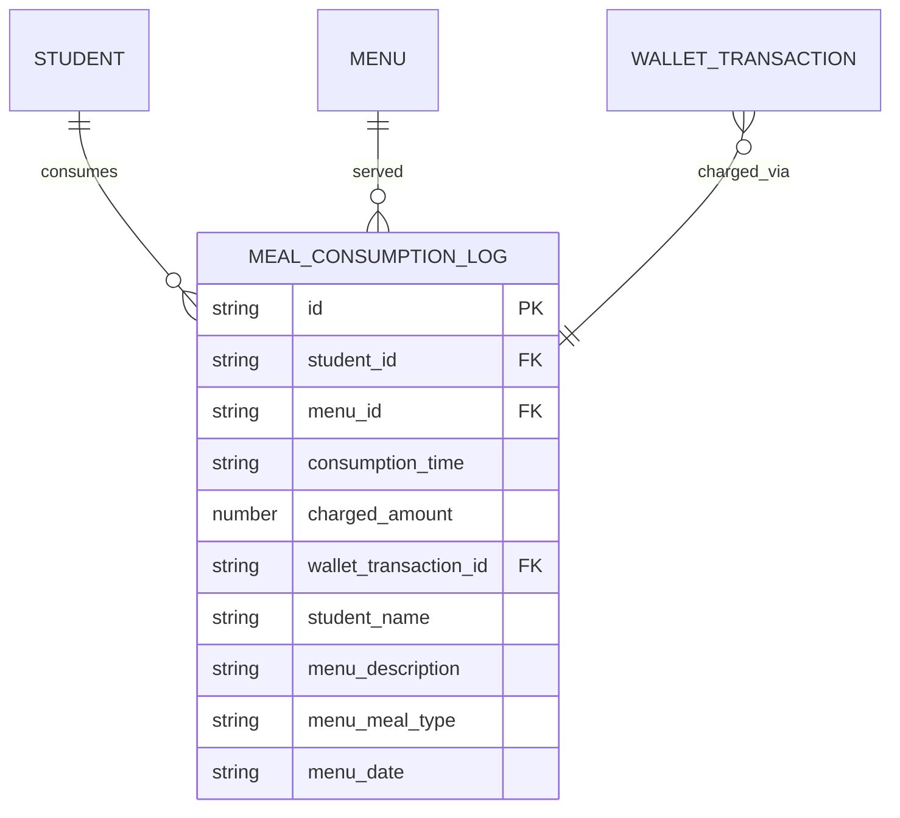
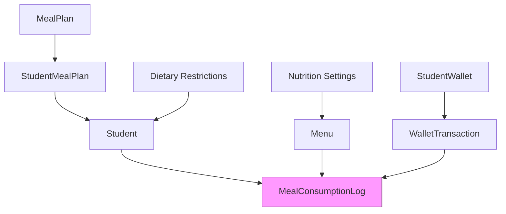
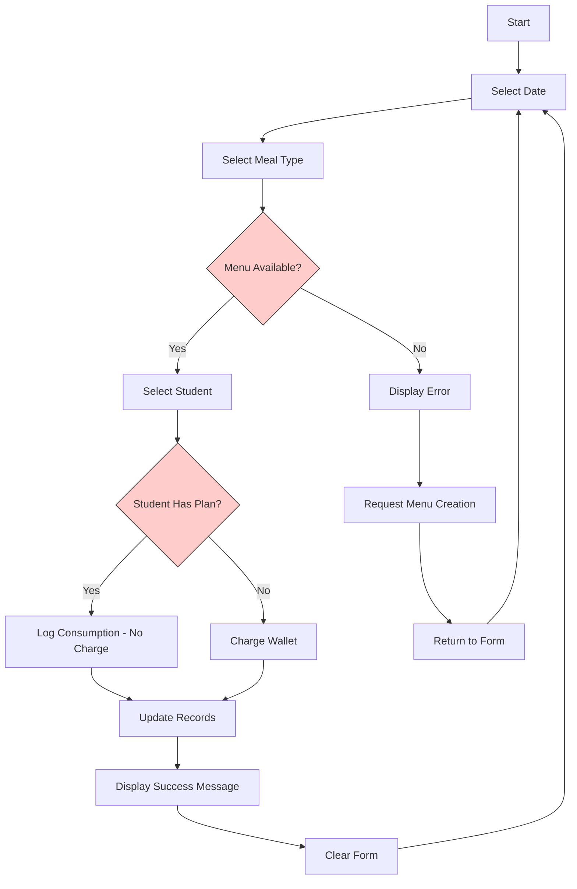
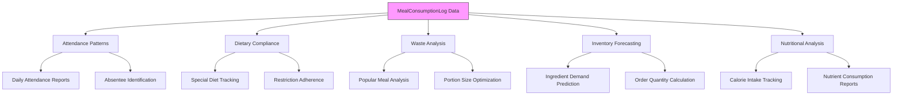

# Meal Consumption Data Model

<cite>
**Referenced Files in This Document**   
- [types.ts](file://src/core/types.ts#L1244-L1256)
- [schema.ts](file://src/modules/nutrition/data/schema.ts#L41-L69)
- [types.ts](file://src/modules/nutrition/data/types.ts#L1-L92)
- [mockData.ts](file://src/modules/nutrition/data/mockData.ts#L83-L93)
- [MealConsumptionLogPage.tsx](file://src/modules/nutrition/pages/MealConsumptionLogPage.tsx#L0-L194)
- [useMealConsumptionLogData.ts](file://src/modules/nutrition/data/useMealConsumptionLogData.ts#L7-L39)
</cite>

## Table of Contents
1. [Introduction](#introduction)
2. [Entity Schema and Fields](#entity-schema-and-fields)
3. [Data Relationships and Context](#data-relationships-and-context)
4. [Time-Series Nature and Data Collection](#time-series-nature-and-data-collection)
5. [Sample JSON Data](#sample-json-data)
6. [User Interface and Data Entry](#user-interface-and-data-entry)
7. [Reporting and Analytics Capabilities](#reporting-and-analytics-capabilities)
8. [Performance Considerations](#performance-considerations)

## Introduction
The MealConsumptionLog entity is a critical component of the school's nutrition management system, designed to track actual meal consumption by students against their planned meals. This documentation provides a comprehensive overview of the entity's structure, functionality, and role within the broader system. The entity captures detailed records of when students consume meals, enabling nutritional analysis, inventory forecasting, and financial tracking. While the documentation objective mentions certain fields like mealPlanId, verifiedBy, staffId, and consumptionStatus, the actual implementation reveals a slightly different schema that focuses on core consumption tracking with denormalized data for performance and reporting purposes.

**Section sources**
- [types.ts](file://src/core/types.ts#L1244-L1256)

## Entity Schema and Fields
The MealConsumptionLog entity is defined with a specific set of fields that capture essential information about each meal consumption event. The schema is implemented in a database-agnostic manner, allowing for flexibility across different storage backends.



**Diagram sources**
- [schema.ts](file://src/modules/nutrition/data/schema.ts#L41-L69)
- [types.ts](file://src/core/types.ts#L1244-L1256)

The entity contains the following fields:

- **logId**: Represented as `id` in the schema, this is a unique identifier for each consumption record, generated as a string.
- **studentId**: The `student_id` field references the student who consumed the meal, establishing a relationship with the student database.
- **menuId**: The `menu_id` field references the specific menu item that was consumed, linking to the menu planning system.
- **consumedAt timestamp**: Captured as `consumption_time`, this field records when the meal was consumed in ISO 8601 format.
- **chargedAmount**: The `charged_amount` field (nullable) indicates the financial charge for the meal, which may be null if the meal is covered by a meal plan.
- **walletTransactionId**: The `wallet_transaction_id` field (nullable) references the specific wallet transaction if payment was made from the student's digital wallet.
- **Denormalized Fields**: The schema includes several denormalized fields for performance and reporting: `student_name`, `menu_description`, `menu_meal_type`, and `menu_date`. These fields duplicate data from related entities to avoid expensive joins during reporting and display.

It's important to note that the actual implementation does not include the `mealPlanId`, `verifiedBy`, `staffId`, or `consumptionStatus` fields mentioned in the documentation objective. Instead, the system determines meal plan coverage through business logic when recording consumption, and verification appears to be implicit in the data entry process rather than tracked with specific staff attribution.

**Section sources**
- [schema.ts](file://src/modules/nutrition/data/schema.ts#L41-L69)
- [types.ts](file://src/core/types.ts#L1244-L1256)

## Data Relationships and Context
The MealConsumptionLog entity exists within a rich ecosystem of related data entities that provide context for meal planning and consumption tracking. These relationships enable comprehensive nutritional management and financial tracking.



**Diagram sources**
- [schema.ts](file://src/modules/nutrition/data/schema.ts#L41-L69)
- [types.ts](file://src/core/types.ts#L1244-L1256)

The primary relationships are:

- **Student Relationship**: Each consumption log is linked to a student through the `student_id` field. The system also stores the `student_name` denormalized for efficient display in reports and interfaces.
- **Menu Relationship**: Consumption logs are connected to specific menu items through the `menu_id` field. The menu entity contains information about the meal type (Breakfast, Lunch, Supper, etc.) and date, which are also denormalized into the consumption log.
- **Meal Plan Context**: While not directly referenced in the consumption log, meal plan information is available through the `student_meal_plan` entity, which links students to their active meal plans. The system uses this relationship to determine whether a meal should be charged to a wallet or covered by a plan.
- **Financial Integration**: When a meal is charged to a student's wallet, the `wallet_transaction_id` field creates a link to the financial transaction, enabling complete audit trails from consumption to payment.
- **Dietary Context**: Student dietary restrictions are managed separately but inform menu planning, ensuring that appropriate meal options are available for students with special dietary needs.

This interconnected data model allows the system to track not just what was eaten, but also the nutritional, financial, and planning context surrounding each consumption event.

**Section sources**
- [schema.ts](file://src/modules/nutrition/data/schema.ts#L41-L69)
- [types.ts](file://src/core/types.ts#L1244-L1256)

## Time-Series Nature and Data Collection
The MealConsumptionLog entity is inherently time-series in nature, with each record representing a discrete event in time when a student consumed a meal. This temporal aspect is fundamental to its role in nutritional analysis and inventory forecasting.

The `consumption_time` field serves as the primary temporal dimension, capturing the exact moment when a meal was consumed in UTC timestamp format. This allows for precise analysis of consumption patterns throughout the day, week, or academic term. The time-series nature enables several key analytical capabilities:

- **Temporal Aggregation**: Data can be aggregated by various time periods (hourly, daily, weekly, monthly) to identify consumption trends and patterns.
- **Attendance Analysis**: By analyzing the frequency and timing of meal consumption, the system can infer student attendance patterns, particularly for boarding students.
- **Peak Demand Identification**: The timestamps help identify peak meal times, which can inform staffing decisions and kitchen operations.
- **Longitudinal Studies**: The time-series data enables longitudinal analysis of individual student eating habits and nutritional intake over extended periods.

The data collection process is designed to be efficient and user-friendly, typically occurring through a dedicated interface rather than kiosk or staff verification systems. The primary method of data entry is through the MealConsumptionLogPage component, which provides a form-based interface for staff to record meal consumption events.

**Section sources**
- [types.ts](file://src/core/types.ts#L1244-L1256)
- [MealConsumptionLogPage.tsx](file://src/modules/nutrition/pages/MealConsumptionLogPage.tsx#L0-L194)

## Sample JSON Data
The following sample JSON represents a day's consumption records for multiple students, based on the mock data provided in the system. This example illustrates the structure and content of actual MealConsumptionLog records as they exist in the database.

```json
[
  {
    "id": "MCL001",
    "student_id": "STU001",
    "menu_id": "MENU001",
    "consumption_time": "2024-07-29T13:05:00Z",
    "charged_amount": null,
    "wallet_transaction_id": null,
    "student_name": "Kevin Malone",
    "menu_description": "Rice, Beans, Cabbage",
    "menu_meal_type": "LUNCH",
    "menu_date": "2024-07-29"
  },
  {
    "id": "MCL002",
    "student_id": "STU002",
    "menu_id": "MENU002",
    "consumption_time": "2024-07-29T08:30:00Z",
    "charged_amount": null,
    "wallet_transaction_id": null,
    "student_name": "Angela Martin",
    "menu_description": "Tea, Bread, Egg",
    "menu_meal_type": "BREAKFAST",
    "menu_date": "2024-07-29"
  },
  {
    "id": "MCL003",
    "student_id": "STU001",
    "menu_id": "MENU004",
    "consumption_time": "2024-07-29T19:00:00Z",
    "charged_amount": null,
    "wallet_transaction_id": null,
    "student_name": "Kevin Malone",
    "menu_description": "Chapati, Green Grams, Vegetables",
    "menu_meal_type": "SUPPER",
    "menu_date": "2024-07-29"
  }
]
```

This sample data demonstrates several key aspects of the entity:
- The use of string IDs for both the log record and related entities
- Null values for `charged_amount` and `wallet_transaction_id` when meals are covered by a meal plan
- ISO 8601 format for timestamps in UTC
- Denormalized fields containing human-readable information for display purposes
- Complete context for each consumption event, including the meal description and type

The data structure is optimized for both storage efficiency and query performance, with all necessary information available in a single document for reporting and display purposes.

**Section sources**
- [mockData.ts](file://src/modules/nutrition/data/mockData.ts#L83-L93)

## User Interface and Data Entry
The primary interface for recording meal consumption is the MealConsumptionLogPage component, which provides a user-friendly form for staff to log consumption events. The interface is designed to minimize data entry errors and ensure complete records.



**Diagram sources**
- [MealConsumptionLogPage.tsx](file://src/modules/nutrition/pages/MealConsumptionLogPage.tsx#L0-L194)

The data entry process follows these steps:

1. **Date and Meal Type Selection**: The user first selects the date and meal type (Breakfast, Lunch, Supper) for which they are recording consumption.
2. **Menu Validation**: The system checks if a menu exists for the selected date and meal type. If no menu is found, an error message prompts the user to create one first.
3. **Student Selection**: Once a valid menu is identified, the user can select a student from the list of active students.
4. **Consumption Logging**: When the user clicks "Log Consumption," the system creates a new MealConsumptionLog record with the current timestamp.
5. **Financial Processing**: The system determines whether to charge the student's wallet based on their meal plan status. Students with active meal plans are not charged, while others have the appropriate amount deducted from their wallet balance.
6. **Feedback and Confirmation**: The interface provides immediate feedback on the success or failure of the logging operation, including the amount charged if applicable.

The interface also includes a DataGrid component that displays recent consumption logs, allowing staff to verify entries and monitor consumption patterns in real-time. This immediate feedback loop helps ensure data accuracy and completeness.

**Section sources**
- [MealConsumptionLogPage.tsx](file://src/modules/nutrition/pages/MealConsumptionLogPage.tsx#L0-L194)

## Reporting and Analytics Capabilities
The MealConsumptionLog entity serves as the foundation for several important reporting and analytics capabilities that support nutritional management, financial oversight, and operational planning.



**Diagram sources**
- [mockData.ts](file://src/modules/nutrition/data/mockData.ts#L83-L93)
- [MealConsumptionLogPage.tsx](file://src/modules/nutrition/pages/MealConsumptionLogPage.tsx#L53-L100)

Key reporting capabilities include:

- **Attendance Patterns**: By analyzing meal consumption frequency and timing, the system can generate reports on student attendance, particularly valuable for boarding schools where meal participation is closely tied to presence on campus.
- **Dietary Compliance**: The system can track whether students with special dietary needs (vegetarian, gluten-free, etc.) are receiving appropriate meals, ensuring compliance with health requirements and parental instructions.
- **Waste Analysis**: By comparing consumption data with kitchen production records, the system can identify popular and unpopular meals, helping to optimize menu planning and reduce food waste.
- **Inventory Forecasting**: Consumption patterns provide valuable data for predicting future ingredient demand, enabling more accurate purchasing and inventory management.
- **Nutritional Analysis**: When combined with nutritional information about menu items, consumption data can be used to track average calorie and nutrient intake across the student population.
- **Financial Reporting**: The integration with wallet transactions enables detailed financial reporting on meal-related revenue, including breakdowns by meal type, student group, and time period.

These reporting capabilities transform raw consumption data into actionable insights that support better decision-making across nutritional, operational, and financial domains.

**Section sources**
- [mockData.ts](file://src/modules/nutrition/data/mockData.ts#L83-L93)
- [MealConsumptionLogPage.tsx](file://src/modules/nutrition/pages/MealConsumptionLogPage.tsx#L53-L100)

## Performance Considerations
The MealConsumptionLog entity is designed with performance considerations in mind, particularly for high-frequency logging and aggregation queries that are common in a school nutrition environment.

The schema employs several optimization strategies:

- **Denormalization**: By including `student_name`, `menu_description`, `menu_meal_type`, and `menu_date` directly in the consumption log, the system avoids expensive JOIN operations when displaying or reporting on consumption data. This is particularly important for the DataGrid component that displays recent logs.
- **Indexing**: The database schema includes indexes on `student_id` and `consumption_time`, enabling efficient queries by student or by time period. These indexes are crucial for generating attendance reports and analyzing consumption patterns.
- **Client-Side Caching**: The useMealConsumptionLogData hook maintains an in-memory cache of consumption logs, reducing the need for repeated database queries during user interactions.
- **Batch Processing**: While not explicitly implemented in the current code, the time-series nature of the data lends itself well to batch processing for aggregation and reporting, which can be performed during off-peak hours to minimize impact on system performance.

For high-frequency logging scenarios, such as during peak meal times when many students are being served simultaneously, the system's performance could be further enhanced by:

- Implementing queue-based processing to handle bursts of log entries
- Using bulk insert operations for multiple consumption records
- Employing read replicas for reporting queries to separate analytical workloads from transactional operations
- Implementing caching layers for frequently accessed reports and dashboards

The current implementation appears optimized for a moderate-scale environment, with room for performance improvements as the system scales to larger institutions or higher transaction volumes.

**Section sources**
- [schema.ts](file://src/modules/nutrition/data/schema.ts#L41-L69)
- [useMealConsumptionLogData.ts](file://src/modules/nutrition/data/useMealConsumptionLogData.ts#L7-L39)