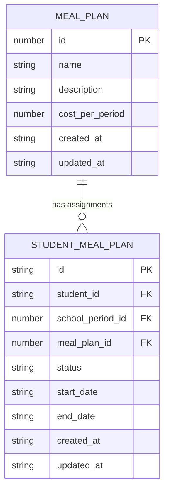
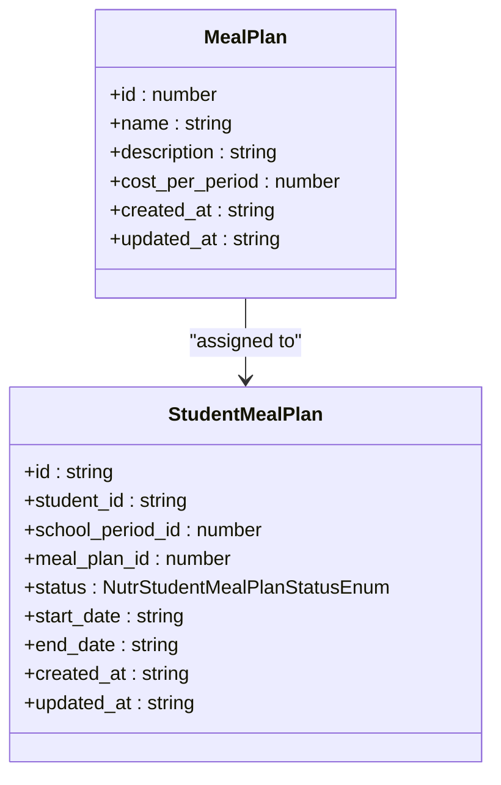
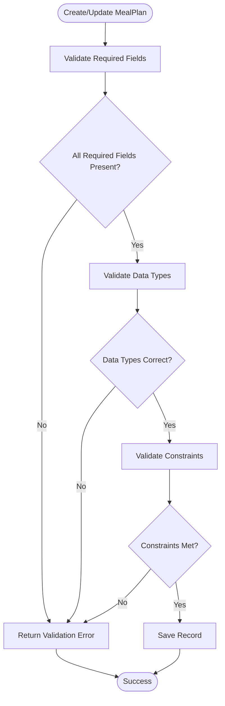
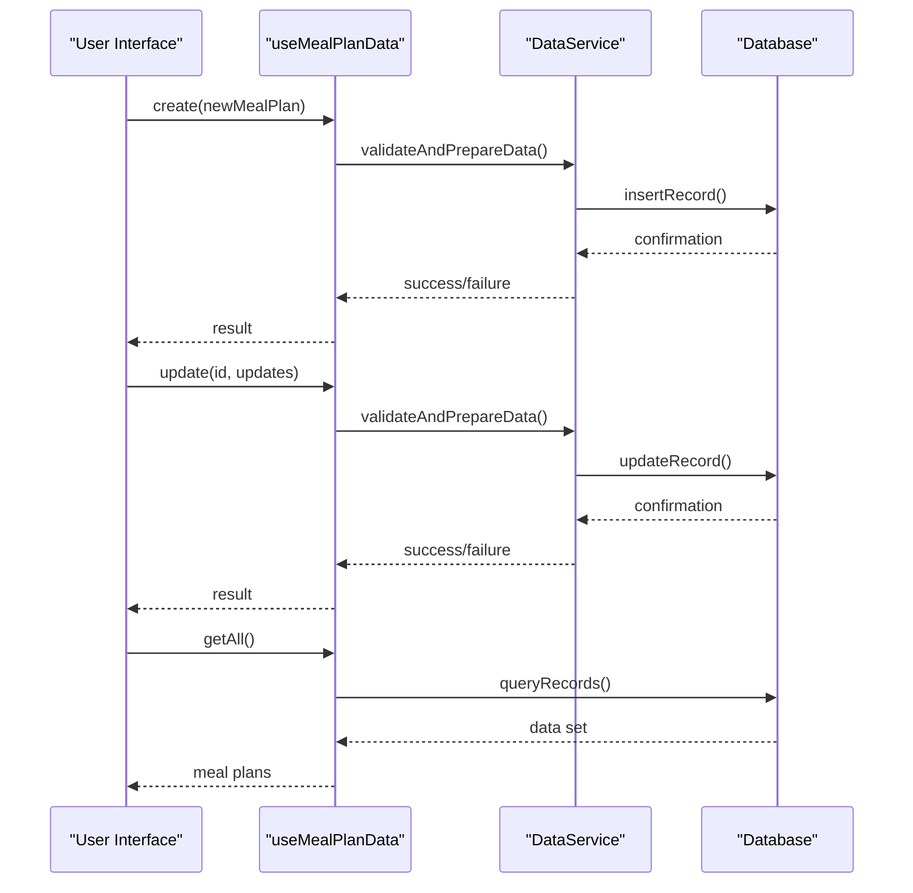

# Meal Plan Data Model

<cite>
**Referenced Files in This Document**   
- [schema.ts](file://src/modules/nutrition/data/schema.ts)
- [types.ts](file://src/modules/nutrition/data/types.ts)
- [useMealPlanData.ts](file://src/modules/nutrition/data/useMealPlanData.ts)
- [mockData.ts](file://src/modules/nutrition/data/mockData.ts)
- [types.ts](file://src/core/types.ts)
</cite>

## Table of Contents
1. [Introduction](#introduction)
2. [MealPlan Entity Schema](#mealplan-entity-schema)
3. [Field Definitions](#field-definitions)
4. [Relationships](#relationships)
5. [Sample Data](#sample-data)
6. [Validation Rules](#validation-rules)
7. [CRUD Operations](#crud-operations)
8. [Conclusion](#conclusion)

## Introduction
The MealPlan entity is a core component of the Nutrition module in the SchoolPilot system, serving as a template for recurring meal schedules. This documentation provides a comprehensive overview of the MealPlan data model, including its schema structure, relationships, validation rules, and operational workflows. The MealPlan entity enables schools to define standardized meal offerings that can be assigned to students through the StudentMealPlan relationship.

**Section sources**
- [schema.ts](file://src/modules/nutrition/data/schema.ts#L1-L25)
- [types.ts](file://src/modules/nutrition/data/types.ts#L1-L20)

## MealPlan Entity Schema
The MealPlan entity is defined with a database-agnostic schema that specifies its structure, properties, and constraints. The schema is implemented using RxDB-compatible definitions that can work across different database providers.



**Diagram sources**
- [schema.ts](file://src/modules/nutrition/data/schema.ts#L1-L25)

**Section sources**
- [schema.ts](file://src/modules/nutrition/data/schema.ts#L1-L25)

## Field Definitions
The MealPlan entity contains the following fields with their respective data types and constraints:

### Core Fields
- **id**: `number` - Unique identifier for the meal plan (Primary Key)
- **name**: `string` - Meal plan name with a maximum length of 150 characters
- **description**: `string` - Meal plan description with a maximum length of 500 characters (optional)
- **cost_per_period**: `number` - Cost of the meal plan per period (e.g., per term or month)
- **created_at**: `string` - Timestamp when the meal plan was created (ISO format)
- **updated_at**: `string` - Timestamp when the meal plan was last updated (ISO format)

### Field Constraints
- **Required Fields**: id, name, created_at, updated_at
- **Indexes**: name field is indexed for efficient searching
- **Data Types**: All fields follow strict typing with appropriate validation
- **Length Constraints**: Name (150 chars), Description (500 chars)

**Section sources**
- [schema.ts](file://src/modules/nutrition/data/schema.ts#L1-L25)
- [types.ts](file://src/modules/nutrition/data/types.ts#L1-L20)

## Relationships
The MealPlan entity participates in several key relationships within the system architecture:

### StudentMealPlan Relationship
The primary relationship is with the StudentMealPlan entity, which represents the assignment of a meal plan to a specific student. This is a one-to-many relationship where one MealPlan can be assigned to multiple students.



**Diagram sources**
- [schema.ts](file://src/modules/nutrition/data/schema.ts#L1-L50)
- [types.ts](file://src/modules/nutrition/data/types.ts#L1-L50)

### Menu Relationship
While not directly referenced in the MealPlan schema, meal plans are conceptually linked to Menu items through the meal scheduling system. The MealPlan serves as a template that determines which menus are available to students.

### Denormalized Data
The StudentMealPlan entity includes denormalized fields from the MealPlan entity:
- **meal_plan_name**: Copy of the meal plan name for display purposes
- **student_name**: Student's full name for reporting
- **school_period_name**: School period name for context

**Section sources**
- [schema.ts](file://src/modules/nutrition/data/schema.ts#L1-L50)
- [types.ts](file://src/modules/nutrition/data/types.ts#L1-L50)

## Sample Data
The following example demonstrates a typical MealPlan record with realistic values:

```json
{
  "id": 2,
  "name": "Full Board Plan (All Meals)",
  "description": "Breakfast, Lunch, Supper, and Snacks",
  "cost_per_period": 15000,
  "created_at": "2024-07-28T10:00:00Z",
  "updated_at": "2024-07-28T10:00:00Z"
}
```

### Extended Sample with Relationships
The following JSON represents a complete meal plan configuration with associated student assignments:

```json
{
  "mealPlan": {
    "id": 2,
    "name": "Full Board Plan (All Meals)",
    "description": "Breakfast, Lunch, Supper, and Snacks",
    "cost_per_period": 15000,
    "created_at": "2024-07-28T10:00:00Z",
    "updated_at": "2024-07-28T10:00:00Z"
  },
  "studentAssignments": [
    {
      "id": "SMP001",
      "student_id": "STU001",
      "school_period_id": 3,
      "meal_plan_id": 2,
      "status": "Active",
      "start_date": "2024-07-28",
      "end_date": "2024-12-15",
      "student_name": "Kevin Malone",
      "school_period_name": "Term 3 - AY 2023/2024",
      "meal_plan_name": "Full Board Plan (All Meals)"
    }
  ]
}
```

**Section sources**
- [mockData.ts](file://src/modules/nutrition/data/mockData.ts#L1-L30)
- [schema.ts](file://src/modules/nutrition/data/schema.ts#L1-L25)

## Validation Rules
The MealPlan entity enforces several validation rules to ensure data integrity:

### Required Field Validation
- All required fields (id, name, created_at, updated_at) must be present
- Name field cannot be empty or exceed 150 characters
- Timestamps must be in valid ISO format

### Business Logic Validation
- **Cost Validation**: cost_per_period must be a non-negative number
- **Name Uniqueness**: Meal plan names should be unique within the system
- **Date Validation**: created_at and updated_at timestamps must be logical (updated_at cannot be before created_at)

### Data Type Validation
- id must be a number
- name and description must be strings
- cost_per_period must be a number
- created_at and updated_at must be valid date strings



**Diagram sources**
- [schema.ts](file://src/modules/nutrition/data/schema.ts#L1-L25)
- [types.ts](file://src/modules/nutrition/data/types.ts#L1-L20)

**Section sources**
- [schema.ts](file://src/modules/nutrition/data/schema.ts#L1-L25)
- [types.ts](file://src/modules/nutrition/data/types.ts#L1-L20)

## CRUD Operations
MealPlan entities are managed through standardized data hooks that provide consistent CRUD operations across the application.

### Data Hook Implementation
The `useMealPlanData` hook provides the primary interface for MealPlan operations:

```typescript
export const useMealPlanData = () => {
  useDataHookRegistration(useMealPlanDataConfig);
  return createDataHook<MealPlan>(useMealPlanDataConfig)();
};
```

### Available Operations
- **Create**: Add a new meal plan with required fields
- **Read**: Retrieve meal plans by ID, name, or list all plans
- **Update**: Modify existing meal plan details
- **Delete**: Remove a meal plan (typically soft-deleted)

### Operation Workflow


**Diagram sources**
- [useMealPlanData.ts](file://src/modules/nutrition/data/useMealPlanData.ts#L1-L27)
- [schema.ts](file://src/modules/nutrition/data/schema.ts#L1-L25)

**Section sources**
- [useMealPlanData.ts](file://src/modules/nutrition/data/useMealPlanData.ts#L1-L27)
- [schema.ts](file://src/modules/nutrition/data/schema.ts#L1-L25)

## Conclusion
The MealPlan entity serves as a foundational component of the Nutrition module, providing a flexible template system for recurring meal schedules. Its simple yet effective schema allows schools to define various meal plan options that can be efficiently assigned to students. The integration with the StudentMealPlan entity enables robust tracking of meal plan assignments and statuses, while the standardized data hook interface ensures consistent CRUD operations throughout the application. This data model supports the core functionality of school meal management while maintaining data integrity through comprehensive validation rules.