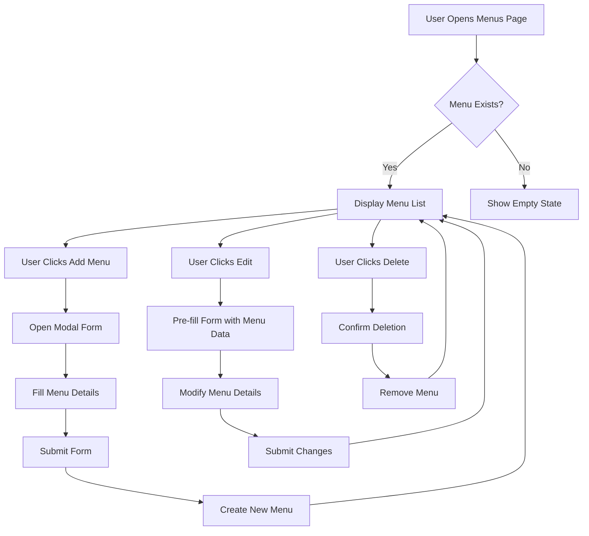
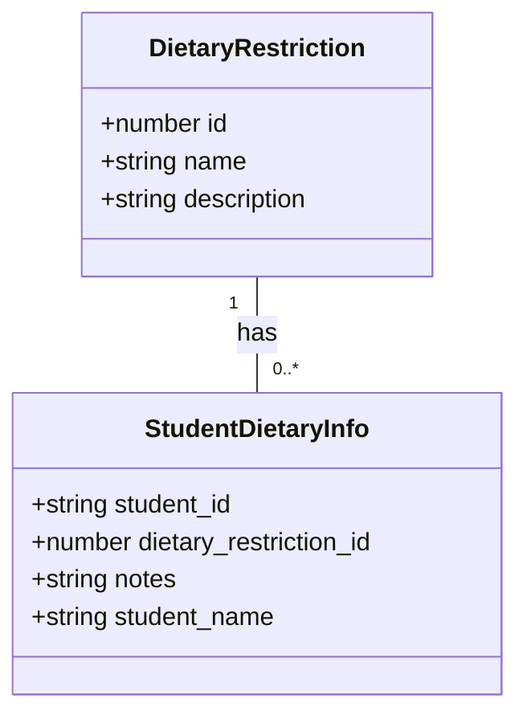
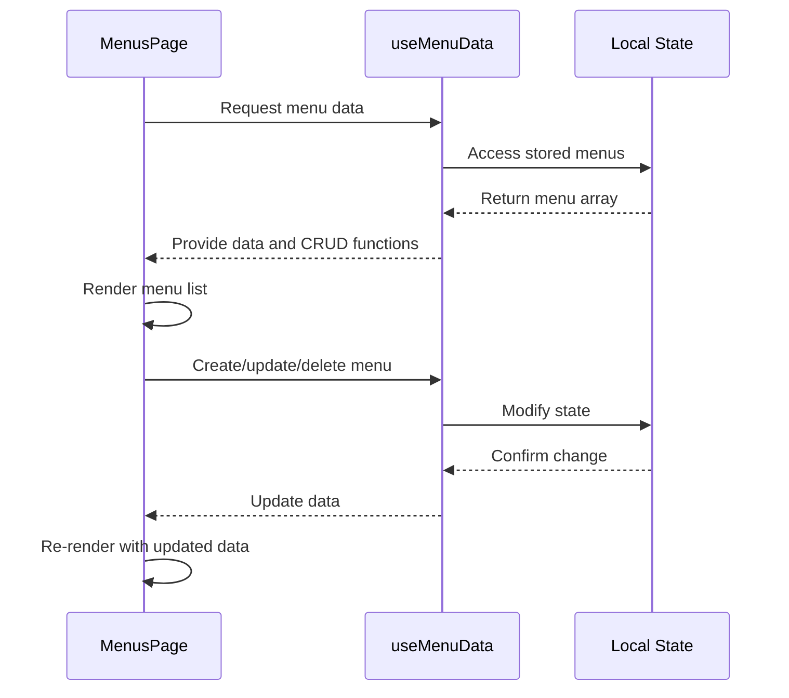

# Menu Data Model

<cite>
**Referenced Files in This Document**   
- [schema.ts](file://src/modules/nutrition/data/schema.ts)
- [types.ts](file://src/modules/nutrition/data/types.ts)
- [useMenuData.ts](file://src/modules/nutrition/data/useMenuData.ts)
- [MenusPage.tsx](file://src/modules/nutrition/pages/MenusPage.tsx)
- [types.ts](file://src/core/types.ts)
- [mockData.ts](file://src/modules/nutrition/data/mockData.ts)
</cite>

## Table of Contents
1. [Introduction](#introduction)
2. [Menu Entity Schema](#menu-entity-schema)
3. [Food Item Structure](#food-item-structure)
4. [Sample Menu Data](#sample-menu-data)
5. [Menu Workflow and Management](#menu-workflow-and-management)
6. [Dietary Restriction Integration](#dietary-restriction-integration)
7. [Menu Data Retrieval](#menu-data-retrieval)

## Introduction
The Menu data model in the Nutrition module represents daily food offerings within an educational institution. This document details the schema, structure, relationships, and functionality of the Menu entity, including its integration with meal planning, dietary restrictions, and consumption tracking systems. The model supports planning, approval, and tracking of meals across different meal types and dates.

## Menu Entity Schema

The Menu entity is defined with essential properties that capture the key aspects of a daily meal offering. The schema is implemented in both database and TypeScript definitions.

**Section sources**
- [schema.ts](file://src/modules/nutrition/data/schema.ts#L41-L69)
- [types.ts](file://src/modules/nutrition/data/types.ts#L30-L37)
- [types.ts](file://src/core/types.ts#L1235-L1242)

### Schema Definition
The menuSchema defines the structure of the Menu entity in the database:

```mermaid
classDiagram
class Menu {
+string id
+string menu_date
+string meal_type
+string description
+string created_at
+string updated_at
}
note right of Menu
Database schema for menu entity
Primary key : id
Indexed fields : menu_date, meal_type
end note
```

**Diagram sources**
- [schema.ts](file://src/modules/nutrition/data/schema.ts#L41-L69)

### Property Details
The Menu interface defines the TypeScript type with the following properties:

- **id**: Unique identifier for the menu (string)
- **menu_date**: Date of the menu (string in ISO format)
- **meal_type**: Type of meal from predefined enum (string)
- **description**: Description of the menu items (string)
- **created_at**: Timestamp when the menu was created (string in ISO format)
- **updated_at**: Timestamp when the menu was last updated (string in ISO format)

The meal_type property uses the NutrMealTypeEnum which includes: BREAKFAST, SNACK_MORNING, LUNCH, SNACK_EVENING, and SUPPER.

**Section sources**
- [types.ts](file://src/modules/nutrition/data/types.ts#L30-L37)
- [types.ts](file://src/core/types.ts#L1235-L1242)

## Food Item Structure

While the Menu entity itself does not contain a structured array of food items, the food items are represented within the description field as a comma-separated list of dishes.

### Food Item Representation
Food items are stored as text within the menu description field, following the format: "Main Dish, Side Dish, Vegetable". For example: "Rice, Beans, Cabbage" or "Ugali, Sukuma Wiki, Beef".

The system does not currently maintain structured nutritional data (calories, protein, carbs, fats) or individual food item properties (portionSize, allergens, dietaryTags) as separate fields in the Menu entity.

### Dietary Tags and Allergens
Although the Menu entity does not directly store allergen or dietary tag information, this data is managed separately in the system through student dietary restrictions. The dietary restriction system includes categories such as:
- Vegetarian
- Vegan
- Halal
- Gluten-Free
- Dairy-Free
- Nut Allergy
- Diabetic
- Low Sodium

These restrictions are tracked at the student level and can be used to ensure appropriate meal planning for students with specific dietary needs.

**Section sources**
- [mockData.ts](file://src/modules/nutrition/data/mockData.ts#L145-L168)
- [mockData.ts](file://src/modules/nutrition/data/mockData.ts#L110-L145)

## Sample Menu Data

The system includes sample menu data that demonstrates how menus are structured and used within the application.

### Sample Lunch Menu
```json
{
  "id": "MENU001",
  "menu_date": "2024-07-29",
  "meal_type": "Lunch",
  "description": "Rice, Beans, Cabbage",
  "created_at": "2024-07-28T10:00:00Z",
  "updated_at": "2024-07-28T10:00:00Z"
}
```

### Extended Menu Examples
The system contains multiple menu examples across different dates and meal types:

```json
[
  {
    "id": "MENU002",
    "menu_date": "2024-07-29",
    "meal_type": "Breakfast",
    "description": "Tea, Bread, Egg",
    "created_at": "2024-07-28T10:00:00Z",
    "updated_at": "2024-07-28T10:00:00Z"
  },
  {
    "id": "MENU003",
    "menu_date": "2024-07-30",
    "meal_type": "Lunch",
    "description": "Ugali, Sukuma Wiki, Beef",
    "created_at": "2024-07-29T09:00:00Z",
    "updated_at": "2024-07-29T09:00:00Z"
  },
  {
    "id": "MENU004",
    "menu_date": "2024-07-29",
    "meal_type": "Supper",
    "description": "Chapati, Green Grams, Vegetables",
    "created_at": "2024-07-28T10:00:00Z",
    "updated_at": "2024-07-28T10:00:00Z"
  }
]
```

**Section sources**
- [mockData.ts](file://src/modules/nutrition/data/mockData.ts#L72-L93)

## Menu Workflow and Management

The menu management system provides CRUD operations for creating, reading, updating, and deleting menu items through a dedicated hook and user interface.

### Menu Approval Workflow
The current implementation does not include a formal approval workflow for menus. Menus can be created and modified directly by users with appropriate permissions without a multi-step approval process.

However, the system has the foundation for implementing such workflows through its role-based access control (RBAC) system, which includes permissions for meal management.

### Versioning System
The menu system does not implement versioning for menu changes. When a menu is updated, the existing record is modified in place with the updated_at timestamp being refreshed. There is no history or audit trail of previous menu versions.

The system does track creation and update timestamps, which provides basic change tracking but not full version history.

### User Interface for Menu Management
The MenusPage component provides a user interface for managing menus with the following features:
- Table view of all menus with filtering and sorting
- Modal form for creating and editing menus
- Confirmation dialog for deleting menus
- Form validation for required fields



**Diagram sources**
- [MenusPage.tsx](file://src/modules/nutrition/pages/MenusPage.tsx#L0-L196)

**Section sources**
- [MenusPage.tsx](file://src/modules/nutrition/pages/MenusPage.tsx#L0-L196)

## Dietary Restriction Integration

The system integrates dietary restriction tracking to ensure students with special dietary needs receive appropriate meals.

### Dietary Restriction Management
The system maintains a list of dietary restrictions that can be assigned to students:



**Diagram sources**
- [mockData.ts](file://src/modules/nutrition/data/mockData.ts#L145-L168)

The dietary restrictions include Vegetarian, Vegan, Halal, Gluten-Free, Dairy-Free, Nut Allergy, Diabetic, and Low Sodium.

### Student Dietary Information
Each student can have one or more dietary restrictions recorded in the system. The student dietary information includes:
- student_id: Reference to the student
- dietary_restriction_id: Reference to the dietary restriction type
- notes: Additional information about the restriction
- student_name: Denormalized student name for display

This information is used to ensure that students receive meals that comply with their dietary requirements.

**Section sources**
- [mockData.ts](file://src/modules/nutrition/data/mockData.ts#L145-L168)

## Menu Data Retrieval

The system provides a dedicated hook for retrieving and managing menu data throughout the application.

### useMenuData Hook
The useMenuData hook provides the primary interface for menu data operations:

```mermaid
classDiagram
class useMenuData {
+Menu[] data
+create(newItem : Partial<Menu>) : Promise<Menu>
+update(id : number, updatedData : Partial<Menu>) : Promise<void>
+remove(id : number) : Promise<void>
}
note right of useMenuData
Hook for managing menu data
Uses local state with mock data
Provides CRUD operations
end note
```

**Diagram sources**
- [useMenuData.ts](file://src/modules/nutrition/data/useMenuData.ts#L7-L39)

### Hook Implementation
The useMenuData hook is implemented as a custom React hook that manages menu data state:

```typescript
export const useMenuData = () => {
  const [data, setData] = useState<Menu[]>(initialMockMenus);

  const create = async (newItem: Partial<Menu>) => {
    const newDataItem: Menu = {
      ...newItem,
      id: Date.now().toString(),
      created_at: new Date().toISOString(),
      updated_at: new Date().toISOString()
    } as Menu;
    setData((prev: Menu[]) => [...prev, newDataItem]);
    return newDataItem;
  };

  const update = async (id: string, updatedData: Partial<Menu>) => {
    setData((prev: Menu[]) => prev.map((item: Menu) => 
      item.id === id 
        ? { ...item, ...updatedData, updated_at: new Date().toISOString() }
        : item
    ));
  };

  const remove = async (id: string) => {
    setData((prev: Menu[]) => prev.filter((item: Menu) => item.id !== id));
  };

  return {
    data,
    create,
    update,
    remove
  };
};
```

The hook uses initialMockMenus as its data source and provides methods to create, update, and remove menu items from the state.

### Data Flow
The data flow for menu retrieval and display follows this pattern:



**Diagram sources**
- [useMenuData.ts](file://src/modules/nutrition/data/useMenuData.ts#L7-L39)
- [MenusPage.tsx](file://src/modules/nutrition/pages/MenusPage.tsx#L0-L196)

**Section sources**
- [useMenuData.ts](file://src/modules/nutrition/data/useMenuData.ts#L7-L39)
- [MenusPage.tsx](file://src/modules/nutrition/pages/MenusPage.tsx#L0-L196)