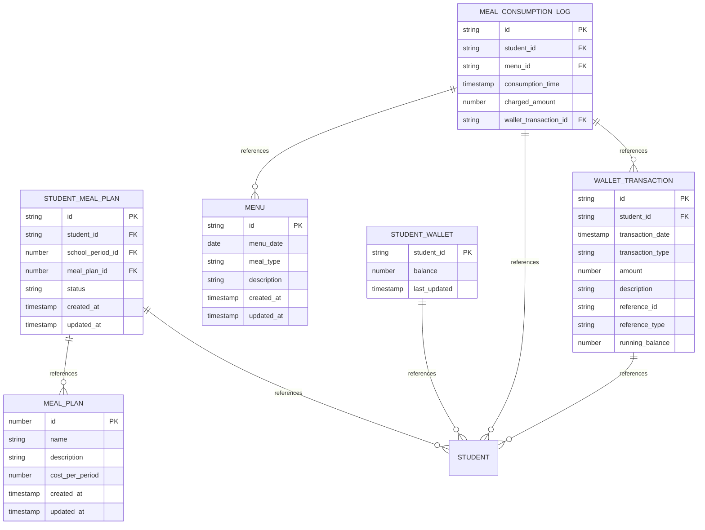
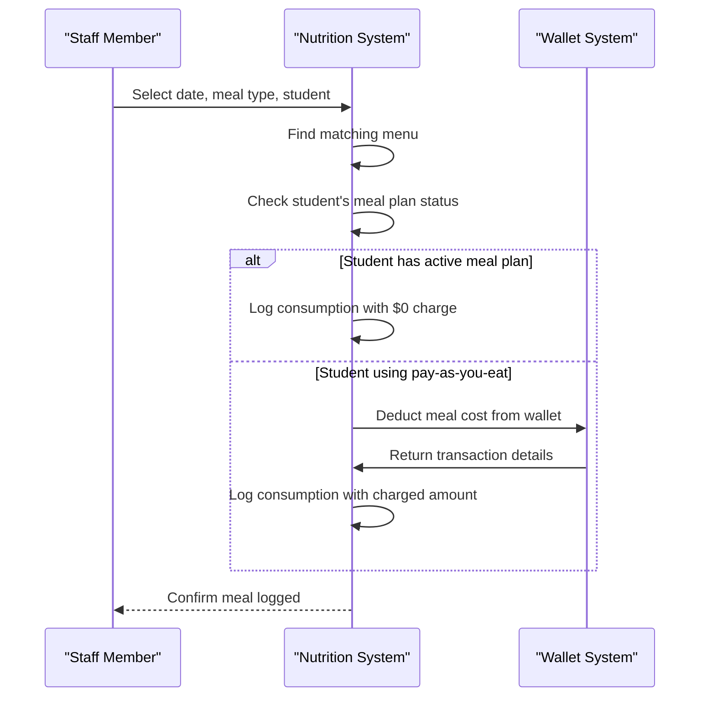
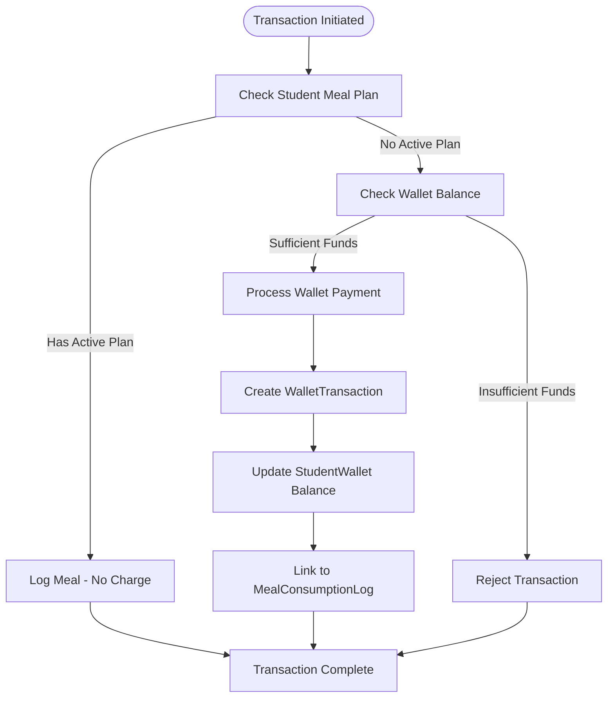
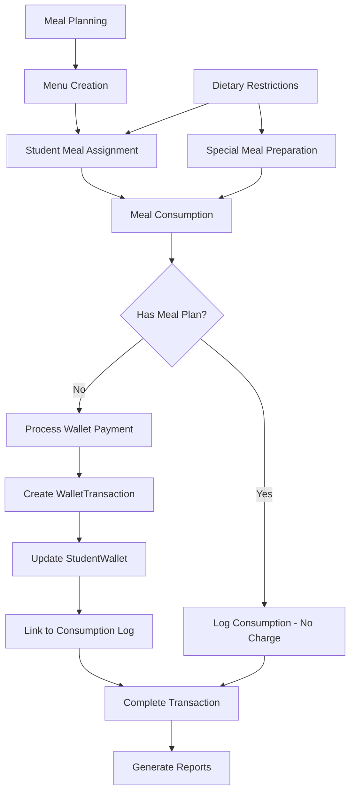

# Nutrition Data Model

<cite>
**Referenced Files in This Document**   
- [types.ts](file://src/core/types.ts#L1200-L1399)
- [mockData.ts](file://src/modules/nutrition/data/mockData.ts#L0-L190)
- [useWalletTransactionData.ts](file://src/modules/nutrition/data/useWalletTransactionData.ts#L0-L56)
- [schema.ts](file://src/modules/nutrition/data/schema.ts#L0-L29)
- [StudentWalletPage.tsx](file://src/modules/nutrition/pages/StudentWalletPage.tsx#L29-L132)
- [MealConsumptionLogPage.tsx](file://src/modules/nutrition/pages/MealConsumptionLogPage.tsx#L0-L100)
- [StudentMealAssignmentsPage.tsx](file://src/modules/nutrition/pages/StudentMealAssignmentsPage.tsx#L0-L246)
</cite>

## Table of Contents
1. [Introduction](#introduction)
2. [Core Data Collections](#core-data-collections)
3. [Entity Relationships](#entity-relationships)
4. [Meal Planning System](#meal-planning-system)
5. [Student Meal Assignment](#student-meal-assignment)
6. [Meal Consumption Tracking](#meal-consumption-tracking)
7. [Wallet-Based Payment Processing](#wallet-based-payment-processing)
8. [Dietary Restriction Management](#dietary-restriction-management)
9. [Sample Data Instances](#sample-data-instances)
10. [Data Flow Diagrams](#data-flow-diagrams)

## Introduction
The Nutrition module in schoolpilot3 provides a comprehensive meal management system for educational institutions. This documentation details the data model architecture for 12+ collections including MealPlan, Menu, MealConsumptionLog, StudentMealPlan, and StudentWallet. The system enables schools to manage meal planning, student meal assignments, consumption tracking, and wallet-based payment processing. The data model is designed to support both structured meal plans and flexible pay-as-you-eat options, with integration between student demographic data and dietary requirements.

**Section sources**
- [types.ts](file://src/core/types.ts#L1200-L1399)
- [mockData.ts](file://src/modules/nutrition/data/mockData.ts#L0-L190)

## Core Data Collections

### MealPlan Collection
The MealPlan collection defines daily or weekly meal schedules available to students. Each meal plan represents a specific meal offering with associated costs and descriptions.

**Field Documentation:**
- **id**: Unique identifier for the meal plan
- **name**: Meal plan name (e.g., "Standard Lunch Plan")
- **description**: Detailed description of the meal plan
- **cost_per_period**: Cost of the meal plan per period (nullable for free plans)
- **created_at**: Record creation timestamp
- **updated_at**: Record last update timestamp

**Section sources**
- [types.ts](file://src/core/types.ts#L1200-L1207)
- [schema.ts](file://src/modules/nutrition/data/schema.ts#L0-L29)

### Menu Collection
The Menu collection specifies actual food items served on specific dates and meal types. It provides the detailed content for meal planning.

**Field Documentation:**
- **id**: Unique identifier for the menu
- **menu_date**: Date when the menu is served
- **meal_type**: Type of meal (Breakfast, Lunch, Supper, etc.)
- **description**: Detailed description of food items served
- **created_at**: Record creation timestamp
- **updated_at**: Record last update timestamp

**Section sources**
- [types.ts](file://src/core/types.ts#L1215-L1221)
- [schema.ts](file://src/modules/nutrition/data/schema.ts#L41-L69)

### StudentMealPlan Collection
The StudentMealPlan collection manages the assignment of meal plans to individual students for specific school periods.

**Field Documentation:**
- **id**: Unique identifier for the student meal plan
- **student_id**: Reference to the student
- **school_period_id**: Reference to the school period
- **meal_plan_id**: Reference to the meal plan
- **status**: Current status of the meal plan assignment
- **created_at**: Record creation timestamp
- **updated_at**: Record last update timestamp
- **student_name**: Denormalized student name for display
- **school_period_name**: Denormalized school period name
- **meal_plan_name**: Denormalized meal plan name

**Section sources**
- [types.ts](file://src/core/types.ts#L1208-L1214)
- [schema.ts](file://src/modules/nutrition/data/schema.ts#L25-L42)

### MealConsumptionLog Collection
The MealConsumptionLog collection tracks individual meal consumption events with timestamped records.

**Field Documentation:**
- **id**: Unique identifier for the consumption log
- **student_id**: Reference to the student
- **menu_id**: Reference to the menu consumed
- **consumption_time**: Timestamp of meal consumption
- **charged_amount**: Amount charged for the meal (nullable for plan members)
- **wallet_transaction_id**: Reference to associated wallet transaction
- **student_name**: Denormalized student name
- **menu_description**: Denormalized menu description
- **menu_meal_type**: Denormalized meal type
- **menu_date**: Denormalized menu date

**Section sources**
- [types.ts](file://src/core/types.ts#L1223-L1233)
- [schema.ts](file://src/modules/nutrition/data/schema.ts#L71-L91)

### StudentWallet and WalletTransaction Collections
The wallet system enables students to make purchases using pre-funded accounts.

**StudentWallet Fields:**
- **student_id**: Reference to the student
- **balance**: Current wallet balance
- **last_updated**: Timestamp of last balance update
- **student_name**: Denormalized student name

**WalletTransaction Fields:**
- **id**: Unique identifier for the transaction
- **student_id**: Reference to the student
- **transaction_date**: Timestamp of transaction
- **transaction_type**: Type of transaction (Deposit, Purchase, etc.)
- **amount**: Transaction amount (negative for debits)
- **description**: Transaction description
- **reference_id**: Reference to related entity
- **reference_type**: Type of referenced entity
- **running_balance**: Balance after transaction
- **student_name**: Denormalized student name

**Section sources**
- [types.ts](file://src/core/types.ts#L1235-L1248)
- [useWalletTransactionData.ts](file://src/modules/nutrition/data/useWalletTransactionData.ts#L0-L56)

## Entity Relationships



**Diagram sources**
- [types.ts](file://src/core/types.ts#L1200-L1399)
- [schema.ts](file://src/modules/nutrition/data/schema.ts#L0-L91)

## Meal Planning System

The meal planning system allows administrators to define meal schedules and menu items. MealPlan entities represent different meal offerings (e.g., Standard Lunch Plan, Full Board Plan), while Menu entities specify the actual food items served on specific dates.

The system supports both structured meal plans with fixed costs and flexible pay-as-you-eat options. Meal plans can be assigned to students for specific school periods, enabling term-based meal management. The Menu collection allows for detailed meal planning with different meal types (Breakfast, Lunch, Supper) on specific dates.

Administrators can create and manage meal plans through the MealPlansPage interface, which provides CRUD operations for meal plan management. The system validates required fields such as meal plan name and ensures data integrity through proper schema definitions.

**Section sources**
- [types.ts](file://src/core/types.ts#L1200-L1221)
- [MealPlansPage.tsx](file://src/modules/nutrition/pages/MealPlansPage.tsx#L0-L104)

## Student Meal Assignment

The student meal assignment process establishes the relationship between students and meal plans for specific school periods. This is managed through the StudentMealPlan collection, which acts as a junction table between students and meal plans.

The assignment workflow involves:
1. Selecting a student from active students
2. Choosing a school period (term/semester)
3. Selecting a meal plan
4. Setting the assignment status (Active, Inactive, Pending)

The system prevents duplicate active assignments for the same student and school period. When a student is assigned to a meal plan, they gain access to the meals included in that plan without additional charges. The assignment includes denormalized fields for student name, school period name, and meal plan name to optimize display performance.

**Section sources**
- [types.ts](file://src/core/types.ts#L1208-L1214)
- [StudentMealAssignmentsPage.tsx](file://src/modules/nutrition/pages/StudentMealAssignmentsPage.tsx#L0-L246)

## Meal Consumption Tracking

The meal consumption tracking system records when students consume meals through the MealConsumptionLog collection. Each log entry captures:
- Student identity
- Menu consumed
- Timestamp of consumption
- Amount charged (if applicable)
- Associated wallet transaction

The system determines the charge amount based on the student's meal plan status. Students with active meal plan assignments are charged $0 for meals included in their plan, while students using the pay-as-you-eat option are charged the menu's standard rate from their wallet balance.

The consumption logging interface allows staff to quickly record meals by selecting a date, meal type, and student. The system automatically identifies the appropriate menu and processes the transaction if wallet payment is required.



**Diagram sources**
- [types.ts](file://src/core/types.ts#L1223-L1233)
- [MealConsumptionLogPage.tsx](file://src/modules/nutrition/pages/MealConsumptionLogPage.tsx#L0-L100)

## Wallet-Based Payment Processing

The wallet system enables students to make purchases using pre-funded accounts. The StudentWallet collection maintains current balances, while WalletTransaction records all financial activities.

**Payment Processing Flow:**
1. Student attempts to consume a meal without an active meal plan
2. System calculates the meal cost
3. System checks wallet balance
4. If sufficient funds exist:
   - Create WalletTransaction with negative amount
   - Update StudentWallet running balance
   - Link transaction to consumption log
5. If insufficient funds:
   - Reject transaction
   - Notify student/staff

The system supports various transaction types:
- **DEPOSIT**: Funds added to wallet (parent payments, transfers)
- **PURCHASE**: Meal or item purchase
- **ADJUSTMENT_DEBIT**: Manual balance reduction
- **ADJUSTMENT_CREDIT**: Manual balance increase

Administrators can manage wallet transactions through the StudentWalletPage interface, which displays current balances and transaction history.



**Diagram sources**
- [types.ts](file://src/core/types.ts#L1235-L1248)
- [StudentWalletPage.tsx](file://src/modules/nutrition/pages/StudentWalletPage.tsx#L29-L132)

## Dietary Restriction Management

The system tracks dietary restrictions for students with special nutritional needs. This is managed through dietary restriction definitions and student-specific dietary information.

**Dietary Restriction Types:**
- Vegetarian
- Vegan
- Halal
- Gluten-Free
- Dairy-Free
- Nut Allergy
- Diabetic
- Low Sodium

Each student can have one primary dietary restriction with additional notes. The system uses this information to:
- Generate special meal preparations
- Alert kitchen staff about allergies
- Provide reporting on dietary preferences
- Ensure compliance with health requirements

The dietary information is integrated with student demographic data, allowing for comprehensive student profiles that include both academic and wellness information.

**Section sources**
- [mockData.ts](file://src/modules/nutrition/data/mockData.ts#L110-L168)

## Sample Data Instances

### MealConsumptionLog Sample
```json
{
  "id": "MCL001",
  "student_id": "STU001",
  "menu_id": "MENU001",
  "consumption_time": "2024-07-29T13:05:00Z",
  "charged_amount": null,
  "wallet_transaction_id": null,
  "student_name": "Kevin Malone",
  "menu_description": "Rice, Beans, Cabbage",
  "menu_meal_type": "LUNCH",
  "menu_date": "2024-07-29",
  "created_at": "2024-07-29T13:05:00Z",
  "updated_at": "2024-07-29T13:05:00Z"
}
```

### StudentWallet Sample
```json
{
  "student_id": "STU003",
  "balance": 1500.00,
  "last_updated": "2024-07-29T13:10:00Z",
  "student_name": "Jim Halpert",
  "transaction_history": [
    {
      "id": "WTX001",
      "transaction_date": "2024-07-28T10:00:00Z",
      "transaction_type": "DEPOSIT",
      "amount": 2000,
      "description": "Pocket money deposit by parent",
      "running_balance": 2000
    },
    {
      "id": "WTX002",
      "transaction_date": "2024-07-29T13:10:00Z",
      "transaction_type": "PURCHASE",
      "amount": -500,
      "description": "Canteen Purchase - Snacks",
      "reference_id": "1",
      "reference_type": "Merchant",
      "running_balance": 1500
    }
  ]
}
```

**Section sources**
- [mockData.ts](file://src/modules/nutrition/data/mockData.ts#L83-L93)
- [useWalletTransactionData.ts](file://src/modules/nutrition/data/useWalletTransactionData.ts#L0-L56)

## Data Flow Diagrams



**Diagram sources**
- [types.ts](file://src/core/types.ts#L1200-L1399)
- [mockData.ts](file://src/modules/nutrition/data/mockData.ts#L0-L190)