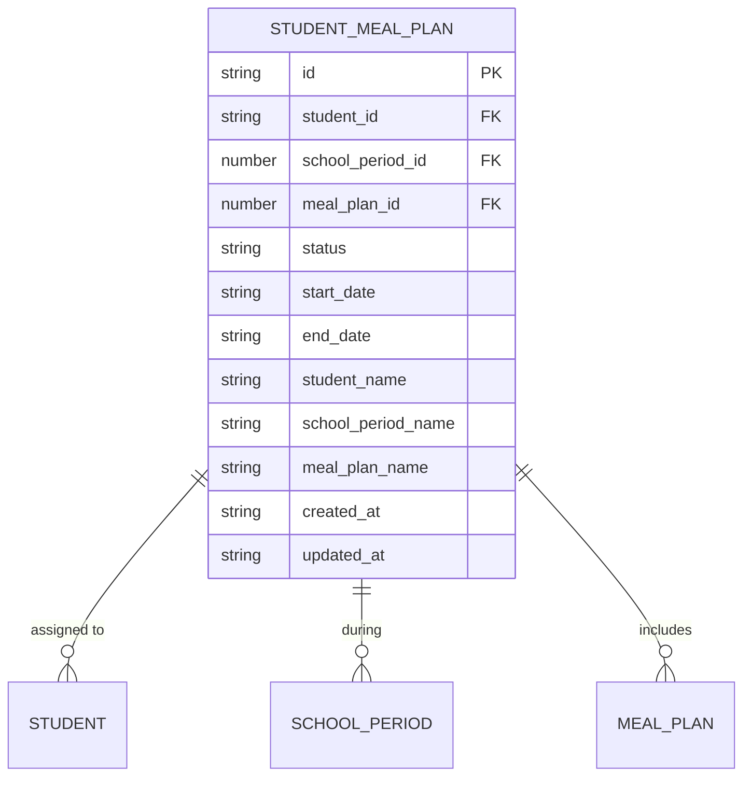
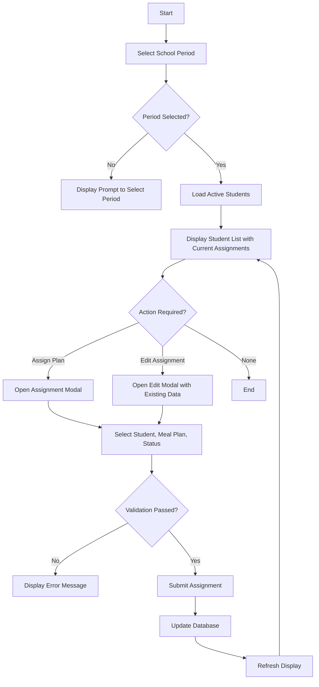
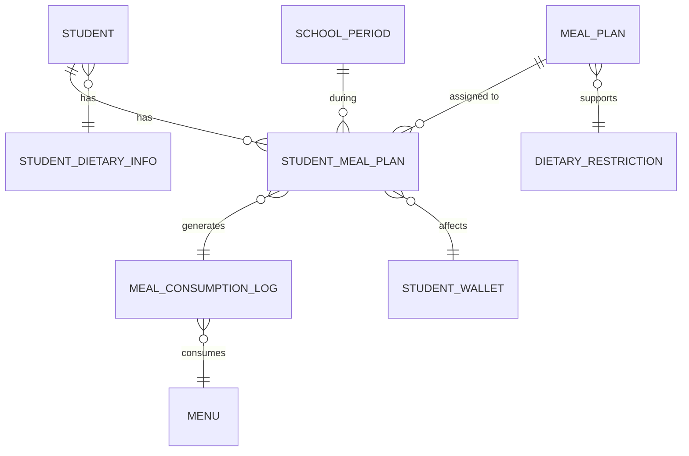
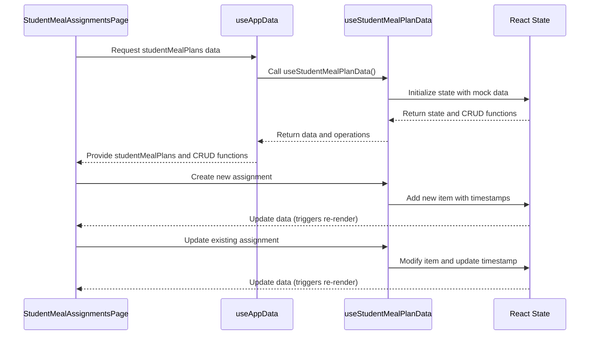
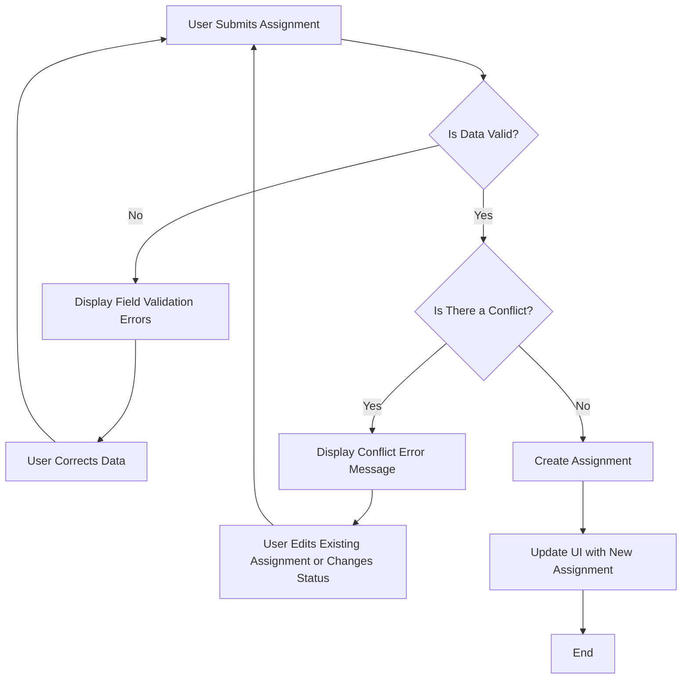

# Student Meal Plan Data Model

<cite>
**Referenced Files in This Document**   
- [types.ts](file://src/core/types.ts#L1221-L1233)
- [schema.ts](file://src/modules/nutrition/data/schema.ts#L25-L42)
- [types.ts](file://src/modules/nutrition/data/types.ts#L0-L33)
- [mockData.ts](file://src/modules/nutrition/data/mockData.ts#L0-L200)
- [useStudentMealPlanData.ts](file://src/modules/nutrition/data/useStudentMealPlanData.ts#L0-L56)
- [StudentMealAssignmentsPage.tsx](file://src/modules/nutrition/pages/StudentMealAssignmentsPage.tsx#L0-L247)
</cite>

## Table of Contents
1. [Introduction](#introduction)
2. [StudentMealPlan Schema](#studentmealplan-schema)
3. [Enrollment Workflow](#enrollment-workflow)
4. [Sample Data](#sample-data)
5. [Entity Relationships](#entity-relationships)
6. [CRUD Operations and Real-Time Updates](#crud-operations-and-real-time-updates)
7. [Data Validation and Conflict Resolution](#data-validation-and-conflict-resolution)

## Introduction
The StudentMealPlan entity is a critical component of the school's nutrition management system, serving as the bridge between students and their assigned meal plans. This document provides a comprehensive overview of the StudentMealPlan data model, including its schema, relationships with other entities, enrollment workflow, and implementation details. The system enables personalized meal planning based on student needs and preferences, particularly for those with special dietary requirements. The documentation covers the complete lifecycle of meal plan assignments, from creation to consumption tracking, and explains how the system ensures data integrity through validation and conflict resolution mechanisms.

## StudentMealPlan Schema
The StudentMealPlan entity is defined with a comprehensive schema that captures all essential information about a student's meal plan assignment. The schema includes both core attributes and denormalized fields for efficient data retrieval.

### Core Attributes
The StudentMealPlan interface defines the following properties:

**studentMealPlanId**: Unique identifier for the student meal plan assignment (string)
**studentId**: Reference to the student (string)
**mealPlanId**: Reference to the meal plan (number)
**startDate**: Start date of the meal plan (string, optional)
**endDate**: End date of the meal plan (string, optional)
**status**: Current status of the meal plan assignment (StudentMealPlanStatus)
**created_at**: Record creation timestamp (string)
**updated_at**: Record last update timestamp (string)

### Denormalized Fields
To optimize performance and reduce database queries, the schema includes denormalized fields:

**student_name**: Student name (string, optional)
**school_period_name**: School period name (string, optional)
**meal_plan_name**: Meal plan name (string, optional)

### Status Enum
The StudentMealPlanStatus enum defines the possible states of a meal plan assignment:

```typescript
export enum StudentMealPlanStatus {
    ACTIVE = 'Active',
    INACTIVE = 'Inactive',
}
```

The nutrition module extends this with an additional status:

```typescript
export enum NutrStudentMealPlanStatusEnum { 
    ACTIVE = 'Active', 
    INACTIVE = 'Inactive', 
    CANCELLED = 'Cancelled' 
}
```

### Database Schema
The database schema for the student_meal_plan collection includes validation rules and indexes:



**Diagram sources**
- [schema.ts](file://src/modules/nutrition/data/schema.ts#L25-L42)
- [types.ts](file://src/core/types.ts#L1221-L1233)

**Section sources**
- [types.ts](file://src/core/types.ts#L1221-L1233)
- [schema.ts](file://src/modules/nutrition/data/schema.ts#L25-L42)

## Enrollment Workflow
The enrollment workflow for assigning meal plans to students is implemented through the StudentMealAssignmentsPage component, which provides a user-friendly interface for administrators to manage meal plan assignments.

### Workflow Steps
1. **Select School Period**: Administrators first select the school period for which they want to manage meal plan assignments.
2. **View Student List**: The system displays all active students for the selected period.
3. **Assign or Edit Plan**: For each student, administrators can either assign a new meal plan or edit an existing assignment.
4. **Complete Assignment**: The administrator selects the appropriate meal plan and status, then submits the assignment.

### User Interface Components
The StudentMealAssignmentsPage uses several UI components to facilitate the enrollment process:

- **DataGrid**: Displays students and their current meal plan assignments
- **Modal**: Provides a form for creating or editing meal plan assignments
- **Select Inputs**: Allow selection of student, school period, meal plan, and status
- **Filter Controls**: Enable filtering by school period

### Business Logic
The enrollment workflow includes several key business rules:

- Only active students are displayed for assignment
- The current active school period is pre-selected by default
- Administrators can filter assignments by school period
- Each student can have only one active meal plan per school period



**Diagram sources**
- [StudentMealAssignmentsPage.tsx](file://src/modules/nutrition/pages/StudentMealAssignmentsPage.tsx#L0-L247)

**Section sources**
- [StudentMealAssignmentsPage.tsx](file://src/modules/nutrition/pages/StudentMealAssignmentsPage.tsx#L0-L247)

## Sample Data
The system includes sample data that demonstrates various meal plan assignments, including those for students with special dietary requirements.

### Sample Student with Special Dietary Requirement
The following JSON represents a student with a vegetarian dietary restriction assigned to a specialized meal plan:

```json
{
  "id": "SMP005",
  "student_id": "STU006",
  "school_period_id": 3,
  "meal_plan_id": 7,
  "status": "Active",
  "start_date": null,
  "end_date": null,
  "created_at": "2024-07-28T10:00:00Z",
  "updated_at": "2024-07-28T10:00:00Z",
  "student_name": "Kelly Kapoor",
  "school_period_name": "Term 3 - AY 2023/2024",
  "meal_plan_name": "Vegetarian Plan"
}
```

### Dietary Restriction Information
The student's dietary restriction is stored separately in the studentDietaryInfo collection:

```json
{
  "student_id": "STU006",
  "dietary_restriction_id": 1,
  "notes": "Strict vegetarian - no meat, fish, or eggs",
  "student_name": "Kelly Kapoor"
}
```

### Dietary Restrictions Catalog
The system maintains a catalog of available dietary restrictions:

```json
[
  {
    "id": 1,
    "name": "Vegetarian",
    "description": "No meat or fish products"
  },
  {
    "id": 2,
    "name": "Vegan",
    "description": "No animal products"
  },
  {
    "id": 3,
    "name": "Halal",
    "description": "Islamic dietary requirements"
  },
  {
    "id": 4,
    "name": "Gluten-Free",
    "description": "No gluten-containing products"
  },
  {
    "id": 5,
    "name": "Dairy-Free",
    "description": "No dairy products"
  },
  {
    "id": 6,
    "name": "Nut Allergy",
    "description": "No nuts or nut products"
  },
  {
    "id": 7,
    "name": "Diabetic",
    "description": "Low sugar, controlled carbohydrates"
  },
  {
    "id": 8,
    "name": "Low Sodium",
    "description": "Reduced salt intake"
  }
]
```

**Section sources**
- [mockData.ts](file://src/modules/nutrition/data/mockData.ts#L0-L200)

## Entity Relationships
The StudentMealPlan entity serves as a central hub that connects students with meal plans and other related entities in the nutrition management system.

### Primary Relationships
The StudentMealPlan entity has direct relationships with three key entities:

**Student**: One-to-many relationship where one student can have multiple meal plan assignments over time, but typically only one active assignment per school period.

**MealPlan**: One-to-many relationship where one meal plan can be assigned to multiple students.

**SchoolPeriod**: One-to-many relationship where one school period can have multiple meal plan assignments.

### Secondary Relationships
The StudentMealPlan also indirectly relates to other entities through the meal consumption process:

**Menu**: Students with active meal plans can consume meals from menus that match their plan.

**MealConsumptionLog**: Each meal consumption event is linked to a student's meal plan assignment.

**StudentWallet**: For students on pay-as-you-eat plans, meal consumption may result in wallet transactions.



**Diagram sources**
- [types.ts](file://src/core/types.ts#L1221-L1233)
- [types.ts](file://src/core/types.ts#L1212-L1219)
- [types.ts](file://src/core/types.ts#L414-L454)

**Section sources**
- [types.ts](file://src/core/types.ts#L1221-L1233)
- [types.ts](file://src/core/types.ts#L1212-L1219)
- [types.ts](file://src/core/types.ts#L414-L454)

## CRUD Operations and Real-Time Updates
The useStudentMealPlanData hook provides a comprehensive set of CRUD operations for managing student meal plan assignments with real-time updates.

### Hook Implementation
The useStudentMealPlanData hook is implemented as a self-contained data management solution:

```typescript
const useStudentMealPlanData = () => {
  const [studentMealPlans, setStudentMealPlans] = useState<any[]>([]);
  const [isLoading, setIsLoading] = useState<boolean>(true);
  const [error, setError] = useState<string | null>(null);

  useEffect(() => {
    try {
      // Simulate fetching data from a mock source
      setStudentMealPlans(initialMockUsers);
      setIsLoading(false);
    } catch (e) {
      setError('Failed to fetch student meal plans');
      setIsLoading(false);
    }
  }, []);

  const create = async (newItem: Partial<any>) => {
    const newDataItem: any = {
      ...newItem,
      id: Date.now(),
      created_at: new Date().toISOString(),
      updated_at: new Date().toISOString()
    } as any;
    setStudentMealPlans((prev: any[]) => [...prev, newDataItem]);
    return newDataItem;
  };

  const update = async (id: number, updatedData: Partial<any>) => {
    setStudentMealPlans((prev: any[]) => prev.map((item: any) =>
      item.id === id
        ? { ...item, ...updatedData, updated_at: new Date().toISOString() }
        : item
    ));
  };

  const remove = async (id: number) => {
    setStudentMealPlans((prev: any[]) => prev.filter((item: any) => item.id !== id));
  };

  return {
    data: studentMealPlans,
    isLoading,
    error,
    create,
    update,
    remove
  };
};
```

### CRUD Operations
The hook exposes the following operations:

**Create**: Adds a new student meal plan assignment with a generated ID and timestamps
**Update**: Modifies an existing assignment and updates the timestamp
**Remove**: Deletes an assignment by ID
**Read**: Provides access to the current list of assignments through the data property

### Real-Time Updates
The hook uses React's useState and useEffect hooks to provide real-time updates to the UI:

- The studentMealPlans state is updated immediately when CRUD operations are performed
- Components that use this hook will re-render automatically when the data changes
- The isLoading state provides feedback during data loading
- The error state captures any issues with data retrieval

### Integration with UI
The hook is integrated into the StudentMealAssignmentsPage through the useAppData hook, which provides a unified interface to all application data:



**Diagram sources**
- [useStudentMealPlanData.ts](file://src/modules/nutrition/data/useStudentMealPlanData.ts#L0-L56)

**Section sources**
- [useStudentMealPlanData.ts](file://src/modules/nutrition/data/useStudentMealPlanData.ts#L0-L56)

## Data Validation and Conflict Resolution
The system implements several validation rules and conflict resolution mechanisms to ensure data integrity in meal plan assignments.

### Overlapping Assignment Validation
The enrollment workflow includes validation to prevent overlapping active assignments for the same student and school period:

```typescript
const handleSubmit = async () => {
  // ... validation code
  
  if (editingAssignment) {
    await updateStudentMealPlan({ ...editingAssignment, ...payload });
  } else {
    // Check if student already has an active assignment for this period
    const existingActive = (studentMealPlans || []).find(smp =>
      smp.student_id === payload.student_id &&
      smp.school_period_id === payload.school_period_id &&
      smp.status === StudentMealPlanStatus.ACTIVE
    );
    if (existingActive && payload.status === StudentMealPlanStatus.ACTIVE) {
      alert("This student already has an active meal plan for this period. Please edit the existing assignment or set it to inactive first.");
      return;
    }
    await addStudentMealPlan(payload);
  }
  closeModal();
};
```

### Validation Rules
The system enforces the following validation rules:

- **Required Fields**: Student, school period, meal plan, and status are required for all assignments
- **Unique Constraints**: A student can have only one active meal plan per school period
- **Status Validation**: The status must be one of the defined values (Active, Inactive, Cancelled)
- **Reference Validation**: Student ID, school period ID, and meal plan ID must reference existing records

### Conflict Resolution
When a conflict is detected (such as attempting to create a duplicate active assignment), the system:

1. Prevents the creation of the new assignment
2. Displays a descriptive error message to the user
3. Guides the user to either edit the existing assignment or deactivate it before creating a new one

### Error Handling
The system provides comprehensive error handling:

- Client-side validation prevents invalid data from being submitted
- Server-side validation (implied) would catch any issues that bypass client validation
- Descriptive error messages help users understand and resolve issues
- The UI provides visual feedback during loading and error states



**Section sources**
- [StudentMealAssignmentsPage.tsx](file://src/modules/nutrition/pages/StudentMealAssignmentsPage.tsx#L0-L247)
- [useStudentMealPlanData.ts](file://src/modules/nutrition/data/useStudentMealPlanData.ts#L0-L56)