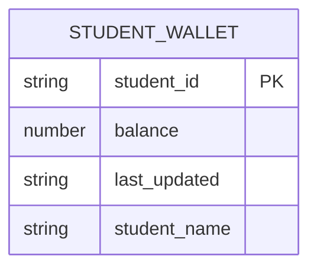
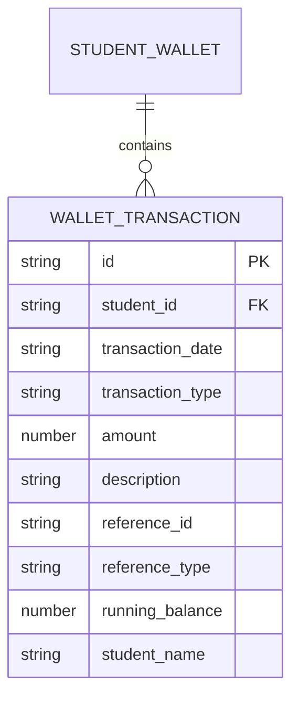
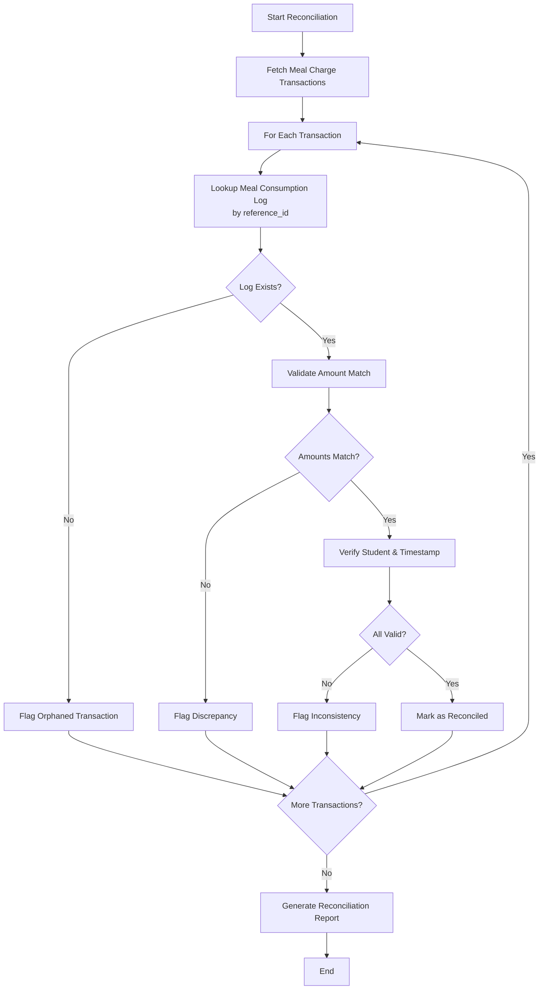
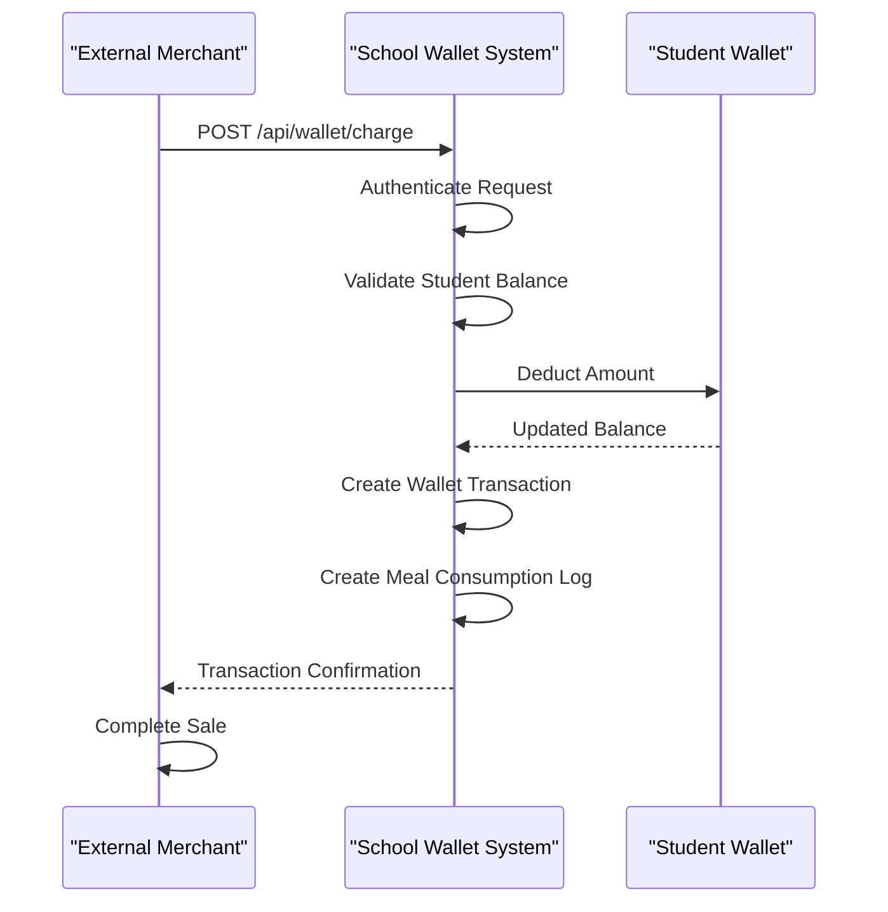

# Student Wallet Data Model

<cite>
**Referenced Files in This Document**   
- [useStudentWalletData.ts](file://src/modules/nutrition/data/useStudentWalletData.ts)
- [useWalletTransactionData.ts](file://src/modules/nutrition/data/useWalletTransactionData.ts)
- [types.ts](file://src/core/types.ts)
- [schema.ts](file://src/livestore/schema.ts)
- [types.ts](file://src/modules/nutrition/data/types.ts)
- [schema.ts](file://src/modules/nutrition/data/schema.ts)
</cite>

## Table of Contents
1. [Student Wallet Schema](#student-wallet-schema)
2. [Wallet Transaction Schema](#wallet-transaction-schema)
3. [Financial Tracking System](#financial-tracking-system)
4. [Sample Data](#sample-data)
5. [Reconciliation Process](#reconciliation-process)
6. [External Integration](#external-integration)
7. [Security and Audit](#security-and-audit)

## Student Wallet Schema

The StudentWallet entity represents a student's financial account for meal purchases and other transactions within the school system. The schema is defined in the nutrition module's database schema and includes essential fields for tracking account status and balance.

**Key Properties:**
- **student_id**: Unique identifier for the student (primary key)
- **balance**: Current wallet balance in the specified currency
- **last_updated**: Timestamp of the last balance update
- **student_name**: Denormalized student name for display purposes

The wallet schema is implemented as a database-agnostic schema using the `createDatabaseSchema` function, ensuring compatibility across different database providers. The primary key is set to `student_id`, enabling direct lookups by student.



**Diagram sources**
- [schema.ts](file://src/modules/nutrition/data/schema.ts#L118-L137)

**Section sources**
- [schema.ts](file://src/modules/nutrition/data/schema.ts#L118-L137)
- [types.ts](file://src/modules/nutrition/data/types.ts#L70-L76)

## Wallet Transaction Schema

The WalletTransaction entity records all financial activities associated with student wallets. Each transaction maintains a complete audit trail and includes metadata for reconciliation with other systems.

**Key Properties:**
- **id**: Unique transaction identifier
- **student_id**: Reference to the student
- **transaction_date**: Timestamp of transaction execution
- **transaction_type**: Type of transaction (Deposit, Purchase, Meal Charge, etc.)
- **amount**: Transaction amount (positive for credits, negative for debits)
- **description**: Human-readable description of the transaction
- **reference_id**: ID of related record (e.g., meal log, merchant sale)
- **reference_type**: Type of referenced entity
- **running_balance**: Account balance after transaction
- **student_name**: Denormalized student name

The transaction schema includes indexes on `student_id` and `transaction_date` to optimize queries for transaction history and reporting.



**Diagram sources**
- [schema.ts](file://src/modules/nutrition/data/schema.ts#L139-L165)

**Section sources**
- [schema.ts](file://src/modules/nutrition/data/schema.ts#L139-L165)
- [types.ts](file://src/modules/nutrition/data/types.ts#L78-L88)
- [types.ts](file://src/core/types.ts#L1258-L1270)

## Financial Tracking System

The financial tracking system manages meal purchases and account management through an integrated wallet system. Students can load funds into their wallets through various methods, and these funds are then used for meal purchases and other approved expenses.

The system maintains real-time balance tracking with each transaction updating the `running_balance` field in the WalletTransaction record and the `balance` field in the StudentWallet record. This dual-tracking approach ensures data consistency and provides both current balance information and complete transaction history.

When a student makes a meal purchase:
1. The system creates a meal consumption log entry
2. A corresponding wallet transaction is created with type "Meal Charge"
3. The wallet balance is updated atomically
4. The transaction includes a reference to the meal log ID

The system supports multiple transaction types through the `NutrWalletTransactionType` enum, including:
- **Deposit**: Funds added to the wallet
- **Purchase**: General purchase transaction
- **Meal Charge**: Specific charge for meal consumption
- **Adjustment (Debit)**: Administrative balance reduction
- **Adjustment (Credit)**: Administrative balance increase

**Section sources**
- [types.ts](file://src/modules/nutrition/data/types.ts#L67-L69)
- [schema.ts](file://src/modules/nutrition/data/schema.ts#L139-L165)

## Sample Data

The following JSON example demonstrates a student wallet with transaction history including top-ups and meal deductions:

```json
{
  "studentWallet": {
    "student_id": "STU001",
    "balance": 1250.00,
    "last_updated": "2024-01-15T14:30:00Z",
    "student_name": "John Doe"
  },
  "transactions": [
    {
      "id": "WTX001",
      "student_id": "STU001",
      "transaction_date": "2024-01-10T09:15:00Z",
      "transaction_type": "Deposit",
      "amount": 2000.00,
      "description": "Parent top-up via mobile payment",
      "reference_id": "PAY12345",
      "reference_type": "EXTERNAL_PAYMENT",
      "running_balance": 2000.00,
      "student_name": "John Doe"
    },
    {
      "id": "WTX002",
      "student_id": "STU001",
      "transaction_date": "2024-01-10T12:30:00Z",
      "transaction_type": "Meal Charge",
      "amount": -150.00,
      "description": "Lunch purchase - Cafeteria",
      "reference_id": "MCL001",
      "reference_type": "MEAL_CONSUMPTION_LOG",
      "running_balance": 1850.00,
      "student_name": "John Doe"
    },
    {
      "id": "WTX003",
      "student_id": "STU001",
      "transaction_date": "2024-01-11T12:45:00Z",
      "transaction_type": "Meal Charge",
      "amount": -120.00,
      "description": "Lunch purchase - Cafeteria",
      "reference_id": "MCL002",
      "reference_type": "MEAL_CONSUMPTION_LOG",
      "running_balance": 1730.00,
      "student_name": "John Doe"
    },
    {
      "id": "WTX004",
      "student_id": "STU001",
      "transaction_date": "2024-01-15T14:30:00Z",
      "transaction_type": "Adjustment (Credit)",
      "amount": 500.00,
      "description": "Scholarship credit applied",
      "reference_id": "ADJ001",
      "reference_type": "ADMIN_ADJUSTMENT",
      "running_balance": 2230.00,
      "student_name": "John Doe"
    },
    {
      "id": "WTX005",
      "student_id": "STU001",
      "transaction_date": "2024-01-15T14:30:30Z",
      "transaction_type": "Meal Charge",
      "amount": -980.00,
      "description": "Dinner purchase - Merchant Partner",
      "reference_id": "MCL003",
      "reference_type": "MEAL_CONSUMPTION_LOG",
      "running_balance": 1250.00,
      "student_name": "John Doe"
    }
  ]
}
```

**Section sources**
- [useStudentWalletData.ts](file://src/modules/nutrition/data/useStudentWalletData.ts)
- [useWalletTransactionData.ts](file://src/modules/nutrition/data/useWalletTransactionData.ts)

## Reconciliation Process

The reconciliation process ensures consistency between wallet transactions and meal consumption records. This process runs periodically and verifies that all meal charges in the wallet system correspond to valid meal consumption logs.

The reconciliation workflow:
1. Retrieve all wallet transactions with type "Meal Charge"
2. For each transaction, verify the existence of a corresponding meal consumption log using the `reference_id`
3. Validate that the `charged_amount` in the meal log matches the transaction `amount`
4. Confirm that the `student_id` and timestamps are consistent
5. Generate reconciliation reports for any discrepancies

The system uses denormalized fields in both entities to optimize reconciliation queries:
- WalletTransaction includes `student_name` and `menu_description` from related records
- MealConsumptionLog includes `wallet_transaction_id` for direct linking

This bidirectional referencing enables efficient reconciliation without complex joins, improving performance during end-of-day processing.



**Diagram sources**
- [schema.ts](file://src/modules/nutrition/data/schema.ts#L139-L165)
- [schema.ts](file://src/modules/nutrition/data/schema.ts#L99-L116)

**Section sources**
- [schema.ts](file://src/modules/nutrition/data/schema.ts#L99-L116)
- [schema.ts](file://src/modules/nutrition/data/schema.ts#L139-L165)

## External Integration

The system integrates with external payment systems and merchant accounts through the `useMerchantData` functionality. This integration enables students to use their wallet balances at partner merchants while maintaining centralized financial tracking.

The Merchant entity schema includes:
- **id**: Unique merchant identifier
- **name**: Merchant business name
- **gl_account_id**: Reference to the general ledger account
- **gl_account_name**: Denormalized GL account name

When a student makes a purchase at a linked merchant:
1. The merchant system sends a transaction request to the school's API
2. The system validates the student's wallet balance
3. A wallet transaction is created with type "Purchase" or "Meal Charge"
4. The meal consumption log is created with reference to the merchant
5. The merchant receives confirmation and the transaction is completed

The integration uses a secure API with authentication and rate limiting to prevent unauthorized access. Transaction requests include digital signatures to ensure data integrity.



**Diagram sources**
- [schema.ts](file://src/modules/nutrition/data/schema.ts#L90-L97)
- [schema.ts](file://src/modules/nutrition/data/schema.ts#L139-L165)

**Section sources**
- [schema.ts](file://src/modules/nutrition/data/schema.ts#L90-L97)
- [schema.ts](file://src/modules/nutrition/data/schema.ts#L139-L165)

## Security and Audit

The financial data system implements multiple security layers to protect sensitive information and ensure audit compliance. All wallet transactions are immutable once created, preventing unauthorized alterations to financial records.

**Security Measures:**
- **Data Encryption**: Sensitive financial data is encrypted at rest and in transit
- **Access Controls**: Role-based access control (RBAC) restricts financial operations to authorized personnel
- **Audit Trails**: Every transaction includes creation and update timestamps
- **Immutable Records**: Transactions cannot be deleted, only voided with explanatory notes
- **Input Validation**: All transaction amounts and references are validated before processing

The system maintains comprehensive audit requirements by preserving:
- Complete transaction history with running balances
- References to source systems and related records
- Timestamps for all financial operations
- User context for administrative adjustments

Regular audit reports can be generated to track:
- Balance changes over time
- Transaction volume by type
- Merchant partnership activity
- Reconciliation status
- System integrity checks

These measures ensure compliance with financial regulations and provide transparency in student account management.

**Section sources**
- [useStudentWalletData.ts](file://src/modules/nutrition/data/useStudentWalletData.ts)
- [useWalletTransactionData.ts](file://src/modules/nutrition/data/useWalletTransactionData.ts)
- [types.ts](file://src/modules/nutrition/data/types.ts)