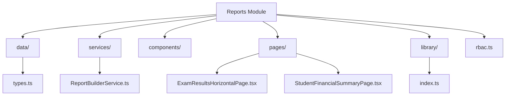
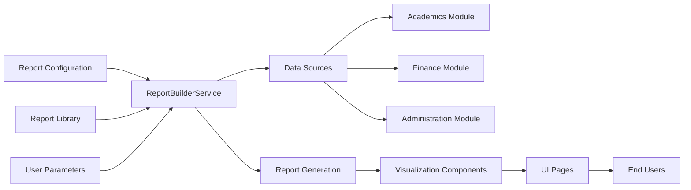
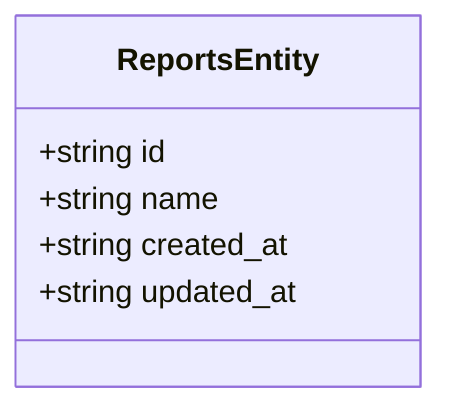
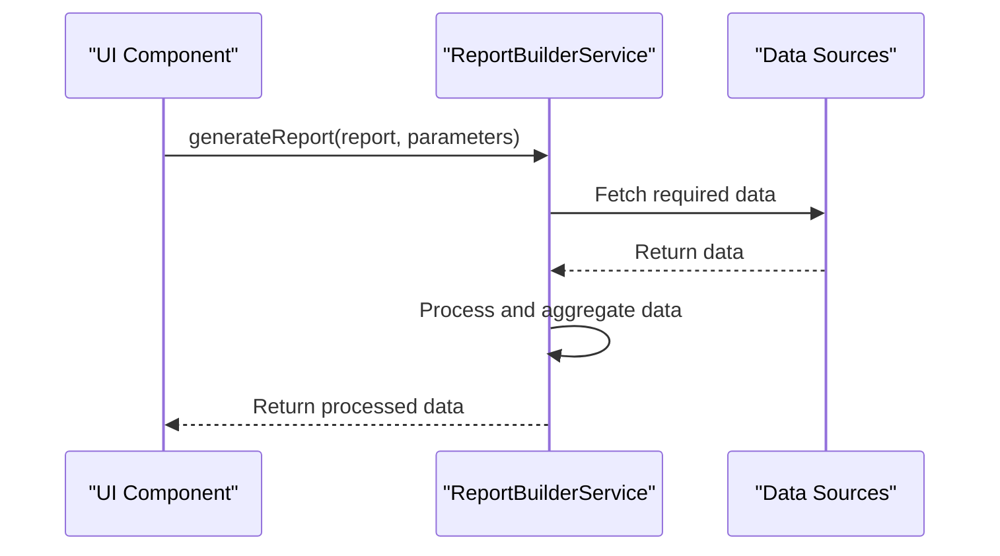
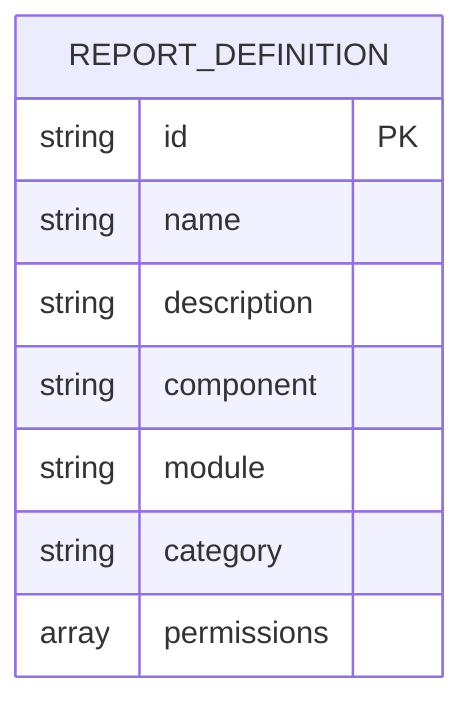
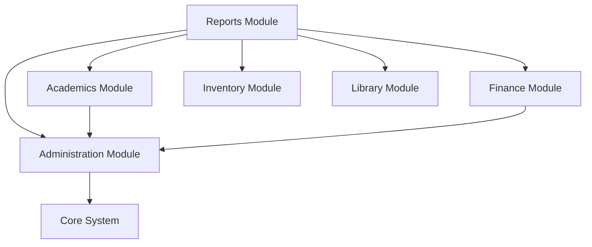

# Reports Data Model

<cite>
**Referenced Files in This Document**   
- [types.ts](file://src/modules/reports/data/types.ts)
- [ReportBuilderService.ts](file://src/modules/reports/services/ReportBuilderService.ts)
- [index.ts](file://src/modules/reports/library/index.ts)
- [ExamResultsHorizontalPage.tsx](file://src/modules/reports/pages/ExamResultsHorizontalPage.tsx)
- [StudentFinancialSummaryPage.tsx](file://src/modules/reports/pages/StudentFinancialSummaryPage.tsx)
- [reports.json](file://src/i18n/locales/en/reports.json)
</cite>

## Table of Contents
1. [Introduction](#introduction)
2. [Project Structure](#project-structure)
3. [Core Components](#core-components)
4. [Architecture Overview](#architecture-overview)
5. [Detailed Component Analysis](#detailed-component-analysis)
6. [Dependency Analysis](#dependency-analysis)
7. [Performance Considerations](#performance-considerations)
8. [Troubleshooting Guide](#troubleshooting-guide)
9. [Conclusion](#conclusion)

## Introduction
This document provides comprehensive documentation for the Reports module in schoolpilot3, detailing the data model, schema design, and dynamic configuration capabilities. The system enables flexible reporting across academic, financial, and operational domains with support for dynamic data aggregation and visualization. The documentation covers metadata structures, field-level details, and relationships between operational data and analytical reporting entities.

## Project Structure
The Reports module follows a modular architecture with clearly defined components for data, services, and UI. It integrates with multiple modules to provide cross-functional reporting capabilities.

**Diagram sources**
- [types.ts](file://src/modules/reports/data/types.ts)
- [ReportBuilderService.ts](file://src/modules/reports/services/ReportBuilderService.ts)
- [index.ts](file://src/modules/reports/library/index.ts)

**Section sources**
- [types.ts](file://src/modules/reports/data/types.ts#L1-L6)
- [ReportBuilderService.ts](file://src/modules/reports/services/ReportBuilderService.ts#L1-L10)

## Core Components
The Reports module consists of several core components that enable dynamic report generation and visualization. The system is designed to support both predefined and custom reports with flexible data sourcing and presentation options.

**Section sources**
- [types.ts](file://src/modules/reports/data/types.ts#L1-L6)
- [ReportBuilderService.ts](file://src/modules/reports/services/ReportBuilderService.ts#L1-L10)

## Architecture Overview
The reporting architecture follows a service-oriented design with clear separation between data definitions, processing logic, and presentation components. The system supports dynamic report configuration and integrates with multiple data sources across the application.

**Diagram sources**
- [ReportBuilderService.ts](file://src/modules/reports/services/ReportBuilderService.ts#L1-L10)
- [index.ts](file://src/modules/reports/library/index.ts#L1-L26)

## Detailed Component Analysis

### Report Data Model
The core data model for reports is defined by the ReportsEntity interface, which provides basic metadata for all report entities in the system.

**Diagram sources**
- [types.ts](file://src/modules/reports/data/types.ts#L3-L7)

**Section sources**
- [types.ts](file://src/modules/reports/data/types.ts#L3-L7)

### Report Generation Service
The ReportBuilderService is responsible for generating reports based on report definitions and parameters. It serves as the central processing component for report execution.

**Diagram sources**
- [ReportBuilderService.ts](file://src/modules/reports/services/ReportBuilderService.ts#L6-L10)

**Section sources**
- [ReportBuilderService.ts](file://src/modules/reports/services/ReportBuilderService.ts#L6-L10)

### Report Library and Metadata Structure
The report library contains predefined report definitions with metadata that includes permissions, categories, and component mappings. This structure enables dynamic loading and access control for reports.

**Diagram sources**
- [index.ts](file://src/modules/reports/library/index.ts#L10-L25)

**Section sources**
- [index.ts](file://src/modules/reports/library/index.ts#L10-L25)

## Dependency Analysis
The Reports module has dependencies on multiple other modules in the system, enabling cross-functional reporting capabilities.

**Diagram sources**
- [modules.json](file://src/config/modules.json#L53-L73)

**Section sources**
- [modules.json](file://src/config/modules.json#L53-L73)

## Performance Considerations
The reporting system must handle large datasets efficiently, particularly for financial and academic reports that aggregate data across multiple dimensions. The current implementation uses a placeholder approach in the ReportBuilderService, indicating that performance optimization strategies will need to be implemented.

For large dataset reporting, the following strategies should be considered:
- **Data aggregation at the source**: Push aggregation operations to the database level
- **Caching mechanisms**: Implement result caching for frequently accessed reports
- **Pagination**: Support for paginated results in data-intensive reports
- **Asynchronous processing**: Background job processing for complex reports

The system currently lacks explicit data aggregation strategies in the report generation service, which may impact performance with large datasets.

**Section sources**
- [ReportBuilderService.ts](file://src/modules/reports/services/ReportBuilderService.ts#L6-L10)

## Troubleshooting Guide
When troubleshooting issues with the Reports module, consider the following common problems and solutions:

1. **Report generation failures**: Verify that all required parameters are provided and that data sources are accessible
2. **Missing report definitions**: Check that report components are properly exported in the library index
3. **Permission issues**: Ensure users have the required permissions defined in report definitions
4. **Data inconsistencies**: Validate that source data modules are properly synchronized

The current implementation shows export functionality as "to be developed" in several report pages, indicating that export features are not yet fully implemented.

**Section sources**
- [ExamResultsHorizontalPage.tsx](file://src/modules/reports/pages/ExamResultsHorizontalPage.tsx#L156-L180)
- [StudentFinancialSummaryPage.tsx](file://src/modules/reports/pages/StudentFinancialSummaryPage.tsx#L131-L151)

## Conclusion
The Reports module in schoolpilot3 provides a foundation for dynamic reporting across multiple domains. The architecture supports flexible report configuration and integration with various data sources. Key components include the ReportBuilderService for report generation and the report library for predefined report definitions. While the core structure is in place, several features such as export functionality and performance optimizations require further development. The module successfully establishes relationships between operational data entities and their analytical counterparts, enabling comprehensive reporting capabilities across academic, financial, and administrative domains.