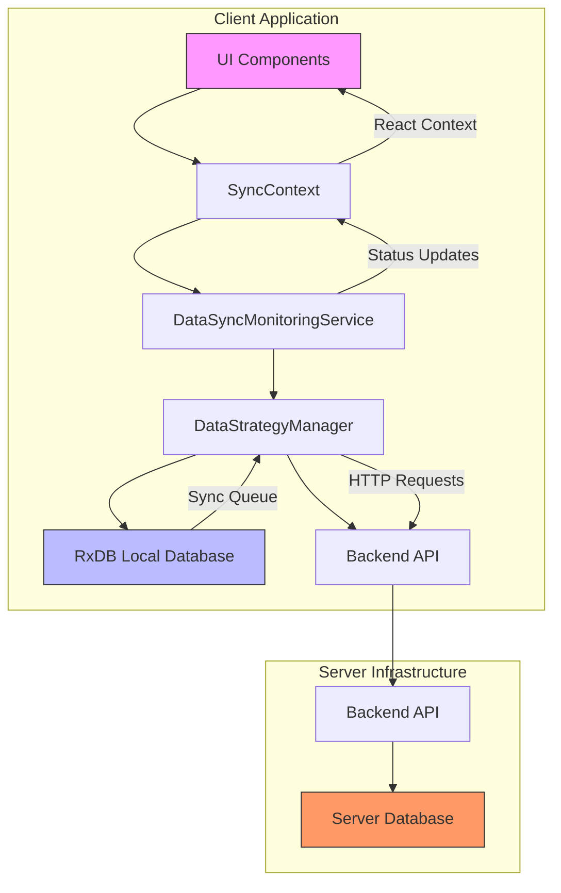
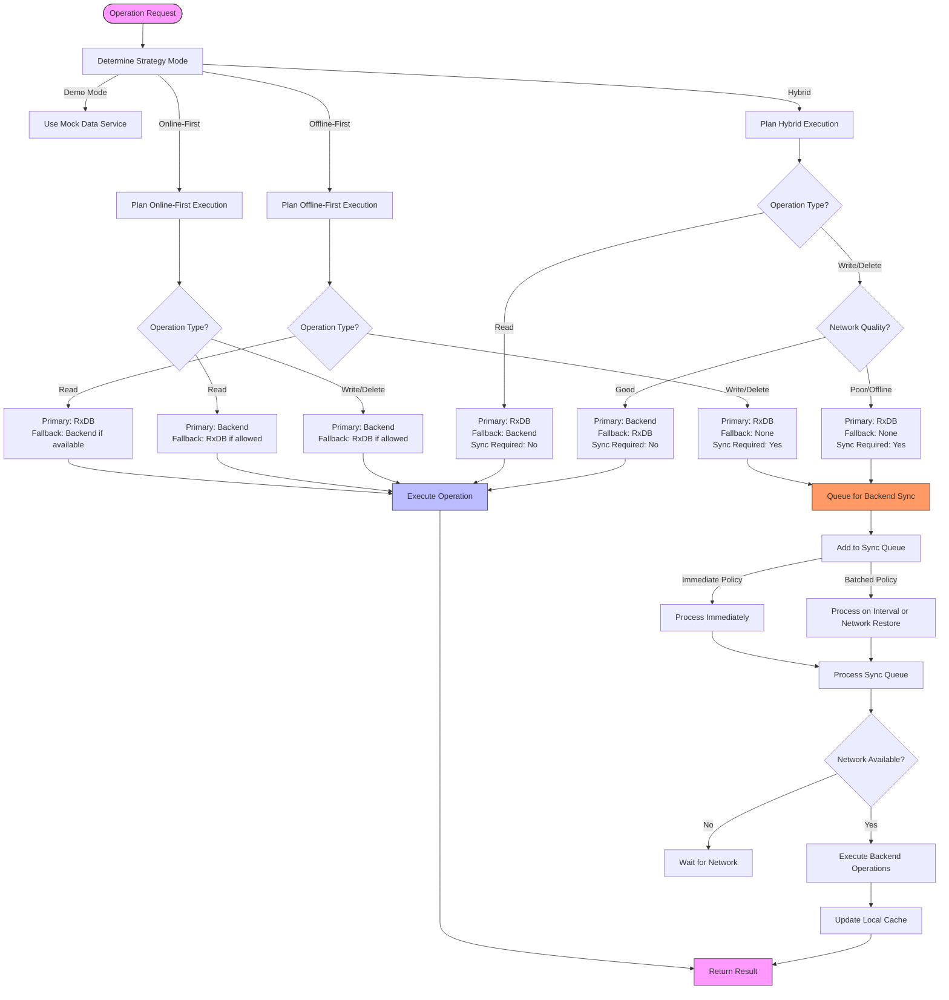
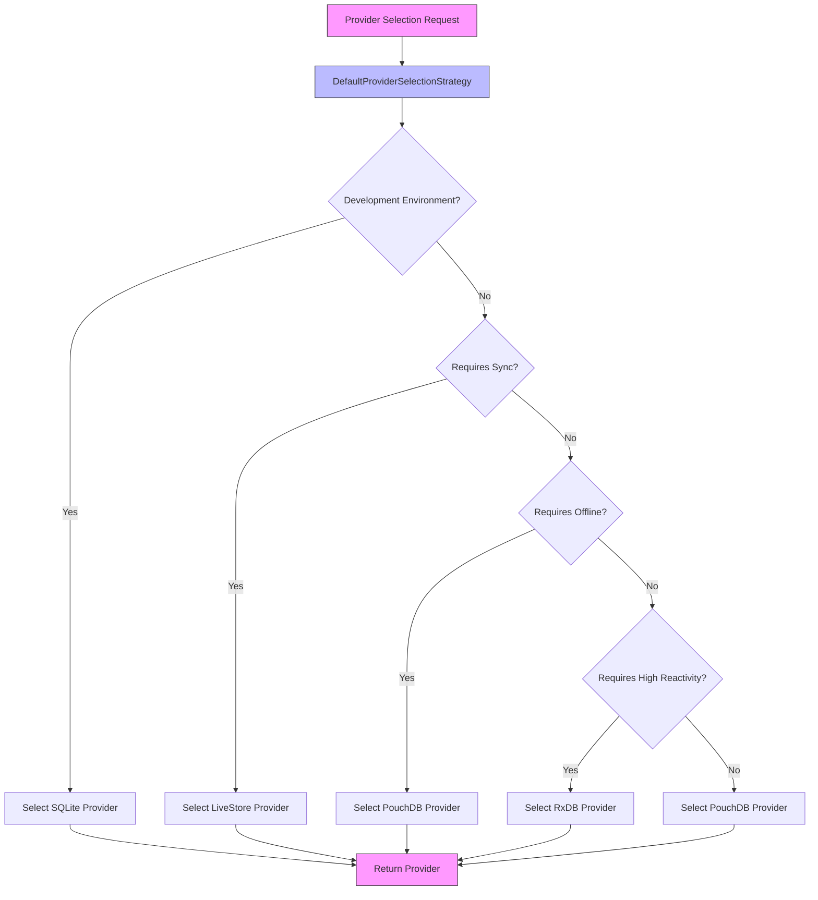
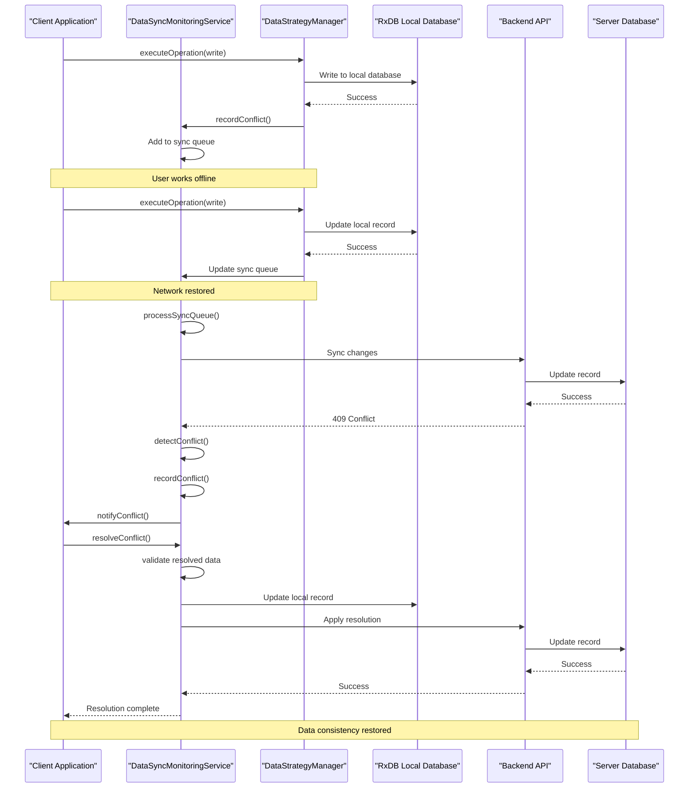
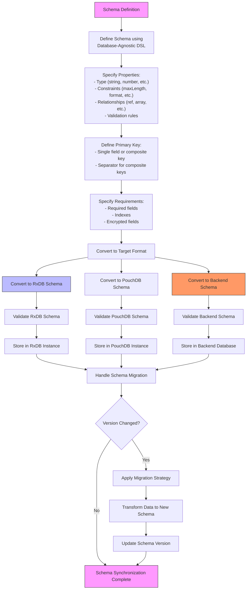

# Data Synchronization

<cite>
**Referenced Files in This Document**   
- [DataSyncMonitoringService.ts](file://src/services/DataSyncMonitoringService.ts)
- [DataStrategyManager.ts](file://src/services/DataStrategyManager.ts)
- [SyncContext.tsx](file://src/contexts/SyncContext.tsx)
- [rxdbService.ts](file://src/services/rxdbService.ts)
- [databaseAgnosticSchema.ts](file://src/utils/databaseAgnosticSchema.ts)
- [ConflictDetectionEngine.ts](file://src/modules/academics/services/ConflictDetectionEngine.ts)
- [ConflictResolutionInterface.tsx](file://src/components/ConflictResolutionInterface.tsx)
- [ProviderSelector.ts](file://src/services/database/ProviderSelector.ts) - *Updated in recent commit*
- [DatabaseProviderFactory.ts](file://src/services/database/DatabaseProviderFactory.ts) - *Updated in recent commit*
</cite>

## Update Summary
**Changes Made**   
- Updated documentation to reflect enhanced provider selection and fallback mechanisms in the database layer
- Added details about the improved provider selection strategy and fallback logic in DataSyncMonitoringService
- Updated hybrid synchronization strategy section to include new provider selection logic
- Enhanced troubleshooting section with new provider-related issues
- Added new diagram for provider selection process
- Removed outdated information about LiveStore implementation status as provider selection is now dynamic

## Table of Contents
1. [Introduction](#introduction)
2. [Data Synchronization Architecture](#data-synchronization-architecture)
3. [Connection Status and Sync Progress Monitoring](#connection-status-and-sync-progress-monitoring)
4. [Hybrid Synchronization Strategy](#hybrid-synchronization-strategy)
5. [Conflict Detection and Resolution](#conflict-detection-and-resolution)
6. [Sync Event Handling in UI Components](#sync-event-handling-in-ui-components)
7. [Schema Synchronization Process](#schema-synchronization-process)
8. [Troubleshooting Common Sync Issues](#troubleshooting-common-sync-issues)

## Introduction
The schoolpilot3 data synchronization system provides a robust framework for managing data consistency across distributed databases in educational institutions. This documentation details the architecture, implementation, and operational aspects of the synchronization system, focusing on the core components that enable offline-first capabilities with real-time updates. The system is designed to handle complex scenarios such as concurrent edits on student records and financial transactions while maintaining data integrity across multiple devices and network conditions.

Recent code changes have enhanced the database provider selection and fallback mechanisms, enabling more robust data persistence across different environments. The ProviderSelector and DatabaseProviderFactory now implement intelligent provider selection based on environment, requirements, and availability, with automatic fallback to PouchDB when preferred providers are unavailable. This documentation reflects these updates, providing accurate information about the current provider selection strategy and its impact on data synchronization.

## Data Synchronization Architecture



**Diagram sources**
- [DataSyncMonitoringService.ts](file://src/services/DataSyncMonitoringService.ts)
- [DataStrategyManager.ts](file://src/services/DataStrategyManager.ts)
- [SyncContext.tsx](file://src/contexts/SyncContext.tsx)

**Section sources**
- [DataSyncMonitoringService.ts](file://src/services/DataSyncMonitoringService.ts)
- [DataStrategyManager.ts](file://src/services/DataStrategyManager.ts)

## Connection Status and Sync Progress Monitoring

The DataSyncMonitoringService is responsible for tracking connection status, sync progress, and conflict occurrences across distributed databases. It provides comprehensive monitoring capabilities through a centralized service that aggregates synchronization metrics and status information.

```mermaid
classDiagram
class DataSyncMonitoringService {
+dataStrategyManager : DataStrategyManager
+networkManager : NetworkStateManager
+conflicts : Map<string, SyncConflict>
+errors : SyncError[]
+metrics : SyncMetrics
+subscribers : Array<(status : SyncStatus) => void>
+getSyncStatus() : SyncStatus
+recordConflict() : string
+resolveConflict() : Promise<boolean>
+recordError() : void
+subscribe() : () => void
+forceSyncAll() : Promise<void>
}
class SyncStatus {
+isActive : boolean
+mode : 'idle' | 'syncing' | 'paused' | 'error'
+progress : { current : number, total : number, percentage : number }
+queue : { pending : number, processing : number, completed : number, failed : number }
+conflicts : { total : number, unresolved : number, byType : Record<string, number> }
+lastSync : Date | null
+nextSync : Date | null
+errors : SyncError[]
+performance : { averageSyncTime : number, successRate : number, throughput : number }
}
class SyncConflict {
+id : string
+entityName : string
+entityId : string | number
+conflictType : 'version' | 'concurrent_edit' | 'deleted_locally' | 'deleted_remotely'
+localData : any
+remoteData : any
+timestamp : Date
+resolved : boolean
+resolution? : ConflictResolution
}
class ConflictResolution {
+strategy : 'local_wins' | 'remote_wins' | 'merge' | 'manual'
+resolvedData? : any
+resolvedBy? : string
+resolvedAt : Date
+notes? : string
}
class SyncError {
+id : string
+timestamp : Date
+entityName : string
+entityId? : string | number
+operation : 'create' | 'update' | 'delete' | 'sync'
+error : string
+retryCount : number
+resolved : boolean
}
class SyncMetrics {
+totalOperations : number
+successfulOperations : number
+failedOperations : number
+averageLatency : number
+peakLatency : number
+throughput : number
+errorRate : number
+conflictRate : number
+cacheHitRate : number
}
DataSyncMonitoringService --> SyncStatus : "provides"
DataSyncMonitoringService --> SyncConflict : "manages"
DataSyncMonitoringService --> ConflictResolution : "applies"
DataSyncMonitoringService --> SyncError : "records"
DataSyncMonitoringService --> SyncMetrics : "tracks"
```

**Diagram sources**
- [DataSyncMonitoringService.ts](file://src/services/DataSyncMonitoringService.ts#L25-L482)

**Section sources**
- [DataSyncMonitoringService.ts](file://src/services/DataSyncMonitoringService.ts#L25-L482)

The DataSyncMonitoringService tracks connection status by integrating with the NetworkStateManager to detect online/offline transitions and backend availability. When network connectivity is lost, the service automatically transitions to a "paused" mode, suspending synchronization operations until connectivity is restored. The service maintains a comprehensive sync status object that includes:

- **Connection status**: Real-time monitoring of network connectivity and backend availability
- **Sync progress**: Percentage completion, current/total operations, and estimated completion time
- **Queue metrics**: Pending, processing, completed, and failed operations categorized by priority
- **Conflict tracking**: Total conflicts, unresolved conflicts, and conflict types distribution
- **Performance metrics**: Average sync time, success rate, and throughput (items per minute)

The service employs a polling mechanism that updates metrics every 5 seconds and notifies subscribed components of status changes. It also maintains a history of sync operations to calculate performance metrics and success rates over time.

Recent updates to the DataSyncMonitoringService have enhanced its integration with the provider selection system. When the active database provider becomes unavailable, the service now automatically coordinates with the DatabaseProviderFactory to switch to a fallback provider (typically PouchDB), ensuring continuous data availability and synchronization capabilities. This enhancement improves system resilience in environments where preferred providers may not be available.

## Hybrid Synchronization Strategy

The hybrid synchronization strategy in schoolpilot3 combines offline-first capabilities with real-time updates through the DataStrategyManager, which implements intelligent operation routing based on network conditions, operation priority, and data requirements.



**Diagram sources**
- [DataStrategyManager.ts](file://src/services/DataStrategyManager.ts#L0-L573)

**Section sources**
- [DataStrategyManager.ts](file://src/services/DataStrategyManager.ts#L0-L573)

The DataStrategyManager implements a flexible strategy system that can operate in different modes:

- **Offline-first**: Prioritizes local RxDB operations for maximum responsiveness, queuing changes for backend synchronization when connectivity is available
- **Online-first**: Prefers direct backend operations for immediate consistency, falling back to local storage when offline
- **Hybrid**: Intelligent routing that uses local storage for read operations (cache-first) and prefers backend for write operations when network quality is good
- **Demo**: Uses mock data service for demonstration purposes without actual backend communication

The strategy manager evaluates each operation based on:
- Operation type (read, write, delete)
- Priority (critical, high, normal, low)
- Whether the operation requires backend connectivity
- Whether offline operation is allowed
- Network state and connection quality

For write operations in offline mode, changes are stored in the local RxDB instance and added to a persistent sync queue for later transmission to the backend. The sync queue prioritizes operations based on their priority level, ensuring critical operations are processed first when connectivity is restored.

Recent implementation updates have enhanced the provider selection mechanism through the DatabaseProviderFactory and ProviderSelector. The system now implements a more sophisticated provider selection strategy that considers environment, requirements, and availability:



**Diagram sources**
- [DatabaseProviderFactory.ts](file://src/services/database/DatabaseProviderFactory.ts#L100-L250)
- [ProviderSelector.ts](file://src/services/database/ProviderSelector.ts#L50-L200)

The enhanced provider selection strategy now:
- Uses SQLite for development environments with persistent storage requirements
- Selects LiveStore for production environments requiring real-time sync and high performance
- Falls back to PouchDB when preferred providers are unavailable
- Automatically handles provider switching and initialization

This improved provider selection enhances system reliability and performance across different deployment scenarios.

## Conflict Detection and Resolution

The system implements a comprehensive conflict detection and resolution mechanism to handle concurrent edits on student records, financial transactions, and other critical data entities. Conflicts are detected during synchronization when the same record has been modified in both the local database and the server database.



**Diagram sources**
- [DataSyncMonitoringService.ts](file://src/services/DataSyncMonitoringService.ts#L25-L482)
- [DataStrategyManager.ts](file://src/services/DataStrategyManager.ts#L0-L573)
- [ConflictDetectionEngine.ts](file://src/modules/academics/services/ConflictDetectionEngine.ts#L14-L248)

**Section sources**
- [DataSyncMonitoringService.ts](file://src/services/DataSyncMonitoringService.ts#L25-L482)
- [ConflictDetectionEngine.ts](file://src/modules/academics/services/ConflictDetectionEngine.ts#L14-L248)
- [ConflictResolutionInterface.tsx](file://src/components/ConflictResolutionInterface.tsx#L0-L44)

Conflict detection occurs when the backend rejects a synchronization request due to a version mismatch or when the DataSyncMonitoringService identifies conflicting changes during the sync process. The system supports several conflict resolution strategies:

- **Local wins**: The locally modified data overrides the server version
- **Remote wins**: The server version overrides the local changes
- **Merge**: Combines changes from both versions, typically preserving the latest timestamps
- **Manual**: User intervention required to resolve the conflict through a dedicated UI

The ConflictResolutionInterface component provides a user-friendly interface for resolving conflicts, displaying both versions of the conflicting data and allowing users to choose which fields to keep from each version. For automated resolution, the system implements a merge strategy that preserves creation timestamps from the local version while using the latest update timestamp from either version.

## Sync Event Handling in UI Components

UI components interact with the synchronization system through the SyncContext, which provides a React context-based API for accessing sync status and controls. This allows components to respond to synchronization events and display relevant information to users.

```mermaid
classDiagram
class SyncContext {
+syncStatus : SyncStatus
+pendingSyncCount : number
+lastSyncTime : Date | null
+forceSync() : Promise<void>
+pauseSync() : void
+resumeSync() : void
+getQueueStatus() : QueueStatus
+clearQueue() : void
+clearSyncQueue() : void
+getSyncSettings() : SyncSettings
+updateSyncSettings() : void
+offlineCapabilities : OfflineCapability[]
+disabledFeatures : string[]
}
class SyncStatus {
+state : 'idle' | 'syncing' | 'error' | 'paused'
+progress : number
+lastError : Error | null
+conflictsCount : number
+lastSyncTime : Date | null
}
class QueueStatus {
+api : { pending : number, processing : boolean, byPriority : Record<string, number> }
+sync : { pending : number, processing : boolean, byPriority : Record<string, number>, errors : number }
}
class SyncSettings {
+autoSync : boolean
+syncInterval : number
+batchSize : number
}
class OfflineCapability {
+feature : string
+available : boolean
+reason? : string
+alternativeAction? : string
}
SyncContext --> SyncStatus
SyncContext --> QueueStatus
SyncContext --> SyncSettings
SyncContext --> OfflineCapability
class SyncProvider {
+children : ReactNode
+isOnline : boolean
+syncStatus : SyncStatus
+syncSettings : SyncSettings
+forceSync() : Promise<void>
+pauseSync() : void
+resumeSync() : void
+getQueueStatus() : QueueStatus
+clearQueue() : void
+clearSyncQueue() : void
+getSyncSettings() : SyncSettings
+updateSyncSettings() : void
+offlineCapabilities : OfflineCapability[]
+disabledFeatures : string[]
+contextValue : SyncContextType
}
class useSync {
+returns : SyncContextType
}
SyncProvider --> SyncContext : "provides"
useSync --> SyncContext : "consumes"
```

**Diagram sources**
- [SyncContext.tsx](file://src/contexts/SyncContext.tsx#L0-L197)

**Section sources**
- [SyncContext.tsx](file://src/contexts/SyncContext.tsx#L0-L197)

The SyncContext exposes the following functionality to UI components:

- **Sync status**: Current state (idle, syncing, error, paused), progress percentage, last error, and conflict count
- **Sync controls**: Methods to force synchronization, pause/resume sync operations
- **Queue management**: Access to API and sync queue status, ability to clear queues
- **Sync settings**: Configuration for auto-sync, sync interval, and batch size
- **Offline capabilities**: Information about which features are available offline and which are disabled

Components can use the `useSync()` hook to access the synchronization context and respond to changes in sync status. For example, a component might display a sync indicator when synchronization is in progress or show a conflict notification when unresolved conflicts exist.

```typescript
// Example usage of SyncContext in a UI component
const SyncIndicator = () => {
  const { syncStatus, forceSync, getQueueStatus } = useSync();
  const { isOnline } = useNetwork();
  
  const queueStatus = getQueueStatus();
  const hasPendingOperations = queueStatus.sync.pending > 0;
  
  return (
    <div className="sync-indicator">
      <span>Status: {syncStatus.state}</span>
      {syncStatus.progress > 0 && syncStatus.progress < 100 && (
        <span>Progress: {Math.round(syncStatus.progress)}%</span>
      )}
      {syncStatus.conflictsCount > 0 && (
        <button onClick={() => showConflictModal()}>
          {syncStatus.conflictsCount} conflicts to resolve
        </button>
      )}
      {hasPendingOperations && isOnline && (
        <button onClick={forceSync}>Sync Now</button>
      )}
    </div>
  );
};
```

## Schema Synchronization Process

The schema synchronization process ensures consistency between client-side RxDB instances and server-side databases through a database-agnostic schema definition system. This approach allows the application to maintain compatible data structures across different database technologies while supporting evolution of the data model over time.



**Diagram sources**
- [databaseAgnosticSchema.ts](file://src/utils/databaseAgnosticSchema.ts)
- [rxdbService.ts](file://src/services/rxdbService.ts)

**Section sources**
- [databaseAgnosticSchema.ts](file://src/utils/databaseAgnosticSchema.ts)
- [rxdbService.ts](file://src/services/rxdbService.ts)

The schema synchronization process follows these key principles:

1. **Database-agnostic definitions**: Schemas are defined using a custom DSL (Domain Specific Language) that is independent of any specific database technology. This allows the same schema definition to be converted to RxDB, PouchDB, or backend database formats.

2. **Centralized schema management**: Each module defines its collections and schemas in dedicated files (e.g., `collections.ts` and `schema.ts` in module data directories). These definitions are imported by the central rxdbService to create the database structure.

3. **Schema conversion**: The DatabaseSchemaConverter class transforms the database-agnostic schema definitions into formats compatible with specific database technologies:
   - `convertToRxDBSchema()`: Converts to RxDB-compatible schema format
   - `convertToPouchDBSchema()`: Converts to PouchDB-compatible schema format

4. **Migration support**: The system supports schema versioning and migration strategies to handle changes to data structures over time. When a schema version changes, the system applies the appropriate migration strategy to transform existing data to the new schema format.

5. **Validation and consistency**: Schema definitions include validation rules, required fields, indexes, and encryption specifications to ensure data integrity and security across all database instances.

The schema definition process uses helper functions like `SchemaHelpers.string()`, `SchemaHelpers.number()`, and `SchemaHelpers.ref()` to create consistent property definitions with appropriate constraints and validation rules. This ensures that data entered on the client side will be compatible with server-side validation and storage requirements.

## Troubleshooting Common Sync Issues

This section provides guidance for diagnosing and resolving common synchronization issues that may occur in the schoolpilot3 system.

### Stalled Replications
When synchronization appears to be stalled or not progressing:

1. **Check network connectivity**: Verify that the device has internet connectivity and can reach the backend server.
2. **Examine the sync queue**: Use the SyncContext or DataSyncMonitoringService to check the status of the sync queue:
   ```typescript
   const queueStatus = globalDataSyncMonitoringService.getSyncStatus().queue;
   console.log('Sync queue status:', queueStatus);
   ```
3. **Review error logs**: Check for any sync errors that might be preventing operations from completing:
   ```typescript
   const errors = globalDataSyncMonitoringService.getSyncStatus().errors;
   console.log('Sync errors:', errors);
   ```
4. **Force synchronization**: Attempt to force synchronization to restart the process:
   ```typescript
   await globalDataSyncMonitoringService.forceSyncAll();
   ```
5. **Check database locks**: In rare cases, database locks might prevent sync operations. Restarting the application can resolve this issue.
6. **Verify provider status**: Check if the active database provider is functioning correctly:
   ```typescript
   const providerStatus = globalDataSyncMonitoringService.getProviderStatus();
   console.log('Database provider status:', providerStatus);
   ```

### Authentication Failures During Sync
When synchronization fails due to authentication issues:

1. **Verify authentication state**: Ensure the user is properly authenticated:
   ```typescript
   const authState = authService.getAuthState();
   console.log('Authentication state:', authState);
   ```
2. **Check token expiration**: Authentication tokens may have expired. Attempt to refresh the token:
   ```typescript
   try {
     await authService.refreshToken();
     await globalDataSyncMonitoringService.forceSyncAll();
   } catch (error) {
     console.error('Token refresh failed:', error);
     // Prompt user to log in again
   }
   ```
3. **Review API request headers**: Ensure that authentication headers are being properly attached to sync requests. The BackendAPIService should automatically include authentication tokens.
4. **Check backend authentication logs**: Examine server logs for authentication-related errors that might provide more specific information about the failure.

### Provider Selection and Fallback Issues
When database provider selection or fallback is not working as expected:

1. **Check available providers**: Verify which providers are available in the current environment:
   ```typescript
   const availableProviders = getDatabaseProviderFactory().getAvailableProviders();
   console.log('Available providers:', availableProviders);
   ```
2. **Review provider selection strategy**: Check the current provider selection strategy and requirements:
   ```typescript
   const providerStatus = getDatabaseProviderFactory().getProviderStatus();
   console.log('Provider status:', providerStatus);
   ```
3. **Force provider switch**: If needed, manually switch to a different provider:
   ```typescript
   try {
     await getDatabaseManager().switchProvider('pouchdb', { name: 'schoolpilot' });
     console.log('Successfully switched to PouchDB provider');
   } catch (error) {
     console.error('Failed to switch provider:', error);
   }
   ```
4. **Check provider initialization**: Verify that the selected provider has been properly initialized:
   ```typescript
   const dbManager = getDatabaseManager();
   if (dbManager.isAvailable()) {
     console.log('Database manager is available');
   } else {
     console.log('Database manager is not available');
   }
   ```

### Conflict Resolution Issues
When conflicts are not being resolved properly:

1. **Verify conflict detection**: Ensure that conflicts are being properly detected and recorded:
   ```typescript
   const conflicts = globalDataSyncMonitoringService.getUnresolvedConflicts();
   console.log('Unresolved conflicts:', conflicts);
   ```
2. **Check resolution strategy**: Verify that the appropriate conflict resolution strategy is being applied:
   ```typescript
   await globalDataSyncMonitoringService.resolveConflict(conflictId, {
     strategy: 'merge', // or 'local_wins', 'remote_wins', 'manual'
     resolvedAt: new Date()
   });
   ```
3. **Validate resolved data**: Ensure that the resolved data passes validation before being applied:
   ```typescript
   const validation = await globalDataConsistencyService.validateEntity(
     conflict.entityName,
     resolvedData,
     'update'
   );
   if (!validation.isValid) {
     console.error('Resolved data is invalid:', validation.errors);
   }
   ```
4. **Examine conflict timestamps**: Check the timestamps of conflicting versions to ensure the most recent changes are being preserved.

### General Troubleshooting Tips
- **Enable debug logging**: Set the debug flag in database configurations to get more detailed logs:
  ```typescript
  const dbConfig: DatabaseConfig = {
    name: 'schoolpilot',
    debug: true
  };
  ```
- **Monitor network requests**: Use browser developer tools to monitor API requests and responses during synchronization.
- **Check database storage**: Ensure that the device has sufficient storage space for the local database.
- **Verify schema compatibility**: Ensure that client and server schema versions are compatible.
- **Restart the application**: In persistent cases, restarting the application can resolve synchronization issues by clearing temporary states.

**Section sources**
- [DataSyncMonitoringService.ts](file://src/services/DataSyncMonitoringService.ts)
- [DataStrategyManager.ts](file://src/services/DataStrategyManager.ts)
- [SyncContext.tsx](file://src/contexts/SyncContext.tsx)
- [DatabaseProviderFactory.ts](file://src/services/database/DatabaseProviderFactory.ts)
- [ProviderSelector.ts](file://src/services/database/ProviderSelector.ts)