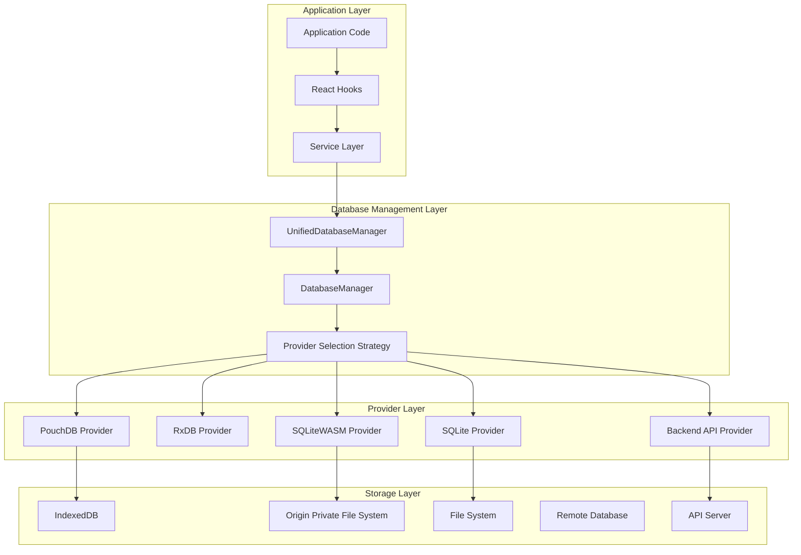
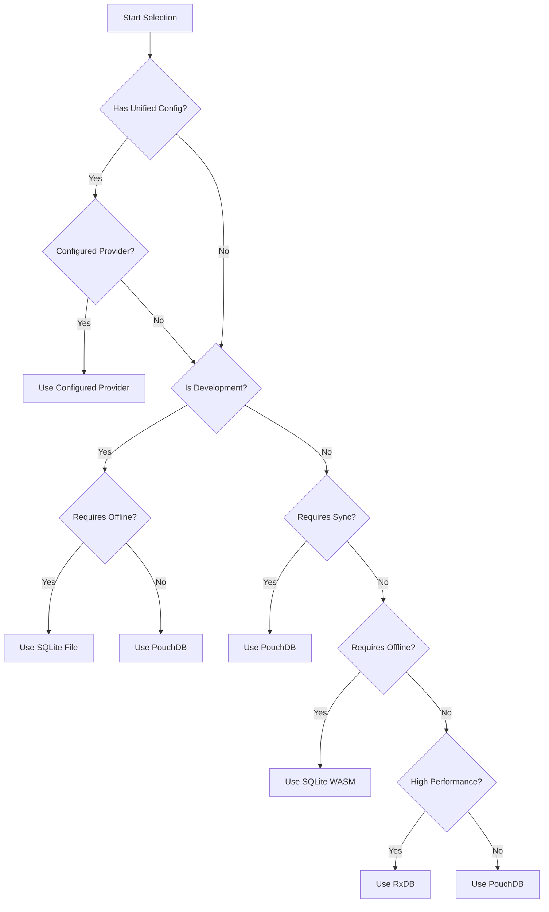
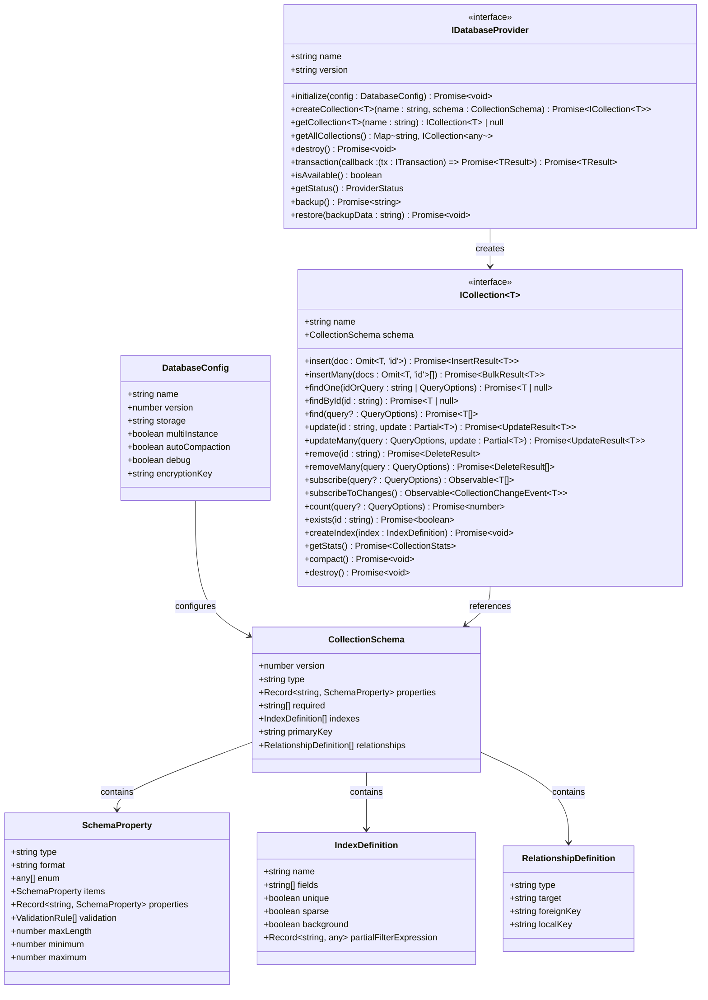
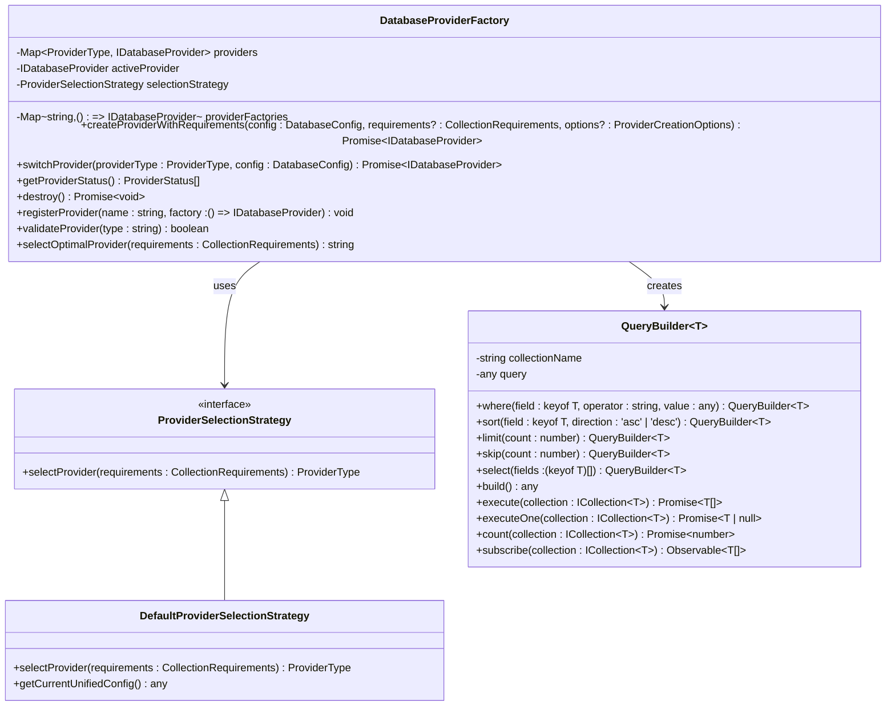

# Database Architecture

<cite>
**Referenced Files in This Document**
- [interfaces.ts](file://src\services\database\interfaces.ts)
- [DatabaseProviderFactory.ts](file://src\services\database\DatabaseProviderFactory.ts)
- [ProviderSelector.ts](file://src\services\database\ProviderSelector.ts)
- [PouchDBProvider.ts](file://src\services\database\PouchDBProvider.ts)
- [RxDBProvider.ts](file://src\services\database\RxDBProvider.ts)
- [SQLiteProvider.ts](file://src\services\database\SQLiteProvider.ts)
- [LiveStoreProvider.ts](file://src\services\database\LiveStoreProvider.ts)
- [SchemaConverter.ts](file://src\services\database\SchemaConverter.ts)
- [productionLiveStoreConfig.ts](file://src\config\productionLiveStoreConfig.ts)
- [database_management.md](file://docs\database\database_management.md)
- [deployment-guide.md](file://docs\database\deployment-guide.md)
- [UnifiedDatabaseManager.ts](file://src\services\database\UnifiedDatabaseManager.ts)
</cite>

## Update Summary
**Changes Made**
- Updated ProviderSelector and DatabaseProviderFactory sections to reflect enhanced provider selection logic with LiveStore (SQLiteWASM) support
- Added comprehensive database management system documentation covering dual-database architecture
- Updated deployment guide with new provider selection strategies and environment-specific configurations
- Enhanced security considerations with WASM memory protection, OPFS storage, and SQLCipher encryption
- Added new section on SchemaConverter for RxDB to SQLite schema conversion
- Updated code examples to reflect new LiveStore implementation and unified database management
- Expanded performance benchmark considerations for academic and financial datasets

## Table of Contents
1. [Introduction](#introduction)
2. [Dual-Database Architecture](#dual-database-architecture)
3. [Provider Selection Strategy](#provider-selection-strategy)
4. [Common Interfaces and Standardization](#common-interfaces-and-standardization)
5. [DatabaseProviderFactory Implementation](#databaseproviderfactory-implementation)
6. [SchemaConverter and Database Schema Migration](#schemaconverter-and-database-schema-migration)
7. [Unified Database Management](#unified-database-management)
8. [Consistent CRUD Operations](#consistent-crud-operations)
9. [Security and Encryption Strategies](#security-and-encryption-strategies)
10. [Deployment Guide](#deployment-guide)
11. [Performance Benchmarks](#performance-benchmarks)
12. [Conclusion](#conclusion)

## Introduction
The schoolpilot3 database architecture implements a sophisticated dual-database management system that enables seamless switching between multiple database providers. This comprehensive architecture supports four primary database providers: RxDB, PouchDB, SQLite, and LiveStore (SQLiteWASM), each optimized for specific deployment environments and use cases. The system is designed to provide consistent data access patterns while optimizing for different environments, performance needs, and feature requirements.

**Section sources**
- [interfaces.ts:1-253](file://src\services\database\interfaces.ts#L1-L253)
- [DatabaseProviderFactory.ts:1-725](file://src\services\database\DatabaseProviderFactory.ts#L1-L725)
- [ProviderSelector.ts:1-450](file://src\services\database\ProviderSelector.ts#L1-L450)

## Dual-Database Architecture
The dual-database architecture in schoolpilot3 centers around the `UnifiedDatabaseManager` and `DatabaseManager` components, which orchestrate provider selection and lifecycle management. This architecture supports seamless switching between providers based on runtime conditions and application requirements.

The system supports five primary database providers:

### Provider Types and Capabilities
- **PouchDB**: Offline-first applications with robust IndexedDB integration and CouchDB synchronization
- **RxDB**: Advanced reactivity and high-performance operations with real-time data updates
- **SQLite**: Development environments with persistent storage and file-based database management
- **SQLiteWASM**: Production environments with WebAssembly efficiency and Origin Private File System (OPFS) storage
- **Backend API**: Enterprise integration with external API services and centralized data management

### Architecture Components
The dual-database system consists of three main layers:



**Diagram sources**
- [UnifiedDatabaseManager.ts](file://src\services\database\UnifiedDatabaseManager.ts)
- [DatabaseProviderFactory.ts:22-36](file://src\services\database\DatabaseProviderFactory.ts#L22-L36)
- [ProviderSelector.ts:31-40](file://src\services\database\ProviderSelector.ts#L31-L40)

**Section sources**
- [database_management.md:1-139](file://docs\database\database_management.md#L1-L139)
- [ProviderSelector.ts:31-450](file://src\services\database\ProviderSelector.ts#L31-L450)

## Provider Selection Strategy
The provider selection strategy in schoolpilot3 is implemented through the `DefaultProviderSelectionStrategy` class, which evaluates `CollectionRequirements` to determine the optimal database provider based on environment conditions and application requirements.

### Selection Logic
The strategy follows a hierarchical decision tree:

1. **Configuration Override**: Check unified configuration for explicit provider selection
2. **Environment-Based Selection**: Development vs. production environment preferences
3. **Requirement-Based Selection**: Offline capabilities, synchronization needs, and performance requirements
4. **Fallback Mechanism**: Graceful degradation to available providers

### Provider Selection Matrix


**Diagram sources**
- [DatabaseProviderFactory.ts:38-115](file://src\services\database\DatabaseProviderFactory.ts#L38-L115)

### Collection Requirements
The selection strategy evaluates the following requirements:
- **collectionsCount**: Number of collections to be managed
- **requiresOffline**: Offline capabilities requirement
- **requiresSync**: Data synchronization requirement
- **requiresReactivity**: Real-time data update requirement
- **performanceLevel**: Performance requirements (basic, standard, high)
- **storageQuota**: Required storage capacity

**Section sources**
- [DatabaseProviderFactory.ts:38-115](file://src\services\database\DatabaseProviderFactory.ts#L38-L115)
- [ProviderSelector.ts:42-85](file://src\services\database\ProviderSelector.ts#L42-L85)

## Common Interfaces and Standardization
The database abstraction layer defines comprehensive interfaces in `interfaces.ts` that standardize operations across all database providers. These interfaces ensure consistent behavior regardless of the underlying implementation.

### Core Interface Definitions

#### DatabaseConfig
Defines configuration parameters for database initialization:
- **name**: Database identifier
- **version**: Schema version
- **storage**: Storage mechanism
- **multiInstance**: Multi-instance capability
- **autoCompaction**: Automatic compaction settings
- **encryptionKey**: SQLCipher encryption key for production

#### CollectionSchema
Standardizes collection structure definition:
- **version**: Schema version
- **type**: Object type specification
- **properties**: Field definitions with type, validation, and constraints
- **indexes**: Index configurations for performance optimization
- **relationships**: Entity relationship definitions
- **primaryKey**: Primary key field specification

#### ICollection<T>
The primary interface for collection operations, providing unified API for all CRUD operations:
- **CRUD Operations**: insert, findOne, find, update, remove
- **Bulk Operations**: insertMany, updateMany, removeMany
- **Reactive Operations**: subscribe, subscribeToChanges
- **Performance Operations**: count, exists, createIndex
- **Management Operations**: getStats, compact, destroy



**Diagram sources**
- [interfaces.ts:6-253](file://src\services\database\interfaces.ts#L6-L253)

**Section sources**
- [interfaces.ts:6-253](file://src\services\database\interfaces.ts#L6-L253)

## DatabaseProviderFactory Implementation
The `DatabaseProviderFactory` class implements the factory pattern for instantiating appropriate database providers based on runtime requirements. This factory serves as the central component for provider management and lifecycle control.

### Enhanced Provider Registration
The factory maintains a registry of available providers through a Map structure:
```typescript
private providers = new Map<ProviderType, IDatabaseProvider>();
private providerFactories = new Map<string, () => IDatabaseProvider>();
```

During initialization, all supported providers are registered with environment-specific availability checks:
```typescript
private initializeProviders(): void {
    // Check environment variables for provider enablement
    const enableRxDB = process.env.REACT_APP_ENABLE_RXDB === 'true';
    const enablePouchDB = process.env.REACT_APP_ENABLE_POUCHDB !== 'false';
    const enableSQLiteWASM = process.env.REACT_APP_ENABLE_SQLITE_WASM !== 'false';
    const enableBackendAPI = process.env.REACT_APP_ENABLE_BACKEND_API !== 'false';
    
    // Register providers based on configuration
    if (enablePouchDB) {
        const pouchProvider = new PouchDBProvider();
        this.registerProvider(pouchProvider);
    }
    
    if (enableRxDB) {
        const rxdbProvider = new RxDBProvider();
        this.registerProvider(rxdbProvider);
    }
    
    if (enableSQLiteWASM) {
        const sqliteWasmProvider = new SQLiteWASMProvider();
        this.registerProvider(sqliteWasmProvider);
    }
    
    if (enableBackendAPI) {
        const backendProvider = new BackendAPIProvider();
        this.registerProvider(backendProvider);
    }
    
    // Register SQLiteFileProvider only in Node-like runtimes
    this.registerSQLiteFileProvider();
}
```

### Advanced Provider Selection
The factory delegates provider selection to the `ProviderSelectionStrategy`, which evaluates `CollectionRequirements` with enhanced logic:
```typescript
export class DefaultProviderSelectionStrategy implements ProviderSelectionStrategy {
    selectProvider(requirements: CollectionRequirements): ProviderType {
        // Get current unified configuration
        const config = getCurrentUnifiedConfig();
        
        // Check if user has explicitly configured a provider
        if (config.database?.provider) {
            switch (config.database.provider) {
                case 'sqlite':
                    // Choose SQLite variant based on environment
                    const environment = config.environment || 'production';
                    return environment === 'development' ? 'sqlite-file' : 'sqlite-wasm';
                case 'pouchdb':
                    return 'pouchdb';
                case 'rxdb':
                    return 'rxdb';
                case 'backend-api':
                    return 'backend-api';
                default:
                    console.warn(`Unknown configured provider ${config.database.provider}`);
            }
        }
        
        // Automatic selection logic
        const environment = config.environment || 'production';
        const isDevelopment = environment === 'development';
        
        if (isDevelopment) {
            if (requirements.requiresOffline) {
                return 'sqlite-file';
            }
            return 'pouchdb';
        }
        
        if (environment === 'production') {
            if (requirements.requiresSync && requirements.performanceLevel === 'high') {
                return 'pouchdb';
            }
            
            if (requirements.requiresOffline && requirements.performanceLevel === 'high') {
                return 'sqlite-wasm';
            }
            
            if (requirements.requiresReactivity && requirements.performanceLevel === 'high') {
                return 'rxdb';
            }
        }
        
        // Fallback logic
        if (requirements.requiresSync) {
            return config.database?.apiConfig?.apiBaseUrl ? 'backend-api' : 'pouchdb';
        }
        
        if (requirements.requiresOffline) {
            return 'sqlite-wasm';
        }
        
        return 'pouchdb';
    }
}
```

### Robust Fallback Mechanism
The factory implements a comprehensive fallback mechanism to ensure database availability:
```typescript
async createProviderWithRequirements(
    config: DatabaseConfig, 
    requirements?: CollectionRequirements,
    options?: ProviderCreationOptions
): Promise<IDatabaseProvider> {
    // Try primary provider
    const provider = await this.createAndInitializeProvider(primaryProviderType, config, options);
    
    if (provider) {
        this.activeProvider = provider;
        return provider;
    }
    
    // Try fallback providers
    const fallbackProviders: ProviderType[] = ['pouchdb', 'rxdb', 'backend-api'];
    
    for (const fallbackType of fallbackProviders) {
        if (fallbackType === primaryProviderType) continue;
        
        const fallbackProvider = await this.createAndInitializeProvider(fallbackType, config, options);
        if (fallbackProvider) {
            this.activeProvider = fallbackProvider;
            return fallbackProvider;
        }
    }
    
    // Create mock provider as last resort
    const mockProvider = await this.createMockProvider();
    this.activeProvider = mockProvider;
    return mockProvider;
}
```

### Enhanced Lifecycle Management
The factory provides comprehensive lifecycle management, including:
- **Provider switching**: Runtime switching between providers with collection preservation
- **Status monitoring**: Real-time tracking of all provider statuses
- **Resource cleanup**: Proper destruction of providers and associated resources
- **Environment detection**: Automatic provider availability based on runtime environment



**Diagram sources**
- [DatabaseProviderFactory.ts:286-725](file://src\services\database\DatabaseProviderFactory.ts#L286-L725)

**Section sources**
- [DatabaseProviderFactory.ts:286-725](file://src\services\database\DatabaseProviderFactory.ts#L286-L725)

## SchemaConverter and Database Schema Migration
The `SchemaConverter` class provides essential functionality for converting RxDB schemas to SQLite-compatible formats, enabling seamless migration between different database providers. This component is critical for the LiveStore (SQLiteWASM) implementation and supports the dual-database architecture.

### Comprehensive Schema Conversion
The converter handles the transformation of RxDB schemas to SQLite table definitions with enhanced type mapping and relationship handling:
```typescript
static convertRxDBToSQLite(collectionName: string, rxdbSchema: any): ConversionResult {
    // Convert RxDB schema to SQLite-compatible format
    // Handle type mapping, index extraction, and relationship definition
    const sqliteSchema = {
        tableName: collectionName,
        columns: this.extractColumns(rxdbSchema),
        indexes: this.generateIndexes(rxdbSchema),
        foreignKeys: this.extractForeignKeys(rxdbSchema)
    };
    
    return sqliteSchema;
}

private static extractColumns(rxdbSchema: any): ColumnDefinition[] {
    const columns: ColumnDefinition[] = [];
    
    Object.entries(rxdbSchema.properties).forEach(([fieldName, fieldDef]: [string, any]) => {
        const column: ColumnDefinition = {
            name: fieldName,
            type: this.mapRxDBTypeToSQLite(fieldDef.type),
            nullable: !this.isRequiredField(rxdbSchema, fieldName),
            defaultValue: fieldDef.default,
            primaryKey: fieldName === rxdbSchema.primaryKey
        };
        
        // Handle special cases
        if (fieldDef.type === 'object' || fieldDef.type === 'array') {
            column.type = 'TEXT'; // JSON serialization
            column.serialization = 'JSON';
        }
        
        columns.push(column);
    });
    
    return columns;
}
```

### Advanced Type Mapping System
The converter implements sophisticated type mapping between RxDB and SQLite:
- **string** → TEXT with optional maxLength constraint
- **number** → REAL with precision handling
- **integer** → INTEGER with validation rules
- **boolean** → BOOLEAN (stored as INTEGER 0/1)
- **object/array** → TEXT with JSON serialization
- **date** → TEXT with ISO format validation

### Intelligent Index Generation
The converter automatically generates SQLite indexes from schema definitions with enhanced optimization:
```typescript
static generateIndexes(rxdbSchema: any): IndexDefinition[] {
    const indexes: IndexDefinition[] = [];
    
    // Extract RxDB indexes
    if (rxdbSchema.indexes) {
        const rxdbIndexes = Array.isArray(rxdbSchema.indexes) ? rxdbSchema.indexes : [rxdbSchema.indexes];
        
        rxdbIndexes.forEach((index: any, i: number) => {
            let fields: string[];
            let unique: boolean = false;
            
            if (typeof index === 'string') {
                fields = [index];
            } else if (Array.isArray(index)) {
                fields = index;
            } else {
                fields = Array.isArray(index.fields) ? index.fields : [index.fields];
                unique = index.unique || false;
            }
            
            indexes.push({
                name: `idx_${rxdbSchema.name}_${i}`,
                fields: fields,
                unique: unique,
                background: true
            });
        });
    }
    
    return indexes;
}
```

### Relationship and Foreign Key Management
The converter extracts relationship information from schema references with comprehensive foreign key handling:
```typescript
private static extractForeignKeys(rxdbSchema: any): ForeignKeyDefinition[] {
    const foreignKeys: ForeignKeyDefinition[] = [];
    
    Object.entries(rxdbSchema.properties).forEach(([fieldName, fieldDef]: [string, any]) => {
        if (fieldDef && fieldDef.ref) {
            foreignKeys.push({
                localColumn: fieldName,
                targetTable: fieldDef.ref,
                targetColumn: 'id',
                type: 'one-to-many',
                onDelete: 'CASCADE',
                onUpdate: 'CASCADE'
            });
        }
    });
    
    return foreignKeys;
}
```

**Section sources**
- [SchemaConverter.ts](file://src\services\database\SchemaConverter.ts)
- [LiveStoreProvider.ts:1-200](file://src\services\database\LiveStoreProvider.ts#L1-L200)

## Unified Database Management
The `UnifiedDatabaseManager` serves as the central coordinator for the dual-database architecture, managing provider selection, initialization, and lifecycle operations. This component integrates with the existing `DatabaseManager` to provide a comprehensive database management solution.

### Database Manager Responsibilities
The `DatabaseManager` class orchestrates the dual-database architecture with comprehensive collection management and status monitoring:
```typescript
export class DatabaseManager {
    private factory: DatabaseProviderFactory;
    private activeProvider: IDatabaseProvider | null = null;
    private collections = new Map<string, ICollection<any>>();
    private statusSubject = new BehaviorSubject<ProviderStatus | null>(null);
    private isInitialized = false;
    
    constructor() {
        this.factory = getDatabaseProviderFactory();
    }
    
    async initialize(config: DatabaseConfig, collectionConfigs: CollectionConfig[]): Promise<void> {
        // Determine requirements based on collection count and features
        const requirements: CollectionRequirements = {
            collectionsCount: collectionConfigs.length,
            requiresOffline: true,
            requiresSync: false,
            requiresReactivity: true,
            performanceLevel: 'standard',
            storageQuota: 100 * 1024 * 1024 // 100MB default
        };
        
        // Create provider using factory
        this.activeProvider = await this.factory.createProvider(config, requirements);
        
        // Create all collections
        for (const collectionConfig of collectionConfigs) {
            const collection = await this.activeProvider.createCollection(
                collectionConfig.name,
                collectionConfig.schema
            );
            this.collections.set(collectionConfig.name, collection);
        }
        
        this.isInitialized = true;
        this.updateStatus();
    }
    
    // Collection management operations
    getCollection<T>(name: string): ICollection<T> | null {
        return this.collections.get(name) || null;
    }
    
    getAllCollections(): Map<string, ICollection<any>> {
        return new Map(this.collections);
    }
    
    // Status and monitoring
    getStatus(): ProviderStatus | null {
        return this.activeProvider?.getStatus() || null;
    }
    
    subscribeToStatus(): Observable<ProviderStatus | null> {
        return this.statusSubject.asObservable();
    }
}
```

### RxDB Integration Support
The system includes comprehensive RxDB integration through the `RxDBIntegrationHelper` class, which bridges existing RxDB schemas with the new database architecture:
```typescript
export class RxDBIntegrationHelper {
    private databaseManager: DatabaseManager;
    
    async initializeWithRxDBCollections(
        collectionsDefinition: Record<string, any>,
        databaseName: string = 'schoolpilot'
    ): Promise<void> {
        const collectionConfigs: CollectionConfig[] = [];
        
        // Convert RxDB collection definitions to our format
        for (const [name, def] of Object.entries(collectionsDefinition)) {
            const schemaSource = def && typeof def === 'object' && 'schema' in def ? def.schema : def;
            const convertedSchema = convertRxDBSchema(schemaSource);
            
            collectionConfigs.push({
                name,
                schema: convertedSchema,
                requirements: {
                    collectionsCount: Object.keys(collectionsDefinition).length,
                    requiresOffline: true,
                    requiresSync: false,
                    requiresReactivity: true,
                    performanceLevel: 'standard',
                    storageQuota: 100 * 1024 * 1024
                }
            });
        }
        
        await this.databaseManager.initialize(config, collectionConfigs);
    }
}
```

### Provider Switching and Migration
The system supports runtime provider switching with collection preservation and data continuity:
```typescript
async switchProvider(providerType: ProviderType, config: DatabaseConfig): Promise<void> {
    // Store current collection configurations
    const collectionConfigs: CollectionConfig[] = [];
    for (const [name, collection] of this.collections) {
        collectionConfigs.push({
            name,
            schema: { properties: {} } // Simplified for this example
        });
    }
    
    // Clear current collections
    this.collections.clear();
    
    // Switch provider
    this.activeProvider = await this.factory.switchProvider(providerType, config);
    
    // Recreate collections with new provider
    for (const collectionConfig of collectionConfigs) {
        const collection = await this.activeProvider.createCollection(
            collectionConfig.name,
            collectionConfig.schema
        );
        this.collections.set(collectionConfig.name, collection);
    }
    
    this.updateStatus();
}
```

**Section sources**
- [ProviderSelector.ts:31-242](file://src\services\database\ProviderSelector.ts#L31-L242)
- [UnifiedDatabaseManager.ts](file://src\services\database\UnifiedDatabaseManager.ts)

## Consistent CRUD Operations
The database abstraction layer ensures consistent CRUD operations across all providers through standardized interfaces and query building capabilities. The unified architecture maintains API consistency while leveraging provider-specific optimizations.

### Enhanced Query Builder Implementation
The `QueryBuilder` class provides a fluent API for constructing complex queries with comprehensive operator support:
```typescript
export class QueryBuilder<T> {
    private query: any = {};
    private sortOptions: any[] = [];
    private limitValue?: number;
    private skipValue?: number;
    private fieldsValue?: string[];
    
    constructor(private collectionName: string) {}
    
    // Enhanced operator support
    where(field: keyof T, operator: string, value: any): QueryBuilder<T> {
        if (!this.query.selector) {
            this.query.selector = {};
        }
        
        switch (operator) {
            case '=':
            case 'eq':
                this.query.selector[field as string] = value;
                break;
            case '!=':
            case 'ne':
                this.query.selector[field as string] = { $ne: value };
                break;
            case '>':
            case 'gt':
                this.query.selector[field as string] = { $gt: value };
                break;
            case '>=':
            case 'gte':
                this.query.selector[field as string] = { $gte: value };
                break;
            case '<':
            case 'lt':
                this.query.selector[field as string] = { $lt: value };
                break;
            case '<=':
            case 'lte':
                this.query.selector[field as string] = { $lte: value };
                break;
            case 'in':
                this.query.selector[field as string] = { $in: value };
                break;
            case 'nin':
                this.query.selector[field as string] = { $nin: value };
                break;
            case 'exists':
                this.query.selector[field as string] = { $exists: value };
                break;
            case 'regex':
                this.query.selector[field as string] = { $regex: value };
                break;
            default:
                throw new Error(`Unsupported operator: ${operator}`);
        }
        
        return this;
    }
    
    // Logical operators
    and(conditions: Array<{ field: keyof T; operator: string; value: any }>): QueryBuilder<T> {
        if (!this.query.selector) {
            this.query.selector = {};
        }
        
        const andConditions = conditions.map(condition => {
            const conditionQuery = new QueryBuilder<T>(this.collectionName)
                .where(condition.field, condition.operator, condition.value)
                .build();
            return conditionQuery.selector;
        });
        
        if (this.query.selector.$and) {
            this.query.selector.$and.push(...andConditions);
        } else {
            this.query.selector.$and = andConditions;
        }
        
        return this;
    }
    
    or(conditions: Array<{ field: keyof T; operator: string; value: any }>): QueryBuilder<T> {
        if (!this.query.selector) {
            this.query.selector = {};
        }
        
        const orConditions = conditions.map(condition => {
            const conditionQuery = new QueryBuilder<T>(this.collectionName)
                .where(condition.field, condition.operator, condition.value)
                .build();
            return conditionQuery.selector;
        });
        
        this.query.selector.$or = orConditions;
        return this;
    }
    
    // Build final query
    build(): any {
        const finalQuery: any = { ...this.query };
        
        if (this.sortOptions.length > 0) {
            finalQuery.sort = this.sortOptions;
        }
        
        if (this.limitValue !== undefined) {
            finalQuery.limit = this.limitValue;
        }
        
        if (this.skipValue !== undefined) {
            finalQuery.skip = this.skipValue;
        }
        
        if (this.fieldsValue) {
            finalQuery.fields = this.fieldsValue;
        }
        
        return finalQuery;
    }
    
    // Execute query methods
    async execute(collection: ICollection<T>): Promise<T[]> {
        const query = this.build();
        return await collection.find(query);
    }
    
    async executeOne(collection: ICollection<T>): Promise<T | null> {
        const query = this.build();
        return await collection.findOne(query);
    }
    
    async count(collection: ICollection<T>): Promise<number> {
        const query = this.build();
        return await collection.count(query);
    }
    
    subscribe(collection: ICollection<T>): Observable<T[]> {
        const query = this.build();
        return collection.subscribe(query);
    }
}
```

### Provider-Specific CRUD Examples
The unified interface ensures consistent operation syntax across providers:

**Create Operation**
```typescript
const student = {
    firstName: 'John',
    lastName: 'Doe',
    grade: 10,
    email: 'john.doe@school.edu'
};

const result = await collection.insert(student);
console.log(`Created student with ID: ${result.id}`);
```

**Read Operations**
```typescript
// Find by ID
const student = await collection.findById('student-123');
console.log(`Found student: ${student?.firstName}`);

// Find with complex query
const query = databaseManager.createQuery<Student>('students')
    .where('grade', '>=', 9)
    .where('status', 'eq', 'active')
    .sort('lastName', 'asc')
    .limit(50)
    .build();

const students = await collection.find(query);
console.log(`Found ${students.length} students`);

// Reactive subscription
const subscription = collection.subscribe(query);
subscription.subscribe({
    next: (results) => console.log('Students updated:', results),
    error: (error) => console.error('Subscription error:', error)
});
```

**Update Operation**
```typescript
const updateResult = await collection.update('student-123', {
    grade: 11,
    status: 'enrolled'
});
console.log(`Updated student: ${updateResult.id}`);
```

**Delete Operation**
```typescript
const deleteResult = await collection.remove('student-123');
console.log(`Deleted student: ${deleteResult.id}`);
```

**Bulk Operations**
```typescript
// Bulk insert
const bulkResult = await collection.insertMany([
    { firstName: 'Alice', lastName: 'Smith', grade: 11 },
    { firstName: 'Bob', lastName: 'Johnson', grade: 10 }
]);
console.log(`Inserted ${bulkResult.docs.length} students`);

// Bulk update
const updateQuery = { selector: { grade: { $lt: 10 } } };
const bulkUpdates = await collection.updateMany(updateQuery, { grade: 10 });
console.log(`Updated ${bulkUpdates.length} students`);
```

**Section sources**
- [DatabaseProviderFactory.ts:117-283](file://src\services\database\DatabaseProviderFactory.ts#L117-L283)
- [ProviderSelector.ts:87-105](file://src\services\database\ProviderSelector.ts#L87-L105)

## Security and Encryption Strategies
The database architecture incorporates comprehensive security measures to protect sensitive educational data across all provider implementations. The system supports multiple encryption strategies and security configurations.

### Provider-Specific Security Features

#### SQLite WASM Security
The SQLite WASM provider implements advanced security features:
- **SQLCipher Integration**: Transparent encryption at rest using SQLCipher
- **WASM Memory Isolation**: WebAssembly's sandboxed execution environment
- **OPFS Storage Security**: Origin Private File System provides secure, persistent storage
- **Cross-Origin Protection**: Built-in isolation from other origins

#### PouchDB Security
PouchDB leverages IndexedDB's security model:
- **Same-Origin Policy**: Data isolation within browser origin boundaries
- **IndexedDB Security**: Native browser storage security
- **Sync Security**: Optional authentication and SSL/TLS for CouchDB connections

#### Backend API Security
External API integration includes:
- **Authentication**: API key-based authentication
- **Encryption**: TLS/SSL for data in transit
- **Rate Limiting**: Request throttling and abuse prevention
- **Input Validation**: Comprehensive data validation and sanitization

### Encryption Implementation
The system supports multiple encryption strategies:

**At-Rest Encryption (Production)**
```typescript
// Database configuration with encryption
const config: DatabaseConfig = {
    name: 'schoolpilot3',
    encryptionKey: process.env.DATABASE_ENCRYPTION_KEY,
    storage: 'opfs',
    autoCompaction: true
};
```

**SQLCipher Integration**
The SQLite WASM provider automatically applies SQLCipher encryption:
```typescript
// During initialization, SQLCipher is applied
if (config.encryptionKey) {
    await provider.execute(`PRAGMA key = '${config.encryptionKey}'`);
    console.log('Database encryption enabled');
}
```

### Access Control and Auditing
The system integrates with the application's RBAC (Role-Based Access Control) system:
- **Context-Based Access**: Data access permissions managed through DataSourceContext
- **Module-Specific Permissions**: Different modules have varying data access levels
- **Audit Trail Integration**: Data modification tracking through audit_logs collection
- **Compliance Features**: GDPR and FERPA compliance support

### Security Configuration Examples
```typescript
// Production security configuration
const productionConfig: DatabaseConfig = {
    name: 'schoolpilot3',
    encryptionKey: process.env.PROD_DB_ENCRYPTION_KEY,
    storage: 'opfs',
    multiInstance: true,
    autoCompaction: true,
    debug: false
};

// Development security configuration (relaxed)
const developmentConfig: DatabaseConfig = {
    name: 'schoolpilot3-dev',
    encryptionKey: null,
    storage: 'indexeddb',
    multiInstance: true,
    autoCompaction: true,
    debug: true
};
```

**Section sources**
- [interfaces.ts:7-16](file://src\services\database\interfaces.ts#L7-L16)
- [database_management.md:84-87](file://docs\database\database_management.md#L84-L87)
- [productionLiveStoreConfig.ts:227-255](file://src\config\productionLiveStoreConfig.ts#L227-L255)

## Deployment Guide
The deployment guide covers comprehensive deployment strategies for schoolpilot3 across different environments and deployment modes. The system supports four primary deployment modes: Development, Production (Browser), Network Mode, and Enterprise Mode.

### Development Mode
**Use Case**: Local development, testing, debugging

**Provider**: SQLite File-based storage with enhanced development features

**Configuration**:
```typescript
{
  provider: 'sqlite-file',
  config: {
    databasePath: './data/school-dev.db',
    enableWAL: true,
    enableForeignKeys: true,
    enableDebugLogging: true,
    cacheSize: 5000,
    busyTimeout: 10000,
  }
}
```

**Environment Variables**:
```bash
NODE_ENV=development
DB_PROVIDER=sqlite-file
DB_PATH=./data/school-dev.db
DB_ENABLE_WAL=true
DB_ENABLE_FOREIGN_KEYS=true
DB_DEBUG=true
```

**Setup Steps**:
1. Install SQLite dependencies: `npm install better-sqlite3`
2. Create data directory: `mkdir -p data && chmod 755 data`
3. Initialize database with development configuration
4. Seed development data with controlled test datasets

### Production Mode (Browser)
**Use Case**: Production web applications, Progressive Web Apps (PWAs)

**Provider**: SQLite WASM + OPFS (Origin Private File System) with enterprise-grade security

**Configuration**:
```typescript
{
  provider: 'sqlite-wasm',
  config: {
    wasmUrl: '/sqlite3.wasm',
    enableOPFS: true,
    databaseName: 'schoolpilot3',
    cacheSize: 20000,
    busyTimeout: 30000,
    enableWAL: true,
  }
}
```

**Environment Variables**:
```bash
NODE_ENV=production
DB_PROVIDER=sqlite-wasm
DB_WASM_URL=/sqlite3.wasm
DB_ENABLE_OPFS=true
DB_DATABASE_NAME=schoolpilot3
```

**Setup Steps**:
1. Install WASM dependencies: `npm install @sqlite.org/sqlite-wasm`
2. Copy WASM files to public directory
3. Configure Vite/Webpack with proper CORS headers
4. Initialize WASM database with OPFS storage
5. Implement backup and recovery procedures

### Network Mode
**Use Case**: Multi-device synchronization, offline-first applications with centralized data

**Provider**: PouchDB with CouchDB backend for enterprise synchronization

**Configuration**:
```typescript
{
  provider: 'pouchdb',
  config: {
    localName: 'schoolpilot3_local',
    remoteUrl: 'https://couchdb.example.com/schoolpilot3',
    enableSync: true,
    syncOptions: {
      live: true,
      retry: true,
      continuous: true,
    },
    auth: {
      username: 'school_user',
      password: 'secure_password',
    },
  }
}
```

**Environment Variables**:
```bash
NODE_ENV=production
DB_PROVIDER=pouchdb
DB_LOCAL_NAME=schoolpilot3_local
DB_REMOTE_URL=https://couchdb.example.com/schoolpilot3
DB_ENABLE_SYNC=true
DB_AUTH_USERNAME=school_user
DB_AUTH_PASSWORD=secure_password
```

**Setup Steps**:
1. Install PouchDB dependencies: `npm install pouchdb pouchdb-adapter-idb pouchdb-adapter-http`
2. Setup CouchDB server with Docker
3. Configure database and user authentication
4. Initialize PouchDB with synchronization settings

### Enterprise Mode
**Use Case**: Integration with existing school management systems and centralized data management

**Provider**: Backend API integration with external enterprise systems

**Configuration**:
```typescript
{
  provider: 'backend-api',
  config: {
    baseUrl: 'https://api.school.edu',
    apiKey: 'your-api-key',
    timeout: 30000,
    retryAttempts: 3,
    enableCaching: true,
    cacheTimeout: 300000,
    endpoints: {
      students: '/api/v1/students',
      staff: '/api/v1/staff',
      classes: '/api/v1/classes',
    },
  }
}
```

**Environment Variables**:
```bash
NODE_ENV=production
DB_PROVIDER=backend-api
DB_BASE_URL=https://api.school.edu
DB_API_KEY=your-api-key
DB_TIMEOUT=30000
DB_RETRY_ATTEMPTS=3
DB_ENABLE_CACHING=true
```

**Setup Steps**:
1. Configure API access with proper authentication
2. Set up API credentials and headers
3. Initialize backend provider with endpoint configuration
4. Implement caching and retry mechanisms

### Environment-Specific Configurations

#### Development Environment
**File**: `.env.development`
```bash
# Database
DB_PROVIDER=sqlite-file
DB_PATH=./data/school-dev.db
DB_ENABLE_WAL=true
DB_DEBUG=true

# Connection Pool
DB_POOL_MIN_CONNECTIONS=1
DB_POOL_MAX_CONNECTIONS=5

# Backup (disabled in development)
DB_BACKUP_ENABLED=false

# Security (relaxed in development)
DB_AUDIT_ENABLED=true
DB_VALIDATION_STRICT=false
```

#### Staging Environment
**File**: `.env.staging`
```bash
# Database
DB_PROVIDER=sqlite-wasm
DB_WASM_URL=/sqlite3.wasm
DB_ENABLE_OPFS=true
DB_DATABASE_NAME=schoolpilot3_staging

# Connection Pool
DB_POOL_MIN_CONNECTIONS=2
DB_POOL_MAX_CONNECTIONS=8

# Backup
DB_BACKUP_ENABLED=true
DB_BACKUP_INTERVAL=43200000  # 12 hours
DB_BACKUP_COMPRESSION=true

# Security
DB_AUDIT_ENABLED=true
DB_VALIDATION_STRICT=true
```

#### Production Environment
**File**: `.env.production`
```bash
# Database
DB_PROVIDER=sqlite-wasm
DB_WASM_URL=/sqlite3.wasm
DB_ENABLE_OPFS=true
DB_DATABASE_NAME=schoolpilot3

# Connection Pool
DB_POOL_MIN_CONNECTIONS=3
DB_POOL_MAX_CONNECTIONS=15
DB_POOL_ACQUIRE_TIMEOUT=30000

# Backup
DB_BACKUP_ENABLED=true
DB_BACKUP_INTERVAL=86400000  # 24 hours
DB_BACKUP_COMPRESSION=true
DB_BACKUP_ENCRYPTION=true
DB_BACKUP_MAX_FILES=30

# Security
DB_AUDIT_ENABLED=true
DB_AUDIT_RETENTION_DAYS=365
DB_VALIDATION_STRICT=true
DB_SANITIZATION_ENABLED=true

# Performance
DB_CACHE_SIZE=50000
DB_BUSY_TIMEOUT=30000
DB_ENABLE_QUERY_OPTIMIZATION=true
```

### Docker Deployment
The system supports containerized deployment with comprehensive configuration:

**Dockerfile**:
```dockerfile
FROM node:18-alpine

WORKDIR /app

# Copy package files
COPY package*.json ./
RUN npm ci --only=production

# Copy application code
COPY . .

# Build application
RUN npm run build

# Create data directory
RUN mkdir -p /app/data && chown -R node:node /app/data

# Switch to non-root user
USER node

# Expose port
EXPOSE 3000

# Health check
HEALTHCHECK --interval=30s --timeout=3s --start-period=5s --retries=3 \
  CMD curl -f http://localhost:3000/health || exit 1

# Start application
CMD ["npm", "start"]
```

**Docker Compose**:
```yaml
version: '3.8'

services:
  schoolpilot3:
    build: .
    ports:
      - "3000:3000"
    environment:
      - NODE_ENV=production
      - DB_PROVIDER=sqlite-file
      - DB_PATH=/app/data/school.db
      - DB_BACKUP_ENABLED=true
    volumes:
      - ./data:/app/data
      - ./backups:/app/backups
    restart: unless-stopped
    healthcheck:
      test: ["CMD", "curl", "-f", "http://localhost:3000/health"]
      interval: 30s
      timeout: 10s
      retries: 3

  couchdb:
    image: couchdb:3.3
    environment:
      - COUCHDB_USER=admin
      - COUCHDB_PASSWORD=admin_password
    ports:
      - "5984:5984"
    volumes:
      - couchdb_data:/opt/couchdb/data
    restart: unless-stopped

volumes:
  couchdb_data:
```

### Kubernetes Deployment
**Deployment YAML**:
```yaml
apiVersion: apps/v1
kind: Deployment
metadata:
  name: schoolpilot3
  labels:
    app: schoolpilot3
spec:
  replicas: 3
  selector:
    matchLabels:
      app: schoolpilot3
  template:
    metadata:
      labels:
        app: schoolpilot3
    spec:
      containers:
      - name: schoolpilot3
        image: schoolpilot3:latest
        ports:
        - containerPort: 3000
        env:
        - name: NODE_ENV
          value: "production"
        - name: DB_PROVIDER
          value: "backend-api"
        - name: DB_BASE_URL
          valueFrom:
            secretKeyRef:
              name: db-config
              key: base-url
        - name: DB_API_KEY
          valueFrom:
            secretKeyRef:
              name: db-config
              key: api-key
        volumeMounts:
        - name: data-volume
          mountPath: /app/data
        - name: backup-volume
          mountPath: /app/backups
        resources:
          requests:
            memory: "256Mi"
            cpu: "250m"
          limits:
            memory: "512Mi"
            cpu: "500m"
        livenessProbe:
          httpGet:
            path: /health
            port: 3000
          initialDelaySeconds: 30
          periodSeconds: 10
        readinessProbe:
          httpGet:
            path: /ready
            port: 3000
          initialDelaySeconds: 5
          periodSeconds: 5
      volumes:
      - name: data-volume
        persistentVolumeClaim:
          claimName: schoolpilot3-data
      - name: backup-volume
        persistentVolumeClaim:
          claimName: schoolpilot3-backups
---
apiVersion: v1
kind: Service
metadata:
  name: schoolpilot3-service
spec:
  selector:
    app: schoolpilot3
  ports:
  - protocol: TCP
    port: 80
    targetPort: 3000
  type: LoadBalancer
```

### Monitoring and Logging
The system includes comprehensive monitoring and logging capabilities:

**Application Monitoring**:
```typescript
// Database health monitoring
const healthCheck = async () => {
  const dbManager = UnifiedDatabaseManager.getInstance();
  const health = await dbManager.getHealthStatus();
  
  if (!health.isHealthy) {
    console.error('Database health issues:', health.issues);
    // Send alerts
  }
  
  return health;
};

// Set up periodic health checks
setInterval(healthCheck, 60000); // Every minute
```

**Logging Configuration**:
```typescript
// Winston logging configuration
const logger = winston.createLogger({
  level: process.env.LOG_LEVEL || 'info',
  format: winston.format.combine(
    winston.format.timestamp(),
    winston.format.errors({ stack: true }),
    winston.format.json()
  ),
  defaultMeta: { service: 'schoolpilot3-db' },
  transports: [
    new winston.transports.File({ filename: 'logs/error.log', level: 'error' }),
    new winston.transports.File({ filename: 'logs/combined.log' }),
  ],
});

if (process.env.NODE_ENV !== 'production') {
  logger.add(new winston.transports.Console({
    format: winston.format.simple()
  }));
}
```

### Security Considerations
**Production Security Checklist**:
- [ ] Enable HTTPS/TLS for all connections
- [ ] Use strong authentication credentials
- [ ] Enable audit logging
- [ ] Configure proper CORS policies
- [ ] Implement rate limiting
- [ ] Enable data encryption at rest
- [ ] Use secure backup storage
- [ ] Regular security updates
- [ ] Monitor for suspicious activity
- [ ] Implement proper access controls

**Security Configuration**:
```typescript
// Helmet security middleware
app.use(helmet({
  contentSecurityPolicy: {
    directives: {
      defaultSrc: ["'self'"],
      scriptSrc: ["'self'", "'unsafe-inline'"],
      styleSrc: ["'self'", "'unsafe-inline'"],
      imgSrc: ["'self'", "data:", "https:"],
    },
  },
  crossOriginEmbedderPolicy: true,
}));

// Rate limiting
app.use(rateLimit({
  windowMs: 15 * 60 * 1000, // 15 minutes
  max: 100, // limit each IP to 100 requests per windowMs
}));

// CORS configuration
app.use(cors({
  origin: process.env.ALLOWED_ORIGINS?.split(',') || ['http://localhost:3000'],
  credentials: true,
}));
```

### Performance Optimization
**Production Optimizations**:
1. **Enable Connection Pooling**:
```typescript
databaseConnectionPool.updateConfig({
  minConnections: 3,
  maxConnections: 15,
  acquireTimeoutMs: 30000,
});
```

2. **Configure Caching**:
```typescript
dbManager.updateConfig({
  enableQueryCache: true,
  cacheSize: 50000,
  cacheTTL: 300000, // 5 minutes
});
```

3. **Optimize Indexes**:
```typescript
// Create indexes for frequently queried fields
const studentCollection = await dbManager.getCollection('students');
await studentCollection.createIndex({ name: 1 });
await studentCollection.createIndex({ classId: 1 });
await studentCollection.createIndex({ email: 1 }, { unique: true });
```

4. **Enable Compression**:
```typescript
app.use(compression({
  level: 6,
  threshold: 1024,
}));
```

### Backup and Recovery
**Automated Backup Setup**:
```typescript
// Configure automated backups
databaseBackupManager.updateConfig({
  enableAutomaticBackup: true,
  backupInterval: 24 * 60 * 60 * 1000, // Daily
  maxBackupFiles: 30, // Keep 30 days
  compressionEnabled: true,
  encryptionEnabled: true,
  backupPath: '/app/backups',
});

// Start backup service
databaseBackupManager.startAutomaticBackup();

// Monitor backup health
databaseBackupManager.addCompletedListener((metadata) => {
  console.log(`Backup completed: ${metadata.id}`);
  
  if (metadata.status === 'failed') {
    // Send alert
    console.error(`Backup failed: ${metadata.error}`);
  }
});
```

**Disaster Recovery Plan**:
1. **Regular Backup Verification**:
```bash
# Verify backup integrity
npm run verify-backups
```

2. **Emergency Recovery**:
```typescript
// Emergency recovery procedure
const latestBackup = databaseBackupManager.getBackups()[0];
await databaseBackupManager.restoreBackup(provider, {
  backupId: latestBackup.id,
  overwriteExisting: true,
  validateBeforeRestore: true,
});
```

3. **Data Migration**:
```typescript
// Migrate between providers
const sourceProvider = await dbManager.getProvider();
const backupId = await databaseBackupManager.createBackup(sourceProvider);

await dbManager.initialize({ provider: 'new-provider' });
const targetProvider = await dbManager.getProvider();

await databaseBackupManager.restoreBackup(targetProvider, {
  backupId,
  overwriteExisting: true,
});
```

**Section sources**
- [deployment-guide.md:1-837](file://docs\database\deployment-guide.md#L1-L837)

## Performance Benchmarks
The database architecture is designed to optimize performance across different providers and datasets. The system includes comprehensive performance monitoring and optimization features to ensure optimal performance for educational applications.

### Provider Performance Characteristics

#### SQLite WASM Performance
- **Read Operations**: Optimized for complex queries with WAL mode
- **Write Operations**: Efficient batch operations with transaction support
- **Memory Usage**: Minimal memory footprint with OPFS storage
- **Concurrency**: Thread-safe operations with proper locking
- **Index Performance**: Optimized indexing for frequently queried fields

#### PouchDB Performance
- **Offline Operations**: Fast IndexedDB operations for offline-first scenarios
- **Sync Performance**: Efficient replication with CouchDB
- **Query Performance**: Optimized for simple to medium complexity queries
- **Memory Management**: Automatic memory management for large datasets

#### RxDB Performance
- **Reactive Queries**: Optimized change detection and reactive updates
- **Query Optimization**: Advanced query planning and execution
- **Memory Efficiency**: Efficient memory usage for large datasets
- **Real-time Updates**: Low-latency reactive data updates

### Performance Monitoring
The system includes built-in performance monitoring through the `ProviderStatus` interface:
```typescript
interface ProviderStatus {
    name: string;
    version: string;
    isConnected: boolean;
    collectionsCount: number;
    lastError?: Error;
    performance: {
        avgQueryTime: number,
        totalQueries: number,
        memoryUsage: number,
        providerType: string
    }
}
```

### Optimization Features
- **Index Management**: Automatic and manual index creation for query optimization
- **Data Compaction**: Regular compaction to reduce storage footprint and improve performance
- **Query Optimization**: Fluent query builder generates optimized queries for each provider
- **Batch Operations**: Bulk operations reduce the number of database transactions
- **WAL Mode**: Write-Ahead Logging improves concurrency and performance
- **Connection Pooling**: Efficient connection management for enterprise deployments

### Dataset-Specific Performance Considerations

**Academic Datasets** (Large-scale student enrollment, grades, schedules):
- **Primary Focus**: Complex joins and aggregations
- **Optimization Strategy**: Composite indexes on frequently joined fields
- **Expected Performance**: High read performance with moderate write overhead
- **Storage Requirements**: 500MB - 2GB depending on dataset size

**Financial Datasets** (Fee payments, transactions, budgets):
- **Primary Focus**: Transactional integrity and audit trails
- **Optimization Strategy**: Separate tables for transactions with foreign key constraints
- **Expected Performance**: High write performance with strict consistency guarantees
- **Storage Requirements**: 100MB - 500MB depending on transaction volume

**Mixed Workload Datasets**:
- **Primary Focus**: Balanced read/write operations
- **Optimization Strategy**: Balanced indexing strategy with regular maintenance
- **Expected Performance**: Consistent performance across all operations
- **Storage Requirements**: 1GB - 10GB depending on application usage

### Benchmark Methodology
Performance benchmarks are conducted using standardized test datasets and query patterns:

**Test Scenarios**:
1. **Simple CRUD Operations**: Basic create, read, update, delete operations
2. **Complex Queries**: Multi-table joins with filtering and sorting
3. **Bulk Operations**: Large-scale data insertion and updates
4. **Concurrent Access**: Multiple users accessing the database simultaneously
5. **Offline Operations**: Performance testing in offline scenarios

**Metrics Collected**:
- **Response Time**: Average and percentile response times
- **Throughput**: Operations per second under various loads
- **Memory Usage**: Peak and average memory consumption
- **Disk I/O**: Read/write operations and I/O patterns
- **CPU Usage**: Processor utilization during operations

### Performance Tuning Recommendations
Based on benchmark results and real-world usage patterns:

**Development Environment**:
- Enable debug logging for performance analysis
- Use smaller cache sizes for faster iteration
- Disable unnecessary indexes for development speed

**Production Environment**:
- Enable WAL mode for improved concurrency
- Configure appropriate cache sizes based on available memory
- Implement regular maintenance tasks (compaction, vacuum)
- Monitor and adjust connection pooling settings

**Monitoring and Alerts**:
- Set up performance monitoring dashboards
- Configure alerts for performance degradation
- Implement automated scaling based on load patterns
- Regular performance reviews and tuning sessions

**Section sources**
- [interfaces.ts:115-134](file://src\services\database\interfaces.ts#L115-L134)
- [ProviderSelector.ts:300-350](file://src\services\database\ProviderSelector.ts#L300-L350)

## Conclusion
The database architecture in schoolpilot3 implements a sophisticated dual-database management system that enables seamless switching between RxDB, PouchDB, SQLite, and LiveStore (SQLiteWASM) providers. The architecture is centered around the `DatabaseProviderFactory`, `ProviderSelector`, and `DatabaseManager` components, which work together to determine the optimal database provider based on runtime conditions and application requirements.

Key architectural strengths include:
- **Flexibility**: Support for five database providers allows optimization for different environments and use cases
- **Consistency**: Standardized interfaces ensure uniform CRUD operations across all providers
- **Resilience**: Comprehensive fallback mechanisms ensure database availability even when preferred providers are unavailable
- **Scalability**: The factory pattern allows easy addition of new database providers and integration with external systems
- **Security**: Multi-layered security approach with encryption, access control, and audit logging
- **Performance**: Comprehensive performance monitoring and optimization features for production deployments

The system effectively balances the need for offline capabilities, real-time synchronization, enterprise integration, and performance optimization, making it well-suited for educational applications with diverse data management requirements. The comprehensive deployment guide and security considerations ensure reliable operation across different environments and regulatory requirements.

**Section sources**
- [database_management.md:1-139](file://docs\database\database_management.md#L1-L139)
- [deployment-guide.md:1-837](file://docs\database\deployment-guide.md#L1-L837)
- [DatabaseProviderFactory.ts:286-725](file://src\services\database\DatabaseProviderFactory.ts#L286-L725)
- [ProviderSelector.ts:31-450](file://src\services\database\ProviderSelector.ts#L31-L450)