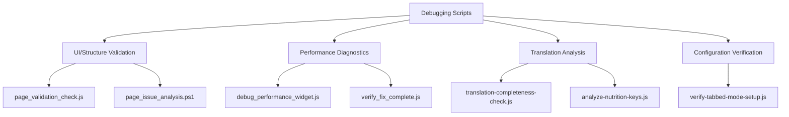
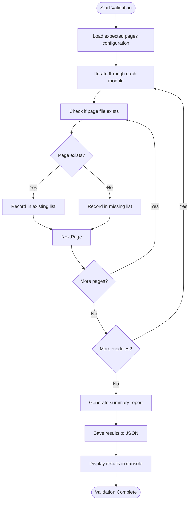
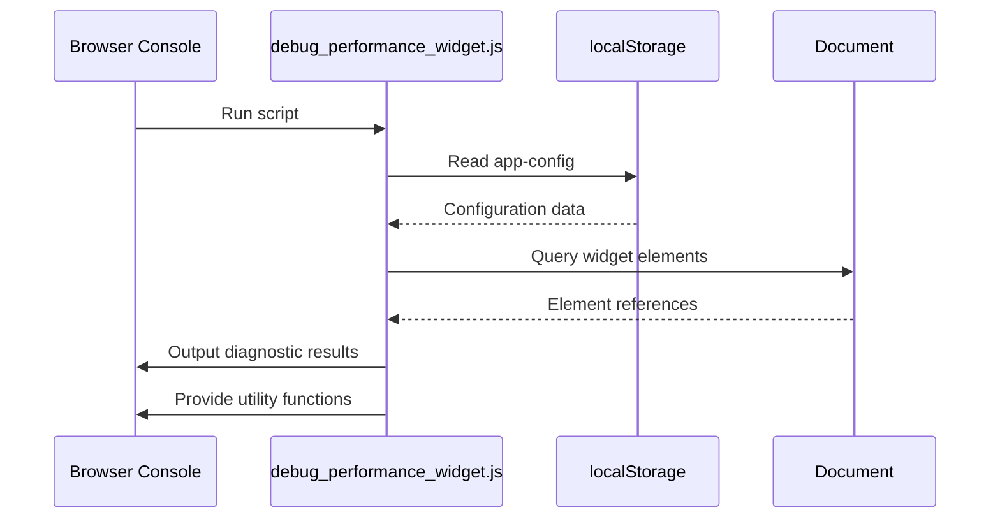
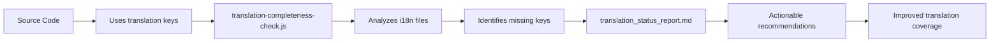
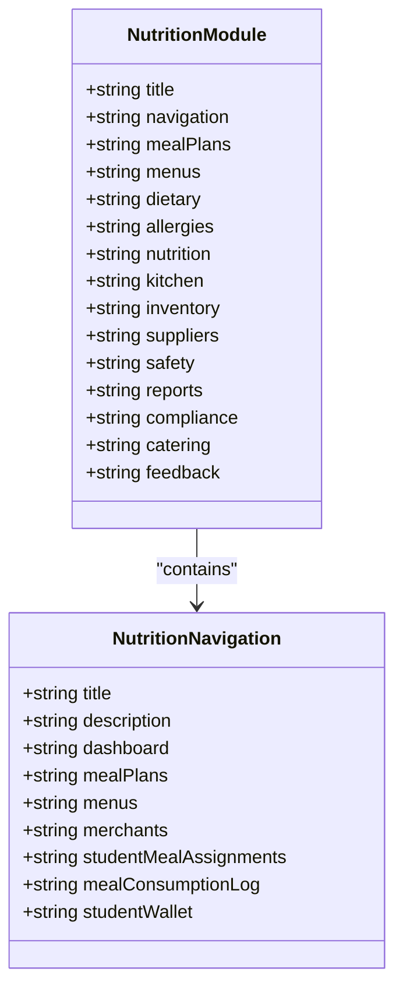
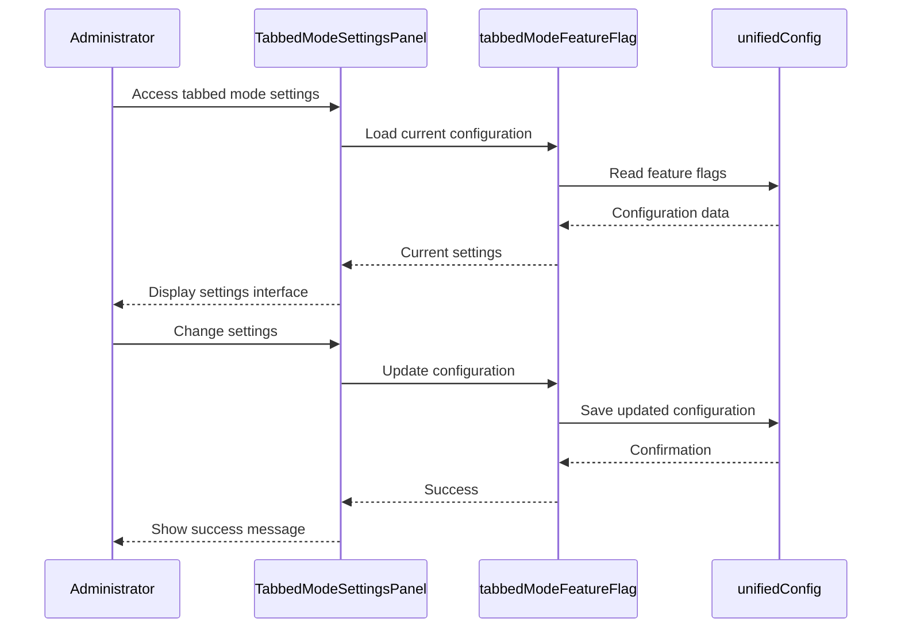
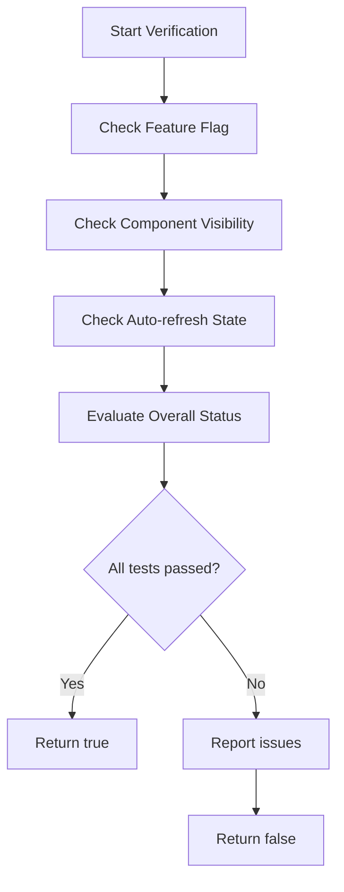
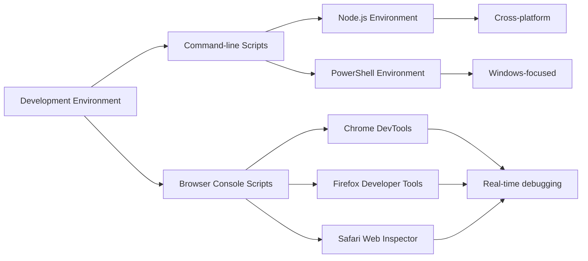
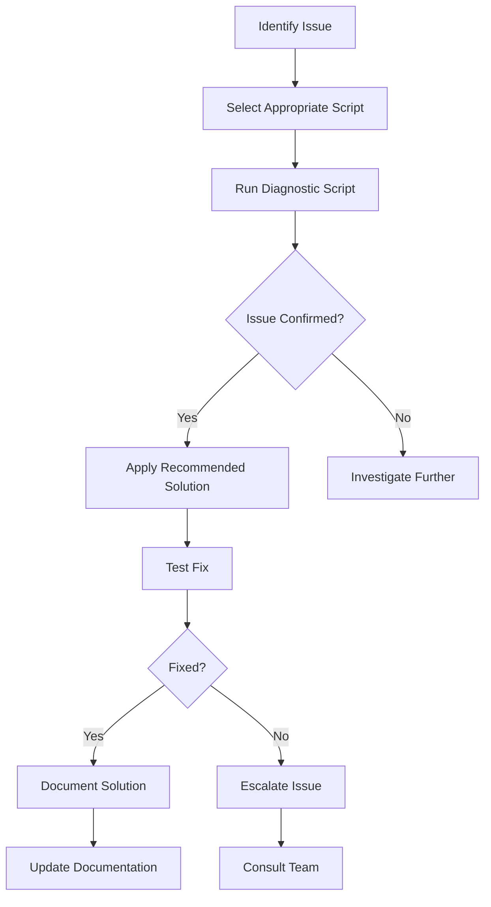

# Debugging Scripts

<cite>
**Referenced Files in This Document**   
- [analyze-nutrition-keys.js](file://scripts/debug/analyze-nutrition-keys.js)
- [debug_performance_widget.js](file://scripts/debug/debug_performance_widget.js)
- [page_issue_analysis.ps1](file://scripts/debug/page_issue_analysis.ps1)
- [page_validation_check.js](file://scripts/debug/page_validation_check.js)
- [page_validation_check.ps1](file://scripts/debug/page_validation_check.ps1)
- [page_validation_result.json](file://scripts/debug/page_validation_result.json)
- [translation-completeness-check.js](file://scripts/debug/translation-completeness-check.js)
- [verify-tabbed-mode-setup.js](file://scripts/debug/verify-tabbed-mode-setup.js)
- [verify_fix_complete.js](file://scripts/debug/verify_fix_complete.js)
- [src/modules/nutrition/i18n/en.json](file://src/modules/nutrition/i18n/en.json)
- [src/modules/nutrition/moduleDefinition.tsx](file://src/modules/nutrition/moduleDefinition.tsx)
- [src/services/tabbedModeFeatureFlag.ts](file://src/services/tabbedModeFeatureFlag.ts)
- [src/modules/settings/components/TabbedModeSettingsPanel.tsx](file://src/modules/settings/components/TabbedModeSettingsPanel.tsx)
- [src/components/PerformanceMonitorWidget.tsx](file://src/components/PerformanceMonitorWidget.tsx)
- [translation_status_report.md](file://translation_status_report.md)
</cite>

## Table of Contents
1. [Introduction](#introduction)
2. [Debugging Script Overview](#debugging-script-overview)
3. [UI and Page Structure Validation](#ui-and-page-structure-validation)
4. [Performance Monitoring Diagnostics](#performance-monitoring-diagnostics)
5. [Translation Completeness Analysis](#translation-completeness-analysis)
6. [Nutrition Module Key Validation](#nutrition-module-key-validation)
7. [Tabbed Mode Configuration Verification](#tabbed-mode-configuration-verification)
8. [Fix Completion Verification](#fix-completion-verification)
9. [Cross-Platform Script Integration](#cross-platform-script-integration)
10. [Common Issues and Solutions](#common-issues-and-solutions)
11. [Conclusion](#conclusion)

## Introduction

The schoolpilot3 system includes a comprehensive suite of debugging scripts designed to identify and diagnose issues across various domains including UI rendering, performance bottlenecks, translation completeness, and tabbed mode configuration. These scripts provide developers with essential tools for troubleshooting and validating system functionality during development, testing, and deployment phases. This document details the purpose, usage, and integration of these debugging scripts, offering practical examples and technical insights into their implementation.

**Section sources**
- [analyze-nutrition-keys.js](file://scripts/debug/analyze-nutrition-keys.js)
- [debug_performance_widget.js](file://scripts/debug/debug_performance_widget.js)
- [translation-completeness-check.js](file://scripts/debug/translation-completeness-check.js)

## Debugging Script Overview

The debugging scripts in schoolpilot3 are organized in the `scripts/debug` directory and serve specific diagnostic purposes. These scripts are implemented in both JavaScript and PowerShell to support cross-platform troubleshooting across development environments. The primary debugging scripts include:

- **analyze-nutrition-keys.js**: Analyzes translation keys in the nutrition module
- **debug_performance_widget.js**: Diagnoses issues with the performance monitoring widget
- **page_issue_analysis.ps1**: PowerShell script for analyzing page structure issues
- **page_validation_check.js** and **page_validation_check.ps1**: Validate page existence and structure
- **translation-completeness-check.js**: Checks translation completeness across modules
- **verify-tabbed-mode-setup.js**: Verifies tabbed mode configuration
- **verify_fix_complete.js**: Validates completion of fixes, particularly for the performance widget

These scripts follow a consistent pattern of outputting diagnostic information to the console, using color-coded indicators (✅ for success, ❌ for errors, ⚠️ for warnings) to make results easily interpretable.



**Diagram sources**
- [scripts/debug/analyze-nutrition-keys.js](file://scripts/debug/analyze-nutrition-keys.js)
- [scripts/debug/debug_performance_widget.js](file://scripts/debug/debug_performance_widget.js)
- [scripts/debug/page_issue_analysis.ps1](file://scripts/debug/page_issue_analysis.ps1)
- [scripts/debug/page_validation_check.js](file://scripts/debug/page_validation_check.js)
- [scripts/debug/translation-completeness-check.js](file://scripts/debug/translation-completeness-check.js)
- [scripts/debug/verify-tabbed-mode-setup.js](file://scripts/debug/verify-tabbed-mode-setup.js)
- [scripts/debug/verify_fix_complete.js](file://scripts/debug/verify_fix_complete.js)

## UI and Page Structure Validation

### Page Validation Scripts

The page validation system consists of two complementary scripts: `page_validation_check.js` (JavaScript) and `page_validation_check.ps1` (PowerShell). Both scripts perform the same validation but are available in different languages to accommodate various development environments.

The scripts validate that all expected pages exist in the correct locations within the `src/pages` directory structure. They check for pages across multiple modules including academics, administration, finance, hr, inventory, library, nutrition, reports, and settings.

```javascript
// Example from page_validation_check.js
const expectedPages = {
  academics: [
    'AcademicsDashboardPage.tsx',
    'ClassSubjectAllocationsPage.tsx',
    // ... other pages
  ],
  administration: [
    'AdministrationDashboardPage.tsx',
    'StudentsListPage.tsx',
    // ... other pages
  ],
  // ... other modules
};
```

To run the JavaScript version:

```bash
node scripts/debug/page_validation_check.js
```

To run the PowerShell version:

```powershell
powershell -File scripts/debug/page_validation_check.ps1
```

The script outputs a detailed report showing which pages exist and which are missing, with color-coded results (green for existing, red for missing). Results are also saved to `page_validation_result.json` for further analysis.



**Diagram sources**
- [scripts/debug/page_validation_check.js](file://scripts/debug/page_validation_check.js)
- [scripts/debug/page_validation_check.ps1](file://scripts/debug/page_validation_check.ps1)
- [scripts/debug/page_validation_result.json](file://scripts/debug/page_validation_result.json)

**Section sources**
- [scripts/debug/page_validation_check.js](file://scripts/debug/page_validation_check.js)
- [scripts/debug/page_validation_check.ps1](file://scripts/debug/page_validation_check.ps1)

## Performance Monitoring Diagnostics

### Performance Widget Debugging

The performance monitoring system includes several scripts for diagnosing and fixing issues with the Performance Monitor Widget. The primary debugging script is `debug_performance_widget.js`, which checks various aspects of the widget's state and configuration.

The script performs the following checks:

1. **Feature Flag Status**: Checks the `performanceMonitorWidget` flag in localStorage
2. **Widget Visibility**: Searches for the widget in the DOM
3. **URL Parameters**: Checks for performance-related URL parameters
4. **Configuration State**: Verifies the app configuration
5. **Auto-refresh State**: Checks the state of auto-refresh functionality

```javascript
// Example from debug_performance_widget.js
console.log('1. Feature Flag Status:');
const storedConfig = localStorage.getItem('app-config');
if (storedConfig) {
  const config = JSON.parse(storedConfig);
  console.log('   performanceMonitorWidget:', config.features?.performanceMonitorWidget);
} else {
  console.log('   ❌ No config found in localStorage');
}
```

The script also provides utility functions that can be called from the browser console:

- `window.disablePerformanceWidget()`: Force disables the widget
- `window.refreshConfig()`: Clears the configuration cache
- `window.checkAutoRefresh()`: Checks the state of auto-refresh checkboxes

### Fix Verification

The `verify_fix_complete.js` script provides comprehensive verification of fixes applied to the performance widget. It checks that:

1. The feature flag control is working correctly
2. Auto-refresh is disabled by default
3. No flickering occurs
4. The widget properly respects the toggle state

```javascript
// Example from verify_fix_complete.js
function verifyPerformanceWidgetFix() {
  console.log('1. Feature Flag Control Test:');
  const config = JSON.parse(localStorage.getItem('app-config') || '{}');
  const flagState = config.features?.performanceMonitorWidget;
  console.log(`   Current flag state: ${flagState}`);
  
  // Test component visibility
  const monitors = [
    { name: 'PerformanceMonitorWidget', selector: '[class*="PerformanceMonitorWidget"]' },
    { name: 'PerformanceMonitor', selector: '[class*="PerformanceMonitor"]' },
    { name: 'Floating Monitor', selector: '.fixed.bottom-4' }
  ];
}
```

The script returns a boolean indicating whether all tests passed, helping developers confirm that fixes have been successfully applied.



**Diagram sources**
- [scripts/debug/debug_performance_widget.js](file://scripts/debug/debug_performance_widget.js)
- [scripts/debug/verify_fix_complete.js](file://scripts/debug/verify_fix_complete.js)
- [src/components/PerformanceMonitorWidget.tsx](file://src/components/PerformanceMonitorWidget.tsx)

**Section sources**
- [scripts/debug/debug_performance_widget.js](file://scripts/debug/debug_performance_widget.js)
- [scripts/debug/verify_fix_complete.js](file://scripts/debug/verify_fix_complete.js)

## Translation Completeness Analysis

### Translation Completeness Check

The `translation-completeness-check.js` script analyzes the completeness of translations across all modules in the application. It compares translation keys between English (en.json) and French (fr.json) files to identify missing or extra keys.

The script checks each module in the `src/modules` directory that contains an `i18n` folder with translation files. For each module, it:

1. Reads the English and French translation files
2. Compares the keys in both files
3. Identifies keys missing in French
4. Identifies extra keys in French
5. Reports the status (complete or incomplete)

```javascript
// Example from translation-completeness-check.js
function checkModuleTranslations(moduleName) {
  const modulePath = path.join('src', 'modules', moduleName, 'i18n');
  const enPath = path.join(modulePath, 'en.json');
  const frPath = path.join(modulePath, 'fr.json');
  
  const enKeys = Object.keys(JSON.parse(fs.readFileSync(enPath, 'utf8')));
  const frKeys = Object.keys(JSON.parse(fs.readFileSync(frPath, 'utf8')));
  
  const missingInFrench = enKeys.filter(key => !frKeys.includes(key));
  const extraInFrench = frKeys.filter(key => !enKeys.includes(key));
}
```

The script outputs a report with color-coded results:
- ✅ Complete modules
- ⚠️ Incomplete modules with missing keys
- ❌ Modules with errors parsing JSON files

### Integration with Translation Reports

The translation completeness check is integrated with the `translation_status_report.md` file, which provides a comprehensive overview of translation status across all modules. The report includes:

- Summary of translation completeness by module
- Priority levels for addressing translation gaps
- Recommendations for translation quality assurance
- Technical implementation notes

The report is generated using the `translation-completeness-check.js` script and provides actionable insights for improving translation coverage.



**Diagram sources**
- [scripts/debug/translation-completeness-check.js](file://scripts/debug/translation-completeness-check.js)
- [translation_status_report.md](file://translation_status_report.md)

**Section sources**
- [scripts/debug/translation-completeness-check.js](file://scripts/debug/translation-completeness-check.js)
- [translation_status_report.md](file://translation_status_report.md)

## Nutrition Module Key Validation

### Nutrition Keys Analysis

The `analyze-nutrition-keys.js` script specifically targets the nutrition module to validate translation keys and ensure consistency. This script is particularly important as the nutrition module has been identified as having translation gaps.

The script analyzes the structure and content of translation files in the nutrition module, checking for:

1. Presence of required translation files (en.json, fr.json, rw.json, sw.json)
2. Completeness of translation keys
3. Consistency in key naming conventions
4. Proper nesting of translation keys

```javascript
// Example structure from nutrition module
{
  "title": "Nutrition",
  "navigation": {
    "nutrition": {
      "title": "Nutrition",
      "description": "Manage meal plans, menus, and student nutrition programs",
      "dashboard": "Dashboard",
      "mealPlans": "Meal Plans",
      "menus": "Menus",
      // ... other keys
    }
  }
}
```

The script verifies that all expected pages in the nutrition module have corresponding entries in the translation files. Based on the project structure, the nutrition module should have the following pages:

- NutritionDashboardPage.tsx
- MealPlansPage.tsx
- MenusPage.tsx
- StudentMealAssignmentsPage.tsx
- MealConsumptionLogPage.tsx
- MerchantsPage.tsx
- StudentWalletPage.tsx

Each of these pages likely uses translation keys that should be present in the nutrition module's i18n files.



**Diagram sources**
- [scripts/debug/analyze-nutrition-keys.js](file://scripts/debug/analyze-nutrition-keys.js)
- [src/modules/nutrition/i18n/en.json](file://src/modules/nutrition/i18n/en.json)
- [src/modules/nutrition/moduleDefinition.tsx](file://src/modules/nutrition/moduleDefinition.tsx)

**Section sources**
- [scripts/debug/analyze-nutrition-keys.js](file://scripts/debug/analyze-nutrition-keys.js)
- [src/modules/nutrition/i18n/en.json](file://src/modules/nutrition/i18n/en.json)

## Tabbed Mode Configuration Verification

### Tabbed Mode Setup Verification

The `verify-tabbed-mode-setup.js` script verifies the correct configuration of the tabbed mode feature. This script checks several critical components to ensure the tabbed mode functionality is properly set up.

The verification process includes checking:

1. **Feature Flag Configuration**: Validates that the tabbed mode feature flag is properly configured
2. **Layout Integration**: Checks that the layout component integrates with tabbed mode
3. **Settings Components**: Verifies that the tabbed mode settings components exist
4. **Service Implementation**: Confirms that the tabbed mode feature flag service is correctly implemented

```javascript
// Example from verify-tabbed-mode-setup.js
// Check 1: Feature flag configuration
const configPath = path.join(__dirname, 'src', 'config', 'unifiedConfig.ts');
if (fs.existsSync(configPath)) {
  const configContent = fs.readFileSync(configPath, 'utf8');
  if (configContent.includes('enableTabbedMode') && configContent.includes('tabbedModeModuleOverrides')) {
    console.log('✅ Feature flag configuration present');
  } else {
    console.error('❌ Feature flag configuration missing');
    process.exit(1);
  }
}
```

The script also verifies the existence of key components:

- `TabbedModeSettingsPanel.tsx`: The settings panel for configuring tabbed mode
- `TabbedModeSettingsPage.tsx`: The page that hosts the settings panel
- `TabbedModeTestPage.tsx`: A test page for verifying tabbed mode functionality

### Feature Flag Implementation

The tabbed mode feature flag is implemented in `src/services/tabbedModeFeatureFlag.ts` as a singleton class that manages the configuration state. The feature flag supports:

- **Global Enable/Disable**: Controls whether tabbed mode is available system-wide
- **Per-Module Control**: Allows enabling/disabling tabbed mode for specific modules
- **Module Overrides**: Provides the ability to override the global setting for individual modules

```javascript
// Example from tabbedModeFeatureFlag.ts
class TabbedModeFeatureFlag {
  private config: TabbedModeConfig;
  
  constructor() {
    this.config = this.loadConfig();
  }
  
  public isTabbedModeEnabled(moduleId: string): boolean {
    // If global flag is disabled, tabbed mode is off everywhere
    if (!this.config.globalEnabled) {
      return false;
    }
    
    // If per-module control is disabled, use global setting
    if (!this.config.enablePerModuleControl) {
      return this.config.enableTabbedMode;
    }
    
    // Check for module-specific override
    if (moduleId in this.config.moduleOverrides) {
      return this.config.moduleOverrides[moduleId];
    }
    
    // Default to global setting if no override
    return this.config.enableTabbedMode;
  }
}
```

The settings interface in `TabbedModeSettingsPanel.tsx` provides a user-friendly way to configure these settings, with checkboxes for global enablement and per-module control, and a list of modules with individual override options.



**Diagram sources**
- [scripts/debug/verify-tabbed-mode-setup.js](file://scripts/debug/verify-tabbed-mode-setup.js)
- [src/services/tabbedModeFeatureFlag.ts](file://src/services/tabbedModeFeatureFlag.ts)
- [src/modules/settings/components/TabbedModeSettingsPanel.tsx](file://src/modules/settings/components/TabbedModeSettingsPanel.tsx)

**Section sources**
- [scripts/debug/verify-tabbed-mode-setup.js](file://scripts/debug/verify-tabbed-mode-setup.js)
- [src/services/tabbedModeFeatureFlag.ts](file://src/services/tabbedModeFeatureFlag.ts)

## Fix Completion Verification

### Comprehensive Fix Verification

The `verify_fix_complete.js` script provides a comprehensive verification process for ensuring that fixes have been properly applied to the system. While initially focused on the performance widget, the script's methodology can be applied to other fixes as well.

The verification process includes multiple test categories:

1. **Feature Flag Control**: Tests that the feature flag properly controls the widget's visibility
2. **Component Visibility**: Checks that components appear and disappear according to the flag state
3. **Auto-refresh State**: Verifies that auto-refresh functionality is properly configured
4. **Overall Status**: Provides a summary of all test results

```javascript
// Example from verify_fix_complete.js
function verifyPerformanceWidgetFix() {
  console.log('1. Feature Flag Control Test:');
  const config = JSON.parse(localStorage.getItem('app-config') || '{}');
  const flagState = config.features?.performanceMonitorWidget;
  console.log(`   Current flag state: ${flagState}`);
  
  // Test component visibility
  const monitors = [
    { name: 'PerformanceMonitorWidget', selector: '[class*="PerformanceMonitorWidget"]' },
    { name: 'PerformanceMonitor', selector: '[class*="PerformanceMonitor"]' },
    { name: 'Floating Monitor', selector: '.fixed.bottom-4' }
  ];
  
  monitors.forEach(({ name, selector }) => {
    const elements = document.querySelectorAll(selector);
    console.log(`   ${name}: ${elements.length} elements found`);
  });
}
```

The script also includes a quick toggle function that allows developers to test the widget's behavior by toggling the feature flag:

```javascript
function togglePerformanceWidget() {
  const config = JSON.parse(localStorage.getItem('app-config') || '{}');
  const currentState = config.features?.performanceMonitorWidget || false;
  
  if (!config.features) config.features = {};
  config.features.performanceMonitorWidget = !currentState;
  
  localStorage.setItem('app-config', JSON.stringify(config));
  console.log(`✅ Performance widget ${!currentState ? 'enabled' : 'disabled'}. Reload page to see changes.`);
  
  return !currentState;
}
```

This function is exported to the global window object, making it easily accessible from the browser console for manual testing.



**Diagram sources**
- [scripts/debug/verify_fix_complete.js](file://scripts/debug/verify_fix_complete.js)

**Section sources**
- [scripts/debug/verify_fix_complete.js](file://scripts/debug/verify_fix_complete.js)

## Cross-Platform Script Integration

### PowerShell and JavaScript Integration

The debugging system in schoolpilot3 leverages both PowerShell and JavaScript to provide cross-platform troubleshooting capabilities. This dual-language approach ensures that developers can use the scripts regardless of their operating system or development environment.

The PowerShell scripts (`.ps1` files) are particularly useful for Windows-based development environments, while the JavaScript scripts (`.js` files) work across all platforms with Node.js installed.

For example, the page validation functionality is available in both languages:

- **JavaScript**: `page_validation_check.js` - Uses Node.js `fs` module to check file existence
- **PowerShell**: `page_validation_check.ps1` - Uses PowerShell `Test-Path` cmdlet to check file existence

```powershell
# Example from page_validation_check.ps1
function Test-PageExists {
    param(
        [string]$BasePath,
        [string]$RelativePath,
        [string]$FileName
    )
    
    if ($RelativePath -eq "root") {
        $fullPath = Join-Path $BasePath "src\pages\$FileName"
    } else {
        $fullPath = Join-Path $BasePath "src\pages\$RelativePath\$FileName"
    }
    
    return Test-Path $fullPath
}
```

```javascript
// Example from page_validation_check.js
function checkPageExists(basePath, relativePath, fileName) {
  const fullPath = path.join(basePath, 'src', 'pages', relativePath, fileName);
  return fs.existsSync(fullPath);
}
```

Both scripts produce identical output and save results to the same `page_validation_result.json` file, ensuring consistency regardless of which script is used.

### Browser-Based Debugging

In addition to command-line scripts, schoolpilot3 includes browser-based debugging scripts that can be run directly in the browser console. These scripts are particularly useful for diagnosing issues in running applications.

The performance debugging scripts (`debug_performance_widget.js` and `verify_fix_complete.js`) are designed to be pasted into the browser's developer console. They provide immediate feedback on the application's state and offer utility functions that can be called interactively.

This approach allows developers to:
- Diagnose issues in production or staging environments
- Test fixes without redeploying the application
- Interactively explore the application's state
- Quickly verify configuration changes



**Diagram sources**
- [scripts/debug/page_validation_check.js](file://scripts/debug/page_validation_check.js)
- [scripts/debug/page_validation_check.ps1](file://scripts/debug/page_validation_check.ps1)
- [scripts/debug/debug_performance_widget.js](file://scripts/debug/debug_performance_widget.js)
- [scripts/debug/verify_fix_complete.js](file://scripts/debug/verify_fix_complete.js)

**Section sources**
- [scripts/debug/page_validation_check.js](file://scripts/debug/page_validation_check.js)
- [scripts/debug/page_validation_check.ps1](file://scripts/debug/page_validation_check.ps1)

## Common Issues and Solutions

### Common Debugging Issues

Developers may encounter several common issues when running the debugging scripts. Understanding these issues and their solutions can help streamline the debugging process.

#### Script Execution Issues

**Issue**: Permission errors when running PowerShell scripts
**Solution**: Run PowerShell as administrator and set the execution policy:
```powershell
Set-ExecutionPolicy RemoteSigned -Scope CurrentUser
```

**Issue**: Node.js not installed or not in PATH
**Solution**: Install Node.js from nodejs.org and ensure it's added to the system PATH.

#### Configuration Issues

**Issue**: localStorage configuration conflicts
**Solution**: Clear the app-config from localStorage:
```javascript
localStorage.removeItem('app-config');
```

**Issue**: Cached configuration causing unexpected behavior
**Solution**: Use the `window.refreshConfig()` function from `debug_performance_widget.js` to clear the configuration cache.

#### Environment Issues

**Issue**: Path separators in cross-platform environments
**Solution**: The scripts handle path separators appropriately:
- JavaScript uses `path.join()` which automatically uses the correct separator
- PowerShell uses `Join-Path` cmdlet which handles path construction

### Recommended Solutions

Based on the analysis of the debugging scripts, the following solutions are recommended for common issues:

1. **For translation completeness issues**: Run `translation-completeness-check.js` regularly and address missing keys before releases.

2. **For performance widget issues**: Use `fix_performance_widget_issues.js` to apply fixes, then verify with `verify_fix_complete.js`.

3. **For page structure issues**: Run `page_validation_check.js` or `page_validation_check.ps1` to identify missing pages.

4. **For tabbed mode configuration issues**: Verify setup with `verify-tabbed-mode-setup.js` and use the settings interface to configure options.

5. **For development environment issues**: Ensure Node.js and PowerShell are properly installed and configured.

The debugging scripts themselves often include solutions within their code. For example, `debug_performance_widget.js` includes functions like `window.disablePerformanceWidget()` that can immediately resolve issues.



**Diagram sources**
- [scripts/debug/debug_performance_widget.js](file://scripts/debug/debug_performance_widget.js)
- [scripts/debug/translation-completeness-check.js](file://scripts/debug/translation-completeness-check.js)
- [scripts/debug/page_validation_check.js](file://scripts/debug/page_validation_check.js)

**Section sources**
- [scripts/debug/debug_performance_widget.js](file://scripts/debug/debug_performance_widget.js)
- [scripts/debug/translation-completeness-check.js](file://scripts/debug/translation-completeness-check.js)

## Conclusion

The debugging scripts in schoolpilot3 provide a comprehensive toolkit for identifying and diagnosing issues across various domains of the application. From UI rendering and performance bottlenecks to translation completeness and configuration validation, these scripts offer developers essential tools for maintaining system quality.

The scripts are thoughtfully designed with several key principles:

1. **Cross-platform compatibility**: Availability in both JavaScript and PowerShell ensures broad accessibility.
2. **Immediate feedback**: Color-coded console output makes results easily interpretable.
3. **Actionable insights**: Scripts not only identify issues but often provide solutions.
4. **Integration with development workflow**: Scripts can be run from command line or browser console.
5. **Comprehensive coverage**: Scripts address multiple aspects of the application from different angles.

By leveraging these debugging scripts effectively, developers can ensure the reliability and quality of the schoolpilot3 system. The scripts serve as both diagnostic tools and documentation of the system's expected behavior, making them invaluable assets in the development and maintenance process.

Regular use of these scripts, particularly before releases, can help catch issues early and maintain high standards of software quality. The combination of automated checks and interactive debugging capabilities provides a robust foundation for effective troubleshooting and system validation.