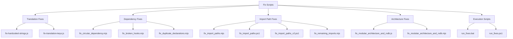
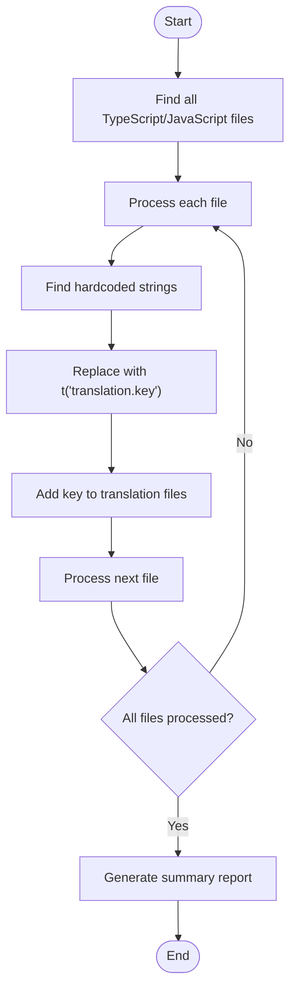
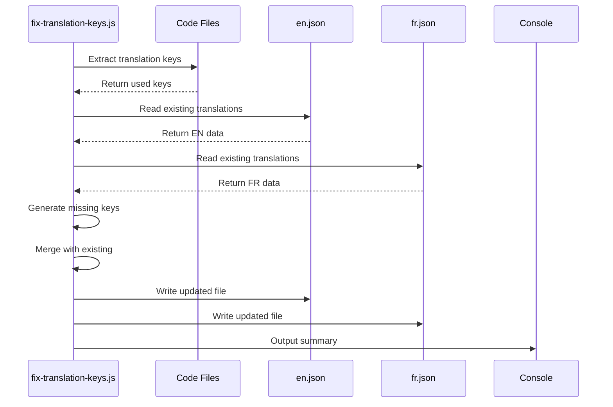
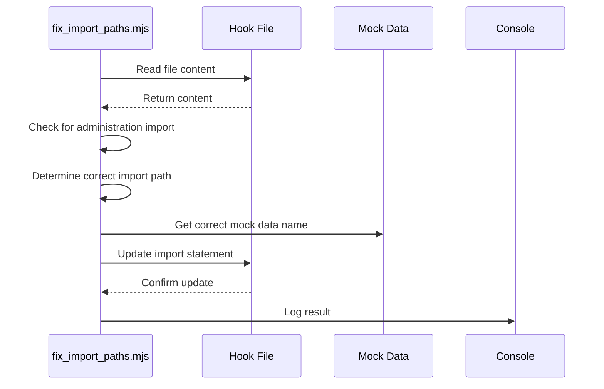
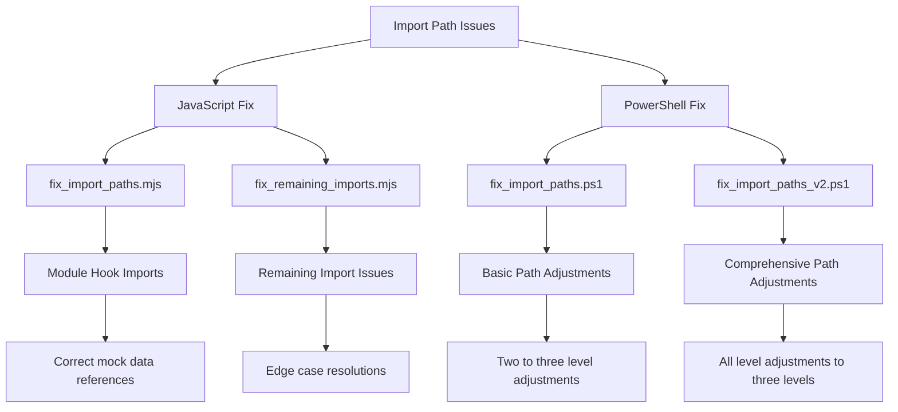
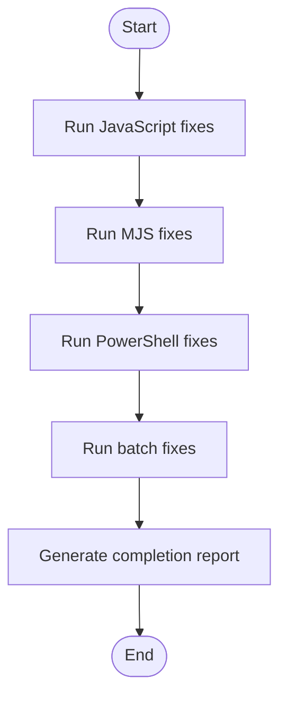
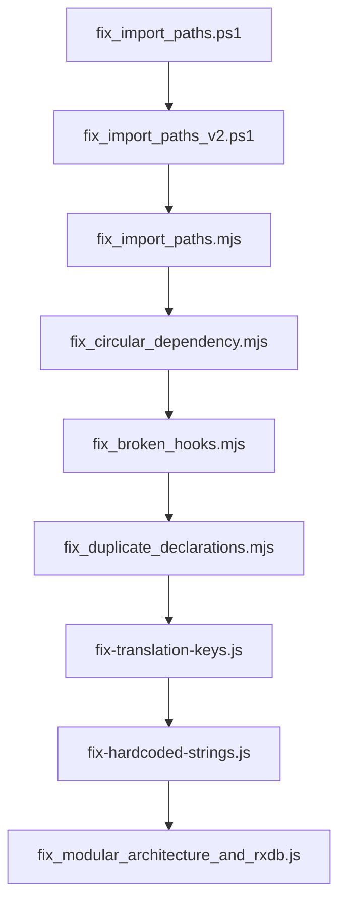
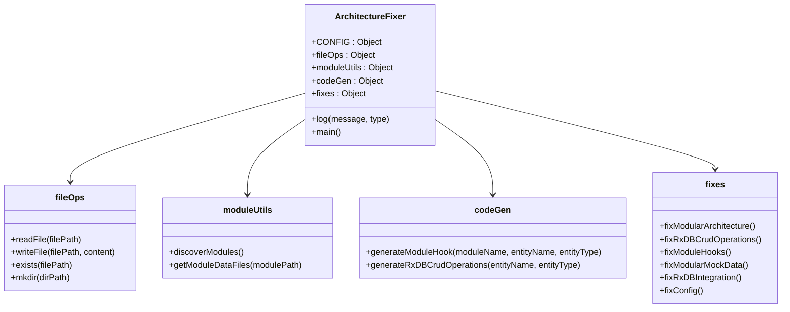
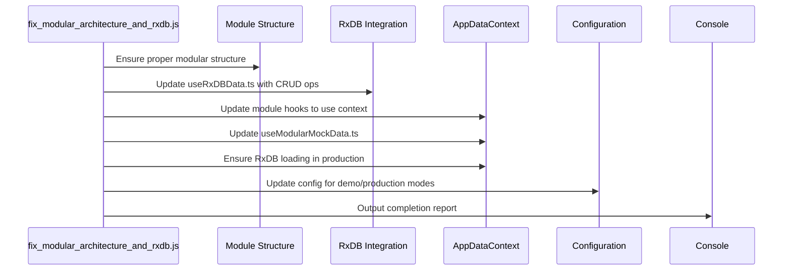

# Fix Scripts

<cite>
**Referenced Files in This Document**   
- [fix-hardcoded-strings.js](file://scripts\fix\fix-hardcoded-strings.js)
- [fix-translation-keys.js](file://scripts\fix\fix-translation-keys.js)
- [fix_broken_hooks.mjs](file://scripts\fix\fix_broken_hooks.mjs)
- [fix_circular_dependency.mjs](file://scripts\fix\fix_circular_dependency.mjs)
- [fix_duplicate_declarations.mjs](file://scripts\fix\fix_duplicate_declarations.mjs)
- [fix_import_paths.mjs](file://scripts\fix\fix_import_paths.mjs)
- [fix_import_paths.ps1](file://scripts\fix\fix_import_paths.ps1)
- [fix_import_paths_v2.ps1](file://scripts\fix\fix_import_paths_v2.ps1)
- [fix_modular_architecture_and_rxdb.js](file://scripts\fix\fix_modular_architecture_and_rxdb.js)
- [run_fixes.bat](file://scripts\fix\run_fixes.bat)
- [run_fixes.ps1](file://scripts\fix\run_fixes.ps1)
</cite>

## Table of Contents
1. [Introduction](#introduction)
2. [Project Structure and Fix Script Ecosystem](#project-structure-and-fix-script-ecosystem)
3. [Core Fix Script Analysis](#core-fix-script-analysis)
4. [Translation and Internationalization Fixes](#translation-and-internationalization-fixes)
5. [Modular Architecture and Dependency Resolution](#modular-architecture-and-dependency-resolution)
6. [Import Path Resolution System](#import-path-resolution-system)
7. [Execution Patterns and Batch Processing](#execution-patterns-and-batch-processing)
8. [Fix Script Interactions with RxDB Integration](#fix-script-interactions-with-rxdb-integration)
9. [Extending the Fix Script Ecosystem](#extending-the-fix-script-ecosystem)
10. [Conclusion](#conclusion)

## Introduction
The schoolpilot3 repository employs a comprehensive suite of automated fix scripts designed to maintain code quality, resolve architectural inconsistencies, and ensure proper modular structure. These scripts address critical issues such as hardcoded strings, translation key inconsistencies, import path errors, circular dependencies, and broken hooks. The fix script ecosystem operates across multiple layers of the application, from internationalization to data layer integration with RxDB. This document provides a detailed analysis of these automated fix scripts, their implementation patterns, and their interactions with the modular architecture of the schoolpilot3 application.

## Project Structure and Fix Script Ecosystem
The fix scripts are organized within the `scripts/fix` directory, forming a specialized subsystem dedicated to automated code correction and architectural compliance. This ecosystem includes JavaScript, TypeScript, PowerShell, and batch scripts that work together to maintain code integrity across the modular application structure.



**Diagram sources**
- [scripts/fix](file://scripts\fix)

**Section sources**
- [scripts/fix](file://scripts\fix)

## Core Fix Script Analysis

### Hardcoded Strings Resolution
The `fix-hardcoded-strings.js` script systematically identifies and replaces hardcoded strings with proper translation keys, ensuring internationalization compliance across the application.



**Diagram sources**
- [fix-hardcoded-strings.js](file://scripts\fix\fix-hardcoded-strings.js#L0-L232)

**Section sources**
- [fix-hardcoded-strings.js](file://scripts\fix\fix-hardcoded-strings.js#L0-L232)

The script uses a predefined mapping of common hardcoded strings to translation keys, replacing them with proper i18n function calls. It also handles alert messages by converting them to use translation keys, ensuring consistent user messaging across the application.

### Translation Key Standardization
The `fix-translation-keys.js` script ensures consistency in translation key usage by analyzing code to extract used keys and updating translation files to include missing keys with reasonable default values.

```javascript
// Example of translation key extraction
function extractTranslationKeys(filePath) {
  const content = fs.readFileSync(filePath, 'utf8');
  const regex = /t\(['"`]([^'"`]+)['"`]\)/g;
  const keys = [];
  let match;
  
  while ((match = regex.exec(content)) !== null) {
    if (match[1].includes('.') && !match[1].includes(' ') && !match[1].includes('!') && !match[1].includes('?')) {
      keys.push(match[1]);
    }
  }
  
  return [...new Set(keys)];
}
```

**Section sources**
- [fix-translation-keys.js](file://scripts\fix\fix-translation-keys.js#L0-L209)

The script processes multiple modules (academics, administration, inventory, reports) to ensure their translation files contain all keys used in the code. It generates default English values based on key names and preserves existing French translations as placeholders.

## Translation and Internationalization Fixes

### Translation Key Management Workflow
The translation fix scripts follow a systematic workflow to ensure comprehensive coverage of internationalization requirements.



**Diagram sources**
- [fix-translation-keys.js](file://scripts\fix\fix-translation-keys.js#L0-L209)

**Section sources**
- [fix-translation-keys.js](file://scripts\fix\fix-translation-keys.js#L0-L209)

### Hardcoded Strings Replacement Strategy
The hardcoded strings fix script employs a multi-phase approach to identify and replace problematic strings throughout the codebase.

```javascript
// Common replacements mapping
const commonReplacements = {
  '"Class Stream, Subject, and Academic Year are required."': 'validation.classStreamSubjectAcademicYearRequired',
  '"This subject is already allocated to this class stream for the selected academic year."': 'validation.subjectAlreadyAllocated',
  '"Name, Structure, and a valid positive Sequence Order are required."': 'validation.nameStructureSequenceRequired',
  // ... additional mappings
};

// Function to generate translation key from string
function generateTranslationKey(str) {
  let key = str
    .toLowerCase()
    .replace(/[^a-zA-Z0-9\s]/g, '')
    .replace(/\s+/g, ' ')
    .trim()
    .split(' ')
    .map((word, index) => index === 0 ? word : word.charAt(0).toUpperCase() + word.slice(1))
    .join('');
  
  if (str.includes('required') || str.includes('must') || str.includes('select')) {
    return `validation.${key}`;
  } else if (str.includes('implemented') || str.includes('to be')) {
    return `messages.${key}`;
  } else {
    return `messages.${key}`;
  }
}
```

**Section sources**
- [fix-hardcoded-strings.js](file://scripts\fix\fix-hardcoded-strings.js#L0-L232)

The script categorizes strings into validation messages, common actions, status messages, and single character strings, applying appropriate translation key prefixes based on context.

## Modular Architecture and Dependency Resolution

### Circular Dependency Resolution
The `fix_circular_dependency.mjs` script addresses circular dependencies by making module hooks self-contained and independent of AppDataContext.

```mermaid
classDiagram
class HookFixer {
+CONFIG : Object
+log(message, type)
+createBackup()
+backupFile(filePath)
+getModuleHookFiles()
+fixHookFile(filePath)
+main()
}
class HookData {
+hookName : string
+dataType : string
+mockDataName : string
}
HookFixer --> HookData : "uses mapping"
HookFixer --> "fs" : "Node.js filesystem"
HookFixer --> "path" : "Node.js path"
```

**Diagram sources**
- [fix_circular_dependency.mjs](file://scripts\fix\fix_circular_dependency.mjs#L0-L247)

**Section sources**
- [fix_circular_dependency.mjs](file://scripts\fix\fix_circular_dependency.mjs#L0-L247)

The script identifies hooks that import from AppDataContext and transforms them into self-contained hooks that manage their own data state using useState and mock data.

### Broken Hooks Resolution
Following the circular dependency fix, the `fix_broken_hooks.mjs` script corrects issues with data type mappings that may have been incorrectly applied.

```javascript
// Data type mapping for hooks
const dataTypeMap = {
  'useAcademicYearData': { type: 'AcademicYear', mockData: 'initialMockAcademicYears' },
  'useAcademicPeriodDefinitionData': { type: 'AcademicPeriodDefinition', mockData: 'initialMockAcademicPeriodDefinitions' },
  // ... additional mappings
};
```

**Section sources**
- [fix_broken_hooks.mjs](file://scripts\fix\fix_broken_hooks.mjs#L0-L252)

The script ensures proper TypeScript typing and correct mock data references for each hook, maintaining type safety across the application.

### Duplicate Declarations Resolution
The `fix_duplicate_declarations.mjs` script resolves duplicate variable declarations in the useModularMockData.ts file that may result from previous fix operations.

```javascript
// Proper version of useModularMockData.ts
const properContent = `import { useState, useEffect } from 'react';
import { AppDataContextType, AppDataLoadingStates } from '../types';

// Import all module hooks
import { useAcademicYearData } from '../modules/academics/data/useAcademicYearData';
// ... additional imports

export const useModularMockData = (): AppDataContextType => {
  // Use module-specific hooks for live data
  const { data: academicyears, create: addAcademicYear, /* ... */ } = useAcademicYearData();
  // ... additional hook calls
  
  const [loading, setLoading] = useState<AppDataLoadingStates>(createLoadingStates());

  useEffect(() => {
    const timer = setTimeout(() => {
      setLoading(prev => {
        const newLoading = { ...prev };
        Object.keys(newLoading).forEach(key => {
          newLoading[key as keyof AppDataLoadingStates] = false;
        });
        return newLoading;
      });
    }, 100);
    return () => clearTimeout(timer);
  }, []);

  const fullData: any = {
    academicyears,
    // ... additional data
    ...rawInitialData
  };

  return {
    ...fullData,
    loading,
    // Add CRUD operations
    addStudent: async (data: any) => { /* implementation */ },
    // ... additional CRUD operations
  };
};
`;
```

**Section sources**
- [fix_duplicate_declarations.mjs](file://scripts\fix\fix_duplicate_declarations.mjs#L0-L487)

The script creates a comprehensive version of useModularMockData.ts with proper imports and hook usage, eliminating duplicate declarations and ensuring consistent data access patterns.

## Import Path Resolution System

### JavaScript Import Path Fixing
The `fix_import_paths.mjs` script corrects import paths in module hook files to ensure they reference the correct mock data sources.



**Diagram sources**
- [fix_import_paths.mjs](file://scripts\fix\fix_import_paths.mjs#L0-L217)

**Section sources**
- [fix_import_paths.mjs](file://scripts\fix\fix_import_paths.mjs#L0-L217)

The script uses a mapping system to determine the correct import path and mock data name for each hook based on its name, ensuring proper module isolation.

### PowerShell Import Path Fixing
The PowerShell scripts `fix_import_paths.ps1` and `fix_import_paths_v2.ps1` address import path issues in moved page components.

```powershell
# fix_import_paths.ps1
$content = $content -replace 'from ''\.\./\.\./', 'from ''../../../'
$content = $content -replace 'from ''\.\./\.\./types''', 'from ''../../../types'''
$content = $content -replace 'from ''\.\./\.\./contexts', 'from ''../../../contexts'
# ... additional replacements
```

**Section sources**
- [fix_import_paths.ps1](file://scripts\fix\fix_import_paths.ps1#L0-L33)
- [fix_import_paths_v2.ps1](file://scripts\fix\fix_import_paths_v2.ps1#L0-L34)

These scripts use regular expressions to update relative import paths in TypeScript files, accounting for the movement of pages from `src/pages/module/` to `src/modules/module/pages/`.

### Import Path Fixing Strategy
The import path resolution system employs a multi-layered approach to ensure comprehensive coverage.



**Diagram sources**
- [fix_import_paths.mjs](file://scripts\fix\fix_import_paths.mjs#L0-L217)
- [fix_import_paths.ps1](file://scripts\fix\fix_import_paths.ps1#L0-L33)
- [fix_import_paths_v2.ps1](file://scripts\fix\fix_import_paths_v2.ps1#L0-L34)

The system combines JavaScript and PowerShell scripts to address different types of import path issues, with the PowerShell scripts handling bulk path adjustments and the JavaScript scripts handling specific module hook imports.

## Execution Patterns and Batch Processing

### Batch Execution Scripts
The `run_fixes.bat` and `run_fixes.ps1` scripts provide a unified interface for executing multiple fix scripts in sequence.



**Section sources**
- [run_fixes.bat](file://scripts\fix\run_fixes.bat)
- [run_fixes.ps1](file://scripts\fix\run_fixes.ps1)

These execution scripts ensure that fix operations are performed in the correct order, with dependencies resolved before subsequent fixes are applied.

### Fix Script Execution Order
The fix scripts follow a specific execution order to ensure proper resolution of interdependent issues.



**Section sources**
- [run_fixes.bat](file://scripts\fix\run_fixes.bat)
- [run_fixes.ps1](file://scripts\fix\run_fixes.ps1)

The execution order is designed to resolve foundational issues (import paths) before addressing higher-level architectural concerns (circular dependencies, translation keys).

## Fix Script Interactions with RxDB Integration

### Modular Architecture and RxDB Fix
The `fix_modular_architecture_and_rxdb.js` script addresses comprehensive issues related to modular architecture and RxDB integration.



**Diagram sources**
- [fix_modular_architecture_and_rxdb.js](file://scripts\fix\fix_modular_architecture_and_rxdb.js#L0-L524)

**Section sources**
- [fix_modular_architecture_and_rxdb.js](file://scripts\fix\fix_modular_architecture_and_rxdb.js#L0-L524)

The script performs multiple fixes to ensure proper modular architecture compliance and complete RxDB integration, including updating useRxDBData.ts with complete CRUD operations and ensuring proper RxDB loading in production mode.

### RxDB Integration Workflow
The modular architecture fix script follows a comprehensive workflow to ensure proper RxDB integration.



**Diagram sources**
- [fix_modular_architecture_and_rxdb.js](file://scripts\fix\fix_modular_architecture_and_rxdb.js#L0-L524)

The script ensures that the application properly supports both demo and production modes, with appropriate configuration for RxDB database name, leader election, and settings collection.

## Extending the Fix Script Ecosystem

### Creating New Fix Scripts
New fix scripts should follow the established patterns and conventions of the existing ecosystem.

```javascript
// Template for new fix script
#!/usr/bin/env node

/**
 * New Fix Script
 * 
 * This script addresses [specific issue].
 */

import fs from 'fs';
import path from 'path';
import { fileURLToPath } from 'url';

const __filename = fileURLToPath(import.meta.url);
const __dirname = path.dirname(__filename);

// Configuration
const CONFIG = {
  targetDir: 'src/target',
  backupDir: 'backup_' + new Date().toISOString().replace(/[:.]/g, '-'),
  logFile: 'new_fix.log'
};

// Logging utility
const log = (message, type = 'INFO') => {
  const timestamp = new Date().toISOString();
  const logMessage = `[${timestamp}] [${type}] ${message}`;
  console.log(logMessage);
  fs.appendFileSync(CONFIG.logFile, logMessage + '\n');
};

// Create backup directory
const createBackup = () => {
  if (!fs.existsSync(CONFIG.backupDir)) {
    fs.mkdirSync(CONFIG.backupDir, { recursive: true });
    log(`Created backup directory: ${CONFIG.backupDir}`);
  }
};

// Main execution
const main = async () => {
  try {
    log('Starting new fix...');
    
    // Create backup
    createBackup();
    
    // Implement fix logic here
    
    log('New fix completed successfully!');
    
  } catch (error) {
    log(`Error in main execution: ${error.message}`, 'ERROR');
    process.exit(1);
  }
};

// Run the script
main();
```

When creating new fix scripts, developers should:
1. Use the same configuration structure with backup and logging
2. Implement proper error handling and backup mechanisms
3. Follow the naming convention `fix-[description].[js|mjs|ps1|bat]`
4. Include comprehensive comments explaining the script's purpose
5. Ensure the script can be safely executed multiple times

### Best Practices for Fix Script Development
The following best practices should be followed when developing new fix scripts:

1. **Always create backups**: Ensure all modified files are backed up before changes
2. **Use consistent logging**: Implement the same logging format across all scripts
3. **Handle errors gracefully**: Include proper error handling and exit codes
4. **Test thoroughly**: Verify script behavior on a copy of the codebase before production use
5. **Document assumptions**: Clearly document any assumptions about the codebase structure
6. **Follow execution order**: Consider dependencies with other fix scripts
7. **Use appropriate technology**: Choose JavaScript/TypeScript for complex logic, PowerShell/Batch for simple file operations

## Conclusion
The automated fix script ecosystem in schoolpilot3 provides a comprehensive solution for maintaining code quality and architectural integrity. These scripts address critical issues across multiple dimensions of the application, from internationalization to modular architecture and data layer integration. The ecosystem demonstrates a well-structured approach to automated code correction, with scripts organized by functionality and executed in a specific order to resolve interdependent issues. By following established patterns and conventions, the fix scripts ensure consistent code quality and reduce the potential for human error in code maintenance. The combination of JavaScript, TypeScript, PowerShell, and batch scripts provides flexibility in addressing different types of issues, while the centralized execution scripts ensure proper sequencing of fix operations. This comprehensive approach to automated code correction serves as a model for maintaining large, complex codebases with multiple interdependent components.