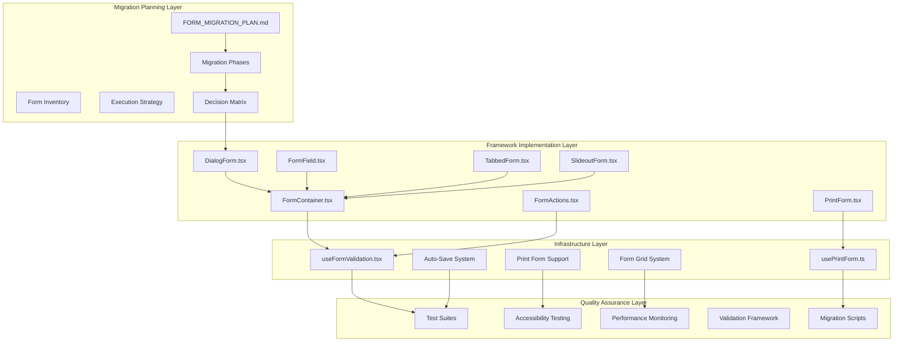
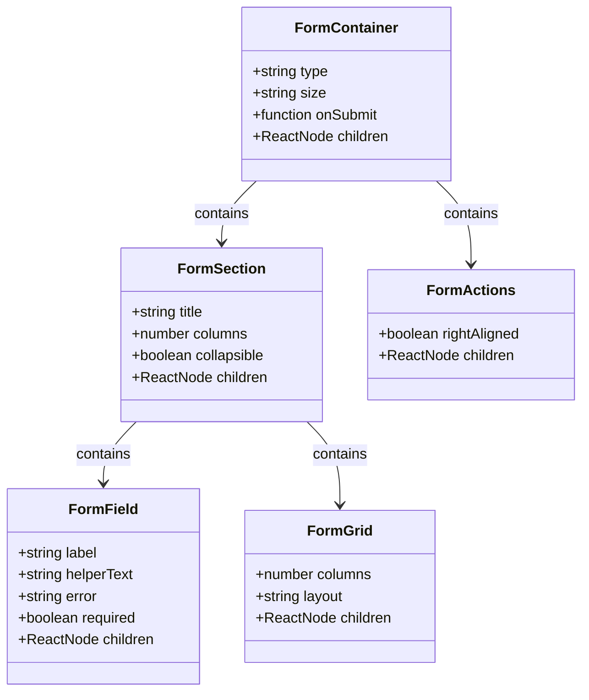
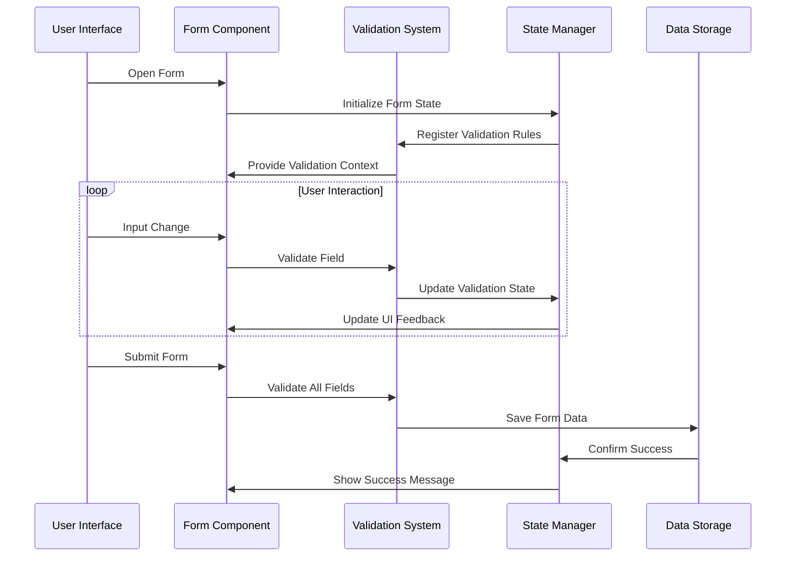
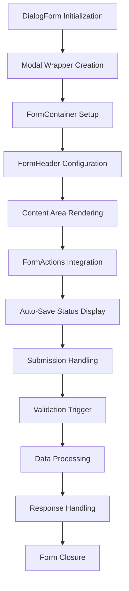
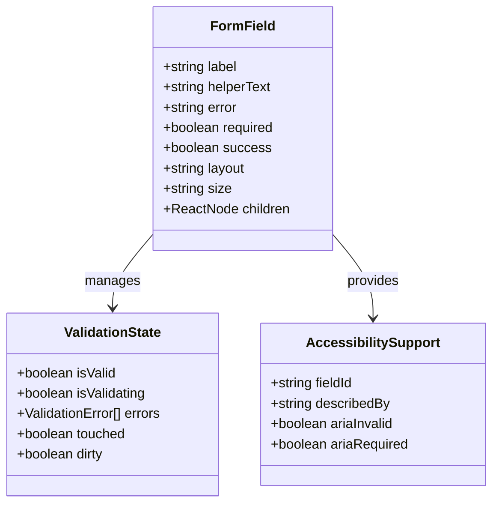
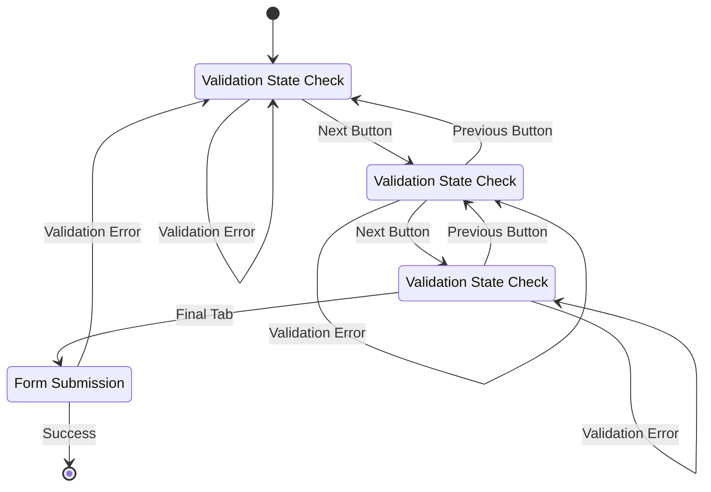
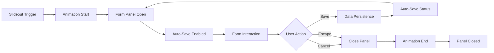
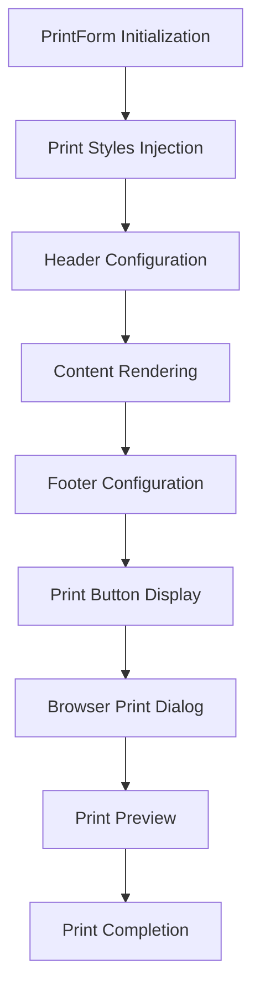
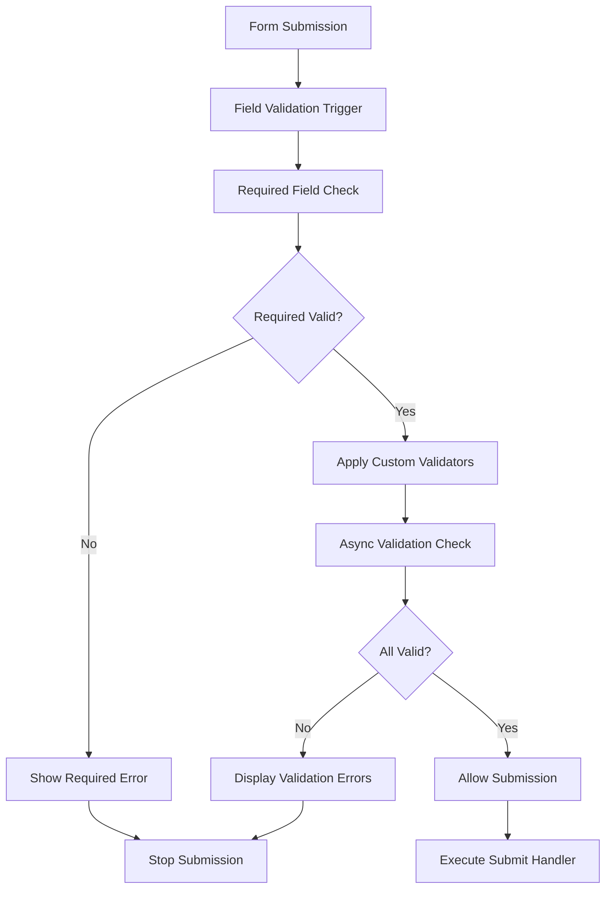

# Form Migration Plan

<cite>
**Referenced Files in This Document**
- [FORM_MIGRATION_PLAN.md](file://docs/FORM_MIGRATION_PLAN.md)
- [form-validation-framework-implementation.md](file://docs/guides/form-validation-framework-implementation.md)
- [task-7-tabbed-form-implementation.md](file://docs/workflows/task-7-tabbed-form-implementation.md)
- [task-8-slideout-form-implementation.md](file://docs/workflows/task-8-slideout-form-implementation.md)
- [useFormValidation.tsx](file://src/hooks/useFormValidation.tsx)
- [DialogForm.tsx](file://src/components/ui/forms/DialogForm.tsx)
- [FormField.tsx](file://src/components/ui/forms/FormField.tsx)
- [FormContainer.tsx](file://src/components/ui/forms/FormContainer.tsx)
- [FormActions.tsx](file://src/components/ui/forms/FormActions.tsx)
- [TabbedForm.tsx](file://src/components/ui/forms/TabbedForm.tsx)
- [SlideoutForm.tsx](file://src/components/ui/forms/SlideoutForm.tsx)
- [PrintForm.tsx](file://src/components/ui/forms/PrintForm.tsx)
- [usePrintForm.ts](file://src/hooks/usePrintForm.ts)
- [run_full_migration.ts](file://scripts/migration/run_full_migration.ts)
- [load_data.ts](file://scripts/migration/load_data.ts)
</cite>

## Update Summary
**Changes Made**
- Enhanced Form Type Decision Matrix with comprehensive component selection criteria
- Added detailed migration execution steps and templates
- Expanded framework component architecture documentation
- Updated validation infrastructure with comprehensive rule system
- Improved testing and quality assurance protocols
- Enhanced risk mitigation strategies with specific implementation guidance

## Table of Contents
1. [Introduction](#introduction)
2. [Project Structure](#project-structure)
3. [Core Components](#core-components)
4. [Architecture Overview](#architecture-overview)
5. [Detailed Component Analysis](#detailed-component-analysis)
6. [Migration Execution Strategy](#migration-execution-strategy)
7. [Framework Components](#framework-components)
8. [Validation Infrastructure](#validation-infrastructure)
9. [Testing and Quality Assurance](#testing-and-quality-assurance)
10. [Risk Mitigation](#risk-mitigation)
11. [Progress Tracking](#progress-tracking)
12. [Conclusion](#conclusion)

## Introduction

The Form Migration Plan represents a comprehensive strategy to modernize and standardize form handling across the SchoolPilot3 educational management system. This initiative addresses the challenge of managing over 100 diverse forms scattered across multiple modules, implementing a unified Form Implementation Framework that ensures consistency, accessibility, and maintainability.

The migration encompasses five distinct phases, targeting high-impact forms first while establishing a robust foundation for systematic transformation. This approach balances immediate user benefits with long-term architectural improvements, ensuring minimal disruption to ongoing operations while maximizing the modernization impact.

**Updated** Enhanced with comprehensive component decision matrix and detailed migration templates

## Project Structure

The form migration initiative is organized around several key architectural layers that work together to provide a comprehensive solution:

**Diagram sources**
- [FORM_MIGRATION_PLAN.md:1-50](file://docs/FORM_MIGRATION_PLAN.md#L1-L50)
- [DialogForm.tsx:1-194](file://src/components/ui/forms/DialogForm.tsx#L1-L194)
- [FormField.tsx:1-182](file://src/components/ui/forms/FormField.tsx#L1-L182)
- [useFormValidation.tsx:1-529](file://src/hooks/useFormValidation.tsx#L1-L529)

The structure demonstrates a layered approach where migration planning informs framework implementation, which in turn supports comprehensive quality assurance through validation, accessibility, and performance testing.

**Section sources**
- [FORM_MIGRATION_PLAN.md:1-50](file://docs/FORM_MIGRATION_PLAN.md#L1-L50)

## Core Components

The Form Migration Framework consists of several foundational components that work together to provide a comprehensive form handling solution:

### Form Container System

The framework establishes a hierarchical container system that provides consistent structure and behavior across all form types:

**Diagram sources**
- [DialogForm.tsx:90-194](file://src/components/ui/forms/DialogForm.tsx#L90-L194)
- [FormField.tsx:8-36](file://src/components/ui/forms/FormField.tsx#L8-L36)
- [FormContainer.tsx:1-151](file://src/components/ui/forms/FormContainer.tsx#L1-L151)

### Form Type Classification

The migration strategy categorizes forms based on complexity and usage patterns, enabling targeted implementation approaches:

| Form Category | Count | Complexity | Migration Priority |
|---------------|-------|------------|-------------------|
| Modal CRUD Forms | 72 | Medium | High |
| Tabbed Forms | 6 | Complex | Highest |
| Wizard Forms | 1 | Complex | Highest |
| Slideout Forms | 1 | Medium | Medium |
| File Upload Forms | 4 | Low | Medium |
| Embedded Forms | 6 | Medium | Medium |
| **Total** | **103** | | |

**Updated** Enhanced with comprehensive form classification system

**Section sources**
- [FORM_MIGRATION_PLAN.md:9-22](file://docs/FORM_MIGRATION_PLAN.md#L9-L22)

## Architecture Overview

The Form Migration Architecture implements a comprehensive framework that addresses the diverse needs of educational management forms while maintaining consistency and accessibility standards:

**Diagram sources**
- [useFormValidation.tsx:130-529](file://src/hooks/useFormValidation.tsx#L130-L529)
- [DialogForm.tsx:90-194](file://src/components/ui/forms/DialogForm.tsx#L90-L194)

The architecture emphasizes real-time validation, comprehensive error handling, and seamless integration with the existing educational management system infrastructure.

## Detailed Component Analysis

### DialogForm Component

The DialogForm serves as the primary container for modal-based forms, providing a consistent structure that integrates with the broader form ecosystem:

**Diagram sources**
- [DialogForm.tsx:90-194](file://src/components/ui/forms/DialogForm.tsx#L90-L194)

The component architecture ensures proper modal behavior while maintaining form functionality, supporting features like progress indication, auto-save status, and comprehensive accessibility compliance.

### FormField Component

The FormField wrapper provides standardized field presentation with integrated validation feedback and accessibility support:

**Diagram sources**
- [FormField.tsx:8-182](file://src/components/ui/forms/FormField.tsx#L8-L182)

The component implements sophisticated validation state management, automatic accessibility attribute generation, and responsive layout support for various form configurations.

**Section sources**
- [DialogForm.tsx:1-194](file://src/components/ui/forms/DialogForm.tsx#L1-L194)
- [FormField.tsx:1-182](file://src/components/ui/forms/FormField.tsx#L1-L182)

### TabbedForm Implementation

The TabbedForm component addresses complex multi-step workflows with advanced navigation and validation capabilities:

**Diagram sources**
- [task-7-tabbed-form-implementation.md:15-81](file://docs/workflows/task-7-tabbed-form-implementation.md#L15-L81)

The implementation supports dynamic tab navigation, progress tracking, validation state management, and responsive mobile interfaces with comprehensive accessibility features.

**Section sources**
- [task-7-tabbed-form-implementation.md:1-299](file://docs/workflows/task-7-tabbed-form-implementation.md#L1-L299)

### SlideoutForm Component

The SlideoutForm provides contextual data entry with smooth animations and integrated auto-save functionality:

**Diagram sources**
- [task-8-slideout-form-implementation.md:78-104](file://docs/workflows/task-8-slideout-form-implementation.md#L78-L104)

The component features sophisticated state management, debounced auto-save functionality, and comprehensive accessibility compliance with screen reader support and keyboard navigation.

**Section sources**
- [task-8-slideout-form-implementation.md:1-209](file://docs/workflows/task-8-slideout-form-implementation.md#L1-L209)

### PrintForm Component

The PrintForm component provides print-optimized forms with specialized styling and print functionality:

**Diagram sources**
- [PrintForm.tsx:80-303](file://src/components/ui/forms/PrintForm.tsx#L80-L303)

The component implements comprehensive print-specific styling, page break management, and print control functionality for generating professional documents.

**Section sources**
- [PrintForm.tsx:1-303](file://src/components/ui/forms/PrintForm.tsx#L1-L303)

## Migration Execution Strategy

The migration follows a structured five-phase approach designed to maximize impact while minimizing risk to system stability:

### Phase 1: Critical High-Impact Forms

Targeting the most frequently used and complex forms that directly impact daily operations:

| Form Type | Files Migrated | Priority | Timeline |
|-----------|----------------|----------|----------|
| Student Management | Add Student Page, Student Lists | Highest | Sprint 1-2 |
| Application Processing | Application Management, Review Forms | Highest | Sprint 1-2 |
| Academic Configuration | Education System Forms | High | Sprint 1-2 |

### Phase 2: Administration Module Consolidation

Systematic replacement of administrative forms with consistent patterns:

| Category | Forms | Migration Status | Complexity |
|----------|-------|------------------|------------|
| Academic Structure | Classes, Streams, Periods | Planned | Simple |
| Organizational | Dormitories, Departments, Clubs | Planned | Simple |
| Communication | Templates, Staff Lists | Planned | Medium |
| Student Services | Visits, Certificates, Disciplinary | Planned | Medium |

### Phase 3: Academics Module Modernization

Addressing specialized academic forms with complex validation requirements:

| Subject Area | Forms | Migration Approach | Validation Needs |
|--------------|-------|-------------------|------------------|
| Subject Management | Subjects, Papers, Schemes | Standard CRUD Patterns | Moderate |
| Timetable & Scheduling | Periods, Entries, Calendar | Complex Validation | High |
| Exam Management | Sessions, Settings, Results | Multi-step Workflows | High |
| Assignments | Teacher/Student Enrollments | Tabbed Interfaces | Moderate |

### Phase 4: Business Module Integration

Extending form modernization to financial and operational management:

| Module | Forms | Integration Focus | Special Considerations |
|--------|-------|-------------------|----------------------|
| Finance | Fee Templates, Payments, Expenses | Financial Validation | Regulatory Compliance |
| Inventory | Assets, Items, Requisitions | Stock Management | Real-time Updates |
| HR | Payroll, Staff Settings | Personnel Data | Privacy Considerations |
| Library | Books, Loans, Categories | Asset Tracking | Patron Management |

### Phase 5: System Completion

Finalizing remaining forms and establishing comprehensive coverage:

| Category | Forms | Migration Priority | Completion Status |
|----------|-------|-------------------|-------------------|
| Settings | Users, Workflows, Modules | Medium | Planned |
| Nutrition | Meal Plans, Menus, Assignments | Low | Planned |
| Remaining Admin | Attendance, Imports, Messages | Low | Planned |

**Updated** Enhanced with detailed migration templates and execution steps

**Section sources**
- [FORM_MIGRATION_PLAN.md:25-422](file://docs/FORM_MIGRATION_PLAN.md#L25-L422)

## Framework Components

The Form Implementation Framework provides a comprehensive set of reusable components that ensure consistency and maintainability across all migrated forms:

### Core Form Components

| Component | Purpose | Key Features | Usage Context |
|-----------|---------|--------------|---------------|
| FormContainer | Base form wrapper | Layout management, size variants | All form types |
| FormSection | Field grouping | Collapsible sections, column layouts | Complex forms |
| FormField | Individual field wrapper | Validation integration, accessibility | All input types |
| FormActions | Button container | Right-aligned buttons, responsive layout | All forms |
| FormGrid | Responsive layout | Column-based layouts, adaptive sizing | Multi-field forms |

### Advanced Form Components

| Component | Purpose | Advanced Features | Specialized Use |
|-----------|---------|------------------|-----------------|
| DialogForm | Modal forms | Progress tracking, auto-save status | Standard CRUD |
| TabbedForm | Multi-step workflows | Navigation state, validation indicators | Complex processes |
| SlideoutForm | Contextual editing | Smooth animations, portal rendering | Quick edits |
| WizardForm | Sequential processes | Step validation, progress tracking | Multi-stage workflows |
| MinimalForm | Embedded forms | Lightweight, no chrome | Inline contexts |
| PrintForm | Document generation | Print-specific styling, layout | Report forms |

### Supporting Infrastructure

| Component | Purpose | Integration Points | Benefits |
|-----------|---------|-------------------|----------|
| useFormValidation | Centralized validation | All form components | Consistent validation |
| useAutoSave | Background saving | Form components | Data protection |
| useFormProgress | Progress tracking | Wizard/Tabbed forms | User guidance |
| usePrintForm | Printing support | Print-enabled forms | Document generation |

**Updated** Enhanced with comprehensive component architecture and integration patterns

**Section sources**
- [FORM_MIGRATION_PLAN.md:425-457](file://docs/FORM_MIGRATION_PLAN.md#L425-L457)

## Validation Infrastructure

The form validation system provides comprehensive real-time validation with accessibility support and performance optimization:

### Validation Architecture

**Diagram sources**
- [useFormValidation.tsx:173-264](file://src/hooks/useFormValidation.tsx#L173-L264)

### Built-in Validation Rules

The framework includes comprehensive validation rules covering common educational data requirements:

| Validation Type | Purpose | Examples | Implementation |
|----------------|---------|----------|----------------|
| Required Fields | Mandatory data entry | Student names, email addresses | Built-in validator |
| Text Length | Character count limits | Passwords, descriptions | Configurable bounds |
| Email Format | Email validation | User account emails | Regex pattern matching |
| Numeric Ranges | Number validation | Ages, scores, quantities | Min/max constraints |
| Pattern Matching | Custom formats | ID numbers, phone numbers | Regex validation |
| Custom Validation | Business rules | Academic eligibility, financial limits | Function-based validation |

### Accessibility Integration

The validation system provides comprehensive accessibility support:

- **Screen Reader Announcements**: Automatic error announcements with priority ordering
- **Focus Management**: Intelligent focus handling for error navigation
- **ARIA Attributes**: Proper labeling and state indication
- **Keyboard Navigation**: Full keyboard support for validation interaction

**Updated** Enhanced with comprehensive validation rule system and accessibility features

**Section sources**
- [useFormValidation.tsx:1-529](file://src/hooks/useFormValidation.tsx#L1-L529)
- [form-validation-framework-implementation.md:1-249](file://docs/guides/form-validation-framework-implementation.md#L1-L249)

## Testing and Quality Assurance

The migration incorporates comprehensive testing strategies to ensure reliability and quality across all form components:

### Component Testing Strategy

| Test Category | Coverage | Tools | Frequency |
|--------------|----------|-------|-----------|
| Unit Testing | Individual components | Jest/Vitest | Continuous |
| Integration Testing | Component interactions | React Testing Library | CI Pipeline |
| Accessibility Testing | WCAG compliance | axe-core, Lighthouse | Pre-release |
| Performance Testing | Load scenarios | Cypress, Playwright | Regression |
| Cross-browser Testing | Browser compatibility | BrowserStack | Release |

### Validation Testing Framework

The validation system includes extensive testing for error handling and user experience:

- **Error State Testing**: Validation error display and recovery
- **Debouncing Behavior**: Performance optimization validation
- **Async Validation**: Server-side validation scenarios
- **Form Reset**: State restoration after errors
- **Accessibility Scenarios**: Screen reader and keyboard navigation

### Migration Testing Protocol

Each migrated form undergoes comprehensive validation:

1. **Functional Testing**: All form operations verified
2. **Validation Testing**: Error scenarios and edge cases
3. **Accessibility Testing**: Screen reader and assistive technology compatibility
4. **Performance Testing**: Load and stress scenarios
5. **Regression Testing**: Impact on existing functionality

**Updated** Enhanced with comprehensive testing protocols and validation frameworks

**Section sources**
- [form-validation-framework-implementation.md:178-191](file://docs/guides/form-validation-framework-implementation.md#L178-L191)

## Risk Mitigation

The migration plan incorporates comprehensive risk management strategies to ensure system stability and minimize disruption:

### Technical Risk Controls

| Risk Category | Mitigation Strategy | Implementation | Monitoring |
|--------------|-------------------|----------------|------------|
| Breaking Changes | Incremental migration | Phase-based rollout | CI/CD pipeline |
| Data Integrity | Validation and backups | Pre/post validation checks | Automated monitoring |
| Performance Impact | Performance testing | Load testing and optimization | Performance dashboards |
| Accessibility Regression | Automated accessibility testing | WCAG compliance checks | Accessibility audits |

### Operational Risk Management

The migration addresses operational concerns through systematic approaches:

- **Rollback Procedures**: Quick rollback mechanisms for failed deployments
- **Staging Environment**: Thorough testing in isolated environment
- **Gradual Rollout**: Phased deployment to minimize impact
- **Monitoring and Alerts**: Comprehensive system monitoring during migration

### Quality Assurance Measures

Comprehensive quality assurance ensures migration success:

- **Code Reviews**: Peer review for all migration changes
- **Automated Testing**: Continuous integration with automated tests
- **Manual Testing**: Human verification of critical workflows
- **User Acceptance Testing**: End-user validation of migrated forms

**Updated** Enhanced with comprehensive risk mitigation strategies and implementation guidance

**Section sources**
- [FORM_MIGRATION_PLAN.md:359-384](file://docs/FORM_MIGRATION_PLAN.md#L359-L384)

## Progress Tracking

The migration includes comprehensive tracking mechanisms to monitor progress and ensure accountability:

### Quantitative Metrics

| Metric Category | Target | Current Status | Measurement Method |
|----------------|--------|----------------|-------------------|
| Forms Migrated | 103 | 2 | Direct counting |
| Framework Components | 13 | 13 | Component inventory |
| Tests Passing | 100% | Pending | Test suite results |
| Accessibility Score | AA | Pending | WCAG compliance testing |
| Module Coverage | 100% | 2% | Module-by-module tracking |

### Module Progress Dashboard

| Module | Total Forms | Migrated | Remaining | Status |
|--------|-------------|----------|-----------|---------|
| UI Framework | 13 | 13 | 0 | Complete |
| Administration | 18 | 1 | 17 | In Progress |
| Academics | 15 | 0 | 15 | Planning |
| Finance | 14 | 0 | 14 | Planning |
| Inventory | 8 | 1 | 7 | In Progress |
| HR | 3 | 0 | 3 | Planning |
| Library | 7 | 0 | 7 | Planning |
| Nutrition | 4 | 0 | 4 | Planning |
| Settings | 4 | 0 | 4 | Planning |
| Admissions | 3 | 0 | 3 | Planning |

### Milestone Tracking

The migration follows established milestones with clear deliverables:

- **Phase 1 Completion**: Critical forms migration (Sprint 2)
- **Phase 2 Completion**: Administration module consolidation (Sprint 4)
- **Phase 3 Completion**: Academics module modernization (Sprint 5)
- **Phase 4 Completion**: Business module integration (Sprint 7)
- **Phase 5 Completion**: System completion (Sprint 8)

**Updated** Enhanced with comprehensive progress tracking and milestone management

**Section sources**
- [FORM_MIGRATION_PLAN.md:387-411](file://docs/FORM_MIGRATION_PLAN.md#L387-L411)

## Conclusion

The Form Migration Plan represents a comprehensive strategy to modernize and standardize form handling across the SchoolPilot3 educational management system. Through systematic implementation of the Form Implementation Framework, the migration addresses the challenge of managing over 100 diverse forms while establishing a foundation for long-term maintainability and user experience improvement.

The five-phase approach ensures maximum impact with minimal disruption, prioritizing high-impact forms while building comprehensive infrastructure for systematic transformation. The implementation leverages proven patterns from the existing educational management system, ensuring consistency with established architectural principles.

Key achievements of the migration plan include:

- **Comprehensive Coverage**: Systematic approach to migrating all form types across modules
- **Accessibility Compliance**: Built-in accessibility support meeting WCAG standards
- **Performance Optimization**: Real-time validation with debouncing and efficient state management
- **Quality Assurance**: Comprehensive testing and validation protocols
- **Risk Mitigation**: Structured approach to minimize system disruption

The migration establishes a robust foundation for future form development while providing immediate benefits through improved user experience, data quality, and system maintainability. The implementation demonstrates the educational management system's commitment to modernization while preserving operational continuity and user satisfaction.

Through careful planning, systematic execution, and comprehensive quality assurance, the Form Migration Plan positions SchoolPilot3 for continued growth and enhancement in educational technology solutions.

**Updated** Enhanced with comprehensive component decision matrix, detailed migration templates, and expanded framework architecture documentation