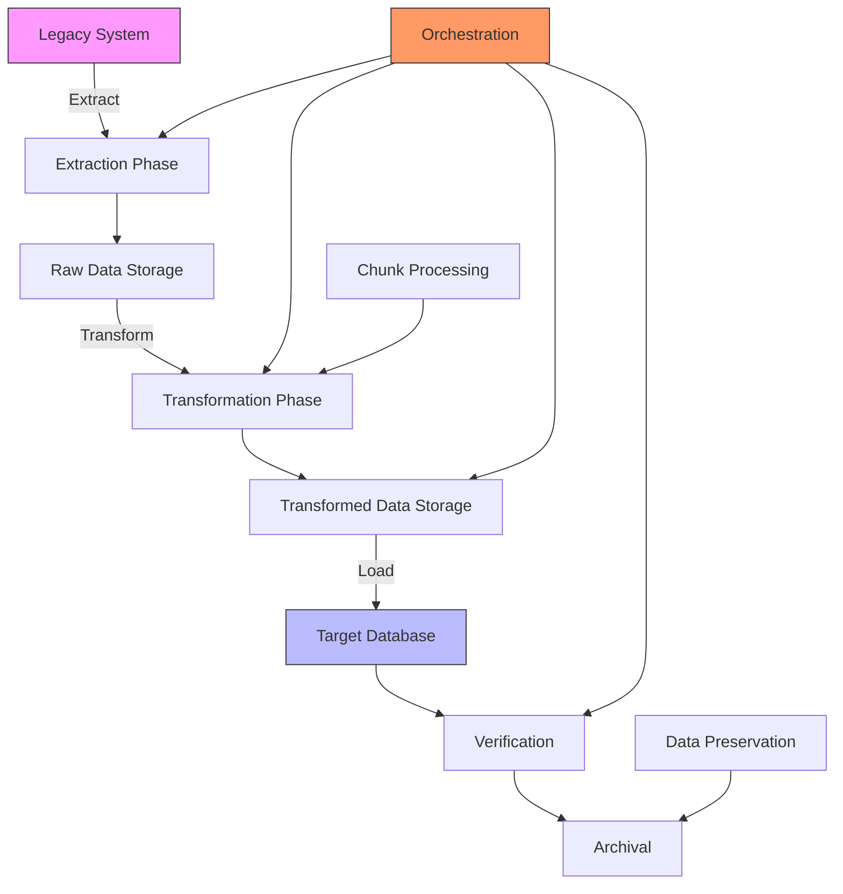
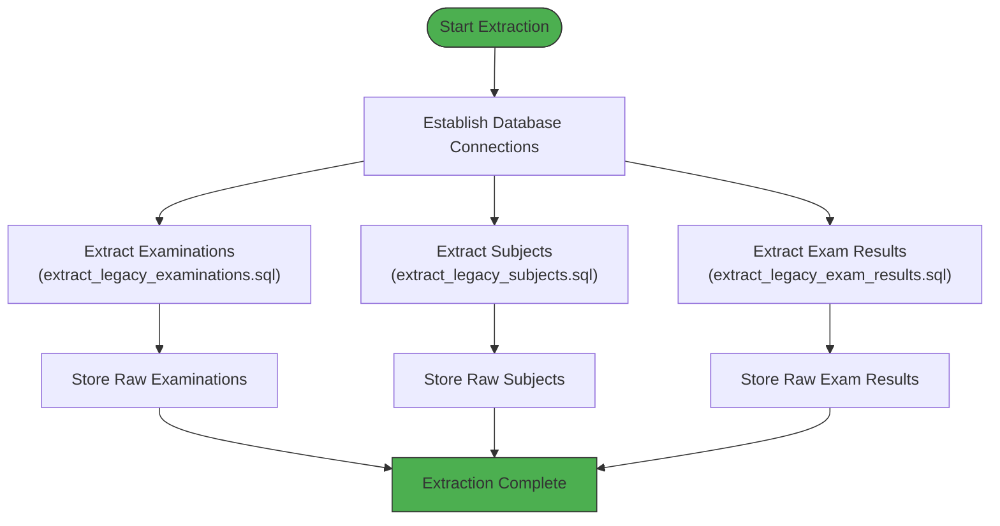
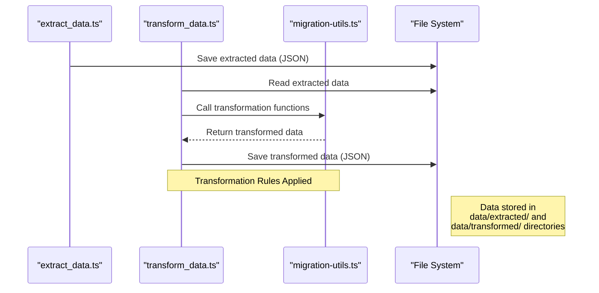
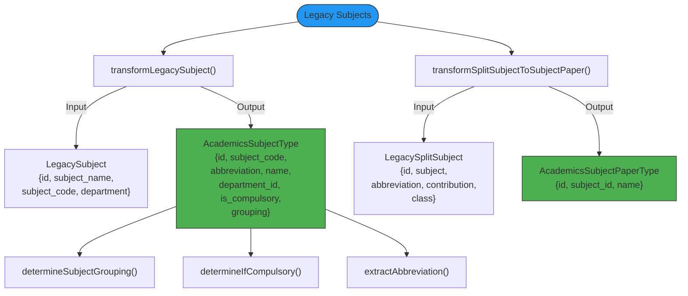
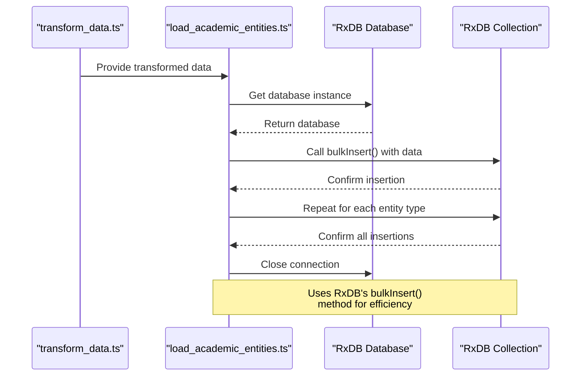
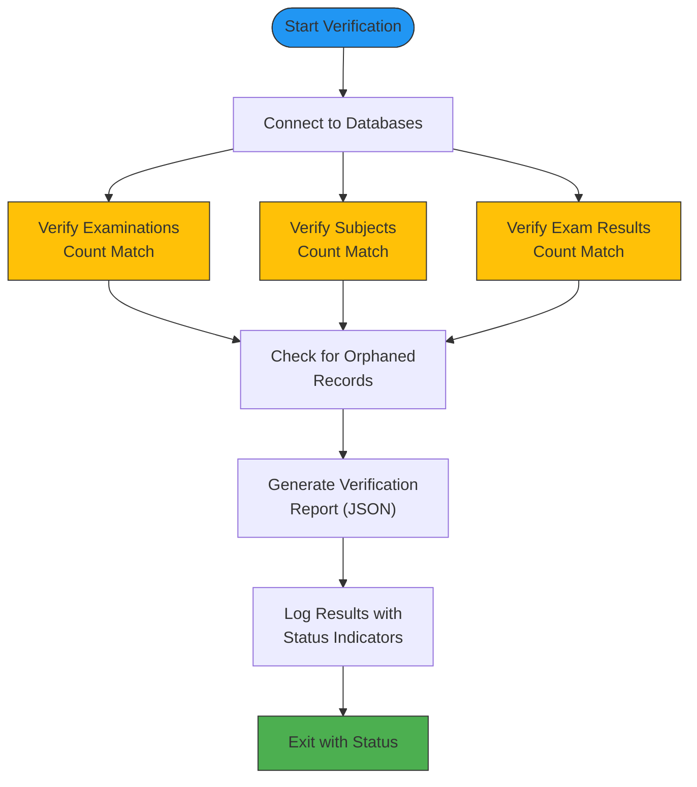
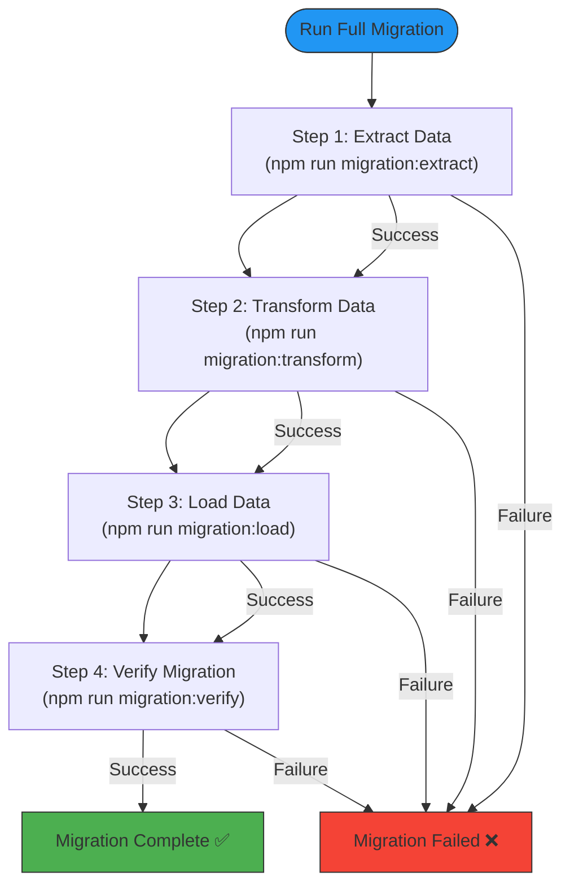

# Migration Scripts

<cite>
**Referenced Files in This Document**   
- [archival_service.ts](file://scripts/migration/archival_service.ts)
- [chunk_processor.ts](file://scripts/migration/chunk_processor.ts)
- [database_manager.ts](file://scripts/migration/database_manager.ts)
- [extract_data.ts](file://scripts/migration/extract_data.ts)
- [extract_legacy_subjects.sql](file://scripts/migration/extract_legacy_subjects.sql)
- [load_academic_entities.ts](file://scripts/migration/load_academic_entities.ts)
- [migration_config.ts](file://migration_config.ts)
- [run_full_migration.ts](file://scripts/migration/run_full_migration.ts)
- [transform_data.ts](file://scripts/migration/transform_data.ts)
- [transform_exam_results.ts](file://scripts/migration/transform_exam_results.ts)
- [transform_subjects.ts](file://scripts/migration/transform_subjects.ts)
- [verification_queries.ts](file://scripts/migration/verification_queries.ts)
- [verify_migration.ts](file://scripts/migration/verify_migration.ts)
- [migration-utils.ts](file://src/modules/academics/data/migration-utils.ts)
</cite>

## Table of Contents
1. [Introduction](#introduction)
2. [ETL Pipeline Architecture](#etl-pipeline-architecture)
3. [Data Extraction Phase](#data-extraction-phase)
4. [Data Transformation Phase](#data-transformation-phase)
5. [Data Loading Phase](#data-loading-phase)
6. [Data Integrity Verification](#data-integrity-verification)
7. [Large Dataset Processing](#large-dataset-processing)
8. [Data Preservation](#data-preservation)
9. [Migration Orchestration](#migration-orchestration)
10. [Common Migration Challenges](#common-migration-challenges)
11. [Best Practices](#best-practices)

## Introduction
The data migration toolkit in schoolpilot3 provides a comprehensive ETL (Extract, Transform, Load) pipeline for migrating academic data from legacy systems to the modern SchoolPilot3 platform. This document details the architecture, components, and workflows of the migration system, focusing on the extraction of historical data, transformation of academic entities, and loading into the target database. The toolkit addresses common migration challenges such as schema mismatches, data type conversions, and performance bottlenecks while ensuring data integrity through comprehensive verification workflows.

## ETL Pipeline Architecture
The ETL pipeline in schoolpilot3 follows a modular architecture with distinct phases for extraction, transformation, and loading, orchestrated by a central workflow manager. The system connects to both the source legacy database (Akademico) and the target SchoolPilot3 database, facilitating data transfer while preserving academic relationships and integrity.



**Diagram sources**
- [run_full_migration.ts](file://scripts/migration/run_full_migration.ts)
- [database_manager.ts](file://scripts/migration/database_manager.ts)

**Section sources**
- [run_full_migration.ts](file://scripts/migration/run_full_migration.ts)
- [database_manager.ts](file://scripts/migration/database_manager.ts)

## Data Extraction Phase
The extraction phase retrieves data from legacy systems using SQL scripts and connection managers. The process begins with establishing connections to both the source (Akademico) and target (SchoolPilot) databases, followed by executing specific SQL queries to extract academic entities.

### Database Connection Management
The DatabaseManager class handles connections to multiple database systems, supporting both PostgreSQL (for Akademico) and MySQL (for SchoolPilot). Connection configurations are stored in environment variables for security and flexibility.

```mermaid
classDiagram
class DatabaseManager {
+akademicoConnection : DatabaseConnection
+schoolPilotConnection : DatabaseConnection
+rxdbInstance : RxDatabase
+getAkademicoConnection() Promise~DatabaseConnection~
+getSchoolPilotConnection() Promise~DatabaseConnection~
+setRxDBInstance(db : RxDatabase) void
+getRxDBInstance() RxDatabase
+executeTransaction(connection, operations) Promise~T~
+testConnections() Promise~{akademico : boolean, schoolPilot : boolean, rxdb : boolean}~
+closeAllConnections() Promise~void~
+healthCheck() Promise~void~
}
class DatabaseConnection {
<<interface>>
+query(sql : string, params? : any[]) Promise~any~
+beginTransaction() Promise~void~
+commit() Promise~void~
+rollback() Promise~void~
+close() Promise~void~
}
class PostgresConnection {
-pool : PostgresPool
-client : any
+query(sql : string, params? : any[]) Promise~any~
+beginTransaction() Promise~void~
+commit() Promise~void~
+rollback() Promise~void~
+close() Promise~void~
}
class MySQLConnection {
-pool : mysql.Pool
-connection : mysql.PoolConnection
+query(sql : string, params? : any[]) Promise~any~
+beginTransaction() Promise~void~
+commit() Promise~void~
+rollback() Promise~void~
+close() Promise~void~
}
DatabaseManager --> DatabaseConnection : "uses"
PostgresConnection ..|> DatabaseConnection : "implements"
MySQLConnection ..|> DatabaseConnection : "implements"
```

**Diagram sources**
- [database_manager.ts](file://scripts/migration/database_manager.ts#L50-L268)
- [migration_config.ts](file://migration_config.ts#L1-L26)

**Section sources**
- [database_manager.ts](file://scripts/migration/database_manager.ts)
- [migration_config.ts](file://migration_config.ts)

### SQL-Based Data Extraction
The extraction process utilizes SQL scripts to retrieve specific academic entities from the legacy system. Each script targets a particular data type, ensuring focused and efficient data retrieval.



**Diagram sources**
- [extract_data.ts](file://scripts/migration/extract_data.ts#L1-L45)
- [extract_legacy_subjects.sql](file://scripts/migration/extract_legacy_subjects.sql)

**Section sources**
- [extract_data.ts](file://scripts/migration/extract_data.ts)
- [extract_legacy_subjects.sql](file://scripts/migration/extract_legacy_subjects.sql)

### Subject Data Extraction Example
The `extract_legacy_subjects.sql` script extracts both main subjects and split subjects from the legacy system. This two-part extraction ensures that both the primary subject information and its subdivisions (papers) are captured for comprehensive transformation.

```sql
-- Extract all subjects
SELECT 
    id,
    subject_name,
    subject_code,
    department
FROM 
    subjects;

-- Extract all split subjects
SELECT 
    id,
    subject as parent_subject,
    abbreviation,
    contribution,
    class
FROM 
    split_subjects;
```

This extraction approach separates the subject hierarchy, allowing the transformation phase to properly map main subjects to their respective papers in the SchoolPilot3 schema.

## Data Transformation Phase
The transformation phase converts extracted legacy data into the SchoolPilot3 schema, applying business rules and normalization to ensure data consistency and integrity.

### Transformation Workflow
The transformation process follows a structured workflow, reading extracted data from files, applying transformation rules, and saving the results for loading.



**Diagram sources**
- [transform_data.ts](file://scripts/migration/transform_data.ts#L1-L48)
- [migration-utils.ts](file://src/modules/academics/data/migration-utils.ts)

**Section sources**
- [transform_data.ts](file://scripts/migration/transform_data.ts)
- [migration-utils.ts](file://src/modules/academics/data/migration-utils.ts)

### Subject Transformation Logic
The subject transformation process converts legacy subject data into the SchoolPilot3 schema, including the creation of subject papers from split subjects.



**Diagram sources**
- [transform_subjects.ts](file://scripts/migration/transform_subjects.ts#L1-L26)
- [migration-utils.ts](file://src/modules/academics/data/migration-utils.ts#L1-L199)

**Section sources**
- [transform_subjects.ts](file://scripts/migration/transform_subjects.ts)
- [migration-utils.ts](file://src/modules/academics/data/migration-utils.ts)

### Exam Results Normalization
The exam results transformation normalizes grading data by converting legacy exam result records into the SchoolPilot3 schema, including the creation of student paper marks.

```typescript
static transformSubjectMarksToStudentPaperMarks(
    legacyResult: LegacyExamResult,
    studentExamResultId: string,
    subjectPapers: Array<{
      subject_code: string;
      paper_id: number;
      paper_name: string;
      paper_setting_id: string;
      marks_out_of: number;
    }>
  ): types.AcademicsStudentPaperMarkWithDetailsType[] {
    const paperMarks: types.AcademicsStudentPaperMarkWithDetailsType[] = [];

    // Known subject columns from legacy system
    const subjectColumns = ['ENG', 'KIS', 'MAT', 'BIO', 'CHEM', 'PHY', 'HIST', 'GEO', 'CRE', 'IRE', 'HRE'];

    for (const subjectCode of subjectColumns) {
      const subjectScore = legacyResult[subjectCode];
      if (subjectScore !== undefined && subjectScore !== null) {
        
        // Find papers for this subject
        const relatedPapers = subjectPapers.filter(sp => sp.subject_code === subjectCode);
        
        // Create paper marks for each paper
        for (const paper of relatedPapers) {
          paperMarks.push({
            id: AcademicsMigrationUtils.generateMigrationUUID('paper_marks', `${legacyResult.id}_${paper.paper_id}`),
            student_exam_result_id: studentExamResultId,
            subject_paper_id: paper.paper_id,
            marks_obtained: subjectScore,
            marks_out_of: paper.marks_out_of,
            created_at: new Date().toISOString(),
            updated_at: new Date().toISOString()
          });
        }
      }
    }
    
    return paperMarks;
  }
```

This transformation function processes each subject column in the legacy exam result, creating individual paper mark records for each subject paper, thereby normalizing the data structure.

## Data Loading Phase
The loading phase inserts transformed data into the target SchoolPilot3 database using RxDB collections.

### Academic Entities Loading
The load_academic_entities.ts script handles the insertion of transformed academic data into the appropriate RxDB collections.



**Diagram sources**
- [load_academic_entities.ts](file://scripts/migration/load_academic_entities.ts#L1-L23)
- [transform_data.ts](file://scripts/migration/transform_data.ts#L1-L48)

**Section sources**
- [load_academic_entities.ts](file://scripts/migration/load_academic_entities.ts)
- [transform_data.ts](file://scripts/migration/transform_data.ts)

## Data Integrity Verification
The verification phase ensures data integrity by comparing source and target data counts and validating relationships.

### Verification Workflow
The verify_migration.ts script performs comprehensive data integrity checks across multiple academic entities.



**Diagram sources**
- [verify_migration.ts](file://scripts/migration/verify_migration.ts#L1-L159)
- [verification_queries.ts](file://scripts/migration/verification_queries.ts#L1-L13)

**Section sources**
- [verify_migration.ts](file://scripts/migration/verify_migration.ts)
- [verification_queries.ts](file://scripts/migration/verification_queries.ts)

### Verification Results Structure
The verification process generates a comprehensive report with detailed results for each entity type:

```json
{
  "timestamp": "2023-12-07T10:30:00Z",
  "overall_status": "PASS",
  "results": [
    {
      "entity": "examinations",
      "source_count": 50,
      "target_count": 50,
      "status": "PASS",
      "message": "Counts match perfectly"
    },
    {
      "entity": "subjects",
      "source_count": 25,
      "target_count": 25,
      "status": "PASS",
      "message": "Counts match perfectly"
    },
    {
      "entity": "exam_results",
      "source_count": 10000,
      "target_count": 10000,
      "status": "PASS",
      "message": "Counts match perfectly"
    }
  ],
  "summary": {
    "total_entities": 3,
    "passed": 3,
    "failed": 0,
    "warnings": 0
  }
}
```

This structured report enables easy identification of any data discrepancies and provides a clear overview of the migration's success.

## Large Dataset Processing
The chunk_processor.ts module handles large datasets efficiently, preventing memory issues and ensuring transactional integrity.

### Chunk Processing Architecture
The MigrationManager class processes data in configurable chunks, providing error handling and rollback capabilities.

```mermaid
classDiagram
class MigrationManager {
-db : RxDatabase
-logger : Logger
-rollbackLog : MigrationItem[]
-options : ChunkProcessorOptions
+processInChunks(items, processor) Promise~MigrationResult~
+processChunkWithRetry(chunk, processor) Promise~MigrationItem[]~
+validateChunk(migrationItems) Promise~void~
+commitChunk(migrationItems) Promise~void~
+rollbackAll() Promise~void~
+getStats() {processedItems : number, rollbackItems : number}
}
class MigrationItem {
+id : string
+collectionName : string
+data : any
+operation : 'insert' | 'update' | 'delete'
}
class MigrationResult {
+success : boolean
+processedItems : number
+errors : Array<{item : MigrationItem, error : Error}>
+rollbackItems : MigrationItem[]
}
class ChunkProcessorOptions {
+chunkSize : number
+maxRetries : number
+rollbackOnError : boolean
+validateBeforeCommit : boolean
+logLevel : 'debug' | 'info' | 'warn' | 'error'
}
MigrationManager --> MigrationItem : "processes"
MigrationManager --> MigrationResult : "returns"
MigrationManager --> ChunkProcessorOptions : "uses"
```

**Diagram sources**
- [chunk_processor.ts](file://scripts/migration/chunk_processor.ts#L1-L283)

**Section sources**
- [chunk_processor.ts](file://scripts/migration/chunk_processor.ts)

### Chunk Processing Workflow
The chunk processing workflow ensures reliable handling of large datasets with error recovery mechanisms.

```mermaid
sequenceDiagram
participant Client as "Migration Script"
participant Manager as "MigrationManager"
participant DB as "RxDB Database"
Client->>Manager : processInChunks(items, processor)
Manager->>Manager : Log start of migration
loop For each chunk
Manager->>Manager : Slice items into chunk
Manager->>Manager : Log chunk processing
Manager->>Manager : processChunkWithRetry()
loop With retry logic
Manager->>Manager : Attempt processing
alt Success
Manager-->>Manager : Return migration items
break
else Failure
Manager->>Manager : Wait with exponential backoff
end
end
Manager->>Manager : validateChunk()
Manager->>Manager : commitChunk()
Manager->>Manager : Update rollback log
end
alt All chunks successful
Manager-->>Client : Return success result
else Error with rollback
Manager->>Manager : rollbackAll()
Manager-->>Client : Throw error
end
Note over Manager : Implements exponential backoff<br/>and transactional rollback
```

**Diagram sources**
- [chunk_processor.ts](file://scripts/migration/chunk_processor.ts#L1-L283)

**Section sources**
- [chunk_processor.ts](file://scripts/migration/chunk_processor.ts)

## Data Preservation
The archival_service.ts module ensures data preservation by archiving non-migrated historical data.

### Archival Service Implementation
The ArchivalService class provides methods for archiving and retrieving historical data.

```mermaid
classDiagram
class ArchivalService {
-archiveDB : any
+constructor(archiveDB : any)
+archive(tableName : string, data : any[]) Promise~void~
+search(tableName : string, query : string) Promise~any[]~
}
ArchivalService --> "archiveDB" : "uses"
note right of ArchivalService
Archives data in JSON format
Creates separate tables for each
entity type with 'archive_' prefix
end note
```

**Diagram sources**
- [archival_service.ts](file://scripts/migration/archival_service.ts#L1-L24)

**Section sources**
- [archival_service.ts](file://scripts/migration/archival_service.ts)

### Data Archival Process
The archival process converts data to JSON and stores it in dedicated archive tables.

```typescript
async archive(tableName: string, data: any[]) {
    const archiveTable = `archive_${tableName}`;
    await this.archiveDB.query(`CREATE TABLE IF NOT EXISTS ${archiveTable} (data JSON)`);
    for (const item of data) {
        await this.archiveDB.query(`INSERT INTO ${archiveTable} (data) VALUES (?)`, [JSON.stringify(item)]);
    }
}
```

This approach preserves the original data structure while making it searchable through JSON queries.

## Migration Orchestration
The run_full_migration.ts script orchestrates the entire ETL pipeline, ensuring proper sequence and error handling.

### Full Migration Workflow
The orchestration script executes the migration phases in the correct order, with comprehensive error handling.



**Diagram sources**
- [run_full_migration.ts](file://scripts/migration/run_full_migration.ts#L1-L55)

**Section sources**
- [run_full_migration.ts](file://scripts/migration/run_full_migration.ts)

## Common Migration Challenges
The migration toolkit addresses several common challenges encountered during data migration processes.

### Schema Mismatches
The transformation layer resolves schema differences between legacy and target systems by mapping fields and applying business rules. For example, the legacy system stores subject information in a flat structure, while SchoolPilot3 uses a hierarchical model with subjects and papers.

### Data Type Conversions
The migration process handles data type conversions, such as:
- Converting numeric IDs to UUIDs using deterministic generation
- Standardizing date formats to ISO 8601
- Normalizing text case and encoding
- Converting numeric grades to letter grades based on thresholds

### Performance Bottlenecks
The toolkit mitigates performance issues through:
- Chunked processing to manage memory usage
- Bulk insert operations for improved database performance
- Connection pooling to reduce connection overhead
- Exponential backoff for retrying failed operations

## Best Practices
The migration framework incorporates several best practices for extending and maintaining the system.

### Extending with New Data Sources
To add a new data source:
1. Create a SQL extraction script in the migration directory
2. Implement transformation logic in migration-utils.ts
3. Update the transform_data.ts script to include the new entity
4. Add verification checks in verify_migration.ts

### Target Format Extensions
To support new target formats:
1. Define the schema in the target database
2. Create transformation functions in migration-utils.ts
3. Implement loading logic in the appropriate load script
4. Add verification rules to ensure data integrity

### Error Handling and Recovery
The system implements robust error handling through:
- Comprehensive logging at all levels
- Transactional operations with rollback capabilities
- Retry mechanisms with exponential backoff
- Detailed error reporting and diagnostics

### Testing and Validation
Recommended testing practices include:
- Unit testing transformation functions with sample data
- Integration testing the complete ETL pipeline
- Performance testing with large datasets
- Verification of data integrity after migration