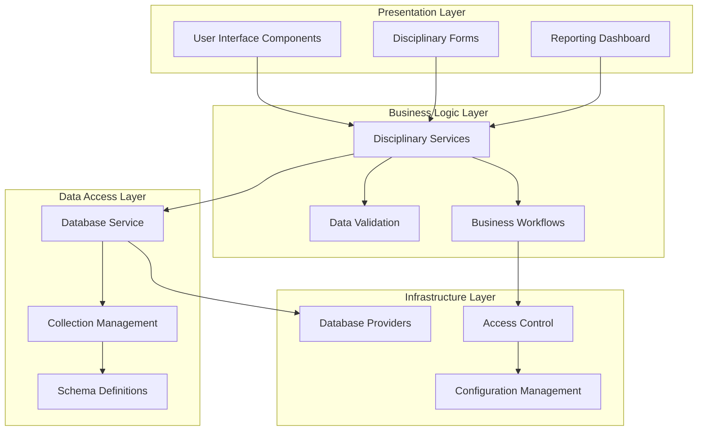
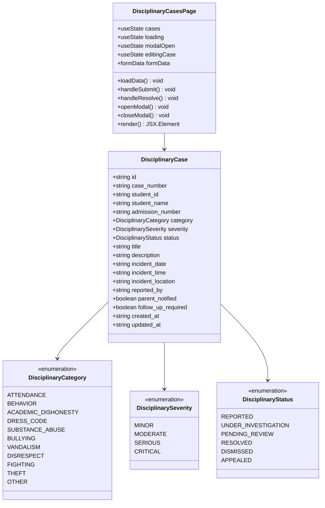
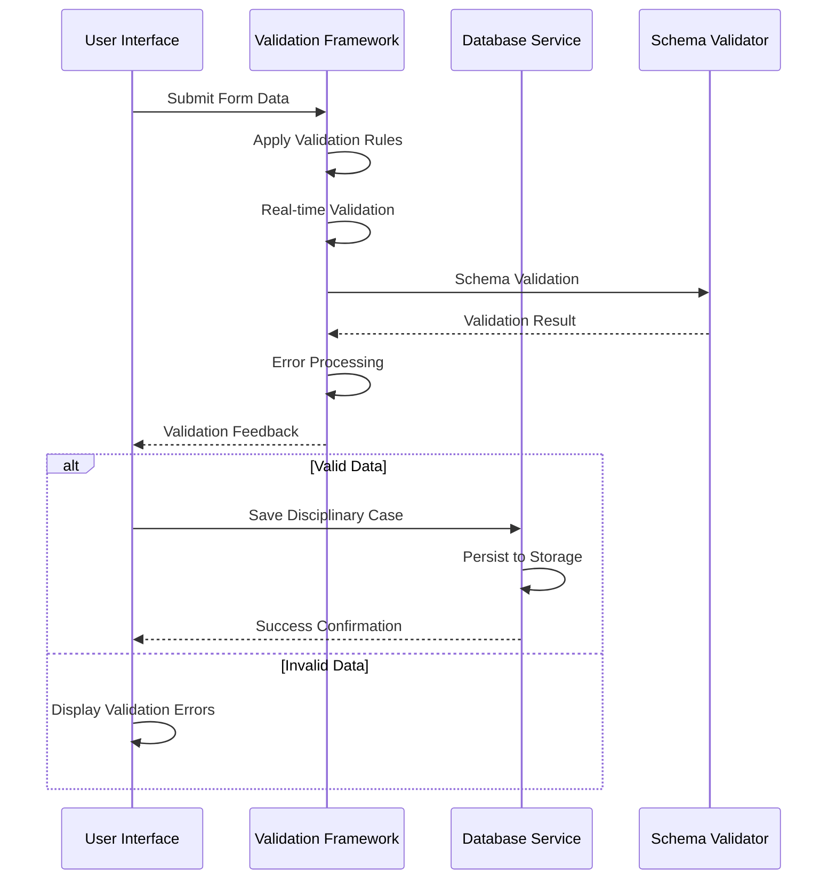
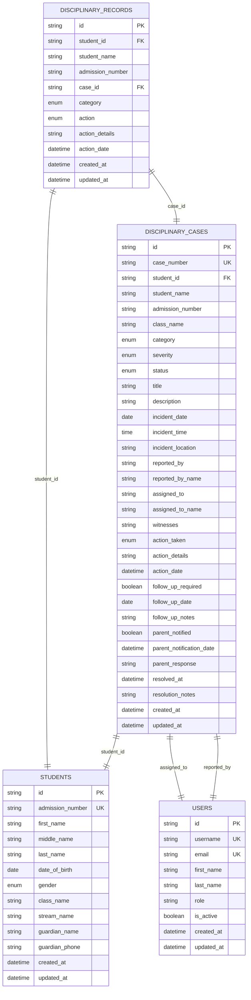
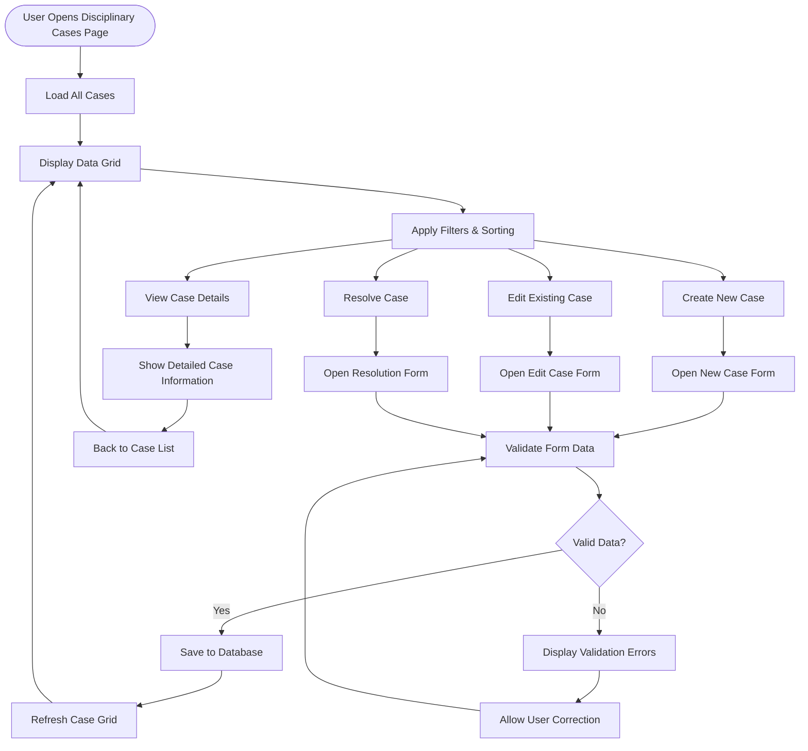
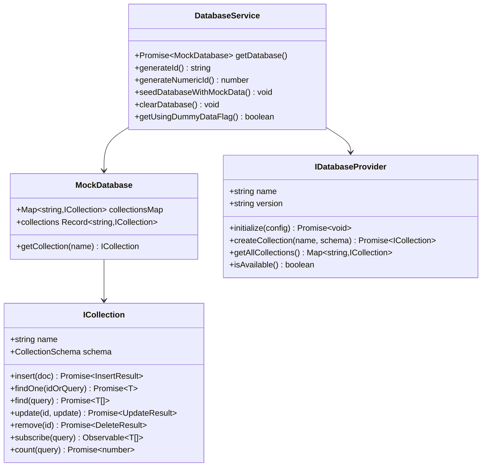
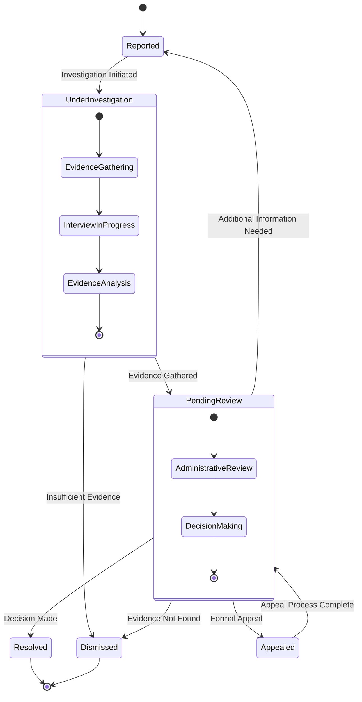
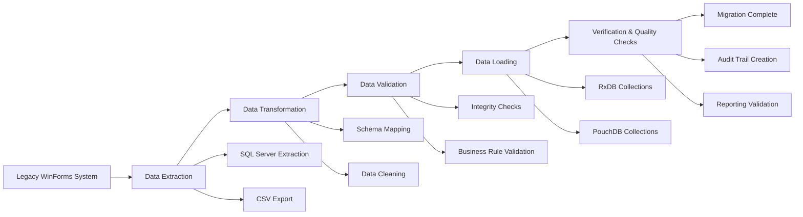

# Disciplinarian Cases Management

<cite>
**Referenced Files in This Document**
- [DisciplinaryCasesPage.tsx](file://src/modules/administration/pages/DisciplinaryCasesPage.tsx)
- [types.ts](file://src/modules/administration/data/types.ts)
- [schema.ts](file://src/modules/administration/data/schema.ts)
- [databaseService.ts](file://src/services/databaseService.ts)
- [interfaces.ts](file://src/services/database/interfaces.ts)
- [UnifiedCRUDService.ts](file://src/services/UnifiedCRUDService.ts)
- [Admissions_Architecture_Spec.md](file://docs/migration/admissions-migration/Admissions_Architecture_Spec.md)
- [Akademiko_Admissions_Migration_Specification.md](file://docs/migration/admissions-migration/Akademiko_Admissions_Migration_Specification.md)
- [Legacy_Feature_Catalog.csv](file://docs/migration/Legacy_Feature_Catalog.csv)
</cite>

## Table of Contents
1. [Introduction](#introduction)
2. [System Architecture](#system-architecture)
3. [Core Components](#core-components)
4. [Data Model](#data-model)
5. [User Interface Components](#user-interface-components)
6. [Database Integration](#database-integration)
7. [Business Logic](#business-logic)
8. [Migration and Legacy Integration](#migration-and-legacy-integration)
9. [Performance Considerations](#performance-considerations)
10. [Security and Access Control](#security-and-access-control)
11. [Troubleshooting Guide](#troubleshooting-guide)
12. [Conclusion](#conclusion)

## Introduction

The Disciplinarian Cases Management system is a comprehensive solution designed to manage student discipline cases within educational institutions. This system provides a centralized platform for recording, tracking, and resolving disciplinary incidents while maintaining compliance with institutional policies and regulatory requirements.

The system is built as part of the broader SchoolPilot3 educational management platform, integrating seamlessly with existing modules such as Administration, Academics, and Student Management. It supports multiple categories of disciplinary offenses, severity levels, and resolution actions while providing robust reporting capabilities and audit trails.

## System Architecture

The Disciplinarian Cases Management system follows a modern, modular architecture that emphasizes scalability, maintainability, and extensibility. The system is designed with clear separation of concerns across multiple layers:

**Diagram sources**
- [DisciplinaryCasesPage.tsx:1-485](file://src/modules/administration/pages/DisciplinaryCasesPage.tsx#L1-L485)
- [databaseService.ts:1-358](file://src/services/databaseService.ts#L1-L358)

The architecture employs a provider pattern for database abstraction, allowing seamless switching between different storage backends while maintaining consistent data access patterns. The system utilizes reactive programming principles for real-time updates and state management.

## Core Components

### Disciplinary Cases Management Page

The primary interface for managing disciplinary cases is implemented as a comprehensive React component that provides full CRUD (Create, Read, Update, Delete) operations along with advanced filtering and sorting capabilities.

**Diagram sources**
- [DisciplinaryCasesPage.tsx:1-485](file://src/modules/administration/pages/DisciplinaryCasesPage.tsx#L1-L485)
- [types.ts:666-757](file://src/modules/administration/data/types.ts#L666-L757)

**Section sources**
- [DisciplinaryCasesPage.tsx:1-485](file://src/modules/administration/pages/DisciplinaryCasesPage.tsx#L1-L485)
- [types.ts:666-757](file://src/modules/administration/data/types.ts#L666-L757)

### Data Validation Framework

The system incorporates a sophisticated validation framework that ensures data integrity and consistency across all disciplinary case entries. The validation system supports real-time validation with debouncing, custom validation rules, and comprehensive error reporting.

**Diagram sources**
- [DisciplinaryCasesPage.tsx:106-142](file://src/modules/administration/pages/DisciplinaryCasesPage.tsx#L106-L142)
- [interfaces.ts:143-175](file://src/services/database/interfaces.ts#L143-L175)

**Section sources**
- [DisciplinaryCasesPage.tsx:56-98](file://src/modules/administration/pages/DisciplinaryCasesPage.tsx#L56-L98)
- [interfaces.ts:1-253](file://src/services/database/interfaces.ts#L1-L253)

## Data Model

The disciplinary cases management system utilizes a comprehensive data model that captures all aspects of student discipline incidents, from initial reporting to final resolution.

### Core Entities

**Diagram sources**
- [schema.ts:605-668](file://src/modules/administration/data/schema.ts#L605-L668)
- [types.ts:710-757](file://src/modules/administration/data/types.ts#L710-L757)

### Enumerations and Constants

The system defines comprehensive enumerations for different aspects of disciplinary management:

**Disciplinary Categories:**
- Attendance violations (unauthorized absences, truancy)
- Behavioral infractions (bullying, harassment, disruptive behavior)
- Academic dishonesty (cheating, plagiarism, fabrication)
- Dress code violations
- Substance abuse cases
- Bullying and harassment
- Property damage and theft
- Respect and courtesy violations
- Fighting and violence
- Theft and property crimes
- Other unspecified violations

**Severity Levels:**
- Minor: First offense, low impact, educational intervention
- Moderate: Repeat offense, significant impact, formal warning
- Serious: Major violation, potential suspension
- Critical: Severe violation, expulsion consideration

**Status Tracking:**
- Reported: Initial incident report submitted
- Under Investigation: Active investigation ongoing
- Pending Review: Case awaiting administrative review
- Resolved: Case closed with appropriate action
- Dismissed: Case closed without action
- Appealed: Formal appeal process initiated

**Section sources**
- [types.ts:668-708](file://src/modules/administration/data/types.ts#L668-L708)
- [schema.ts:605-668](file://src/modules/administration/data/schema.ts#L605-L668)

## User Interface Components

### Main Disciplinary Cases Dashboard

The primary interface provides a comprehensive dashboard for managing all disciplinary cases within the institution:

**Diagram sources**
- [DisciplinaryCasesPage.tsx:163-180](file://src/modules/administration/pages/DisciplinaryCasesPage.tsx#L163-L180)
- [DisciplinaryCasesPage.tsx:254-278](file://src/modules/administration/pages/DisciplinaryCasesPage.tsx#L254-L278)

### Case Management Forms

The system provides specialized forms for different aspects of case management:

**New/Edit Case Form:**
- Student identification and enrollment details
- Incident categorization and severity assessment
- Timeline and location details
- Witness information
- Parent notification tracking
- Follow-up requirements

**Resolution Form:**
- Action selection from predefined disciplinary measures
- Action details and justification
- Timeline for corrective actions
- Monitoring requirements

**Section sources**
- [DisciplinaryCasesPage.tsx:374-480](file://src/modules/administration/pages/DisciplinaryCasesPage.tsx#L374-L480)
- [DisciplinaryCasesPage.tsx:280-371](file://src/modules/administration/pages/DisciplinaryCasesPage.tsx#L280-L371)

## Database Integration

### Database Service Architecture

The system employs a sophisticated database service layer that abstracts database operations while providing consistent interfaces across different storage backends:

**Diagram sources**
- [databaseService.ts:98-141](file://src/services/databaseService.ts#L98-L141)
- [databaseService.ts:44-95](file://src/services/databaseService.ts#L44-L95)
- [interfaces.ts:178-219](file://src/services/database/interfaces.ts#L178-L219)

### Collection Schema Management

Each disciplinary case collection maintains strict schema definitions that ensure data integrity and consistency:

**Disciplinary Cases Collection Schema:**
- Primary key: UUID-based unique identifier
- Indexes: Multi-field indexes for efficient querying
- References: Foreign key relationships to student and user collections
- Validation: Comprehensive schema validation rules
- Timestamps: Automatic creation and modification tracking

**Disciplinary Records Collection Schema:**
- Audit trail: Complete history of disciplinary actions
- Relationships: Direct linkage to specific cases
- Metadata: Action details and resolution information

**Section sources**
- [schema.ts:605-668](file://src/modules/administration/data/schema.ts#L605-L668)
- [databaseService.ts:1-358](file://src/services/databaseService.ts#L1-L358)

## Business Logic

### Case Lifecycle Management

The system implements a comprehensive workflow for managing the complete lifecycle of disciplinary cases:

**Diagram sources**
- [types.ts:675-682](file://src/modules/administration/data/types.ts#L675-L682)
- [DisciplinaryCasesPage.tsx:144-161](file://src/modules/administration/pages/DisciplinaryCasesPage.tsx#L144-L161)

### Resolution Actions Framework

The system provides a structured framework for disciplinary actions with predefined categories and escalation procedures:

**Verbal Warning:**
- First-time minor infractions
- Educational intervention
- Written acknowledgment required

**Written Warning:**
- Repeat offenses
- Formal documentation
- Parent notification required
- Probation period established

**Detention:**
- School-sanctioned community service
- Supervised correctional activities
- Duration determined by severity

**Suspension:**
- Temporary removal from school
- Duration based on infraction severity
- Academic work provision maintained
- Review board requirement for extended suspensions

**Expulsion:**
- Permanent school exclusion
- Board hearing required
- Legal consultation advised
- Alternative education placement consideration

**Section sources**
- [types.ts:684-694](file://src/modules/administration/data/types.ts#L684-L694)
- [DisciplinaryCasesPage.tsx:144-161](file://src/modules/administration/pages/DisciplinaryCasesPage.tsx#L144-L161)

## Migration and Legacy Integration

### Legacy System Integration

The Disciplinarian Cases Management system includes comprehensive migration support for legacy systems, particularly the Akademiko WinForms application:

**Legacy Data Mapping:**
- Student identification and enrollment data
- Disciplinary incident records
- Action and resolution histories
- Staff member assignments
- Reporting and analytics data

**Migration Process:**

**Diagram sources**
- [Akademiko_Admissions_Migration_Specification.md:96-112](file://docs/migration/admissions-migration/Akademiko_Admissions_Migration_Specification.md#L96-L112)
- [Legacy_Feature_Catalog.csv:1-3](file://docs/migration/Legacy_Feature_Catalog.csv#L1-L3)

### Implementation Roadmap

The migration implementation follows a structured approach with clear milestones and quality assurance checkpoints:

**Phase 1: Planning and Analysis**
- Requirements gathering from legacy system
- Data model mapping and transformation
- Risk assessment and mitigation strategies

**Phase 2: Infrastructure Setup**
- Database schema creation
- API development
- Security and access control implementation

**Phase 3: Data Migration**
- Batch data extraction from legacy system
- Data transformation and validation
- Incremental loading with conflict resolution

**Phase 4: Testing and Validation**
- Unit testing of migrated data
- Integration testing with new system
- User acceptance testing

**Phase 5: Go-Live and Support**
- Cutover planning and execution
- User training and support
- Monitoring and maintenance

**Section sources**
- [Admissions_Architecture_Spec.md:177-201](file://docs/migration/admissions-migration/Admissions_Architecture_Spec.md#L177-L201)
- [Akademiko_Admissions_Migration_Specification.md:96-112](file://docs/migration/admissions-migration/Akademiko_Admissions_Migration_Specification.md#L96-L112)

## Performance Considerations

### Database Optimization

The system implements several performance optimization strategies:

**Indexing Strategy:**
- Multi-field indexes for frequently queried combinations
- Composite indexes for complex filtering scenarios
- Partial indexes for specific use cases

**Query Optimization:**
- Efficient sorting and pagination
- Selective field retrieval
- Aggregation queries for reporting

**Caching Mechanisms:**
- In-memory caching for frequently accessed data
- Database-level query result caching
- CDN for static resources

### Scalability Features

**Horizontal Scaling:**
- Database sharding for large datasets
- Load balancing for high-traffic scenarios
- Microservice architecture for modularity

**Resource Management:**
- Connection pooling for database operations
- Memory optimization for large datasets
- Asynchronous processing for heavy operations

## Security and Access Control

### Role-Based Access Control (RBAC)

The system implements comprehensive RBAC to ensure appropriate access to disciplinary case information:

**User Roles:**
- **Administrator**: Full access to all disciplinary cases and system management
- **Disciplinary Officer**: Access to case management within assigned jurisdiction
- **Teacher**: View-only access to cases involving their students
- **Parent/Guardian**: Limited access to cases affecting their children
- **Student**: No direct access to disciplinary case information

**Access Control Implementation:**
- Database-level row-level security
- Application-level authorization checks
- Audit trail for all access and modifications
- Session-based authentication with automatic timeout

**Data Privacy Protection:**
- Encryption of sensitive personal information
- Secure deletion procedures for expired records
- Compliance with educational privacy regulations
- Right-to-privacy considerations for minors

## Troubleshooting Guide

### Common Issues and Solutions

**Database Connection Problems:**
- Verify database service availability
- Check network connectivity and firewall settings
- Review database credentials and permissions
- Monitor database performance metrics

**Data Validation Errors:**
- Review form field requirements
- Check for missing mandatory fields
- Validate data formats and types
- Confirm referential integrity

**Performance Issues:**
- Analyze query execution plans
- Review indexing strategy effectiveness
- Monitor memory usage patterns
- Optimize database configuration

**UI Component Problems:**
- Check browser console for JavaScript errors
- Verify React component dependencies
- Review CSS styling conflicts
- Test responsive design on different devices

### Debugging Tools and Techniques

**Development Tools:**
- Browser developer tools for client-side debugging
- Database query analyzer for server-side optimization
- Performance profiling tools for bottleneck identification
- Logging frameworks for systematic error tracking

**Monitoring and Alerting:**
- Real-time system health monitoring
- Automated performance alerting
- Error rate tracking and trending analysis
- User experience monitoring and feedback collection

**Section sources**
- [databaseService.ts:135-141](file://src/services/databaseService.ts#L135-L141)
- [DisciplinaryCasesPage.tsx:138-142](file://src/modules/administration/pages/DisciplinaryCasesPage.tsx#L138-L142)

## Conclusion

The Disciplinarian Cases Management system represents a comprehensive solution for educational institutions seeking to modernize their disciplinary case management processes. The system combines robust technical architecture with intuitive user interfaces, ensuring both operational efficiency and compliance with institutional policies.

Key strengths of the system include:

**Technical Excellence:**
- Modular architecture supporting future enhancements
- Comprehensive data validation and integrity controls
- Scalable database design accommodating growth
- Robust security and access control mechanisms

**Operational Effectiveness:**
- Streamlined workflows reducing administrative burden
- Comprehensive reporting and analytics capabilities
- Real-time collaboration and communication features
- Mobile-responsive design for flexible access

**Compliance and Governance:**
- Audit trails supporting transparency and accountability
- Data privacy protections meeting regulatory requirements
- Standardized procedures ensuring consistency
- Training and support resources for effective adoption

The system's foundation in the SchoolPilot3 platform ensures seamless integration with existing educational management processes while providing the specialized functionality required for effective disciplinary case management. Through careful planning, rigorous implementation, and comprehensive testing, the system delivers a reliable foundation for institutional discipline management that can evolve with changing needs and requirements.

Future enhancements may include expanded integration capabilities, advanced analytics and predictive modeling, automated workflow optimization, and enhanced mobile functionality to support increasingly distributed educational environments.