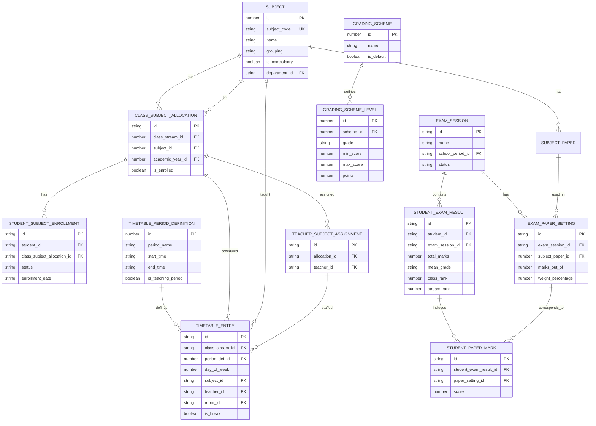
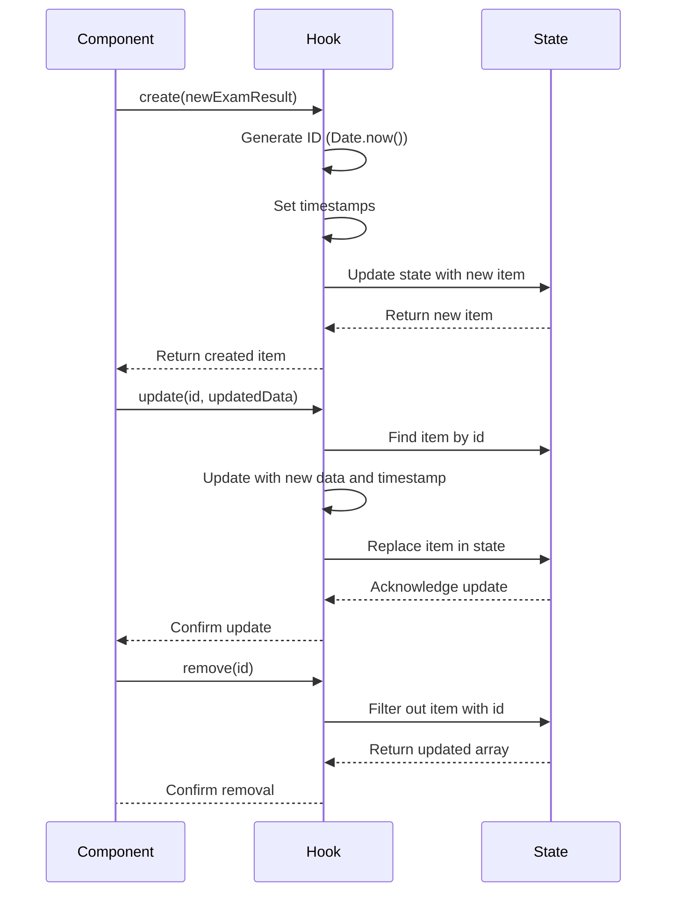
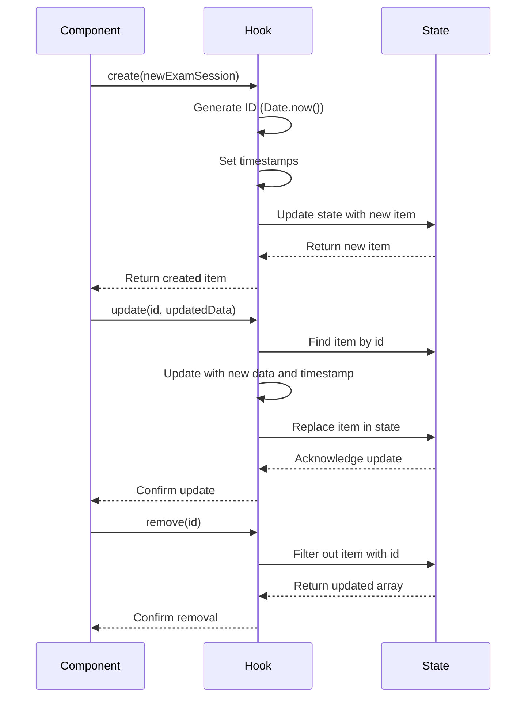

# Academics Data Model

<cite>
**Referenced Files in This Document**   
- [schema.ts](file://src/modules/academics/data/schema.ts)
- [types.ts](file://src/modules/academics/data/types.ts)
- [enums.ts](file://src/modules/academics/data/enums.ts)
- [collections.ts](file://src/modules/academics/data/collections.ts)
- [useStudentExamResultData.ts](file://src/modules/academics/data/useStudentExamResultData.ts)
- [useExamSessionData.ts](file://src/modules/academics/data/useExamSessionData.ts)
</cite>

## Table of Contents
1. [Introduction](#introduction)
2. [Core Entities Overview](#core-entities-overview)
3. [Entity Field Definitions](#entity-field-definitions)
4. [Relationships and Data Model Diagram](#relationships-and-data-model-diagram)
5. [Data Validation and Business Logic](#data-validation-and-business-logic)
6. [Data Access Patterns](#data-access-patterns)
7. [Lifecycle Management and Archival](#lifecycle-management-and-archival)

## Introduction
This document provides comprehensive documentation for the Academics module data model. It details the core entities, their field definitions, relationships, constraints, and data access patterns used within the educational system. The model supports academic year management, subject and class organization, exam scheduling, grading, and student performance tracking. The schema is designed to be database-agnostic, supporting both RxDB and PouchDB implementations.

## Core Entities Overview
The Academics module consists of several interconnected entities that represent key academic concepts in an educational institution. These entities include AcademicYear (implied through academic_year_id), Subject, Class (via class_stream_id), ExamSession, GradingScheme, StudentExamResult, TimetableEntry, and SubjectPaper. Each entity is defined with strict data types, constraints, and indexing strategies to ensure data integrity and query performance.

The data model follows a hierarchical structure where academic activities are organized by academic year and school period, with subjects allocated to classes and students enrolled in those subjects. Exams are conducted within specific sessions, and results are recorded with detailed mark breakdowns by subject paper. Grading schemes provide the framework for converting raw scores into meaningful grades.

**Section sources**
- [schema.ts](file://src/modules/academics/data/schema.ts#L0-L304)
- [types.ts](file://src/modules/academics/data/types.ts#L0-L328)

## Entity Field Definitions

### AcademicYear (Referenced by academic_year_id)
While not explicitly defined as a top-level collection in the academics module, AcademicYear is referenced through the `academic_year_id` field in multiple entities. It represents a calendar or academic year during which educational activities occur.

**Label Structure Requirements**
- **id**: number, required, primary key, range: 1-999999999
- **name**: string, computed field, maxLength: 100

**Section sources**
- [schema.ts](file://src/modules/academics/data/schema.ts#L200-L205)
- [types.ts](file://src/modules/academics/data/types.ts#L100-L105)

### Subject
Represents an academic subject taught in the institution, such as Mathematics or English.

**Label Structure Requirements**
- **id**: number, required, primary key, minimum: 1, maximum: 999999999
- **subject_code**: string, required, maxLength: 20
- **abbreviation**: string, maxLength: 10
- **name**: string, required, maxLength: 100
- **department_id**: string, reference to departments collection, maxLength: 100
- **is_compulsory**: boolean, default: false
- **grouping**: string, enum: SubjectGrouping values, required, maxLength: 50
- **department_name**: string, computed field, maxLength: 100
- **papers**: array of SubjectPaper objects, default: []

**Indexes**: subject_code, name, department_id

**Section sources**
- [schema.ts](file://src/modules/academics/data/schema.ts#L60-L85)
- [types.ts](file://src/modules/academics/data/types.ts#L80-L95)

### Class (via ClassSubjectAllocation)
Class information is managed through the ClassSubjectAllocation entity, which links subjects to class streams within an academic year.

**Label Structure Requirements**
- **id**: string, required, primary key, maxLength: 100
- **class_stream_id**: number, required, reference to class_streams
- **subject_id**: number, required, reference to subjects
- **academic_year_id**: number, required, reference to academic_years
- **class_stream_name**: string, computed field, maxLength: 150
- **subject_name**: string, computed field, maxLength: 100
- **academic_year_name**: string, computed field, maxLength: 100
- **is_enrolled**: boolean, required, default: true

**Indexes**: class_stream_id, subject_id, academic_year_id

**Section sources**
- [schema.ts](file://src/modules/academics/data/schema.ts#L200-L215)
- [types.ts](file://src/modules/academics/data/types.ts#L100-L110)

### ExamSession
Represents a specific examination period within a school period, such as "Mid-Term Exams" or "Final Exams".

**Label Structure Requirements**
- **id**: string, required, primary key, maxLength: 100
- **name**: string, required, maxLength: 150
- **school_period_id**: string, reference to school_periods, required
- **status**: string, enum: ExamSessionStatus values, required, maxLength: 50
- **result_publication_date**: timestamp, ISO format
- **created_at**: timestamp, required, ISO format
- **updated_at**: timestamp, required, ISO format
- **school_period_name**: string, computed field, maxLength: 100
- **education_system_id**: string, reference to education_system_configurations, maxLength: 100
- **paper_settings**: array of ExamPaperSetting objects, default: []

**Indexes**: school_period_id, status

**Section sources**
- [schema.ts](file://src/modules/academics/data/schema.ts#L135-L160)
- [types.ts](file://src/modules/academics/data/types.ts#L180-L195)

### GradingScheme
Defines a system for converting numerical scores into letter grades, percentage ranges, or competency levels.

**Label Structure Requirements**
- **id**: number, required, primary key, minimum: 1, maximum: 999999999
- **name**: string, required, maxLength: 100
- **is_default**: boolean, required, default: false
- **created_at**: timestamp, required, ISO format
- **updated_at**: timestamp, required, ISO format
- **levels**: array of GradingSchemeLevel objects
- **education_system_id**: string, reference to education_system_configurations, maxLength: 100

**Indexes**: name, is_default

**Section sources**
- [schema.ts](file://src/modules/academics/data/schema.ts#L165-L185)
- [types.ts](file://src/modules/academics/data/types.ts#L160-L175)

### StudentExamResult
Records the examination results for a specific student in a particular exam session.

**Label Structure Requirements**
- **id**: string, required, primary key, maxLength: 100
- **student_id**: string, reference to students, required, maxLength: 100
- **exam_session_id**: string, reference to exam_sessions, required, maxLength: 100
- **total_marks**: number, minimum: 0, maximum: 999999.99
- **mean_grade**: string, maxLength: 10
- **class_rank**: integer, minimum: 1, maximum: 999999999
- **stream_rank**: integer, minimum: 1, maximum: 999999999
- **overall_comment**: string, maxLength: 1000
- **created_at**: timestamp, required, ISO format
- **updated_at**: timestamp, required, ISO format
- **marks**: array of StudentPaperMark objects, default: []
- **student_name**: string, computed field, maxLength: 200
- **admission_no**: string, computed field, maxLength: 50
- **class_name**: string, computed field, maxLength: 100
- **stream_name**: string, computed field, maxLength: 100
- **exam_session_name**: string, computed field, maxLength: 150

**Indexes**: student_id, exam_session_id

**Section sources**
- [schema.ts](file://src/modules/academics/data/schema.ts#L187-L215)
- [types.ts](file://src/modules/academics/data/types.ts#L220-L240)

### TimetableEntry
Represents a scheduled class or activity in the school timetable, specifying when and where subjects are taught.

**Label Structure Requirements**
- **id**: string, required, primary key, maxLength: 100
- **class_stream_id**: string, reference to class_streams, required, maxLength: 100
- **period_def_id**: number, reference to timetable_period_definitions, required
- **day_of_week**: number, required, range: 1-7
- **subject_id**: string, reference to subjects, required, maxLength: 100
- **teacher_id**: string, reference to staff, required, maxLength: 100
- **room_id**: string, reference to rooms, required, maxLength: 100
- **is_break**: boolean, default: false
- **break_type**: string, enum: BreakType values, maxLength: 50
- **created_at**: timestamp, required, ISO format
- **updated_at**: timestamp, required, ISO format
- **class_name**: string, computed field, maxLength: 100
- **stream_name**: string, computed field, maxLength: 100
- **period_name**: string, computed field, maxLength: 100
- **subject_name**: string, computed field, maxLength: 100
- **teacher_name**: string, computed field, maxLength: 200
- **room_name**: string, computed field, maxLength: 100
- **start_time**: string, computed field, maxLength: 20
- **end_time**: string, computed field, maxLength: 20

**Indexes**: class_stream_id, period_def_id, day_of_week

**Section sources**
- [schema.ts](file://src/modules/academics/data/schema.ts#L270-L304)
- [types.ts](file://src/modules/academics/data/types.ts#L280-L300)

### SubjectPaper
Represents a specific paper or component within a subject, such as "Paper 1: Theory" or "Paper 2: Practical".

**Label Structure Requirements**
- **id**: number, required, primary key, minimum: 1, maximum: 999999999
- **subject_id**: string, reference to subjects, required
- **name**: string, required, maxLength: 150
- **created_at**: timestamp, required, ISO format
- **updated_at**: timestamp, required, ISO format
- **subject_name**: string, computed field, maxLength: 100

**Indexes**: subject_id

**Section sources**
- [schema.ts](file://src/modules/academics/data/schema.ts#L50-L58)
- [types.ts](file://src/modules/academics/data/types.ts#L70-L75)

## Relationships and Data Model Diagram

**Diagram sources**
- [schema.ts](file://src/modules/academics/data/schema.ts#L50-L304)
- [types.ts](file://src/modules/academics/data/types.ts#L70-L300)

## Data Validation and Business Logic

The data model enforces several validation rules and business constraints at the data layer:

1. **Required Fields**: Each entity has specific required fields that must be present for data integrity. For example, Subject requires id, subject_code, name, and grouping.

2. **Data Type Constraints**: Strict data typing is enforced with specific ranges for numeric values (e.g., id fields have minimum and maximum values) and length limits for string fields.

3. **Enumeration Constraints**: Certain fields are restricted to predefined values through enum types:
   - **ResultState**: Draft, Submitted, Reviewed, Approved, Rejected, Published
   - **BreakType**: Short Break, Lunch, Health Break
   - **EducationSystemType**: Primary, Secondary, University, College, Technical, Vocational
   - **GradingSystemType**: Letter Grades, Percentage, Competency Based, Points/GPA, Pass/Fail
   - **AcademicPeriodType**: Term, Semester, Quarter, Trimester
   - **AssessmentType**: Formative, Summative, Competency, Project Based, Practical
   - **StudentEnrollmentStatus**: Enrolled, Withdrawn
   - **ExamSessionStatus**: Planning, Marks Entry Open, Published, Closed, Archived

4. **Computed Fields**: Several fields are computed rather than stored directly, including department_name, class_stream_name, subject_name, academic_year_name, student_name, admission_no, class_name, stream_name, exam_session_name, period_name, teacher_name, room_name, start_time, and end_time. These are populated by the application logic when records are retrieved.

5. **Default Values**: Certain boolean fields have default values (e.g., is_compulsory defaults to false, is_enrolled defaults to true).

6. **Primary Keys**: Each collection has a designated primary key field (id) with appropriate data types and constraints.

7. **Foreign Key References**: The schema defines references between collections using the ref property, establishing relationships between entities.

**Section sources**
- [schema.ts](file://src/modules/academics/data/schema.ts#L0-L304)
- [enums.ts](file://src/modules/academics/data/enums.ts#L0-L69)
- [types.ts](file://src/modules/academics/data/types.ts#L0-L328)

## Data Access Patterns

The Academics module implements data access through custom React hooks that provide CRUD operations for each entity. These hooks abstract the underlying database operations and provide a consistent interface for components.

### useStudentExamResultData Hook
This hook manages student exam result data with the following operations:

**Label Structure Requirements**
- **data**: StudentExamResult[], current state of exam results
- **create**: async function that adds a new exam result with auto-generated ID and timestamps
- **update**: async function that modifies an existing exam result and updates the timestamp
- **remove**: async function that deletes an exam result by ID

The hook uses React's useState to maintain local state with initial mock data. When creating a new record, it generates a timestamp-based ID and sets both created_at and updated_at fields to the current ISO timestamp.

**Diagram sources**
- [useStudentExamResultData.ts](file://src/modules/academics/data/useStudentExamResultData.ts#L7-L39)

### useExamSessionData Hook
This hook manages exam session data with identical CRUD operations:

**Label Structure Requirements**
- **data**: ExamSession[], current state of exam sessions
- **create**: async function that adds a new exam session with auto-generated ID and timestamps
- **update**: async function that modifies an existing exam session and updates the timestamp
- **remove**: async function that deletes an exam session by ID

The implementation pattern is identical to useStudentExamResultData, demonstrating a consistent approach to data management across the module.

**Diagram sources**
- [useExamSessionData.ts](file://src/modules/academics/data/useExamSessionData.ts#L7-L39)

Both hooks follow a pattern of maintaining in-memory state with useState, using timestamp-based IDs for new records, and automatically managing created_at and updated_at timestamps. This suggests a client-side data management approach, potentially synchronized with a backend database through the RxDB or PouchDB providers.

**Section sources**
- [useStudentExamResultData.ts](file://src/modules/academics/data/useStudentExamResultData.ts#L7-L39)
- [useExamSessionData.ts](file://src/modules/academics/data/useExamSessionData.ts#L7-L39)

## Lifecycle Management and Archival

The data model includes several features for managing the lifecycle of academic records:

1. **Status Transitions**: The ExamSessionStatus enum defines a clear lifecycle for exam sessions: Planning → Marks Entry Open → Published → Closed → Archived. This state machine ensures proper sequencing of exam processes.

2. **Timestamps**: All entities include created_at and updated_at timestamps, enabling audit trails and temporal queries.

3. **Archival**: The ARCHIVED status in ExamSessionStatus indicates that completed exam sessions are not deleted but rather archived, preserving historical data.

4. **Enrollment Status**: Student enrollment can be marked as WITHDRAWN rather than deleted, maintaining historical records of student participation.

5. **Result Approval Workflow**: The ResultState enum (Draft, Submitted, Reviewed, Approved, Rejected, Published) implements a formal approval process for exam results, ensuring data quality before publication.

6. **Audit Trail**: The result_approval collection maintains an audit_trail array that records all state changes with timestamps, user IDs, and previous/new states, providing complete traceability.

7. **Data Retention**: The model appears designed for long-term retention of academic records, with computed fields ensuring consistency even if referenced data changes over time.

8. **Historical Context**: By maintaining academic_year_id and school_period_id references, the system preserves the historical context of all academic activities.

The collections configuration in collections.ts shows that nested data (like paper_settings within exam_sessions and marks within student_exam_results) is stored within parent documents rather than as separate top-level collections, suggesting a document-oriented database design optimized for read performance and data consistency.

**Section sources**
- [schema.ts](file://src/modules/academics/data/schema.ts#L0-L304)
- [enums.ts](file://src/modules/academics/data/enums.ts#L0-L69)
- [collections.ts](file://src/modules/academics/data/collections.ts#L0-L50)