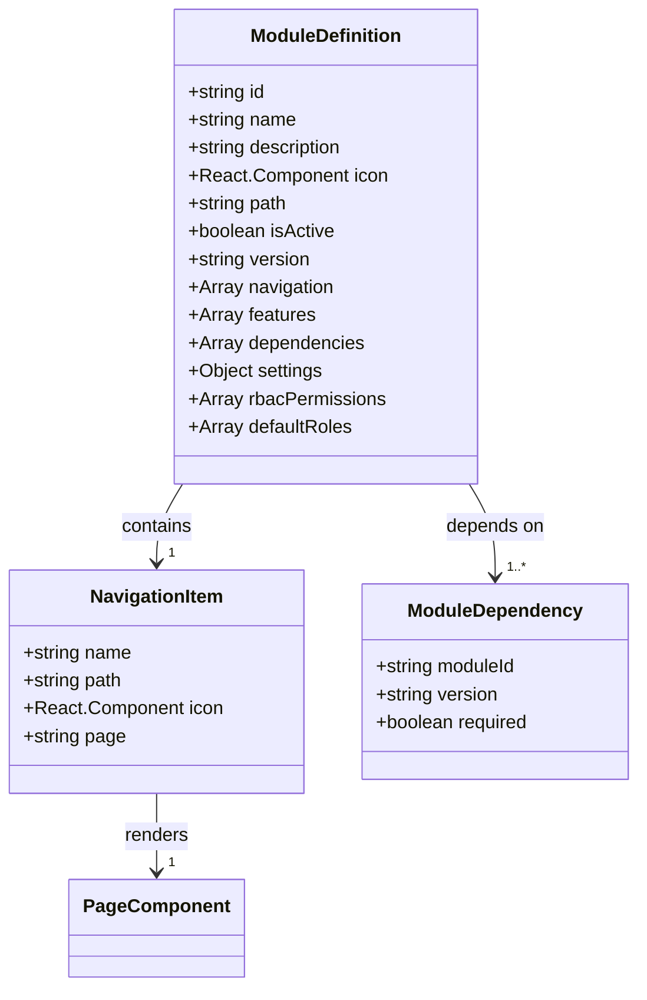
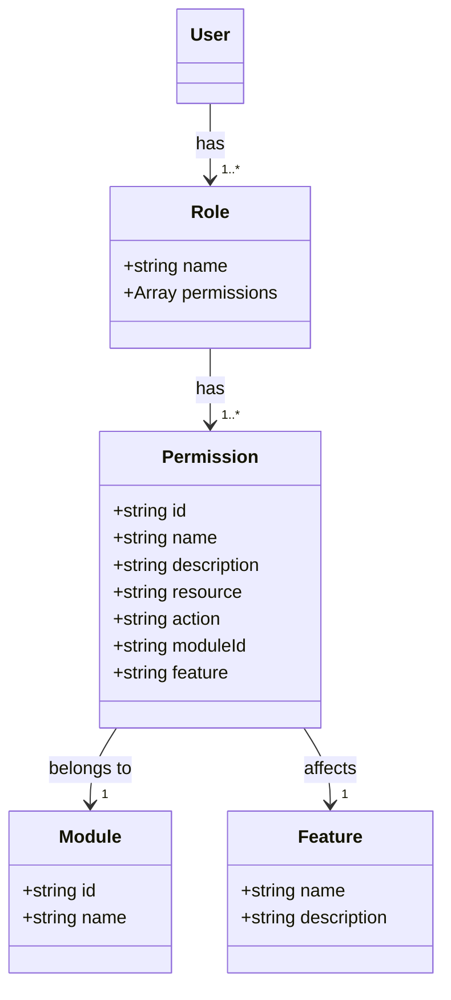
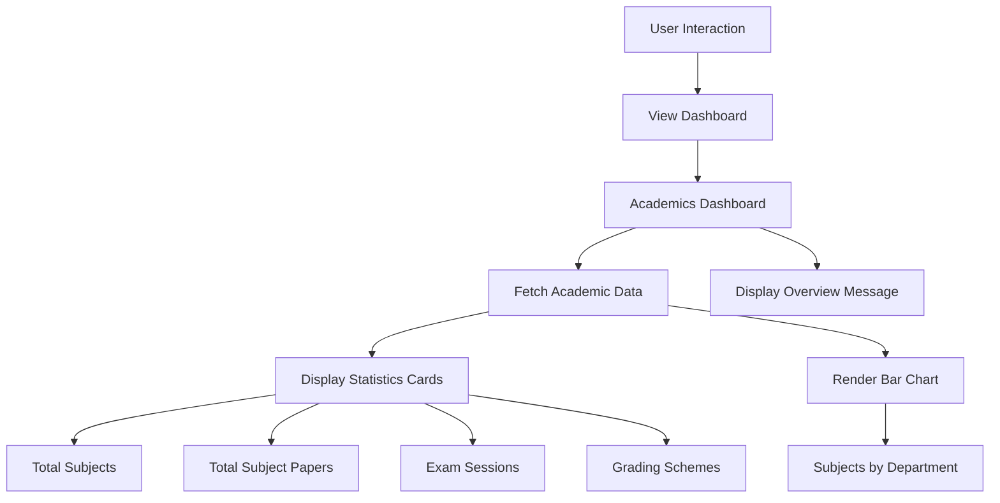
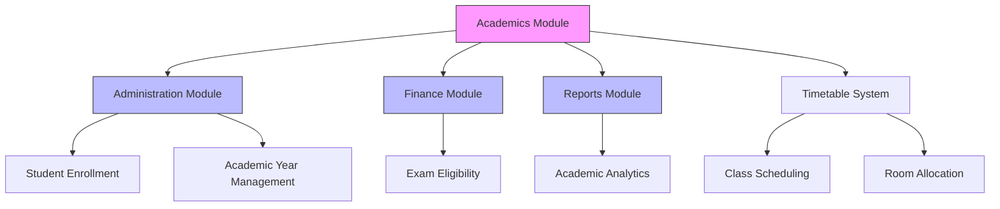
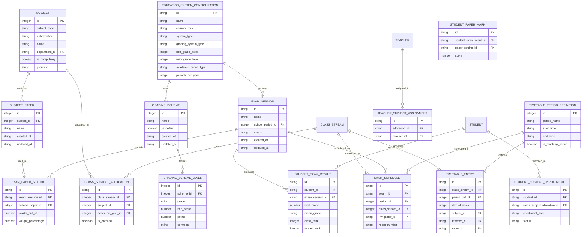
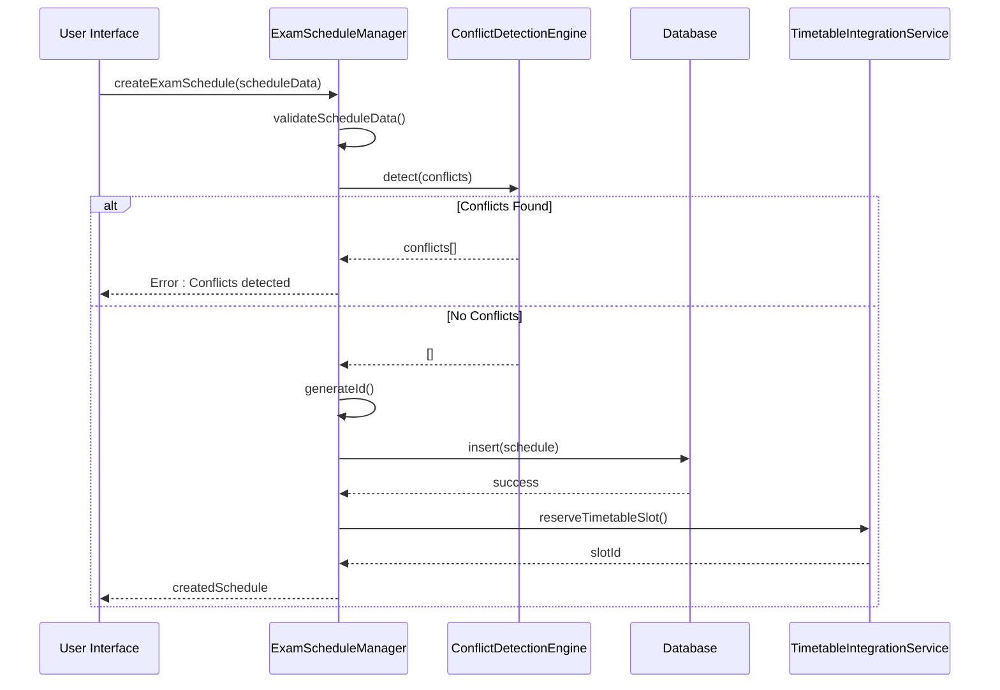
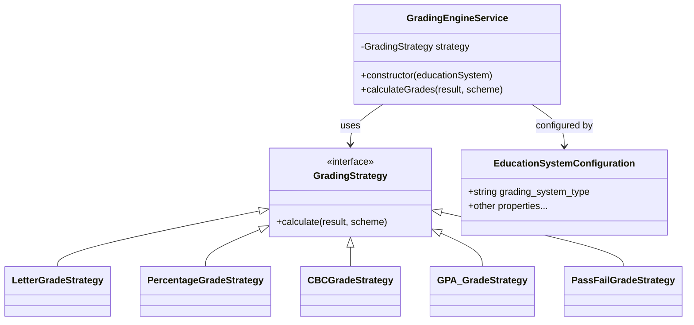
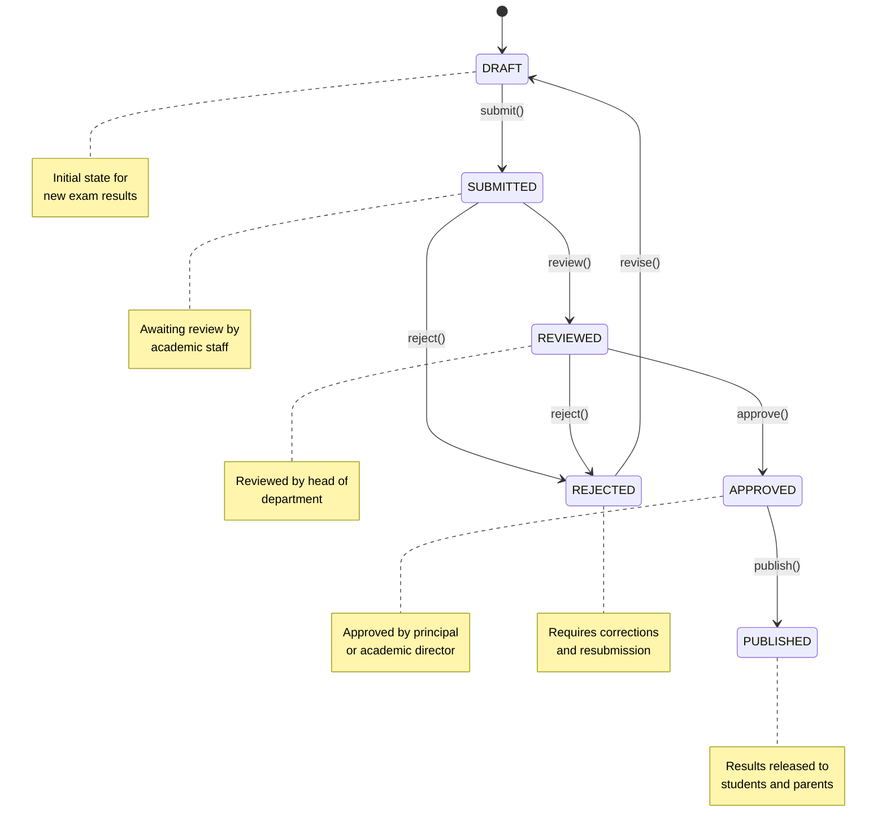
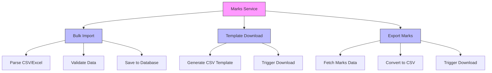

# Academics Module Overview

<cite>
**Referenced Files in This Document**   
- [moduleDefinition.tsx](file://src/modules/academics/moduleDefinition.tsx)
- [rbac.ts](file://src/modules/academics/rbac.ts)
- [AcademicsDashboardPage.tsx](file://src/modules/academics/pages/AcademicsDashboardPage.tsx)
- [ExamScheduleManager.ts](file://src/modules/academics/services/ExamScheduleManager.ts)
- [GradingEngineService.ts](file://src/modules/academics/services/GradingEngineService.ts)
- [types.ts](file://src/modules/academics/data/types.ts)
- [enums.ts](file://src/modules/academics/data/enums.ts)
- [marksService.ts](file://src/modules/academics/services/marksService.ts)
- [TimetableIntegrationService.ts](file://src/modules/academics/services/TimetableIntegrationService.ts)
- [ResultApprovalStateMachine.ts](file://src/modules/academics/services/ResultApprovalStateMachine.ts)
- [collections.ts](file://src/modules/academics/data/collections.ts)
- [schema.ts](file://src/modules/academics/data/schema.ts)
- [useSubjectData.ts](file://src/modules/academics/data/useSubjectData.ts)
- [useExamSessionData.ts](file://src/modules/academics/data/useExamSessionData.ts)
- [useGradingSchemeData.ts](file://src/modules/academics/data/useGradingSchemeData.ts)
- [useAcademicYearData.ts](file://src/modules/academics/data/useAcademicYearData.ts)
- [reportsModule.ts](file://src/modules/reports/moduleDefinition.tsx)
- [administrationModule.ts](file://src/modules/administration/moduleDefinition.tsx)
- [financeModule.ts](file://src/modules/finance/moduleDefinition.tsx)
</cite>

## Table of Contents
1. [Introduction](#introduction)
2. [Core Functionality](#core-functionality)
3. [Module Registration and Configuration](#module-registration-and-configuration)
4. [Role-Based Access Control](#role-based-access-control)
5. [Integration with Main Dashboard](#integration-with-main-dashboard)
6. [Cross-Module Integration](#cross-module-integration)
7. [Data Model and Schema](#data-model-and-schema)
8. [Key Services and Workflows](#key-services-and-workflows)
9. [Setup and Configuration](#setup-and-configuration)
10. [Conclusion](#conclusion)

## Introduction
The Academics module serves as the central system for managing all academic operations within the educational institution. It provides comprehensive functionality for curriculum management, exam scheduling, grading, and student performance tracking. This module acts as the backbone of academic administration, ensuring that educational activities are properly organized, executed, and assessed. The module is designed with a modular architecture that allows for seamless integration with other institutional systems while maintaining its core academic functions.

## Core Functionality
The Academics module provides a comprehensive suite of features for managing academic operations. These include subject management, class management, timetable creation, exam management, and grading systems. The module supports various educational system types including primary, secondary, university, college, technical, and vocational institutions. It also accommodates different grading system types such as letter grades, percentage-based, competency-based, points/GPA, and pass/fail systems.

The module enables administrators to define education system configurations, create and manage subjects and subject papers, allocate subjects to classes, assign teachers to subjects, and enroll students in subjects. For examinations, the module supports exam session management, exam paper setting, exam scheduling, and marks entry. The grading engine supports multiple grading strategies based on the configured education system, automatically calculating grades according to the selected grading scheme.

Student performance is tracked through exam results, with support for calculating total marks, mean grades, and class/stream rankings. The module also includes a result approval workflow with audit trails to ensure academic integrity and compliance with institutional policies.

**Section sources**
- [moduleDefinition.tsx](file://src/modules/academics/moduleDefinition.tsx#L42-L47)
- [types.ts](file://src/modules/academics/data/types.ts#L190-L199)

## Module Registration and Configuration
The Academics module is registered and configured through the moduleDefinition.tsx file, which defines all essential properties for module integration within the system. The module is self-contained and follows a standardized definition pattern that allows for easy registration and configuration.



**Diagram sources**
- [moduleDefinition.tsx](file://src/modules/academics/moduleDefinition.tsx#L1-L87)

**Section sources**
- [moduleDefinition.tsx](file://src/modules/academics/moduleDefinition.tsx#L1-L87)

The module definition includes several key components:
- **Basic Information**: The module has an ID of 'academics', a name and description referenced from translation files, an AcademicCapIcon as its visual representation, and a base path of '/academics'.
- **Navigation Structure**: The module defines a comprehensive navigation structure with 14 distinct pages accessible from the main navigation, including dashboard, subjects, timetable, exam scheduling, grading schemes, and more.
- **Feature Set**: The module declares its supported features including subject-management, class-management, timetable, exam-management, and grading.
- **Dependencies**: The module has explicit dependencies on other modules, with administration being required and finance and reports being optional.
- **Settings**: The module defines configurable settings for enabling or disabling key features such as exam management, timetable management, and grading schemes.
- **Security Configuration**: The module references its RBAC permissions and default roles, ensuring proper access control is applied.

## Role-Based Access Control
The Academics module implements a comprehensive role-based access control (RBAC) system to ensure that users have appropriate permissions for their roles. The RBAC configuration is defined in the rbac.ts file and includes both specific permissions and default roles.



**Diagram sources**
- [rbac.ts](file://src/modules/academics/rbac.ts#L1-L77)

**Section sources**
- [rbac.ts](file://src/modules/academics/rbac.ts#L1-L77)

The RBAC system includes the following key components:
- **Permissions**: The module defines granular permissions for both subjects and exams, including read, create, update, and delete operations. Each permission has a unique ID, descriptive name, resource, action, module ID, and associated feature.
- **Subject Permissions**: These include viewing, creating, updating, and deleting subjects, allowing for comprehensive subject management.
- **Exam Permissions**: These include viewing, creating, updating, and deleting exams, enabling complete exam lifecycle management.
- **Default Roles**: The module specifies that both 'teacher' and 'administrator' roles have access to the module by default, ensuring that key academic staff can perform their duties.

The RBAC system follows a hierarchical structure where permissions are grouped by resource and action, allowing for fine-grained control over user capabilities within the academic system.

## Integration with Main Dashboard
The Academics module integrates seamlessly with the main dashboard through its dedicated dashboard page, which provides an overview of key academic metrics and statistics. The integration is achieved through the AcademicsDashboardPage component, which displays important academic data in a user-friendly format.



**Diagram sources**
- [AcademicsDashboardPage.tsx](file://src/modules/academics/pages/AcademicsDashboardPage.tsx#L0-L98)

**Section sources**
- [AcademicsDashboardPage.tsx](file://src/modules/academics/pages/AcademicsDashboardPage.tsx#L0-L98)

The dashboard integration includes the following features:
- **Data Fetching**: The dashboard uses the useAppData hook to retrieve academic data including subjects, subject papers, exam sessions, grading schemes, and departments.
- **Statistics Display**: Key metrics are displayed in StatCard components showing the total number of subjects, subject papers, exam sessions, and grading schemes.
- **Visual Analytics**: A bar chart visualizes the distribution of subjects across academic departments, providing insights into curriculum structure.
- **User Guidance**: The dashboard includes an overview message with enhancement notes to guide users on available features and improvements.
- **Loading States**: The component handles loading states appropriately, displaying a spinner while data is being fetched.

The dashboard serves as the primary entry point for users accessing the Academics module, providing immediate visibility into the current state of academic operations.

## Cross-Module Integration
The Academics module is designed to work in conjunction with other institutional systems, creating a cohesive ecosystem for educational management. The integration points are defined in the module's dependency configuration and implemented through various service interactions.



**Diagram sources**
- [moduleDefinition.tsx](file://src/modules/academics/moduleDefinition.tsx#L58-L73)
- [reportsModule.ts](file://src/modules/reports/moduleDefinition.tsx#L10-L20)
- [administrationModule.ts](file://src/modules/administration/moduleDefinition.tsx)
- [financeModule.ts](file://src/modules/finance/moduleDefinition.tsx)

**Section sources**
- [moduleDefinition.tsx](file://src/modules/academics/moduleDefinition.tsx#L58-L73)

The key integration points include:
- **Administration Module**: This is a required dependency that provides student enrollment data, academic year definitions, class structures, and staff information. The Academics module relies on this data for subject allocations, student enrollments, and teacher assignments.
- **Finance Module**: This is an optional dependency that can be used to determine exam eligibility based on fee clearance status. Students with outstanding financial obligations may be restricted from participating in examinations.
- **Reports Module**: This is an optional dependency that consumes academic data for generating analytics and performance reports. The Reports module can access exam results, grading data, and student performance metrics to create comprehensive academic analytics.
- **Timetable System**: The module integrates with the timetable system through the TimetableIntegrationService, ensuring that exam schedules do not conflict with regular class schedules and that rooms and resources are properly allocated.

These integrations create a comprehensive educational management ecosystem where academic operations are coordinated with administrative, financial, and analytical functions.

## Data Model and Schema
The Academics module employs a comprehensive data model that represents the key entities and relationships in academic management. The data model is defined through TypeScript interfaces and database schemas, ensuring type safety and data integrity.



**Diagram sources**
- [types.ts](file://src/modules/academics/data/types.ts#L0-L328)
- [schema.ts](file://src/modules/academics/data/schema.ts#L0-L304)
- [collections.ts](file://src/modules/academics/data/collections.ts#L0-L50)

**Section sources**
- [types.ts](file://src/modules/academics/data/types.ts#L0-L328)
- [schema.ts](file://src/modules/academics/data/schema.ts#L0-L304)
- [collections.ts](file://src/modules/academics/data/collections.ts#L0-L50)

The data model includes the following key entities:
- **Subject and Subject Paper**: Represents academic subjects and their constituent papers, forming the foundation of the curriculum.
- **Class Subject Allocation**: Links subjects to specific classes and academic years, defining what is taught where and when.
- **Exam Session**: Represents a period during which examinations are conducted, with associated status and scheduling information.
- **Exam Paper Setting**: Defines the papers included in an exam session, their maximum marks, and weightings.
- **Exam Schedule**: Specifies when and where specific exams are conducted, including invigilators and room assignments.
- **Grading Scheme and Levels**: Defines how marks are converted to grades, with configurable grade boundaries and comments.
- **Student Exam Result**: Captures a student's performance in an exam session, including total marks, mean grade, and rankings.
- **Student Paper Mark**: Records individual paper scores that contribute to a student's overall exam result.
- **Student Subject Enrollment**: Tracks which students are enrolled in which subjects.
- **Teacher Subject Assignment**: Assigns teachers to teach specific subjects in specific classes.
- **Timetable Entities**: Includes period definitions and timetable entries that coordinate with exam scheduling.
- **Education System Configuration**: Defines the overarching educational framework, including grading systems and academic periods.

The data model is implemented using RxDB collections with JSON schema validation, ensuring data consistency and integrity across the application.

## Key Services and Workflows
The Academics module implements several key services that handle critical academic workflows. These services encapsulate business logic and provide APIs for managing academic operations.

### Exam Scheduling Workflow
The exam scheduling process is managed by the ExamScheduleManager service, which handles the creation, retrieval, updating, and deletion of exam schedules with built-in conflict detection.



**Diagram sources**
- [ExamScheduleManager.ts](file://src/modules/academics/services/ExamScheduleManager.ts#L0-L278)
- [TimetableIntegrationService.ts](file://src/modules/academics/services/TimetableIntegrationService.ts#L0-L280)

**Section sources**
- [ExamScheduleManager.ts](file://src/modules/academics/services/ExamScheduleManager.ts#L0-L278)

The exam scheduling workflow includes:
- **Data Validation**: Ensures all required fields are present before processing.
- **Conflict Detection**: Checks for scheduling conflicts with existing exams or timetable entries.
- **Database Operations**: Persists exam schedules to the database with proper error handling.
- **Timetable Integration**: Reserves corresponding timetable slots to prevent scheduling conflicts.
- **Bulk Operations**: Supports bulk creation of schedules for efficient exam planning.

### Grading Engine Workflow
The grading system is implemented through the GradingEngineService, which uses a strategy pattern to support multiple grading systems based on the configured education system.



**Diagram sources**
- [GradingEngineService.ts](file://src/modules/academics/services/GradingEngineService.ts#L0-L43)
- [types.ts](file://src/modules/academics/data/types.ts#L190-L199)

**Section sources**
- [GradingEngineService.ts](file://src/modules/academics/services/GradingEngineService.ts#L0-L43)

The grading engine workflow includes:
- **Strategy Pattern**: Uses different grading strategies based on the education system's grading system type.
- **Dynamic Strategy Selection**: Instantiates the appropriate strategy during service construction based on configuration.
- **Grade Calculation**: Applies the selected strategy to calculate grades from raw marks.
- **Support for Multiple Systems**: Handles letter grades, percentages, competency-based, GPA, and pass/fail systems.

### Result Approval Workflow
The result approval process is managed by the ResultApprovalStateMachine, which implements a state machine pattern to control the approval workflow with audit trails.



**Diagram sources**
- [ResultApprovalStateMachine.ts](file://src/modules/academics/services/ResultApprovalStateMachine.ts#L0-L60)
- [enums.ts](file://src/modules/academics/data/enums.ts#L1-L10)

**Section sources**
- [ResultApprovalStateMachine.ts](file://src/modules/academics/services/ResultApprovalStateMachine.ts#L0-L60)

The result approval workflow includes:
- **State Management**: Implements a finite state machine with defined states and transitions.
- **Audit Trail**: Maintains a complete history of state changes with timestamps and user information.
- **Transition Validation**: Ensures only valid state transitions are allowed.
- **Automated Processing**: Triggers grade calculation when results are approved.

### Marks Management
The marks service handles the import, export, and management of student marks, supporting both bulk operations and individual entry.



**Diagram sources**
- [marksService.ts](file://src/modules/academics/services/marksService.ts#L0-L88)

**Section sources**
- [marksService.ts](file://src/modules/academics/services/marksService.ts#L0-L88)

The marks management functionality includes:
- **Bulk Import**: Allows uploading of marks from CSV or Excel files.
- **Template Generation**: Provides downloadable templates for consistent data entry.
- **Data Export**: Enables exporting of marks for external analysis or reporting.
- **File Processing**: Handles parsing and validation of imported data.

## Setup and Configuration
To enable and configure the Academics module, administrators need to follow a series of steps to ensure proper setup and integration with other systems.

### Module Activation
The module is activated by ensuring it is enabled in the system configuration. This is typically done through the module management interface or by modifying the modules.json configuration file.

```json
{
  "modules": {
    "academics": {
      "enabled": true,
      "required": false,
      "description": "Academic operations management"
    }
  }
}
```

### Basic Academic Settings
The module provides configurable settings that can be adjusted based on institutional requirements:

**Settings Configuration**
- **enableExamManagement**: Enables or disables exam management features (default: true)
- **enableTimetableManagement**: Enables or disables timetable management features (default: true)
- **enableGradingSchemes**: Enables or disables grading scheme management (default: true)

These settings can be modified through the system settings interface or programmatically.

### Initial Data Setup
Before the module can be fully operational, certain foundational data must be configured:

1. **Education System Configuration**: Define the education system type, grading system, academic period type, and other system-wide parameters.
2. **Subjects and Subject Papers**: Create the curriculum by defining subjects and their constituent papers.
3. **Grading Schemes**: Establish grading schemes with appropriate grade boundaries and comments.
4. **Academic Year and Periods**: Configure the academic calendar with years, terms, semesters, or other periods.
5. **Class Structures**: Define classes, streams, and sections for student organization.

### Integration Configuration
To ensure proper integration with other modules:

1. **Administration Module**: Verify that student enrollment data is synchronized and accessible.
2. **Finance Module**: Configure exam eligibility rules based on fee clearance status if required.
3. **Reports Module**: Ensure data sharing permissions are properly configured for academic analytics.

### User Role Configuration
Configure user roles and permissions to ensure appropriate access:

1. **Assign Roles**: Ensure teachers and administrators have the 'teacher' or 'administrator' roles.
2. **Custom Permissions**: Create custom roles with specific permissions if needed.
3. **Access Verification**: Test access to ensure users can perform their required functions.

**Section sources**
- [moduleDefinition.tsx](file://src/modules/academics/moduleDefinition.tsx#L74-L83)
- [rbac.ts](file://src/modules/academics/rbac.ts#L1-L77)

## Conclusion
The Academics module provides a comprehensive solution for managing all aspects of academic operations within an educational institution. It serves as the central system for curriculum management, exam scheduling, grading, and student performance tracking, with robust integration capabilities that connect it to administrative, financial, and reporting systems.

The module's architecture follows modern software design principles with a clear separation of concerns, using standardized patterns for data management, service implementation, and user interface components. The use of TypeScript interfaces ensures type safety, while the RxDB-based data layer provides reliable local storage with synchronization capabilities.

Key strengths of the module include its flexibility in supporting multiple education system types and grading methodologies, its comprehensive workflow management for exam scheduling and result approval, and its seamless integration with other institutional systems. The role-based access control system ensures that security is maintained while allowing appropriate access for academic staff.

For institutions looking to streamline their academic operations, the Academics module offers a powerful, extensible platform that can be configured to meet specific institutional requirements while maintaining data integrity and operational efficiency.