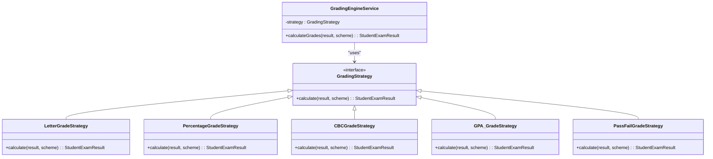
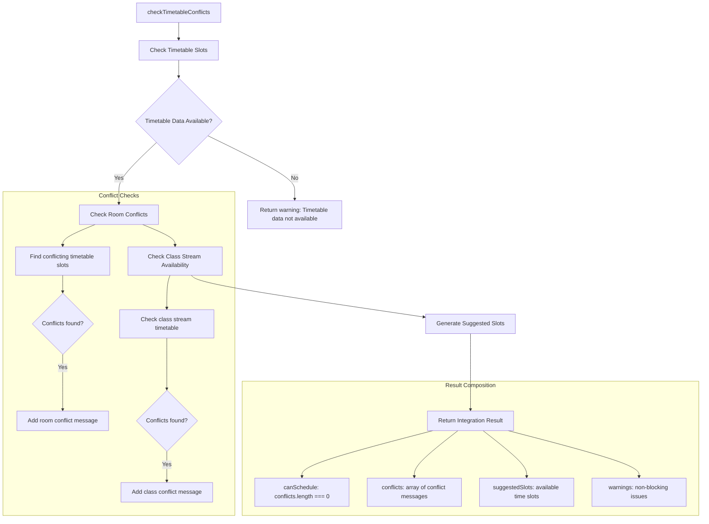
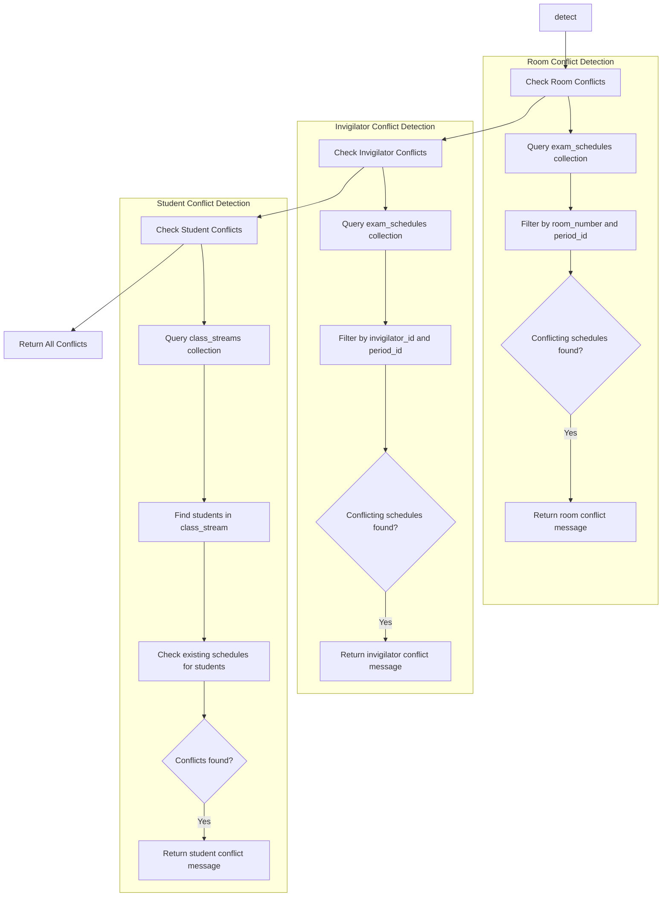
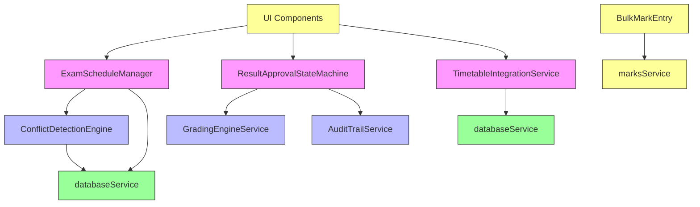

# Academics Services

<cite>
**Referenced Files in This Document**   
- [ExamScheduleManager.ts](file://src/modules/academics/services/ExamScheduleManager.ts)
- [GradingEngineService.ts](file://src/modules/academics/services/GradingEngineService.ts)
- [marksService.ts](file://src/modules/academics/services/marksService.ts)
- [ResultApprovalStateMachine.ts](file://src/modules/academics/services/ResultApprovalStateMachine.ts)
- [TimetableIntegrationService.ts](file://src/modules/academics/services/TimetableIntegrationService.ts)
- [ConflictDetectionEngine.ts](file://src/modules/academics/services/ConflictDetectionEngine.ts)
- [AuditTrailService.ts](file://src/modules/academics/services/AuditTrailService.ts)
- [databaseService.ts](file://src/services/database/databaseService.ts)
</cite>

## Table of Contents
1. [Introduction](#introduction)
2. [Core Services Overview](#core-services-overview)
3. [ExamScheduleManager Service](#examschedulemanager-service)
4. [GradingEngineService Service](#gradingengineservice-service)
5. [marksService Service](#marksservice-service)
6. [ResultApprovalStateMachine Service](#resultapprovalstatemachine-service)
7. [TimetableIntegrationService Service](#timetableintegrationservice-service)
8. [ConflictDetectionEngine Service](#conflictdetectionengine-service)
9. [AuditTrailService Service](#audittrailservice-service)
10. [Service Interactions and Integration](#service-interactions-and-integration)
11. [Common Issues and Solutions](#common-issues-and-solutions)

## Introduction
The Academics module provides a comprehensive suite of services for managing academic operations in an educational institution. This document details the implementation and usage patterns of key services including exam scheduling, grading, mark entry, result approval workflows, timetable integration, conflict detection, and audit trail tracking. The services are designed to work together seamlessly while maintaining clear separation of concerns and robust error handling.

## Core Services Overview
The Academics module consists of seven core services that handle different aspects of academic administration:

- **ExamScheduleManager**: Manages exam timetables and scheduling operations
- **GradingEngineService**: Calculates grades based on configured grading systems
- **marksService**: Handles mark entry, validation, and bulk operations
- **ResultApprovalStateMachine**: Manages the workflow for result approval
- **TimetableIntegrationService**: Synchronizes exam schedules with regular timetables
- **ConflictDetectionEngine**: Identifies scheduling conflicts across multiple dimensions
- **AuditTrailService**: Tracks changes to academic data for accountability

These services interact through well-defined interfaces and leverage a shared database service for data persistence.

## ExamScheduleManager Service

The ExamScheduleManager service provides comprehensive functionality for managing exam timetables. It handles creation, retrieval, updating, and deletion of exam schedules while ensuring data integrity and preventing conflicts.

### Service Interface and Method Signatures

```typescript
export class ExamScheduleManager {
  constructor()
  
  async createExamSchedule(scheduleData: CreateExamScheduleDto): Promise<ExamSchedule>
  async getExamSchedule(id: string): Promise<ExamSchedule | null>
  async getAllExamSchedules(query?: ExamScheduleQuery): Promise<ExamSchedule[]>
  async updateExamSchedule(id: string, updateData: UpdateExamScheduleDto): Promise<ExamSchedule>
  async deleteExamSchedule(id: string): Promise<boolean>
  async checkConflicts(schedule: Partial<ExamSchedule>): Promise<ConflictCheckResult>
  async bulkCreateSchedules(schedules: CreateExamScheduleDto[]): Promise<ExamSchedule[]>
  async getSchedulesByExam(examId: string): Promise<ExamSchedule[]>
  async getSchedulesByClassStream(classStreamId: number): Promise<ExamSchedule[]>
  async getSchedulesByInvigilator(invigilatorId: string): Promise<ExamSchedule[]>
  async getSchedulesByRoom(roomNumber: string): Promise<ExamSchedule[]>
  async getScheduleCounts(): Promise<{
    total: number;
    byExam: Record<string, number>;
    byClassStream: Record<string, number>;
    byInvigilator: Record<string, number>;
  }>
}
```

### Key Methods and Functionality

**createExamSchedule**: Creates a new exam schedule after validating required fields and checking for conflicts using the ConflictDetectionEngine. The method generates a unique ID and saves the schedule to the database.

**updateExamSchedule**: Updates an existing exam schedule with new data, performing conflict detection before applying changes to prevent scheduling conflicts.

**checkConflicts**: Checks for potential conflicts in a proposed exam schedule by delegating to the ConflictDetectionEngine service.

**bulkCreateSchedules**: Allows creation of multiple exam schedules in a single operation, with individual error handling for each schedule.

### Data Validation
The service includes a private `validateScheduleData` method that ensures all required fields are present before creating or updating a schedule. Required fields include:
- exam_id
- period_id
- class_stream_id
- invigilator_id
- room_number

### Error Handling
The service implements comprehensive error handling with specific error messages for different failure scenarios:
- Missing required fields
- Scheduling conflicts
- Database operation failures
- Record not found (for updates/deletes)

**Section sources**
- [ExamScheduleManager.ts](file://src/modules/academics/services/ExamScheduleManager.ts#L41-L276)

## GradingEngineService Service

The GradingEngineService implements a strategy pattern to support multiple grading systems within the same application. It delegates the actual grade calculation to specialized strategy classes based on the configured education system.

### Service Interface and Method Signatures

```typescript
export class GradingEngineService {
  constructor(educationSystem: EducationSystemConfiguration)
  calculateGrades(result: StudentExamResult, gradingScheme?: GradingScheme): StudentExamResult
}
```

### Strategy Pattern Implementation
The service uses the strategy pattern to support different grading systems:



**Diagram sources**
- [GradingEngineService.ts](file://src/modules/academics/services/GradingEngineService.ts#L13-L41)

### Constructor and Strategy Selection
The constructor receives an `EducationSystemConfiguration` object and selects the appropriate grading strategy based on the `grading_system_type` property:

- **LETTER_GRADES**: Uses LetterGradeStrategy
- **PERCENTAGE**: Uses PercentageGradeStrategy  
- **COMPETENCY_BASED**: Uses CBCGradeStrategy
- **POINTS**: Uses GPA_GradeStrategy
- **PASS_FAIL**: Uses PassFailGradeStrategy

If an unsupported grading system is specified, the constructor throws an error.

### Grade Calculation Process
The `calculateGrades` method delegates to the selected strategy's `calculate` method, passing the student exam result and optional grading scheme. The strategy implements the specific logic for converting raw scores to grades according to its grading system.

**Section sources**
- [GradingEngineService.ts](file://src/modules/academics/services/GradingEngineService.ts#L13-L41)

## marksService Service

The marksService provides functionality for bulk mark entry, template management, and mark export operations. It operates primarily in the browser environment, handling file operations for import and export.

### Service Interface and Method Signatures

```typescript
export interface MarksBulkImportData {
  examSessionId: string;
  classStreamId: number;
  marks: {
    studentId: string;
    paperSettingId: string;
    score: number;
  }[];
}

export const uploadMarks = async (file?: File): Promise<void>
export const downloadMarksTemplate = async (): Promise<void>
export const exportMarks = async (examSessionId: string, classStreamId: number): Promise<void>
```

### Key Methods and Functionality

**uploadMarks**: Handles the upload and processing of mark data from CSV or Excel files. When called without a file parameter, it triggers a file input dialog. When a file is provided, it reads and parses the file content, extracting student marks data.

**downloadMarksTemplate**: Generates and downloads a CSV template file that users can fill out with mark data. The template includes headers and sample data to guide users.

**exportMarks**: Exports marks data for a specific exam session and class stream as a CSV file. This allows administrators to download mark records for external processing or archiving.

### File Format and Data Structure
The service expects mark data in CSV format with the following structure:
- Student ID
- Paper Setting ID
- Score

For example:
```
Student ID,Paper Setting ID,Score
student_1,paper_1,85
student_2,paper_1,92
student_3,paper_1,78
```

### Implementation Details
The service uses the browser's FileReader API to read uploaded files and the Blob API to generate downloadable files. All operations include appropriate delay simulations to provide user feedback during processing.

**Section sources**
- [marksService.ts](file://src/modules/academics/services/marksService.ts#L0-L88)

## ResultApprovalStateMachine Service

The ResultApprovalStateMachine service implements a finite state machine to manage the workflow of result approval. It ensures that state transitions follow predefined rules and maintains an audit trail of all changes.

### Service Interface and Method Signatures

```typescript
export class ResultApprovalStateMachine {
  constructor(entity: ResultApprovalEntity)
  transition(newState: ResultState, userId: string): boolean
}
```

### State Machine Configuration

```mermaid
stateDiagram-v2
[*] --> DRAFT
DRAFT --> SUBMITTED : "Submit for review"
SUBMITTED --> REVIEWED : "Review complete"
SUBMITTED --> REJECTED : "Needs corrections"
REVIEWED --> APPROVED : "Final approval"
REVIEWED --> REJECTED : "Not approved"
APPROVED --> PUBLISHED : "Publish results"
REJECTED --> DRAFT : "Make corrections"
state DRAFT {
note right
Initial state for new results
Can be edited freely
end note
}
state SUBMITTED {
note right
Awaiting department review
Cannot be edited
end note
}
state REVIEWED {
note right
Reviewed by department
Ready for final approval
end note
}
state APPROVED {
note right
Approved by principal
Final grades calculated
end note
}
state REJECTED {
note right
Rejected with feedback
Must be corrected
end note
}
state PUBLISHED {
note right
Results published to students
Immutable
end note
}
```

**Diagram sources**
- [ResultApprovalStateMachine.ts](file://src/modules/academics/services/ResultApprovalStateMachine.ts#L5-L58)

### State Transitions
The state machine supports the following valid transitions:
- DRAFT → SUBMITTED
- SUBMITTED → REVIEWED or REJECTED
- REVIEWED → APPROVED or REJECTED
- APPROVED → PUBLISHED
- REJECTED → DRAFT
- PUBLISHED has no outgoing transitions (terminal state)

### Transition Process
The `transition` method checks if a state transition is valid using the `canTransition` method. If valid, it:
1. Updates the current state
2. Records the timestamp and user who made the change
3. Logs the transition in the audit trail
4. Returns true to indicate success

If the transition is invalid, the method returns false.

### Audit Trail Integration
When transitioning to the APPROVED state, the service automatically triggers grade calculation using the GradingEngineService. It also maintains a detailed audit trail of all state changes, including timestamps, user IDs, and the nature of each change.

**Section sources**
- [ResultApprovalStateMachine.ts](file://src/modules/academics/services/ResultApprovalStateMachine.ts#L5-L58)

## TimetableIntegrationService Service

The TimetableIntegrationService ensures that exam schedules are coordinated with the regular class timetable to prevent conflicts in room usage, teacher assignments, and class availability.

### Service Interface and Method Signatures

```typescript
export class TimetableIntegrationService {
  constructor()
  async checkTimetableConflicts(examSchedule: ExamSchedule): Promise<IntegrationResult>
  async reserveTimetableSlot(examSchedule: ExamSchedule): Promise<{ success: boolean; slotId?: string; error?: string }>
  async releaseTimetableSlot(examScheduleId: string): Promise<boolean>
  async getTimetableConflictsForPeriod(periodId: number): Promise<TimetableSlot[]>
}
```

### Conflict Detection Process



**Diagram sources**
- [TimetableIntegrationService.ts](file://src/modules/academics/services/TimetableIntegrationService.ts#L25-L280)

### Key Methods and Functionality

**checkTimetableConflicts**: The primary method that checks for conflicts between an exam schedule and the existing timetable. It returns an IntegrationResult object containing:
- canSchedule: Boolean indicating if scheduling is possible
- conflicts: Array of conflict messages
- suggestedSlots: Available time slots for scheduling
- warnings: Non-blocking issues

**reserveTimetableSlot**: Creates a timetable slot for an exam schedule after verifying there are no conflicts. The slot is marked with type 'EXAM' and linked to the exam schedule.

**releaseTimetableSlot**: Removes timetable slots associated with an exam schedule, typically when the exam is canceled or rescheduled.

### Integration with Exam Scheduling
The service integrates with the ExamScheduleManager by providing conflict checking capabilities. When creating or updating an exam schedule, the system can use this service to ensure the proposed schedule doesn't conflict with existing timetable commitments.

**Section sources**
- [TimetableIntegrationService.ts](file://src/modules/academics/services/TimetableIntegrationService.ts#L25-L280)

## ConflictDetectionEngine Service

The ConflictDetectionEngine service identifies potential scheduling conflicts across multiple dimensions including room usage, invigilator availability, and student schedules.

### Service Interface and Method Signatures

```typescript
export class ConflictDetectionEngine {
  constructor()
  async detect(schedule: ExamSchedule, options: ConflictDetectionOptions = {}): Promise<string[]>
  async validateSchedule(schedule: ExamSchedule, options: ConflictDetectionOptions = {}): Promise<{
    isValid: boolean;
    conflicts: string[];
    warnings: string[];
  }>
  async getAvailableSlots(options: {
    period_id: number;
    room_number?: string;
    invigilator_id?: string;
    class_stream_id?: number;
  }): Promise<{
    availableRooms: string[];
    availableInvigilators: string[];
    conflictingSchedules: ExamSchedule[];
  }>
}
```

### Conflict Detection Strategy



**Diagram sources**
- [ConflictDetectionEngine.ts](file://src/modules/academics/services/ConflictDetectionEngine.ts#L14-L248)

### Conflict Types
The engine detects three main types of conflicts:

**Room Conflicts**: Occur when the same room is scheduled for multiple exams during the same period.

**Invigilator Conflicts**: Occur when an invigilator is assigned to multiple exams during the same period.

**Student Conflicts**: Occur when students in a class stream have conflicting exam schedules (though the current implementation is simplified).

### Validation and Options
The `validateSchedule` method extends conflict detection by also checking for missing required fields, providing both conflicts (blocking issues) and warnings (non-blocking issues).

The detection process can be customized using ConflictDetectionOptions:
- checkRoomConflicts: Whether to check room conflicts
- checkInvigilatorConflicts: Whether to check invigilator conflicts
- checkStudentConflicts: Whether to check student conflicts
- timeWindowMinutes: Time window for conflict detection
- excludeScheduleId: Schedule ID to exclude from conflict checks (useful for updates)

**Section sources**
- [ConflictDetectionEngine.ts](file://src/modules/academics/services/ConflictDetectionEngine.ts#L14-L248)

## AuditTrailService Service

The AuditTrailService provides a simple interface for accessing audit trail information associated with academic entities.

### Service Interface and Method Signatures

```typescript
export class AuditTrailService {
  static getAuditTrail(entity: ResultApprovalEntity): AuditLog[]
}
```

### Implementation Details
The service is implemented as a static utility class with a single method:

**getAuditTrail**: Returns the audit trail array from a ResultApprovalEntity. Each audit log entry contains:
- timestamp: When the action occurred
- user_id: Who performed the action
- action: Description of the action
- previous_state: State before the transition
- new_state: State after the transition

The simplicity of this service reflects a focused responsibility - providing access to audit trail data without managing the logging process itself. The actual logging is handled by other services, particularly the ResultApprovalStateMachine.

### Integration with State Machine
The AuditTrailService works in conjunction with the ResultApprovalStateMachine, which is responsible for populating the audit trail. When a state transition occurs, the state machine adds a new log entry to the entity's audit_trail array.

**Section sources**
- [AuditTrailService.ts](file://src/modules/academics/services/AuditTrailService.ts#L4-L8)

## Service Interactions and Integration

The academic services work together through a well-defined architecture that promotes loose coupling and clear responsibilities.

### Service Dependency Graph



**Diagram sources**
- [ExamScheduleManager.ts](file://src/modules/academics/services/ExamScheduleManager.ts#L41-L276)
- [ResultApprovalStateMachine.ts](file://src/modules/academics/services/ResultApprovalStateMachine.ts#L5-L58)
- [TimetableIntegrationService.ts](file://src/modules/academics/services/TimetableIntegrationService.ts#L25-L280)
- [ConflictDetectionEngine.ts](file://src/modules/academics/services/ConflictDetectionEngine.ts#L14-L248)
- [GradingEngineService.ts](file://src/modules/academics/services/GradingEngineService.ts#L13-L41)
- [AuditTrailService.ts](file://src/modules/academics/services/AuditTrailService.ts#L4-L8)
- [marksService.ts](file://src/modules/academics/services/marksService.ts#L0-L88)
- [databaseService.ts](file://src/services/database/databaseService.ts#L287-L307)

### Data Flow and Integration Points

**Exam Scheduling Workflow**:
1. UI calls ExamScheduleManager.createExamSchedule
2. ExamScheduleManager validates data and checks for conflicts using ConflictDetectionEngine
3. If no conflicts, ExamScheduleManager saves to database via databaseService
4. UI can then call TimetableIntegrationService.reserveTimetableSlot to coordinate with regular timetable

**Result Approval Workflow**:
1. UI calls ResultApprovalStateMachine.transition to change state
2. State machine validates transition and updates state
3. On APPROVED transition, state machine calls GradingEngineService.calculateGrades
4. State machine logs transition in audit trail accessible via AuditTrailService

**Mark Entry Workflow**:
1. UI component BulkMarkEntry calls marksService.uploadMarks
2. marksService handles file selection and parsing
3. Parsed marks data is processed and stored in the database

### Database Integration
All services that require persistent storage use the databaseService singleton to access the database. This provides a consistent interface for database operations and centralizes database configuration and connection management.

**Section sources**
- [databaseService.ts](file://src/services/database/databaseService.ts#L287-L307)

## Common Issues and Solutions

### Exam Conflicts
**Issue**: Scheduling conflicts occur when rooms, invigilators, or students are double-booked.

**Solution**: The system prevents conflicts through proactive detection:
- ExamScheduleManager calls ConflictDetectionEngine before creating/updating schedules
- TimetableIntegrationService checks for timetable conflicts
- Multiple conflict types are checked simultaneously
- Clear error messages guide users to resolve conflicts

### Grading Calculation Errors
**Issue**: Incorrect grades due to wrong calculation methods or missing grading schemes.

**Solution**: The strategy pattern ensures correct calculation:
- GradingEngineService selects appropriate strategy based on education system
- Strategies are tested independently
- Grade calculation is triggered automatically upon approval
- Results can be reviewed before publication

### Result Approval Bottlenecks
**Issue**: Approval workflows stall due to unclear responsibilities or missing notifications.

**Solution**: The state machine provides structure:
- Clear state definitions and transition rules
- Audit trail shows who changed state and when
- Terminal PUBLISHED state prevents further changes
- REJECTED state allows corrections and resubmission

### Bulk Mark Entry Issues
**Issue**: Errors in bulk mark uploads due to format problems or data validation.

**Solution**: The marksService provides user-friendly interfaces:
- Downloadable template ensures correct format
- File parsing handles common format variations
- Error messages guide users to fix issues
- Individual record processing prevents complete failure

### Performance Considerations
For large datasets, consider:
- Implementing pagination in getAll methods
- Adding caching for frequently accessed data
- Optimizing database queries with appropriate indexes
- Using bulk operations for mass updates
- Implementing rate limiting for API endpoints