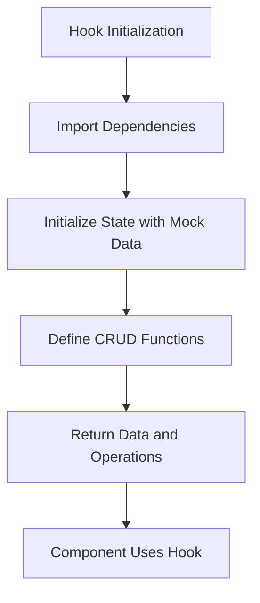
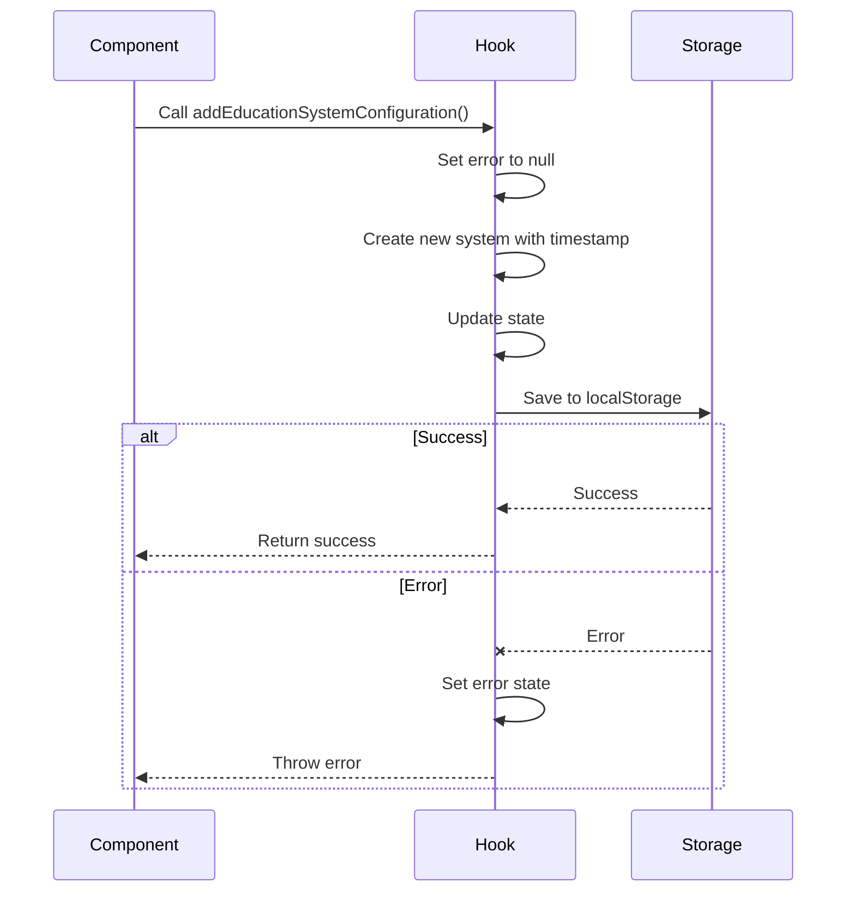
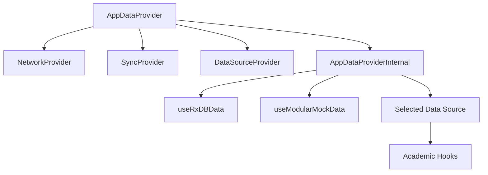

# Data Access Hooks

<cite>
**Referenced Files in This Document**   
- [useExamSessionData.ts](file://src/modules/academics/data/useExamSessionData.ts)
- [useStudentExamResultData.ts](file://src/modules/academics/data/useStudentExamResultData.ts)
- [useGradingSchemeData.ts](file://src/modules/academics/data/useGradingSchemeData.ts)
- [useSubjectData.ts](file://src/modules/academics/data/useSubjectData.ts)
- [useStudentSubjectEnrollmentData.ts](file://src/modules/academics/data/useStudentSubjectEnrollmentData.ts)
- [useTeacherSubjectAssignmentData.ts](file://src/modules/academics/data/useTeacherSubjectAssignmentData.ts)
- [useTimetableEntryData.ts](file://src/modules/academics/data/useTimetableEntryData.ts)
- [useEducationSystemData.ts](file://src/modules/academics/data/useEducationSystemData.ts)
- [types.ts](file://src/modules/academics/data/types.ts)
- [mockData.ts](file://src/modules/academics/data/mockData.ts)
- [index.ts](file://src/modules/academics/data/index.ts)
- [useDataHookFactory.ts](file://src/hooks/useDataHookFactory.ts)
- [useAppData.ts](file://src/hooks/useAppData.ts)
- [AppDataContext.tsx](file://src/contexts/AppDataContext.tsx)
- [useRxDBData.ts](file://src/hooks/useRxDBData.ts)
</cite>

## Table of Contents
1. [Introduction](#introduction)
2. [Core Data Access Hooks](#core-data-access-hooks)
3. [Hook Implementation Patterns](#hook-implementation-patterns)
4. [Data Structures and Types](#data-structures-and-types)
5. [Global Data Management Integration](#global-data-management-integration)
6. [Usage Examples](#usage-examples)
7. [Error Handling and Loading States](#error-handling-and-loading-states)
8. [Conclusion](#conclusion)

## Introduction
This document provides comprehensive documentation for the custom React hooks that provide data access in the Academics module of the SchoolPilot system. These hooks enable components to retrieve, create, update, and delete academic data entities such as exam sessions, student results, grading schemes, subjects, and other academic records. The documentation covers each hook's purpose, parameters, return values, usage patterns, underlying data fetching mechanisms, caching strategies, and error handling patterns.

**Section sources**
- [useExamSessionData.ts](file://src/modules/academics/data/useExamSessionData.ts)
- [useStudentExamResultData.ts](file://src/modules/academics/data/useStudentExamResultData.ts)
- [useGradingSchemeData.ts](file://src/modules/academics/data/useGradingSchemeData.ts)

## Core Data Access Hooks

### useExamSessionData
The `useExamSessionData` hook provides access to exam session information within the Academics module. It enables components to manage exam sessions including creating new sessions, updating existing ones, and removing sessions.

**Key Features:**
- **Data Retrieval**: Returns current exam session data
- **CRUD Operations**: Supports create, update, and remove operations
- **State Management**: Uses React's useState for local state management
- **Self-contained**: Does not depend on AppDataContext

**Return Values:**
- **data**: Array of ExamSession objects
- **create**: Function to create a new exam session
- **update**: Function to update an existing exam session
- **remove**: Function to remove an exam session

```typescript
export const useExamSessionData = () => {
  const [data, setData] = useState<ExamSession[]>(initialMockExamSessions);

  const create = async (newItem: Partial<ExamSession>) => {
    const newDataItem: ExamSession = {
      ...newItem,
      id: Date.now(),
      created_at: new Date().toISOString(),
      updated_at: new Date().toISOString()
    } as ExamSession;
    setData((prev: ExamSession[]) => [...prev, newDataItem]);
    return newDataItem;
  };

  const update = async (id: number, updatedData: Partial<ExamSession>) => {
    setData((prev: ExamSession[]) => prev.map((item: ExamSession) => 
      item.id === id 
        ? { ...item, ...updatedData, updated_at: new Date().toISOString() }
        : item
    ));
  };

  const remove = async (id: number) => {
    setData((prev: ExamSession[]) => prev.filter((item: ExamSession) => item.id !== id));
  };

  return {
    data,
    create,
    update,
    remove
  };
};
```

**Section sources**
- [useExamSessionData.ts](file://src/modules/academics/data/useExamSessionData.ts#L1-L41)

### useStudentExamResultData
The `useStudentExamResultData` hook provides functionality for retrieving and updating student exam results. It manages student exam result records with full CRUD operations.

**Key Features:**
- **Student Result Management**: Handles student exam results
- **Data Persistence**: Maintains results in component state
- **Timestamp Management**: Automatically updates creation and modification timestamps
- **Type Safety**: Uses TypeScript interfaces for type safety

**Return Values:**
- **data**: Array of StudentExamResult objects
- **create**: Function to create a new student exam result
- **update**: Function to update an existing student exam result
- **remove**: Function to remove a student exam result

**Section sources**
- [useStudentExamResultData.ts](file://src/modules/academics/data/useStudentExamResultData.ts#L1-L41)

### useGradingSchemeData
The `useGradingSchemeData` hook manages grading configurations within the Academics module. It handles grading schemes and their associated levels.

**Key Features:**
- **Grading Configuration**: Manages grading schemes
- **Hierarchical Data**: Supports grading schemes with multiple levels
- **CRUD Operations**: Full create, read, update, delete functionality
- **State Isolation**: Self-contained with no external dependencies

**Return Values:**
- **data**: Array of GradingScheme objects
- **create**: Function to create a new grading scheme
- **update**: Function to update an existing grading scheme
- **remove**: Function to remove a grading scheme

**Section sources**
- [useGradingSchemeData.ts](file://src/modules/academics/data/useGradingSchemeData.ts#L1-L41)

### useSubjectData
The `useSubjectData` hook provides access to subject information within the academic system. It manages subject records and their properties.

**Key Features:**
- **Subject Management**: Handles academic subjects
- **Comprehensive Data**: Includes subject codes, names, departments
- **State Management**: Uses React hooks for state management
- **Data Integrity**: Ensures proper timestamp updates

**Return Values:**
- **data**: Array of Subject objects
- **create**: Function to create a new subject
- **update**: Function to update an existing subject
- **remove**: Function to remove a subject

**Section sources**
- [useSubjectData.ts](file://src/modules/academics/data/useSubjectData.ts#L1-L41)

### useStudentSubjectEnrollmentData
The `useStudentSubjectEnrollmentData` hook manages student subject enrollment records. It tracks which students are enrolled in which subjects.

**Key Features:**
- **Enrollment Tracking**: Manages student-subject relationships
- **Status Management**: Tracks enrollment status (enrolled, withdrawn)
- **Historical Data**: Maintains creation and update timestamps
- **CRUD Operations**: Complete data manipulation capabilities

**Return Values:**
- **data**: Array of StudentSubjectEnrollment objects
- **create**: Function to create a new enrollment record
- **update**: Function to update an existing enrollment record
- **remove**: Function to remove an enrollment record

**Section sources**
- [useStudentSubjectEnrollmentData.ts](file://src/modules/academics/data/useStudentSubjectEnrollmentData.ts#L1-L41)

### useTeacherSubjectAssignmentData
The `useTeacherSubjectAssignmentData` hook manages teacher-subject mappings within the academic system. It tracks which teachers are assigned to teach which subjects.

**Key Features:**
- **Assignment Management**: Handles teacher-subject assignments
- **Relationship Tracking**: Maintains teacher-subject relationships
- **Data Consistency**: Ensures proper timestamp management
- **Flexible Updates**: Supports partial updates to assignment records

**Return Values:**
- **data**: Array of TeacherSubjectAssignment objects
- **create**: Function to create a new teacher-subject assignment
- **update**: Function to update an existing assignment
- **remove**: Function to remove an assignment

**Section sources**
- [useTeacherSubjectAssignmentData.ts](file://src/modules/academics/data/useTeacherSubjectAssignmentData.ts#L1-L41)

### useTimetableEntryData
The `useTimetableEntryData` hook provides access to schedule data within the academic system. It manages timetable entries that define when and where classes occur.

**Key Features:**
- **Schedule Management**: Handles class scheduling
- **Time Slot Definition**: Manages day, period, and classroom assignments
- **Teacher-Subject-Class Mapping**: Links teachers, subjects, and classes
- **Complete CRUD**: Full data manipulation capabilities

**Return Values:**
- **data**: Array of TimetableEntry objects
- **create**: Function to create a new timetable entry
- **update**: Function to update an existing timetable entry
- **remove**: Function to remove a timetable entry

**Section sources**
- [useTimetableEntryData.ts](file://src/modules/academics/data/useTimetableEntryData.ts#L1-L41)

### useEducationSystemData
The `useEducationSystemData` hook manages curriculum frameworks and education system configurations. Unlike other hooks, it uses localStorage for persistence and includes loading and error states.

**Key Features:**
- **LocalStorage Persistence**: Stores data in browser localStorage
- **Loading States**: Manages loading state during data retrieval
- **Error Handling**: Provides error state for data operations
- **Comprehensive Interface**: Includes specialized functions for education system management

**Return Values:**
- **educationSystemConfigurations**: Array of EducationSystemConfiguration objects
- **loading**: Boolean indicating if data is being loaded
- **error**: Error message if data operations fail
- **addEducationSystemConfiguration**: Function to add a new education system
- **updateEducationSystemConfiguration**: Function to update an existing system
- **deleteEducationSystemConfiguration**: Function to remove a system
- **getEducationSystemConfiguration**: Function to retrieve a specific system by ID

```typescript
export const useEducationSystemData = (): UseEducationSystemData => {
  const [educationSystemConfigurations, setEducationSystemConfigurations] = useState<EducationSystemConfiguration[]>([]);
  const [loading, setLoading] = useState(true);
  const [error, setError] = useState<string | null>(null);

  // Load initial data from localStorage or create default
  useEffect(() => {
    const loadData = async () => {
      try {
        setLoading(true);
        const stored = localStorage.getItem(STORAGE_KEY);
        if (stored) {
          setEducationSystemConfigurations(JSON.parse(stored));
        } else {
          // Initialize with some default systems
          const defaultSystems: EducationSystemConfiguration[] = [
            {
              id: 'kenya-cbc-primary',
              name: 'Kenya CBC Primary System',
              country_code: 'KE',
              system_type: 'Primary',
              grading_system_type: 'Competency Based',
              min_grade_level: 1,
              max_grade_level: 6,
              academic_period_type: 'Term',
              periods_per_year: 3,
              uses_competency_tracking: true,
              competency_levels: ['Exceeding Expectations', 'Meeting Expectations', 'Approaching Expectations', 'Below Expectations'],
              assessment_types: ['Formative', 'Summative', 'Competency'],
              continuous_assessment_weight: 60,
              final_exam_weight: 40,
              passing_grade: 50,
              max_grade_value: 100,
              grade_precision: 0,
              uses_credit_hours: false,
              allows_grade_modification: true,
              requires_external_moderation: false,
              supports_remedial_exams: true,
              created_at: new Date().toISOString(),
              updated_at: new Date().toISOString()
            }
          ];
          setEducationSystemConfigurations(defaultSystems);
          localStorage.setItem(STORAGE_KEY, JSON.stringify(defaultSystems));
        }
      } catch (err) {
        setError(err instanceof Error ? err.message : 'Failed to load education system data');
      } finally {
        setLoading(false);
      }
    };

    loadData();
  }, []);

  const saveToStorage = useCallback((systems: EducationSystemConfiguration[]) => {
    localStorage.setItem(STORAGE_KEY, JSON.stringify(systems));
  }, []);

  const addEducationSystemConfiguration = useCallback(async (config: Partial<EducationSystemConfiguration>) => {
    try {
      setError(null);
      const newSystem: EducationSystemConfiguration = {
        id: `edu-system-${Date.now()}`,
        created_at: new Date().toISOString(),
        updated_at: new Date().toISOString(),
        ...config
      } as EducationSystemConfiguration;

      const updated = [...educationSystemConfigurations, newSystem];
      setEducationSystemConfigurations(updated);
      saveToStorage(updated);
    } catch (err) {
      setError(err instanceof Error ? err.message : 'Failed to add education system');
    }
  }, [educationSystemConfigurations, saveToStorage]);

  return {
    educationSystemConfigurations,
    loading,
    error,
    addEducationSystemConfiguration,
    updateEducationSystemConfiguration,
    deleteEducationSystemConfiguration,
    getEducationSystemConfiguration
  };
};
```

**Section sources**
- [useEducationSystemData.ts](file://src/modules/academics/data/useEducationSystemData.ts#L1-L183)

## Hook Implementation Patterns

### Common Architecture
All academic data hooks follow a consistent implementation pattern:

**State Management:**
- Uses React's `useState` hook for local state management
- Stores data in component state
- Initializes with mock data from `mockData.ts`

**CRUD Operations:**
- **Create**: Generates new items with unique IDs and timestamps
- **Update**: Maps over existing data to update specific items
- **Remove**: Filters out items to be removed
- All operations are asynchronous for consistency

**Data Initialization:**
- Most hooks initialize with mock data
- `useEducationSystemData` uses localStorage with fallback defaults
- All hooks maintain creation and update timestamps



**Diagram sources**
- [useExamSessionData.ts](file://src/modules/academics/data/useExamSessionData.ts#L1-L41)
- [useStudentExamResultData.ts](file://src/modules/academics/data/useStudentExamResultData.ts#L1-L41)

### Data Fetching Mechanisms
The academic hooks use different data persistence strategies:

**Memory-based Storage:**
- Most hooks store data in React component state
- Data persists only during the current session
- Uses `initialMockData` from `mockData.ts` for initialization
- Suitable for development and testing

**LocalStorage-based Storage:**
- `useEducationSystemData` uses localStorage for persistence
- Data survives page refreshes
- Implements save and load operations
- Includes error handling for storage operations

**Section sources**
- [useEducationSystemData.ts](file://src/modules/academics/data/useEducationSystemData.ts#L1-L183)
- [mockData.ts](file://src/modules/academics/data/mockData.ts#L1-L200)

### Caching Strategies
The hooks implement simple caching through React's state management:

**State-based Caching:**
- Data is cached in component state
- Updates trigger re-renders through React's reactivity
- No additional caching layers for simplicity

**Memory-aware Considerations:**
- All hooks are lightweight and memory-efficient
- Data is stored as arrays of objects
- No complex caching algorithms implemented

**Section sources**
- [useExamSessionData.ts](file://src/modules/academics/data/useExamSessionData.ts#L1-L41)
- [useStudentExamResultData.ts](file://src/modules/academics/data/useStudentExamResultData.ts#L1-L41)

### Error Handling Patterns
The hooks implement different error handling approaches:

**Basic Hooks:**
- Most hooks do not include explicit error handling
- Rely on React's error boundaries
- Errors may propagate to the component level

**Advanced Hook (useEducationSystemData):**
- Implements comprehensive error handling
- Uses try-catch blocks for all operations
- Maintains error state in component state
- Provides error messages to consumers



**Diagram sources**
- [useEducationSystemData.ts](file://src/modules/academics/data/useEducationSystemData.ts#L1-L183)

## Data Structures and Types

### Core Data Types
The academic hooks rely on well-defined TypeScript interfaces:

**ExamSession Interface:**
```typescript
export interface ExamSession {
  id: string;
  name: string;
  school_period_id: number;
  status: enums.ExamSessionStatus;
  created_at: string;
  updated_at: string;
  school_period_name?: string | null;
  paper_settings?: ExamPaperSetting[];
}
```

**StudentExamResult Interface:**
```typescript
export interface StudentExamResult {
  id: string;
  student_id: string;
  exam_session_id: string;
  total_marks?: number | null;
  mean_grade?: string | null;
  class_rank?: number | null;
  stream_rank?: number | null;
  created_at: string;
  updated_at: string;
  marks?: StudentPaperMark[];
}
```

**GradingScheme Interface:**
```typescript
export interface GradingScheme {
  id: number;
  name: string;
  is_default: boolean;
  created_at: string;
  updated_at: string;
  levels?: GradingSchemeLevel[];
}
```

**Section sources**
- [types.ts](file://src/modules/academics/data/types.ts#L1-L199)

### Enum Definitions
The system uses enums to ensure data consistency:

**ExamSessionStatus Enum:**
```typescript
export enum ExamSessionStatus {
    PLANNING = 'Planning', 
    MARKS_ENTRY_OPEN = 'Marks Entry Open', 
    PUBLISHED = 'Published', 
    CLOSED = 'Closed', 
    ARCHIVED = 'Archived'
}
```

**SubjectGrouping Enum:**
```typescript
export enum SubjectGrouping {
  GROUP_1_COMPULSORY = "Group 1 (Compulsory)",
  GROUP_2_SCIENCES = "Group 2 (Sciences)",
  GROUP_3_HUMANITIES = "Group 3 (Humanities)",
  GROUP_4_TECHNICALS = "Group 4 (Technicals)",
  GROUP_5_LANGUAGES = "Group 5 (Foreign Languages)",
  OTHER = "Other/Optional"
}
```

**Section sources**
- [types.ts](file://src/modules/academics/data/types.ts#L1-L199)

### Mock Data Structure
The hooks are initialized with comprehensive mock data:

**Initial Mock Subjects:**
- 18 subjects across various disciplines
- Includes core, science, humanities, technical, and language subjects
- Each subject has metadata like code, abbreviation, and department

**Initial Mock Exam Sessions:**
- Two exam sessions: "End of Term 3 Exams 2024" and "Mid Term 1 Exams 2025"
- Different statuses (Marks Entry Open, Planning)
- Associated with school periods

**Section sources**
- [mockData.ts](file://src/modules/academics/data/mockData.ts#L1-L200)

## Global Data Management Integration

### AppDataContext Integration
The academic hooks are designed to work within the global data management system:

**Context Hierarchy:**
- AppDataProvider wraps the entire application
- Provides data through AppDataContext
- Uses NetworkProvider, SyncProvider, and DataSourceProvider

**Data Source Selection:**
- Determines data source based on configuration
- Can use RxDB or modular mock data
- Controlled by enhancedDataLayer feature flag



**Diagram sources**
- [AppDataContext.tsx](file://src/contexts/AppDataContext.tsx#L1-L169)

### useAppData Hook
The `useAppData` hook provides access to the global data context:

**Implementation:**
- Uses React's useContext to access AppDataContext
- Throws error if used outside provider
- Internal version (useAppDataInternal) returns null instead of throwing

**Usage:**
- Central point for accessing global application data
- Provides loading and error states
- Enables data refresh operations

**Section sources**
- [useAppData.ts](file://src/hooks/useAppData.ts#L1-L21)
- [AppDataContext.tsx](file://src/contexts/AppDataContext.tsx#L1-L169)

### Data Strategy and Synchronization
The system supports multiple data strategies:

**RxDB Integration:**
- useRxDBData hook provides access to persistent database
- Manages loading states for various data entities
- Handles database initialization and error states

**Mock Data Fallback:**
- useModularMockData provides mock data when needed
- Used when enhancedDataLayer is disabled
- Supports development and testing scenarios

**Section sources**
- [useRxDBData.ts](file://src/hooks/useRxDBData.ts#L1-L199)
- [AppDataContext.tsx](file://src/contexts/AppDataContext.tsx#L1-L169)

## Usage Examples

### Basic Usage Pattern
```typescript
import { useExamSessionData } from './useExamSessionData';

const ExamSessionComponent = () => {
  const { data: examSessions, create, update, remove } = useExamSessionData();
  
  const handleCreate = async () => {
    await create({
      name: 'Mid Term Exams',
      school_period_id: 2,
      status: 'Planning'
    });
  };
  
  const handleUpdate = async (id: string) => {
    await update(id, { status: 'Marks Entry Open' });
  };
  
  const handleRemove = async (id: string) => {
    await remove(id);
  };
  
  return (
    <div>
      <h2>Exam Sessions</h2>
      <button onClick={handleCreate}>Create Session</button>
      {examSessions.map(session => (
        <div key={session.id}>
          <p>{session.name} - {session.status}</p>
          <button onClick={() => handleUpdate(session.id)}>Update</button>
          <button onClick={() => handleRemove(session.id)}>Delete</button>
        </div>
      ))}
    </div>
  );
};
```

### Handling Loading States
```typescript
import { useEducationSystemData } from './useEducationSystemData';

const EducationSystemComponent = () => {
  const { 
    educationSystemConfigurations, 
    loading, 
    error,
    addEducationSystemConfiguration 
  } = useEducationSystemData();
  
  if (loading) {
    return <div>Loading education systems...</div>;
  }
  
  if (error) {
    return <div>Error: {error}</div>;
  }
  
  return (
    <div>
      <h2>Education Systems</h2>
      {educationSystemConfigurations.map(system => (
        <div key={system.id}>
          <h3>{system.name}</h3>
          <p>Type: {system.system_type}</p>
          <p>Grading: {system.grading_system_type}</p>
        </div>
      ))}
    </div>
  );
};
```

### Data Mutation Pattern
```typescript
import { useStudentExamResultData } from './useStudentExamResultData';

const ResultsEntryComponent = () => {
  const { data: results, update } = useStudentExamResultData();
  
  const handleMarkEntry = async (resultId: string, marks: number) => {
    try {
      await update(resultId, { total_marks: marks });
      console.log('Marks updated successfully');
    } catch (error) {
      console.error('Failed to update marks:', error);
    }
  };
  
  return (
    <div>
      {results.map(result => (
        <div key={result.id}>
          <p>Student ID: {result.student_id}</p>
          <input 
            type="number" 
            onChange={(e) => handleMarkEntry(result.id, Number(e.target.value))}
            placeholder="Enter marks"
          />
        </div>
      ))}
    </div>
  );
};
```

**Section sources**
- [useExamSessionData.ts](file://src/modules/academics/data/useExamSessionData.ts#L1-L41)
- [useEducationSystemData.ts](file://src/modules/academics/data/useEducationSystemData.ts#L1-L183)
- [useStudentExamResultData.ts](file://src/modules/academics/data/useStudentExamResultData.ts#L1-L41)

## Error Handling and Loading States

### Loading State Management
The hooks handle loading states differently:

**Simple Hooks:**
- No explicit loading state
- Data is immediately available from initialization
- Suitable for mock data scenarios

**Complex Hook (useEducationSystemData):**
- Implements loading state for localStorage operations
- Shows loading indicator during data retrieval
- Prevents rendering until data is ready

### Error State Management
Error handling varies across hooks:

**Basic Approach:**
- Most hooks do not manage error states
- Rely on component-level error handling
- Errors may cause component crashes

**Advanced Approach:**
- useEducationSystemData maintains error state
- Catches and handles errors gracefully
- Displays error messages to users
- Allows recovery from failed operations

### Best Practices for Consumers
When using these hooks, follow these best practices:

**Always Check for Errors:**
```typescript
const { data, error } = useEducationSystemData();
if (error) {
  // Handle error appropriately
  return <ErrorMessage message={error} />;
}
```

**Handle Loading States:**
```typescript
const { data, loading } = useEducationSystemData();
if (loading) {
  return <LoadingSpinner />;
}
```

**Use Async/Await for Mutations:**
```typescript
const { create } = useExamSessionData();
const handleSubmit = async () => {
  try {
    await create(newSessionData);
    // Handle success
  } catch (error) {
    // Handle failure
  }
};
```

**Section sources**
- [useEducationSystemData.ts](file://src/modules/academics/data/useEducationSystemData.ts#L1-L183)

## Conclusion
The academic data access hooks provide a consistent and reliable interface for managing academic data in the SchoolPilot system. Each hook follows a standardized pattern while adapting to specific data entity requirements. The hooks are designed to be self-contained, easy to use, and integrate well with React's component model.

Key takeaways:
- All hooks provide CRUD operations for their respective data entities
- Most hooks use in-memory state with mock data initialization
- useEducationSystemData implements advanced features like localStorage persistence and error handling
- The hooks are designed to work within the global AppDataContext system
- Comprehensive TypeScript interfaces ensure type safety
- Clear usage patterns make integration straightforward

These hooks form the foundation for academic data management in the application, enabling components to efficiently access and manipulate academic records while maintaining data consistency and integrity.

**Section sources**
- [useExamSessionData.ts](file://src/modules/academics/data/useExamSessionData.ts)
- [useStudentExamResultData.ts](file://src/modules/academics/data/useStudentExamResultData.ts)
- [useGradingSchemeData.ts](file://src/modules/academics/data/useGradingSchemeData.ts)
- [useEducationSystemData.ts](file://src/modules/academics/data/useEducationSystemData.ts)