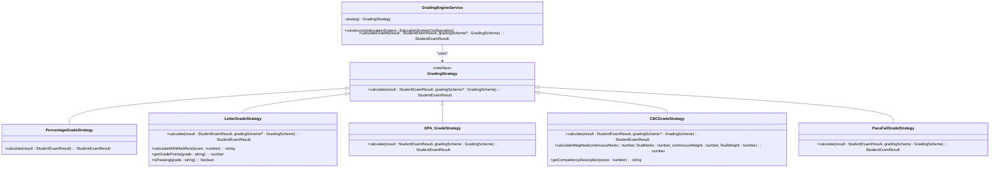
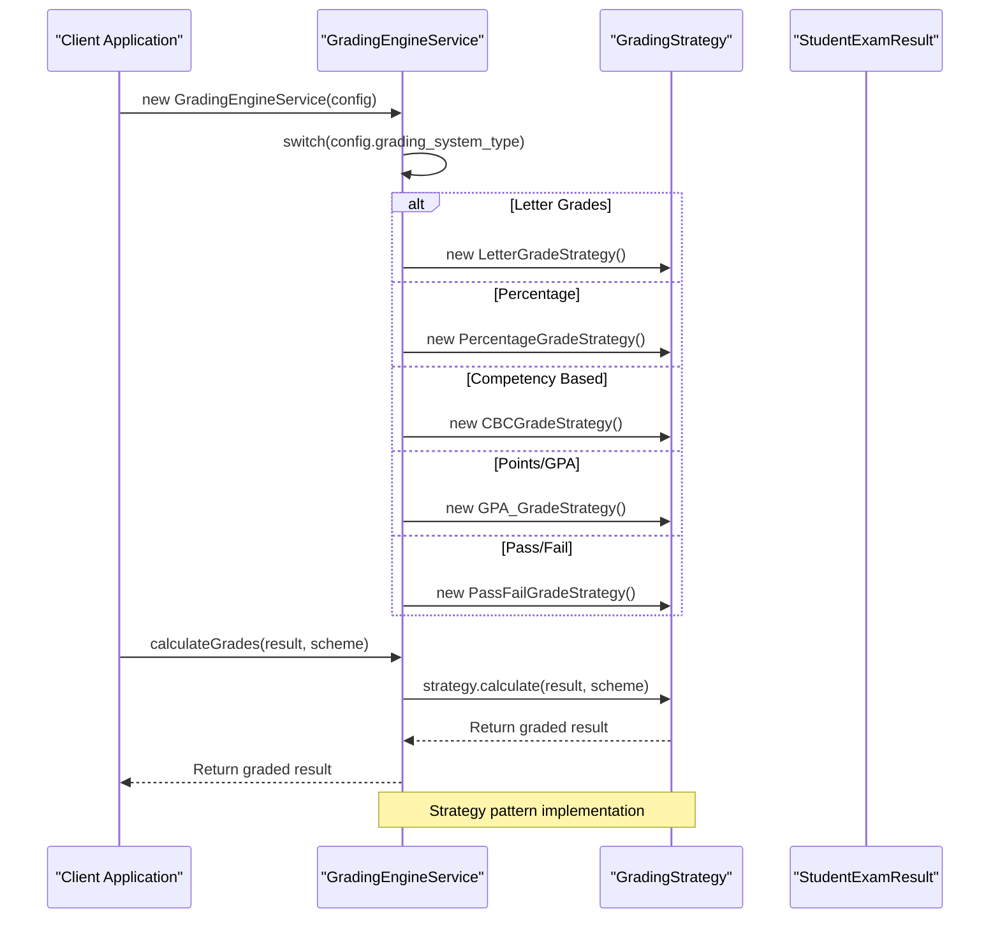
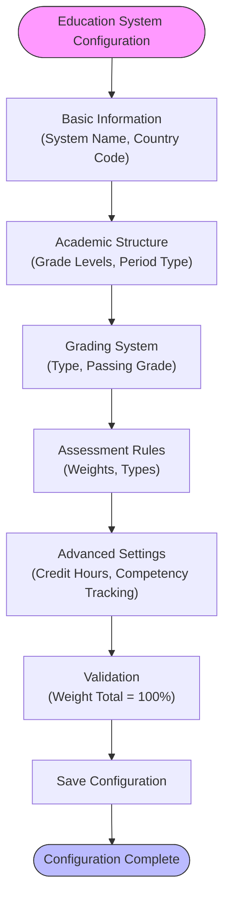

# Grading Strategies

<cite>
**Referenced Files in This Document**   
- [PercentageGradeStrategy.ts](file://src/modules/academics/strategies/PercentageGradeStrategy.ts)
- [LetterGradeStrategy.ts](file://src/modules/academics/strategies/LetterGradeStrategy.ts)
- [GPA_GradeStrategy.ts](file://src/modules/academics/strategies/GPA_GradeStrategy.ts)
- [CBCGradeStrategy.ts](file://src/modules/academics/strategies/CBCGradeStrategy.ts)
- [PassFailGradeStrategy.ts](file://src/modules/academics/strategies/PassFailGradeStrategy.ts)
- [GradingEngineService.ts](file://src/modules/academics/services/GradingEngineService.ts)
- [types.ts](file://src/modules/academics/data/types.ts)
- [enums.ts](file://src/modules/academics/data/enums.ts)
- [schema.ts](file://src/modules/academics/data/schema.ts)
- [EducationSystemValidationService.ts](file://src/modules/academics/services/EducationSystemValidationService.ts)
- [useGradingSchemeData.ts](file://src/modules/academics/data/useGradingSchemeData.ts)
- [mockData.ts](file://src/modules/academics/data/mockData.ts)
- [EducationSystemConfigPage.tsx](file://src/modules/academics/pages/EducationSystemConfigPage.tsx)
- [EducationSystemForm.tsx](file://src/modules/academics/components/EducationSystemForm.tsx)
- [useEducationSystemData.ts](file://src/modules/academics/data/useEducationSystemData.ts)
- [education-system-templates.ts](file://src/modules/academics/data/templates/education-system-templates.ts)
</cite>

## Table of Contents
1. [Introduction](#introduction)
2. [Grading Strategy Architecture](#grading-strategy-architecture)
3. [Grading Strategy Implementations](#grading-strategy-implementations)
   - [Percentage Grading Strategy](#percentage-grading-strategy)
   - [Letter Grading Strategy](#letter-grading-strategy)
   - [GPA Grading Strategy](#gpa-grading-strategy)
   - [Competency-Based Curriculum (CBC) Strategy](#competency-based-curriculum-cbc-strategy)
   - [Pass/Fail Grading Strategy](#passfail-grading-strategy)
4. [Grading Engine Service](#grading-engine-service)
5. [Education System Configuration](#education-system-configuration)
6. [Grading Scheme Management](#grading-scheme-management)
7. [Example Calculations](#example-calculations)
8. [Extending the Grading System](#extending-the-grading-system)
9. [Conclusion](#conclusion)

## Introduction

The grading strategy system in the Academics module implements a flexible strategy pattern that supports multiple grading systems including Percentage, Letter, GPA, CBC (Competency-Based Curriculum), and Pass/Fail. This document provides comprehensive documentation of the system architecture, implementation details, and configuration options. The system allows educational institutions to configure and switch between different grading systems based on their specific requirements and educational frameworks.

**Section sources**
- [GradingEngineService.ts](file://src/modules/academics/services/GradingEngineService.ts#L1-L44)
- [types.ts](file://src/modules/academics/data/types.ts#L0-L199)

## Grading Strategy Architecture

The grading system follows the Strategy design pattern, which enables the selection of algorithms at runtime. The architecture consists of a common interface for all grading strategies and a grading engine service that selects and applies the appropriate strategy based on the education system configuration.



**Diagram sources**
- [GradingEngineService.ts](file://src/modules/academics/services/GradingEngineService.ts#L1-L44)
- [PercentageGradeStrategy.ts](file://src/modules/academics/strategies/PercentageGradeStrategy.ts#L1-L15)
- [LetterGradeStrategy.ts](file://src/modules/academics/strategies/LetterGradeStrategy.ts#L1-L86)
- [GPA_GradeStrategy.ts](file://src/modules/academics/strategies/GPA_GradeStrategy.ts#L1-L23)
- [CBCGradeStrategy.ts](file://src/modules/academics/strategies/CBCGradeStrategy.ts#L1-L67)
- [PassFailGradeStrategy.ts](file://src/modules/academics/strategies/PassFailGradeStrategy.ts#L1-L23)

**Section sources**
- [GradingEngineService.ts](file://src/modules/academics/services/GradingEngineService.ts#L1-L44)
- [types.ts](file://src/modules/academics/data/types.ts#L0-L199)

## Grading Strategy Implementations

### Percentage Grading Strategy

The PercentageGradeStrategy converts raw scores into percentage grades. This strategy is the simplest form of grading, directly converting the total marks into a percentage format.

**Key Implementation Details:**
- Takes the total marks and converts it to a percentage
- Formats the result with two decimal places
- Returns the percentage as a string with a "%" suffix

```typescript
export class PercentageGradeStrategy implements GradingStrategy {
  calculate(result: StudentExamResult): StudentExamResult {
    if (result.total_marks) {
      result.mean_grade = `${((result.total_marks / 100) * 100).toFixed(2)}%`;
    }
    return result;
  }
}
```

**Section sources**
- [PercentageGradeStrategy.ts](file://src/modules/academics/strategies/PercentageGradeStrategy.ts#L1-L15)

### Letter Grading Strategy

The LetterGradeStrategy converts numerical scores into letter grades (A, B, C, etc.) based on predefined grading scales. It supports both custom grading schemes and a default Kenyan letter grade system.

**Key Implementation Details:**
- Uses a default grading scale if no custom scheme is provided
- Supports plus/minus modifiers (A+, B-, etc.)
- Provides methods for grade point conversion and pass/fail determination
- Sorts grading levels from highest to lowest score for accurate matching

```typescript
export class LetterGradeStrategy implements GradingStrategy {
  calculate(result: StudentExamResult, gradingScheme?: GradingScheme): StudentExamResult {
    if (!result.total_marks) {
      return result;
    }

    // Default Kenyan letter grade system if no grading scheme provided
    const defaultLevels: GradingSchemeLevel[] = [
      { id: 1, scheme_id: 0, grade: 'A', min_score: 80, points: 12, comment: 'Excellent' },
      { id: 2, scheme_id: 0, grade: 'A-', min_score: 75, points: 11, comment: 'Very Good' },
      // ... additional levels
    ];

    const levels = gradingScheme?.levels || defaultLevels;
    const score = result.total_marks;

    // Find the appropriate grade level (sorted from highest to lowest)
    const sortedLevels = [...levels].sort((a, b) => b.min_score - a.min_score);
    const level = sortedLevels.find(l => score >= l.min_score);

    if (level) {
      result.mean_grade = level.grade;
    } else {
      result.mean_grade = 'E';
    }

    return result;
  }

  calculateWithModifiers(score: number): string {
    // Implementation for plus/minus modifiers
  }

  getGradePoints(grade: string): number {
    // Implementation for GPA calculation
  }

  isPassing(grade: string): boolean {
    // Implementation for pass/fail determination
  }
}
```

**Section sources**
- [LetterGradeStrategy.ts](file://src/modules/academics/strategies/LetterGradeStrategy.ts#L1-L86)

### GPA Grading Strategy

The GPA_GradeStrategy converts numerical scores into grade points on a 4.0 scale or custom scale defined in the grading scheme. This strategy is commonly used in university systems.

**Key Implementation Details:**
- Requires a grading scheme with defined levels and points
- Converts the raw score to a percentage and matches it to the appropriate grade level
- Returns the grade points as a formatted string with two decimal places
- Uses the min_score and max_score properties of grading levels to determine the appropriate grade

```typescript
export class GPA_GradeStrategy implements GradingStrategy {
  calculate(result: StudentExamResult, gradingScheme: GradingScheme): StudentExamResult {
    if (!result.total_marks || !gradingScheme || !gradingScheme.levels) {
      return result;
    }

    const score = (result.total_marks / 100) * 100;
    const level = gradingScheme.levels.find(l => score >= l.min_score && score <= (l.max_score || 100));

    if (level && level.points) {
      result.mean_grade = level.points.toFixed(2);
    }

    return result;
  }
}
```

**Section sources**
- [GPA_GradeStrategy.ts](file://src/modules/academics/strategies/GPA_GradeStrategy.ts#L1-L23)

### Competency-Based Curriculum (CBC) Strategy

The CBCGradeStrategy implements competency-based grading, which focuses on mastery of skills and competencies rather than numerical scores. This strategy is particularly used in the Kenyan education system.

**Key Implementation Details:**
- Uses competency levels such as "Exceeding Expectations", "Meeting Expectations", etc.
- Supports weighted assessment with different weights for continuous assessment and final exams
- Provides descriptive feedback based on performance levels
- Includes methods for calculating weighted scores and generating competency descriptions

```typescript
export class CBCGradeStrategy implements GradingStrategy {
  calculate(result: StudentExamResult, gradingScheme?: GradingScheme): StudentExamResult {
    if (!result.total_marks) {
      return result;
    }

    // Default CBC competency levels if no grading scheme provided
    const defaultLevels: GradingSchemeLevel[] = [
      { id: 1, scheme_id: 0, grade: 'Exceeding Expectations', min_score: 80, comment: 'Exceeding Expectations - Outstanding performance' },
      { id: 2, scheme_id: 0, grade: 'Meeting Expectations', min_score: 60, comment: 'Meeting Expectations - Satisfactory performance' },
      { id: 3, scheme_id: 0, grade: 'Approaching Expectations', min_score: 40, comment: 'Approaching Expectations - Fair performance' },
      { id: 4, scheme_id: 0, grade: 'Below Expectations', min_score: 0, comment: 'Below Expectations - Needs improvement' }
    ];

    const levels = gradingScheme?.levels || defaultLevels;
    const score = result.total_marks;

    // Find the appropriate competency level (sorted from highest to lowest)
    const sortedLevels = [...levels].sort((a, b) => b.min_score - a.min_score);
    const level = sortedLevels.find(l => score >= l.min_score);

    if (level) {
      result.mean_grade = level.comment || level.grade;
    } else {
      result.mean_grade = 'Below Expectations';
    }

    return result;
  }

  calculateWeighted(
    continuousMarks: number,
    finalMarks: number,
    continuousWeight: number = 60,
    finalWeight: number = 40
  ): number {
    const continuousScore = (continuousMarks * continuousWeight) / 100;
    const finalScore = (finalMarks * finalWeight) / 100;
    return continuousScore + finalScore;
  }

  getCompetencyDescription(score: number): string {
    // Implementation for generating competency descriptions
  }
}
```

**Section sources**
- [CBCGradeStrategy.ts](file://src/modules/academics/strategies/CBCGradeStrategy.ts#L1-L67)

### Pass/Fail Grading Strategy

The PassFailGradeStrategy implements a binary grading system where students either pass or fail based on a threshold defined in the grading scheme.

**Key Implementation Details:**
- Requires a grading scheme with defined pass/fail thresholds
- Uses the min_score property of grading levels to determine if a student passes
- Returns the grade as defined in the grading scheme (typically "Pass" or "Fail")
- Simple implementation that only requires a passing threshold

```typescript
export class PassFailGradeStrategy implements GradingStrategy {
  calculate(result: StudentExamResult, gradingScheme: GradingScheme): StudentExamResult {
    if (!result.total_marks || !gradingScheme || !gradingScheme.levels) {
      return result;
    }

    const score = (result.total_marks / 100) * 100;
    const level = gradingScheme.levels.find(l => score >= l.min_score);

    if (level) {
      result.mean_grade = level.grade;
    }

    return result;
  }
}
```

**Section sources**
- [PassFailGradeStrategy.ts](file://src/modules/academics/strategies/PassFailGradeStrategy.ts#L1-L23)

## Grading Engine Service

The GradingEngineService is the central component that selects and applies the appropriate grading strategy based on the education system configuration. It implements the Strategy pattern by instantiating the correct strategy class at construction time.

**Key Implementation Details:**
- Takes an EducationSystemConfiguration object in the constructor
- Uses a switch statement to instantiate the appropriate grading strategy
- Throws an error for unsupported grading system types
- Provides a calculateGrades method that delegates to the selected strategy



**Diagram sources**
- [GradingEngineService.ts](file://src/modules/academics/services/GradingEngineService.ts#L1-L44)

**Section sources**
- [GradingEngineService.ts](file://src/modules/academics/services/GradingEngineService.ts#L1-L44)

## Education System Configuration

The education system configuration allows administrators to define and manage different grading systems within the institution. The configuration includes settings for grading type, assessment weights, and other academic parameters.

**Key Configuration Parameters:**
- **name**: Name of the education system
- **country_code**: ISO country code
- **system_type**: Primary, Secondary, University, etc.
- **grading_system_type**: Letter Grades, Percentage, Competency Based, Points/GPA, Pass/Fail
- **min_grade_level** and **max_grade_level**: Grade level range
- **academic_period_type**: Term, Semester, Quarter, Trimester
- **passing_grade**: Minimum score to pass
- **max_grade_value**: Maximum possible score
- **grade_precision**: Number of decimal places for grades
- **assessment_types**: Formative, Summative, Competency, Project Based, Practical
- **continuous_assessment_weight** and **final_exam_weight**: Weight distribution
- **uses_credit_hours**: Whether the system uses credit hours
- **uses_competency_tracking**: Whether the system tracks competencies



**Diagram sources**
- [EducationSystemForm.tsx](file://src/modules/academics/components/EducationSystemForm.tsx#L1-L145)
- [EducationSystemValidationService.ts](file://src/modules/academics/services/EducationSystemValidationService.ts#L1-L76)

**Section sources**
- [EducationSystemForm.tsx](file://src/modules/academics/components/EducationSystemForm.tsx#L1-L145)
- [EducationSystemValidationService.ts](file://src/modules/academics/services/EducationSystemValidationService.ts#L1-L76)
- [useEducationSystemData.ts](file://src/modules/academics/data/useEducationSystemData.ts#L1-L183)

## Grading Scheme Management

Grading schemes define the specific rules and thresholds for converting numerical scores into grades. They are used by the grading strategies to determine the appropriate grade for a given score.

**Key Components:**
- **GradingScheme**: Top-level entity that contains multiple grading levels
- **GradingSchemeLevel**: Individual grade level with minimum score, grade label, points, and comment

**Database Schema:**
```typescript
export const gradingSchemeSchema: DatabaseSchema = createDatabaseSchema({
    title: 'grading_scheme',
    primaryKey: 'id',
    properties: {
        id: SchemaHelpers.integer({ description: 'Unique identifier', minimum: 1, maximum: 999999999 }),
        name: SchemaHelpers.string({ description: 'Grading scheme name', maxLength: 100 }),
        is_default: SchemaHelpers.boolean({ description: 'Whether this is the default scheme', default: false }),
        created_at: SchemaHelpers.timestamp({ description: 'Creation timestamp' }),
        updated_at: SchemaHelpers.timestamp({ description: 'Last update timestamp' }),
        levels: SchemaHelpers.array(
            SchemaHelpers.object(gradingSchemeLevelProperties),
            { description: 'Grading levels' }
        ),
        education_system_id: SchemaHelpers.ref('education_system_configurations', { description: 'Reference to education system', maxLength: 100 })
    },
    required: ['id', 'name', 'is_default', 'created_at', 'updated_at'],
    indexes: ['name', 'is_default']
});
```

**Sample Grading Scheme (Kenyan Standard A-E):**
- A: 80-100 (Excellent)
- A-: 75-79 (Excellent)
- B+: 70-74 (Very Good)
- B: 65-69 (Good)
- B-: 60-64 (Good)
- C+: 55-59 (Average)
- C: 50-54 (Average)
- C-: 45-49 (Average)
- D+: 40-44 (Pass)
- D: 35-39 (Pass)
- D-: 30-34 (Pass)
- E: 0-29 (Fail)

**Section sources**
- [schema.ts](file://src/modules/academics/data/schema.ts#L1-L199)
- [mockData.ts](file://src/modules/academics/data/mockData.ts#L1-L199)
- [useGradingSchemeData.ts](file://src/modules/academics/data/useGradingSchemeData.ts#L1-L41)

## Example Calculations

### Percentage Grading Example
**Input:**
- Total marks: 87.5
- Grading system: Percentage

**Calculation:**
```
87.5 / 100 * 100 = 87.50%
```

**Output:**
- Mean grade: "87.50%"

### Letter Grading Example
**Input:**
- Total marks: 87.5
- Grading system: Letter Grades
- Grading scheme: Kenyan Standard A-E

**Calculation:**
- Score (87.5) >= 80 → Grade A
- Score (87.5) < 90 → No A+

**Output:**
- Mean grade: "A"

### GPA Grading Example
**Input:**
- Total marks: 87.5
- Grading system: Points/GPA
- Grading scheme: 4.0 scale
- Level: A = 4.0 points (80-100)

**Calculation:**
- Score (87.5) falls in A range
- Grade points: 4.00

**Output:**
- Mean grade: "4.00"

### CBC Grading Example
**Input:**
- Total marks: 87.5
- Grading system: Competency Based
- Grading scheme: CBC levels

**Calculation:**
- Score (87.5) >= 80 → Exceeding Expectations

**Output:**
- Mean grade: "Exceeding Expectations - Outstanding performance"

### Pass/Fail Grading Example
**Input:**
- Total marks: 87.5
- Grading system: Pass/Fail
- Grading scheme: Pass >= 50

**Calculation:**
- Score (87.5) >= 50 → Pass

**Output:**
- Mean grade: "Pass"

**Section sources**
- [PercentageGradeStrategy.ts](file://src/modules/academics/strategies/PercentageGradeStrategy.ts#L1-L15)
- [LetterGradeStrategy.ts](file://src/modules/academics/strategies/LetterGradeStrategy.ts#L1-L86)
- [GPA_GradeStrategy.ts](file://src/modules/academics/strategies/GPA_GradeStrategy.ts#L1-L23)
- [CBCGradeStrategy.ts](file://src/modules/academics/strategies/CBCGradeStrategy.ts#L1-L67)
- [PassFailGradeStrategy.ts](file://src/modules/academics/strategies/PassFailGradeStrategy.ts#L1-L23)

## Extending the Grading System

The grading system is designed to be extensible, allowing institutions to implement custom grading strategies that meet their specific requirements.

**Steps to Add a Custom Grading Strategy:**

1. **Create a new strategy class** that implements the GradingStrategy interface:
```typescript
import { StudentExamResult, GradingScheme } from '../data/types';
import { GradingStrategy } from '../services/GradingEngineService';

export class CustomGradeStrategy implements GradingStrategy {
  calculate(result: StudentExamResult, gradingScheme?: GradingScheme): StudentExamResult {
    // Custom calculation logic
    return result;
  }
}
```

2. **Add the new grading system type** to the GradingSystemType enum:
```typescript
export enum GradingSystemType {
  LETTER_GRADES = 'Letter Grades',
  PERCENTAGE = 'Percentage',
  COMPETENCY_BASED = 'Competency Based',
  POINTS = 'Points/GPA',
  PASS_FAIL = 'Pass/Fail',
  CUSTOM = 'Custom' // New type
}
```

3. **Update the GradingEngineService** to support the new strategy:
```typescript
constructor(educationSystem: EducationSystemConfiguration) {
  switch (educationSystem.grading_system_type) {
    case GradingSystemType.LETTER_GRADES:
      this.strategy = new LetterGradeStrategy();
      break;
    // ... existing cases
    case GradingSystemType.CUSTOM:
      this.strategy = new CustomGradeStrategy();
      break;
    default:
      throw new Error(`Unsupported grading system: ${educationSystem.grading_system_type}`);
  }
}
```

4. **Update the user interface** to include the new grading system option in the EducationSystemForm component.

5. **Add validation rules** for the custom grading system in the EducationSystemValidationService if needed.

**Best Practices for Custom Strategies:**
- Follow the same interface and method signatures as existing strategies
- Handle edge cases such as null or undefined values
- Include comprehensive documentation and comments
- Write unit tests to verify the correctness of the implementation
- Consider performance implications for large datasets

**Section sources**
- [GradingEngineService.ts](file://src/modules/academics/services/GradingEngineService.ts#L1-L44)
- [types.ts](file://src/modules/academics/data/types.ts#L0-L199)
- [enums.ts](file://src/modules/academics/data/enums.ts#L1-L70)
- [EducationSystemForm.tsx](file://src/modules/academics/components/EducationSystemForm.tsx#L1-L145)

## Conclusion

The grading strategy system in the Academics module provides a flexible and extensible framework for implementing multiple grading systems. By using the Strategy design pattern, the system allows educational institutions to configure and switch between different grading approaches including Percentage, Letter, GPA, CBC (Competency-Based Curriculum), and Pass/Fail systems.

Key features of the system include:
- Support for multiple grading systems through a common interface
- Configurable education system settings that determine the grading approach
- Predefined templates for common educational frameworks
- Extensible architecture that allows for custom grading strategies
- Comprehensive validation to ensure data integrity
- User-friendly interface for configuring grading systems

The system is designed to accommodate the diverse needs of educational institutions worldwide, from primary schools using competency-based assessment to universities using traditional GPA systems. Its modular design makes it easy to extend and customize for specific institutional requirements.