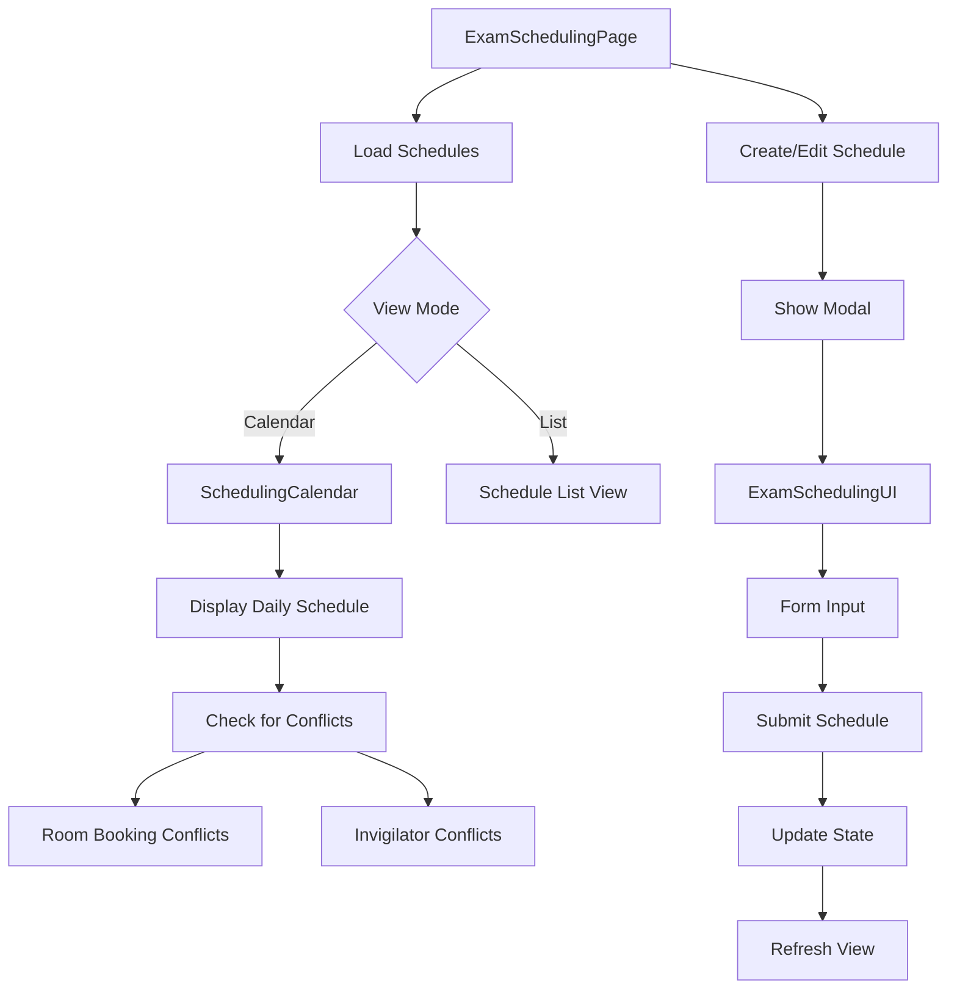
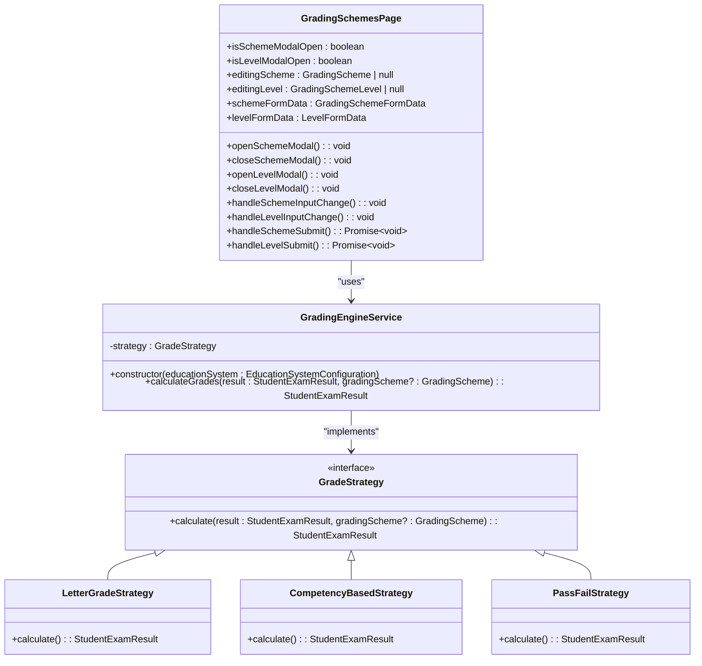
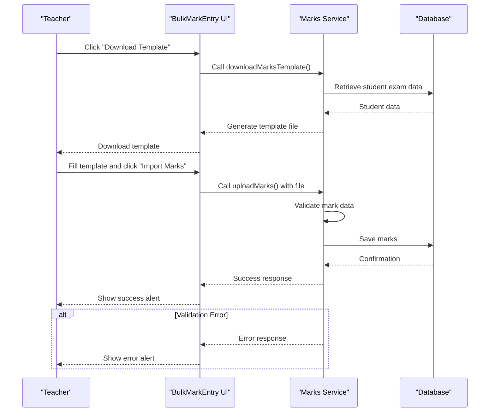
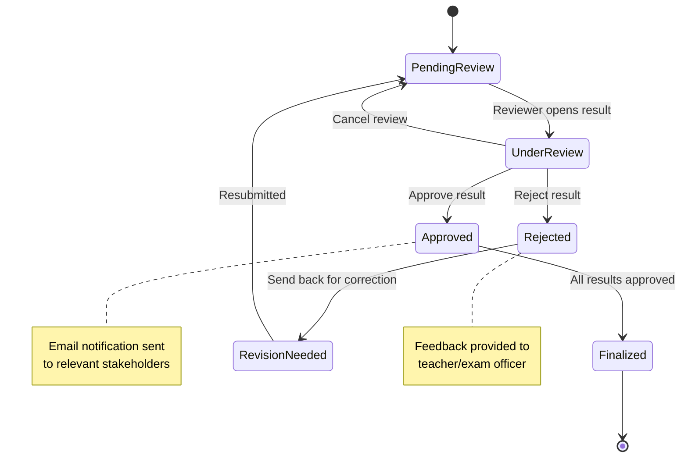
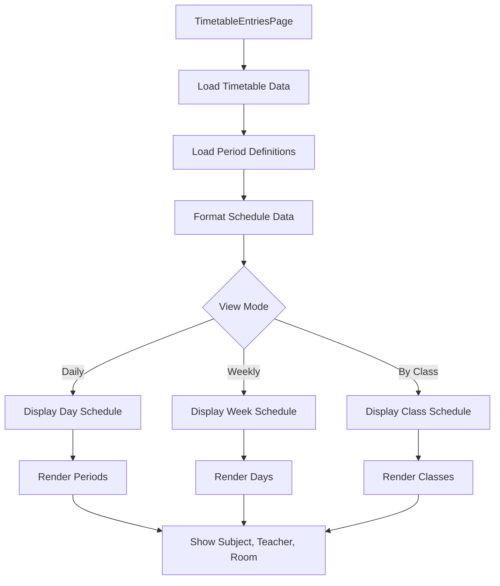
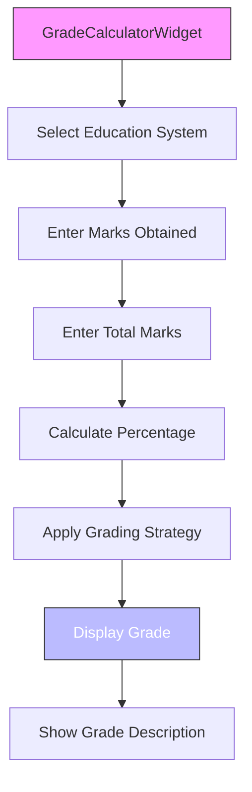

# User Interfaces

<cite>
**Referenced Files in This Document**   
- [ExamSchedulingPage.tsx](file://src/modules/academics/pages/ExamSchedulingPage.tsx)
- [GradingSchemesPage.tsx](file://src/modules/academics/pages/GradingSchemesPage.tsx)
- [StudentExamResultsEntryPage.tsx](file://src/modules/academics/pages/StudentExamResultsEntryPage.tsx)
- [ResultApprovalDashboard.tsx](file://src/modules/academics/pages/ResultApprovalDashboard.tsx)
- [TimetableEntriesPage.tsx](file://src/modules/academics/pages/TimetableEntriesPage.tsx)
- [ExamSchedulingUI.tsx](file://src/modules/academics/components/ExamSchedulingUI.tsx)
- [BulkMarkEntry.tsx](file://src/modules/academics/components/BulkMarkEntry.tsx)
- [GradeCalculatorWidget.tsx](file://src/modules/academics/components/GradeCalculatorWidget.tsx)
- [ResultReviewInterface.tsx](file://src/modules/academics/components/ResultReviewInterface.tsx)
- [SchedulingCalendar.tsx](file://src/modules/academics/components/SchedulingCalendar.tsx)
- [useAppData.ts](file://src/hooks/useAppData.ts)
- [ExamScheduleManager.ts](file://src/modules/academics/services/ExamScheduleManager.ts)
- [GradingEngineService.ts](file://src/modules/academics/services/GradingEngineService.ts)
</cite>

## Table of Contents
1. [Introduction](#introduction)
2. [Exam Scheduling Interface](#exam-scheduling-interface)
3. [Grading Schemes Management](#grading-schemes-management)
4. [Student Exam Results Entry](#student-exam-results-entry)
5. [Result Approval Dashboard](#result-approval-dashboard)
6. [Timetable Entries View](#timetable-entries-view)
7. [Specialized Components](#specialized-components)
8. [User Workflows](#user-workflows)

## Introduction
This document provides comprehensive documentation for the user interfaces in the Academics module of the EduGen school management system. The documentation covers key pages and components responsible for exam scheduling, grading configuration, student results entry, result approval workflows, and timetable viewing. The system is designed to support academic administrators, teachers, and exam coordinators in managing the assessment lifecycle efficiently. The interfaces follow a consistent design pattern using React components with state management through hooks and context providers.

**Section sources**
- [ExamSchedulingPage.tsx](file://src/modules/academics/pages/ExamSchedulingPage.tsx#L1-L30)
- [GradingSchemesPage.tsx](file://src/modules/academics/pages/GradingSchemesPage.tsx#L1-L30)

## Exam Scheduling Interface

The ExamSchedulingPage provides a comprehensive interface for creating and managing exam timetables. The page combines a calendar view with a list view, allowing users to visualize and manage exam schedules across different class streams and time periods.

The interface state is managed through several useState hooks that track schedules, filters, loading status, and modal states. The component uses the useAppData hook to access class stream data and other academic information. The ExamScheduleManager service handles the business logic for exam scheduling operations.

Key features include:
- Calendar and list view toggle for schedule visualization
- Filtering by class stream and examination room
- Conflict detection for room and invigilator double-booking
- Modal-based creation and editing of exam schedules
- Integration with the ExamSchedulingUI component for form inputs

The page initializes by loading schedules when the exam session ID changes, and provides controls for creating new schedules or editing existing ones through modal dialogs.

**Diagram sources**
- [ExamSchedulingPage.tsx](file://src/modules/academics/pages/ExamSchedulingPage.tsx#L30-L300)
- [SchedulingCalendar.tsx](file://src/modules/academics/components/SchedulingCalendar.tsx#L1-L281)
- [ExamSchedulingUI.tsx](file://src/modules/academics/components/ExamSchedulingUI.tsx#L1-L100)

**Section sources**
- [ExamSchedulingPage.tsx](file://src/modules/academics/pages/ExamSchedulingPage.tsx#L1-L439)
- [SchedulingCalendar.tsx](file://src/modules/academics/components/SchedulingCalendar.tsx#L1-L281)

## Grading Schemes Management

The GradingSchemesPage component enables administrators to configure grading systems used across the institution. The interface provides a complete CRUD (Create, Read, Update, Delete) functionality for grading schemes and their associated levels.

The component uses React state to manage modal visibility and form data for both grading schemes and grading levels. It integrates with the useAppData hook to access and modify grading scheme data. The interface supports two levels of configuration:
1. Grading schemes (top-level containers with name and default status)
2. Grading levels (specific grade definitions with minimum scores and points)

Key features include:
- DataGrid component for displaying existing grading schemes
- Modal dialogs for creating and editing grading schemes
- Nested modal for managing grading levels within a selected scheme
- Form validation for required fields like scheme name
- Visual indicators for default grading schemes

The grading system supports different grading strategies (competency-based, letter grades, pass/fail) through the GradingEngineService, which applies the appropriate calculation logic based on the education system configuration.

**Diagram sources**
- [GradingSchemesPage.tsx](file://src/modules/academics/pages/GradingSchemesPage.tsx#L1-L270)
- [GradingEngineService.ts](file://src/modules/academics/services/GradingEngineService.ts#L1-L50)

**Section sources**
- [GradingSchemesPage.tsx](file://src/modules/academics/pages/GradingSchemesPage.tsx#L1-L270)
- [GradingEngineService.ts](file://src/modules/academics/services/GradingEngineService.ts#L1-L50)

## Student Exam Results Entry

The StudentExamResultsEntryPage provides an interface for teachers and exam officers to enter student marks for examinations. While the complete implementation is not available in the provided code snippets, the interface is designed to work with the BulkMarkEntry component for efficient data entry.

The BulkMarkEntry component provides two primary functions:
1. Import marks from a template file
2. Download a template for offline data entry

The component manages its state with uploading and downloading flags to provide visual feedback during file operations. When importing marks, it calls the uploadMarks service, and for template download, it uses the downloadMarksTemplate service. The interface displays appropriate alerts to confirm successful operations or report failures.

The expected workflow includes:
1. Downloading a pre-formatted template with student information
2. Filling in marks for each student in the template
3. Uploading the completed template to import marks into the system
4. System validation and processing of the uploaded data

**Diagram sources**
- [BulkMarkEntry.tsx](file://src/modules/academics/components/BulkMarkEntry.tsx#L1-L46)
- [marksService.ts](file://src/modules/academics/services/marksService.ts#L1-L50)

**Section sources**
- [BulkMarkEntry.tsx](file://src/modules/academics/components/BulkMarkEntry.tsx#L1-L46)

## Result Approval Dashboard

The ResultApprovalDashboard provides a workflow management interface for approving student examination results. The dashboard integrates with the ResultReviewInterface component, which serves as the primary UI for reviewing and approving results.

While the implementation of ResultReviewInterface is minimal in the provided code, the component is designed to display results that require approval, show relevant student and exam information, and provide controls for approving or rejecting results. The approval workflow likely follows a state machine pattern managed by the ResultApprovalStateMachine service.

Key features expected in the dashboard include:
- List of results pending approval
- Filtering by exam session, class, or subject
- Detailed view of individual student results
- Approval and rejection controls with audit logging
- Status indicators for approval progress
- Delegation capabilities for department heads

The interface would integrate with the GradingEngineService to display calculated grades and with the AuditTrailService to maintain a record of approval actions.

**Diagram sources**
- [ResultApprovalDashboard.tsx](file://src/modules/academics/pages/ResultApprovalDashboard.tsx#L1-L50)
- [ResultReviewInterface.tsx](file://src/modules/academics/components/ResultReviewInterface.tsx#L1-L15)
- [ResultApprovalStateMachine.ts](file://src/modules/academics/services/ResultApprovalStateMachine.ts#L1-L50)

**Section sources**
- [ResultReviewInterface.tsx](file://src/modules/academics/components/ResultReviewInterface.tsx#L1-L15)

## Timetable Entries View

The TimetableEntriesPage provides a read-only interface for viewing academic schedules. While the complete implementation is not available in the provided code, the interface is designed to display timetable information in a clear, organized format.

The page likely uses the useTimetableEntryData and useTimetablePeriodDefData hooks to retrieve timetable information and period definitions. It would display information such as:
- Class schedules by day and period
- Subject and teacher assignments
- Room allocations
- Special scheduling notes

The interface may support different viewing modes (daily, weekly, by class) and filtering options to help users find specific timetable information. It would integrate with the TimetableIntegrationService to ensure consistency with other scheduling systems.

**Section sources**
- [TimetableEntriesPage.tsx](file://src/modules/academics/pages/TimetableEntriesPage.tsx#L1-L50)

## Specialized Components

### ExamSchedulingUI
The ExamSchedulingUI component provides the form interface for creating and editing exam schedules. It is used within modal dialogs in the ExamSchedulingPage and handles all input fields required for exam scheduling, including exam session, class stream, date, period, room, and invigilator selection.

### BulkMarkEntry
As previously described, this component facilitates bulk entry of student marks through template import/export functionality, improving efficiency for data entry tasks.

### GradeCalculatorWidget
The GradeCalculatorWidget provides a real-time grade calculation tool that helps teachers understand how marks translate to grades. It supports multiple education systems and displays both the calculated grade and a descriptive interpretation.

**Diagram sources**
- [GradeCalculatorWidget.tsx](file://src/modules/academics/components/GradeCalculatorWidget.tsx#L1-L135)

### ResultReviewInterface
This component serves as the core interface for reviewing examination results during the approval process. It likely displays student performance data, calculated grades, and provides controls for approval actions.

**Section sources**
- [GradeCalculatorWidget.tsx](file://src/modules/academics/components/GradeCalculatorWidget.tsx#L1-L135)

## User Workflows

### Bulk Mark Entry Process
1. Navigate to Student Exam Results Entry page
2. Click "Download Template" to get a pre-formatted spreadsheet
3. Fill in student marks in the downloaded template
4. Return to the interface and click "Import Marks"
5. Select the completed template file
6. Wait for system processing and confirmation
7. Review any error reports for invalid entries

### Exam Conflict Resolution
1. Open Exam Scheduling page and select calendar view
2. Identify potential conflicts indicated by warning icons
3. Review conflict details (room double-booking or invigilator scheduling)
4. Adjust schedule by changing room, time period, or invigilator
5. Save changes and verify conflict resolution
6. Notify affected teachers of schedule changes

### Result Approval Process
1. Access Result Approval Dashboard
2. Filter results by exam session and class
3. Select results requiring approval
4. Review student performance data and calculated grades
5. Approve results if accurate or reject with feedback if corrections needed
6. Monitor approval status until all results are finalized
7. Generate final grade reports after complete approval

These workflows are supported by the underlying component architecture and state management patterns that ensure data consistency and provide appropriate user feedback throughout each process.

**Section sources**
- [ExamSchedulingPage.tsx](file://src/modules/academics/pages/ExamSchedulingPage.tsx#L1-L439)
- [GradingSchemesPage.tsx](file://src/modules/academics/pages/GradingSchemesPage.tsx#L1-L270)
- [BulkMarkEntry.tsx](file://src/modules/academics/components/BulkMarkEntry.tsx#L1-L46)
- [ResultApprovalDashboard.tsx](file://src/modules/academics/pages/ResultApprovalDashboard.tsx#L1-L50)