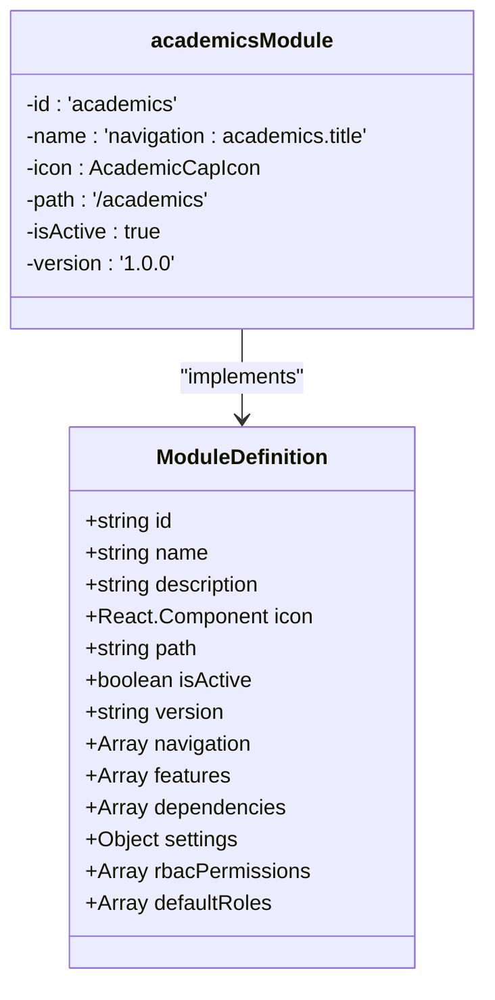
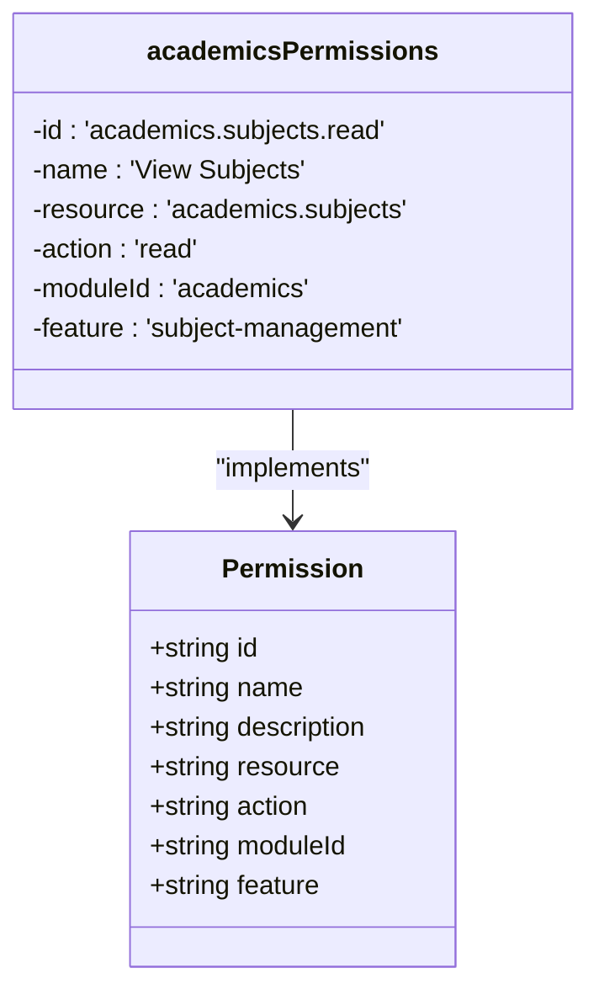
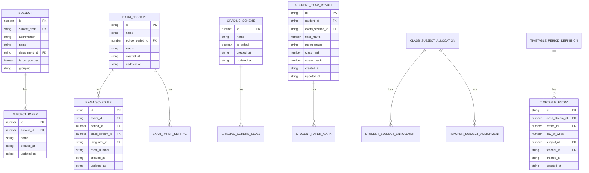
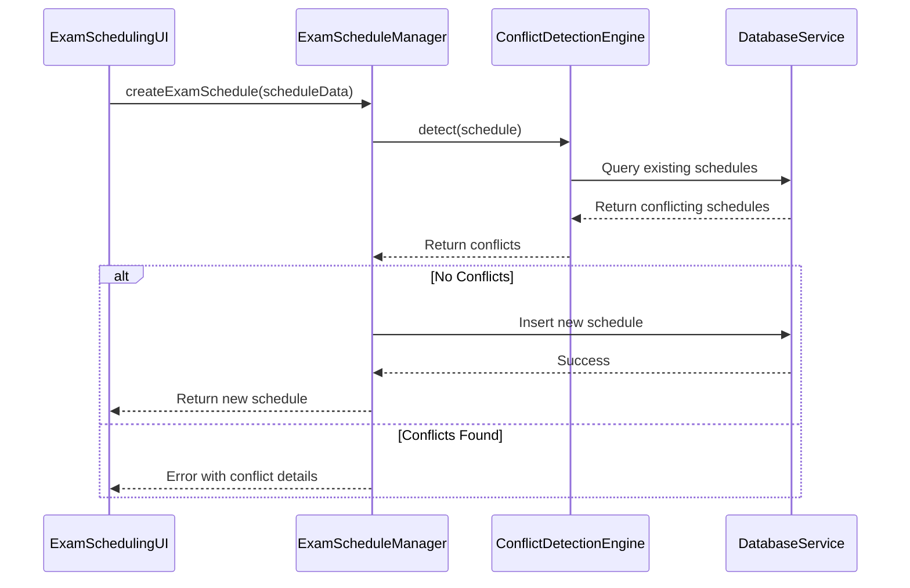
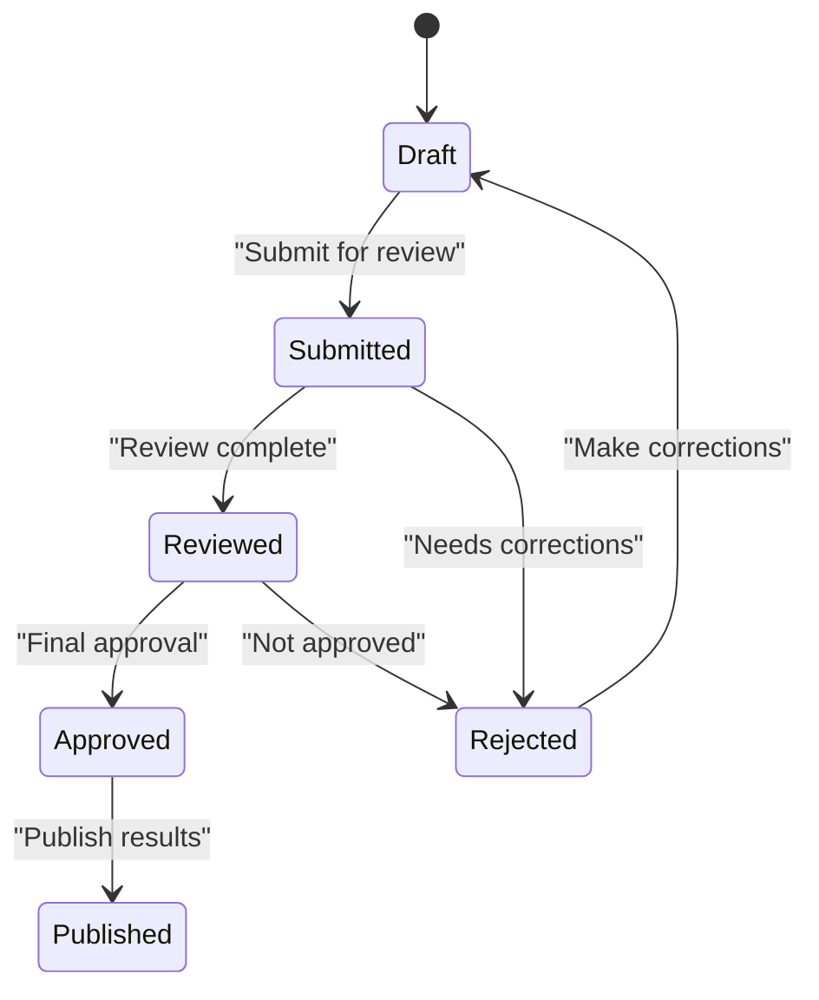
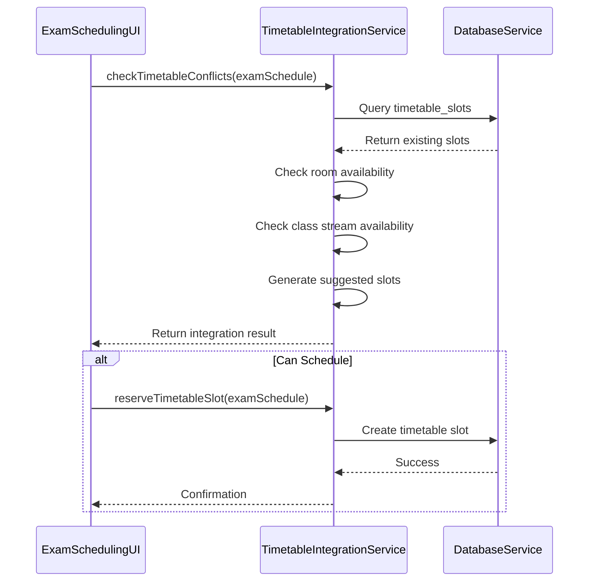
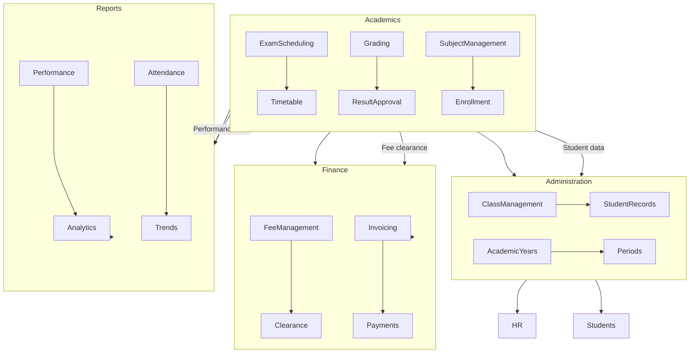
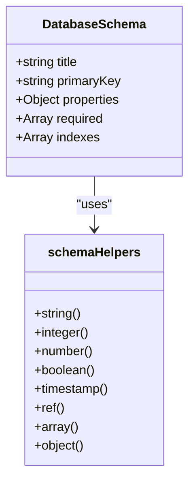

# Academics Module

<cite>
**Referenced Files in This Document**   
- [moduleDefinition.tsx](file://src\modules\academics\moduleDefinition.tsx)
- [rbac.ts](file://src\modules\academics\rbac.ts)
- [ExamScheduleManager.ts](file://src\modules\academics\services\ExamScheduleManager.ts)
- [ConflictDetectionEngine.ts](file://src\modules\academics\services\ConflictDetectionEngine.ts)
- [types.ts](file://src\modules\academics\data\types.ts)
- [GradingEngineService.ts](file://src\modules\academics\services\GradingEngineService.ts)
- [LetterGradeStrategy.ts](file://src\modules\academics\strategies\LetterGradeStrategy.ts)
- [ResultApprovalStateMachine.ts](file://src\modules\academics\services\ResultApprovalStateMachine.ts)
- [enums.ts](file://src\modules\academics\data\enums.ts)
- [ExamSchedulingUI.tsx](file://src\modules\academics\components\ExamSchedulingUI.tsx)
- [TimetableIntegrationService.ts](file://src\modules\academics\services\TimetableIntegrationService.ts)
- [schema.ts](file://src\modules\academics\data\schema.ts)
- [collections.ts](file://src\modules\academics\data\collections.ts)
- [App.tsx](file://src\App.tsx) - *Updated in recent commit*
- [ProviderSelector.ts](file://src\services\database\ProviderSelector.ts) - *Updated in recent commit*
</cite>

## Update Summary
**Changes Made**   
- Updated documentation to reflect database provider improvements in App.tsx and ProviderSelector.ts
- Added notes about database service abstraction in ExamScheduleManager and related services
- Clarified that database access is now handled through databaseService abstraction
- No structural changes to the module's functionality or architecture
- Enhanced source tracking with updated file references

## Table of Contents
1. [Introduction](#introduction)
2. [Module Registration and Configuration](#module-registration-and-configuration)
3. [Role-Based Access Control](#role-based-access-control)
4. [Domain Model and Data Structures](#domain-model-and-data-structures)
5. [Exam Scheduling System](#exam-scheduling-system)
6. [Grading System Architecture](#grading-system-architecture)
7. [Result Approval Workflow](#result-approval-workflow)
8. [Timetable Integration](#timetable-integration)
9. [Cross-Module Integration](#cross-module-integration)
10. [Performance and Optimization](#performance-and-optimization)

## Introduction
The Academics module in schoolpilot3 is a comprehensive system for managing core academic functions including subject management, timetable creation, exam scheduling, grading, and result processing. This document provides a detailed technical analysis of the module's architecture, implementation details, and key functionality. The module follows a modular design pattern with clear separation of concerns between data models, services, and UI components. It implements advanced features such as pluggable grading strategies, conflict detection for exam scheduling, and a state machine for result approval workflows. The module integrates with other system components like Finance for fee clearance checks and Reports for academic analytics.

Recent database provider improvements in App.tsx and ProviderSelector.ts have enhanced the database abstraction layer, but these changes are transparent to the Academics module's functionality. The module continues to interact with the database through the databaseService abstraction, ensuring compatibility across different database providers.

## Module Registration and Configuration

The Academics module is registered through the `moduleDefinition.tsx` file, which defines its metadata, navigation structure, dependencies, and configuration options. The module definition follows the `ModuleDefinition` interface from the core types and provides essential information for the system to integrate and display the module correctly.

**Section sources**
- [moduleDefinition.tsx](file://src\modules\academics\moduleDefinition.tsx#L1-L87)

The module definition includes several key properties:
- **id**: A unique identifier for the module ('academics')
- **name**: Localized display name using i18n key 'navigation:academics.title'
- **icon**: React component (AcademicCapIcon) for visual representation
- **path**: Base route for the module ('/academics')
- **navigation**: Array of navigation items that define the module's menu structure, each with a localized name, path, icon, and associated page component
- **features**: List of enabled features including subject-management, timetable, exam-management, and grading
- **dependencies**: Required and optional dependencies on other modules (administration, finance, reports)
- **settings**: Configurable settings with default values for features like exam management and timetable management
- **rbacPermissions**: Reference to the permissions defined in rbac.ts for access control

The module's navigation structure provides access to 14 different pages, covering all aspects of academic management from dashboard to education systems configuration. The dependencies section indicates that the administration module is required, while finance and reports modules are optional, suggesting integration points for fee-based exam eligibility and academic performance reporting.

## Role-Based Access Control

The Academics module implements a comprehensive role-based access control (RBAC) system defined in the `rbac.ts` file. This system defines granular permissions for different academic operations and assigns default roles that have access to the module.

**Section sources**
- [rbac.ts](file://src\modules\academics\rbac.ts#L1-L77)

The RBAC system defines permissions using the `Permission` interface with the following properties:
- **id**: Unique identifier in the format 'module.resource.action' (e.g., 'academics.subjects.read')
- **name**: Human-readable name of the permission
- **description**: Detailed description of what the permission allows
- **resource**: The resource being accessed (e.g., 'academics.subjects')
- **action**: The operation being performed (read, create, update, delete)
- **moduleId**: The module to which the permission belongs
- **feature**: The specific feature within the module

Currently, the module defines eight permissions focused on two main resources:
- **Subject Management**: CRUD operations for subjects (read, create, update, delete)
- **Exam Management**: CRUD operations for exams (read, create, update, delete)

The module also defines default roles in the `academicsDefaultRoles` constant, which includes 'teacher' and 'administrator'. These roles automatically have access to the academics module, ensuring that key academic staff can perform their duties without additional permission configuration.

## Domain Model and Data Structures

The Academics module defines a comprehensive domain model through TypeScript interfaces and enums in the `types.ts` and `enums.ts` files. These data structures represent the core entities and relationships in the academic system.

**Section sources**
- [types.ts](file://src\modules\academics\data\types.ts#L1-L327)
- [enums.ts](file://src\modules\academics\data\enums.ts#L1-L69)
- [schema.ts](file://src\modules\academics\data\schema.ts#L1-L304)

The domain model includes several key entities:

### Core Academic Entities
- **Subject**: Represents an academic subject with properties like code, name, and grouping
- **SubjectPaper**: Represents different papers or components within a subject
- **ExamSession**: Represents a period during which exams are conducted (e.g., Midterm, Final)
- **ExamSchedule**: Represents the scheduling of a specific exam, linking exams to time slots, rooms, and invigilators
- **GradingScheme**: Defines how student performance is evaluated, with different levels and criteria
- **StudentExamResult**: Stores a student's results for a particular exam session

### Academic Relationships
- **ClassSubjectAllocation**: Links subjects to specific class streams and academic years
- **StudentSubjectEnrollment**: Tracks which students are enrolled in which subjects
- **TeacherSubjectAssignment**: Assigns teachers to teach specific subjects to class streams
- **TimetableEntry**: Defines the regular class schedule for subjects, teachers, and time slots

### Key Enums
- **ResultState**: Defines the lifecycle states of academic results (Draft, Submitted, Reviewed, Approved, Rejected, Published)
- **GradingSystemType**: Specifies different grading approaches (Letter Grades, Percentage, Competency Based, Points/GPA, Pass/Fail)
- **ExamSessionStatus**: Tracks the status of exam sessions (Planning, Marks Entry Open, Published, Closed, Archived)
- **SubjectGrouping**: Categorizes subjects into groups (Compulsory, Sciences, Humanities, etc.)

The data model uses a combination of direct references (using IDs) and computed properties (like subject_name, teacher_name) to optimize data retrieval and display. The schema is designed to support both normalized data storage and denormalized read operations for improved performance.

## Exam Scheduling System

The exam scheduling system is implemented through several interconnected components, with the `ExamScheduleManager` service at its core. This system provides CRUD operations for exam schedules with built-in conflict detection to prevent scheduling conflicts.

**Section sources**
- [ExamScheduleManager.ts](file://src\modules\academics\services\ExamScheduleManager.ts#L1-L278)
- [ConflictDetectionEngine.ts](file://src\modules\academics\services\ConflictDetectionEngine.ts#L1-L250)
- [ExamSchedulingUI.tsx](file://src\modules\academics\components\ExamSchedulingUI.tsx#L1-L427)

### ExamScheduleManager Service
The `ExamScheduleManager` class provides the primary interface for managing exam schedules with the following key methods:
- **createExamSchedule**: Creates a new exam schedule after validating data and checking for conflicts
- **getExamSchedule**: Retrieves a specific exam schedule by ID
- **getAllExamSchedules**: Retrieves multiple schedules with optional filtering
- **updateExamSchedule**: Updates an existing schedule with conflict checking
- **deleteExamSchedule**: Removes a schedule from the system
- **checkConflicts**: Checks for potential conflicts without creating or updating a schedule
- **bulkCreateSchedules**: Creates multiple schedules in a single operation

The service follows a defensive programming approach by validating input data and checking for conflicts before any database operation. When creating or updating a schedule, it first uses the `ConflictDetectionEngine` to identify potential issues, only proceeding if no conflicts are found.

Recent database provider improvements have been abstracted through the databaseService, so the ExamScheduleManager continues to function without changes. The service uses `databaseService.getDatabase()` to access the database instance, which now supports multiple database providers through the ProviderSelector.

### ConflictDetectionEngine
The `ConflictDetectionEngine` class is responsible for identifying scheduling conflicts across multiple dimensions:
- **Room Conflicts**: Ensures the same room isn't scheduled for multiple exams at the same time
- **Invigilator Conflicts**: Prevents assigning the same invigilator to multiple exams simultaneously
- **Student Conflicts**: Detects when students would have conflicting exam schedules (placeholder implementation)

The engine uses configurable options to control which types of conflicts to check and can exclude a specific schedule ID (useful when updating an existing schedule). It returns a list of conflict descriptions that can be displayed to users.

### ExamSchedulingUI Component
The `ExamSchedulingUI` React component provides the user interface for creating and editing exam schedules. Key features include:
- Real-time conflict checking as users fill out the form
- Integration with the `useAppData` hook to access exam sessions and class streams
- Display of conflicts and warnings to guide users
- Form validation and submission handling
- Integration with the timetable system to check for conflicts

The component uses several services:
- `ExamScheduleManager` for CRUD operations
- `ConflictDetectionEngine` for conflict checking
- `TimetableIntegrationService` for checking timetable conflicts

## Grading System Architecture

The grading system in the Academics module implements a pluggable strategy pattern, allowing different grading approaches to be used based on the educational system configuration. The core of this system is the `GradingEngineService` which acts as a strategy selector.

```mermaid
classDiagram
class GradingStrategy {
<<interface>>
+calculate(result : StudentExamResult, gradingScheme? : GradingScheme) : StudentExamResult
}
class GradingEngineService {
-strategy : GradingStrategy
+constructor(educationSystem : EducationSystemConfiguration)
+calculateGrades(result : StudentExamResult, gradingScheme? : GradingScheme) : StudentExamResult
}
class LetterGradeStrategy {
+calculate(result : StudentExamResult, gradingScheme? : GradingScheme) : StudentExamResult
+calculateWithModifiers(score : number) : string
+getGradePoints(grade : string) : number
+isPassing(grade : string) : boolean
}
class PercentageGradeStrategy {
+calculate(result : StudentExamResult, gradingScheme? : GradingScheme) : StudentExamResult
}
class CBCGradeStrategy {
+calculate(result : StudentExamResult, gradingScheme? : GradingScheme) : StudentExamResult
}
class GPA_GradeStrategy {
+calculate(result : StudentExamResult, gradingScheme? : GradingScheme) : StudentExamResult
}
class PassFailGradeStrategy {
+calculate(result : StudentExamResult, gradingScheme? : GradingScheme) : StudentExamResult
}
GradingEngineService --> GradingStrategy : "uses"
LetterGradeStrategy --> GradingStrategy : "implements"
PercentageGradeStrategy --> GradingStrategy : "implements"
CBCGradeStrategy --> GradingStrategy : "implements"
GPA_GradeStrategy --> GradingStrategy : "implements"
PassFailGradeStrategy --> GradingStrategy : "implements"
```

**Section sources**
- [GradingEngineService.ts](file://src\modules\academics\services\GradingEngineService.ts#L1-L43)
- [LetterGradeStrategy.ts](file://src\modules\academics\strategies\LetterGradeStrategy.ts#L1-L85)

### Strategy Pattern Implementation
The grading system uses the Strategy design pattern to allow different grading algorithms to be selected at runtime based on the education system configuration. The pattern consists of:

1. **GradingStrategy Interface**: Defines the contract that all grading strategies must implement
2. **GradingEngineService**: Acts as the context that uses the strategy, selecting the appropriate implementation based on configuration
3. **Concrete Strategy Classes**: Implement specific grading algorithms (LetterGrade, Percentage, CBC, GPA, PassFail)

### Supported Grading Strategies
The system currently supports five grading strategies:

#### LetterGradeStrategy
This strategy converts numerical scores to letter grades based on a grading scheme. Key features:
- Uses a default Kenyan letter grade system if no scheme is provided
- Supports grade modifiers (A+, A-, etc.)
- Provides methods to calculate grade points for GPA calculation
- Includes logic to determine if a grade is passing

#### PercentageGradeStrategy
Converts scores to percentage grades, typically used in systems where the raw percentage is the primary grade.

#### CBCGradeStrategy (Competency-Based)
Designed for competency-based education systems where students are assessed on mastery of specific skills or competencies.

#### GPA_GradeStrategy
Calculates Grade Point Average based on course credits and letter grades, commonly used in university systems.

#### PassFailGradeStrategy
A simple binary grading system where students either pass or fail based on a threshold score.

### Grading Engine Workflow
When calculating grades, the workflow is as follows:
1. The `GradingEngineService` is instantiated with an `EducationSystemConfiguration`
2. Based on the `grading_system_type` in the configuration, the appropriate strategy is selected
3. The `calculateGrades` method is called with a `StudentExamResult` and optional `GradingScheme`
4. The selected strategy calculates the mean grade and updates the result object
5. The updated result is returned to the caller

This flexible architecture allows the system to support different educational systems and grading philosophies without requiring changes to the core grading logic.

## Result Approval Workflow

The result approval process is managed by the `ResultApprovalStateMachine` service, which implements a finite state machine to control the lifecycle of academic results. This ensures that results progress through a defined approval workflow with proper audit trails.

**Section sources**
- [ResultApprovalStateMachine.ts](file://src\modules\academics\services\ResultApprovalStateMachine.ts#L1-L60)
- [enums.ts](file://src\modules\academics\data\enums.ts#L1-L10)

### State Machine Implementation
The `ResultApprovalStateMachine` class manages the state transitions for result approvals with the following key components:

#### States
The state machine supports six states defined in the `ResultState` enum:
- **DRAFT**: Initial state where results can be edited
- **SUBMITTED**: Results submitted for review
- **REVIEWED**: Results reviewed by academic staff
- **APPROVED**: Results formally approved
- **REJECTED**: Results rejected and requiring corrections
- **PUBLISHED**: Final state where results are published to students

#### Transitions
Valid transitions between states are strictly controlled:
- DRAFT → SUBMITTED
- SUBMITTED → REVIEWED or REJECTED
- REVIEWED → APPROVED or REJECTED
- APPROVED → PUBLISHED
- REJECTED → DRAFT
- PUBLISHED has no outgoing transitions

#### Key Methods
- **transition(newState, userId)**: Attempts to transition to a new state, returning true if successful
- **canTransition(newState)**: Checks if a transition to the specified state is allowed
- **updateState(newState, userId)**: Updates the current state and metadata
- **logAuditTrail(userId, newState)**: Records the state change in the audit trail

### Audit Trail
Each state transition is recorded in an audit trail that captures:
- Timestamp of the action
- User ID who performed the action
- Action description
- Previous state
- New state

When a result is approved, the state machine automatically triggers the grading engine to calculate final grades based on the configured grading scheme. This ensures that grades are calculated at the appropriate point in the approval workflow.

## Timetable Integration

The Academics module includes integration between exam scheduling and the regular class timetable through the `TimetableIntegrationService`. This ensures that exam schedules do not conflict with existing class schedules.

**Section sources**
- [TimetableIntegrationService.ts](file://src\modules\academics\services\TimetableIntegrationService.ts#L1-L280)
- [ExamSchedulingUI.tsx](file://src\modules\academics\components\ExamSchedulingUI.tsx#L1-L427)

### Integration Service
The `TimetableIntegrationService` provides methods to check for conflicts between exam schedules and the regular class timetable:

#### checkTimetableConflicts
This method checks for potential conflicts and returns an `IntegrationResult` with:
- **canSchedule**: Boolean indicating if scheduling is possible
- **conflicts**: Array of conflict descriptions
- **suggestedSlots**: Array of suggested time slots
- **warnings**: Array of non-blocking warnings

The service checks for conflicts in three areas:
1. **Existing timetable slots** that overlap with the exam schedule
2. **Room availability** - ensuring the room isn't already booked
3. **Class stream availability** - ensuring the class doesn't have conflicting classes

#### reserveTimetableSlot
After successful conflict checking, this method reserves a slot in the timetable collection to prevent future conflicts. It performs a final conflict check before creating the reservation.

### Data Schema Integration
The timetable integration is supported by database schemas that define the relationship between exam schedules and timetable entries:
- **timetable_period_definitions**: Defines the time periods for classes (e.g., Period 1, Period 2)
- **timetable_entries**: Stores the regular class schedule with references to class streams, subjects, teachers, and time slots
- **exam_schedules**: Stores exam schedules with similar time and resource references

The integration service queries the `timetable_slots` collection to check for existing commitments when scheduling exams, ensuring that the same room, class stream, or teacher isn't double-booked.

## Cross-Module Integration

The Academics module integrates with several other modules in the schoolpilot3 system to provide a comprehensive educational management solution. These integrations are defined in the module dependencies and implemented through service calls and data sharing.

**Section sources**
- [moduleDefinition.tsx](file://src\modules\academics\moduleDefinition.tsx#L1-L87)
- [types.ts](file://src\modules\academics\data\types.ts#L1-L327)

### Administration Module Integration
The Academics module has a required dependency on the Administration module, which provides essential data and services:
- **Student and Staff Data**: Access to student and teacher records for enrollment and assignment
- **Class and Stream Management**: Information about class structures and streams
- **Academic Year Configuration**: Details about the current academic year and periods
- **Department Information**: Data about academic departments

This integration allows the Academics module to properly assign subjects to classes, enroll students, and assign teachers to subjects.

### Finance Module Integration
The Finance module is an optional dependency that enables fee-based access control for academic activities:
- **Exam Eligibility**: Students must have cleared fees to be eligible for exams
- **Payment Verification**: The system can check student payment status before allowing exam registration
- **Financial Reporting**: Integration for reporting on academic-related fees

This integration ensures that financial obligations are met before academic privileges are granted, helping schools manage revenue collection.

### Reports Module Integration
The Reports module integration enables academic performance analytics:
- **Result Analytics**: Aggregation and analysis of student results across subjects and classes
- **Performance Trends**: Tracking student performance over time
- **Grade Distribution**: Analysis of grade distributions across different grading schemes
- **Academic Insights**: Generation of reports for academic planning and improvement

This integration transforms raw academic data into actionable insights for school administrators and academic leaders.

## Performance and Optimization

The Academics module includes several performance optimizations to handle large datasets and complex operations efficiently.

### Database Schema Optimization
The data schema is designed with performance in mind:
- **Indexes**: Critical fields are indexed to speed up queries (e.g., exam_id, period_id, class_stream_id in exam_schedules)
- **Denormalization**: Computed properties like subject_name and teacher_name are stored to avoid expensive joins
- **Nested Documents**: Related data is nested within parent documents (e.g., paper_settings within exam_sessions) to reduce the number of queries

**Section sources**
- [schema.ts](file://src\modules\academics\data\schema.ts#L1-L304)
- [collections.ts](file://src\modules\academics\data\collections.ts#L1-L50)

### Large-Scale Exam Scheduling
For institutions with many students and exams, the system provides optimization tips:
- **Batch Processing**: Use the `bulkCreateSchedules` method to create multiple schedules efficiently
- **Conflict Detection**: Run conflict detection during off-peak hours for large-scale scheduling
- **Indexing**: Ensure all query fields are properly indexed in the database
- **Caching**: Implement caching for frequently accessed data like subject lists and class streams

### Optimization Recommendations
1. **Database Indexing**: Regularly review and optimize database indexes based on query patterns
2. **Data Partitioning**: Consider partitioning large datasets by academic year or semester
3. **Query Optimization**: Use specific selectors in database queries to minimize data retrieval
4. **Caching Strategy**: Implement a caching layer for read-heavy operations like result viewing
5. **Background Processing**: Move intensive operations like grade calculation to background jobs

These optimizations ensure that the Academics module can scale to meet the needs of large educational institutions while maintaining responsive performance.