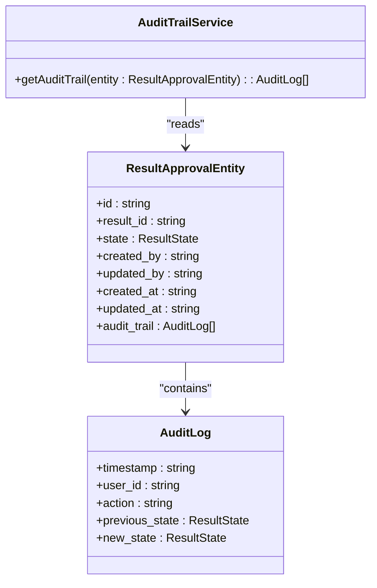
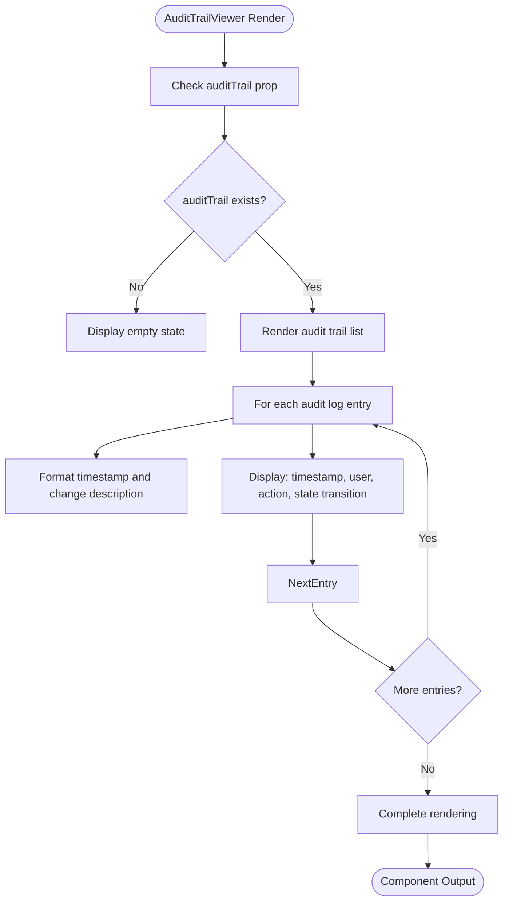
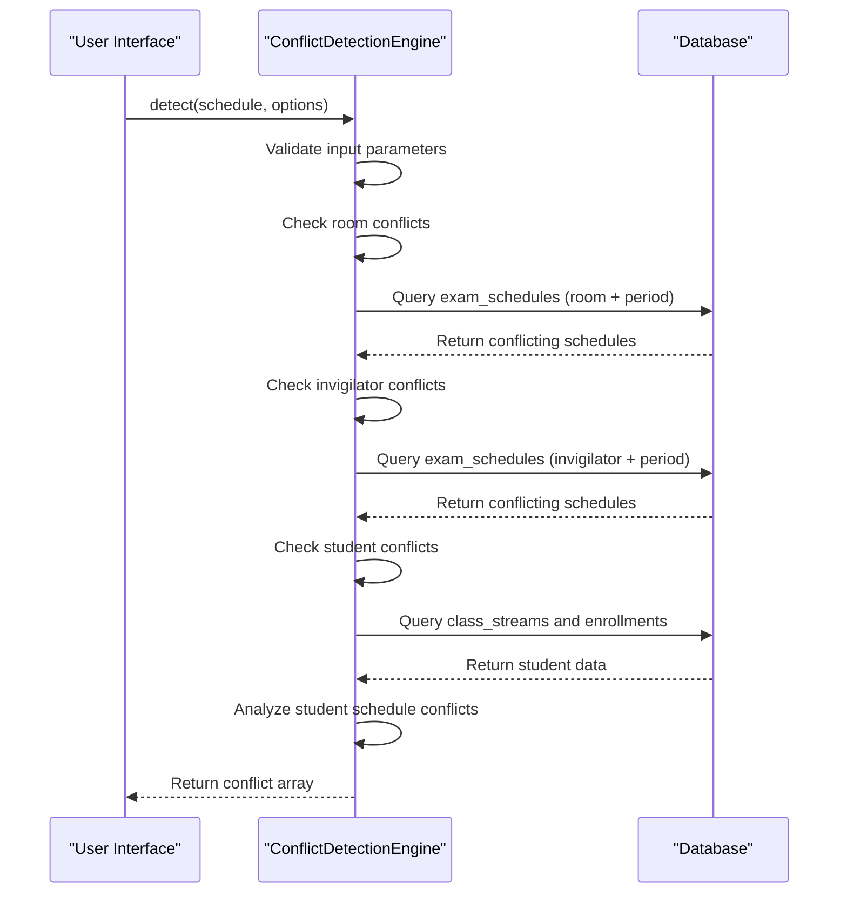
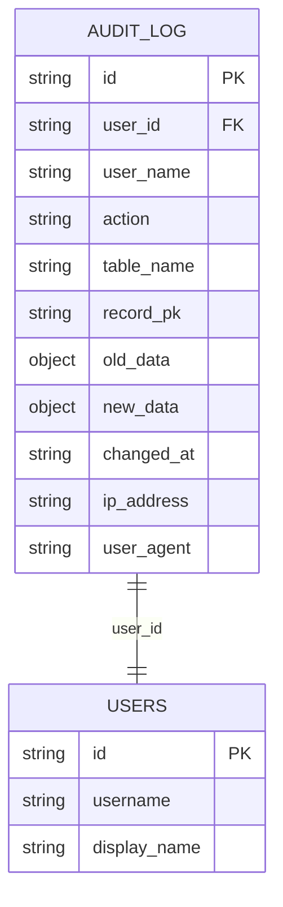

# Audit Trail and Data Integrity

<cite>
**Referenced Files in This Document**   
- [AuditTrailService.ts](file://src/modules/academics/services/AuditTrailService.ts)
- [AuditTrailViewer.tsx](file://src/modules/academics/components/AuditTrailViewer.tsx)
- [ConflictDetectionEngine.ts](file://src/modules/academics/services/ConflictDetectionEngine.ts)
- [types.ts](file://src/modules/academics/data/types.ts)
- [rxdbService.ts](file://src/services/rxdbService.ts)
- [AuditLogPage.tsx](file://src/modules/settings/pages/AuditLogPage.tsx)
- [types.ts](file://src/core/types.ts)
</cite>

## Table of Contents
1. [Introduction](#introduction)
2. [Audit Trail Implementation](#audit-trail-implementation)
3. [Audit Trail Viewer Component](#audit-trail-viewer-component)
4. [Data Integrity and Conflict Detection](#data-integrity-and-conflict-detection)
5. [Audit Log Data Model](#audit-log-data-model)
6. [Retention Policies and Compliance](#retention-policies-and-compliance)
7. [Configuration and Performance](#configuration-and-performance)

## Introduction
This document provides a comprehensive overview of the Audit Trail and Data Integrity features within the EduGen academic system. The system ensures complete traceability of critical academic operations through robust audit logging, while maintaining data consistency through advanced conflict detection mechanisms. Administrators can review historical changes with full context, and the system supports compliance reporting and investigation of data discrepancies. The implementation balances detailed tracking with performance considerations for high-volume transaction environments.

## Audit Trail Implementation

The AuditTrailService is responsible for managing audit trails for academic operations, particularly focusing on tracking changes to result approval states. The service provides a clean interface for retrieving audit history associated with academic entities.

**Diagram sources**
- [AuditTrailService.ts](file://src/modules/academics/services/AuditTrailService.ts)
- [types.ts](file://src/modules/academics/data/types.ts)

**Section sources**
- [AuditTrailService.ts](file://src/modules/academics/services/AuditTrailService.ts#L1-L10)
- [types.ts](file://src/modules/academics/data/types.ts#L15-L25)

The AuditTrailService implementation is minimal but effective, providing a static method to extract audit trail information from a ResultApprovalEntity. This service tracks state transitions in the result approval workflow, capturing the user responsible, timestamp, and the transition between result states. The implementation suggests that audit logging occurs at the business logic layer, with audit entries being appended to the entity's audit_trail array during state changes.

## Audit Trail Viewer Component

The AuditTrailViewer component provides a user interface for administrators to review historical changes to academic records. It displays a chronological list of audit entries with key information about each change.

**Diagram sources**
- [AuditTrailViewer.tsx](file://src/modules/academics/components/AuditTrailViewer.tsx)

**Section sources**
- [AuditTrailViewer.tsx](file://src/modules/academics/components/AuditTrailViewer.tsx#L1-L26)

The AuditTrailViewer component is a simple React functional component that takes an array of audit logs as a prop and renders them in a list format. Each entry displays the timestamp, the user ID who performed the action, the action type, and the transition between previous and new states. The component is designed to be embedded within larger administrative interfaces, providing focused visibility into the audit history of specific academic records.

## Data Integrity and Conflict Detection

The ConflictDetectionEngine prevents data inconsistencies during concurrent edits, particularly in the context of exam scheduling. It validates new or updated schedules against existing ones to identify potential conflicts.

**Diagram sources**
- [ConflictDetectionEngine.ts](file://src/modules/academics/services/ConflictDetectionEngine.ts)

**Section sources**
- [ConflictDetectionEngine.ts](file://src/modules/academics/services/ConflictDetectionEngine.ts#L1-L251)

The ConflictDetectionEngine performs three primary types of conflict detection:
1. **Room conflicts**: Ensures no two exams are scheduled in the same room during the same period
2. **Invigilator conflicts**: Prevents a staff member from being assigned to proctor multiple exams simultaneously
3. **Student conflicts**: Detects scheduling conflicts for students enrolled in multiple classes

The engine uses the databaseService to query existing schedules and applies filtering based on the current schedule being validated. It supports an exclusion parameter to allow for updates to existing schedules without triggering false conflicts. The implementation includes error handling and returns an array of descriptive conflict messages that can be displayed to users.

## Audit Log Data Model

The audit log data model captures comprehensive information about system changes, with different implementations across modules. The core audit log structure in the database schema provides a rich set of fields for tracking changes.

**Diagram sources**
- [rxdbService.ts](file://src/services/rxdbService.ts#L85-L86)

**Section sources**
- [rxdbService.ts](file://src/services/rxdbService.ts#L80-L100)
- [types.ts](file://src/core/types.ts#L276-L281)

The audit log data model includes the following key fields:
- **id**: Unique identifier for the audit log entry
- **user_id**: Reference to the user who performed the action
- **user_name**: Display name of the user for reporting purposes
- **action**: Type of operation performed (INSERT, UPDATE, DELETE, SOFT_DELETE)
- **table_name**: Name of the database table affected
- **record_pk**: Primary key of the affected record
- **old_data**: Complete snapshot of the record before changes (for UPDATE operations)
- **new_data**: Complete snapshot of the record after changes
- **changed_at**: Timestamp of when the change occurred
- **ip_address**: IP address from which the change was made
- **user_agent**: Browser or client information

The model supports both fine-grained tracking of individual field changes through the old_data and new_data objects, as well as high-level tracking of the operation type and context.

## Retention Policies and Compliance

While specific retention policy configurations are not evident in the current codebase, the system provides the foundation for compliance reporting through comprehensive audit logging. The AuditLogPage component in the settings module demonstrates the administrative interface for reviewing audit logs across the system.

The audit system supports compliance requirements by:
- Capturing user identity and context for all critical operations
- Recording timestamps with precision
- Maintaining before and after states of changed data
- Tracking the source of changes (IP address, user agent)

The presence of filtering capabilities in the AuditLogPage component (by date range, user, and action type) enables administrators to conduct targeted investigations of data discrepancies. This functionality is essential for compliance audits and forensic analysis of data changes.

**Section sources**
- [AuditLogPage.tsx](file://src/modules/settings/pages/AuditLogPage.tsx#L35-L70)
- [AuditLogPage.tsx](file://src/modules/settings/pages/AuditLogPage.tsx#L108-L141)

## Configuration and Performance

The audit trail system is designed to balance thorough tracking with performance considerations. In high-volume transaction environments, several factors influence performance:

1. **Database indexing**: The audit_logs collection should be indexed on frequently queried fields such as changed_at, user_id, and action to ensure efficient filtering and sorting.

2. **Data volume management**: The inclusion of complete before and after snapshots (old_data, new_data) in audit logs can result in significant data volume, particularly for entities with many fields. Consideration should be given to whether full snapshots are necessary or if tracking only changed fields would suffice for compliance requirements.

3. **Asynchronous logging**: The current implementation appears to write audit logs synchronously as part of the transaction. For high-volume environments, consider implementing asynchronous audit logging to prevent performance degradation during peak usage.

4. **Query optimization**: The AuditLogPage component applies filtering and sorting on the client side after retrieving all audit logs. For systems with large audit datasets, this approach may become inefficient. Server-side pagination and filtering would improve performance.

The system currently provides basic filtering capabilities (by date, user, and action type) but indicates through a UI message that "Detailed view for logs coming soon," suggesting that more advanced analysis and reporting features are planned for future implementation.

**Section sources**
- [AuditLogPage.tsx](file://src/modules/settings/pages/AuditLogPage.tsx#L167-L190)
- [rxdbService.ts](file://src/services/rxdbService.ts#L85-L86)