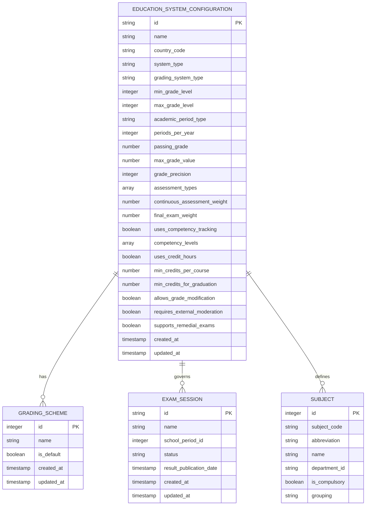
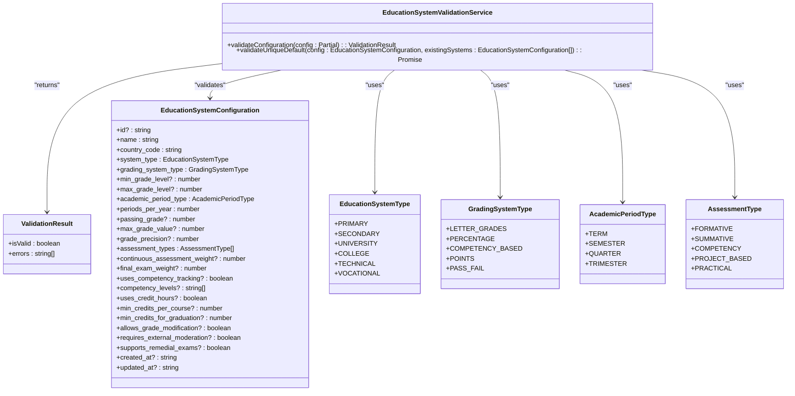

# Education System Configuration

<cite>
**Referenced Files in This Document**   
- [EducationSystemForm.tsx](file://src/modules/academics/components/EducationSystemForm.tsx)
- [EducationSystemValidationService.ts](file://src/modules/academics/services/EducationSystemValidationService.ts)
- [education-system-templates.ts](file://src/modules/academics/data/templates/education-system-templates.ts)
- [types.ts](file://src/modules/academics/data/types.ts)
- [schema.ts](file://src/modules/academics/data/schema.ts)
- [useEducationSystemData.ts](file://src/modules/academics/data/useEducationSystemData.ts)
- [enums.ts](file://src/modules/academics/data/enums.ts)
- [collections.ts](file://src/modules/academics/data/collections.ts)
- [EducationSystemConfigPage.tsx](file://src/modules/academics/pages/EducationSystemConfigPage.tsx)
- [EducationSystemsPage.tsx](file://src/modules/academics/pages/EducationSystemsPage.tsx)
</cite>

## Table of Contents
1. [Introduction](#introduction)
2. [Education System Data Model](#education-system-data-model)
3. [Education System Form Component](#education-system-form-component)
4. [Validation Rules](#validation-rules)
5. [Template System](#template-system)
6. [Step-by-Step Setup Guide](#step-by-step-setup-guide)
7. [Common Configuration Errors](#common-configuration-errors)
8. [Best Practices](#best-practices)

## Introduction
The Education System Configuration system provides a comprehensive framework for modeling and configuring different educational frameworks within the institution. This document details how national curricula, international baccalaureate, and other educational systems are implemented in the software. The system supports flexible configuration of academic structures, grading schemes, assessment methods, and subject hierarchies, allowing institutions to adapt to various educational frameworks. The implementation includes a user-friendly interface for configuration, robust validation rules, and pre-configured templates to streamline setup.

## Education System Data Model

The Education System Configuration data model is designed to capture the essential characteristics of different educational frameworks. The core entity is the `EducationSystemConfiguration` interface, which defines all configurable parameters for an education system.



**Diagram sources**
- [types.ts](file://src/modules/academics/data/types.ts#L200-L328)
- [schema.ts](file://src/modules/academics/data/schema.ts#L0-L305)

**Section sources**
- [types.ts](file://src/modules/academics/data/types.ts#L200-L328)
- [schema.ts](file://src/modules/academics/data/schema.ts#L0-L305)

### Core Properties
The `EducationSystemConfiguration` interface includes the following key properties:

**System Identification**
- `id`: Unique identifier for the education system
- `name`: Descriptive name of the system (e.g., "Kenya CBC Secondary System")
- `country_code`: ISO country code (e.g., "KE" for Kenya)
- `system_type`: Type of education system (Primary, Secondary, University, etc.)

**Academic Structure**
- `min_grade_level`: Minimum grade level in the system
- `max_grade_level`: Maximum grade level in the system
- `academic_period_type`: Type of academic period (Term, Semester, Quarter, etc.)
- `periods_per_year`: Number of academic periods per year

**Grading Configuration**
- `grading_system_type`: Type of grading system (Letter Grades, Percentage, Competency Based, etc.)
- `passing_grade`: Minimum score required to pass
- `max_grade_value`: Maximum possible grade value
- `grade_precision`: Number of decimal places for grade precision

**Assessment Configuration**
- `assessment_types`: Array of supported assessment types (Formative, Summative, Competency, etc.)
- `continuous_assessment_weight`: Percentage weight of continuous assessment
- `final_exam_weight`: Percentage weight of final exams

**Specialized Features**
- `uses_competency_tracking`: Flag indicating if the system uses competency-based assessment
- `competency_levels`: Array of competency level descriptions
- `uses_credit_hours`: Flag indicating if the system uses credit hours (for universities)
- `min_credits_per_course`: Minimum credits per course
- `min_credits_for_graduation`: Minimum credits required for graduation

## Education System Form Component

The `EducationSystemForm` component provides a user-friendly interface for creating and editing education system configurations. The form is organized into multiple tabs to group related settings and improve usability.

```mermaid
flowchart TD
Start([Education System Form]) --> Tabs["Tabs Component"]
Tabs --> BasicInfo["Basic Information Tab"]
Tabs --> AcademicStructure["Academic Structure Tab"]
Tabs --> GradingSystem["Grading System Tab"]
Tabs --> AssessmentRules["Assessment Rules Tab"]
Tabs --> AdvancedSettings["Advanced Settings Tab"]
BasicInfo --> NameInput["Name Input Field"]
BasicInfo --> CountryCodeInput["Country Code Input"]
BasicInfo --> SystemTypeSelect["System Type Dropdown"]
BasicInfo --> ActiveCheckbox["Active Checkbox"]
BasicInfo --> DefaultCheckbox["Default Checkbox"]
AcademicStructure --> MinGradeInput["Minimum Grade Level"]
AcademicStructure --> MaxGradeInput["Maximum Grade Level"]
AcademicStructure --> PeriodTypeSelect["Academic Period Type"]
AcademicStructure --> PeriodsPerYearInput["Periods Per Year"]
GradingSystem --> GradingTypeSelect["Grading System Type"]
GradingSystem --> PassingGradeInput["Passing Grade"]
GradingSystem --> MaxGradeInput["Maximum Grade Value"]
GradingSystem --> GradePrecisionInput["Grade Precision"]
AssessmentRules --> AssessmentTypes["Assessment Type Checkboxes"]
AssessmentRules --> ContinuousWeight["Continuous Assessment Weight"]
AssessmentRules --> FinalWeight["Final Exam Weight"]
AdvancedSettings --> CompetencyTracking["Competency Tracking Toggle"]
AdvancedSettings --> CreditHours["Credit Hours Toggle"]
AdvancedSettings --> OtherSettings["Other Advanced Settings"]
BasicInfo --> ValidationCheck["Validation Check"]
AssessmentRules --> ValidationCheck
ValidationCheck --> SaveButton["Save Button"]
SaveButton --> SaveAction["Save Action"]
SaveAction --> ValidationService["Validation Service"]
ValidationService --> Success["Success: Save Configuration"]
ValidationService --> Error["Error: Display Validation Errors"]
```



**Diagram sources**
- [EducationSystemForm.tsx](file://src/modules/academics/components/EducationSystemForm.tsx#L17-L140)
- [EducationSystemValidationService.ts](file://src/modules/academics/services/EducationSystemValidationService.ts#L9-L73)

**Section sources**
- [EducationSystemForm.tsx](file://src/modules/academics/components/EducationSystemForm.tsx#L17-L140)

### Form Structure and Functionality
The form is implemented as a React component with the following key features:

**Tabbed Interface**
The form uses a tabbed interface to organize settings into logical groups:
- **Basic Info**: System name, country code, type, and active/default status
- **Academic Structure**: Grade levels and academic period configuration
- **Grading System**: Grading type, passing grade, and precision settings
- **Assessment Rules**: Assessment types and weight distribution
- **Advanced Settings**: Specialized features like competency tracking and credit hours

**State Management**
The form uses React's `useState` hook to manage form data:
```typescript
const [formData, setFormData] = useState<Partial<EducationSystemConfiguration>>({
  name: '',
  country_code: '',
  system_type: EducationSystemType.SECONDARY,
  // ... other default values
  ...initialData
});
```

**Input Handlers**
The form includes specialized handlers for different input types:
- `handleInputChange`: Updates individual field values
- `handleAssessmentTypeChange`: Manages the array of assessment types
- `validateWeights`: Ensures assessment weights sum to 100%

**Initial Data Support**
The form accepts an `initialData` prop to support both creation and editing of education systems. When editing an existing system, the form is pre-populated with the current configuration values.

## Validation Rules

The `EducationSystemValidationService` enforces comprehensive validation rules to ensure data integrity and prevent configuration errors. The validation service provides both basic configuration validation and unique default system validation.



**Diagram sources**
- [EducationSystemValidationService.ts](file://src/modules/academics/services/EducationSystemValidationService.ts#L9-L73)
- [types.ts](file://src/modules/academics/data/types.ts#L200-L328)
- [enums.ts](file://src/modules/academics/data/enums.ts#L0-L69)

**Section sources**
- [EducationSystemValidationService.ts](file://src/modules/academics/services/EducationSystemValidationService.ts#L9-L73)

### Validation Rules Details
The validation service enforces the following rules:

**Basic Validation**
- **System Name**: Required field, cannot be empty or whitespace
- **Country Code**: Required field, cannot be empty or whitespace

**Assessment Weight Validation**
- The sum of `continuous_assessment_weight` and `final_exam_weight` must equal 100%
- This ensures that the assessment components properly account for the entire grade

**Grade Level Validation**
- The `max_grade_level` must be greater than the `min_grade_level`
- This prevents invalid academic structures where the maximum grade is less than or equal to the minimum grade

**Credit Hours Validation**
- If `uses_credit_hours` is true, then both `min_credits_per_course` and `min_credits_for_graduation` must be provided
- This ensures that credit hour systems have the necessary configuration parameters

**Competency Tracking Validation**
- If `uses_competency_tracking` is true, then `competency_levels` must be defined and non-empty
- This ensures that competency-based systems have the required level definitions

**Unique Default System Validation**
- Only one education system can be set as the default system
- When attempting to set a system as default, the service checks if another system is already marked as default
- If another default system exists, validation fails with a specific error message

## Template System

The template system provides pre-configured education system configurations to streamline setup for common educational frameworks. Templates serve as starting points that can be customized to meet specific institutional needs.

```mermaid
flowchart TD
Templates["Pre-configured Templates"] --> KenyaCBCPrimary["KENYA_CBC_PRIMARY"]
Templates --> KenyaCBCSecondary["KENYA_CBC_SECONDARY"]
Templates --> USUniversitySemester["US_UNIVERSITY_SEMESTER"]
KenyaCBCPrimary --> |Properties| Name1["name: Kenya CBC Primary System"]
KenyaCBCPrimary --> |Properties| Country1["country_code: KE"]
KenyaCBCPrimary --> |Properties| Type1["system_type: PRIMARY"]
KenyaCBCPrimary --> |Properties| Grading1["grading_system_type: COMPETENCY_BASED"]
KenyaCBCPrimary --> |Properties| Levels1["min_grade_level: 1, max_grade_level: 6"]
KenyaCBCPrimary --> |Properties| Period1["academic_period_type: TERM, periods_per_year: 3"]
KenyaCBCPrimary --> |Properties| Competency1["uses_competency_tracking: true"]
KenyaCBCPrimary --> |Properties| Assessment1["assessment_types: FORMATIVE, SUMMATIVE, COMPETENCY"]
KenyaCBCPrimary --> |Properties| Weights1["continuous_assessment_weight: 60, final_exam_weight: 40"]
KenyaCBCSecondary --> |Properties| Name2["name: Kenya CBC Secondary System"]
KenyaCBCSecondary --> |Properties| Country2["country_code: KE"]
KenyaCBCSecondary --> |Properties| Type2["system_type: SECONDARY"]
KenyaCBCSecondary --> |Properties| Grading2["grading_system_type: LETTER_GRADES"]
KenyaCBCSecondary --> |Properties| Levels2["min_grade_level: 7, max_grade_level: 12"]
KenyaCBCSecondary --> |Properties| Period2["academic_period_type: TERM, periods_per_year: 3"]
KenyaCBCSecondary --> |Properties| Assessment2["assessment_types: FORMATIVE, SUMMATIVE"]
KenyaCBCSecondary --> |Properties| Weights2["continuous_assessment_weight: 40, final_exam_weight: 60"]
USUniversitySemester --> |Properties| Name3["name: US University Semester System"]
USUniversitySemester --> |Properties| Country3["country_code: US"]
USUniversitySemester --> |Properties| Type3["system_type: UNIVERSITY"]
USUniversitySemester --> |Properties| Grading3["grading_system_type: POINTS"]
USUniversitySemester --> |Properties| Period3["academic_period_type: SEMESTER, periods_per_year: 2"]
USUniversitySemester --> |Properties| MaxGrade3["max_grade_value: 4.0, grade_precision: 2"]
USUniversitySemester --> |Properties| CreditHours3["uses_credit_hours: true"]
USUniversitySemester --> |Properties| CreditRequirements3["min_credits_per_course: 1, max_credits_per_course: 6, min_credits_for_graduation: 120"]
USUniversitySemester --> |Properties| Assessment3["assessment_types: FORMATIVE, SUMMATIVE, PROJECT_BASED"]
USUniversitySemester --> |Properties| Weights3["continuous_assessment_weight: 30, final_exam_weight: 70"]
UserAction["User Action"] --> SelectTemplate["Select Template"]
SelectTemplate --> ApplyTemplate["Apply Template"]
ApplyTemplate --> Customize["Customize Configuration"]
Customize --> Save["Save Customized System"]
```



**Diagram sources**
- [education-system-templates.ts](file://src/modules/academics/data/templates/education-system-templates.ts#L0-L56)
- [useEducationSystemData.ts](file://src/modules/academics/data/useEducationSystemData.ts#L0-L182)

**Section sources**
- [education-system-templates.ts](file://src/modules/academics/data/templates/education-system-templates.ts#L0-L56)

### Available Templates
The system includes the following pre-configured templates:

**Kenya CBC Primary System**
- Designed for primary education under Kenya's Competency-Based Curriculum
- Uses competency-based grading with four levels: Exceeding Expectations, Meeting Expectations, Approaching Expectations, and Below Expectations
- Assessment weights favor continuous assessment (60%) over final exams (40%)
- Covers grades 1-6 with three terms per year

**Kenya CBC Secondary System**
- Designed for secondary education under Kenya's Competency-Based Curriculum
- Uses letter grades for assessment
- Assessment weights balance continuous assessment (40%) and final exams (60%)
- Covers grades 7-12 with three terms per year
- External moderation is required

**US University Semester System**
- Designed for university education in the United States
- Uses a 4.0 GPA point system with two decimal places of precision
- Uses credit hours with configurable minimum and maximum values
- Requires 120 credits for graduation
- Assessment includes project-based learning
- Uses a semester system with two periods per year

### Template Implementation
Templates are implemented as a constant object `EDUCATION_SYSTEM_TEMPLATES` that maps template identifiers to partial education system configurations:

```typescript
export const EDUCATION_SYSTEM_TEMPLATES: Record<string, Partial<EducationSystemConfiguration>> = {
  'KENYA_CBC_PRIMARY': {
    name: 'Kenya CBC Primary System',
    country_code: 'KE',
    system_type: EducationSystemType.PRIMARY,
    grading_system_type: GradingSystemType.COMPETENCY_BASED,
    min_grade_level: 1,
    max_grade_level: 6,
    academic_period_type: AcademicPeriodType.TERM,
    periods_per_year: 3,
    uses_competency_tracking: true,
    competency_levels: ['Exceeding Expectations', 'Meeting Expectations', 'Approaching Expectations', 'Below Expectations'],
    assessment_types: [AssessmentType.FORMATIVE, AssessmentType.SUMMATIVE, AssessmentType.COMPETENCY],
    continuous_assessment_weight: 60,
    final_exam_weight: 40
  },
  // ... other templates
};
```

## Step-by-Step Setup Guide

This guide provides detailed instructions for setting up a new education system, including importing templates and configuring subject hierarchies.

### Creating a New Education System
1. Navigate to the Education Systems page in the Academics module
2. Click the "Add Education System" button
3. Select a template or start with a blank configuration
4. Fill in the required fields in each tab:
   - **Basic Info**: Enter the system name, country code, and select the system type
   - **Academic Structure**: Configure grade levels and academic periods
   - **Grading System**: Set grading parameters including passing grade and precision
   - **Assessment Rules**: Define assessment types and weight distribution
   - **Advanced Settings**: Configure specialized features as needed
5. Click "Save" to create the education system

**Section sources**
- [EducationSystemsPage.tsx](file://src/modules/academics/pages/EducationSystemsPage.tsx#L0-L141)
- [EducationSystemConfigPage.tsx](file://src/modules/academics/pages/EducationSystemConfigPage.tsx#L0-L19)

### Importing and Customizing Templates
1. When creating a new education system, select a template from the available options
2. The form will be pre-populated with the template's configuration
3. Customize the configuration as needed:
   - Modify assessment weights to match institutional policies
   - Adjust grade levels to match the specific program
   - Update competency levels for competency-based systems
   - Configure credit hour requirements for university systems
4. Save the customized configuration

**Section sources**
- [useEducationSystemData.ts](file://src/modules/academics/data/useEducationSystemData.ts#L0-L182)
- [education-system-templates.ts](file://src/modules/academics/data/templates/education-system-templates.ts#L0-L56)

### Configuring Subject Hierarchies
1. After creating an education system, navigate to the Subjects page
2. Create subjects and assign them to the appropriate education system
3. Organize subjects into groups (e.g., Compulsory, Sciences, Humanities)
4. For systems with subject papers, create papers for each subject
5. Assign subjects to classes and academic years through the Class Subject Allocations page

**Section sources**
- [schema.ts](file://src/modules/academics/data/schema.ts#L0-L305)
- [types.ts](file://src/modules/academics/data/types.ts#L200-L328)

## Common Configuration Errors

This section addresses common configuration errors and their resolution strategies.

### Assessment Weights Not Summing to 100%
**Error Message**: "Assessment weights must total 100%"
**Cause**: The sum of continuous assessment weight and final exam weight does not equal 100%
**Resolution**: Adjust one or both weights so they sum to exactly 100%. For example, if continuous assessment is 40%, final exam must be 60%.

**Section sources**
- [EducationSystemValidationService.ts](file://src/modules/academics/services/EducationSystemValidationService.ts#L20-L25)

### Missing Required Fields
**Error Messages**: "System name is required", "Country code is required"
**Cause**: Required fields are empty or contain only whitespace
**Resolution**: Ensure all required fields have valid values. The system name and country code are mandatory for all education systems.

**Section sources**
- [EducationSystemValidationService.ts](file://src/modules/academics/services/EducationSystemValidationService.ts#L12-L17)

### Invalid Grade Level Range
**Error Message**: "Maximum grade level must be greater than minimum grade level"
**Cause**: The maximum grade level is less than or equal to the minimum grade level
**Resolution**: Ensure the maximum grade level is greater than the minimum grade level. For example, if minimum is 1, maximum must be at least 2.

**Section sources**
- [EducationSystemValidationService.ts](file://src/modules/academics/services/EducationSystemValidationService.ts#L27-L31)

### Multiple Default Systems
**Error Message**: "Only one education system can be set as default. Please unset the current default system first."
**Cause**: Attempting to set a system as default when another system is already marked as default
**Resolution**: First, edit the current default system and uncheck the "Default System" checkbox, then set the new system as default.

**Section sources**
- [EducationSystemValidationService.ts](file://src/modules/academics/services/EducationSystemValidationService.ts#L53-L67)

### Missing Credit Hour Configuration
**Error Message**: "Credit hour system requires minimum credits configuration"
**Cause**: Enabling credit hours without specifying minimum credits per course and minimum credits for graduation
**Resolution**: When enabling credit hours, provide values for both minimum credits per course and minimum credits for graduation.

**Section sources**
- [EducationSystemValidationService.ts](file://src/modules/academics/services/EducationSystemValidationService.ts#L33-L38)

### Missing Competency Levels
**Error Message**: "Competency tracking requires competency levels definition"
**Cause**: Enabling competency tracking without defining competency levels
**Resolution**: When enabling competency tracking, provide an array of competency level descriptions (e.g., ["Exceeding Expectations", "Meeting Expectations", "Approaching Expectations", "Below Expectations"]).

**Section sources**
- [EducationSystemValidationService.ts](file://src/modules/academics/services/EducationSystemValidationService.ts#L40-L45)

## Best Practices

This section provides best practices for maintaining multiple education systems within a single institution.

### Use Templates as Starting Points
Always begin with a template that closely matches your institution's needs. Templates provide a solid foundation with appropriate default values, reducing configuration errors and ensuring consistency.

**Section sources**
- [education-system-templates.ts](file://src/modules/academics/data/templates/education-system-templates.ts#L0-L56)

### Maintain Clear Naming Conventions
Use descriptive names for education systems that clearly indicate their purpose and scope. For example, "Kenya CBC Secondary System - Science Stream" is more informative than "Secondary System 1".

### Designate a Single Default System
Only one education system should be designated as default. The default system is typically used for new students or when no specific system is selected. Regularly review and update the default system as institutional priorities change.

**Section sources**
- [EducationSystemValidationService.ts](file://src/modules/academics/services/EducationSystemValidationService.ts#L53-L67)

### Document Customizations
When customizing a template, document the changes made and the rationale behind them. This documentation helps ensure continuity when staff changes occur and provides context for future modifications.

### Regularly Review Assessment Weights
Periodically review assessment weights to ensure they align with current educational goals and policies. Assessment weights significantly impact teaching and learning approaches, so they should reflect institutional priorities.

### Use Competency Levels Consistently
For competency-based systems, use consistent competency level descriptions across similar programs. This consistency helps students and parents understand expectations and facilitates comparison across subjects and grade levels.

### Plan Credit Hour Requirements Carefully
For university systems, carefully plan credit hour requirements in consultation with academic departments. Ensure that the minimum and maximum credits per course and total graduation requirements align with accreditation standards and program goals.

### Test New Configurations
Before implementing a new education system configuration institution-wide, test it with a small group of users or in a sandbox environment. This testing helps identify any issues or unintended consequences before full deployment.

### Maintain Documentation
Keep comprehensive documentation of all education system configurations, including:
- Purpose and scope of each system
- Key configuration decisions and rationale
- Relationships to grading schemes and subjects
- Any customizations from standard templates

This documentation serves as a valuable reference for administrators, teachers, and support staff.