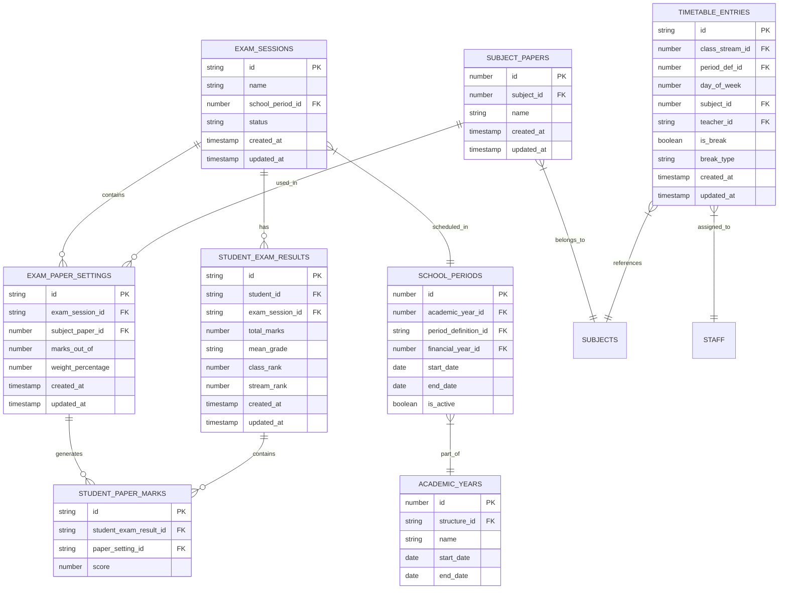
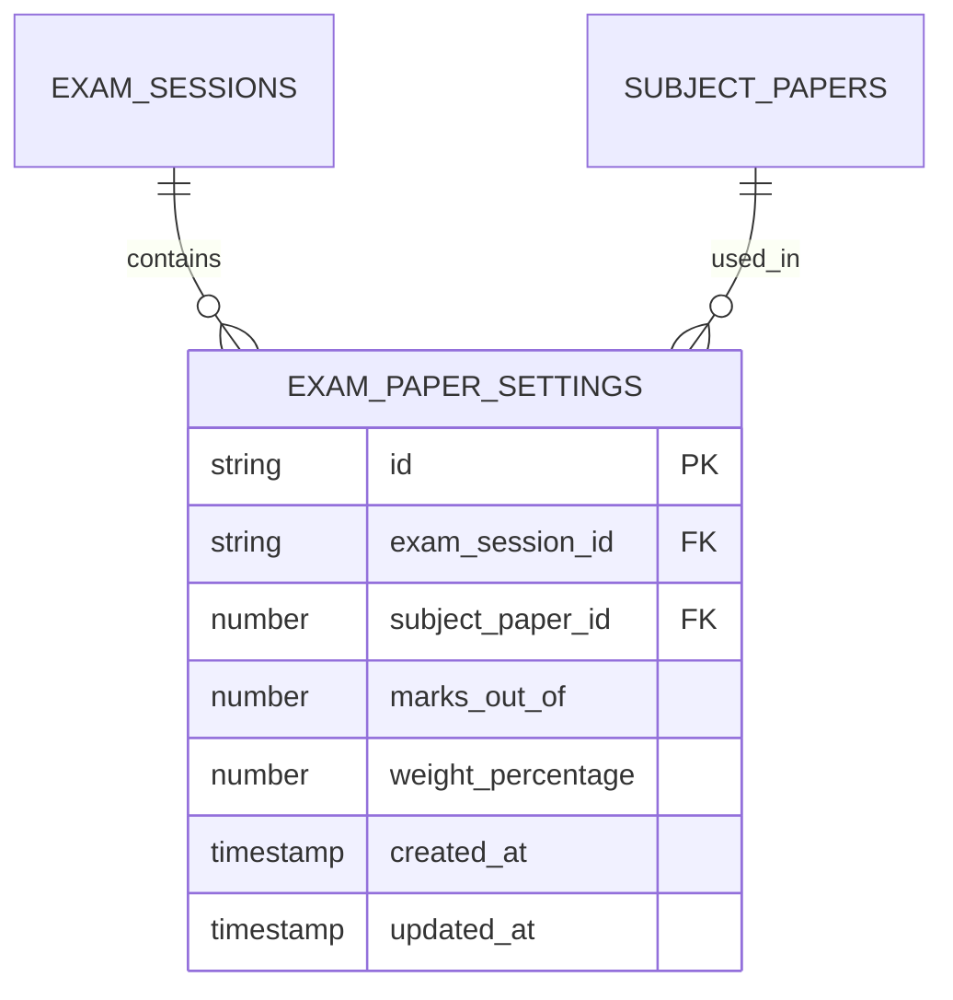
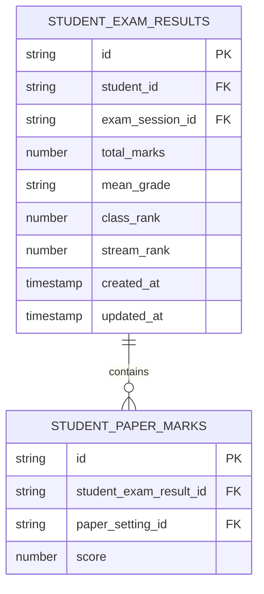

# Data Models and Schema

<cite>
**Referenced Files in This Document**   
- [types.ts](file://src/core/types.ts)
- [types.ts](file://src/modules/academics/data/types.ts)
- [schema.ts](file://src/modules/academics/data/schema.ts)
- [collections.ts](file://src/modules/academics/data/collections.ts)
- [useExamSessionData.ts](file://src/modules/academics/data/useExamSessionData.ts)
- [useSubjectPaperData.ts](file://src/modules/academics/data/useSubjectPaperData.ts)
- [enums.ts](file://src/modules/academics/data/enums.ts)
</cite>

## Table of Contents
1. [Introduction](#introduction)
2. [Entity Relationship Overview](#entity-relationship-overview)
3. [Core Academic Entities](#core-academic-entities)
4. [Exam Scheduling Data Model](#exam-scheduling-data-model)
5. [Schema Design and Constraints](#schema-design-and-constraints)
6. [Indexing and Performance](#indexing-and-performance)
7. [Data Access Patterns](#data-access-patterns)
8. [Data Lifecycle and Referential Integrity](#data-lifecycle-and-referential-integrity)
9. [Example Data Records](#example-data-records)

## Introduction
This document provides comprehensive documentation for the data models and schema of the Exam Scheduling system within the SchoolPilot educational platform. The system manages academic assessments, exam sessions, subject papers, and related entities with a focus on data integrity, performance, and usability. The schema is designed to support complex academic workflows including exam planning, marks entry, result processing, and reporting. This documentation details the entity relationships, field definitions, constraints, and access patterns that form the foundation of the academic assessment system.

## Entity Relationship Overview
The Exam Scheduling system is built around a core set of interrelated entities that represent the academic assessment lifecycle. These entities form a hierarchical structure where ExamSessions contain ExamPaperSettings, which in turn are linked to SubjectPapers and Subjects. Students participate in exam sessions through StudentExamResults, which contain individual StudentPaperMarks for each paper they take. The system also integrates with timetabling through TimetableEntries and academic structures through SchoolPeriods and AcademicYears.



**Diagram sources**
- [schema.ts](file://src/modules/academics/data/schema.ts#L150-L304)
- [types.ts](file://src/modules/academics/data/types.ts#L50-L150)

**Section sources**
- [types.ts](file://src/modules/academics/data/types.ts#L1-L329)
- [schema.ts](file://src/modules/academics/data/schema.ts#L1-L305)

## Core Academic Entities

### Subject and SubjectPaper
The Subject and SubjectPaper entities form the foundation of the academic curriculum. A Subject represents a broad academic discipline (e.g., Mathematics, English), while a SubjectPaper represents a specific examination component within that subject (e.g., Mathematics Paper 1, English Comprehension).

**Subject Entity**
- **id**: Unique identifier (integer, primary key)
- **subject_code**: Official subject code (string, max 20 characters)
- **abbreviation**: Short form of subject name (string, max 10 characters)
- **name**: Full subject name (string, max 100 characters)
- **department_id**: Reference to academic department (string, foreign key)
- **is_compulsory**: Indicates if subject is mandatory (boolean)
- **grouping**: Categorization of subject (SubjectGrouping enum)
- **department_name**: Denormalized department name for display

**SubjectPaper Entity**
- **id**: Unique identifier (integer, primary key)
- **subject_id**: Reference to parent subject (number, foreign key)
- **name**: Name of the paper (string, max 150 characters)
- **created_at**: Creation timestamp (ISO date-time)
- **updated_at**: Last update timestamp (ISO date-time)
- **subject_name**: Denormalized subject name for display

```mermaid
classDiagram
class Subject {
+id : number
+subject_code : string
+abbreviation : string
+name : string
+department_id : string
+is_compulsory : boolean
+grouping : SubjectGrouping
+department_name : string
}
class SubjectPaper {
+id : number
+subject_id : number
+name : string
+created_at : string
+updated_at : string
+subject_name : string
}
Subject ||--o{ SubjectPaper : "has"
```

**Diagram sources**
- [schema.ts](file://src/modules/academics/data/schema.ts#L70-L100)
- [types.ts](file://src/modules/academics/data/types.ts#L60-L75)

### ExamSession
The ExamSession entity represents a specific examination period (e.g., "Mid-Year Exams 2024", "Final Term Exams"). Each exam session is associated with a school period and has a defined lifecycle status.

**Field Definitions**
- **id**: Unique identifier (string, primary key)
- **name**: Descriptive name of the exam session (string, max 150 characters)
- **school_period_id**: Reference to the school period (number, foreign key)
- **status**: Current state of the exam session (ExamSessionStatus enum)
- **result_publication_date**: Scheduled date for result release (timestamp)
- **created_at**: Creation timestamp (ISO date-time)
- **updated_at**: Last update timestamp (ISO date-time)
- **school_period_name**: Denormalized school period name for display
- **education_system_id**: Reference to education system configuration
- **paper_settings**: Array of ExamPaperSetting objects (computed)

**Status Lifecycle**
The ExamSessionStatus enum defines the progression of an exam session:
- **PLANNING**: Initial phase where exam papers are being configured
- **MARKS_ENTRY_OPEN**: Marks entry is active for teachers
- **PUBLISHED**: Results have been released to students/parents
- **CLOSED**: Exam session is complete and locked
- **ARCHIVED**: Session has been archived for historical purposes

**Section sources**
- [types.ts](file://src/modules/academics/data/types.ts#L90-L100)
- [schema.ts](file://src/modules/academics/data/schema.ts#L150-L170)

## Exam Scheduling Data Model

### ExamPaperSetting
The ExamPaperSetting entity links an exam session with a specific subject paper, defining the assessment parameters for that paper within the session.

**Field Definitions**
- **id**: Unique identifier (string, primary key)
- **exam_session_id**: Reference to parent exam session (string, foreign key)
- **subject_paper_id**: Reference to subject paper (number, foreign key)
- **marks_out_of**: Maximum possible score (number, 0-999999.99)
- **weight_percentage**: Contribution to final grade (number, 0-100)
- **created_at**: Creation timestamp (ISO date-time)
- **updated_at**: Last update timestamp (ISO date-time)
- **subject_paper_name**: Denormalized paper name for display
- **subject_name**: Denormalized subject name for display

This entity serves as the bridge between exam sessions and subject papers, allowing different weightings and maximum marks for the same paper across different exam sessions. For example, a Mathematics Paper 1 might be worth 100 marks in mid-year exams but 120 marks in final exams.



**Diagram sources**
- [schema.ts](file://src/modules/academics/data/schema.ts#L120-L150)
- [types.ts](file://src/modules/academics/data/types.ts#L80-L90)

### StudentExamResult and StudentPaperMark
These entities represent the assessment outcomes for individual students. StudentExamResult captures the overall performance in an exam session, while StudentPaperMark records scores for individual papers.

**StudentExamResult Entity**
- **id**: Unique identifier (string, primary key)
- **student_id**: Reference to student (string, foreign key)
- **exam_session_id**: Reference to exam session (string, foreign key)
- **total_marks**: Sum of all paper marks (number)
- **mean_grade**: Overall grade (string, max 10 characters)
- **class_rank**: Student's rank within their class (integer)
- **stream_rank**: Student's rank within their stream (integer)
- **overall_comment**: Instructor comments (string, max 1000 characters)
- **created_at**: Creation timestamp (ISO date-time)
- **updated_at**: Last update timestamp (ISO date-time)
- **marks**: Array of StudentPaperMark objects

**StudentPaperMark Entity**
- **id**: Unique identifier (string, primary key)
- **student_exam_result_id**: Reference to parent result (string, foreign key)
- **paper_setting_id**: Reference to exam paper setting (string, foreign key)
- **score**: Student's score (number, nullable)
- **subject_paper_name**: Denormalized paper name for display
- **subject_name**: Denormalized subject name for display
- **marks_out_of**: Denormalized maximum marks for reference

The relationship between these entities enables detailed grade calculations and reporting. The system can compute total marks by summing individual paper scores, calculate weighted averages based on paper weights, and determine final grades using configured grading schemes.



**Diagram sources**
- [schema.ts](file://src/modules/academics/data/schema.ts#L220-L250)
- [types.ts](file://src/modules/academics/data/types.ts#L110-L130)

## Schema Design and Constraints

### Primary and Foreign Keys
The schema employs a hybrid key strategy, using string UUIDs for most entities and integer IDs for core reference data. This approach balances human readability with database performance.

**Primary Key Strategy**
- **String UUIDs**: Used for transactional entities (ExamSession, StudentExamResult, StudentPaperMark) to facilitate distributed systems and data synchronization
- **Integer IDs**: Used for master data entities (Subject, SubjectPaper, GradingScheme) for optimal indexing performance

**Foreign Key Relationships**
The schema enforces referential integrity through explicit foreign key constraints:
- ExamSession → SchoolPeriod (school_period_id)
- ExamPaperSetting → ExamSession (exam_session_id)
- ExamPaperSetting → SubjectPaper (subject_paper_id)
- StudentExamResult → ExamSession (exam_session_id)
- StudentExamResult → Student (student_id)
- StudentPaperMark → StudentExamResult (student_exam_result_id)
- StudentPaperMark → ExamPaperSetting (paper_setting_id)

### Data Validation Rules
The schema implements comprehensive validation rules to ensure data quality and consistency.

**Required Fields**
All entities define required fields through the `required` array in their schema definition:
- ExamSession requires: id, name, school_period_id, status, created_at, updated_at
- ExamPaperSetting requires: id, exam_session_id, subject_paper_id, marks_out_of, weight_percentage, created_at, updated_at
- StudentExamResult requires: id, student_id, exam_session_id, created_at, updated_at
- StudentPaperMark requires: id, student_exam_result_id, paper_setting_id

**Data Type Constraints**
- **String fields**: Enforce maximum length limits (e.g., name fields capped at 100-200 characters)
- **Numeric fields**: Define precision and range (e.g., marks_out_of limited to 0-999999.99 with 0.01 precision)
- **Timestamp fields**: Enforce ISO date-time format
- **Enumeration fields**: Restricted to predefined values (e.g., ExamSessionStatus, SubjectGrouping)

**Business Logic Constraints**
- **Weight Percentage**: The weight_percentage in ExamPaperSetting is constrained to 0-100, ensuring valid contribution to final grades
- **Marks Validation**: The marks_out_of field ensures scores are meaningful and calculable
- **Status Transitions**: The ExamSessionStatus enum enforces a logical progression through the exam lifecycle

**Section sources**
- [schema.ts](file://src/modules/academics/data/schema.ts#L1-L305)
- [types.ts](file://src/modules/academics/data/types.ts#L1-L329)

## Indexing and Performance

### Indexing Strategy
The schema includes strategic indexes to optimize common query patterns and ensure responsive performance.

**Primary Indexes**
Each collection has a primary index on its primary key field:
- ExamSession: id
- ExamPaperSetting: id
- StudentExamResult: id
- StudentPaperMark: id

**Secondary Indexes**
Additional indexes are defined to support frequent query patterns:
- **ExamSession**: school_period_id, status
- **ExamPaperSetting**: exam_session_id, subject_paper_id
- **StudentExamResult**: student_id, exam_session_id
- **StudentPaperMark**: student_exam_result_id, paper_setting_id
- **TimetableEntry**: class_stream_id, period_def_id, day_of_week

These indexes enable efficient filtering and joining operations. For example, finding all exam sessions for a specific school period uses the school_period_id index, while retrieving all papers for a particular exam session leverages the exam_session_id index on ExamPaperSetting.

### Query Performance Implications
The indexing strategy is designed to support the most common access patterns in the application:

**Common Query Patterns**
1. **Retrieve all exam sessions for a school period**: Uses school_period_id index on ExamSession
2. **Get all paper settings for an exam session**: Uses exam_session_id index on ExamPaperSetting
3. **Find all results for a student**: Uses student_id index on StudentExamResult
4. **Get all marks for a specific paper setting**: Uses paper_setting_id index on StudentPaperMark
5. **List all timetable entries for a class stream**: Uses class_stream_id index on TimetableEntry

The composite nature of many queries (e.g., "get all results for student X in exam session Y") benefits from the combination of these indexes, allowing the database to quickly narrow down result sets before applying additional filters.

**Section sources**
- [schema.ts](file://src/modules/academics/data/schema.ts#L1-L305)

## Data Access Patterns

### Custom Hooks
The system provides custom React hooks to abstract data access and provide a clean interface for components.

#### useExamSessionData Hook
This hook provides access to exam session data with built-in caching and reactivity.

**Key Features**
- **Data Fetching**: Retrieves exam sessions with optional filtering by school period or status
- **Caching**: Implements local caching to minimize database queries
- **Reactivity**: Automatically updates components when underlying data changes
- **Error Handling**: Includes comprehensive error handling and loading states

```typescript
// Example usage
const { 
  examSessions, 
  loading, 
  error, 
  createExamSession, 
  updateExamSession 
} = useExamSessionData();

// Get all active exam sessions
const activeSessions = examSessions.filter(session => 
  session.status === ExamSessionStatus.MARKS_ENTRY_OPEN
);
```

#### useSubjectPaperData Hook
This hook manages access to subject paper data and related entities.

**Key Features**
- **Hierarchical Data**: Retrieves subject papers with associated subject information
- **Filtering**: Supports filtering by subject, academic year, or other criteria
- **Relationship Management**: Handles the relationship between subjects and papers
- **Performance Optimization**: Implements batch loading and caching

```typescript
// Example usage
const { subjectPapers, getPaperBySubject } = useSubjectPaperData();

// Get all papers for Mathematics
const mathPapers = getPaperBySubject(mathSubjectId);
```

These hooks encapsulate the complexity of data access, providing a simple interface while handling concerns like loading states, error recovery, and data consistency.

**Section sources**
- [useExamSessionData.ts](file://src/modules/academics/data/useExamSessionData.ts)
- [useSubjectPaperData.ts](file://src/modules/academics/data/useSubjectPaperData.ts)

## Data Lifecycle and Referential Integrity

### Lifecycle Management
The system implements a structured lifecycle for exam-related data to ensure data integrity and proper workflow progression.

**Exam Session Lifecycle**
1. **Creation**: Exam session is created in PLANNING status
2. **Configuration**: Exam paper settings are added/modified
3. **Activation**: Status changes to MARKS_ENTRY_OPEN when exams begin
4. **Completion**: Status transitions to PUBLISHED after results are finalized
5. **Closure**: Session is marked as CLOSED after all processing is complete
6. **Archival**: Older sessions are moved to ARCHIVED status for historical reference

**Referential Integrity**
The schema enforces referential integrity through several mechanisms:
- **Foreign Key Constraints**: Database-level constraints prevent orphaned records
- **Cascading Operations**: When an exam session is deleted, related paper settings and student results are automatically removed
- **Validation Rules**: Business logic prevents invalid state transitions (e.g., cannot add paper settings to a PUBLISHED exam session)

**Data Consistency Rules**
- **Score Validation**: Student paper marks cannot exceed the marks_out_of value defined in the paper setting
- **Status Dependencies**: Paper settings can only be modified when the exam session is in PLANNING status
- **Result Calculation**: Total marks are automatically calculated from individual paper scores, ensuring consistency

These rules ensure that the data remains accurate and reliable throughout the assessment process.

**Section sources**
- [types.ts](file://src/modules/academics/data/types.ts#L95-L100)
- [schema.ts](file://src/modules/academics/data/schema.ts#L150-L304)

## Example Data Records

### ExamSession Record
```json
{
  "id": "exam-2024-midyear",
  "name": "Mid-Year Examinations 2024",
  "school_period_id": 123,
  "status": "MARKS_ENTRY_OPEN",
  "result_publication_date": "2024-06-30T00:00:00Z",
  "created_at": "2024-04-15T10:30:00Z",
  "updated_at": "2024-04-15T10:30:00Z",
  "school_period_name": "Term 2, 2024",
  "education_system_id": "kenya-secondary",
  "paper_settings": []
}
```

### ExamPaperSetting Record
```json
{
  "id": "setting-2024-math1",
  "exam_session_id": "exam-2024-midyear",
  "subject_paper_id": 456,
  "marks_out_of": 100,
  "weight_percentage": 25,
  "created_at": "2024-04-15T11:00:00Z",
  "updated_at": "2024-04-15T11:00:00Z",
  "subject_paper_name": "Mathematics Paper 1",
  "subject_name": "Mathematics"
}
```

### StudentExamResult Record
```json
{
  "id": "result-2024-student001",
  "student_id": "student-001",
  "exam_session_id": "exam-2024-midyear",
  "total_marks": 345,
  "mean_grade": "B+",
  "class_rank": 5,
  "stream_rank": 2,
  "created_at": "2024-06-15T14:30:00Z",
  "updated_at": "2024-06-15T14:30:00Z",
  "marks": [
    {
      "id": "mark-2024-student001-math1",
      "student_exam_result_id": "result-2024-student001",
      "paper_setting_id": "setting-2024-math1",
      "score": 87,
      "subject_paper_name": "Mathematics Paper 1",
      "subject_name": "Mathematics",
      "marks_out_of": 100
    }
  ],
  "student_name": "John Doe",
  "admission_no": "ADM001",
  "class_name": "Form 3",
  "stream_name": "East",
  "exam_session_name": "Mid-Year Examinations 2024"
}
```

These example records illustrate the structure and relationships between entities in the Exam Scheduling system, showing how data is organized and interconnected.

**Section sources**
- [types.ts](file://src/modules/academics/data/types.ts#L50-L150)
- [schema.ts](file://src/modules/academics/data/schema.ts#L1-L305)