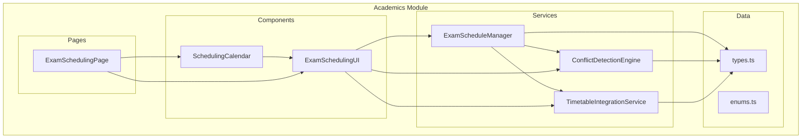
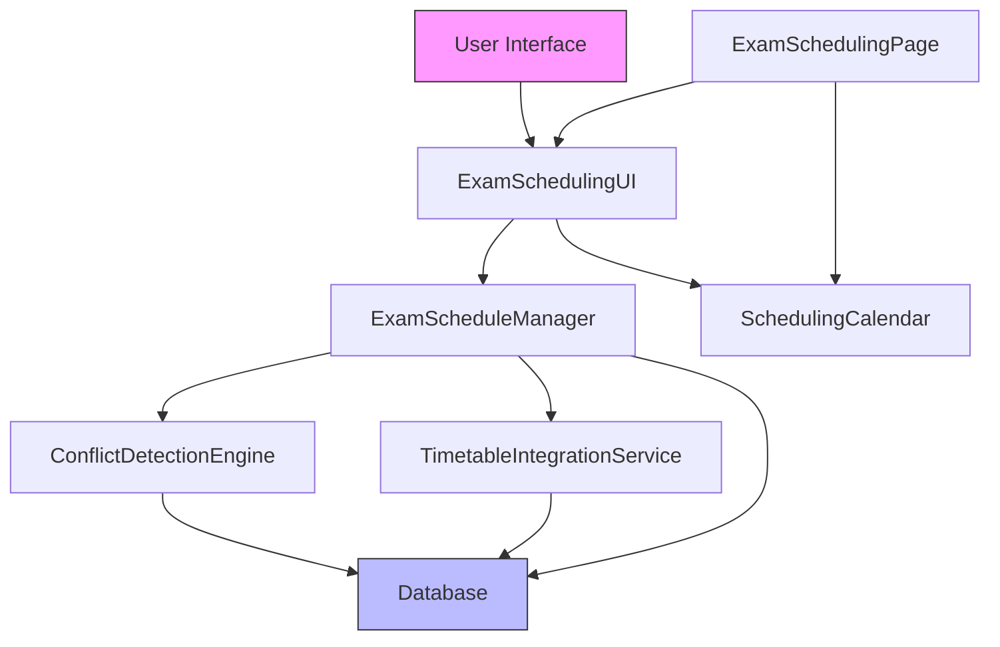
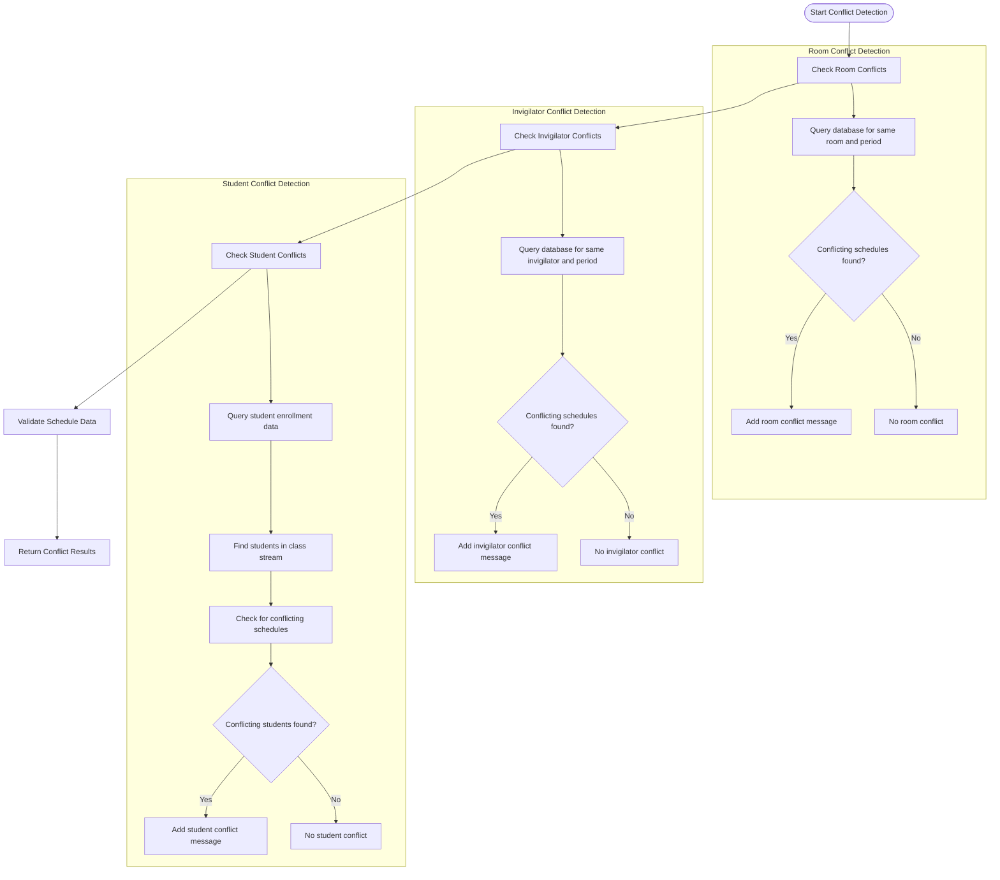
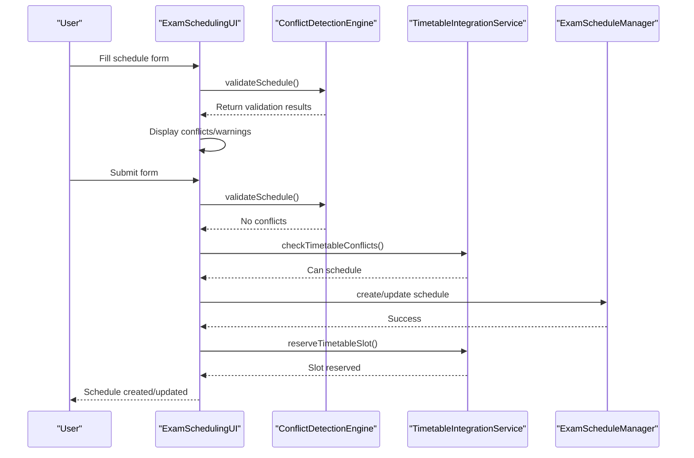
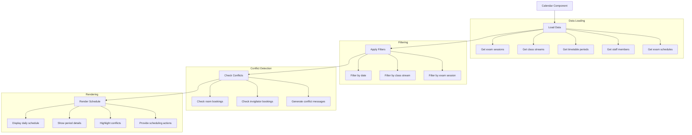
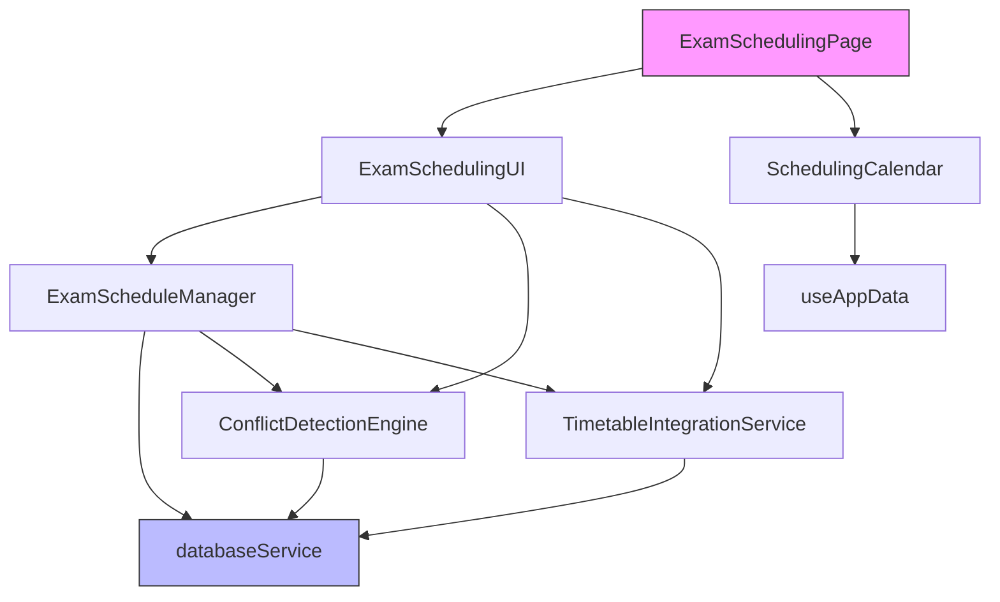
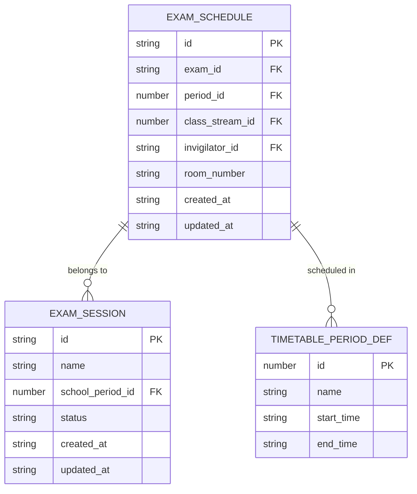

# Exam Scheduling System

<cite>
**Referenced Files in This Document**   
- [ExamScheduleManager.ts](file://src/modules/academics/services/ExamScheduleManager.ts)
- [ConflictDetectionEngine.ts](file://src/modules/academics/services/ConflictDetectionEngine.ts)
- [ExamSchedulingUI.tsx](file://src/modules/academics/components/ExamSchedulingUI.tsx)
- [SchedulingCalendar.tsx](file://src/modules/academics/components/SchedulingCalendar.tsx)
- [types.ts](file://src/modules/academics/data/types.ts)
- [TimetableIntegrationService.ts](file://src/modules/academics/services/TimetableIntegrationService.ts)
- [ExamSchedulingPage.tsx](file://src/modules/academics/pages/ExamSchedulingPage.tsx)
- [todo_exam_scheduling_engine_updated.md](file://todo_exam_scheduling_engine_updated.md)
</cite>

## Table of Contents
1. [Introduction](#introduction)
2. [Project Structure](#project-structure)
3. [Core Components](#core-components)
4. [Architecture Overview](#architecture-overview)
5. [Detailed Component Analysis](#detailed-component-analysis)
6. [Dependency Analysis](#dependency-analysis)
7. [Performance Considerations](#performance-considerations)
8. [Troubleshooting Guide](#troubleshooting-guide)
9. [Conclusion](#conclusion)

## Introduction
The Exam Scheduling System is a comprehensive solution for managing academic examinations within educational institutions. This document provides a detailed analysis of the system's architecture, core components, and functionality, focusing on the implementation of the ExamScheduleManager service, conflict detection algorithms, user interface components, and data models. The system enables administrators to create, manage, and visualize exam schedules while preventing conflicts in room assignments, invigilator availability, and student overlaps.

## Project Structure
The Exam Scheduling System is organized within the academics module of the larger educational platform. The core functionality is distributed across services, components, and data models, following a modular architecture that separates concerns between business logic, user interface, and data management.



**Diagram sources**
- [ExamScheduleManager.ts](file://src/modules/academics/services/ExamScheduleManager.ts)
- [ConflictDetectionEngine.ts](file://src/modules/academics/services/ConflictDetectionEngine.ts)
- [TimetableIntegrationService.ts](file://src/modules/academics/services/TimetableIntegrationService.ts)
- [ExamSchedulingUI.tsx](file://src/modules/academics/components/ExamSchedulingUI.tsx)
- [SchedulingCalendar.tsx](file://src/modules/academics/components/SchedulingCalendar.tsx)
- [types.ts](file://src/modules/academics/data/types.ts)

**Section sources**
- [ExamScheduleManager.ts](file://src/modules/academics/services/ExamScheduleManager.ts)
- [ConflictDetectionEngine.ts](file://src/modules/academics/services/ConflictDetectionEngine.ts)
- [ExamSchedulingUI.tsx](file://src/modules/academics/components/ExamSchedulingUI.tsx)
- [SchedulingCalendar.tsx](file://src/modules/academics/components/SchedulingCalendar.tsx)

## Core Components
The Exam Scheduling System comprises several core components that work together to provide a comprehensive scheduling solution. The ExamScheduleManager service serves as the central business logic component, handling CRUD operations for exam schedules and coordinating with other services for conflict detection and timetable integration. The ConflictDetectionEngine implements algorithms to identify potential scheduling conflicts, while the ExamSchedulingUI and SchedulingCalendar components provide the user interface for creating and managing schedules.

**Section sources**
- [ExamScheduleManager.ts](file://src/modules/academics/services/ExamScheduleManager.ts)
- [ConflictDetectionEngine.ts](file://src/modules/academics/services/ConflictDetectionEngine.ts)
- [ExamSchedulingUI.tsx](file://src/modules/academics/components/ExamSchedulingUI.tsx)
- [SchedulingCalendar.tsx](file://src/modules/academics/components/SchedulingCalendar.tsx)

## Architecture Overview
The Exam Scheduling System follows a service-oriented architecture with clear separation between business logic, user interface, and data management. The system integrates with the existing timetable infrastructure to ensure consistency across academic planning.



**Diagram sources**
- [ExamScheduleManager.ts](file://src/modules/academics/services/ExamScheduleManager.ts)
- [ConflictDetectionEngine.ts](file://src/modules/academics/services/ConflictDetectionEngine.ts)
- [TimetableIntegrationService.ts](file://src/modules/academics/services/TimetableIntegrationService.ts)
- [ExamSchedulingUI.tsx](file://src/modules/academics/components/ExamSchedulingUI.tsx)
- [SchedulingCalendar.tsx](file://src/modules/academics/components/SchedulingCalendar.tsx)
- [ExamSchedulingPage.tsx](file://src/modules/academics/pages/ExamSchedulingPage.tsx)

## Detailed Component Analysis

### ExamScheduleManager Service Analysis
The ExamScheduleManager service provides the core business logic for managing exam schedules, implementing CRUD operations with built-in conflict detection.

```mermaid
classDiagram
class ExamScheduleManager {
+createExamSchedule(scheduleData : CreateExamScheduleDto) : Promise<ExamSchedule>
+getExamSchedule(id : string) : Promise<ExamSchedule | null>
+getAllExamSchedules(query? : ExamScheduleQuery) : Promise<ExamSchedule[]>
+updateExamSchedule(id : string, updateData : UpdateExamScheduleDto) : Promise<ExamSchedule>
+deleteExamSchedule(id : string) : Promise<boolean>
+checkConflicts(schedule : Partial<ExamSchedule>) : Promise<ConflictCheckResult>
+bulkCreateSchedules(schedules : CreateExamScheduleDto[]) : Promise<ExamSchedule[]>
-validateScheduleData(scheduleData : CreateExamScheduleDto) : void
-conflictDetector : ConflictDetectionEngine
}
class ConflictDetectionEngine {
+detect(schedule : ExamSchedule, options : ConflictDetectionOptions) : Promise<string[]>
+validateSchedule(schedule : ExamSchedule, options : ConflictDetectionOptions) : Promise<{isValid : boolean, conflicts : string[], warnings : string[]}>
-detectRoomConflict(schedule : ExamSchedule, options : ConflictDetectionOptions) : Promise<string | null>
-detectInvigilatorConflict(schedule : ExamSchedule, options : ConflictDetectionOptions) : Promise<string | null>
-detectStudentConflict(schedule : ExamSchedule, options : ConflictDetectionOptions) : Promise<string | null>
}
class TimetableIntegrationService {
+checkTimetableConflicts(examSchedule : ExamSchedule) : Promise<IntegrationResult>
+reserveTimetableSlot(examSchedule : ExamSchedule) : Promise<{success : boolean, slotId? : string, error? : string}>
-checkRoomAvailability(examSchedule : ExamSchedule) : Promise<string[]>
-checkClassStreamAvailability(examSchedule : ExamSchedule) : Promise<string[]>
-generateSuggestedSlots(examSchedule : ExamSchedule) : Promise<TimetableSlot[]>
}
ExamScheduleManager --> ConflictDetectionEngine : "uses"
ExamScheduleManager --> TimetableIntegrationService : "uses"
ExamSchedulingUI --> ExamScheduleManager : "depends on"
```

**Diagram sources**
- [ExamScheduleManager.ts](file://src/modules/academics/services/ExamScheduleManager.ts#L0-L279)
- [ConflictDetectionEngine.ts](file://src/modules/academics/services/ConflictDetectionEngine.ts#L0-L251)
- [TimetableIntegrationService.ts](file://src/modules/academics/services/TimetableIntegrationService.ts#L0-L281)

**Section sources**
- [ExamScheduleManager.ts](file://src/modules/academics/services/ExamScheduleManager.ts#L0-L279)

#### Conflict Detection Algorithms
The system implements sophisticated conflict detection algorithms to prevent scheduling issues. The ConflictDetectionEngine checks for three types of conflicts: room double-booking, invigilator scheduling conflicts, and student conflicts.



**Diagram sources**
- [ConflictDetectionEngine.ts](file://src/modules/academics/services/ConflictDetectionEngine.ts#L0-L251)

**Section sources**
- [ConflictDetectionEngine.ts](file://src/modules/academics/services/ConflictDetectionEngine.ts#L0-L251)

### ExamSchedulingUI Component Analysis
The ExamSchedulingUI component provides a user-friendly interface for creating and editing exam schedules, with real-time conflict detection and validation.



**Diagram sources**
- [ExamSchedulingUI.tsx](file://src/modules/academics/components/ExamSchedulingUI.tsx#L0-L428)

**Section sources**
- [ExamSchedulingUI.tsx](file://src/modules/academics/components/ExamSchedulingUI.tsx#L0-L428)

### SchedulingCalendar Integration
The SchedulingCalendar component provides a visual calendar interface for managing exam schedules, with filtering and conflict visualization capabilities.



**Diagram sources**
- [SchedulingCalendar.tsx](file://src/modules/academics/components/SchedulingCalendar.tsx#L0-L283)

**Section sources**
- [SchedulingCalendar.tsx](file://src/modules/academics/components/SchedulingCalendar.tsx#L0-L283)

## Dependency Analysis
The Exam Scheduling System has a well-defined dependency structure, with clear relationships between components and services.



**Diagram sources**
- [ExamSchedulingPage.tsx](file://src/modules/academics/pages/ExamSchedulingPage.tsx#L0-L441)
- [ExamSchedulingUI.tsx](file://src/modules/academics/components/ExamSchedulingUI.tsx#L0-L428)
- [SchedulingCalendar.tsx](file://src/modules/academics/components/SchedulingCalendar.tsx#L0-L283)
- [ExamScheduleManager.ts](file://src/modules/academics/services/ExamScheduleManager.ts#L0-L279)
- [ConflictDetectionEngine.ts](file://src/modules/academics/services/ConflictDetectionEngine.ts#L0-L251)
- [TimetableIntegrationService.ts](file://src/modules/academics/services/TimetableIntegrationService.ts#L0-L281)

**Section sources**
- [ExamSchedulingPage.tsx](file://src/modules/academics/pages/ExamSchedulingPage.tsx#L0-L441)

## Data Models
The system uses well-defined data models to represent exam scheduling entities and their relationships.



**Diagram sources**
- [types.ts](file://src/modules/academics/data/types.ts#L0-L329)

**Section sources**
- [types.ts](file://src/modules/academics/data/types.ts#L0-L329)

## Performance Considerations
The Exam Scheduling System is designed to handle large numbers of exams across multiple classes efficiently. The system implements several performance optimization techniques:

1. **Database Indexing**: The system uses indexed queries to quickly retrieve exam schedules based on various criteria such as exam session, class stream, invigilator, and room.

2. **Batch Operations**: The ExamScheduleManager supports bulk creation of schedules, reducing the number of database transactions.

3. **Caching**: The useAppData hook likely implements data caching to minimize database queries and improve UI responsiveness.

4. **Efficient Conflict Detection**: The conflict detection algorithms are optimized to minimize database queries by combining multiple checks into single operations when possible.

5. **Lazy Loading**: Data is loaded on-demand rather than all at once, improving initial load times.

The todo_exam_scheduling_engine_updated.md file indicates that performance testing with large datasets is still pending, suggesting that further optimizations may be implemented based on testing results.

**Section sources**
- [todo_exam_scheduling_engine_updated.md](file://todo_exam_scheduling_engine_updated.md#L0-L96)

## Troubleshooting Guide
The Exam Scheduling System includes several mechanisms for identifying and resolving common issues:

### Double-Booking of Venues or Invigilators
When a user attempts to schedule an exam that conflicts with an existing schedule, the system prevents the operation and displays clear error messages:

- **Room Conflicts**: "Room {room_number} is already scheduled for this period"
- **Invigilator Conflicts**: "Invigilator {invigilator_id} is already assigned to another exam at this time"

**Resolution Workflow**:
1. The system detects conflicts during schedule creation or update
2. Conflicts are displayed in the UI with descriptive messages
3. The user must resolve conflicts by selecting alternative rooms or invigilators
4. The system validates the updated schedule before saving

### Student Conflicts
The system can detect when students have overlapping exam schedules, though this feature appears to be partially implemented:

- **Student Conflict Detection**: "Students {list} have conflicting schedules"

**Resolution Workflow**:
1. The system identifies students enrolled in multiple classes with conflicting exam times
2. Conflicts are displayed to the administrator
3. The administrator can reschedule one of the conflicting exams
4. The system validates the new schedule to ensure conflicts are resolved

### Timetable Integration Issues
The system checks for conflicts with the regular class timetable:

- **Timetable Conflicts**: "Timetable conflict detected: {count} existing slots conflict with this exam schedule"
- **Room Availability**: "Room {room_number} is already booked in timetable for period {period_id}"

**Resolution Workflow**:
1. The system checks both exam schedules and regular timetable slots
2. Conflicts are displayed with specific details
3. The administrator can choose alternative time slots or rooms
4. The system suggests available slots when possible

**Section sources**
- [ConflictDetectionEngine.ts](file://src/modules/academics/services/ConflictDetectionEngine.ts#L0-L251)
- [TimetableIntegrationService.ts](file://src/modules/academics/services/TimetableIntegrationService.ts#L0-L281)

## Conclusion
The Exam Scheduling System is a comprehensive solution that effectively addresses the complex requirements of academic examination scheduling. The system's modular architecture, with well-defined services and components, enables robust conflict detection and resolution while providing an intuitive user interface. The ExamScheduleManager service serves as the central coordinator, integrating with specialized services for conflict detection and timetable integration. The system is nearly complete, with core functionality fully implemented and ready for comprehensive testing. Future enhancements could include advanced scheduling optimization algorithms, scheduling templates, and improved analytics capabilities.