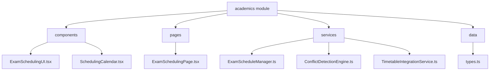
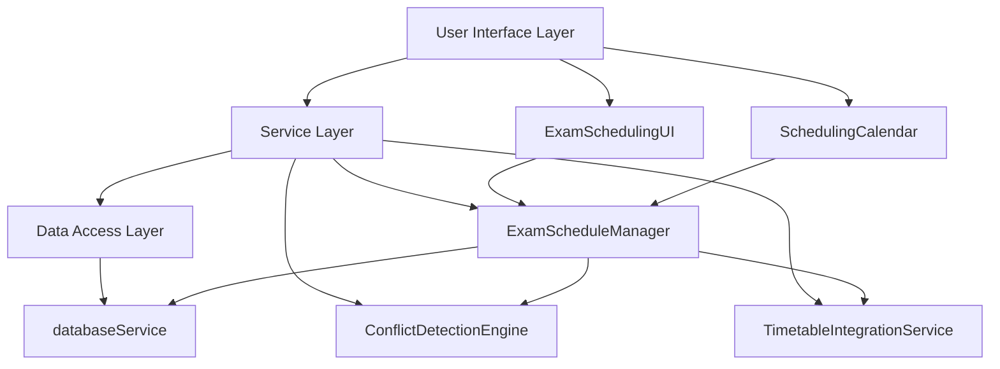
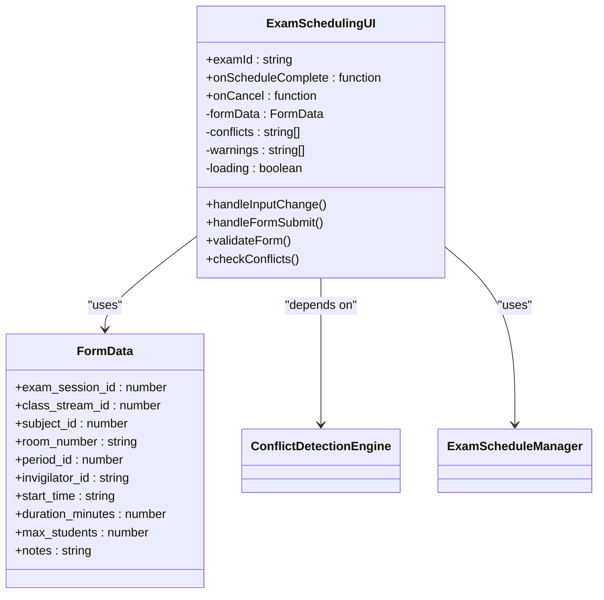
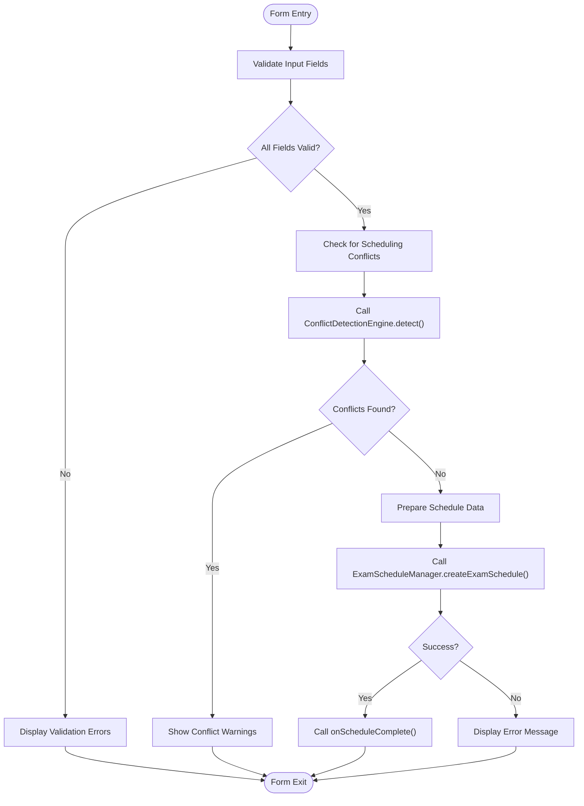
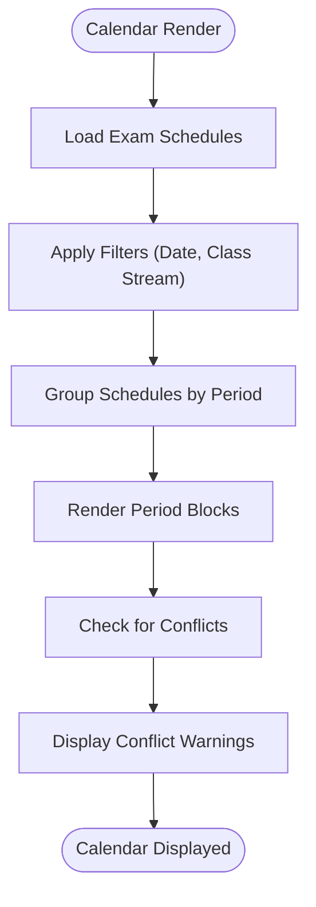
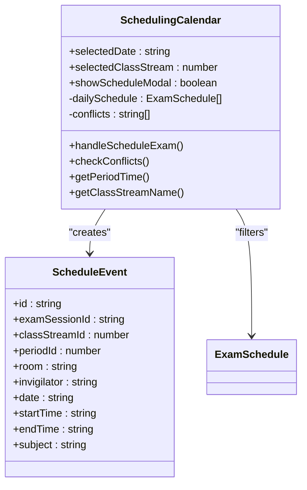
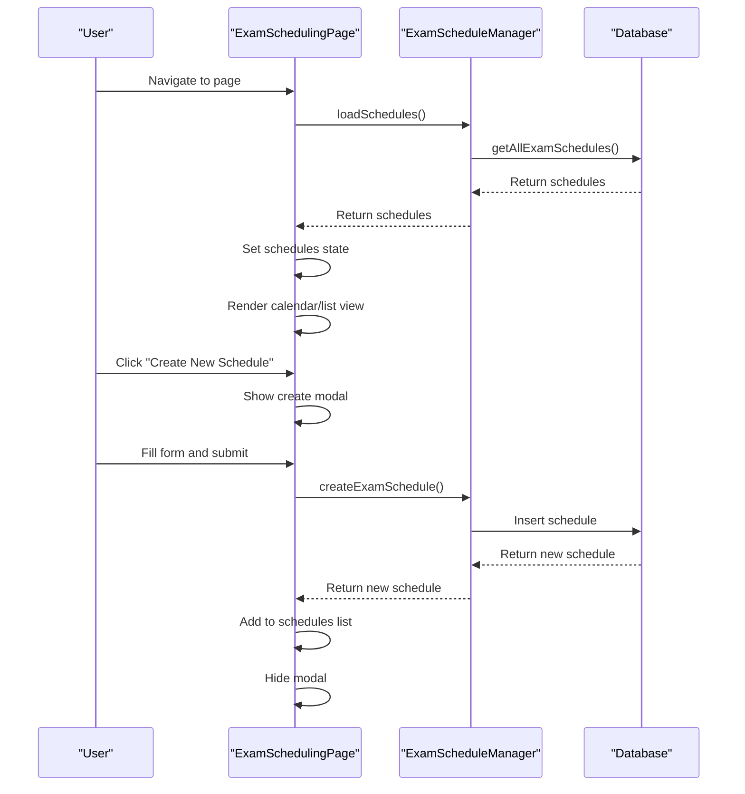
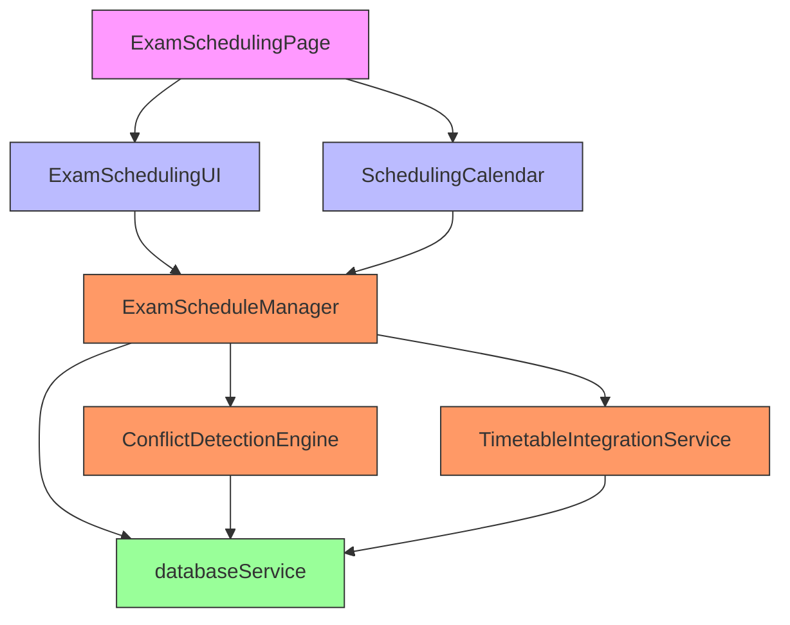

# Exam Scheduling User Interface

<cite>
**Referenced Files in This Document**   
- [ExamSchedulingUI.tsx](file://src/modules/academics/components/ExamSchedulingUI.tsx)
- [SchedulingCalendar.tsx](file://src/modules/academics/components/SchedulingCalendar.tsx)
- [ExamSchedulingPage.tsx](file://src/modules/academics/pages/ExamSchedulingPage.tsx)
- [types.ts](file://src/modules/academics/data/types.ts)
- [ExamScheduleManager.ts](file://src/modules/academics/services/ExamScheduleManager.ts)
- [ConflictDetectionEngine.ts](file://src/modules/academics/services/ConflictDetectionEngine.ts)
- [TimetableIntegrationService.ts](file://src/modules/academics/services/TimetableIntegrationService.ts)
</cite>

## Table of Contents
1. [Introduction](#introduction)
2. [Project Structure](#project-structure)
3. [Core Components](#core-components)
4. [Architecture Overview](#architecture-overview)
5. [Detailed Component Analysis](#detailed-component-analysis)
6. [Dependency Analysis](#dependency-analysis)
7. [Performance Considerations](#performance-considerations)
8. [Troubleshooting Guide](#troubleshooting-guide)
9. [Conclusion](#conclusion)

## Introduction
The Exam Scheduling User Interface provides a comprehensive solution for managing examination schedules within an educational institution. This documentation details the architecture and functionality of the ExamSchedulingUI component as the main container and its integration with SchedulingCalendar for visual time-based scheduling. The system supports drag-and-drop interface, time slot selection mechanics, and real-time conflict visualization features within a tabbed workspace environment. The interface is designed to be responsive across device sizes and integrates seamlessly with backend scheduling logic for conflict detection and timetable integration.

## Project Structure
The exam scheduling functionality is organized within the academics module of the application, following a feature-based organization pattern. The components are structured to separate concerns between UI presentation, business logic, and data management.

**Diagram sources**
- [ExamSchedulingUI.tsx](file://src/modules/academics/components/ExamSchedulingUI.tsx)
- [SchedulingCalendar.tsx](file://src/modules/academics/components/SchedulingCalendar.tsx)
- [ExamSchedulingPage.tsx](file://src/modules/academics/pages/ExamSchedulingPage.tsx)
- [ExamScheduleManager.ts](file://src/modules/academics/services/ExamScheduleManager.ts)
- [types.ts](file://src/modules/academics/data/types.ts)

**Section sources**
- [ExamSchedulingUI.tsx](file://src/modules/academics/components/ExamSchedulingUI.tsx)
- [SchedulingCalendar.tsx](file://src/modules/academics/components/SchedulingCalendar.tsx)
- [ExamSchedulingPage.tsx](file://src/modules/academics/pages/ExamSchedulingPage.tsx)

## Core Components
The exam scheduling system consists of three primary components that work together to provide a complete scheduling solution. The ExamSchedulingUI serves as the main container component for creating and editing exam schedules, while SchedulingCalendar provides a visual representation of scheduled exams over time. These components are orchestrated by the ExamSchedulingPage, which manages state and coordinates interactions between the UI components and backend services.

The system leverages React's component architecture with hooks for state management and side effects. It follows a unidirectional data flow pattern where data is passed from parent to child components through props, and user interactions trigger callbacks that update the application state.

**Section sources**
- [ExamSchedulingUI.tsx](file://src/modules/academics/components/ExamSchedulingUI.tsx#L1-L44)
- [SchedulingCalendar.tsx](file://src/modules/academics/components/SchedulingCalendar.tsx#L1-L41)
- [ExamSchedulingPage.tsx](file://src/modules/academics/pages/ExamSchedulingPage.tsx#L1-L30)

## Architecture Overview
The exam scheduling system follows a layered architecture with clear separation between presentation, business logic, and data access layers. The UI components are decoupled from the backend services through a service layer that handles all business logic and data operations.

**Diagram sources**
- [ExamSchedulingUI.tsx](file://src/modules/academics/components/ExamSchedulingUI.tsx)
- [SchedulingCalendar.tsx](file://src/modules/academics/components/SchedulingCalendar.tsx)
- [ExamScheduleManager.ts](file://src/modules/academics/services/ExamScheduleManager.ts)
- [ConflictDetectionEngine.ts](file://src/modules/academics/services/ConflictDetectionEngine.ts)
- [TimetableIntegrationService.ts](file://src/modules/academics/services/TimetableIntegrationService.ts)

## Detailed Component Analysis

### ExamSchedulingUI Analysis
The ExamSchedulingUI component serves as the primary interface for creating and editing exam schedules. It provides a form-based interface with validation and real-time conflict detection.

#### Component Structure

**Diagram sources**
- [ExamSchedulingUI.tsx](file://src/modules/academics/components/ExamSchedulingUI.tsx#L1-L44)
- [types.ts](file://src/modules/academics/data/types.ts#L14-L23)

#### Form Processing Flow

**Diagram sources**
- [ExamSchedulingUI.tsx](file://src/modules/academics/components/ExamSchedulingUI.tsx)
- [ConflictDetectionEngine.ts](file://src/modules/academics/services/ConflictDetectionEngine.ts)
- [ExamScheduleManager.ts](file://src/modules/academics/services/ExamScheduleManager.ts)

**Section sources**
- [ExamSchedulingUI.tsx](file://src/modules/academics/components/ExamSchedulingUI.tsx#L1-L44)

### SchedulingCalendar Analysis
The SchedulingCalendar component provides a visual calendar interface for viewing and managing exam schedules. It displays scheduled exams in a time-based layout and supports filtering by date and class stream.

#### Calendar Rendering Logic

**Diagram sources**
- [SchedulingCalendar.tsx](file://src/modules/academics/components/SchedulingCalendar.tsx)

#### Component Structure

**Diagram sources**
- [SchedulingCalendar.tsx](file://src/modules/academics/components/SchedulingCalendar.tsx#L1-L41)
- [types.ts](file://src/modules/academics/data/types.ts#L14-L23)

**Section sources**
- [SchedulingCalendar.tsx](file://src/modules/academics/components/SchedulingCalendar.tsx#L1-L41)

### ExamSchedulingPage Analysis
The ExamSchedulingPage component serves as the main container that orchestrates the exam scheduling functionality. It manages the overall state and coordinates between the UI components and backend services.

#### Page Workflow

**Diagram sources**
- [ExamSchedulingPage.tsx](file://src/modules/academics/pages/ExamSchedulingPage.tsx)
- [ExamScheduleManager.ts](file://src/modules/academics/services/ExamScheduleManager.ts)

**Section sources**
- [ExamSchedulingPage.tsx](file://src/modules/academics/pages/ExamSchedulingPage.tsx#L1-L30)

## Dependency Analysis
The exam scheduling components have well-defined dependencies that follow the dependency inversion principle. Higher-level components depend on abstractions rather than concrete implementations, allowing for easier testing and maintenance.

**Diagram sources**
- [ExamSchedulingPage.tsx](file://src/modules/academics/pages/ExamSchedulingPage.tsx)
- [ExamSchedulingUI.tsx](file://src/modules/academics/components/ExamSchedulingUI.tsx)
- [SchedulingCalendar.tsx](file://src/modules/academics/components/SchedulingCalendar.tsx)
- [ExamScheduleManager.ts](file://src/modules/academics/services/ExamScheduleManager.ts)
- [ConflictDetectionEngine.ts](file://src/modules/academics/services/ConflictDetectionEngine.ts)
- [TimetableIntegrationService.ts](file://src/modules/academics/services/TimetableIntegrationService.ts)

**Section sources**
- [ExamSchedulingPage.tsx](file://src/modules/academics/pages/ExamSchedulingPage.tsx)
- [ExamSchedulingUI.tsx](file://src/modules/academics/components/ExamSchedulingUI.tsx)
- [SchedulingCalendar.tsx](file://src/modules/academics/components/SchedulingCalendar.tsx)

## Performance Considerations
The exam scheduling interface is designed with performance in mind, particularly when rendering complex schedules with many exams. The components use React's optimization techniques to minimize unnecessary re-renders.

The SchedulingCalendar component implements filtering and sorting operations efficiently by leveraging React's useEffect hook to only process data when relevant dependencies change. The calendar view is optimized by grouping schedules by period and only rendering visible periods.

For large datasets, the system could benefit from virtualized rendering of the calendar view to only render visible periods rather than the entire schedule at once. Additionally, memoization of expensive calculations like conflict detection could further improve performance.

## Troubleshooting Guide
When encountering issues with the exam scheduling interface, consider the following common problems and solutions:

1. **Schedules not appearing in calendar view**: Verify that the exam schedules are properly loaded from the database and that the date filter is set correctly.

2. **Conflict detection not working**: Check that the ConflictDetectionEngine service is properly instantiated and that the database service is accessible.

3. **Form submission failing**: Ensure all required fields are filled and that there are no conflicts preventing schedule creation.

4. **Performance issues with large schedules**: Implement pagination or virtual scrolling for the calendar view when dealing with large numbers of exams.

**Section sources**
- [ExamSchedulingUI.tsx](file://src/modules/academics/components/ExamSchedulingUI.tsx)
- [SchedulingCalendar.tsx](file://src/modules/academics/components/SchedulingCalendar.tsx)
- [ExamSchedulingPage.tsx](file://src/modules/academics/pages/ExamSchedulingPage.tsx)
- [ConflictDetectionEngine.ts](file://src/modules/academics/services/ConflictDetectionEngine.ts)

## Conclusion
The Exam Scheduling User Interface provides a robust and user-friendly solution for managing examination schedules. The system's modular architecture with clear separation of concerns makes it maintainable and extensible. The integration between the ExamSchedulingUI, SchedulingCalendar, and backend services creates a cohesive experience for users while ensuring data integrity through comprehensive conflict detection. The responsive design ensures usability across different device sizes, and the component-based architecture allows for easy customization and extension of functionality.