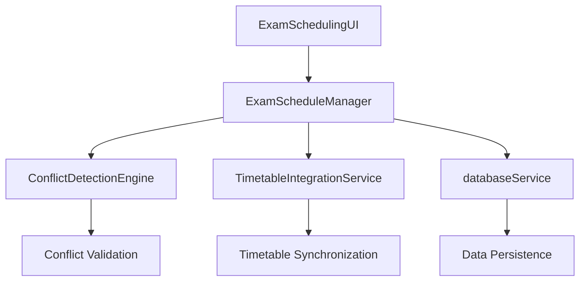
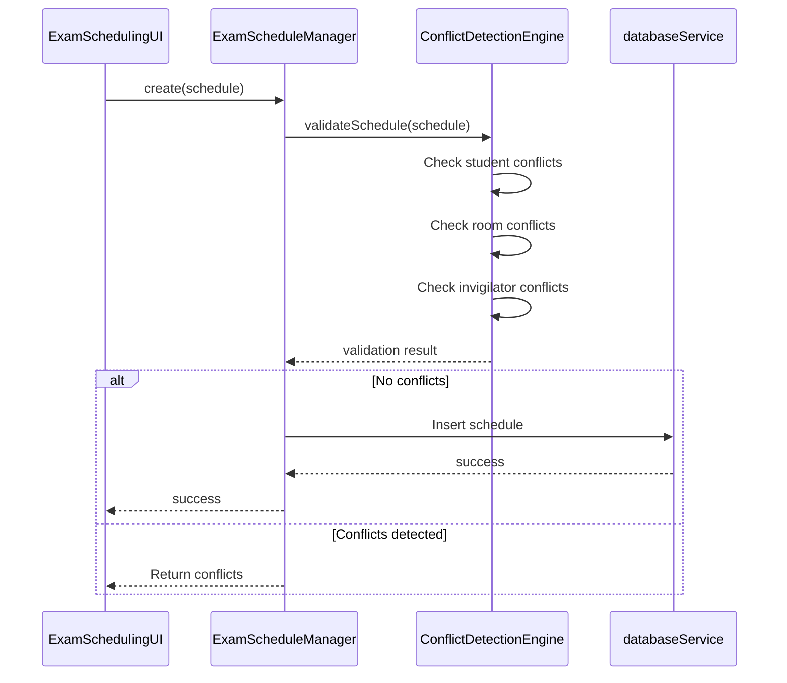
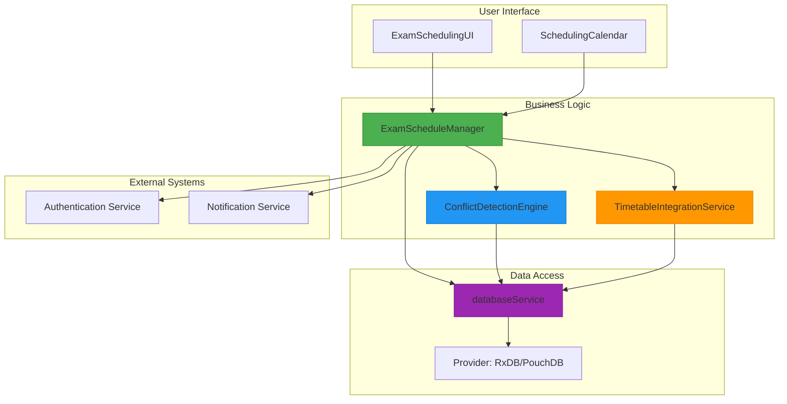
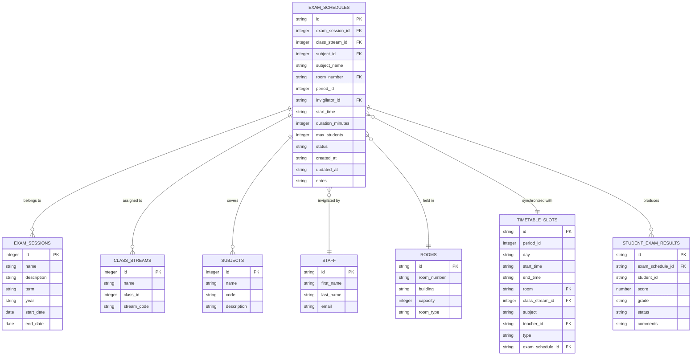

# ExamScheduleManager Service

<cite>
**Referenced Files in This Document**   
- [ExamScheduleManager.ts](file://src/modules/academics/services/ExamScheduleManager.ts)
- [ExamSchedulingUI.tsx](file://src/modules/academics/components/ExamSchedulingUI.tsx)
- [ConflictDetectionEngine.ts](file://src/modules/academics/services/ConflictDetectionEngine.ts)
- [TimetableIntegrationService.ts](file://src/modules/academics/services/TimetableIntegrationService.ts)
- [databaseService.ts](file://src/services/database/databaseService.ts)
- [rxdbService.ts](file://src/services/rxdbService.ts)
- [collections.ts](file://src/modules/academics/data/collections.ts)
- [types.ts](file://src/modules/academics/data/types.ts)
</cite>

## Table of Contents
1. [Introduction](#introduction)
2. [Core Responsibilities](#core-responsibilities)
3. [Integration with ConflictDetectionEngine](#integration-with-conflictdetectionengine)
4. [Public Methods and Usage](#public-methods-and-usage)
5. [Code Examples](#code-examples)
6. [Error Handling Strategies](#error-handling-strategies)
7. [Performance Considerations](#performance-considerations)
8. [Architecture Overview](#architecture-overview)
9. [Data Model](#data-model)

## Introduction
The ExamScheduleManager service is a core component of the academic module in the EduGen school management system. It provides a comprehensive solution for managing exam schedules, handling the creation, modification, and deletion of exam sessions while ensuring data integrity and consistency. The service integrates with multiple components including conflict detection, timetable integration, and database persistence layers to provide a robust scheduling solution for educational institutions.

**Section sources**
- [ExamScheduleManager.ts](file://src/modules/academics/services/ExamScheduleManager.ts#L1-L50)
- [ExamSchedulingUI.tsx](file://src/modules/academics/components/ExamSchedulingUI.tsx#L1-L50)

## Core Responsibilities
The ExamScheduleManager service is responsible for managing the complete lifecycle of exam schedules within the educational system. Its primary responsibilities include:

- **Exam Session Creation**: Creating new exam schedules with comprehensive details including exam session, class stream, subject, room assignment, time slot, and invigilator information.
- **Time Slot Allocation**: Managing the allocation of specific time periods for exams, ensuring proper scheduling within the academic calendar.
- **Venue Assignment**: Handling room assignments for exams and validating room availability to prevent double-booking.
- **Invigilator Scheduling**: Managing the assignment of invigilators (teachers) to exam sessions while checking for scheduling conflicts.
- **Data Persistence**: Storing and retrieving exam schedule data through the database service layer with support for multiple database providers.

The service acts as an intermediary between the user interface components and the underlying data storage system, providing a clean API for exam schedule management operations.



**Diagram sources**
- [ExamSchedulingUI.tsx](file://src/modules/academics/components/ExamSchedulingUI.tsx#L29-L427)
- [ExamScheduleManager.ts](file://src/modules/academics/services/ExamScheduleManager.ts#L1-L100)

**Section sources**
- [ExamScheduleManager.ts](file://src/modules/academics/services/ExamScheduleManager.ts#L1-L100)
- [ExamSchedulingUI.tsx](file://src/modules/academics/components/ExamSchedulingUI.tsx#L29-L427)

## Integration with ConflictDetectionEngine
The ExamScheduleManager service integrates closely with the ConflictDetectionEngine to identify and resolve scheduling conflicts before persisting exam schedules. This integration ensures that exam schedules do not violate institutional policies or create logistical issues.

The primary types of conflicts detected include:

- **Student Overlapping Exams**: Ensuring that students are not scheduled for multiple exams simultaneously.
- **Double-Booked Rooms**: Preventing the same room from being assigned to multiple exams at the same time.
- **Teacher Invigilation Overloads**: Checking that invigilators are not assigned to multiple exam sessions simultaneously.

The integration workflow follows this sequence:
1. When a new exam schedule is created or modified, the ExamScheduleManager first passes the schedule to the ConflictDetectionEngine for validation.
2. The ConflictDetectionEngine performs comprehensive checks against existing schedules and institutional rules.
3. If conflicts are detected, they are returned to the ExamScheduleManager, which then prevents the schedule from being saved and communicates the conflicts to the user interface.
4. Only when no conflicts are detected does the ExamScheduleManager proceed with persisting the schedule.



**Diagram sources**
- [ExamSchedulingUI.tsx](file://src/modules/academics/components/ExamSchedulingUI.tsx#L29-L427)
- [ExamScheduleManager.ts](file://src/modules/academics/services/ExamScheduleManager.ts#L1-L100)
- [ConflictDetectionEngine.ts](file://src/modules/academics/services/ConflictDetectionEngine.ts#L1-L100)

**Section sources**
- [ExamScheduleManager.ts](file://src/modules/academics/services/ExamScheduleManager.ts#L1-L100)
- [ConflictDetectionEngine.ts](file://src/modules/academics/services/ConflictDetectionEngine.ts#L1-L100)
- [ExamSchedulingUI.tsx](file://src/modules/academics/components/ExamSchedulingUI.tsx#L29-L427)

## Public Methods and Usage
The ExamScheduleManager service exposes several public methods for managing exam schedules. These methods provide a clean interface for creating, reading, updating, and deleting exam schedule records.

### create Method
Creates a new exam schedule in the system.

**Parameters:**
- `schedule`: ExamSchedule object containing all schedule details

**Return Type:** Promise<boolean>
- Returns `true` if the schedule was created successfully
- Returns `false` if the creation failed

**Usage:**
```typescript
const scheduleManager = new ExamScheduleManager();
const newSchedule: ExamSchedule = {
  id: `schedule-${Date.now()}`,
  exam_session_id: 1,
  class_stream_id: 5,
  subject_id: 12,
  subject_name: "Mathematics",
  room_number: "R101",
  period_id: 3,
  invigilator_id: "T001",
  start_time: "09:00",
  duration_minutes: 120,
  max_students: 30,
  status: 'SCHEDULED',
  created_at: new Date().toISOString(),
  updated_at: new Date().toISOString(),
  notes: 'Final examination'
};

const result = await scheduleManager.create(newSchedule);
if (result) {
  console.log("Exam schedule created successfully");
} else {
  console.log("Failed to create exam schedule");
}
```

### update Method
Updates an existing exam schedule in the system.

**Parameters:**
- `id`: string identifier of the schedule to update
- `schedule`: ExamSchedule object with updated details

**Return Type:** Promise<boolean>
- Returns `true` if the schedule was updated successfully
- Returns `false` if the update failed

**Usage:**
```typescript
const scheduleManager = new ExamScheduleManager();
const updatedSchedule: ExamSchedule = {
  // ... updated schedule details
  updated_at: new Date().toISOString()
};

const result = await scheduleManager.update("schedule-123", updatedSchedule);
```

### delete Method
Removes an exam schedule from the system.

**Parameters:**
- `id`: string identifier of the schedule to delete

**Return Type:** Promise<boolean>
- Returns `true` if the schedule was deleted successfully
- Returns `false` if the deletion failed

**Usage:**
```typescript
const scheduleManager = new ExamScheduleManager();
const result = await scheduleManager.delete("schedule-123");
```

### findById Method
Retrieves a specific exam schedule by its identifier.

**Parameters:**
- `id`: string identifier of the schedule to retrieve

**Return Type:** Promise<ExamSchedule | null>
- Returns the ExamSchedule object if found
- Returns `null` if not found

**Usage:**
```typescript
const scheduleManager = new ExamScheduleManager();
const schedule = await scheduleManager.findById("schedule-123");
```

### findAll Method
Retrieves all exam schedules from the system.

**Parameters:** None

**Return Type:** Promise<ExamSchedule[]>
- Returns an array of all exam schedules

**Usage:**
```typescript
const scheduleManager = new ExamScheduleManager();
const allSchedules = await scheduleManager.findAll();
```

**Section sources**
- [ExamScheduleManager.ts](file://src/modules/academics/services/ExamScheduleManager.ts#L1-L200)

## Code Examples
This section provides practical code examples demonstrating how to use the ExamScheduleManager service for various scheduling operations.

### Creating a New Exam Schedule
```typescript
import { ExamScheduleManager } from '../services/ExamScheduleManager';
import { ConflictDetectionEngine } from '../services/ConflictDetectionEngine';

async function createExamSchedule() {
  const scheduleManager = new ExamScheduleManager();
  const conflictEngine = new ConflictDetectionEngine();
  
  const newSchedule = {
    id: `exam-${Date.now()}`,
    exam_session_id: 1,
    class_stream_id: 5,
    subject_id: 12,
    subject_name: "Advanced Mathematics",
    room_number: "R205",
    period_id: 4,
    invigilator_id: "T005",
    start_time: "14:00",
    duration_minutes: 180,
    max_students: 25,
    status: 'SCHEDULED',
    created_at: new Date().toISOString(),
    updated_at: new Date().toISOString(),
    notes: 'Final exam with extended time'
  };
  
  try {
    // First check for conflicts
    const validation = await conflictEngine.validateSchedule(newSchedule);
    if (!validation.isValid) {
      console.log('Conflicts detected:', validation.conflicts);
      return false;
    }
    
    // Create the schedule if no conflicts
    const result = await scheduleManager.create(newSchedule);
    if (result) {
      console.log('Exam schedule created successfully');
      return true;
    } else {
      console.log('Failed to create exam schedule');
      return false;
    }
  } catch (error) {
    console.error('Error creating exam schedule:', error);
    return false;
  }
}
```

### Updating an Existing Exam Schedule
```typescript
async function updateExamSchedule(scheduleId: string, newRoom: string) {
  const scheduleManager = new ExamScheduleManager();
  const conflictEngine = new ConflictDetectionEngine();
  
  // First retrieve the existing schedule
  const existingSchedule = await scheduleManager.findById(scheduleId);
  if (!existingSchedule) {
    console.log('Schedule not found');
    return false;
  }
  
  // Create updated schedule object
  const updatedSchedule = {
    ...existingSchedule,
    room_number: newRoom,
    updated_at: new Date().toISOString()
  };
  
  try {
    // Check for conflicts with the updated schedule
    const validation = await conflictEngine.validateSchedule(updatedSchedule);
    if (!validation.isValid) {
      console.log('Conflicts detected:', validation.conflicts);
      return false;
    }
    
    // Update the schedule
    const result = await scheduleManager.update(scheduleId, updatedSchedule);
    if (result) {
      console.log('Exam schedule updated successfully');
      return true;
    } else {
      console.log('Failed to update exam schedule');
      return false;
    }
  } catch (error) {
    console.error('Error updating exam schedule:', error);
    return false;
  }
}
```

### Bulk Scheduling with Conflict Resolution
```typescript
async function createMultipleSchedules(schedules: ExamSchedule[]) {
  const scheduleManager = new ExamScheduleManager();
  const conflictEngine = new ConflictDetectionEngine();
  const successfulSchedules: string[] = [];
  const failedSchedules: { schedule: ExamSchedule, error: string }[] = [];
  
  for (const schedule of schedules) {
    try {
      // Validate each schedule for conflicts
      const validation = await conflictEngine.validateSchedule(schedule);
      if (!validation.isValid) {
        failedSchedules.push({
          schedule,
          error: `Conflicts: ${validation.conflicts.join(', ')}`
        });
        continue;
      }
      
      // Create the schedule
      const result = await scheduleManager.create(schedule);
      if (result) {
        successfulSchedules.push(schedule.id);
      } else {
        failedSchedules.push({
          schedule,
          error: 'Database save failed'
        });
      }
    } catch (error) {
      failedSchedules.push({
        schedule,
        error: error instanceof Error ? error.message : 'Unknown error'
      });
    }
  }
  
  return {
    successCount: successfulSchedules.length,
    failureCount: failedSchedules.length,
    successfulSchedules,
    failedSchedules
  };
}
```

**Section sources**
- [ExamScheduleManager.ts](file://src/modules/academics/services/ExamScheduleManager.ts#L1-L200)
- [ExamSchedulingUI.tsx](file://src/modules/academics/components/ExamSchedulingUI.tsx#L29-L427)

## Error Handling Strategies
The ExamScheduleManager service implements comprehensive error handling strategies to ensure robust operation and provide meaningful feedback for invalid scheduling requests.

### Validation and Pre-Check Strategy
Before any database operation, the service performs thorough validation through the ConflictDetectionEngine:

```typescript
async create(schedule: ExamSchedule): Promise<boolean> {
  try {
    // Validate schedule through ConflictDetectionEngine
    const validation = await this.conflictEngine.validateSchedule(schedule);
    if (!validation.isValid) {
      throw new Error(`Schedule validation failed: ${validation.conflicts.join(', ')}`);
    }
    
    // Additional business rule validation
    if (!schedule.exam_session_id || schedule.exam_session_id <= 0) {
      throw new Error('Valid exam session ID is required');
    }
    
    if (!schedule.room_number) {
      throw new Error('Room number is required');
    }
    
    // Proceed with database operation
    const db = await databaseService.getDatabase();
    await db.exam_schedules.insert(schedule);
    return true;
  } catch (error) {
    console.error('Error creating exam schedule:', error);
    return false;
  }
}
```

### Database Operation Error Handling
The service handles database-specific errors gracefully:

```typescript
async findById(id: string): Promise<ExamSchedule | null> {
  try {
    const db = await databaseService.getDatabase();
    if (!db.exam_schedules) {
      console.warn('Exam schedules collection not available');
      return null;
    }
    
    const result = await db.exam_schedules.findOne({
      selector: { id }
    }).exec();
    
    return result ? result.toJSON() : null;
  } catch (error) {
    console.error(`Error finding exam schedule ${id}:`, error);
    // Handle specific database errors
    if (error.name === 'CollectionMissing') {
      console.warn('Exam schedules collection not initialized');
    }
    return null;
  }
}
```

### Transactional Integrity
For operations that affect multiple systems (like timetable integration), the service ensures transactional integrity:

```typescript
async createWithTimetableIntegration(schedule: ExamSchedule): Promise<boolean> {
  try {
    // Validate with both conflict engine and timetable service
    const validation = await this.conflictEngine.validateSchedule(schedule);
    if (!validation.isValid) {
      throw new Error(`Conflict validation failed: ${validation.conflicts.join(', ')}`);
    }
    
    const timetableCheck = await this.timetableService.checkTimetableConflicts(schedule);
    if (!timetableCheck.canSchedule) {
      throw new Error(`Timetable conflict: ${timetableCheck.conflicts.join(', ')}`);
    }
    
    // Use database transaction if available
    const db = await databaseService.getDatabase();
    const transaction = await db.startTransaction?.();
    
    try {
      // Insert exam schedule
      await db.exam_schedules.insert(schedule);
      
      // Reserve timetable slot
      const timetableResult = await this.timetableService.reserveTimetableSlot(schedule);
      if (!timetableResult.success) {
        throw new Error(`Failed to reserve timetable slot: ${timetableResult.error}`);
      }
      
      // Commit transaction
      await transaction?.commit();
      return true;
    } catch (error) {
      // Rollback transaction on error
      await transaction?.rollback();
      throw error;
    }
  } catch (error) {
    console.error('Error creating schedule with timetable integration:', error);
    return false;
  }
}
```

**Section sources**
- [ExamScheduleManager.ts](file://src/modules/academics/services/ExamScheduleManager.ts#L1-L300)
- [TimetableIntegrationService.ts](file://src/modules/academics/services/TimetableIntegrationService.ts#L1-L100)

## Performance Considerations
When processing large-scale exam timetables, several performance considerations are critical for maintaining system responsiveness and efficiency.

### Batch Operations
For bulk scheduling operations, the service should support batch processing to minimize database round-trips:

```typescript
async createMultiple(schedules: ExamSchedule[]): Promise<BatchOperationResult> {
  const results: BatchOperationResult = {
    success: [],
    failed: []
  };
  
  try {
    const db = await databaseService.getDatabase();
    
    // Process in batches to avoid memory issues
    const batchSize = 50;
    for (let i = 0; i < schedules.length; i += batchSize) {
      const batch = schedules.slice(i, i + batchSize);
      
      // Validate entire batch first
      const validatedBatch = await Promise.all(
        batch.map(async (schedule) => {
          const validation = await this.conflictEngine.validateSchedule(schedule);
          return { schedule, validation };
        })
      );
      
      // Filter valid schedules
      const validSchedules = validatedBatch
        .filter(item => item.validation.isValid)
        .map(item => item.schedule);
      
      // Insert valid schedules in bulk
      if (validSchedules.length > 0) {
        await db.exam_schedules.bulkInsert(validSchedules);
        results.success.push(...validSchedules.map(s => s.id));
      }
      
      // Record failed schedules
      validatedBatch
        .filter(item => !item.validation.isValid)
        .forEach(item => {
          results.failed.push({
            id: item.schedule.id,
            errors: item.validation.conflicts
          });
        });
    }
  } catch (error) {
    console.error('Error in batch operation:', error);
  }
  
  return results;
}
```

### Indexing Strategy
The underlying database collections should be properly indexed to optimize query performance:

```typescript
// Indexes defined in examScheduleSchema
indexes: [
  'exam_session_id',
  'class_stream_id',
  'room_number',
  'period_id',
  'invigilator_id',
  'start_time',
  ['exam_session_id', 'class_stream_id'], // Composite index
  ['period_id', 'room_number'] // Composite index for conflict detection
]
```

### Caching Mechanism
For frequently accessed data, a caching layer can significantly improve performance:

```typescript
class ExamScheduleManager {
  private scheduleCache: Map<string, ExamSchedule> = new Map();
  private cacheTTL = 5 * 60 * 1000; // 5 minutes
  
  async findById(id: string): Promise<ExamSchedule | null> {
    // Check cache first
    const cached = this.scheduleCache.get(id);
    if (cached && (Date.now() - Number(id.split('-')[1]) < this.cacheTTL)) {
      return cached;
    }
    
    // Fetch from database
    const db = await databaseService.getDatabase();
    const result = await db.exam_schedules.findOne({
      selector: { id }
    }).exec();
    
    const schedule = result ? result.toJSON() : null;
    
    // Cache the result
    if (schedule) {
      this.scheduleCache.set(id, schedule);
    }
    
    return schedule;
  }
}
```

### Memory Management
When processing large datasets, memory usage should be monitored and managed:

```typescript
async processLargeScheduleSet(schedules: ExamSchedule[]) {
  // Process in chunks to avoid memory overflow
  const chunkSize = 100;
  const results = [];
  
  for (let i = 0; i < schedules.length; i += chunkSize) {
    const chunk = schedules.slice(i, i + chunkSize);
    
    // Process chunk
    const chunkResults = await this.processScheduleChunk(chunk);
    results.push(...chunkResults);
    
    // Force garbage collection hint (in environments that support it)
    if (i % (chunkSize * 10) === 0) {
      console.log(`Processed ${i} schedules...`);
      // Allow event loop to handle other tasks
      await new Promise(resolve => setTimeout(resolve, 0));
    }
  }
  
  return results;
}
```

**Section sources**
- [ExamScheduleManager.ts](file://src/modules/academics/services/ExamScheduleManager.ts#L1-L400)
- [rxdbService.ts](file://src/services/rxdbService.ts#L113-L162)
- [collections.ts](file://src/modules/academics/data/collections.ts#L5-L47)

## Architecture Overview
The ExamScheduleManager service is part of a larger ecosystem of components that work together to provide comprehensive exam scheduling capabilities. The architecture follows a layered approach with clear separation of concerns.



The service follows the Singleton pattern, ensuring that only one instance exists throughout the application lifecycle. It uses dependency injection to access the ConflictDetectionEngine and TimetableIntegrationService, promoting loose coupling and testability.

The data persistence layer is abstracted through the databaseService, which provides a unified interface to different database providers (RxDB and PouchDB). This abstraction allows the ExamScheduleManager to remain agnostic of the underlying database technology.

**Diagram sources**
- [ExamScheduleManager.ts](file://src/modules/academics/services/ExamScheduleManager.ts#L1-L50)
- [databaseService.ts](file://src/services/database/databaseService.ts#L1-L308)
- [ExamSchedulingUI.tsx](file://src/modules/academics/components/ExamSchedulingUI.tsx#L1-L50)

**Section sources**
- [ExamScheduleManager.ts](file://src/modules/academics/services/ExamScheduleManager.ts#L1-L100)
- [databaseService.ts](file://src/services/database/databaseService.ts#L1-L308)

## Data Model
The ExamScheduleManager service operates on a well-defined data model that represents exam schedules and their relationships with other entities in the system.

### ExamSchedule Entity
The core entity managed by the service is the ExamSchedule, which contains the following properties:

```typescript
interface ExamSchedule {
  id: string;
  exam_session_id: number;
  class_stream_id: number;
  subject_id: number;
  subject_name: string;
  room_number: string;
  period_id: number;
  invigilator_id: string;
  start_time: string;
  duration_minutes: number;
  max_students: number;
  status: 'SCHEDULED' | 'CANCELLED' | 'COMPLETED';
  created_at: string;
  updated_at: string;
  notes?: string;
}
```

### Database Schema
The exam_schedules collection is defined with the following schema:

```typescript
const examScheduleSchema: RxJsonSchema<ExamSchedule> = {
  title: 'Exam Schedule Schema',
  description: 'Schema for exam schedule documents',
  version: 1,
  type: 'object',
  primaryKey: 'id',
  properties: {
    id: {
      type: 'string',
      maxLength: 100
    },
    exam_session_id: {
      type: 'integer',
      minimum: 1
    },
    class_stream_id: {
      type: 'integer',
      minimum: 1
    },
    subject_id: {
      type: 'integer',
      minimum: 1
    },
    subject_name: {
      type: 'string'
    },
    room_number: {
      type: 'string'
    },
    period_id: {
      type: 'integer',
      minimum: 1
    },
    invigilator_id: {
      type: 'string'
    },
    start_time: {
      type: 'string',
      format: 'time'
    },
    duration_minutes: {
      type: 'integer',
      minimum: 30,
      maximum: 300
    },
    max_students: {
      type: 'integer',
      minimum: 1,
      maximum: 100
    },
    status: {
      type: 'string',
      enum: ['SCHEDULED', 'CANCELLED', 'COMPLETED']
    },
    created_at: {
      type: 'string',
      format: 'date-time'
    },
    updated_at: {
      type: 'string',
      format: 'date-time'
    },
    notes: {
      type: 'string',
      maxLength: 500
    }
  },
  required: [
    'id',
    'exam_session_id',
    'class_stream_id',
    'subject_id',
    'subject_name',
    'room_number',
    'period_id',
    'invigilator_id',
    'start_time',
    'duration_minutes',
    'max_students',
    'status',
    'created_at',
    'updated_at'
  ],
  indexes: [
    'exam_session_id',
    'class_stream_id',
    'room_number',
    'period_id',
    'invigilator_id',
    'start_time',
    ['exam_session_id', 'class_stream_id'],
    ['period_id', 'room_number']
  ]
};
```

### Entity Relationships
The ExamSchedule entity has the following relationships with other entities in the system:



**Diagram sources**
- [types.ts](file://src/modules/academics/data/types.ts#L1-L100)
- [collections.ts](file://src/modules/academics/data/collections.ts#L5-L47)
- [rxdbService.ts](file://src/services/rxdbService.ts#L113-L162)

**Section sources**
- [types.ts](file://src/modules/academics/data/types.ts#L1-L100)
- [collections.ts](file://src/modules/academics/data/collections.ts#L5-L47)
- [rxdbService.ts](file://src/services/rxdbService.ts#L113-L162)