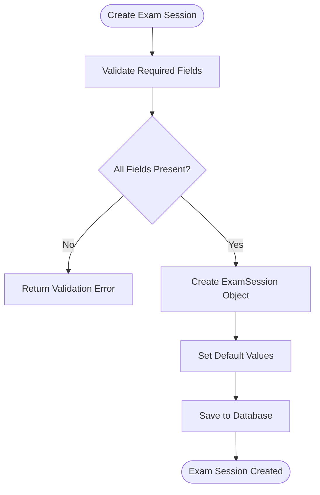
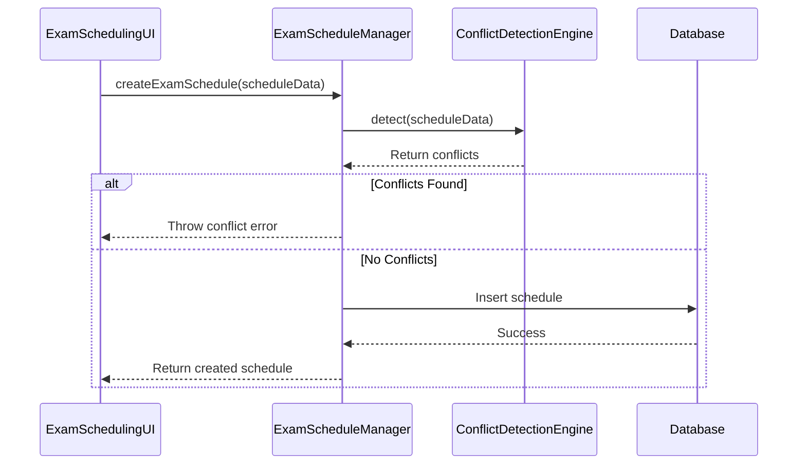
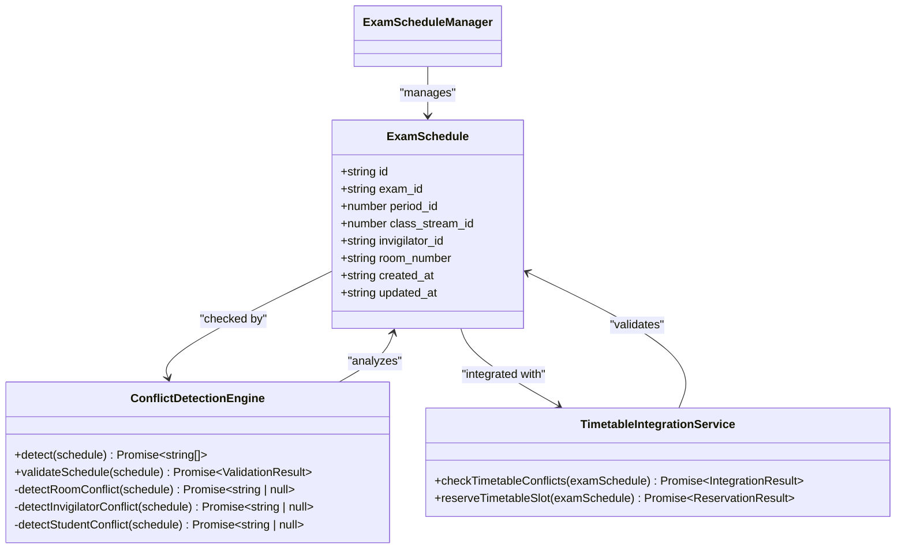
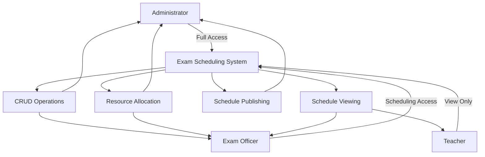
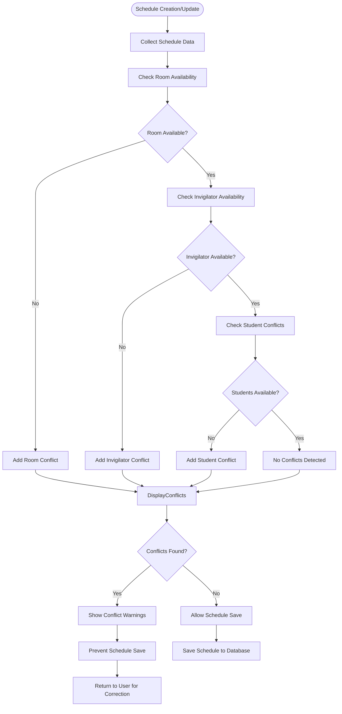
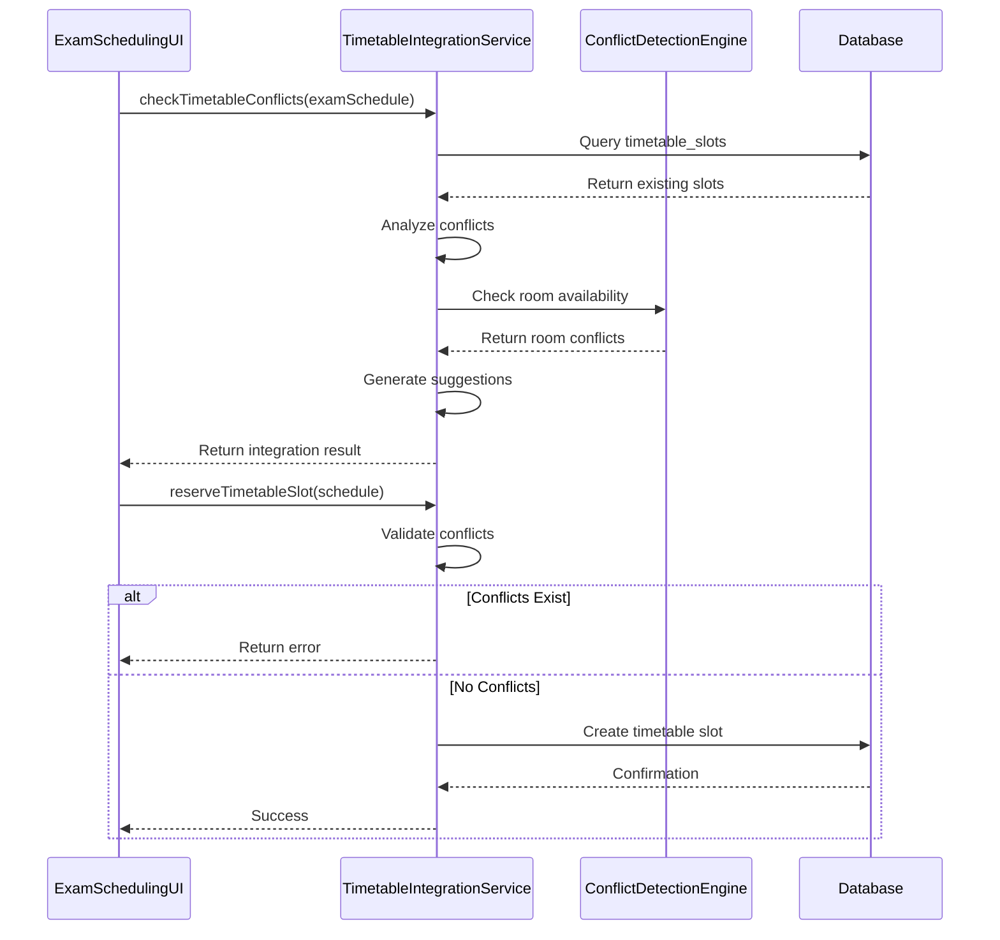
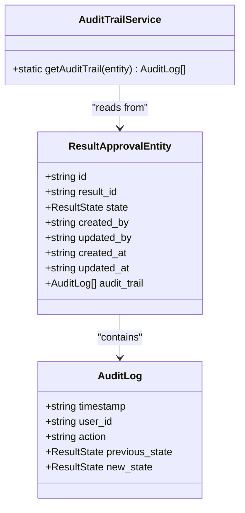
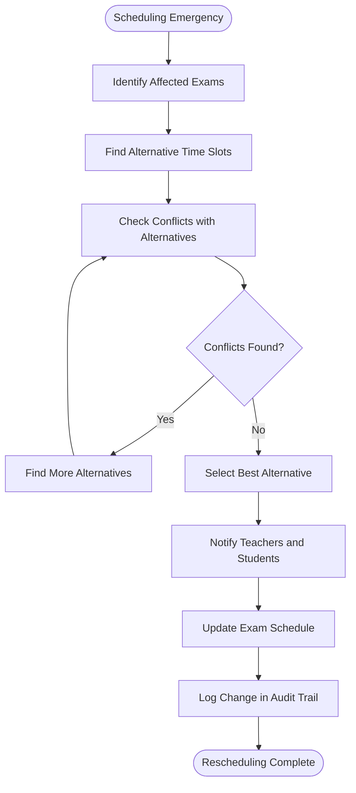

# Scheduling Workflows and Use Cases

<cite>
**Referenced Files in This Document**   
- [ExamScheduleManager.ts](file://src/modules/academics/services/ExamScheduleManager.ts)
- [ConflictDetectionEngine.ts](file://src/modules/academics/services/ConflictDetectionEngine.ts)
- [TimetableIntegrationService.ts](file://src/modules/academics/services/TimetableIntegrationService.ts)
- [AuditTrailService.ts](file://src/modules/academics/services/AuditTrailService.ts)
- [ExamSchedulingPage.tsx](file://src/modules/academics/pages/ExamSchedulingPage.tsx)
- [ExamSchedulingUI.tsx](file://src/modules/academics/components/ExamSchedulingUI.tsx)
- [types.ts](file://src/modules/academics/data/types.ts)
- [enums.ts](file://src/modules/academics/data/enums.ts)
- [rbac.ts](file://src/modules/academics/rbac.ts)
- [ExamSessionsPage.tsx](file://src/modules/academics/pages/ExamSessionsPage.tsx)
- [todo_exam_scheduling_engine_updated.md](file://todo_exam_scheduling_engine_updated.md)
</cite>

## Table of Contents
1. [Introduction](#introduction)
2. [Core Components Overview](#core-components-overview)
3. [Exam Scheduling Workflow](#exam-scheduling-workflow)
4. [Role-Based Access Control](#role-based-access-control)
5. [Conflict Detection and Resolution](#conflict-detection-and-resolution)
6. [Timetable Integration](#timetable-integration)
7. [Audit Logging](#audit-logging)
8. [Real-World Scenarios](#real-world-scenarios)
9. [Best Practices and Pitfalls](#best-practices-and-pitfalls)
10. [System Status and Future Enhancements](#system-status-and-future-enhancements)

## Introduction
This document provides a comprehensive overview of the exam scheduling workflows and use cases within the EduGen school management system. The system enables administrators and exam officers to create and manage exam schedules efficiently while preventing conflicts and ensuring optimal resource allocation. The documentation covers the complete workflow from creating exam sessions to publishing schedules, with detailed information on role-based access, conflict detection, timetable integration, and audit logging.

## Core Components Overview

The exam scheduling system consists of several key components that work together to provide a robust scheduling solution:

- **ExamScheduleManager**: Central service for CRUD operations on exam schedules
- **ConflictDetectionEngine**: Detects and prevents scheduling conflicts for rooms, invigilators, and students
- **TimetableIntegrationService**: Ensures exam schedules don't conflict with regular class timetables
- **ExamSchedulingPage**: User interface for managing exam schedules
- **ExamSchedulingUI**: Form component for creating and editing schedules
- **AuditTrailService**: Tracks changes to exam scheduling data

**Section sources**
- [ExamScheduleManager.ts](file://src/modules/academics/services/ExamScheduleManager.ts#L41-L276)
- [ConflictDetectionEngine.ts](file://src/modules/academics/services/ConflictDetectionEngine.ts#L0-L199)
- [TimetableIntegrationService.ts](file://src/modules/academics/services/TimetableIntegrationService.ts#L0-L199)

## Exam Scheduling Workflow

### Creating New Exam Sessions

The process begins with creating an exam session through the ExamSessionsPage interface. An exam session represents a specific examination period (e.g., Mid-Term Exams, Final Exams) and includes metadata such as:

- **name**: Descriptive name of the exam session
- **school_period_id**: Academic period during which the exams occur
- **status**: Current state of the session (Planning, Marks Entry Open, Published, Closed, Archived)

**Diagram sources**
- [ExamSessionsPage.tsx](file://src/modules/academics/pages/ExamSessionsPage.tsx#L0-L199)

### Assigning Subjects to Time Slots

Once an exam session is created, subjects can be assigned to specific time slots using the ExamSchedulingPage interface. The process involves:

1. Selecting the exam session to schedule
2. Choosing a time period from available timetable periods
3. Assigning a classroom/venue
4. Assigning an invigilator (teacher)
5. Selecting the class stream and subject

The ExamScheduleManager service handles the creation of exam schedules with the following required fields:

- **exam_id**: Reference to the exam session
- **period_id**: Time period for the exam
- **class_stream_id**: Class/grade level taking the exam
- **invigilator_id**: Teacher assigned to supervise
- **room_number**: Examination venue

**Diagram sources**
- [ExamScheduleManager.ts](file://src/modules/academics/services/ExamScheduleManager.ts#L41-L76)
- [ExamSchedulingUI.tsx](file://src/modules/academics/components/ExamSchedulingUI.tsx#L0-L199)

### Allocating Venues and Invigilators

The system ensures optimal allocation of venues and invigilators by checking availability before assignment. When selecting a room and invigilator for an exam:

1. The system queries available rooms and invigilators for the selected time period
2. Conflict detection runs in real-time as fields are filled
3. Visual feedback indicates potential conflicts
4. Users can filter available resources by various criteria

The ConflictDetectionEngine performs three types of conflict checks:

- **Room conflicts**: Ensures the venue isn't double-booked
- **Invigilator conflicts**: Prevents assigning a teacher to multiple exams simultaneously
- **Student conflicts**: Checks for timetable clashes for students

**Diagram sources**
- [types.ts](file://src/modules/academics/data/types.ts#L0-L199)
- [ConflictDetectionEngine.ts](file://src/modules/academics/services/ConflictDetectionEngine.ts#L0-L199)
- [TimetableIntegrationService.ts](file://src/modules/academics/services/TimetableIntegrationService.ts#L0-L199)

### Publishing Schedules

Once all exams are scheduled and verified, the schedule can be published. The publishing workflow includes:

1. Final conflict validation across all scheduled exams
2. Generation of printable schedule documents
3. Notification to teachers and students
4. Updating the exam session status to "Published"

The system supports both calendar and list views for schedule visualization, allowing users to toggle between formats based on preference.

**Section sources**
- [ExamSchedulingPage.tsx](file://src/modules/academics/pages/ExamSchedulingPage.tsx#L14-L436)

## Role-Based Access Control

The system implements role-based access control (RBAC) to ensure appropriate permissions for different user types. The permissions are defined in the academicsPermissions array in the rbac.ts file.

### Administrator
Administrators have full access to all exam scheduling functionality:

- **Create, read, update, delete exams**: Full CRUD operations on exam sessions and schedules
- **Manage all resources**: Assign any venue or invigilator
- **Publish schedules**: Finalize and publish exam timetables
- **Override conflicts**: Ability to force schedule creation despite conflicts (with audit trail)

### Exam Officer
Exam officers have focused permissions for scheduling operations:

- **View and create exams**: Can view all exam sessions and create new ones
- **Schedule management**: Create, edit, and delete exam schedules within their purview
- **Resource allocation**: Assign venues and invigilators from approved lists
- **Conflict resolution**: Address scheduling conflicts through suggested alternatives

### Teacher
Teachers have limited viewing permissions:

- **View assigned exams**: See exams they are scheduled to invigilate
- **View personal schedule**: Check their invigilation timetable
- **No editing rights**: Cannot modify schedules or assign themselves to exams

**Diagram sources**
- [rbac.ts](file://src/modules/academics/rbac.ts#L0-L77)

**Section sources**
- [rbac.ts](file://src/modules/academics/rbac.ts#L0-L77)

## Conflict Detection and Resolution

The ConflictDetectionEngine is a critical component that prevents scheduling conflicts through real-time validation.

### Conflict Types

**Room Double-Booking**: Prevents assigning multiple exams to the same room at the same time.

**Invigilator Conflicts**: Ensures teachers are not scheduled to invigilate multiple exams simultaneously.

**Student Timetable Clashes**: Checks that students don't have overlapping exams (particularly important for students taking subjects across different class streams).

### Detection Process

The conflict detection process follows these steps:

1. When a user creates or edits an exam schedule, the system collects all relevant data
2. The ConflictDetectionEngine checks against existing schedules using database queries
3. Results are returned as an array of conflict descriptions
4. The UI displays conflicts prominently to prevent erroneous scheduling

**Diagram sources**
- [ConflictDetectionEngine.ts](file://src/modules/academics/services/ConflictDetectionEngine.ts#L0-L199)

## Timetable Integration

The TimetableIntegrationService ensures that exam schedules don't conflict with the regular class timetable.

### Integration Process

When creating an exam schedule, the system:

1. Checks for existing timetable entries for the same period, room, and class stream
2. Validates that the exam doesn't overlap with regular classes
3. Reserves the timetable slot to prevent future conflicts
4. Provides suggested alternative slots when conflicts are detected

### Available Period Calculation

The system calculates available periods by:

- Querying the timetable_slots collection for the selected period
- Filtering out periods already occupied by regular classes
- Considering room availability across all scheduled activities
- Providing a list of suggested time slots for exam scheduling

**Diagram sources**
- [TimetableIntegrationService.ts](file://src/modules/academics/services/TimetableIntegrationService.ts#L0-L199)

## Audit Logging

The AuditTrailService provides accountability and traceability for exam scheduling operations.

### Audit Trail Structure

Each audit log entry contains:

- **timestamp**: When the action occurred
- **user_id**: Who performed the action
- **action**: What action was taken (create, update, delete)
- **previous_state**: State before the change
- **new_state**: State after the change

### Implementation

The current implementation provides basic audit trail functionality through the AuditTrailService class, which retrieves audit logs associated with result approval entities. Future enhancements will extend this to cover all exam scheduling operations.

**Diagram sources**
- [AuditTrailService.ts](file://src/modules/academics/services/AuditTrailService.ts#L0-L10)
- [types.ts](file://src/modules/academics/data/types.ts#L0-L199)

## Real-World Scenarios

### Mid-Term Exams

For mid-term exams, the scheduling workflow typically follows this pattern:

1. Create a new exam session with status "Planning"
2. Schedule core subjects first (Mathematics, English, Science)
3. Distribute exams evenly across available periods
4. Ensure adequate breaks between exams for students
5. Assign experienced teachers as invigilators for high-stakes subjects
6. Publish the schedule 2-3 weeks before exams begin

### Final Exams

Final exams require more comprehensive planning due to their importance:

1. Create exam session with extended duration
2. Schedule practical exams first (Science labs, Art, Music)
3. Group related subjects on consecutive days
4. Avoid scheduling difficult subjects back-to-back
5. Ensure all venues are properly equipped for final exams
6. Publish schedule 4-6 weeks in advance

### Special Rescheduling

When conflicts or emergencies require rescheduling:

1. Identify affected exams and stakeholders
2. Use the conflict detection engine to find alternative time slots
3. Prioritize student impact when selecting new times
4. Communicate changes promptly to all affected parties
5. Update the audit trail to document the reason for rescheduling

## Best Practices and Pitfalls

### Best Practices

- **Start early**: Begin scheduling at least 4-6 weeks before exams
- **Prioritize student well-being**: Avoid scheduling multiple difficult exams on consecutive days
- **Balance invigilator load**: Distribute invigilation duties evenly among staff
- **Validate room capacity**: Ensure venues can accommodate all students
- **Communicate clearly**: Publish schedules in multiple formats and locations

### Common Pitfalls

- **Student timetable clashes**: Failing to check for overlapping exams for students taking multiple subjects
- **Resource overallocation**: Assigning the same invigilator to multiple exams simultaneously
- **Venue double-booking**: Scheduling multiple exams in the same room at the same time
- **Insufficient breaks**: Not allowing adequate time between exams for students to rest
- **Last-minute changes**: Making schedule changes without proper communication

## System Status and Future Enhancements

According to the todo_exam_scheduling_engine_updated.md file, the exam scheduling engine is 95% complete with core functionality fully implemented. The system is ready for comprehensive testing and production use.

### Current Status
- **Overall Progress**: 95% complete
- **Core Functionality**: 100% complete
- **Production Readiness**: 95% ready

### Remaining Tasks
- Unit and integration testing
- Performance testing with large datasets
- User acceptance testing
- Final deployment preparation

### Future Enhancements
- Advanced scheduling optimization algorithms
- Scheduling templates system
- Scheduling analytics and reporting dashboard
- Bulk import/export functionality
- Enhanced mobile responsiveness

**Section sources**
- [todo_exam_scheduling_engine_updated.md](file://todo_exam_scheduling_engine_updated.md#L0-L95)