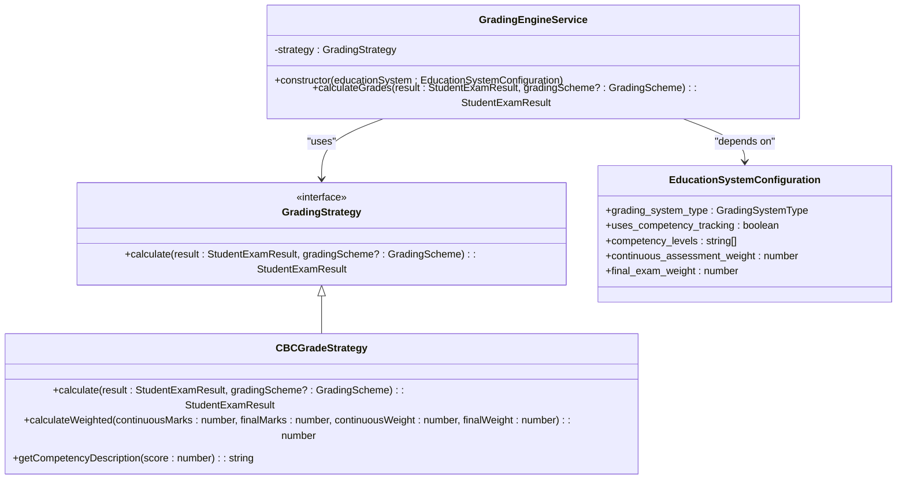
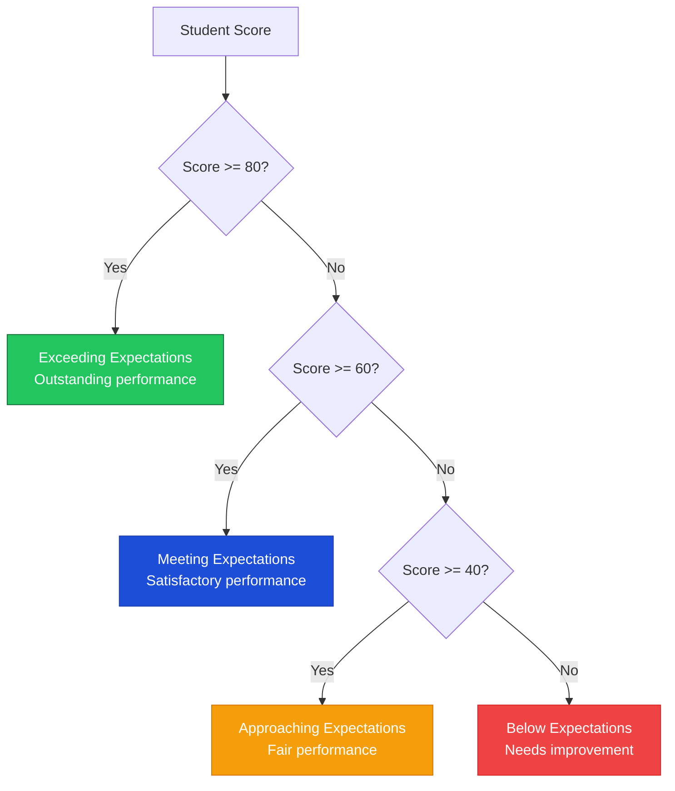
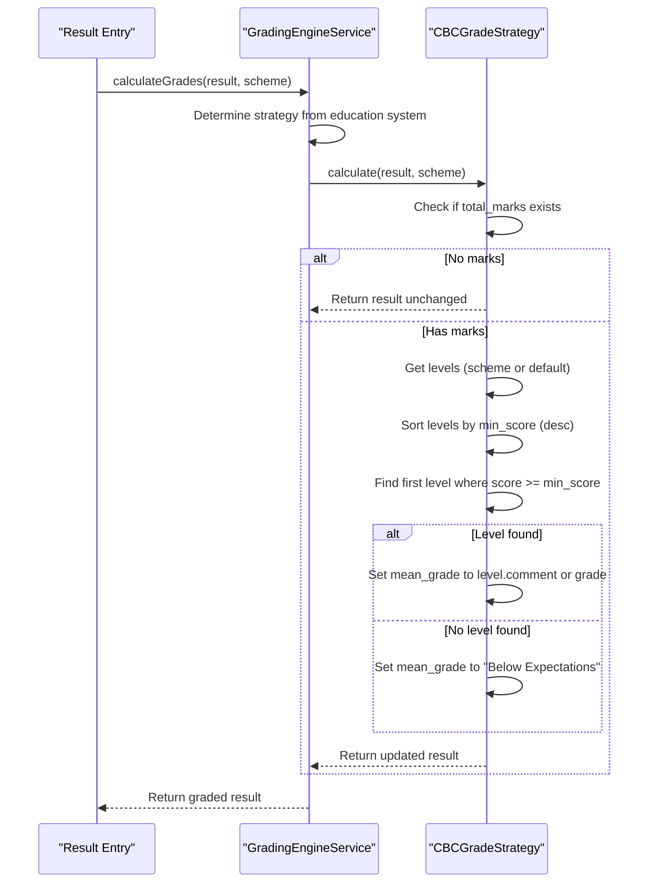
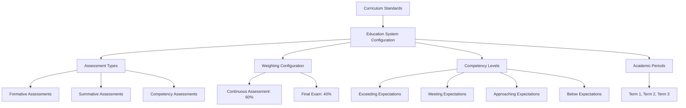
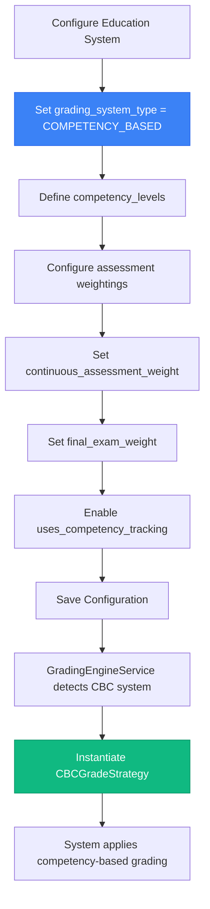

# Competency-Based Curriculum (CBC) Grading Strategy

<cite>
**Referenced Files in This Document**   
- [CBCGradeStrategy.ts](file://src/modules/academics/strategies/CBCGradeStrategy.ts)
- [GradingEngineService.ts](file://src/modules/academics/services/GradingEngineService.ts)
- [education-system-templates.ts](file://src/modules/academics/data/templates/education-system-templates.ts)
- [enums.ts](file://src/modules/academics/data/enums.ts)
- [types.ts](file://src/modules/academics/data/types.ts)
</cite>

## Table of Contents
1. [Introduction](#introduction)
2. [CBC Grading Strategy Overview](#cbc-grading-strategy-overview)
3. [Achievement Levels and Rubrics](#achievement-levels-and-rubrics)
4. [Grade Calculation Process](#grade-calculation-process)
5. [Integration with Curriculum Standards](#integration-with-curriculum-standards)
6. [Configuration and Implementation](#configuration-and-implementation)
7. [Competency Mapping and Proficiency Calculation](#competency-mapping-and-proficiency-calculation)
8. [Best Practices and Challenges](#best-practices-and-challenges)

## Introduction
The Competency-Based Curriculum (CBC) Grading Strategy represents a transformative approach to student assessment that focuses on mastery of specific learning outcomes rather than aggregate scores. This documentation provides a comprehensive analysis of the CBCGradeStrategy implementation, detailing how the system evaluates student performance across various competency levels. The strategy is designed to provide more meaningful feedback by assessing what students can actually do with their knowledge, rather than simply measuring how much content they have memorized. This approach aligns with modern educational philosophies that emphasize deep understanding, critical thinking, and practical application of knowledge.

**Section sources**
- [CBCGradeStrategy.ts](file://src/modules/academics/strategies/CBCGradeStrategy.ts#L1-L66)
- [GradingEngineService.ts](file://src/modules/academics/services/GradingEngineService.ts#L1-L43)

## CBC Grading Strategy Overview
The CBCGradeStrategy implementation follows the Strategy design pattern, allowing the system to dynamically apply different grading methodologies based on the configured education system. When an education system is configured with a grading_system_type of COMPETENCY_BASED, the GradingEngineService instantiates the CBCGradeStrategy to handle all grading calculations. This modular approach enables the system to support multiple grading methodologies within a single platform while maintaining clean separation of concerns. The strategy focuses on assessing student mastery across specific learning outcomes, providing detailed feedback on competency levels rather than reducing performance to a single numerical score or letter grade.

**Diagram sources**
- [CBCGradeStrategy.ts](file://src/modules/academics/strategies/CBCGradeStrategy.ts#L1-L66)
- [GradingEngineService.ts](file://src/modules/academics/services/GradingEngineService.ts#L1-L43)
- [types.ts](file://src/modules/academics/data/types.ts#L273-L311)

**Section sources**
- [CBCGradeStrategy.ts](file://src/modules/academics/strategies/CBCGradeStrategy.ts#L1-L66)
- [GradingEngineService.ts](file://src/modules/academics/services/GradingEngineService.ts#L1-L43)

## Achievement Levels and Rubrics
The CBC grading system implements four distinct achievement levels that provide nuanced feedback on student performance. These levels are: Exceeding Expectations, Meeting Expectations, Approaching Expectations, and Below Expectations. Each level is associated with a specific score range and descriptive commentary that helps educators and students understand the nature of the performance. The system uses a threshold-based approach where scores of 80% and above are classified as "Exceeding Expectations," 60-79% as "Meeting Expectations," 40-59% as "Approaching Expectations," and below 40% as "Below Expectations." These thresholds can be customized through grading schemes, but the system provides sensible defaults that align with educational best practices. The rubrics are designed to be formative rather than purely summative, offering constructive feedback that guides future learning.

**Diagram sources**
- [CBCGradeStrategy.ts](file://src/modules/academics/strategies/CBCGradeStrategy.ts#L10-L24)
- [education-system-templates.ts](file://src/modules/academics/data/templates/education-system-templates.ts#L6-L15)

**Section sources**
- [CBCGradeStrategy.ts](file://src/modules/academics/strategies/CBCGradeStrategy.ts#L10-L24)
- [education-system-templates.ts](file://src/modules/academics/data/templates/education-system-templates.ts#L6-L15)

## Grade Calculation Process
The grade calculation process in the CBC system follows a systematic approach to determine student competency levels. When the calculate method is invoked, the system first checks if total marks are available for the student. If marks are present, the system retrieves the appropriate grading scheme, falling back to default competency levels if no custom scheme is provided. The algorithm sorts grading levels in descending order by minimum score threshold and then finds the highest level for which the student's score meets or exceeds the minimum requirement. This approach ensures that students are recognized for their highest level of achievement. The system also provides a calculateWeighted method that combines continuous assessment and final exam scores using configurable weightings, typically 60% for continuous assessment and 40% for final exams in primary education contexts.

**Diagram sources**
- [CBCGradeStrategy.ts](file://src/modules/academics/strategies/CBCGradeStrategy.ts#L1-L66)
- [GradingEngineService.ts](file://src/modules/academics/services/GradingEngineService.ts#L34-L43)

**Section sources**
- [CBCGradeStrategy.ts](file://src/modules/academics/strategies/CBCGradeStrategy.ts#L1-L66)
- [GradingEngineService.ts](file://src/modules/academics/services/GradingEngineService.ts#L34-L43)

## Integration with Curriculum Standards
The CBC grading strategy is deeply integrated with curriculum standards through the EducationSystemConfiguration structure. The system supports country-specific implementations, with the Kenya CBC Primary System serving as a reference implementation. The configuration includes specific properties such as uses_competency_tracking, competency_levels, and assessment_types that align with competency-based educational frameworks. Assessment types include FORMATIVE, SUMMATIVE, and COMPETENCY assessments, allowing educators to evaluate different dimensions of student learning. The system also incorporates appropriate weighting for different assessment types, with continuous assessment typically accounting for 60% of the final grade in primary education, reflecting the CBC emphasis on ongoing evaluation rather than high-stakes testing. This integration ensures that grading practices are aligned with curriculum objectives and pedagogical approaches.

**Diagram sources**
- [education-system-templates.ts](file://src/modules/academics/data/templates/education-system-templates.ts#L6-L15)
- [types.ts](file://src/modules/academics/data/types.ts#L273-L311)

**Section sources**
- [education-system-templates.ts](file://src/modules/academics/data/templates/education-system-templates.ts#L6-L15)
- [types.ts](file://src/modules/academics/data/types.ts#L273-L311)

## Configuration and Implementation
Configuring the CBC grading system involves setting up an education system with the appropriate parameters for competency-based assessment. The system provides template configurations, such as the KENYA_CBC_PRIMARY template, which pre-configures the system with optimal settings for competency-based evaluation. Administrators can customize various aspects including the competency levels, assessment weightings, and academic period structure. The implementation uses a strategy pattern that allows seamless switching between different grading methodologies based on the education system configuration. When a CBC system is selected, the GradingEngineService automatically instantiates the CBCGradeStrategy, ensuring that all grading calculations follow the competency-based approach. The system also provides fallback mechanisms, using default competency levels when custom grading schemes are not defined, ensuring consistent behavior across different configurations.

**Diagram sources**
- [education-system-templates.ts](file://src/modules/academics/data/templates/education-system-templates.ts#L6-L15)
- [GradingEngineService.ts](file://src/modules/academics/services/GradingEngineService.ts#L10-L15)
- [CBCGradeStrategy.ts](file://src/modules/academics/strategies/CBCGradeStrategy.ts#L1-L66)

**Section sources**
- [education-system-templates.ts](file://src/modules/academics/data/templates/education-system-templates.ts#L6-L15)
- [GradingEngineService.ts](file://src/modules/academics/services/GradingEngineService.ts#L10-L15)

## Competency Mapping and Proficiency Calculation
The CBC system maps assessment results to competency levels through a systematic process that evaluates student mastery across learning outcomes. The calculate method in CBCGradeStrategy takes student exam results and maps them to the appropriate competency level based on predefined thresholds. The system sorts grading levels in descending order by minimum score and finds the highest level the student has achieved. This ensures that students are recognized for their highest level of mastery. For overall subject proficiency, the system can calculate weighted scores that combine continuous assessment (typically 60%) and final exam performance (typically 40%). The getCompetencyDescription method provides detailed feedback on performance, describing what the score indicates about the student's understanding and ability to apply knowledge in different contexts, from exceptional understanding in complex situations to minimal understanding requiring significant support.

**Section sources**
- [CBCGradeStrategy.ts](file://src/modules/academics/strategies/CBCGradeStrategy.ts#L1-L66)
- [types.ts](file://src/modules/academics/data/types.ts#L273-L311)

## Best Practices and Challenges
Implementing a competency-based grading system presents both opportunities and challenges. Key best practices include providing professional development for teachers to ensure consistent application of rubrics, establishing moderation processes to maintain grading consistency across classrooms, and using the detailed competency descriptions to guide instructional decisions. Challenges include ensuring inter-rater reliability when multiple teachers assess the same competencies, maintaining consistency across different subjects with varying assessment methods, and helping stakeholders understand the shift from traditional grading. The system addresses some of these challenges through standardized templates and default competency levels, but ongoing professional development and collaborative moderation are essential for successful implementation. Regular calibration exercises where teachers score sample student work together can help maintain consistency and build shared understanding of the competency levels.

**Section sources**
- [CBCGradeStrategy.ts](file://src/modules/academics/strategies/CBCGradeStrategy.ts#L1-L66)
- [education-system-templates.ts](file://src/modules/academics/data/templates/education-system-templates.ts#L6-L15)
- [GradingEngineService.ts](file://src/modules/academics/services/GradingEngineService.ts#L1-L43)