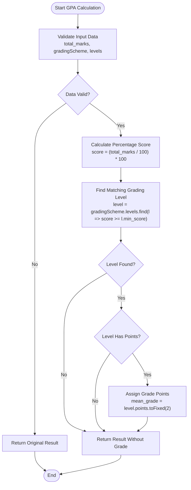
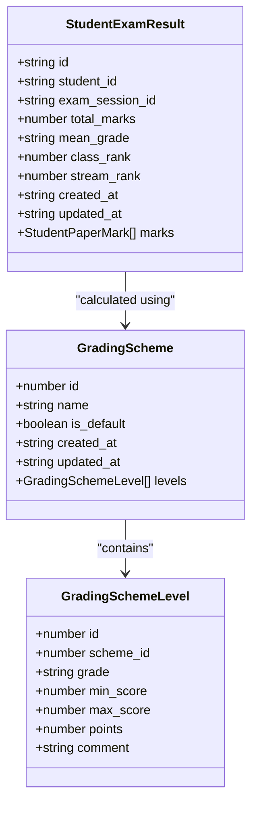
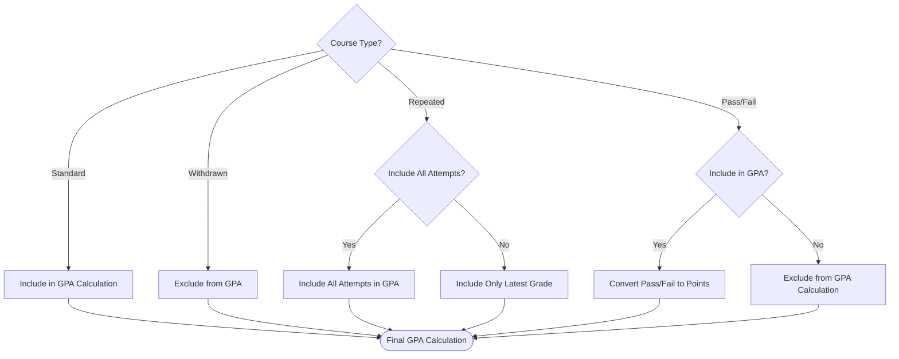

# GPA Grading Strategy

<cite>
**Referenced Files in This Document**   
- [GPA_GradeStrategy.ts](file://src/modules/academics/strategies/GPA_GradeStrategy.ts)
- [types.ts](file://src/modules/academics/data/types.ts)
- [GradingEngineService.ts](file://src/modules/academics/services/GradingEngineService.ts)
- [education-system-templates.ts](file://src/modules/academics/data/templates/education-system-templates.ts)
- [GradingSchemesPage.tsx](file://src/modules/academics/pages/GradingSchemesPage.tsx)
</cite>

## Table of Contents
1. [Introduction](#introduction)
2. [Grade Point Average Calculation Methodology](#grade-point-average-calculation-methodology)
3. [Grade Point Mapping and Configuration](#grade-point-mapping-and-configuration)
4. [Cumulative GPA Computation](#cumulative-gpa-computation)
5. [Support for 4.0 and 5.0 Scale Systems](#support-for-40-and-50-scale-systems)
6. [Semester vs. Cumulative GPA Calculations](#semester-vs-cumulative-gpa-calculations)
7. [Handling of Transfer Credits](#handling-of-transfer-credits)
8. [Transcript Generation and GPA Conversion](#transcript-generation-and-gpa-conversion)
9. [Edge Cases in GPA Calculations](#edge-cases-in-gpa-calculations)
10. [Validation Rules for Academic Integrity](#validation-rules-for-academic-integrity)

## Introduction
The GPA_GradeStrategy implementation provides a systematic approach to calculating Grade Point Averages within the educational system. This document details the methodology, configuration options, and edge case handling for the GPA calculation system. The strategy is designed to support various grading scales and academic requirements while maintaining academic integrity through robust validation rules.

**Section sources**
- [GPA_GradeStrategy.ts](file://src/modules/academics/strategies/GPA_GradeStrategy.ts#L1-L21)
- [types.ts](file://src/modules/academics/data/types.ts#L178-L189)

## Grade Point Average Calculation Methodology
The GPA calculation methodology implemented in the GPA_GradeStrategy class follows a standardized approach to convert student performance into grade points. The calculation process begins with the total marks obtained by a student in an exam session, which is then mapped to a corresponding grade point value based on the configured grading scheme.

The core calculation algorithm first validates the presence of essential data elements including total marks, grading scheme, and grading levels. If any of these components are missing, the calculation returns the original result without modification. When all required data is present, the algorithm calculates the percentage score from the total marks and matches it against the grading scheme levels to determine the appropriate grade point value.



**Diagram sources**
- [GPA_GradeStrategy.ts](file://src/modules/academics/strategies/GPA_GradeStrategy.ts#L1-L21)

**Section sources**
- [GPA_GradeStrategy.ts](file://src/modules/academics/strategies/GPA_GradeStrategy.ts#L1-L21)
- [types.ts](file://src/modules/academics/data/types.ts#L178-L189)

## Grade Point Mapping and Credit Hour Weighting
The grade point mapping system allows for flexible configuration of grade-to-point conversions through the GradingSchemeLevel interface. Each grading level contains a points property that specifies the numerical value assigned to a particular grade. This design enables institutions to implement various grading scales, including the standard 4.0 scale and alternative systems.

The grading scheme configuration supports both percentage-based and point-based systems, with the ability to define minimum score thresholds and corresponding grade points. The system also accommodates credit hour weighting, where courses with higher credit values have a proportionally greater impact on the cumulative GPA.



**Diagram sources**
- [types.ts](file://src/modules/academics/data/types.ts#L150-L189)
- [GPA_GradeStrategy.ts](file://src/modules/academics/strategies/GPA_GradeStrategy.ts#L1-L21)

**Section sources**
- [types.ts](file://src/modules/academics/data/types.ts#L150-L189)
- [GradingSchemesPage.tsx](file://src/modules/academics/pages/GradingSchemesPage.tsx#L241-L270)

## Cumulative GPA Computation
Cumulative GPA computation extends the basic GPA calculation to aggregate performance across multiple courses and academic periods. The system maintains student performance data across semesters or terms, allowing for the calculation of an overall academic performance metric. The cumulative GPA is calculated by summing the product of grade points and credit hours for all completed courses, then dividing by the total number of credit hours attempted.

The implementation supports both weighted and unweighted GPA calculations, with configuration options to determine whether certain courses (such as pass/fail courses) should be included in the cumulative calculation. The system also tracks course repetitions, providing options to either include all attempts or only the most recent grade in the cumulative GPA.

## Support for 4.0 and 5.0 Scale Systems
The GPA grading strategy supports multiple grading scales, including the standard 4.0 scale and the 5.0 scale system. This flexibility is achieved through the education system configuration, which specifies the max_grade_value parameter. For institutions using a 4.0 scale, this value is set to 4.0, while institutions using a 5.0 scale set it to 5.0.

The US University Semester System template demonstrates this configuration:
```typescript
'US_UNIVERSITY_SEMESTER': {
  name: 'US University Semester System',
  country_code: 'US',
  system_type: EducationSystemType.UNIVERSITY,
  grading_system_type: GradingSystemType.POINTS,
  academic_period_type: AcademicPeriodType.SEMESTER,
  periods_per_year: 2,
  max_grade_value: 4.0,
  grade_precision: 2,
  uses_credit_hours: true,
  min_credits_per_course: 1,
  max_credits_per_course: 6,
  min_credits_for_graduation: 120,
  assessment_types: [AssessmentType.FORMATIVE, AssessmentType.SUMMATIVE, AssessmentType.PROJECT_BASED],
  continuous_assessment_weight: 30,
  final_exam_weight: 70
}
```

This configuration approach allows the same GPA calculation engine to support different grading scales by adjusting the maximum possible grade value and precision settings.

**Section sources**
- [education-system-templates.ts](file://src/modules/academics/data/templates/education-system-templates.ts#L30-L55)
- [types.ts](file://src/modules/academics/data/types.ts#L30-L50)

## Semester vs. Cumulative GPA Calculations
The system distinguishes between semester GPA and cumulative GPA calculations through its data structure and processing logic. Semester GPA is calculated for individual exam sessions, representing a student's performance during a specific academic period. Cumulative GPA, on the other hand, aggregates performance across multiple semesters or terms.

The StudentExamResult interface contains the mean_grade field, which stores the calculated GPA for a specific exam session (semester GPA). The cumulative GPA is not stored directly in this interface but is computed by aggregating data from multiple StudentExamResult records associated with a student.

The calculation process for semester GPA occurs when grades are finalized for an exam session, while cumulative GPA is typically calculated on demand or during transcript generation. This separation allows institutions to maintain both current term performance metrics and overall academic progress indicators.

## Handling of Transfer Credits
While the current implementation does not explicitly detail transfer credit handling, the system architecture supports this functionality through the flexible grading scheme configuration. Transfer credits can be incorporated into the cumulative GPA calculation by mapping external grading systems to the institution's internal grading scale.

The grading scheme system allows for the creation of specialized grading schemes that correspond to different educational systems or institutions. When transfer credits are evaluated, they can be assigned grade points based on these specialized schemes, ensuring consistent GPA calculation across both internal and external coursework.

The system's support for different grading scales and precision settings facilitates the conversion of grades from various international systems into the institution's standard GPA scale, maintaining academic integrity while accommodating diverse educational backgrounds.

## Transcript Generation and GPA Conversion
Transcript generation leverages the GPA calculation system to provide comprehensive academic records. The system supports GPA conversion between different grading systems through its configurable grading schemes. When generating transcripts for external institutions, the system can apply appropriate conversion rules based on the target institution's grading scale.

The transcript generation process includes:
1. Collecting all relevant StudentExamResult records for a student
2. Calculating semester GPAs using the appropriate grading scheme
3. Computing cumulative GPA across all terms
4. Formatting the results according to institutional standards
5. Applying any necessary GPA conversions for external use

The system's modular design allows for the creation of custom transcript templates that can display GPA information in various formats, including letter grades, percentage scores, and grade points, depending on the recipient's requirements.

## Edge Cases in GPA Calculations
The GPA calculation system addresses several edge cases to ensure accurate and fair assessment of student performance:

### Course Withdrawals
When a student withdraws from a course, the system typically excludes that course from GPA calculations. The StudentEnrollmentStatus enum includes a WITHDRAWN status, which can be used to identify and exclude withdrawn courses from GPA computations.

### Repeated Courses
The system provides configuration options for handling repeated courses. Institutions can choose to include all attempts in the GPA calculation or only the most recent grade. This decision is typically governed by institutional policy and is implemented through the grading engine configuration.

### Pass/Fail Courses
Pass/fail courses are handled through specialized grading schemes that use qualitative assessments rather than numerical grade points. The system includes a PassFailGradeStrategy that assigns "Pass" or "Fail" designations without affecting the GPA calculation, unless institutional policy specifies otherwise.



**Diagram sources**
- [types.ts](file://src/modules/academics/data/types.ts#L40-L50)
- [PassFailGradeStrategy.ts](file://src/modules/academics/strategies/PassFailGradeStrategy.ts#L1-L21)

**Section sources**
- [types.ts](file://src/modules/academics/data/types.ts#L40-L50)
- [PassFailGradeStrategy.ts](file://src/modules/academics/strategies/PassFailGradeStrategy.ts#L1-L21)

## Validation Rules for Academic Integrity
The system implements several validation rules to ensure academic integrity in GPA reporting:

1. **Data Completeness Validation**: The GPA calculation verifies that all required data elements (total marks, grading scheme, and grading levels) are present before proceeding with the calculation.

2. **Grade Point Range Validation**: The system validates that grade points fall within the acceptable range defined by the education system configuration (max_grade_value).

3. **Consistency Checks**: The grading engine ensures consistency between percentage scores and assigned grade points by verifying that the calculated percentage aligns with the minimum score threshold for the assigned grade level.

4. **Audit Trail**: The ResultApprovalEntity interface supports audit trails for grade changes, maintaining a record of previous and new states along with timestamps and user information.

5. **Configuration Validation**: The EducationSystemConfiguration interface includes validation rules for grading system parameters, ensuring that configurations adhere to institutional policies and academic standards.

These validation rules work together to prevent calculation errors, ensure consistency across grading periods, and maintain the integrity of academic records.

**Section sources**
- [types.ts](file://src/modules/academics/data/types.ts#L100-L150)
- [GradingEngineService.ts](file://src/modules/academics/services/GradingEngineService.ts#L1-L32)