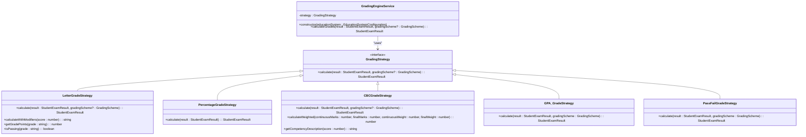
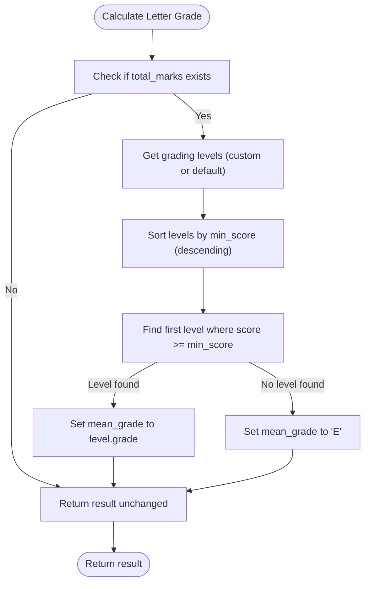
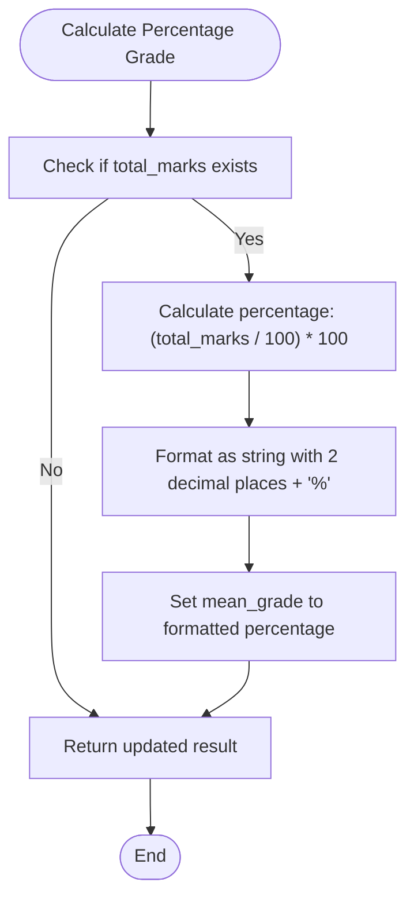
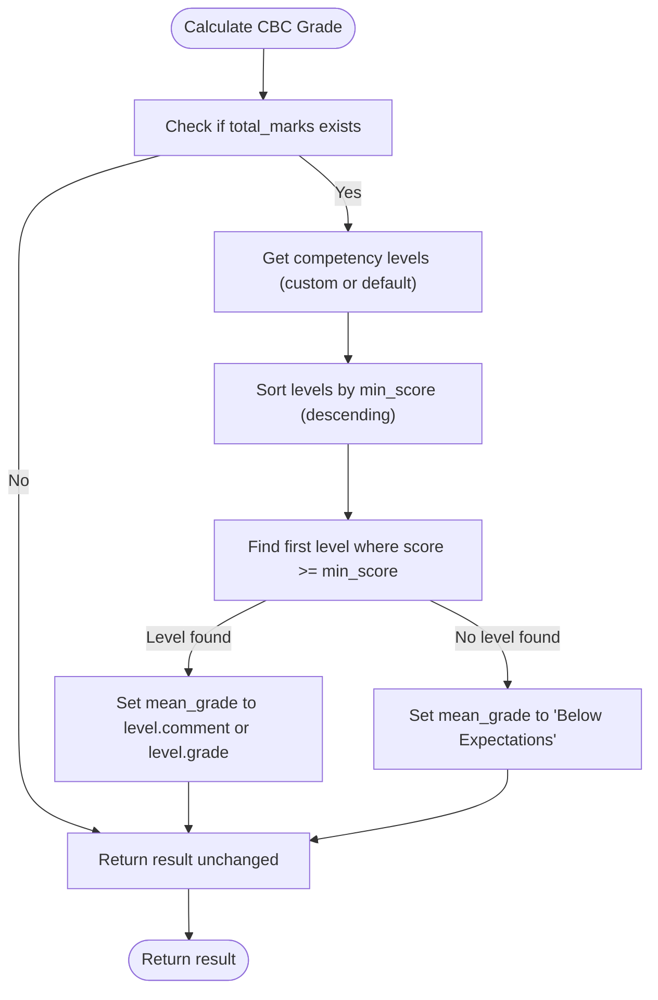
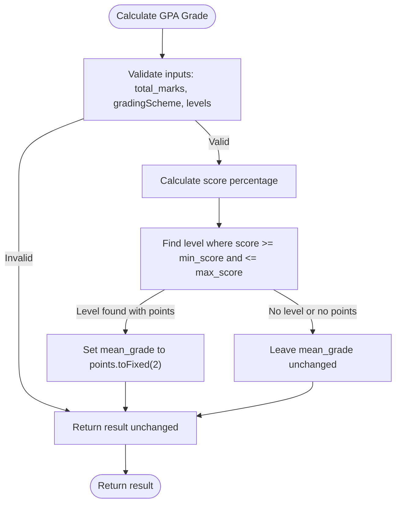
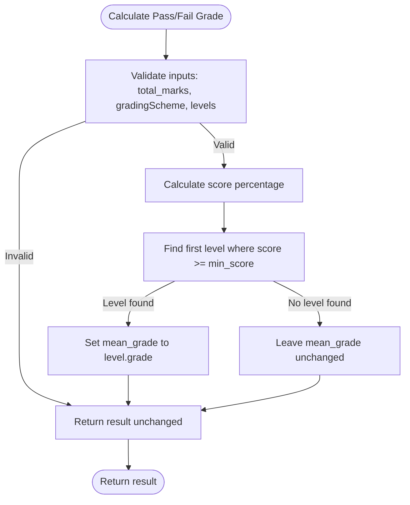
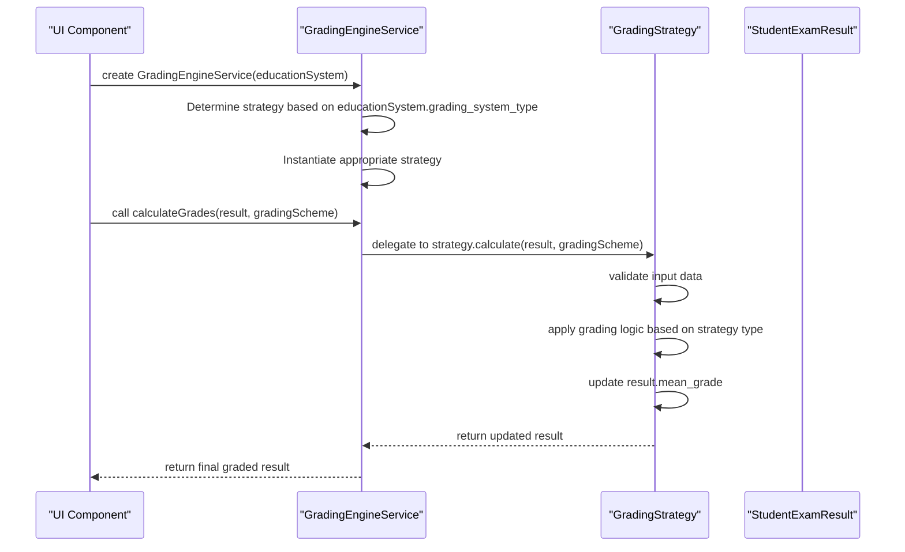
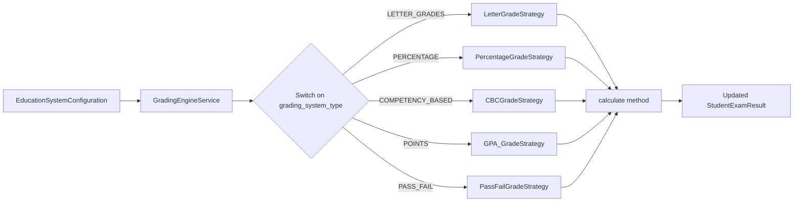
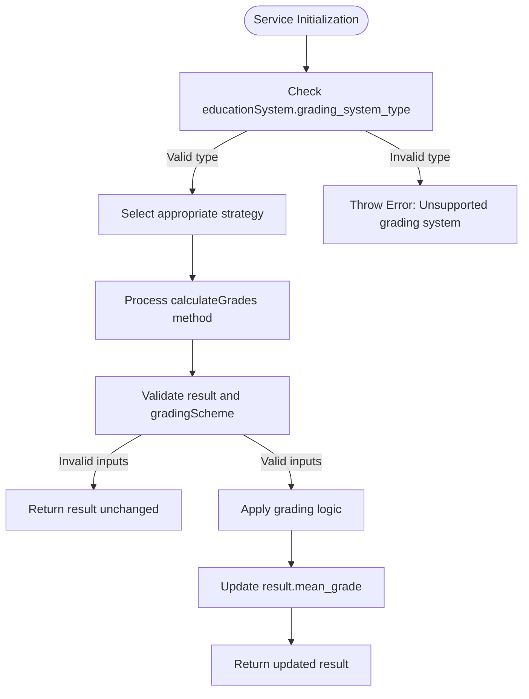

# Grading Engine Service

<cite>
**Referenced Files in This Document**   
- [GradingEngineService.ts](file://src/modules/academics/services/GradingEngineService.ts)
- [types.ts](file://src/modules/academics/data/types.ts)
- [enums.ts](file://src/modules/academics/data/enums.ts)
- [LetterGradeStrategy.ts](file://src/modules/academics/strategies/LetterGradeStrategy.ts)
- [PercentageGradeStrategy.ts](file://src/modules/academics/strategies/PercentageGradeStrategy.ts)
- [CBCGradeStrategy.ts](file://src/modules/academics/strategies/CBCGradeStrategy.ts)
- [GPA_GradeStrategy.ts](file://src/modules/academics/strategies/GPA_GradeStrategy.ts)
- [PassFailGradeStrategy.ts](file://src/modules/academics/strategies/PassFailGradeStrategy.ts)
- [GradeCalculatorWidget.tsx](file://src/modules/academics/components/GradeCalculatorWidget.tsx)
- [grading-engine.spec.ts](file://src/tests/integration/grading-engine.spec.ts)
</cite>

## Table of Contents
1. [Introduction](#introduction)
2. [Core Architecture](#core-architecture)
3. [Grading Strategy Interface](#grading-strategy-interface)
4. [Strategy Implementations](#strategy-implementations)
5. [Data Processing Pipeline](#data-processing-pipeline)
6. [Integration with Module System](#integration-with-module-system)
7. [Usage Examples](#usage-examples)
8. [Error Handling](#error-handling)
9. [Performance Considerations](#performance-considerations)

## Introduction
The Grading Engine Service is the central component responsible for orchestrating all grading calculations within the educational system. It serves as a strategy pattern implementation that dynamically selects and applies the appropriate grading methodology based on the institution's academic context and subject requirements. This service abstracts the complexity of various grading systems, providing a unified interface for grade calculation across different educational frameworks.

**Section sources**
- [GradingEngineService.ts](file://src/modules/academics/services/GradingEngineService.ts#L1-L44)

## Core Architecture
The Grading Engine Service implements the Strategy design pattern, allowing for flexible and extensible grading methodologies. The architecture consists of a central service class that delegates grading calculations to specific strategy implementations based on the configured education system.



**Diagram sources**
- [GradingEngineService.ts](file://src/modules/academics/services/GradingEngineService.ts#L1-L44)
- [LetterGradeStrategy.ts](file://src/modules/academics/strategies/LetterGradeStrategy.ts#L1-L86)
- [PercentageGradeStrategy.ts](file://src/modules/academics/strategies/PercentageGradeStrategy.ts#L1-L15)
- [CBCGradeStrategy.ts](file://src/modules/academics/strategies/CBCGradeStrategy.ts#L1-L67)
- [GPA_GradeStrategy.ts](file://src/modules/academics/strategies/GPA_GradeStrategy.ts#L1-L23)
- [PassFailGradeStrategy.ts](file://src/modules/academics/strategies/PassFailGradeStrategy.ts#L1-L23)

**Section sources**
- [GradingEngineService.ts](file://src/modules/academics/services/GradingEngineService.ts#L1-L44)

## Grading Strategy Interface
The Grading Strategy interface defines the contract for all grading implementations, ensuring consistency in method signatures and return types. This interface enables polymorphic behavior, allowing the Grading Engine Service to work with any strategy implementation without knowing the specific details.

```typescript
export interface GradingStrategy {
  calculate(result: StudentExamResult, gradingScheme?: GradingScheme): StudentExamResult;
}
```

The interface accepts a StudentExamResult object containing the raw marks and returns the same object with the calculated grade populated. The optional gradingScheme parameter allows for custom grading scales to be applied when needed.

**Section sources**
- [GradingEngineService.ts](file://src/modules/academics/services/GradingEngineService.ts#L7-L10)

## Strategy Implementations

### Letter Grade Strategy
The Letter Grade Strategy implements traditional letter-based grading systems (A, B, C, etc.) commonly used in many educational institutions. It supports both standard letter grades and plus/minus modifiers.



**Diagram sources**
- [LetterGradeStrategy.ts](file://src/modules/academics/strategies/LetterGradeStrategy.ts#L12-L62)

**Section sources**
- [LetterGradeStrategy.ts](file://src/modules/academics/strategies/LetterGradeStrategy.ts#L1-L86)

### Percentage Grade Strategy
The Percentage Grade Strategy converts raw scores into percentage-based grades. This simple strategy is commonly used for formative assessments and quick evaluations.



**Diagram sources**
- [PercentageGradeStrategy.ts](file://src/modules/academics/strategies/PercentageGradeStrategy.ts#L7-L14)

**Section sources**
- [PercentageGradeStrategy.ts](file://src/modules/academics/strategies/PercentageGradeStrategy.ts#L1-L15)

### Competency-Based Grading (CBC) Strategy
The CBC Grade Strategy implements competency-based education grading, focusing on mastery of skills rather than point accumulation. This approach is particularly useful for modern educational frameworks that emphasize skill development.



**Diagram sources**
- [CBCGradeStrategy.ts](file://src/modules/academics/strategies/CBCGradeStrategy.ts#L12-L25)

**Section sources**
- [CBCGradeStrategy.ts](file://src/modules/academics/strategies/CBCGradeStrategy.ts#L1-L67)

### GPA Grade Strategy
The GPA Grade Strategy converts raw scores into grade point averages, commonly used in higher education institutions. This strategy relies on grading schemes that define point values for different score ranges.



**Diagram sources**
- [GPA_GradeStrategy.ts](file://src/modules/academics/strategies/GPA_GradeStrategy.ts#L7-L21)

**Section sources**
- [GPA_GradeStrategy.ts](file://src/modules/academics/strategies/GPA_GradeStrategy.ts#L1-L23)

### Pass/Fail Grade Strategy
The Pass/Fail Grade Strategy implements binary grading systems where students either pass or fail based on predefined thresholds. This strategy is commonly used for prerequisite courses and certification programs.



**Diagram sources**
- [PassFailGradeStrategy.ts](file://src/modules/academics/strategies/PassFailGradeStrategy.ts#L7-L21)

**Section sources**
- [PassFailGradeStrategy.ts](file://src/modules/academics/strategies/PassFailGradeStrategy.ts#L1-L23)

## Data Processing Pipeline
The grading data processing pipeline follows a structured sequence from raw marks to final grades, incorporating validation, weighting, and aggregation steps.



**Diagram sources**
- [GradingEngineService.ts](file://src/modules/academics/services/GradingEngineService.ts#L1-L44)
- [types.ts](file://src/modules/academics/data/types.ts#L140-L150)

**Section sources**
- [GradingEngineService.ts](file://src/modules/academics/services/GradingEngineService.ts#L1-L44)

## Integration with Module System
The Grading Engine Service integrates seamlessly with the module system through dependency injection of strategy implementations. The service is instantiated with an EducationSystemConfiguration object that determines which grading strategy to use.



The service is designed to be instantiated wherever grading calculations are needed, with the appropriate strategy automatically selected based on the education system configuration.

**Diagram sources**
- [GradingEngineService.ts](file://src/modules/academics/services/GradingEngineService.ts#L15-L31)
- [enums.ts](file://src/modules/academics/data/enums.ts#L42-L48)

**Section sources**
- [GradingEngineService.ts](file://src/modules/academics/services/GradingEngineService.ts#L1-L44)

## Usage Examples

### UI Component Integration
The Grading Engine Service is used in UI components such as the Grade Calculator Widget to provide real-time grade calculations.

```typescript
// src/modules/academics/components/GradeCalculatorWidget.tsx
const calculateGrade = () => {
  try {
    const gradingEngine = new GradingEngineService(currentSystem);
    const percentage = (marks / totalMarks) * 100;
    
    const mockResult: StudentExamResult = {
      id: 'temp',
      student_id: 'temp',
      exam_session_id: 'temp',
      total_marks: percentage,
      created_at: new Date().toISOString(),
      updated_at: new Date().toISOString()
    };

    const calculatedResult = gradingEngine.calculateGrades(mockResult);
    setCalculatedGrade(calculatedResult.mean_grade || 'N/A');
    
    // Set grade description based on system type
    if (currentSystem.grading_system_type === GradingSystemType.COMPETENCY_BASED) {
      setGradeDescription(getCompetencyDescription(percentage));
    } else {
      setGradeDescription(getLetterGradeDescription(calculatedResult.mean_grade || ''));
    }

    if (onGradeCalculated) {
      onGradeCalculated(calculatedResult);
    }
  } catch (error) {
    console.error('Error calculating grade:', error);
    setCalculatedGrade('Error');
    setGradeDescription('Unable to calculate grade');
  }
};
```

**Section sources**
- [GradeCalculatorWidget.tsx](file://src/modules/academics/components/GradeCalculatorWidget.tsx#L28-L67)

### API Endpoint Integration
The service can be integrated into API endpoints for batch processing of student grades across large cohorts.

```typescript
// Example API endpoint usage
app.post('/api/calculate-grades', async (req, res) => {
  try {
    const { results, educationSystem } = req.body;
    const gradingEngine = new GradingEngineService(educationSystem);
    
    // Process grades in batches for performance optimization
    const batchSize = 100;
    const processedResults = [];
    
    for (let i = 0; i < results.length; i += batchSize) {
      const batch = results.slice(i, i + batchSize);
      const processedBatch = batch.map(result => 
        gradingEngine.calculateGrades(result)
      );
      processedResults.push(...processedBatch);
    }
    
    res.json(processedResults);
  } catch (error) {
    res.status(400).json({ error: error.message });
  }
});
```

## Error Handling
The Grading Engine Service implements robust error handling to manage invalid data and unsupported grading systems.



The service throws an error during initialization if an unsupported grading system type is provided. During grade calculation, invalid inputs are handled gracefully by returning the original result object unchanged rather than throwing exceptions, ensuring that partial data processing can continue.

**Section sources**
- [GradingEngineService.ts](file://src/modules/academics/services/GradingEngineService.ts#L25-L31)

## Performance Considerations
The Grading Engine Service is optimized for both individual and batch grade calculations across large student cohorts.

### Batch Processing Optimization
For processing large numbers of student grades, the service can be used in batch mode to minimize instantiation overhead:

```typescript
// Batch processing optimization
function calculateBatchGrades(
  results: StudentExamResult[], 
  educationSystem: EducationSystemConfiguration,
  gradingScheme?: GradingScheme
): StudentExamResult[] {
  const gradingEngine = new GradingEngineService(educationSystem);
  return results.map(result => 
    gradingEngine.calculateGrades(result, gradingScheme)
  );
}
```

By reusing a single GradingEngineService instance for multiple calculations, the overhead of strategy instantiation is eliminated, significantly improving performance for batch operations.

### Caching Strategy
For frequently used grading schemes, a caching mechanism can be implemented:

```typescript
class CachingGradingEngineService {
  private strategy: GradingStrategy;
  private gradingSchemeCache: Map<number, GradingScheme> = new Map();
  
  constructor(educationSystem: EducationSystemConfiguration) {
    // Strategy instantiation logic
  }
  
  // Cache frequently used grading schemes to avoid repeated database lookups
  private getGradingScheme(schemeId?: number): GradingScheme | undefined {
    if (!schemeId) return undefined;
    
    if (this.gradingSchemeCache.has(schemeId)) {
      return this.gradingSchemeCache.get(schemeId);
    }
    
    // Load from data source and cache
    const scheme = this.loadGradingScheme(schemeId);
    this.gradingSchemeCache.set(schemeId, scheme);
    return scheme;
  }
}
```

The service is designed to handle high-volume grading operations efficiently, making it suitable for end-of-term processing of entire student populations.

**Section sources**
- [GradingEngineService.ts](file://src/modules/academics/services/GradingEngineService.ts#L1-L44)
- [types.ts](file://src/modules/academics/data/types.ts#L140-L150)