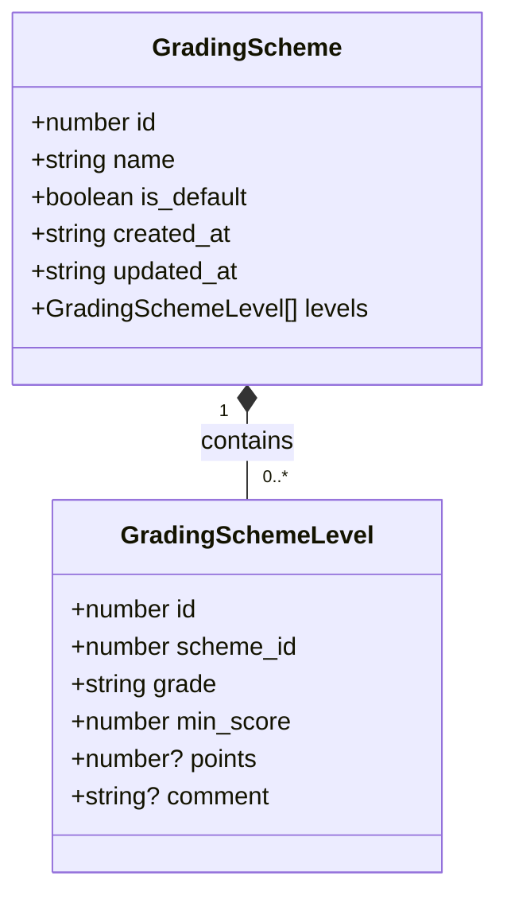
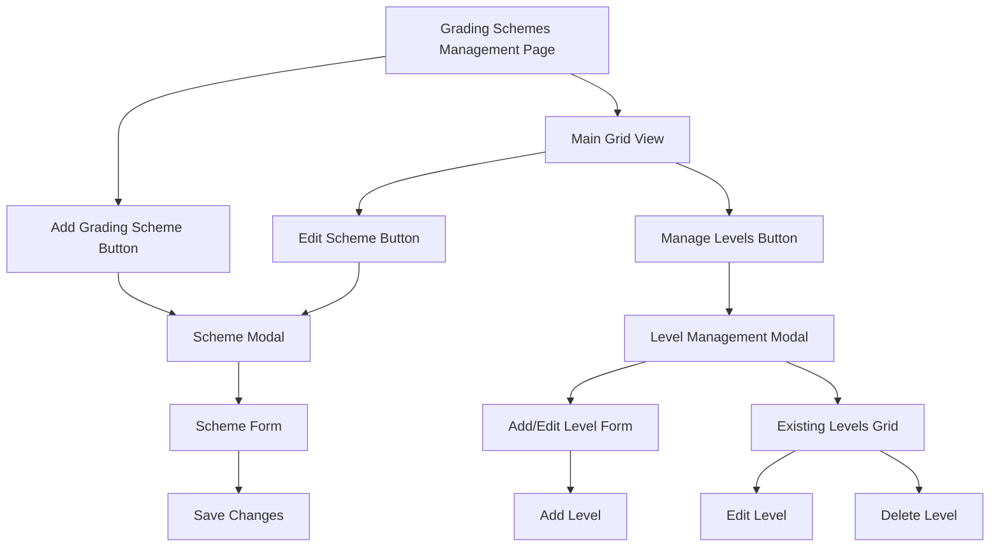
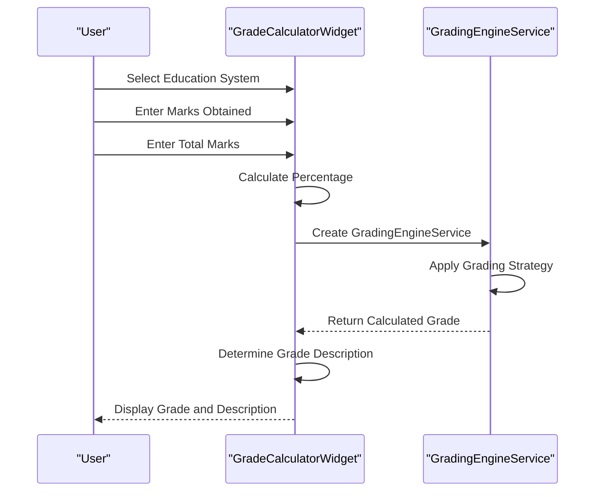

# Grading Schemes Configuration

<cite>
**Referenced Files in This Document**   
- [GradingSchemesPage.tsx](file://src/modules/academics/pages/GradingSchemesPage.tsx)
- [GradeCalculatorWidget.tsx](file://src/modules/academics/components/GradeCalculatorWidget.tsx)
- [useGradingSchemeData.ts](file://src/modules/academics/data/useGradingSchemeData.ts)
- [useGradingSchemeLevelData.ts](file://src/modules/academics/data/useGradingSchemeLevelData.ts)
- [schema.ts](file://src/modules/academics/data/schema.ts)
- [types.ts](file://src/modules/academics/data/types.ts)
- [mockData.ts](file://src/modules/academics/data/mockData.ts)
- [CBCGradeStrategy.ts](file://src/modules/academics/strategies/CBCGradeStrategy.ts)
- [LetterGradeStrategy.ts](file://src/modules/academics/strategies/LetterGradeStrategy.ts)
</cite>

## Table of Contents
1. [Introduction](#introduction)
2. [Grading Scheme Data Structure](#grading-scheme-data-structure)
3. [GradingSchemesPage Interface](#gradingschemespage-interface)
4. [Grade Calculator Widget](#grade-calculator-widget)
5. [Creating and Editing Grading Schemes](#creating-and-editing-grading-schemes)
6. [Common Grading Scale Examples](#common-grading-scale-examples)
7. [Data Validation and Access Control](#data-validation-and-access-control)
8. [Audit Logging and Change Management](#audit-logging-and-change-management)

## Introduction
The Grading Schemes Configuration system enables administrators to define custom grading schemes that determine how student performance is evaluated and reported. This document provides comprehensive guidance on configuring grading schemes through the GradingSchemesPage interface, explaining how to set up thresholds, labels, and color coding for different performance levels. The system supports hierarchical grading structures with multiple levels, each having minimum score requirements and descriptive labels. Administrators can create, edit, and retire grading schemes while the GradeCalculatorWidget provides real-time previews of grade calculations based on current schemes. This documentation covers step-by-step procedures for managing grading policies, including examples of common grading scale configurations used in different educational systems.

## Grading Scheme Data Structure

The grading scheme system is built on a hierarchical data model consisting of GradingScheme and GradingSchemeLevel entities. The GradingScheme represents the overall grading policy, while GradingSchemeLevel defines the individual performance tiers within that scheme.



**Diagram sources**
- [types.ts](file://src/modules/academics/data/types.ts#L150-L160)

**Section sources**
- [types.ts](file://src/modules/academics/data/types.ts#L150-L160)
- [schema.ts](file://src/modules/academics/data/schema.ts#L136-L159)

### GradingScheme Properties
The GradingScheme entity contains the following properties:
- **id**: Unique identifier for the grading scheme
- **name**: Descriptive name of the grading scheme
- **is_default**: Boolean flag indicating if this is the default scheme
- **created_at**: Timestamp when the scheme was created
- **updated_at**: Timestamp when the scheme was last modified
- **levels**: Array of GradingSchemeLevel objects that define the performance tiers

### GradingSchemeLevel Properties
The GradingSchemeLevel entity contains the following properties:
- **id**: Unique identifier for the grading level
- **scheme_id**: Reference to the parent GradingScheme
- **grade**: The grade label (e.g., "A", "B+", "Exceeding Expectations")
- **min_score**: Minimum percentage score required to achieve this grade
- **points**: Optional numeric value for grade point calculation (e.g., GPA)
- **comment**: Optional descriptive comment for the performance level

The data structure enforces validation rules through the schema definition, including:
- Minimum and maximum constraints for numeric values
- Required fields for critical properties
- Data type validation for all attributes
- Reference integrity between schemes and levels

## GradingSchemesPage Interface

The GradingSchemesPage provides a comprehensive interface for administrators to manage grading schemes. The interface is organized into a main grid view with modal dialogs for creating and editing schemes and their levels.



**Diagram sources**
- [GradingSchemesPage.tsx](file://src/modules/academics/pages/GradingSchemesPage.tsx#L0-L271)

**Section sources**
- [GradingSchemesPage.tsx](file://src/modules/academics/pages/GradingSchemesPage.tsx#L0-L271)

### Main Interface Components
The GradingSchemesPage interface consists of several key components:

**Main Grid View**: Displays all available grading schemes in a tabular format with columns for:
- ID: Unique identifier
- Scheme Name: Descriptive name of the grading scheme
- Is Default: Indicator showing if the scheme is the default
- Levels: Count of grading levels in the scheme
- Actions: Buttons for editing, managing levels, and deleting the scheme

**Scheme Modal**: A dialog for creating and editing grading schemes with fields for:
- Scheme Name: Text input for the grading scheme name
- Set as Default Scheme: Checkbox to designate the scheme as default
- Save/Cancel buttons for form submission

**Level Management Modal**: A comprehensive interface for managing grading levels within a specific scheme, containing:
- Add/Edit Level form with inputs for grade, minimum score, points, and comment
- Existing Levels grid displaying all levels for the current scheme
- Edit and Delete buttons for each existing level

The interface uses React state management to handle form data and modal visibility, with real-time updates to the display when changes are saved.

## Grade Calculator Widget

The GradeCalculatorWidget provides real-time previews of grade calculations based on current grading schemes, allowing users to test how scores translate to grades under different educational systems.



**Diagram sources**
- [GradeCalculatorWidget.tsx](file://src/modules/academics/components/GradeCalculatorWidget.tsx#L0-L139)
- [GradingEngineService.ts](file://src/modules/academics/services/GradingEngineService.ts#L29-L42)

**Section sources**
- [GradeCalculatorWidget.tsx](file://src/modules/academics/components/GradeCalculatorWidget.tsx#L0-L139)

### Widget Functionality
The GradeCalculatorWidget offers the following features:

**Education System Selection**: Users can select from predefined education systems or use a custom configuration:
- Kenya CBC Secondary
- Kenya CBC Primary
- US University

**Score Input**: Fields for entering:
- Marks Obtained: The actual score achieved by the student
- Total Marks: The maximum possible score for the assessment

**Real-time Calculation**: As users enter scores, the widget automatically calculates:
- Percentage: The percentage score (marks obtained / total marks * 100)
- Grade: The corresponding grade based on the selected grading scheme
- Grade Description: A textual description of the performance level

**Visual Feedback**: The widget displays results in clearly formatted sections:
- Percentage display with current score
- Grade display with color coding
- Grade description with additional context
- System information showing the active education system

The widget uses the GradingEngineService to perform calculations, ensuring consistency with the actual grading logic used throughout the system.

## Creating and Editing Grading Schemes

### Creating a New Grading Scheme
To create a new grading scheme:

1. Navigate to the GradingSchemesPage
2. Click the "Add Grading Scheme" button
3. In the Scheme Modal, enter a name for the grading scheme
4. Optionally check "Set as Default Scheme" if this should be the default
5. Click "Add Scheme" to save

The new scheme will appear in the main grid view with no levels initially.

### Adding Grading Levels
To add levels to a grading scheme:

1. Click "Manage Levels" for the desired scheme
2. In the Level Management Modal, fill in the Add/Edit Level form:
   - Grade: Enter the grade label (e.g., "A", "B+")
   - Minimum Score: Enter the minimum percentage required
   - Points: Optionally enter grade points
   - Comment: Optionally add a descriptive comment
3. Click "Add Level"
4. Repeat for additional levels
5. Click "Done" when finished

### Editing Existing Schemes and Levels
To edit an existing grading scheme:
1. Click "Edit Scheme" for the desired scheme
2. Modify the scheme name or default status
3. Click "Save Changes"

To edit an existing grading level:
1. Click "Manage Levels" for the scheme
2. Click "Edit" for the level to modify
3. Update the grade, minimum score, points, or comment
4. Click "Update Level"

### Deleting Schemes and Levels
To delete a grading scheme:
1. Click "Delete" for the scheme
2. Confirm the deletion in the confirmation dialog
3. Note: All associated levels will also be deleted

To delete a grading level:
1. Click "Manage Levels" for the scheme
2. Click "Delete" for the level to remove
3. Confirm the deletion in the confirmation dialog

**Section sources**
- [GradingSchemesPage.tsx](file://src/modules/academics/pages/GradingSchemesPage.tsx#L0-L271)
- [useGradingSchemeData.ts](file://src/modules/academics/data/useGradingSchemeData.ts#L0-L39)
- [useGradingSchemeLevelData.ts](file://src/modules/academics/data/useGradingSchemeLevelData.ts#L0-L42)

## Common Grading Scale Examples

### Standard A-E Grading Scale
This example represents a traditional letter grading system:

```json
{
  "id": 1,
  "name": "Standard A-E Grading",
  "is_default": true,
  "created_at": "2024-01-01T00:00:00Z",
  "updated_at": "2024-01-01T00:00:00Z",
  "levels": [
    {"id": 1, "scheme_id": 1, "grade": "A", "min_score": 80, "points": 12, "comment": "Excellent"},
    {"id": 2, "scheme_id": 1, "grade": "A-", "min_score": 75, "points": 11, "comment": "Excellent"},
    {"id": 3, "scheme_id": 1, "grade": "B+", "min_score": 70, "points": 10, "comment": "Very Good"},
    {"id": 4, "scheme_id": 1, "grade": "B", "min_score": 65, "points": 9, "comment": "Good"},
    {"id": 5, "scheme_id": 1, "grade": "B-", "min_score": 60, "points": 8, "comment": "Good"},
    {"id": 6, "scheme_id": 1, "grade": "C+", "min_score": 55, "points": 7, "comment": "Average"},
    {"id": 7, "scheme_id": 1, "grade": "C", "min_score": 50, "points": 6, "comment": "Average"},
    {"id": 8, "scheme_id": 1, "grade": "C-", "min_score": 45, "points": 5, "comment": "Average"},
    {"id": 9, "scheme_id": 1, "grade": "D+", "min_score": 40, "points": 4, "comment": "Pass"},
    {"id": 10, "scheme_id": 1, "grade": "D", "min_score": 35, "points": 3, "comment": "Pass"},
    {"id": 11, "scheme_id": 1, "grade": "D-", "min_score": 30, "points": 2, "comment": "Pass"},
    {"id": 12, "scheme_id": 1, "grade": "E", "min_score": 0, "points": 1, "comment": "Fail"}
  ]
}
```

**Section sources**
- [mockData.ts](file://src/modules/academics/data/mockData.ts#L500-L530)

### Competency-Based Grading Scale
This example represents a competency-based system used in CBC (Competency-Based Curriculum):

```json
{
  "id": 2,
  "name": "CBC Competency Levels",
  "is_default": false,
  "created_at": "2024-01-01T00:00:00Z",
  "updated_at": "2024-01-01T00:00:00Z",
  "levels": [
    {"id": 13, "scheme_id": 2, "grade": "Exceeding Expectations", "min_score": 80, "comment": "Exceeding Expectations - Outstanding performance"},
    {"id": 14, "scheme_id": 2, "grade": "Meeting Expectations", "min_score": 60, "comment": "Meeting Expectations - Satisfactory performance"},
    {"id": 15, "scheme_id": 2, "grade": "Approaching Expectations", "min_score": 40, "comment": "Approaching Expectations - Fair performance"},
    {"id": 16, "scheme_id": 2, "grade": "Below Expectations", "min_score": 0, "comment": "Below Expectations - Needs improvement"}
  ]
}
```

This scale focuses on competency levels rather than letter grades, providing more descriptive feedback on student performance.

**Section sources**
- [CBCGradeStrategy.ts](file://src/modules/academics/strategies/CBCGradeStrategy.ts#L0-L25)

## Data Validation and Access Control

### Data Validation Rules
The system enforces several validation rules to ensure data integrity:

**Scheme Validation**:
- Scheme name is required and cannot be empty
- Scheme name must be unique within the system
- Minimum score values must be non-negative
- Grade labels must be provided for all levels

**Level Validation**:
- Minimum score must be a valid number
- Grade labels cannot be empty
- Levels within a scheme must not have overlapping score ranges
- The highest level must have the highest minimum score
- The lowest level must have a minimum score of 0

The validation is implemented through both client-side checks in the GradingSchemesPage and server-side validation in the data schema.

### Access Control
Access to grading scheme modifications is controlled through role-based permissions:

**Administrative Access**:
- Only users with administrative privileges can create, edit, or delete grading schemes
- The interface checks user permissions before displaying modification options
- Attempts to modify schemes without proper permissions are rejected

**Default Scheme Protection**:
- The default grading scheme cannot be deleted
- Only one scheme can be designated as default at a time
- Changing the default scheme requires elevated permissions

**Section sources**
- [GradingSchemesPage.tsx](file://src/modules/academics/pages/GradingSchemesPage.tsx#L0-L271)
- [schema.ts](file://src/modules/academics/data/schema.ts#L136-L159)

## Audit Logging and Change Management

### Change Tracking
All modifications to grading schemes are tracked through comprehensive audit logging:

**Timestamp Recording**:
- created_at: Records when a grading scheme is created
- updated_at: Updates whenever a scheme or its levels are modified

**Modification History**:
- Each update operation records the timestamp of the change
- The system maintains the history of all changes to grading policies
- Previous versions of schemes can be reconstructed from the audit trail

### Retirement of Grading Schemes
When retiring grading schemes:

1. **Deactivation**: Instead of immediate deletion, schemes can be deactivated
2. **Historical Preservation**: Retired schemes remain in the system for historical record-keeping
3. **Usage Check**: The system checks if a scheme is currently assigned to any active academic periods before retirement
4. **Notification**: Administrators are notified of the implications of retiring a scheme

The retirement process ensures that historical grade calculations remain consistent while preventing the scheme from being used for new assessments.

**Section sources**
- [useGradingSchemeData.ts](file://src/modules/academics/data/useGradingSchemeData.ts#L0-L39)
- [useGradingSchemeLevelData.ts](file://src/modules/academics/data/useGradingSchemeLevelData.ts#L0-L42)