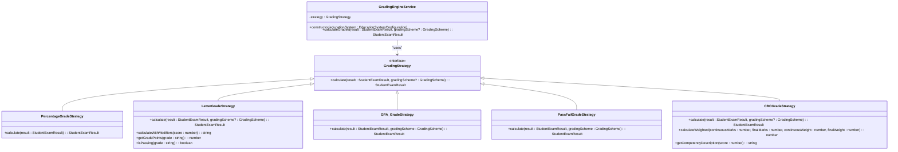
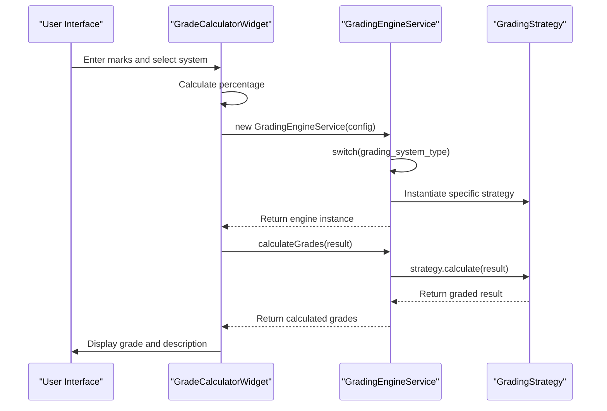
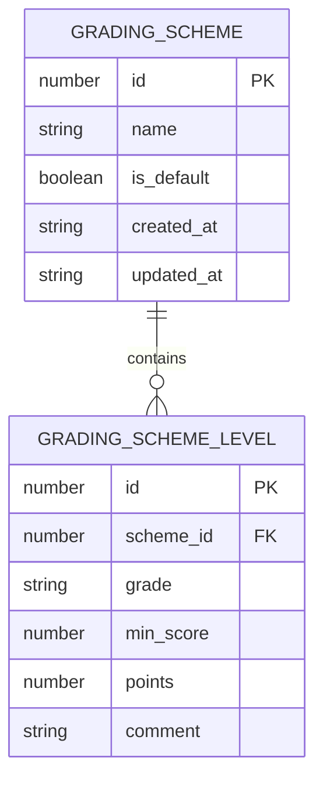

# Grading System and Strategies

<cite>
**Referenced Files in This Document**   
- [PercentageGradeStrategy.ts](file://src/modules/academics/strategies/PercentageGradeStrategy.ts)
- [LetterGradeStrategy.ts](file://src/modules/academics/strategies/LetterGradeStrategy.ts)
- [GPA_GradeStrategy.ts](file://src/modules/academics/strategies/GPA_GradeStrategy.ts)
- [PassFailGradeStrategy.ts](file://src/modules/academics/strategies/PassFailGradeStrategy.ts)
- [CBCGradeStrategy.ts](file://src/modules/academics/strategies/CBCGradeStrategy.ts)
- [GradingEngineService.ts](file://src/modules/academics/services/GradingEngineService.ts)
- [GradeCalculatorWidget.tsx](file://src/modules/academics/components/GradeCalculatorWidget.tsx)
- [types.ts](file://src/modules/academics/data/types.ts)
- [enums.ts](file://src/modules/academics/data/enums.ts)
- [education-system-templates.ts](file://src/modules/academics/data/templates/education-system-templates.ts)
</cite>

## Table of Contents
1. [Introduction](#introduction)
2. [Grading Strategy Pattern Implementation](#grading-strategy-pattern-implementation)
3. [Individual Grading Strategies](#individual-grading-strategies)
   - [Percentage Grading Strategy](#percentage-grading-strategy)
   - [Letter Grading Strategy](#letter-grading-strategy)
   - [GPA Grading Strategy](#gpa-grading-strategy)
   - [Pass/Fail Grading Strategy](#passfail-grading-strategy)
   - [CBC Grading Strategy](#cbc-grading-strategy)
4. [Grading Engine Service](#grading-engine-service)
5. [Grade Calculator Widget](#grade-calculator-widget)
6. [Data Model for Grading Schemes](#data-model-for-grading-schemes)
7. [Configuration Parameters and Use Cases](#configuration-parameters-and-use-cases)
8. [Custom Grading Scheme Configuration](#custom-grading-scheme-configuration)
9. [Migration Between Grading Systems](#migration-between-grading-systems)
10. [Edge Cases and Incomplete Assessments](#edge-cases-and-incomplete-assessments)
11. [Best Practices for Grading Consistency](#best-practices-for-grading-consistency)

## Introduction
The Grading System and Strategies component provides a flexible, pluggable architecture for implementing various grading methodologies within an educational institution. This system supports multiple grading approaches including Percentage, Competency-Based Curriculum (CBC), Grade Point Average (GPA), Letter Grades, and Pass/Fail systems. The implementation follows the Strategy design pattern, allowing for easy extension and configuration of different grading methodologies based on institutional requirements, educational systems, and academic levels. The system is designed to be both comprehensive and adaptable, supporting real-time grade calculation, configurable grading schemes, and seamless migration between different grading systems.

## Grading Strategy Pattern Implementation
The grading system implements the Strategy design pattern to enable pluggable grading methodologies. This pattern allows the algorithm for grade calculation to be selected at runtime based on the configured education system. The core interface `GradingStrategy` defines the contract that all grading strategies must implement, with the `calculate` method accepting a `StudentExamResult` and optional `GradingScheme` parameters.



**Diagram sources**
- [GradingEngineService.ts](file://src/modules/academics/services/GradingEngineService.ts#L1-L43)
- [PercentageGradeStrategy.ts](file://src/modules/academics/strategies/PercentageGradeStrategy.ts#L1-L14)
- [LetterGradeStrategy.ts](file://src/modules/academics/strategies/LetterGradeStrategy.ts#L1-L85)
- [GPA_GradeStrategy.ts](file://src/modules/academics/strategies/GPA_GradeStrategy.ts#L1-L22)
- [PassFailGradeStrategy.ts](file://src/modules/academics/strategies/PassFailGradeStrategy.ts#L1-L22)
- [CBCGradeStrategy.ts](file://src/modules/academics/strategies/CBCGradeStrategy.ts#L1-L66)

**Section sources**
- [GradingEngineService.ts](file://src/modules/academics/services/GradingEngineService.ts#L1-L43)

## Individual Grading Strategies

### Percentage Grading Strategy
The PercentageGradeStrategy implements a straightforward percentage-based grading system where the final grade is expressed as a percentage of total possible marks.

**Algorithm**: The strategy calculates the percentage by dividing the total marks obtained by the maximum possible marks and multiplying by 100. The result is formatted to two decimal places and displayed with a percentage sign.

**Configuration Parameters**:
- No additional configuration required beyond the base education system configuration
- Automatically uses the total marks from the student's exam result

**Use Cases**:
- Simple assessment scenarios where percentage scores are preferred
- Institutions that require transparent, easily understandable grading
- Formative assessments where precise percentage scores are needed

```typescript
export class PercentageGradeStrategy implements GradingStrategy {
  calculate(result: StudentExamResult): StudentExamResult {
    if (result.total_marks) {
      result.mean_grade = `${((result.total_marks / 100) * 100).toFixed(2)}%`;
    }
    return result;
  }
}
```

**Section sources**
- [PercentageGradeStrategy.ts](file://src/modules/academics/strategies/PercentageGradeStrategy.ts#L1-L14)

### Letter Grading Strategy
The LetterGradeStrategy converts numerical scores into letter grades based on predefined thresholds, with support for custom grading schemes or a default Kenyan letter grade system.

**Algorithm**: The strategy first checks if a custom grading scheme is provided. If not, it uses a default set of grading levels. It sorts the grading levels in descending order by minimum score and finds the first level where the student's score meets or exceeds the minimum threshold.

**Configuration Parameters**:
- `gradingScheme`: Optional custom grading scheme with defined levels
- Default levels include grade, minimum score, points, and comment
- Grading levels are defined with minimum scores (no maximum, as they are implicitly defined by the next higher grade)

**Use Cases**:
- Secondary and tertiary institutions using traditional letter grading
- Kenyan education system (default configuration provided)
- Institutions that want to customize their letter grading thresholds

```typescript
export class LetterGradeStrategy implements GradingStrategy {
  calculate(result: StudentExamResult, gradingScheme?: GradingScheme): StudentExamResult {
    if (!result.total_marks) {
      return result;
    }

    const defaultLevels: GradingSchemeLevel[] = [
      { id: 1, scheme_id: 0, grade: 'A', min_score: 80, points: 12, comment: 'Excellent' },
      { id: 2, scheme_id: 0, grade: 'A-', min_score: 75, points: 11, comment: 'Very Good' },
      // Additional levels...
    ];

    const levels = gradingScheme?.levels || defaultLevels;
    const score = result.total_marks;

    const sortedLevels = [...levels].sort((a, b) => b.min_score - a.min_score);
    const level = sortedLevels.find(l => score >= l.min_score);

    if (level) {
      result.mean_grade = level.grade;
    } else {
      result.mean_grade = 'E';
    }

    return result;
  }
}
```

**Section sources**
- [LetterGradeStrategy.ts](file://src/modules/academics/strategies/LetterGradeStrategy.ts#L1-L85)

### GPA Grading Strategy
The GPA_GradeStrategy converts numerical scores into grade points on a 4.0 scale or other configured scale, typically used in university settings.

**Algorithm**: The strategy uses a grading scheme that defines grade points for different score ranges. It finds the appropriate level based on the student's score and assigns the corresponding grade points.

**Configuration Parameters**:
- `gradingScheme`: Required grading scheme with levels that include points
- Each level defines minimum score and corresponding grade points
- The system supports configurable maximum grade values (e.g., 4.0 for standard GPA)

**Use Cases**:
- University and college systems using GPA for academic evaluation
- Institutions that calculate cumulative grade point averages
- Academic programs requiring credit-based grading systems

```typescript
export class GPA_GradeStrategy implements GradingStrategy {
  calculate(result: StudentExamResult, gradingScheme: GradingScheme): StudentExamResult {
    if (!result.total_marks || !gradingScheme || !gradingScheme.levels) {
      return result;
    }

    const score = (result.total_marks / 100) * 100;
    const level = gradingScheme.levels.find(l => score >= l.min_score && score <= (l.max_score || 100));

    if (level && level.points) {
      result.mean_grade = level.points.toFixed(2);
    }

    return result;
  }
}
```

**Section sources**
- [GPA_GradeStrategy.ts](file://src/modules/academics/strategies/GPA_GradeStrategy.ts#L1-L22)

### Pass/Fail Grading Strategy
The PassFailGradeStrategy implements a binary grading system where students either pass or fail based on whether they meet a minimum threshold.

**Algorithm**: The strategy uses a grading scheme with levels that define the pass and fail thresholds. It assigns the grade from the first level where the student's score meets or exceeds the minimum score.

**Configuration Parameters**:
- `gradingScheme`: Required grading scheme with pass/fail levels
- Levels define minimum scores for passing and failing categories
- Typically includes two levels: one for passing (e.g., min_score: 50) and one for failing (min_score: 0)

**Use Cases**:
- Remedial courses and developmental programs
- Professional certification programs with pass/fail requirements
- Courses where mastery is required rather than graded performance
- Attendance-based courses or workshops

```typescript
export class PassFailGradeStrategy implements GradingStrategy {
  calculate(result: StudentExamResult, gradingScheme: GradingScheme): StudentExamResult {
    if (!result.total_marks || !gradingScheme || !gradingScheme.levels) {
      return result;
    }

    const score = (result.total_marks / 100) * 100;
    const level = gradingScheme.levels.find(l => score >= l.min_score);

    if (level) {
      result.mean_grade = level.grade;
    }

    return result;
  }
}
```

**Section sources**
- [PassFailGradeStrategy.ts](file://src/modules/academics/strategies/PassFailGradeStrategy.ts#L1-L22)

### CBC Grading Strategy
The CBCGradeStrategy implements a competency-based grading system that evaluates students based on their mastery of specific competencies rather than traditional scores.

**Algorithm**: The strategy uses a grading scheme with competency levels or defaults to a predefined set of levels. It sorts levels by minimum score in descending order and assigns the highest level for which the student's score qualifies.

**Configuration Parameters**:
- `gradingScheme`: Optional custom grading scheme with competency levels
- Default levels include "Exceeding Expectations", "Meeting Expectations", "Approaching Expectations", and "Below Expectations"
- Supports weighted calculation between continuous assessment and final exams
- Includes competency descriptions for each performance level

**Use Cases**:
- Kenya Competency-Based Curriculum (CBC) system
- Educational institutions focusing on skill mastery
- Programs that emphasize formative assessment and continuous evaluation
- Vocational and technical training programs

```typescript
export class CBCGradeStrategy implements GradingStrategy {
  calculate(result: StudentExamResult, gradingScheme?: GradingScheme): StudentExamResult {
    if (!result.total_marks) {
      return result;
    }

    const defaultLevels: GradingSchemeLevel[] = [
      { id: 1, scheme_id: 0, grade: 'Exceeding Expectations', min_score: 80, comment: 'Exceeding Expectations - Outstanding performance' },
      { id: 2, scheme_id: 0, grade: 'Meeting Expectations', min_score: 60, comment: 'Meeting Expectations - Satisfactory performance' },
      { id: 3, scheme_id: 0, grade: 'Approaching Expectations', min_score: 40, comment: 'Approaching Expectations - Fair performance' },
      { id: 4, scheme_id: 0, grade: 'Below Expectations', min_score: 0, comment: 'Below Expectations - Needs improvement' }
    ];

    const levels = gradingScheme?.levels || defaultLevels;
    const score = result.total_marks;

    const sortedLevels = [...levels].sort((a, b) => b.min_score - a.min_score);
    const level = sortedLevels.find(l => score >= l.min_score);

    if (level) {
      result.mean_grade = level.comment || level.grade;
    } else {
      result.mean_grade = 'Below Expectations';
    }

    return result;
  }
}
```

**Section sources**
- [CBCGradeStrategy.ts](file://src/modules/academics/strategies/CBCGradeStrategy.ts#L1-L66)

## Grading Engine Service
The GradingEngineService acts as the orchestrator for the grading system, implementing the Strategy pattern by selecting and instantiating the appropriate grading strategy based on the education system configuration.

**Algorithm**: The service constructor receives an `EducationSystemConfiguration` object and uses the `grading_system_type` property to instantiate the corresponding grading strategy. The `calculateGrades` method delegates to the selected strategy's `calculate` method.

**Configuration Parameters**:
- `educationSystem`: Education system configuration that determines the grading strategy
- The configuration includes `grading_system_type` which maps to specific strategies
- Supports five grading system types: LETTER_GRADES, PERCENTAGE, COMPETENCY_BASED, POINTS, and PASS_FAIL

**Use Cases**:
- Centralized grade calculation across the application
- Dynamic strategy selection based on institutional settings
- Integration point for grade calculation in various academic workflows



**Diagram sources**
- [GradingEngineService.ts](file://src/modules/academics/services/GradingEngineService.ts#L1-L43)
- [GradeCalculatorWidget.tsx](file://src/modules/academics/components/GradeCalculatorWidget.tsx#L15-L135)

**Section sources**
- [GradingEngineService.ts](file://src/modules/academics/services/GradingEngineService.ts#L1-L43)

## Grade Calculator Widget
The GradeCalculatorWidget provides a user interface for real-time grade previews, allowing educators and administrators to see how scores translate to final grades under different grading systems.

**Algorithm**: The widget monitors input changes (marks obtained and total marks) and automatically recalculates the grade. It creates a mock `StudentExamResult` with the entered data and passes it to the `GradingEngineService` for calculation.

**Configuration Parameters**:
- `onGradeCalculated`: Optional callback function triggered when grade is calculated
- `educationSystem`: Optional pre-configured education system; if not provided, users can select from templates
- Uses `EDUCATION_SYSTEM_TEMPLATES` for default system configurations
- Supports real-time updates via React useEffect hook

**Use Cases**:
- Real-time grade preview during mark entry
- Educational planning and grade goal setting
- Training tool for new teachers learning the grading system
- Parent-teacher conferences to explain grade calculations

```typescript
const GradeCalculatorWidget: React.FC<GradeCalculatorWidgetProps> = ({ 
  onGradeCalculated,
  educationSystem 
}) => {
  const [marks, setMarks] = useState<number>(0);
  const [totalMarks, setTotalMarks] = useState<number>(100);
  const [selectedSystem, setSelectedSystem] = useState<string>('KENYA_CBC_SECONDARY');
  
  const currentSystem = educationSystem || EDUCATION_SYSTEM_TEMPLATES[selectedSystem] as EducationSystemConfiguration;

  useEffect(() => {
    if (marks >= 0 && totalMarks > 0 && currentSystem) {
      calculateGrade();
    }
  }, [marks, totalMarks, currentSystem]);

  const calculateGrade = () => {
    try {
      const gradingEngine = new GradingEngineService(currentSystem);
      const percentage = (marks / totalMarks) * 100;
      
      const mockResult: StudentExamResult = {
        id: 'temp',
        student_id: 'temp',
        exam_session_id: 'temp',
        total_marks: percentage,
        created_at: new Date().toISOString(),
        updated_at: new Date().toISOString()
      };

      const calculatedResult = gradingEngine.calculateGrades(mockResult);
      setCalculatedGrade(calculatedResult.mean_grade || 'N/A');
      
      if (currentSystem.grading_system_type === GradingSystemType.COMPETENCY_BASED) {
        setGradeDescription(getCompetencyDescription(percentage));
      } else {
        setGradeDescription(getLetterGradeDescription(calculatedResult.mean_grade || ''));
      }

      if (onGradeCalculated) {
        onGradeCalculated(calculatedResult);
      }
    } catch (error) {
      console.error('Error calculating grade:', error);
      setCalculatedGrade('Error');
      setGradeDescription('Unable to calculate grade');
    }
  };
  
  // Render method...
};
```

**Section sources**
- [GradeCalculatorWidget.tsx](file://src/modules/academics/components/GradeCalculatorWidget.tsx#L1-L139)

## Data Model for Grading Schemes
The grading system uses a structured data model to define grading schemes and their levels, enabling flexible configuration and customization.

**GradingScheme Interface**:
- `id`: Unique identifier for the grading scheme
- `name`: Descriptive name of the grading scheme
- `is_default`: Boolean indicating if this is the default scheme
- `created_at` and `updated_at`: Timestamps for audit purposes
- `levels`: Array of GradingSchemeLevel objects that define the grading thresholds

**GradingSchemeLevel Interface**:
- `id`: Unique identifier for the level
- `scheme_id`: Foreign key linking to the parent grading scheme
- `grade`: The grade label (e.g., "A", "Pass", "Exceeding Expectations")
- `min_score`: Minimum score required to achieve this grade
- `points`: Optional grade points for GPA calculations
- `comment`: Optional descriptive comment for the grade level



**Diagram sources**
- [types.ts](file://src/modules/academics/data/types.ts#L129-L145)

**Section sources**
- [types.ts](file://src/modules/academics/data/types.ts#L129-L145)

## Configuration Parameters and Use Cases
The grading system supports various configuration parameters through the `EducationSystemConfiguration` interface, allowing institutions to customize their grading approach.

**Key Configuration Parameters**:
- `grading_system_type`: Enum value determining the grading methodology
- `passing_grade`: Minimum score required to pass (typically 50%)
- `max_grade_value`: Maximum possible grade value (100 for percentage, 4.0 for GPA)
- `grade_precision`: Number of decimal places for grade display
- `continuous_assessment_weight`: Percentage weight of continuous assessment
- `final_exam_weight`: Percentage weight of final examination
- `uses_competency_tracking`: Boolean for competency-based systems
- `competency_levels`: Array of competency level descriptions
- `uses_credit_hours`: Boolean for university credit systems

**Use Cases by Education System**:

**Kenya CBC Primary System**:
- Grading system type: COMPETENCY_BASED
- Continuous assessment weight: 60%
- Final exam weight: 40%
- Competency levels: Exceeding, Meeting, Approaching, and Below Expectations
- Assessment types: Formative, Summative, and Competency

**Kenya CBC Secondary System**:
- Grading system type: LETTER_GRADES
- Continuous assessment weight: 40%
- Final exam weight: 60%
- Passing grade: 50%
- Assessment types: Formative and Summative

**US University Semester System**:
- Grading system type: POINTS (GPA)
- Maximum grade value: 4.0
- Grade precision: 2 decimal places
- Uses credit hours: true
- Minimum credits for graduation: 120
- Assessment types: Formative, Summative, and Project Based

```typescript
export interface EducationSystemConfiguration {
  id?: string;
  name: string;
  country_code: string;
  system_type: enums.EducationSystemType;
  grading_system_type: enums.GradingSystemType;
  min_grade_level?: number;
  max_grade_level?: number;
  academic_period_type: enums.AcademicPeriodType;
  periods_per_year: number;
  
  // Grading Configuration
  passing_grade?: number;
  max_grade_value?: number;
  grade_precision?: number;
  
  // Assessment Configuration
  assessment_types: enums.AssessmentType[];
  continuous_assessment_weight?: number;
  final_exam_weight?: number;
  
  // Competency-Based Configuration
  uses_competency_tracking?: boolean;
  competency_levels?: string[];
  
  // Credit Hour Configuration (for universities/colleges)
  uses_credit_hours?: boolean;
  min_credits_per_course?: number;
  max_credits_per_course?: number;
  min_credits_for_graduation?: number;
  
  // System Rules
  allows_grade_modification?: boolean;
  requires_external_moderation?: boolean;
  supports_remedial_exams?: boolean;
  
  created_at?: string;
  updated_at?: string;
}
```

**Section sources**
- [types.ts](file://src/modules/academics/data/types.ts#L250-L300)
- [enums.ts](file://src/modules/academics/data/enums.ts#L50-L70)
- [education-system-templates.ts](file://src/modules/academics/data/templates/education-system-templates.ts#L1-L56)

## Custom Grading Scheme Configuration
The system supports the creation and configuration of custom grading schemes, allowing institutions to define their own grading thresholds and levels.

**Steps to Configure a Custom Grading Scheme**:
1. Create a new `GradingScheme` object with a unique name
2. Define an array of `GradingSchemeLevel` objects with appropriate thresholds
3. Set the `is_default` property to true if this should be the default scheme
4. Associate the scheme with the relevant education system configuration

**Example: Custom University Grading Scheme**
```typescript
const customUniversityScheme: GradingScheme = {
  id: 1,
  name: "Custom University Grading",
  is_default: false,
  created_at: new Date().toISOString(),
  updated_at: new Date().toISOString(),
  levels: [
    { id: 1, scheme_id: 1, grade: "A+", min_score: 97, points: 4.0, comment: "Exceptional performance" },
    { id: 2, scheme_id: 1, grade: "A", min_score: 93, points: 4.0, comment: "Excellent performance" },
    { id: 3, scheme_id: 1, grade: "A-", min_score: 90, points: 3.7, comment: "Very good performance" },
    // Additional levels...
  ]
};
```

**Best Practices for Custom Schemes**:
- Ensure all possible score ranges are covered (0-100%)
- Avoid gaps or overlaps between grade thresholds
- Consider institutional policies and accreditation requirements
- Document the rationale for grade boundaries
- Test the scheme with sample data before deployment
- Provide clear descriptions and comments for each grade level

**Section sources**
- [types.ts](file://src/modules/academics/data/types.ts#L129-L145)
- [LetterGradeStrategy.ts](file://src/modules/academics/strategies/LetterGradeStrategy.ts#L1-L85)

## Migration Between Grading Systems
The system supports migration between different grading systems, allowing institutions to transition from one methodology to another.

**Migration Process**:
1. Define the target grading system in the `EducationSystemConfiguration`
2. Create a mapping between old and new grade levels if necessary
3. Use the GradingEngineService with the new configuration to recalculate grades
4. Validate the migrated grades for accuracy and consistency

**Example: Migrating from Percentage to Letter Grades**
```typescript
// Original percentage-based result
const originalResult: StudentExamResult = {
  id: "123",
  student_id: "S001",
  exam_session_id: "ES001",
  total_marks: 85,
  mean_grade: "85.00%",
  created_at: "2023-06-15T10:30:00Z",
  updated_at: "2023-06-15T10:30:00Z"
};

// New education system configuration with letter grades
const newEducationSystem: EducationSystemConfiguration = {
  name: "Secondary School",
  country_code: "KE",
  system_type: EducationSystemType.SECONDARY,
  grading_system_type: GradingSystemType.LETTER_GRADES,
  academic_period_type: AcademicPeriodType.TERM,
  periods_per_year: 3
};

// Recalculate using the new system
const gradingEngine = new GradingEngineService(newEducationSystem);
const migratedResult = gradingEngine.calculateGrades(originalResult);
// Result: mean_grade will now be "A" instead of "85.00%"
```

**Considerations for Migration**:
- Historical data should be preserved with the original grading system
- Transcripts should indicate the grading system used for each period
- Grade conversions should be documented and approved by academic authorities
- Students should be informed about the migration and its implications
- Faculty should be trained on the new grading system
- The system should support viewing grades in both old and new formats during transition

**Section sources**
- [GradingEngineService.ts](file://src/modules/academics/services/GradingEngineService.ts#L1-L43)
- [types.ts](file://src/modules/academics/data/types.ts#L250-L300)

## Edge Cases and Incomplete Assessments
The grading system handles various edge cases and incomplete assessments to ensure robust and reliable grade calculations.

**Handling Null or Missing Data**:
- If `total_marks` is null or undefined, the calculation returns the result unchanged
- If a required grading scheme is missing for strategies that require it, the calculation returns the result unchanged
- The system gracefully handles missing configuration parameters by using defaults when available

**Incomplete Assessments**:
- For assessments with missing paper marks, the `total_marks` may be calculated based on available components
- The system supports partial grading where only some components have been scored
- When continuous assessment marks are missing, the final exam may be weighted differently

**Edge Case Examples**:
- **Zero marks**: A student with zero marks will receive the lowest possible grade
- **Maximum marks**: A student with perfect scores will receive the highest possible grade
- **Boundary scores**: Scores exactly at threshold boundaries receive the higher grade
- **Missing grading scheme**: Letter and CBC strategies use default levels if no scheme is provided
- **Invalid score ranges**: Scores below 0 or above 100 are handled according to institutional policies

**Error Handling**:
- The GradeCalculatorWidget includes try-catch blocks to handle calculation errors
- Errors are logged to the console and displayed as "Error" in the UI
- The system fails gracefully rather than crashing on invalid inputs
- Input validation ensures marks are within valid ranges

```typescript
// Example of edge case handling in LetterGradeStrategy
calculate(result: StudentExamResult, gradingScheme?: GradingScheme): StudentExamResult {
  if (!result.total_marks) {
    return result; // Return unchanged if no marks
  }
  
  // Rest of calculation...
}
```

**Section sources**
- [LetterGradeStrategy.ts](file://src/modules/academics/strategies/LetterGradeStrategy.ts#L1-L85)
- [GradeCalculatorWidget.tsx](file://src/modules/academics/components/GradeCalculatorWidget.tsx#L15-L135)

## Best Practices for Grading Consistency
To maintain grading consistency across subjects and academic years, institutions should follow these best practices:

**Standardize Grading Schemes**:
- Use consistent grading thresholds across similar subjects and levels
- Establish institutional guidelines for grade boundaries
- Regularly review and update grading schemes based on performance data
- Ensure all faculty members use the same grading scheme for the same course

**Ensure Configuration Consistency**:
- Use the `EDUCATION_SYSTEM_TEMPLATES` as a starting point for new configurations
- Implement version control for education system configurations
- Document all configuration changes and their rationale
- Conduct regular audits of grading system configurations

**Maintain Data Integrity**:
- Ensure all grading schemes have complete level definitions covering the full score range
- Validate that weight percentages sum to 100% for assessment components
- Regularly check for missing or inconsistent grading scheme data
- Implement data validation rules for grading scheme creation and modification

**Support Faculty Development**:
- Provide training on the grading system and its configuration
- Create documentation and guidelines for grade calculation
- Establish a support system for grading-related questions
- Encourage peer review of grading practices

**Monitor and Evaluate**:
- Analyze grade distributions to identify potential inconsistencies
- Compare grading patterns across subjects and instructors
- Collect feedback from students and faculty on the grading system
- Continuously improve the grading system based on data and feedback

**Technical Best Practices**:
- Use the GradingEngineService as the single source of truth for grade calculation
- Avoid hardcoding grading logic in multiple places
- Leverage the strategy pattern to easily add new grading methodologies
- Test grading calculations thoroughly with edge cases and boundary values

**Section sources**
- [GradingEngineService.ts](file://src/modules/academics/services/GradingEngineService.ts#L1-L43)
- [types.ts](file://src/modules/academics/data/types.ts#L250-L300)
- [education-system-templates.ts](file://src/modules/academics/data/templates/education-system-templates.ts#L1-L56)