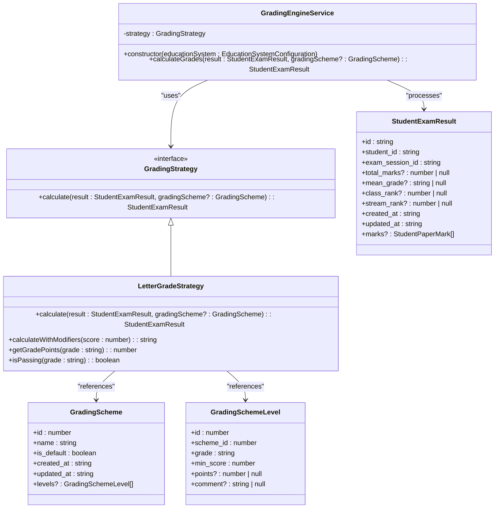
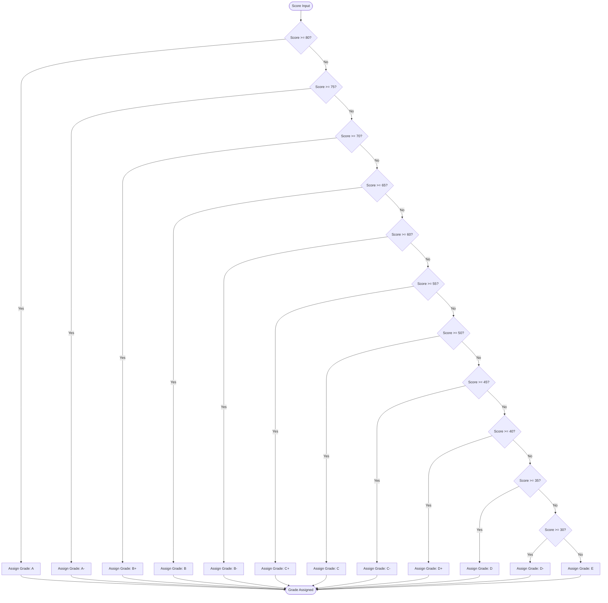
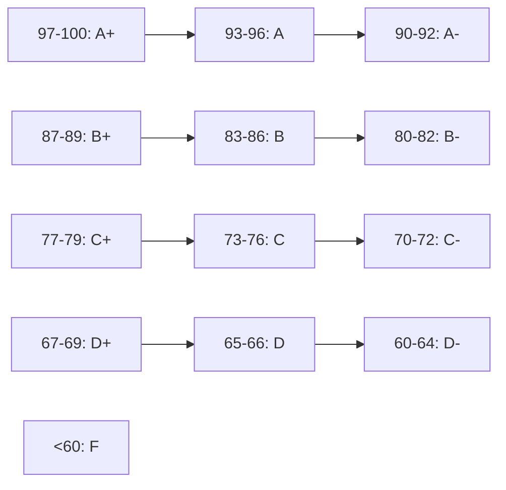
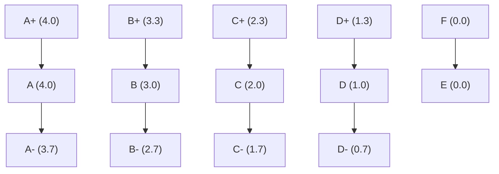
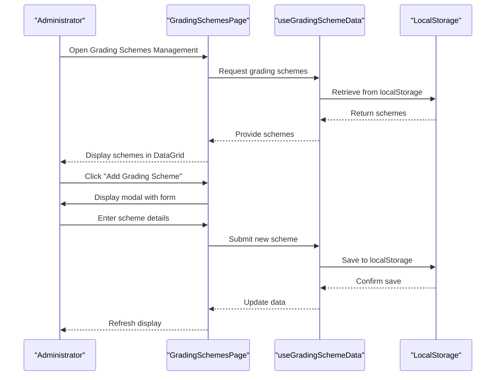
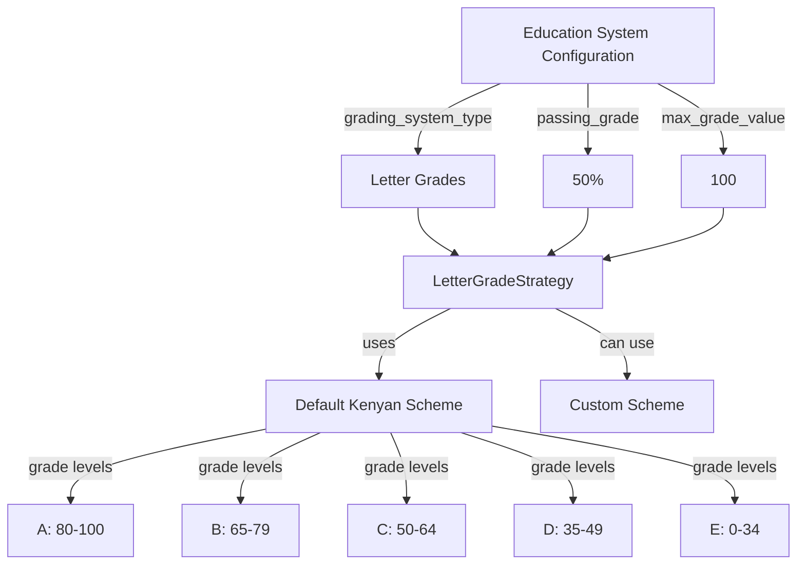
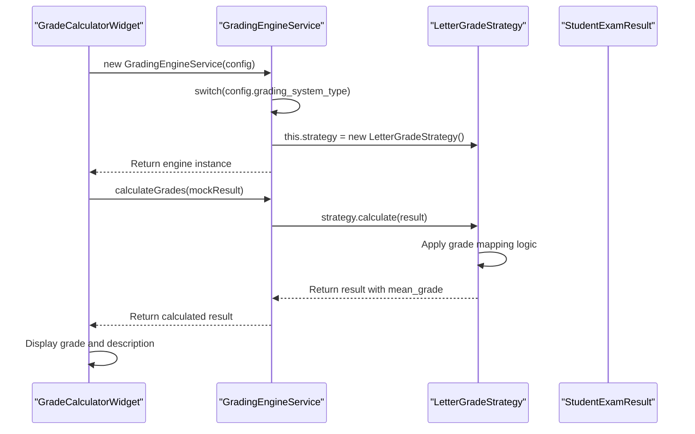
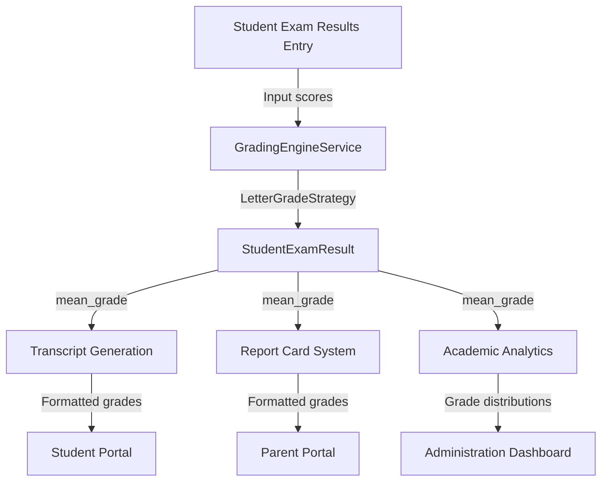

# Letter Grading Strategy

<cite>
**Referenced Files in This Document**   
- [LetterGradeStrategy.ts](file://src/modules/academics/strategies/LetterGradeStrategy.ts)
- [types.ts](file://src/modules/academics/data/types.ts)
- [GradingEngineService.ts](file://src/modules/academics/services/GradingEngineService.ts)
- [GradingSchemesPage.tsx](file://src/modules/academics/pages/GradingSchemesPage.tsx)
- [useGradingSchemeData.ts](file://src/modules/academics/data/useGradingSchemeData.ts)
- [useGradingSchemeLevelData.ts](file://src/modules/academics/data/useGradingSchemeLevelData.ts)
- [mockData.ts](file://src/modules/academics/data/mockData.ts)
- [education-system-templates.ts](file://src/modules/academics/data/templates/education-system-templates.ts)
- [academics.json](file://src/i18n/locales/en/academics.json)
</cite>

## Table of Contents
1. [Introduction](#introduction)
2. [Core Components](#core-components)
3. [Grade Mapping Logic](#grade-mapping-logic)
4. [Configuration and Customization](#configuration-and-customization)
5. [Integration with Academic Systems](#integration-with-academic-systems)
6. [Edge Cases and Institutional Policies](#edge-cases-and-institutional-policies)
7. [Best Practices](#best-practices)

## Introduction
The LetterGradeStrategy implementation provides a flexible system for converting numerical scores into letter grades (A, B, C, D, F) with optional plus/minus modifiers. This strategy supports configurable grading scales that can be customized to meet institutional requirements across different academic levels and departments. The system integrates with transcript generation and report card systems, allowing for consistent grading policies across educational institutions.

The implementation follows a strategy pattern, where the LetterGradeStrategy class implements the GradingStrategy interface and is selected by the GradingEngineService based on the institution's education system configuration. This design allows for multiple grading strategies (letter grades, percentage, competency-based, etc.) to coexist within the same system.

## Core Components

The LetterGradeStrategy implementation consists of several key components that work together to provide a comprehensive grading solution:

- **LetterGradeStrategy class**: Implements the core logic for converting numerical scores to letter grades
- **GradingScheme and GradingSchemeLevel interfaces**: Define the data structure for configurable grading scales
- **GradingEngineService**: Orchestrates the grading process and selects the appropriate strategy
- **GradingSchemesPage**: Provides a user interface for configuring and managing grading schemes
- **Data hooks**: Manage the storage and retrieval of grading scheme data



**Diagram sources**
- [LetterGradeStrategy.ts](file://src/modules/academics/strategies/LetterGradeStrategy.ts)
- [types.ts](file://src/modules/academics/data/types.ts)
- [GradingEngineService.ts](file://src/modules/academics/services/GradingEngineService.ts)

**Section sources**
- [LetterGradeStrategy.ts](file://src/modules/academics/strategies/LetterGradeStrategy.ts#L1-L85)
- [types.ts](file://src/modules/academics/data/types.ts#L130-L189)
- [GradingEngineService.ts](file://src/modules/academics/services/GradingEngineService.ts#L9-L41)

## Grade Mapping Logic

### Standard Grade Conversion
The primary grade mapping logic in the LetterGradeStrategy converts numerical scores to letter grades based on configurable thresholds. When no grading scheme is provided, the system uses a default Kenyan letter grade system with the following thresholds:



**Diagram sources**
- [LetterGradeStrategy.ts](file://src/modules/academics/strategies/LetterGradeStrategy.ts#L10-L42)

**Section sources**
- [LetterGradeStrategy.ts](file://src/modules/academics/strategies/LetterGradeStrategy.ts#L10-L42)

### Grade Modifiers System
The system supports plus/minus grade modifiers through the `calculateWithModifiers` method, which implements a more granular grading scale:



This modifier system allows for more precise differentiation between student performance levels and is particularly useful in competitive academic environments.

### Grade Points Calculation
The `getGradePoints` method converts letter grades to numerical values for GPA calculation:



The passing grades are defined as A+, A, A-, B+, B, B-, C+, C, C-, D+, and D, with all other grades considered failing.

**Section sources**
- [LetterGradeStrategy.ts](file://src/modules/academics/strategies/LetterGradeStrategy.ts#L50-L85)

## Configuration and Customization

### Grading Scheme Management
The system provides a comprehensive interface for configuring custom grading schemes through the GradingSchemesPage component. Administrators can create, edit, and delete grading schemes with the following configurable parameters:

- **Scheme Name**: Descriptive name for the grading scheme
- **Default Status**: Whether the scheme is the default for the institution
- **Grade Levels**: Individual grade definitions with minimum scores and points
- **Grade**: The letter grade (e.g., A, B+, C-)
- **Minimum Score**: The minimum numerical score required for the grade
- **Points**: Optional grade points for GPA calculation
- **Comment**: Optional descriptive comment for the grade



**Diagram sources**
- [GradingSchemesPage.tsx](file://src/modules/academics/pages/GradingSchemesPage.tsx)
- [useGradingSchemeData.ts](file://src/modules/academics/data/useGradingSchemeData.ts)

**Section sources**
- [GradingSchemesPage.tsx](file://src/modules/academics/pages/GradingSchemesPage.tsx#L0-L270)
- [useGradingSchemeData.ts](file://src/modules/academics/data/useGradingSchemeData.ts#L0-L39)

### Institutional Variations
The system supports institutional variations in grading policies through education system templates. For example, the Kenya CBC Secondary System uses letter grades with a passing threshold of 50%, while other institutions might use different scales.



**Section sources**
- [education-system-templates.ts](file://src/modules/academics/data/templates/education-system-templates.ts#L0-L32)
- [types.ts](file://src/modules/academics/data/types.ts#L272-L310)

## Integration with Academic Systems

### Grading Engine Integration
The LetterGradeStrategy integrates with the GradingEngineService, which acts as a factory for different grading strategies based on the institution's education system configuration.



**Diagram sources**
- [GradingEngineService.ts](file://src/modules/academics/services/GradingEngineService.ts#L0-L42)
- [GradeCalculatorWidget.tsx](file://src/modules/academics/components/GradeCalculatorWidget.tsx#L28-L67)

**Section sources**
- [GradingEngineService.ts](file://src/modules/academics/services/GradingEngineService.ts#L0-L42)
- [GradeCalculatorWidget.tsx](file://src/modules/academics/components/GradeCalculatorWidget.tsx#L28-L67)

### Transcript and Report Card Generation
The graded results are stored in the StudentExamResult data structure, which includes the mean_grade field populated by the LetterGradeStrategy. This data is then used for transcript generation and report card systems.



**Section sources**
- [StudentExamResultsEntryPage.tsx](file://src/modules/academics/pages/StudentExamResultsEntryPage.tsx#L0-L239)
- [types.ts](file://src/modules/academics/data/types.ts#L178-L189)

## Edge Cases and Institutional Policies

### Borderline Scores and Rounding
The current implementation does not include automatic rounding of scores, which means borderline cases are handled strictly according to the minimum score thresholds. For example, a score of 79.9 would receive a B grade rather than being rounded up to an A-.

Institutions may implement their own policies for handling borderline scores, which could be addressed through:

1. Pre-processing scores to apply institutional rounding rules
2. Configuring grade thresholds with decimal precision
3. Implementing a separate rounding service that adjusts scores before grading

### Default Grading Scheme
When no custom grading scheme is provided, the system uses a default Kenyan letter grade system with 12 grade levels from A to E. This default scheme includes plus/minus modifiers and is designed to provide fine-grained differentiation between student performance levels.

```json
// Default grading scheme (Kenyan system)
[
  { "grade": "A", "min_score": 80, "points": 12, "comment": "Excellent" },
  { "grade": "A-", "min_score": 75, "points": 11, "comment": "Very Good" },
  { "grade": "B+", "min_score": 70, "points": 10, "comment": "Good" },
  // ... additional levels
]
```

**Section sources**
- [LetterGradeStrategy.ts](file://src/modules/academics/strategies/LetterGradeStrategy.ts#L10-L25)
- [mockData.ts](file://src/modules/academics/data/mockData.ts#L124-L143)

## Best Practices

### Consistency Across Grading Periods
To maintain consistency across grading periods and instructors:

1. **Standardize Grading Schemes**: Use institution-wide grading schemes rather than department-specific ones when possible
2. **Document Policies**: Clearly document grading policies and make them accessible to all instructors
3. **Regular Audits**: Conduct periodic audits of grading patterns to identify inconsistencies
4. **Training**: Provide training for instructors on the proper use of the grading system

### Configuration Management
When customizing letter grade scales for different academic levels or departments:

1. **Use Templates**: Create templates for common grading schemes to ensure consistency
2. **Version Control**: Implement version control for grading scheme changes
3. **Approval Workflow**: Require approval for changes to default grading schemes
4. **Documentation**: Maintain documentation of the rationale for custom grading schemes

### Performance Considerations
The current implementation is efficient with O(n) complexity for grade lookup, where n is the number of grade levels. For optimal performance:

1. **Limit Grade Levels**: Keep the number of grade levels reasonable (typically 5-15)
2. **Cache Schemes**: Cache frequently used grading schemes to avoid repeated database queries
3. **Indexing**: Ensure proper indexing on grading scheme data for quick retrieval

### Internationalization
The system supports internationalization through the i18n framework, allowing grading terminology to be localized in different languages. The English academics.json file contains the base translations for academic terms.

**Section sources**
- [academics.json](file://src/i18n/locales/en/academics.json#L0-L15)