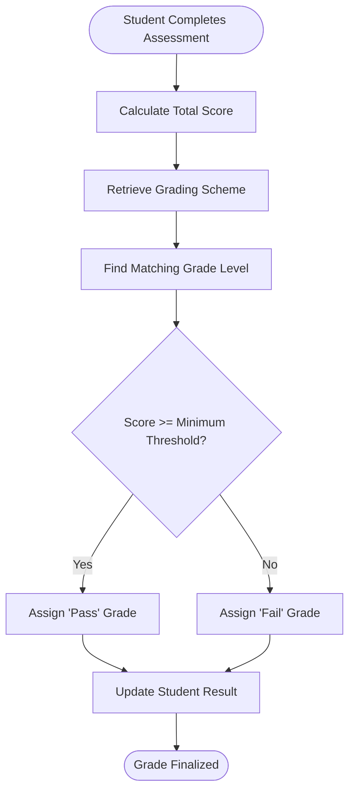
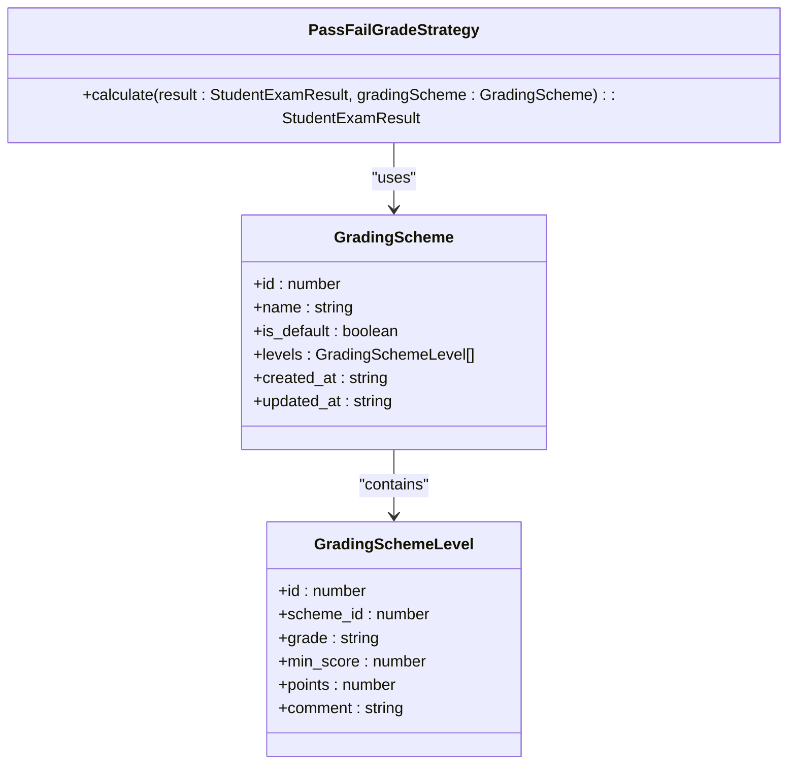
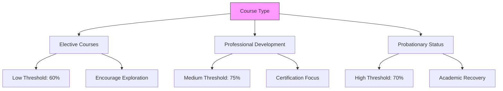
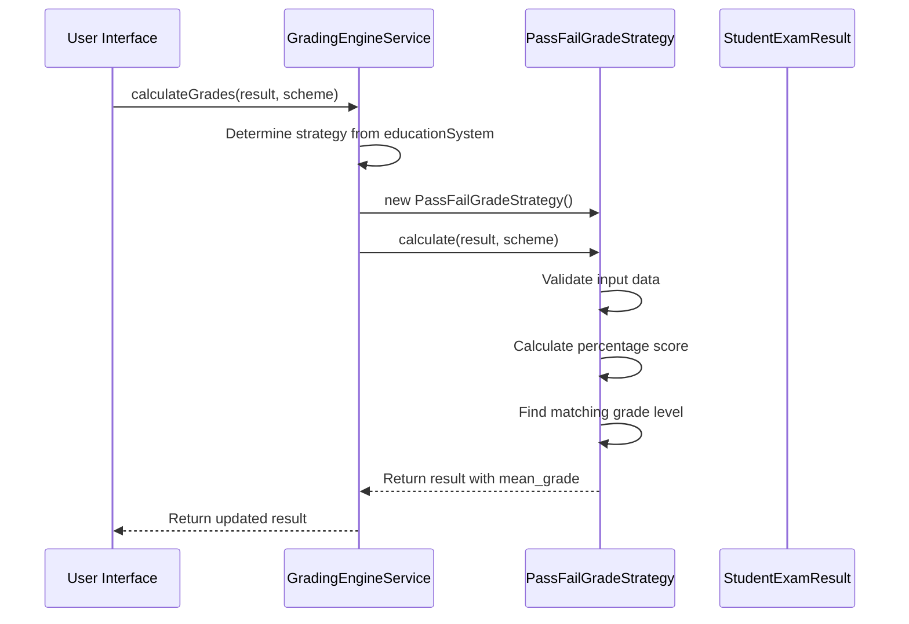

# Pass/Fail Grading Strategy

<cite>
**Referenced Files in This Document**   
- [PassFailGradeStrategy.ts](file://src/modules/academics/strategies/PassFailGradeStrategy.ts)
- [GradingEngineService.ts](file://src/modules/academics/services/GradingEngineService.ts)
- [enums.ts](file://src/modules/academics/data/enums.ts)
- [mockData.ts](file://src/modules/academics/data/mockData.ts)
- [GradingSchemesPage.tsx](file://src/modules/academics/pages/GradingSchemesPage.tsx)
- [useGradingSchemeData.ts](file://src/modules/academics/data/useGradingSchemeData.ts)
- [useGradingSchemeLevelData.ts](file://src/modules/academics/data/useGradingSchemeLevelData.ts)
</cite>

## Table of Contents
1. [Introduction](#introduction)
2. [Binary Assessment Approach](#binary-assessment-approach)
3. [Configurable Passing Criteria](#configurable-passing-criteria)
4. [Integration with Credit Systems](#integration-with-credit-systems)
5. [Handling Borderline Cases and Remediation](#handling-borderline-cases-and-remediation)
6. [Implementation Examples](#implementation-examples)
7. [Reporting and Transcript Notation](#reporting-and-transcript-notation)
8. [Grade Point Calculation Policies](#grade-point-calculation-policies)
9. [Technical Implementation](#technical-implementation)

## Introduction
The Pass/Fail Grading Strategy is a binary assessment approach used in educational institutions to evaluate student performance based on whether they meet minimum competency thresholds. This system simplifies grading by categorizing outcomes into two distinct results: "Pass" or "Fail". It is particularly useful in contexts where mastery of content is more important than comparative performance.

This document provides a comprehensive overview of the Pass/Fail grading implementation within the SchoolPilot system, covering its configuration, integration points, and application across various academic scenarios.

**Section sources**
- [PassFailGradeStrategy.ts](file://src/modules/academics/strategies/PassFailGradeStrategy.ts)

## Binary Assessment Approach
The Pass/Fail grading system operates on a binary assessment model where students receive either a "Pass" or "Fail" designation based on their achievement relative to predefined competency thresholds. Unlike traditional grading systems that use letter grades or percentages to differentiate levels of performance, this approach focuses solely on whether students have demonstrated sufficient mastery of the required material.

In the SchoolPilot implementation, the `PassFailGradeStrategy` class handles the calculation logic for determining pass/fail outcomes. The system evaluates a student's total marks against configured grading scheme levels to determine if they meet the minimum score required for a passing grade.

The binary nature of this system emphasizes competency-based education principles, where the primary goal is ensuring that all students achieve a baseline level of understanding before progressing to subsequent courses or academic levels.

**Diagram sources**
- [PassFailGradeStrategy.ts](file://src/modules/academics/strategies/PassFailGradeStrategy.ts)

**Section sources**
- [PassFailGradeStrategy.ts](file://src/modules/academics/strategies/PassFailGradeStrategy.ts)

## Configurable Passing Criteria
The Pass/Fail grading system supports configurable passing criteria through flexible grading schemes that can be customized for different courses and academic programs. Administrators can define specific thresholds that determine what constitutes a passing performance.

In the SchoolPilot system, grading schemes are managed through the `GradingSchemesPage` component, which allows administrators to create and modify grading schemes with custom levels. Each grading scheme contains one or more levels that specify the minimum score required for a passing grade.

The system uses the `GradingSystemType.PASS_FAIL` enumeration value to identify pass/fail grading systems. When this type is selected, the grading engine instantiates the `PassFailGradeStrategy` to handle grade calculations.

Administrators can configure multiple pass/fail schemes with different thresholds to accommodate various course requirements. For example, a professional development workshop might require only 70% to pass, while a probationary academic course might maintain a higher 80% threshold.

**Diagram sources**
- [enums.ts](file://src/modules/academics/data/enums.ts)
- [PassFailGradeStrategy.ts](file://src/modules/academics/strategies/PassFailGradeStrategy.ts)
- [GradingSchemesPage.tsx](file://src/modules/academics/pages/GradingSchemesPage.tsx)

**Section sources**
- [enums.ts](file://src/modules/academics/data/enums.ts)
- [GradingSchemesPage.tsx](file://src/modules/academics/pages/GradingSchemesPage.tsx)

## Integration with Credit Systems
The Pass/Fail grading strategy integrates with institutional credit systems to support academic progression requirements. When students successfully pass a course under this system, they earn the associated credits which contribute to their overall degree or program requirements.

In the SchoolPilot implementation, credit assignment is handled through the broader academic management system, with the pass/fail outcome serving as the gatekeeper for credit allocation. Students who receive a "Pass" grade are awarded full credit for the course, while those who "Fail" do not receive credit and may need to retake the course.

This integration ensures that pass/fail courses contribute appropriately to a student's academic record and progress toward graduation. The system maintains consistency in credit tracking regardless of the grading method used, allowing institutions to mix traditional and pass/fail graded courses within degree programs.

The integration also supports academic advising systems by providing clear indicators of course completion status, helping advisors monitor student progress and identify potential delays in academic plans.

**Section sources**
- [PassFailGradeStrategy.ts](file://src/modules/academics/strategies/PassFailGradeStrategy.ts)
- [GradingEngineService.ts](file://src/modules/academics/services/GradingEngineService.ts)

## Handling Borderline Cases and Remediation
The Pass/Fail grading system includes mechanisms for handling borderline cases and providing opportunities for remediation. While the system itself produces binary outcomes, institutional policies can be implemented to address students who narrowly miss the passing threshold.

In the SchoolPilot implementation, the grading engine does not automatically provide grace marks or rounding for borderline cases. Instead, it relies on institutional workflows and approval processes to handle these situations. The `ResultApprovalStateMachine` service manages the review and approval of student results, allowing academic committees to examine borderline cases and make discretionary decisions.

For remediation, the system supports retake policies where students who fail a course can register for subsequent offerings. The academic management module tracks failed courses and can automatically recommend appropriate remedial actions based on institutional rules.

Educators can also implement formative assessments throughout the course to identify students at risk of failing, enabling early intervention through additional support, tutoring, or supplemental instruction before the final assessment.

**Section sources**
- [PassFailGradeStrategy.ts](file://src/modules/academics/strategies/PassFailGradeStrategy.ts)
- [ResultApprovalStateMachine.ts](file://src/modules/academics/services/ResultApprovalStateMachine.ts)

## Implementation Examples
The Pass/Fail grading strategy can be implemented in various academic contexts, each with specific requirements and considerations.

### Elective Courses
For elective courses, institutions often implement pass/fail grading to encourage students to explore subjects outside their major without the pressure of maintaining a high GPA. In this context, the system allows students to take intellectual risks and engage with challenging material without grade consequences.

Example configuration:
- Passing threshold: 60%
- Grade options: "Pass" or "Fail"
- Credit value: Full course credits upon passing

### Professional Development
Professional development programs frequently use pass/fail grading to certify competency in specific skills or knowledge areas. This approach focuses on mastery rather than comparison with peers.

Example configuration:
- Passing threshold: 75%
- Grade options: "Certified" or "Not Certified"
- Credit value: Continuing education units (CEUs)

### Probationary Academic Status
Students on academic probation may be required to take courses on a pass/fail basis to rebuild their academic standing. This implementation helps students focus on improving their foundational knowledge without further damaging their GPA.

Example configuration:
- Passing threshold: 70%
- Grade options: "Pass" or "Fail"
- Special notation: "Course taken during probationary period"

**Diagram sources**
- [PassFailGradeStrategy.ts](file://src/modules/academics/strategies/PassFailGradeStrategy.ts)

**Section sources**
- [PassFailGradeStrategy.ts](file://src/modules/academics/strategies/PassFailGradeStrategy.ts)

## Reporting and Transcript Notation
The Pass/Fail grading system includes specific reporting requirements and transcript notation conventions to ensure clarity in academic records.

In the SchoolPilot system, pass/fail courses are clearly identified on student transcripts with the appropriate grade designation ("Pass" or "Fail") rather than traditional letter grades. The transcript entry includes the course information, credit value, and grade, with a notation indicating that the course was graded on a pass/fail basis.

Reporting tools within the system can generate specialized reports for pass/fail courses, including:
- Pass/fail rates by course and instructor
- Trends in pass/fail outcomes over time
- Comparison of pass/fail versus traditionally graded courses
- Impact on student retention and progression

The system also supports filtering and sorting of academic records to distinguish between pass/fail and other grading methods, enabling administrators to analyze the effectiveness of different assessment approaches.

**Section sources**
- [PassFailGradeStrategy.ts](file://src/modules/academics/strategies/PassFailGradeStrategy.ts)
- [GradingSchemesPage.tsx](file://src/modules/academics/pages/GradingSchemesPage.tsx)

## Grade Point Calculation Policies
The Pass/Fail grading system has specific policies regarding grade point calculation and inclusion in GPA computations. By design, pass/fail courses are typically excluded from GPA calculations to prevent them from negatively impacting a student's overall academic average.

In the SchoolPilot implementation, when a student receives a "Pass" grade, the course earns credit but does not contribute to the GPA. Similarly, a "Fail" grade results in no credit and also does not affect the GPA. This policy encourages students to take pass/fail courses without fear of damaging their academic standing.

The system enforces this policy through the grading engine, which recognizes pass/fail courses and bypasses grade point conversion for these courses. The transcript processing module also contains logic to exclude pass/fail grades from GPA calculations while still displaying them in the academic record.

Institutional policies can be configured to modify this behavior if needed, such as counting failed pass/fail courses in GPA calculations to provide a stronger incentive for success, though this approach is less common.

**Section sources**
- [PassFailGradeStrategy.ts](file://src/modules/academics/strategies/PassFailGradeStrategy.ts)
- [GradingEngineService.ts](file://src/modules/academics/services/GradingEngineService.ts)

## Technical Implementation
The technical implementation of the Pass/Fail grading strategy is centered around the `PassFailGradeStrategy` class, which implements the `GradingStrategy` interface. This design follows the Strategy pattern, allowing the system to dynamically select the appropriate grading algorithm based on the configured grading system type.

The `GradingEngineService` acts as a factory that instantiates the correct strategy based on the education system configuration. When a pass/fail system is detected, it creates an instance of `PassFailGradeStrategy` to handle grade calculations.

The core algorithm in `PassFailGradeStrategy` evaluates a student's score against the grading scheme levels to determine the appropriate outcome. It first validates that the necessary data (total marks, grading scheme, and levels) is available, then calculates the percentage score and finds the matching grade level based on the minimum score threshold.

Key technical features include:
- Null safety checks to handle missing data
- Percentage-based score calculation
- Configurable thresholds through grading schemes
- Integration with the broader grading engine service

**Diagram sources**
- [PassFailGradeStrategy.ts](file://src/modules/academics/strategies/PassFailGradeStrategy.ts)
- [GradingEngineService.ts](file://src/modules/academics/services/GradingEngineService.ts)

**Section sources**
- [PassFailGradeStrategy.ts](file://src/modules/academics/strategies/PassFailGradeStrategy.ts)
- [GradingEngineService.ts](file://src/modules/academics/services/GradingEngineService.ts)