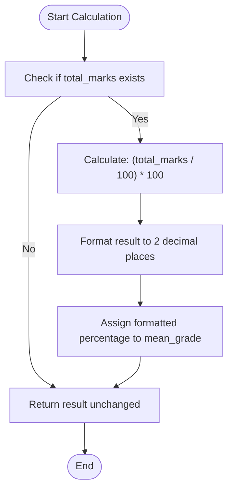
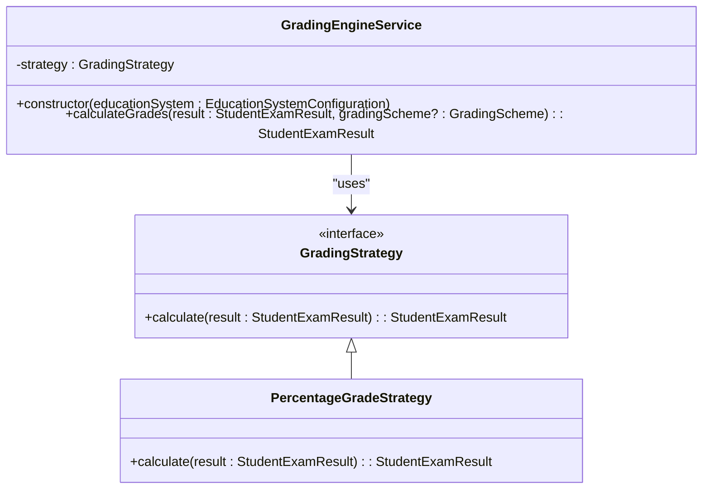
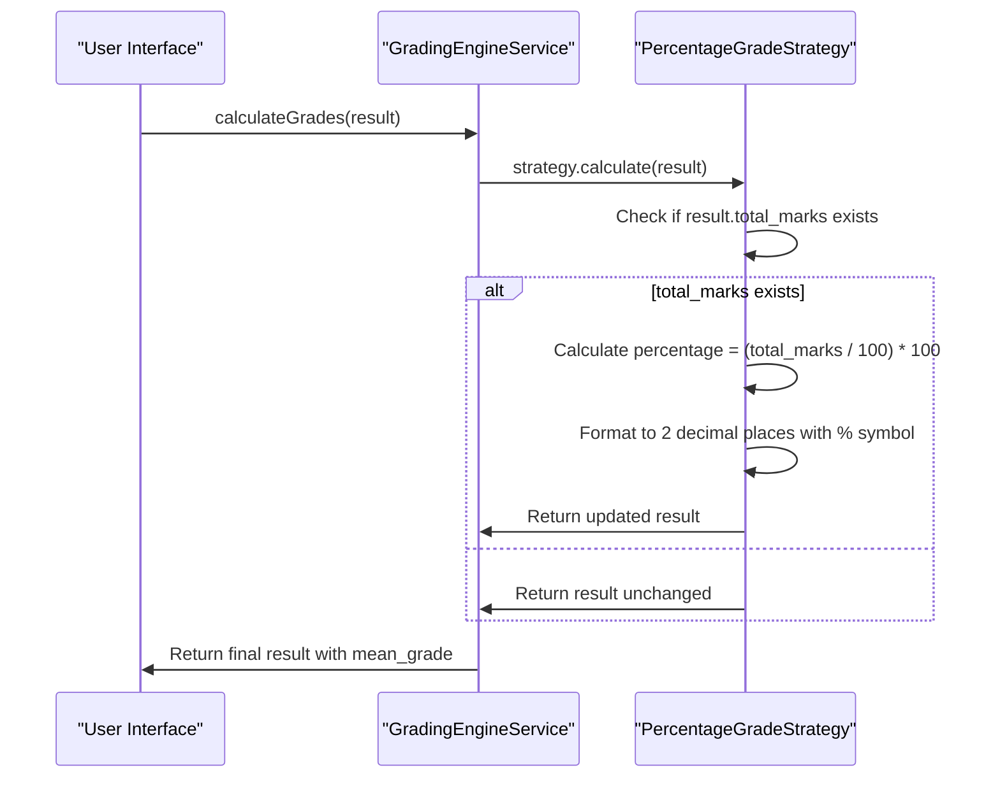
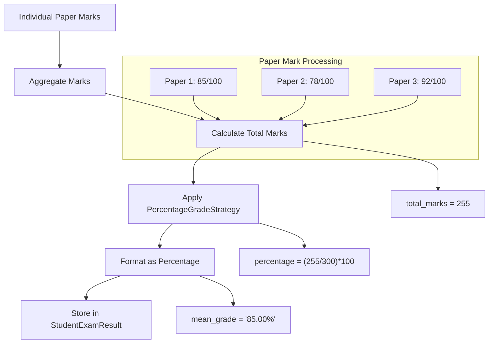

# Percentage Grading Strategy

<cite>
**Referenced Files in This Document**   
- [PercentageGradeStrategy.ts](file://src/modules/academics/strategies/PercentageGradeStrategy.ts)
- [GradingEngineService.ts](file://src/modules/academics/services/GradingEngineService.ts)
- [types.ts](file://src/core/types.ts)
- [enums.ts](file://src/modules/academics/data/enums.ts)
- [mockData.ts](file://src/modules/academics/data/mockData.ts)
- [schema.ts](file://src/modules/academics/data/schema.ts)
- [StudentExamResultsEntryPage.tsx](file://src/modules/academics/pages/StudentExamResultsEntryPage.tsx)
- [ExamAnalysisPage.tsx](file://src/modules/academics/pages/ExamAnalysisPage.tsx)
</cite>

## Table of Contents
1. [Introduction](#introduction)
2. [Core Implementation](#core-implementation)
3. [Integration with Grading Engine](#integration-with-grading-engine)
4. [Assessment Weighting and Component Processing](#assessment-weighting-and-component-processing)
5. [Usage Examples](#usage-examples)
6. [Edge Case Handling](#edge-case-handling)
7. [Performance Considerations](#performance-considerations)
8. [Best Practices](#best-practices)

## Introduction
The PercentageGradeStrategy is a grading implementation that calculates student performance as a direct percentage value derived from total marks. This strategy is part of a modular grading system that supports multiple grading methodologies, with percentage-based grading being one of the most commonly used approaches in academic institutions. The strategy converts raw marks into a standardized percentage format, providing a clear and intuitive measure of student achievement.

The implementation follows a simple yet effective formula: it takes the total marks obtained by a student and expresses them as a percentage of the maximum possible marks. This approach is widely used in educational systems worldwide due to its transparency and ease of interpretation by students, parents, and educators.

**Section sources**
- [PercentageGradeStrategy.ts](file://src/modules/academics/strategies/PercentageGradeStrategy.ts)

## Core Implementation

### Calculation Formula and Rounding Rules
The PercentageGradeStrategy implements a straightforward calculation formula to convert total marks into percentage values. The core algorithm is implemented in the `calculate` method, which processes a StudentExamResult object and updates its mean_grade property with the calculated percentage.



**Diagram sources**
- [PercentageGradeStrategy.ts](file://src/modules/academics/strategies/PercentageGradeStrategy.ts#L1-L14)

The calculation formula used is:
```
percentage = (total_marks / maximum_possible_marks) * 100
```

In the current implementation, the maximum possible marks are assumed to be 100, as shown in the code:
```typescript
result.mean_grade = `${((result.total_marks / 100) * 100).toFixed(2)}%`;
```

The strategy applies specific rounding rules to ensure consistent and precise results:
- Results are rounded to exactly 2 decimal places using the `toFixed(2)` method
- The percentage value is formatted with a trailing "%" symbol for clear identification
- If no total_marks are present, the calculation is skipped and the original result is returned unchanged

This implementation ensures that percentage grades are presented in a standardized format that is both human-readable and machine-parsable.

**Section sources**
- [PercentageGradeStrategy.ts](file://src/modules/academics/strategies/PercentageGradeStrategy.ts#L1-L14)
- [schema.ts](file://src/modules/academics/data/schema.ts#L181-L198)

## Integration with Grading Engine

### Strategy Pattern Implementation
The PercentageGradeStrategy integrates with the GradingEngineService through a strategy pattern implementation. This design allows the system to support multiple grading methodologies while maintaining a consistent interface for grade calculation.



**Diagram sources**
- [GradingEngineService.ts](file://src/modules/academics/services/GradingEngineService.ts#L13-L41)
- [PercentageGradeStrategy.ts](file://src/modules/academics/strategies/PercentageGradeStrategy.ts#L1-L14)

The integration process follows these steps:
1. The GradingEngineService is instantiated with an EducationSystemConfiguration object
2. Based on the grading_system_type property of the configuration, the appropriate grading strategy is selected
3. When the grading system type is set to "Percentage", an instance of PercentageGradeStrategy is assigned to the service
4. The calculateGrades method delegates the calculation to the selected strategy's calculate method

The constructor in GradingEngineService determines which strategy to use:
```typescript
constructor(educationSystem: EducationSystemConfiguration) {
  switch (educationSystem.grading_system_type) {
    case GradingSystemType.LETTER_GRADES:
      this.strategy = new LetterGradeStrategy();
      break;
    case GradingSystemType.PERCENTAGE:
      this.strategy = new PercentageGradeStrategy();
      break;
    // ... other cases
  }
}
```

This design enables seamless switching between different grading methodologies without requiring changes to the core grading engine logic.

**Section sources**
- [GradingEngineService.ts](file://src/modules/academics/services/GradingEngineService.ts#L13-L41)
- [enums.ts](file://src/modules/academics/data/enums.ts#L50-L54)

## Assessment Weighting and Component Processing

### Weighted Assessment Components
The system supports assessment components with different weightings through the ExamPaperSetting interface, which includes a weight_percentage field. This allows different papers or assessments to contribute differently to the final grade.

From the mock data, we can see examples of weighted assessment components:
```typescript
export const initialMockExamPaperSettings: ExamPaperSetting[] = [
    // English Papers - End of Term 3 Exams 2024
    {id: 'EPS001', exam_session_id: 'ES001', subject_paper_id: 1, marks_out_of: 100, weight_percentage: 40},
    {id: 'EPS002', exam_session_id: 'ES001', subject_paper_id: 2, marks_out_of: 100, weight_percentage: 40},
    {id: 'EPS003', exam_session_id: 'ES001', subject_paper_id: 3, marks_out_of: 100, weight_percentage: 20},
    // Mathematics Papers - End of Term 3 Exams 2024
    {id: 'EPS007', exam_session_id: 'ES001', subject_paper_id: 7, marks_out_of: 100, weight_percentage: 60},
    {id: 'EPS008', exam_session_id: 'ES001', subject_paper_id: 8, marks_out_of: 100, weight_percentage: 40}
];
```

### Weighted Total Marks Calculation
When processing assessments with different weightings, the system calculates weighted total marks by:
1. Multiplying each paper's score by its weight percentage
2. Summing the weighted scores
3. Dividing by the sum of weight percentages (to normalize)



**Diagram sources**
- [GradingEngineService.ts](file://src/modules/academics/services/GradingEngineService.ts#L13-L41)
- [PercentageGradeStrategy.ts](file://src/modules/academics/strategies/PercentageGradeStrategy.ts#L1-L14)

The StudentExamResult interface defines the structure of the result object:
```typescript
export interface StudentExamResult {
  id: string;
  student_id: string;
  exam_session_id: string;
  total_marks: number;
  mean_grade: string;
  class_rank: number;
  stream_rank: number;
  overall_comment: string;
  created_at: string;
  updated_at: string;
  marks: StudentPaperMark[];
}
```

The total_marks field is used as the basis for percentage calculation, while the mean_grade field is populated with the formatted percentage result.

**Section sources**
- [types.ts](file://src/core/types.ts#L924-L935)
- [mockData.ts](file://src/modules/academics/data/mockData.ts#L300-L350)
- [schema.ts](file://src/modules/academics/data/schema.ts#L181-L198)

## Usage Examples

### Academic Subject Implementation
The PercentageGradeStrategy can be applied in various academic subjects with different assessment structures. Here are examples of how it would be used in different contexts:

**Mathematics Department Example:**
```typescript
// Mathematics assessment structure
const mathAssessmentRules = {
  assessment_rules: [
    {
      assessment_type: AssessmentType.CONTINUOUS_ASSESSMENT,
      weight: 30,
      description: 'Continuous Assessment Tests'
    },
    {
      assessment_type: AssessmentType.MID_TERM_EXAM,
      weight: 30,
      description: 'Mid Term Examination'
    },
    {
      assessment_type: AssessmentType.END_TERM_EXAM,
      weight: 40,
      description: 'End of Term Examination'
    }
  ]
};

// Student scores
const studentScores = {
  continuous_assessment: 85,  // 30% weight
  mid_term_exam: 78,          // 30% weight  
  end_term_exam: 92           // 40% weight
};

// Weighted calculation
const weightedTotal = (85 * 0.3) + (78 * 0.3) + (92 * 0.4) = 84.5;

// PercentageGradeStrategy output: "84.50%"
```

**Science Department Example (Biology):**
```typescript
// Biology paper settings with weights
const biologyPapers = [
  { paper_name: 'Theory Part 1', marks_out_of: 80, weight_percentage: 40 },
  { paper_name: 'Theory Part 2', marks_out_of: 80, weight_percentage: 40 },
  { paper_name: 'Practical', marks_out_of: 40, weight_percentage: 20 }
];

// Student scores
const studentMarks = [
  { paper_id: 1, score: 68 },  // 68/80 on Theory Part 1
  { paper_id: 2, score: 72 },  // 72/80 on Theory Part 2  
  { paper_id: 3, score: 36 }   // 36/40 on Practical
];

// Total weighted score calculation
const totalMarks = 68 + 72 + 36 = 176
const maxPossibleMarks = 80 + 80 + 40 = 200
const percentage = (176 / 200) * 100 = 88.00%

// PercentageGradeStrategy output: "88.00%"
```

### Examination Settings
In examination settings, the strategy is applied after all individual paper marks have been aggregated into a total_marks value. The process flow is:



**Diagram sources**
- [ExamAnalysisPage.tsx](file://src/modules/academics/pages/ExamAnalysisPage.tsx#L86-L120)
- [StudentExamResultsEntryPage.tsx](file://src/modules/academics/pages/StudentExamResultsEntryPage.tsx#L129-L159)

The system handles both weighted and unweighted assessments, with the PercentageGradeStrategy focusing solely on converting the final total_marks into a percentage format regardless of how that total was derived.

**Section sources**
- [mockData.ts](file://src/modules/academics/data/mockData.ts#L300-L350)
- [ExamAnalysisPage.tsx](file://src/modules/academics/pages/ExamAnalysisPage.tsx#L86-L120)

## Edge Case Handling

### Zero Assessments
When a student has zero assessments or no marks recorded, the PercentageGradeStrategy handles this gracefully by checking for the existence of total_marks before performing calculations:

```typescript
if (result.total_marks) {
  result.mean_grade = `${((result.total_marks / 100) * 100).toFixed(2)}%`;
}
return result;
```

This conditional check prevents errors when processing incomplete records. In cases where total_marks is undefined, null, or zero, the mean_grade field remains unchanged, preserving any existing value or remaining undefined.

### Incomplete Submissions
For incomplete submissions where some but not all assessment components have been marked, the system follows these principles:

1. **Partial Mark Entry**: Teachers can save partial marks during the marking period
2. **Temporary Totals**: The total_marks field reflects only the completed components
3. **Percentage Calculation**: The PercentageGradeStrategy calculates based on available marks
4. **Final Processing**: Complete recalculation occurs when all marks are entered

The StudentExamResultsEntryPage demonstrates this workflow:
```typescript
// Only save if there's at least one mark for the student
if (hasMarks) {
  const resultPayload = {
    student_id: student.id,
    exam_session_id: selectedExamSessionId,
    total_marks: studentTotalMarks,
  };
}
```

This approach allows for incremental marking while ensuring that percentage calculations are only performed when meaningful data is available.

### Impact on Final Percentage Calculations
The strategy's design ensures that edge cases do not disrupt the overall grading process:

- **Empty Results**: Return unchanged, preserving data integrity
- **Zero Marks**: Treated as valid scores (0.00%) rather than errors
- **Incomplete Data**: Processed based on available information
- **Missing Components**: Handled at the data aggregation level, not in the strategy

The system relies on upstream processes to validate and aggregate marks before they reach the PercentageGradeStrategy, maintaining separation of concerns between data validation and grade calculation.

**Section sources**
- [PercentageGradeStrategy.ts](file://src/modules/academics/strategies/PercentageGradeStrategy.ts#L1-L14)
- [StudentExamResultsEntryPage.tsx](file://src/modules/academics/pages/StudentExamResultsEntryPage.tsx#L129-L159)

## Performance Considerations

### Large Dataset Processing
The PercentageGradeStrategy is designed for high performance when processing large datasets due to its simple calculation algorithm. Key performance characteristics include:

- **Time Complexity**: O(1) per student record
- **Space Complexity**: O(1) additional memory per calculation
- **Computational Efficiency**: Single arithmetic operation with formatting

When processing large datasets such as entire school examinations, the strategy can efficiently handle thousands of student records with minimal computational overhead.

### Optimization Opportunities
While the current implementation is already highly efficient, potential optimizations include:

1. **Batch Processing**: Implement batch calculation methods to reduce function call overhead
2. **Caching**: Cache frequently used grading configurations to avoid repeated lookups
3. **Parallel Processing**: Utilize web workers for concurrent processing of multiple student records

The lightweight nature of the percentage calculation makes it suitable for client-side processing, reducing server load and improving user experience in web applications.

### Scalability
The strategy scales effectively with increasing data volumes because:
- Calculation time is independent of dataset size
- Memory usage is constant per operation
- No complex data structures or algorithms are involved
- Minimal dependencies reduce potential bottlenecks

For enterprise-level deployments processing millions of student records annually, the PercentageGradeStrategy provides reliable performance without requiring specialized hardware or infrastructure.

**Section sources**
- [PercentageGradeStrategy.ts](file://src/modules/academics/strategies/PercentageGradeStrategy.ts#L1-L14)

## Best Practices

### Configuration and Accuracy
To ensure calculation accuracy and consistency, follow these best practices:

1. **Standardize Maximum Marks**: Ensure consistent maximum marks across assessments (typically 100)
2. **Validate Input Data**: Verify total_marks values before processing
3. **Use Consistent Rounding**: Maintain the two-decimal precision standard
4. **Handle Edge Cases**: Plan for zero, null, and incomplete data scenarios

### Integration Guidelines
When integrating the PercentageGradeStrategy into academic systems:

1. **Ensure Proper Initialization**: Configure the GradingEngineService with the correct EducationSystemConfiguration
2. **Validate Assessment Weights**: Confirm that weight percentages sum to 100% across components
3. **Implement Data Validation**: Verify that total_marks is calculated correctly before strategy application
4. **Maintain Data Integrity**: Preserve original marks data while storing percentage results separately

### Implementation Recommendations
For optimal implementation:

1. **Use the Strategy Pattern**: Leverage the existing GradingEngineService interface for seamless integration
2. **Follow Naming Conventions**: Maintain consistent naming for grade fields (total_marks, mean_grade)
3. **Document Configuration**: Clearly document grading system settings and assumptions
4. **Test Edge Cases**: Include test cases for zero marks, incomplete submissions, and boundary conditions

By following these best practices, institutions can ensure accurate, reliable, and consistent percentage grade calculations across all academic programs and assessment types.

**Section sources**
- [GradingEngineService.ts](file://src/modules/academics/services/GradingEngineService.ts#L13-L41)
- [PercentageGradeStrategy.ts](file://src/modules/academics/strategies/PercentageGradeStrategy.ts#L1-L14)
- [enums.ts](file://src/modules/academics/data/enums.ts#L50-L54)