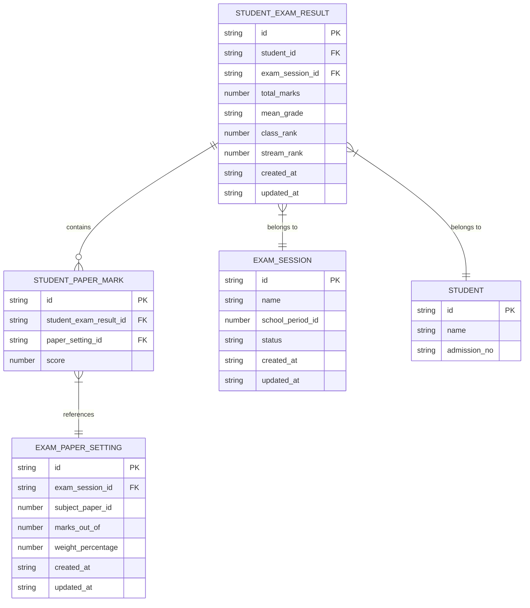
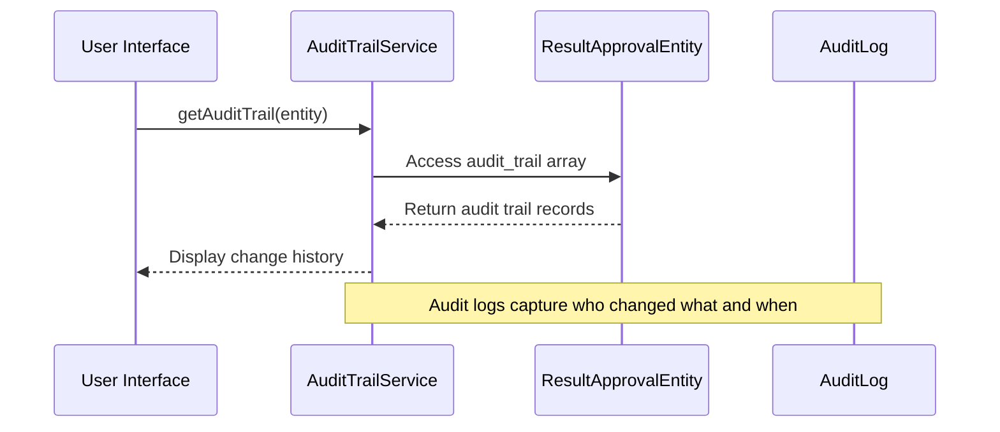
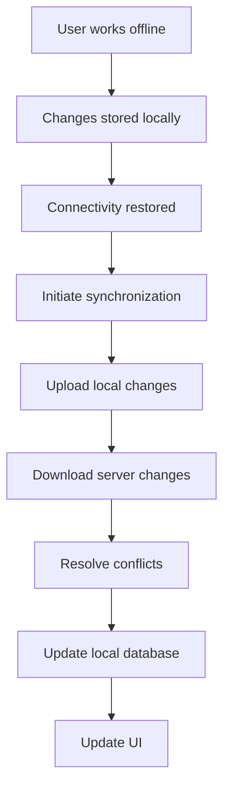

# Data Model for Results and Marks

<cite>
**Referenced Files in This Document**   
- [types.ts](file://src/modules/academics/data/types.ts#L171-L189)
- [marksService.ts](file://src/modules/academics/services/marksService.ts#L0-L88)
- [AuditTrailService.ts](file://src/modules/academics/services/AuditTrailService.ts#L4-L8)
- [types.ts](file://src/core/types.ts#L564-L577)
</cite>

## Table of Contents
1. [Introduction](#introduction)
2. [Core Data Entities](#core-data-entities)
3. [Entity Relationships](#entity-relationships)
4. [Constraints and Indexing](#constraints-and-indexing)
5. [Audit Trail and Versioning](#audit-trail-and-versioning)
6. [Schema Evolution and Data Migration](#schema-evolution-and-data-migration)
7. [Query Performance and Indexing](#query-performance-and-indexing)
8. [Offline-Online Synchronization](#offline-online-synchronization)
9. [Sample Payloads](#sample-payloads)
10. [Data Privacy and Access Control](#data-privacy-and-access-control)
11. [Retention Policies](#retention-policies)

## Introduction
This document provides comprehensive documentation for the StudentExamResult and StudentPaperMark entities within the academic system. It details the data model structure, relationships between exam sessions, subjects, papers, and students, and the implementation of audit trails for tracking changes. The documentation covers constraints, indexing strategies for performance, synchronization behavior, and data privacy considerations for sensitive academic records.

## Core Data Entities

### StudentExamResult Entity
The StudentExamResult entity represents a student's overall performance in a specific exam session. It contains aggregate information about the student's performance across multiple papers.

**Field Definitions:**
- **id**: Unique identifier for the exam result record
- **student_id**: Reference to the student who took the exam
- **exam_session_id**: Reference to the exam session in which the student participated
- **total_marks**: The sum of all marks obtained by the student in the exam session (nullable)
- **mean_grade**: The calculated mean grade for the student's performance (nullable)
- **class_rank**: The student's ranking within their class (nullable)
- **stream_rank**: The student's ranking within their stream (nullable)
- **created_at**: Timestamp when the record was created
- **updated_at**: Timestamp when the record was last updated
- **marks**: Array of StudentPaperMark records representing individual paper scores

### StudentPaperMark Entity
The StudentPaperMark entity represents a student's score on a specific exam paper within an exam session.

**Field Definitions:**
- **id**: Unique identifier for the paper mark record
- **student_exam_result_id**: Reference to the parent StudentExamResult record
- **paper_setting_id**: Reference to the specific paper setting (exam paper configuration)
- **score**: The numerical score obtained by the student on this paper (nullable)

**Section sources**
- [types.ts](file://src/modules/academics/data/types.ts#L171-L189)

## Entity Relationships



**Diagram sources**
- [types.ts](file://src/modules/academics/data/types.ts#L171-L189)

**Section sources**
- [types.ts](file://src/modules/academics/data/types.ts#L171-L189)

## Constraints and Indexing

### Unique Indexes
The system implements unique constraints to prevent duplicate records:

- **Student-Paper Combination**: A unique index ensures that a student cannot have multiple marks for the same paper setting within an exam session. This is enforced through the relationship between StudentExamResult and StudentPaperMark entities.

- **Composite Index**: A composite index on (student_id, exam_session_id, paper_setting_id) ensures data integrity and improves query performance for retrieving specific student paper marks.

### Database Schema Constraints
The data model enforces referential integrity through foreign key relationships:
- StudentPaperMark references StudentExamResult via student_exam_result_id
- StudentExamResult references ExamSession via exam_session_id
- StudentPaperMark references ExamPaperSetting via paper_setting_id

**Section sources**
- [types.ts](file://src/modules/academics/data/types.ts#L171-L189)

## Audit Trail and Versioning

### AuditTrailService Implementation
The system implements a comprehensive audit trail mechanism to track changes to academic records, particularly for result approval workflows.



**Diagram sources**
- [AuditTrailService.ts](file://src/modules/academics/services/AuditTrailService.ts#L4-L8)
- [types.ts](file://src/modules/academics/data/types.ts#L34-L44)

### Audit Log Structure
The audit trail captures detailed information about changes to academic records:

**AuditLog Interface:**
- **id**: Unique identifier for the audit record
- **user_id**: Identifier of the user who made the change
- **action**: Type of action performed (create, update, delete)
- **table_name**: Name of the table/entity affected
- **record_pk**: Primary key of the affected record
- **old_data**: Previous state of the record (as key-value pairs)
- **new_data**: New state of the record (as key-value pairs)
- **changed_at**: Timestamp when the change occurred
- **ip_address**: IP address from which the change was made
- **user_agent**: User agent string of the client
- **user_name**: Denormalized user name for reporting

The ResultApprovalEntity contains an array of AuditLog records, providing a complete history of changes to result states.

**Section sources**
- [AuditTrailService.ts](file://src/modules/academics/services/AuditTrailService.ts#L4-L8)
- [types.ts](file://src/core/types.ts#L564-L577)
- [types.ts](file://src/modules/academics/data/types.ts#L34-L44)

## Schema Evolution and Data Migration

### Schema Evolution Strategy
The system employs a structured approach to schema evolution:

1. **Versioned Migrations**: Database schema changes are managed through versioned migration scripts in the migration directory.
2. **Backward Compatibility**: New fields are added as optional (nullable) to maintain compatibility with existing data.
3. **Data Transformation**: The transform_data.ts and transform_exam_results.ts scripts handle data transformation during migrations.
4. **Verification**: The verification_queries.ts and verify_migration.ts scripts validate data integrity after migrations.

### Migration Process
The migration process follows these steps:
1. Extract data from legacy systems using extract_legacy_*.sql scripts
2. Transform data to match the new schema using transform_*.ts scripts
3. Load data into the target database using load_data.ts
4. Verify data integrity using verification queries

**Section sources**
- [transform_exam_results.ts](file://src/scripts/migration/transform_exam_results.ts)
- [extract_legacy_exam_results.sql](file://src/scripts/migration/extract_legacy_exam_results.sql)
- [load_data.ts](file://src/scripts/migration/load_data.ts)

## Query Performance and Indexing

### Indexing Strategy
To optimize query performance on large datasets, the system implements strategic indexing:

- **Primary Indexes**: UUID-based primary keys for all entities
- **Foreign Key Indexes**: Indexes on all foreign key fields for join operations
- **Composite Indexes**: Multi-column indexes for common query patterns
- **Timestamp Indexes**: Indexes on created_at and updated_at fields for time-based queries

### Query Optimization
The system uses the following techniques to optimize queries:

- **Pagination**: Large result sets are paginated to reduce memory usage
- **Selective Field Loading**: Queries retrieve only needed fields rather than entire records
- **Caching**: Frequently accessed data is cached to reduce database load
- **Batch Operations**: Related operations are batched to minimize round trips

**Section sources**
- [types.ts](file://src/modules/academics/data/types.ts#L171-L189)

## Offline-Online Synchronization

### Synchronization Behavior
The system supports offline-online synchronization through the following mechanisms:

- **Local Storage**: Data is stored locally using RxDB or PouchDB when offline
- **Conflict Resolution**: The ConflictDetectionEngine resolves conflicts when data is synchronized
- **Change Tracking**: Modified records are tracked and synchronized when connectivity is restored
- **Batch Synchronization**: Changes are synchronized in batches to optimize network usage

### Synchronization Workflow


**Section sources**
- [rxdbService.ts](file://src/services/rxdbService.ts)
- [ConflictDetectionEngine.ts](file://src/modules/academics/services/ConflictDetectionEngine.ts)

## Sample Payloads

### StudentExamResult Sample
```json
{
  "id": "result_001",
  "student_id": "student_123",
  "exam_session_id": "session_2024",
  "total_marks": 423,
  "mean_grade": "B+",
  "class_rank": 5,
  "stream_rank": 3,
  "created_at": "2024-01-15T10:30:00Z",
  "updated_at": "2024-01-15T10:30:00Z",
  "marks": [
    {
      "id": "mark_001",
      "student_exam_result_id": "result_001",
      "paper_setting_id": "paper_math_001",
      "score": 85
    },
    {
      "id": "mark_002",
      "student_exam_result_id": "result_001",
      "paper_setting_id": "paper_eng_001",
      "score": 92
    }
  ]
}
```

### Audit Trail Sample
```json
{
  "id": "audit_001",
  "user_id": "admin_001",
  "action": "UPDATE",
  "table_name": "StudentExamResult",
  "record_pk": "result_001",
  "old_data": {
    "status": "DRAFT",
    "total_marks": 420
  },
  "new_data": {
    "status": "APPROVED",
    "total_marks": 423
  },
  "changed_at": "2024-01-15T10:30:00Z",
  "ip_address": "192.168.1.100",
  "user_agent": "Mozilla/5.0",
  "user_name": "John Admin"
}
```

**Section sources**
- [types.ts](file://src/modules/academics/data/types.ts#L171-L189)
- [types.ts](file://src/core/types.ts#L564-L577)

## Data Privacy and Access Control

### Data Privacy Considerations
The system implements several measures to protect sensitive academic records:

- **Encryption**: Sensitive data is encrypted at rest and in transit
- **Access Logging**: All access to academic records is logged for audit purposes
- **Data Minimization**: Only necessary data is collected and stored
- **Retention Policies**: Data is retained only for the required period

### Field-Level Access Control
The system implements field-level access control through the RBAC (Role-Based Access Control) system:

- **Role Definitions**: Roles define what data users can access
- **Permission Levels**: Different permission levels for viewing, editing, and approving results
- **Field Restrictions**: Certain fields (e.g., final grades) may be restricted to specific roles
- **Audit Requirements**: Changes to sensitive fields require additional approval steps

The rbacService.ts and userPermissionsService.ts handle access control logic, ensuring that users can only access data appropriate to their roles.

**Section sources**
- [rbacService.ts](file://src/core/rbacService.ts)
- [userPermissionsService.ts](file://src/services/userPermissionsService.ts)

## Retention Policies

### Data Retention Strategy
The system follows a structured data retention policy:

- **Active Records**: Exam results are kept active for the current and previous academic year
- **Archived Records**: Historical results are archived after two years
- **Deletion Policy**: Records older than seven years are permanently deleted in compliance with data protection regulations

### Archival Process
The archival process is managed by the ArchivalService:

1. Identify records eligible for archiving based on age
2. Move records to archival storage
3. Update record status to "ARCHIVED"
4. Remove from active indexes
5. Update access permissions for archived records

The retention policy balances the need for historical data with data minimization principles and storage efficiency.

**Section sources**
- [archival_service.ts](file://src/scripts/migration/archival_service.ts)
- [types.ts](file://src/modules/academics/data/types.ts#L171-L189)