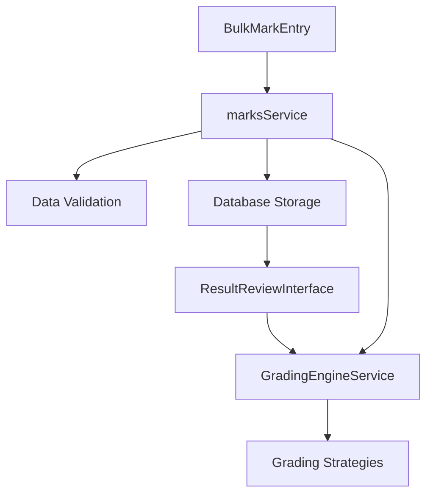
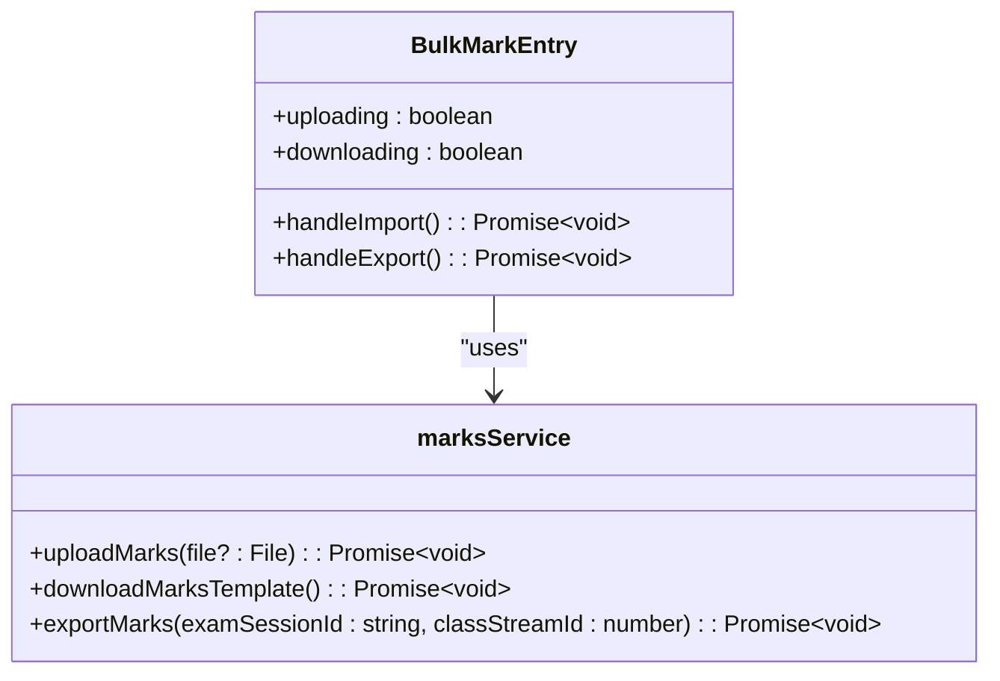
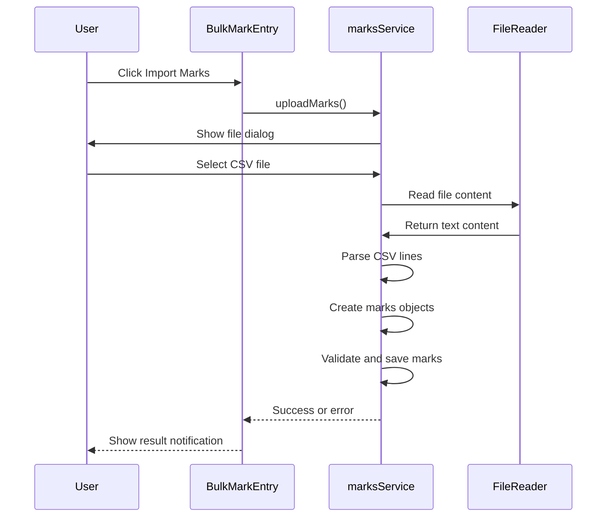
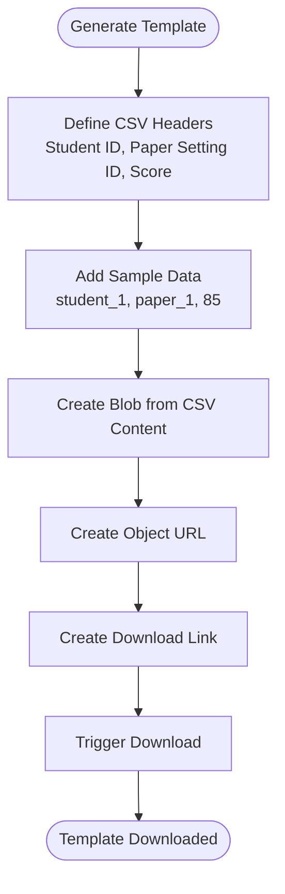
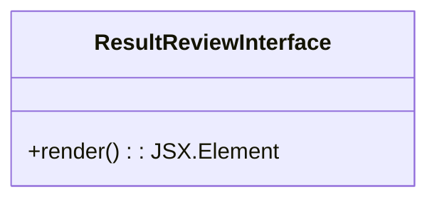
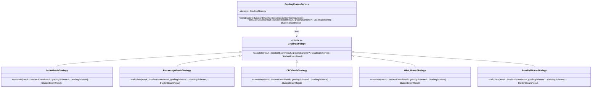
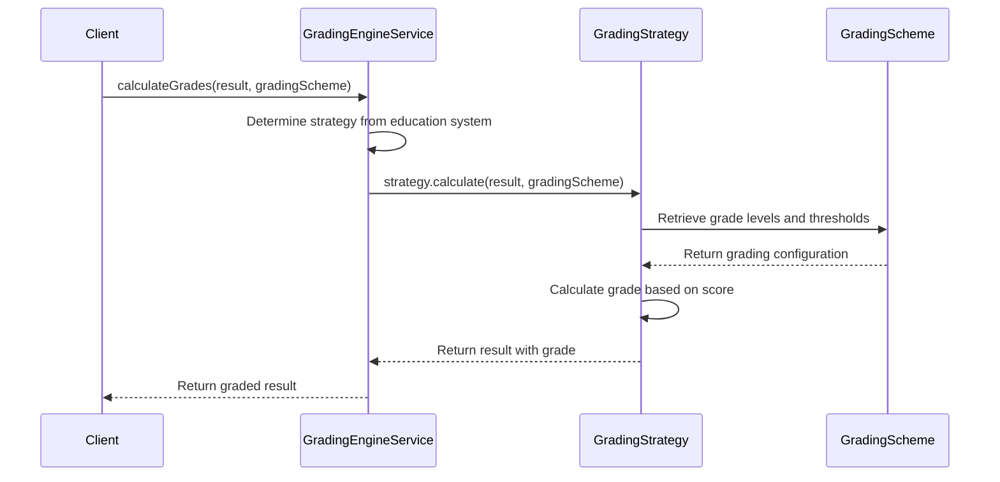
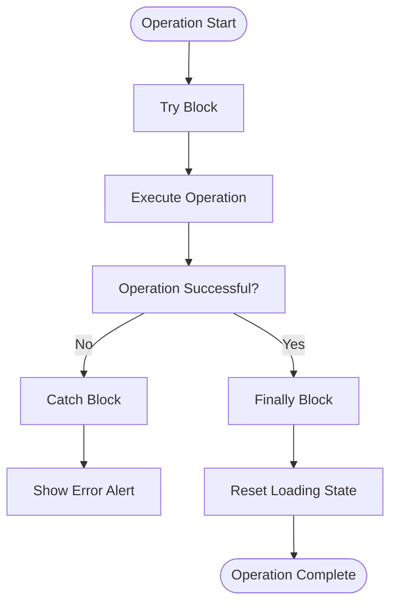
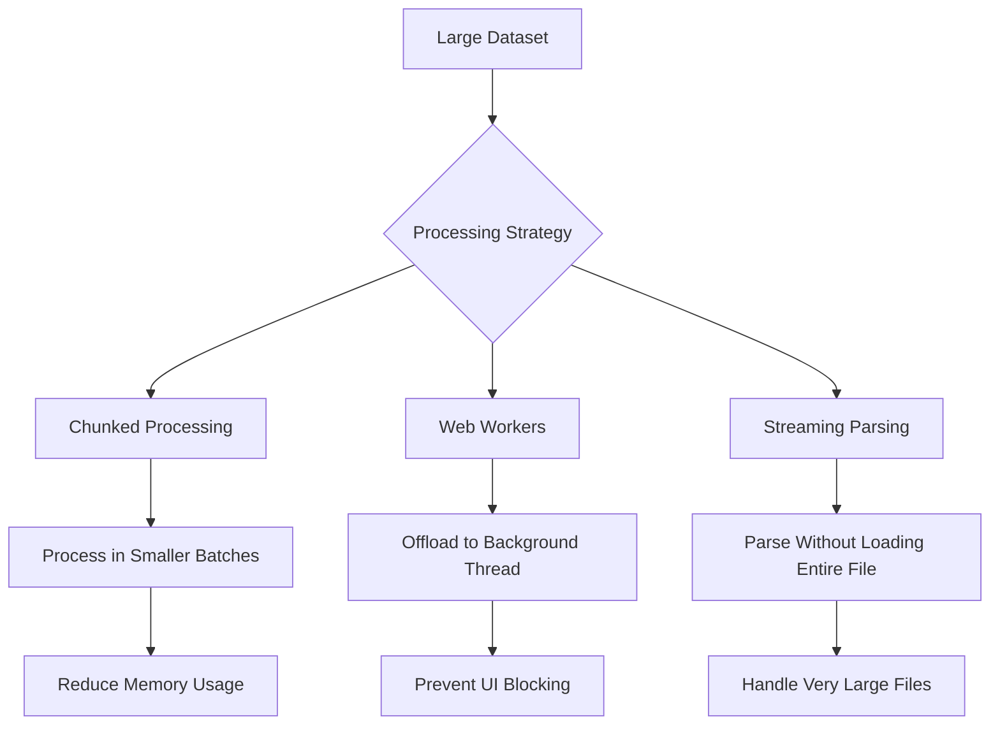

# Mark Entry and Bulk Operations

<cite>
**Referenced Files in This Document**   
- [BulkMarkEntry.tsx](file://src/modules/academics/components/BulkMarkEntry.tsx)
- [ResultReviewInterface.tsx](file://src/modules/academics/components/ResultReviewInterface.tsx)
- [marksService.ts](file://src/modules/academics/services/marksService.ts)
- [GradingEngineService.ts](file://src/modules/academics/services/GradingEngineService.ts)
- [LetterGradeStrategy.ts](file://src/modules/academics/strategies/LetterGradeStrategy.ts)
- [dataValidation.ts](file://src/utils/dataValidation.ts)
- [mark-entry-ui.spec.ts](file://src/tests/integration/mark-entry-ui.spec.ts)
- [grading-engine.spec.ts](file://src/tests/integration/grading-engine.spec.ts)
</cite>

## Table of Contents
1. [Introduction](#introduction)
2. [Core Components Overview](#core-components-overview)
3. [Bulk Mark Entry Mechanism](#bulk-mark-entry-mechanism)
4. [Mark Validation and Data Integrity](#mark-validation-and-data-integrity)
5. [Result Review and Verification](#result-review-and-verification)
6. [Grading Engine Integration](#grading-engine-integration)
7. [Error Handling and Recovery](#error-handling-and-recovery)
8. [Performance Considerations](#performance-considerations)
9. [Usage Examples](#usage-examples)
10. [Troubleshooting Common Issues](#troubleshooting-common-issues)

## Introduction
This document provides comprehensive documentation for the mark entry and bulk operations system within the academic module of the educational platform. The system enables efficient processing of student exam results through bulk import functionality, real-time validation, and integration with grading schemes. The documentation covers the architecture, implementation details, and operational procedures for the BulkMarkEntry component, ResultReviewInterface, marksService, and GradingEngineService. The system is designed to handle large cohorts of student data while maintaining data integrity and providing robust error handling mechanisms.

## Core Components Overview
The mark entry system consists of several interconnected components that work together to facilitate the entry, validation, and processing of student marks. The primary components include the BulkMarkEntry interface for data input, the marksService for backend processing, the ResultReviewInterface for verification, and the GradingEngineService for applying grading schemes. These components follow a modular architecture with clear separation of concerns, allowing for independent development and testing.



**Diagram sources**
- [BulkMarkEntry.tsx](file://src/modules/academics/components/BulkMarkEntry.tsx)
- [marksService.ts](file://src/modules/academics/services/marksService.ts)
- [ResultReviewInterface.tsx](file://src/modules/academics/components/ResultReviewInterface.tsx)
- [GradingEngineService.ts](file://src/modules/academics/services/GradingEngineService.ts)

**Section sources**
- [BulkMarkEntry.tsx](file://src/modules/academics/components/BulkMarkEntry.tsx)
- [marksService.ts](file://src/modules/academics/services/marksService.ts)

## Bulk Mark Entry Mechanism
The BulkMarkEntry component provides a user interface for importing student marks in bulk, typically from CSV files. The component offers two primary functions: importing marks from a file and downloading a template for data preparation. The interface is designed to be simple and intuitive, with clear visual feedback during file operations.

### Interface Implementation
The BulkMarkEntry component is implemented as a React functional component with state management for tracking upload and download operations. It uses the marksService to handle file operations and provides visual feedback through loading states.



**Diagram sources**
- [BulkMarkEntry.tsx](file://src/modules/academics/components/BulkMarkEntry.tsx)
- [marksService.ts](file://src/modules/academics/services/marksService.ts)

**Section sources**
- [BulkMarkEntry.tsx](file://src/modules/academics/components/BulkMarkEntry.tsx)

### Data Import Process
The data import process begins when a user clicks the "Import Marks" button, which triggers the file selection dialog. Once a file is selected, the marksService parses the CSV content and processes the marks data. The current implementation includes basic CSV parsing but lacks comprehensive validation and error handling.



**Diagram sources**
- [marksService.ts](file://src/modules/academics/services/marksService.ts)

## Mark Validation and Data Integrity
The marksService includes basic validation mechanisms for ensuring data integrity during mark entry operations. While the current implementation is minimal, it establishes the foundation for more comprehensive validation in future iterations.

### Data Structure and Validation
The marksService defines a clear interface for bulk import data, specifying the required fields for exam session, class stream, and individual marks. Each mark must include the student ID, paper setting ID, and score.

```typescript
export interface MarksBulkImportData {
  examSessionId: string;
  classStreamId: number;
  marks: {
    studentId: string;
    paperSettingId: string;
    score: number;
  }[];
}
```

The CSV parsing process extracts these fields from the imported file, converting string values to appropriate data types. However, the current implementation lacks comprehensive validation for data accuracy, range checking, or schema verification.

### Template Generation
The marksService provides functionality to generate and download a CSV template for mark entry. This template includes sample data and proper column headers to guide users in preparing their data files.



**Diagram sources**
- [marksService.ts](file://src/modules/academics/services/marksService.ts)

**Section sources**
- [marksService.ts](file://src/modules/academics/services/marksService.ts)

## Result Review and Verification
The ResultReviewInterface component provides a mechanism for reviewing and verifying entered marks before final approval. While the current implementation is minimal, it represents a placeholder for a more comprehensive review system.

### Interface Structure
The ResultReviewInterface is implemented as a React functional component with no current functionality. It serves as a container for future development of mark verification features.



**Diagram sources**
- [ResultReviewInterface.tsx](file://src/modules/academics/components/ResultReviewInterface.tsx)

**Section sources**
- [ResultReviewInterface.tsx](file://src/modules/academics/components/ResultReviewInterface.tsx)

### Future Verification Capabilities
Based on the documentation objective, the ResultReviewInterface is intended to support verification of entered marks against grading schemes and detection of outliers. This would involve comparing entered marks to expected ranges, identifying anomalous scores, and providing tools for manual review and correction.

## Grading Engine Integration
The GradingEngineService is responsible for applying grading schemes to student results based on the configured education system. It uses a strategy pattern to support multiple grading systems, allowing for flexible configuration across different academic programs.

### Strategy Pattern Implementation
The GradingEngineService implements the strategy pattern to support various grading systems. The service selects the appropriate grading strategy based on the education system configuration and delegates the calculation to the strategy implementation.



**Diagram sources**
- [GradingEngineService.ts](file://src/modules/academics/services/GradingEngineService.ts)
- [LetterGradeStrategy.ts](file://src/modules/academics/strategies/LetterGradeStrategy.ts)

**Section sources**
- [GradingEngineService.ts](file://src/modules/academics/services/GradingEngineService.ts)

### Grading Process Flow
The grading process begins when the GradingEngineService receives a student exam result and optional grading scheme. The service uses the configured strategy to calculate the appropriate grade based on the student's score.



**Diagram sources**
- [GradingEngineService.ts](file://src/modules/academics/services/GradingEngineService.ts)

## Error Handling and Recovery
The current implementation includes basic error handling for file operations, with try-catch blocks around asynchronous operations and user notifications for success or failure. However, more comprehensive error handling and recovery mechanisms are needed for production use.

### Current Error Handling
The BulkMarkEntry component implements simple error handling using try-catch blocks around the upload and download operations. When an error occurs, the component displays an alert to inform the user of the failure.



**Section sources**
- [BulkMarkEntry.tsx](file://src/modules/academics/components/BulkMarkEntry.tsx)

### Missing Validation and Conflict Detection
The current implementation lacks several critical error handling features mentioned in the documentation objective, including real-time validation, conflict detection, and schema mismatch handling. These features would require integration with the data validation utilities and conflict detection engine.

## Performance Considerations
The bulk mark entry system is designed to handle large cohorts of student data, but the current implementation has performance limitations that should be addressed in future development.

### Current Performance Characteristics
The marksService implementation includes simulated delays to represent network or processing time, but does not include optimizations for handling large datasets. The CSV parsing is performed synchronously, which could lead to UI blocking for large files.

### Potential Optimization Strategies
For processing large cohorts, the system could implement several performance optimizations:



**Section sources**
- [marksService.ts](file://src/modules/academics/services/marksService.ts)

## Usage Examples
This section provides practical examples of using the bulk mark entry system for common scenarios.

### Basic Bulk Import
The following example demonstrates the basic workflow for importing marks from a CSV file:

1. Click the "Download Template" button to obtain a properly formatted CSV template
2. Fill in the template with student marks data
3. Click the "Import Marks" button and select the completed CSV file
4. Wait for the import to complete and confirm the success message

### Batch Update Process
For updating existing marks, the system would need to implement conflict detection and resolution. The process would involve:

1. Exporting existing marks using the exportMarks function
2. Modifying the exported data as needed
3. Importing the modified data with conflict detection
4. Resolving any conflicts through the ConflictResolutionInterface

## Troubleshooting Common Issues
This section addresses common issues that may occur when using the bulk mark entry system.

### Duplicate Entries
The current implementation does not include specific handling for duplicate entries. To prevent duplicates, users should ensure that their data files do not contain multiple entries for the same student-paper combination.

### Schema Mismatches
Schema mismatches can occur when the CSV file structure does not match the expected format. To avoid this issue:
- Always use the downloaded template as a basis for data entry
- Ensure column headers match exactly (Student ID, Paper Setting ID, Score)
- Verify that all required fields are present and properly formatted

### Network Interruptions
The current implementation does not include specific handling for network interruptions during submission. In a production environment, the system should implement retry mechanisms and offline storage to ensure data is not lost during network outages.

**Section sources**
- [marksService.ts](file://src/modules/academics/services/marksService.ts)
- [BulkMarkEntry.tsx](file://src/modules/academics/components/BulkMarkEntry.tsx)