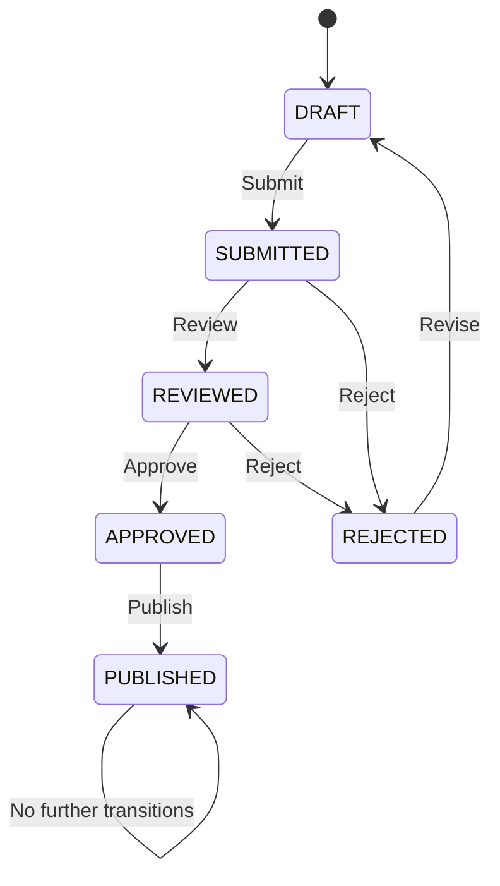
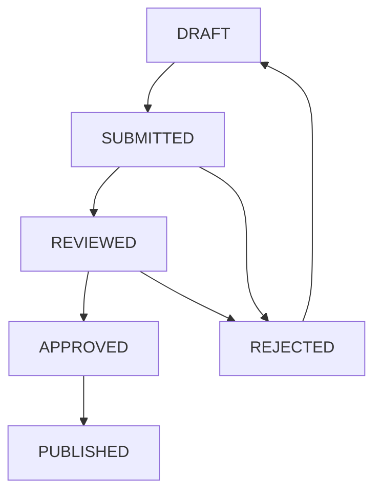
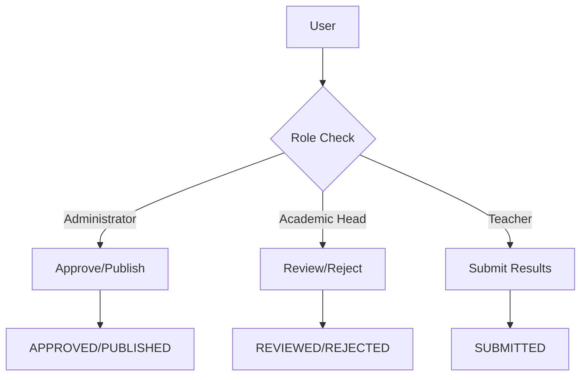
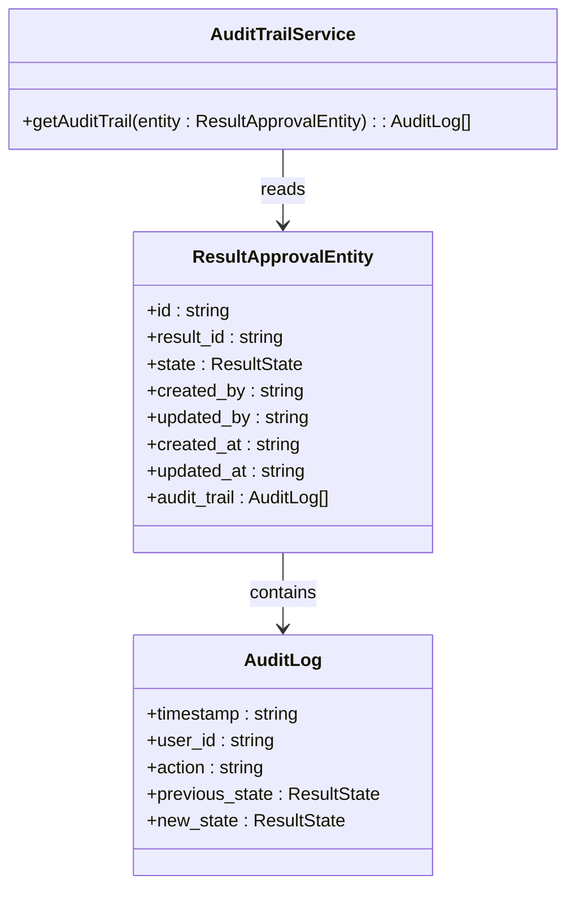
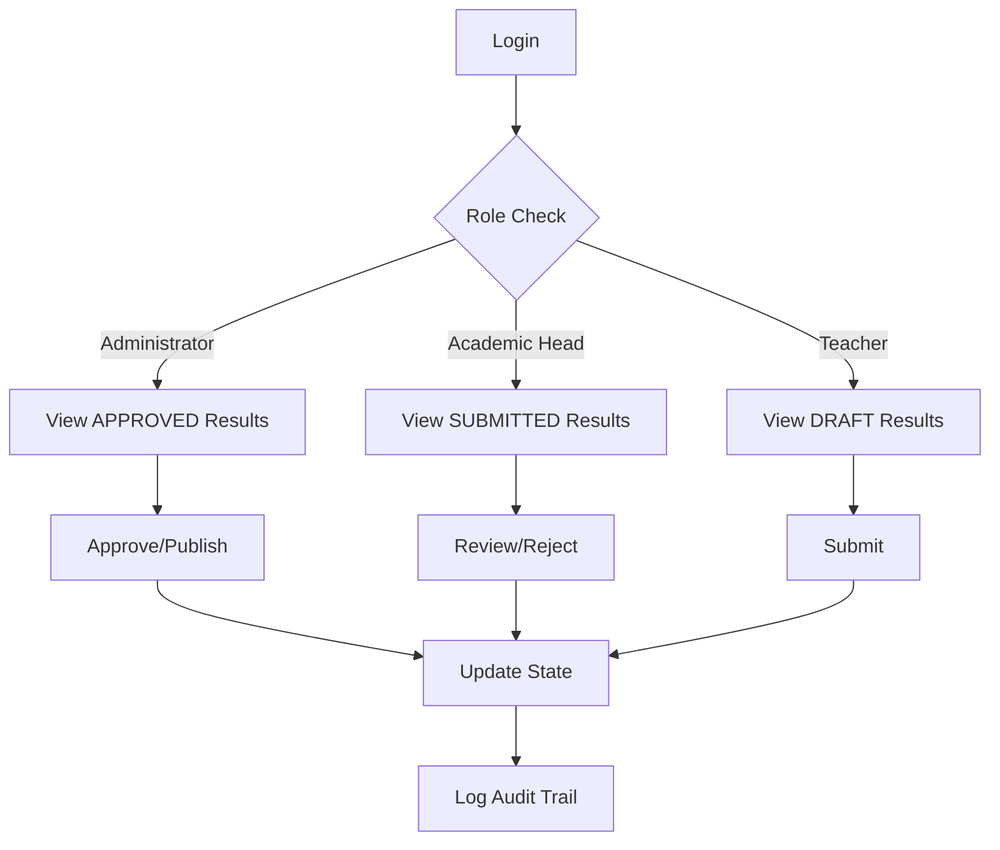
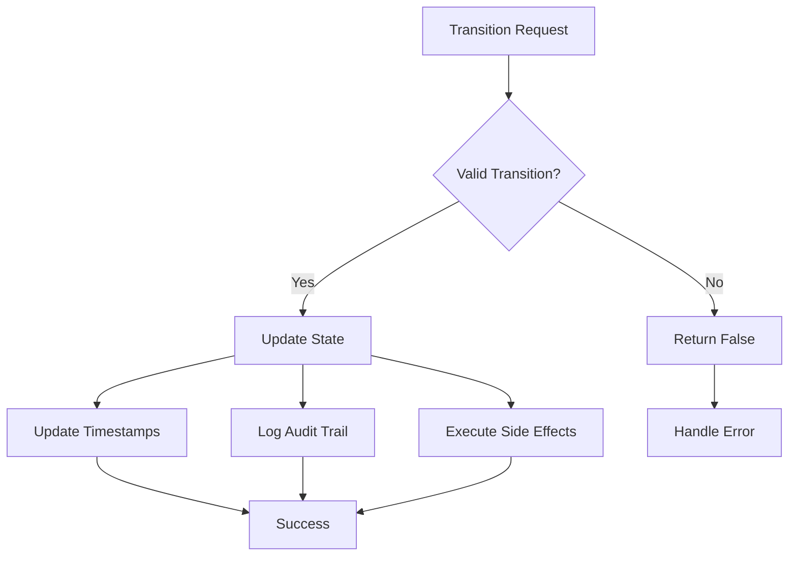
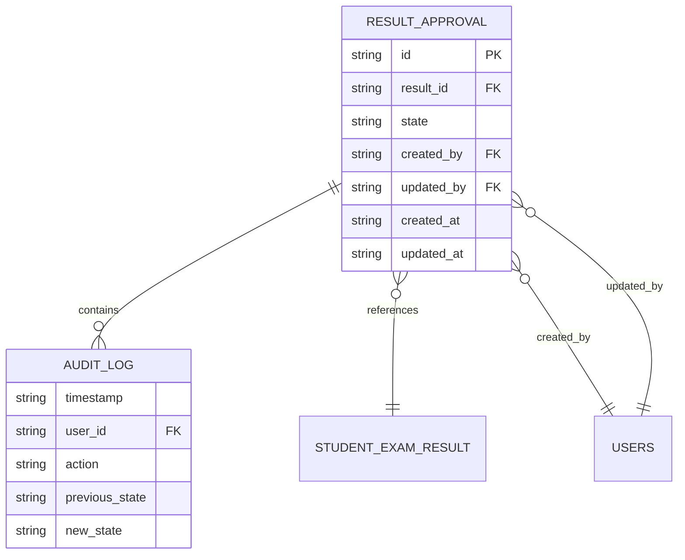
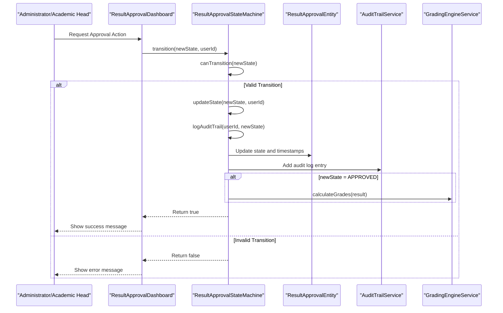
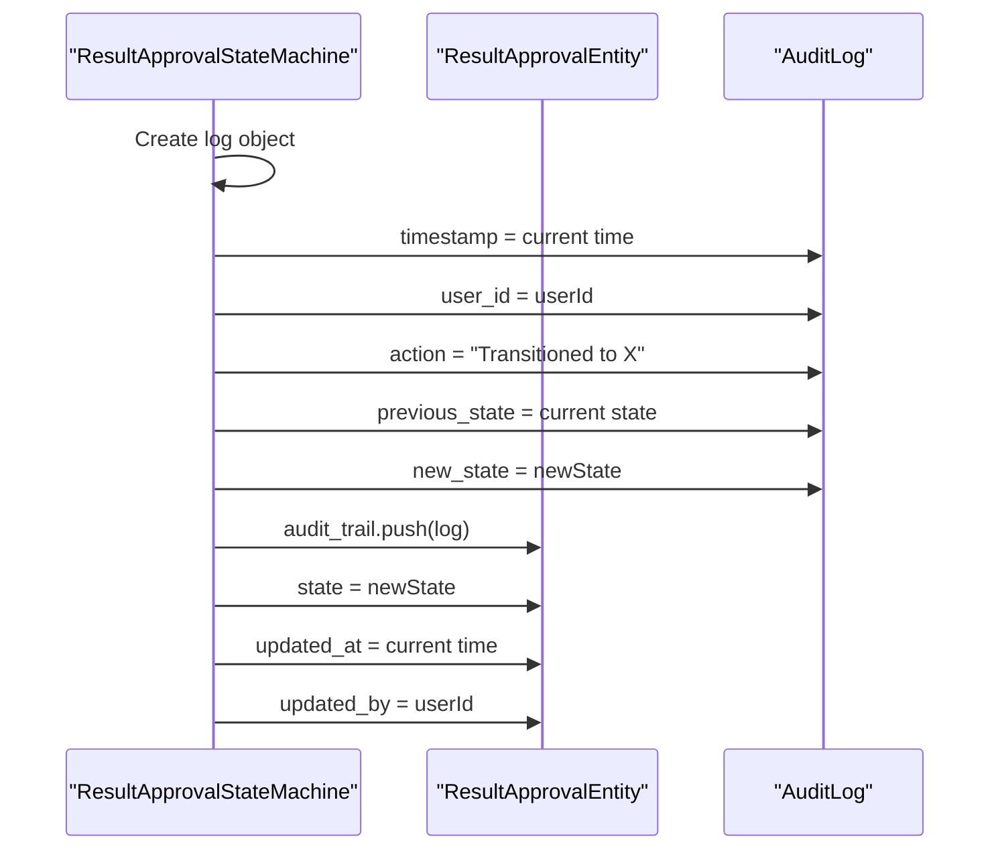

# Result Approval Workflow

<cite>
**Referenced Files in This Document**   
- [ResultApprovalStateMachine.ts](file://src/modules/academics/services/ResultApprovalStateMachine.ts)
- [ResultApprovalDashboard.tsx](file://src/modules/academics/pages/ResultApprovalDashboard.tsx)
- [AuditTrailService.ts](file://src/modules/academics/services/AuditTrailService.ts)
- [enums.ts](file://src/modules/academics/data/enums.ts)
- [types.ts](file://src/modules/academics/data/types.ts)
- [schema.ts](file://src/modules/academics/data/schema.ts)
- [rbac.ts](file://src/modules/academics/rbac.ts)
</cite>

## Table of Contents
1. [Introduction](#introduction)
2. [State Machine Design](#state-machine-design)
3. [State Transitions and Guard Conditions](#state-transitions-and-guard-conditions)
4. [Role-Based Access Control](#role-based-access-control)
5. [Audit Logging](#audit-logging)
6. [UI Flow in ResultApprovalDashboard](#ui-flow-in-resultapprovaldashboard)
7. [Error Handling](#error-handling)
8. [Concurrency Control](#concurrency-control)
9. [State Persistence with RxDB](#state-persistence-with-rxdb)
10. [Performance Under High Load](#performance-under-high-load)
11. [Rollback and Reversion Strategies](#rollback-and-reversion-strategies)
12. [Sequence Diagrams](#sequence-diagrams)

## Introduction
The Result Approval Workflow is a critical component of the academic management system, governing the lifecycle of exam results from initial creation to final publication. This workflow is implemented as a finite state machine (ResultApprovalStateMachine) that ensures data integrity, enforces business rules, and provides auditability throughout the approval process. The system supports role-based access control (RBAC), comprehensive audit logging, and integration with grading engines to calculate final grades upon approval.

**Section sources**
- [ResultApprovalStateMachine.ts](file://src/modules/academics/services/ResultApprovalStateMachine.ts#L1-L60)

## State Machine Design
The Result Approval Workflow is implemented as a finite state machine using the `ResultApprovalStateMachine` class. This design pattern ensures that result approvals follow a strict, predefined path through various states, preventing invalid transitions and maintaining data consistency.

The state machine is instantiated with a `ResultApprovalEntity` object, which contains the current state and all relevant metadata. The machine maintains both the current state internally and updates the entity's state upon successful transitions.

**Diagram sources**
- [ResultApprovalStateMachine.ts](file://src/modules/academics/services/ResultApprovalStateMachine.ts#L1-L60)
- [enums.ts](file://src/modules/academics/data/enums.ts#L3-L10)

**Section sources**
- [ResultApprovalStateMachine.ts](file://src/modules/academics/services/ResultApprovalStateMachine.ts#L1-L60)

## State Transitions and Guard Conditions
The state machine defines valid transitions between states through a guard condition implemented in the `canTransition` method. These guard conditions ensure that only authorized state changes are permitted based on the current state.

The valid transitions are:
- **DRAFT → SUBMITTED**: Initial submission of results for review
- **SUBMITTED → REVIEWED**: Academic head completes review
- **SUBMITTED → REJECTED**: Results returned for corrections
- **REVIEWED → APPROVED**: Final approval by administrator
- **REVIEWED → REJECTED**: Rejection after review
- **APPROVED → PUBLISHED**: Publication of final results
- **REJECTED → DRAFT**: Resubmission after corrections

**Diagram sources**
- [ResultApprovalStateMachine.ts](file://src/modules/academics/services/ResultApprovalStateMachine.ts#L20-L30)
- [enums.ts](file://src/modules/academics/data/enums.ts#L3-L10)

**Section sources**
- [ResultApprovalStateMachine.ts](file://src/modules/academics/services/ResultApprovalStateMachine.ts#L20-L30)

## Role-Based Access Control
The system implements role-based access control (RBAC) to ensure that only authorized users can perform specific actions in the approval workflow. The RBAC configuration is defined in the academics module's `rbac.ts` file.

Currently, the system recognizes two primary roles for the result approval workflow:
- **Administrator**: Can approve results and publish final grades
- **Academic Head**: Can review submitted results and reject them if necessary

The RBAC system is implemented through permission definitions that map specific actions to user roles. While the current implementation shows a basic role structure, the system is designed to support more granular permissions as needed.

**Diagram sources**
- [rbac.ts](file://src/modules/academics/rbac.ts#L1-L78)
- [ResultApprovalStateMachine.ts](file://src/modules/academics/services/ResultApprovalStateMachine.ts#L1-L60)

**Section sources**
- [rbac.ts](file://src/modules/academics/rbac.ts#L1-L78)

## Audit Logging
The system maintains a comprehensive audit trail of all state changes through the `AuditTrailService`. Each transition in the state machine is logged with detailed information including timestamp, user ID, action performed, and state changes.

The audit log is stored as an array of `AuditLog` objects within the `ResultApprovalEntity`. Each log entry captures:
- **timestamp**: When the transition occurred
- **user_id**: Who performed the action
- **action**: Description of the action
- **previous_state**: State before transition
- **new_state**: State after transition

The `AuditTrailService` provides a static method to retrieve the complete audit trail for any result approval entity, enabling transparency and accountability in the approval process.

**Diagram sources**
- [types.ts](file://src/modules/academics/data/types.ts#L34-L44)
- [AuditTrailService.ts](file://src/modules/academics/services/AuditTrailService.ts#L1-L9)

**Section sources**
- [AuditTrailService.ts](file://src/modules/academics/services/AuditTrailService.ts#L1-L9)
- [types.ts](file://src/modules/academics/data/types.ts#L34-L44)

## UI Flow in ResultApprovalDashboard
The `ResultApprovalDashboard` component provides the user interface for administrators and academic heads to manage the result approval workflow. The dashboard presents different views and action options based on the user's role and the current state of results.

The UI flow follows the state machine transitions:
1. **DRAFT**: Teachers can edit and submit results
2. **SUBMITTED**: Academic heads see results for review with approve/reject options
3. **REVIEWED**: Administrators see results for final approval
4. **APPROVED**: Results are ready for publication
5. **PUBLISHED**: Final results are visible to stakeholders

The dashboard is designed to guide users through the approval process with clear visual indicators of the current state and available actions.

**Diagram sources**
- [ResultApprovalDashboard.tsx](file://src/modules/academics/pages/ResultApprovalDashboard.tsx#L1-L13)
- [ResultApprovalStateMachine.ts](file://src/modules/academics/services/ResultApprovalStateMachine.ts#L1-L60)

**Section sources**
- [ResultApprovalDashboard.tsx](file://src/modules/academics/pages/ResultApprovalDashboard.tsx#L1-L13)

## Error Handling
The state machine implements error handling for invalid transitions through its guard conditions. When a transition is attempted that is not permitted by the current state, the `canTransition` method returns false, and the `transition` method returns false without modifying the state.

The system handles invalid transitions gracefully by:
1. Returning false to indicate the transition failed
2. Not modifying the current state
3. Not updating timestamps or audit logs
4. Allowing the calling code to handle the failure appropriately

This approach prevents the system from entering an invalid state while providing a clear indication that the requested transition was not permitted.

**Diagram sources**
- [ResultApprovalStateMachine.ts](file://src/modules/academics/services/ResultApprovalStateMachine.ts#L20-L30)
- [ResultApprovalStateMachine.ts](file://src/modules/academics/services/ResultApprovalStateMachine.ts#L10-L15)

**Section sources**
- [ResultApprovalStateMachine.ts](file://src/modules/academics/services/ResultApprovalStateMachine.ts#L10-L37)

## Concurrency Control
The current implementation of the Result Approval State Machine does not include explicit concurrency control mechanisms. Multiple users could potentially attempt to transition the same result approval entity simultaneously, which might lead to race conditions.

In a production environment, concurrency control should be implemented through:
- **Optimistic locking**: Using version numbers or timestamps to detect concurrent modifications
- **Database-level locking**: Utilizing database transactions and row-level locks
- **Queue-based processing**: Serializing approval requests through a message queue

The absence of explicit concurrency control in the current implementation suggests that the system may rely on the underlying database's transaction isolation to handle concurrent access, or that the workflow is designed to minimize concurrent modifications through business processes.

**Section sources**
- [ResultApprovalStateMachine.ts](file://src/modules/academics/services/ResultApprovalStateMachine.ts#L1-L60)

## State Persistence with RxDB
The result approval state is persisted using RxDB, a reactive database for JavaScript applications. The `resultApprovalSchema` defined in the academics module's schema.ts file specifies the structure of the stored data.

Key persistence features include:
- **Primary key**: Unique identifier (id) for each approval entity
- **References**: Links to related entities like student exam results and users
- **Enum validation**: State field restricted to valid ResultState values
- **Timestamps**: Creation and update timestamps for audit purposes
- **Nested documents**: Audit trail stored as an array of log entries within the main document

The schema ensures data integrity by defining required fields and indexes for efficient querying.

**Diagram sources**
- [schema.ts](file://src/modules/academics/data/schema.ts#L28-L48)
- [types.ts](file://src/modules/academics/data/types.ts#L34-L44)

**Section sources**
- [schema.ts](file://src/modules/academics/data/schema.ts#L28-L48)

## Performance Under High Load
The result approval workflow is designed to handle batch operations efficiently, though specific performance optimizations are not evident in the current implementation. For high-load scenarios involving approval of large batches of results, the following considerations apply:

- **Reactive architecture**: RxDB provides reactive querying capabilities, allowing the dashboard to update in real-time as approvals progress
- **Indexing**: The schema includes indexes on result_id and state fields, enabling efficient filtering and retrieval of results in specific states
- **Batch processing**: The state machine operates on individual entities, suggesting that batch operations would require external orchestration
- **Memory efficiency**: The state machine maintains minimal internal state, reducing memory overhead

For optimal performance with large approval batches, additional optimizations could include:
- Bulk update operations at the database level
- Parallel processing of independent approval requests
- Caching frequently accessed result data
- Pagination and lazy loading in the dashboard UI

**Section sources**
- [ResultApprovalStateMachine.ts](file://src/modules/academics/services/ResultApprovalStateMachine.ts#L1-L60)
- [schema.ts](file://src/modules/academics/data/schema.ts#L28-L48)

## Rollback and Reversion Strategies
The workflow includes built-in reversion capabilities through the REJECTED → DRAFT transition, allowing results to be returned to draft status for corrections. This serves as the primary rollback mechanism in the system.

Additional rollback and reversion strategies include:
- **Audit trail**: Complete history of all state transitions enables reconstruction of previous states
- **Data immutability**: Original result data is preserved, with approvals representing a separate workflow state
- **Manual intervention**: Administrators can potentially modify the state directly in the database if needed

The system does not appear to have automated rollback capabilities for erroneous approvals, suggesting that such operations would require manual intervention through the standard rejection workflow.

**Section sources**
- [ResultApprovalStateMachine.ts](file://src/modules/academics/services/ResultApprovalStateMachine.ts#L20-L30)

## Sequence Diagrams

### Result Approval Sequence

**Diagram sources**
- [ResultApprovalStateMachine.ts](file://src/modules/academics/services/ResultApprovalStateMachine.ts#L1-L60)
- [ResultApprovalDashboard.tsx](file://src/modules/academics/pages/ResultApprovalDashboard.tsx#L1-L13)
- [AuditTrailService.ts](file://src/modules/academics/services/AuditTrailService.ts#L1-L9)

### Audit Logging Sequence

**Diagram sources**
- [ResultApprovalStateMachine.ts](file://src/modules/academics/services/ResultApprovalStateMachine.ts#L45-L59)
- [types.ts](file://src/modules/academics/data/types.ts#L34-L44)