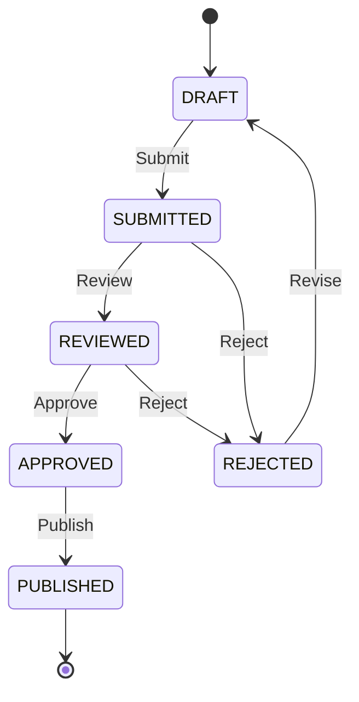
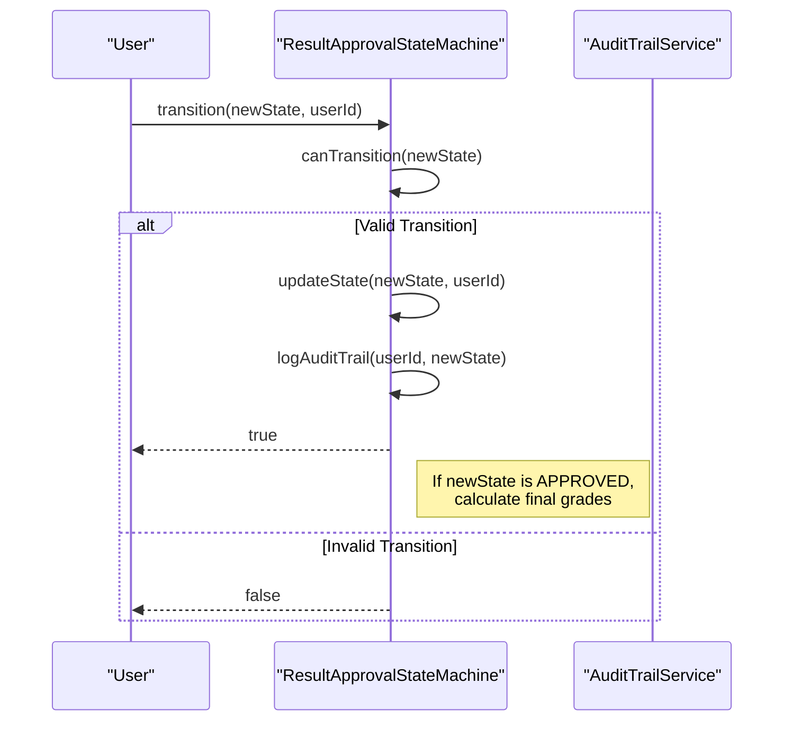
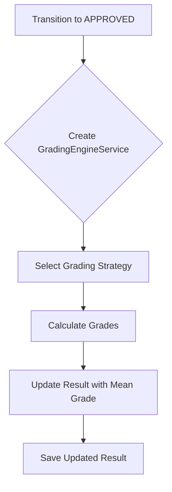
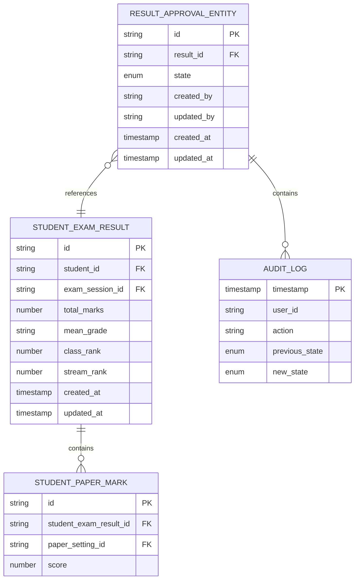
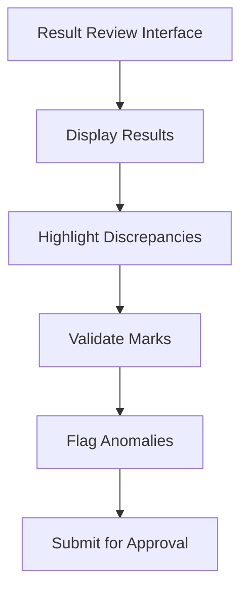
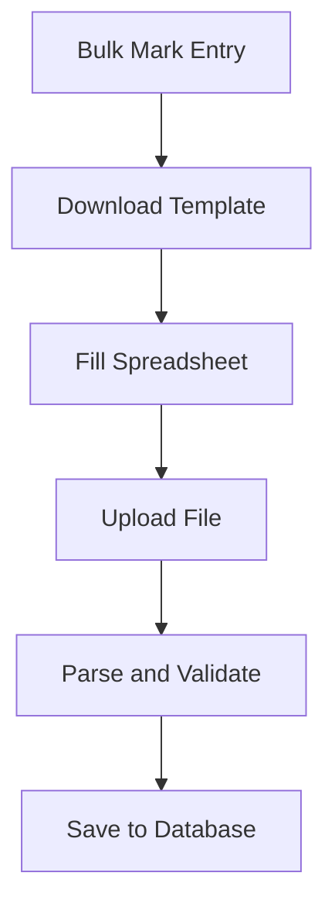
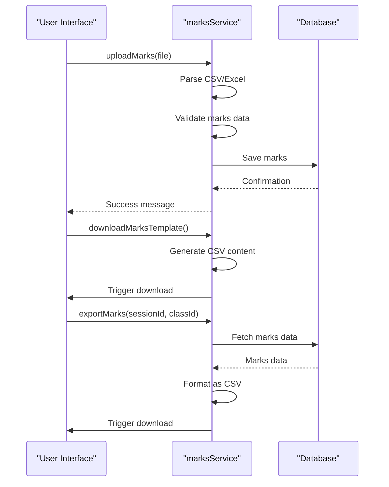
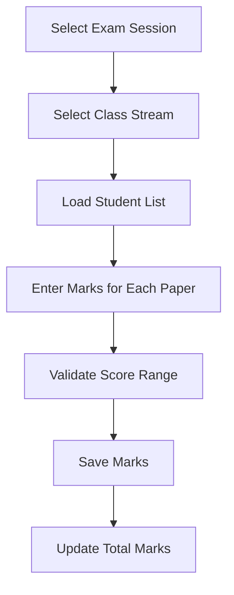

# Result Management and Approval

<cite>
**Referenced Files in This Document**   
- [ResultApprovalStateMachine.ts](file://src/modules/academics/services/ResultApprovalStateMachine.ts)
- [marksService.ts](file://src/modules/academics/services/marksService.ts)
- [types.ts](file://src/modules/academics/data/types.ts)
- [enums.ts](file://src/modules/academics/data/enums.ts)
- [ResultReviewInterface.tsx](file://src/modules/academics/components/ResultReviewInterface.tsx)
- [BulkMarkEntry.tsx](file://src/modules/academics/components/BulkMarkEntry.tsx)
- [StudentExamResultsEntryPage.tsx](file://src/modules/academics/pages/StudentExamResultsEntryPage.tsx)
- [GradingEngineService.ts](file://src/modules/academics/services/GradingEngineService.ts)
- [LetterGradeStrategy.ts](file://src/modules/academics/strategies/LetterGradeStrategy.ts)
- [AuditTrailService.ts](file://src/modules/academics/services/AuditTrailService.ts)
- [ResultApprovalDashboard.tsx](file://src/modules/academics/pages/ResultApprovalDashboard.tsx)
</cite>

## Table of Contents
1. [Introduction](#introduction)
2. [State Machine Implementation](#state-machine-implementation)
3. [Data Model](#data-model)
4. [Result Review Interface](#result-review-interface)
5. [Bulk Mark Entry](#bulk-mark-entry)
6. [Marks Service](#marks-service)
7. [Step-by-Step Workflows](#step-by-step-workflows)
8. [Conflict Resolution](#conflict-resolution)
9. [Performance Considerations](#performance-considerations)
10. [Conclusion](#conclusion)

## Introduction
The Result Management and Approval system provides a comprehensive workflow for handling student examination results from initial entry through final publication. This document details the architecture, components, and processes that ensure accurate, auditable, and secure management of academic results. The system implements a state machine to govern the approval process, supports both individual and bulk mark entry, and includes robust validation and audit capabilities.

## State Machine Implementation

The ResultApprovalStateMachine class implements a finite state machine that governs the lifecycle of result approval processes. This state machine ensures that results progress through a defined workflow with proper validation and audit trails at each transition.



**Diagram sources**
- [ResultApprovalStateMachine.ts](file://src/modules/academics/services/ResultApprovalStateMachine.ts)

**Section sources**
- [ResultApprovalStateMachine.ts](file://src/modules/academics/services/ResultApprovalStateMachine.ts#L5-L58)

### State Transitions
The state machine defines six states in the result approval workflow:
- **DRAFT**: Initial state where marks can be entered and modified
- **SUBMITTED**: Marks have been submitted for review
- **REVIEWED**: Academic staff have reviewed the results
- **APPROVED**: Results have been formally approved
- **REJECTED**: Results were rejected and require revision
- **PUBLISHED**: Final results have been published to students

The valid transitions between states are strictly enforced by the `canTransition` method, which maintains a mapping of allowed state changes. For example, only results in the DRAFT state can transition to SUBMITTED, and only results in the APPROVED state can transition to PUBLISHED.

### Transition Process
When a state transition occurs, three key operations are performed:
1. **State validation**: The `canTransition` method verifies that the requested transition is permitted
2. **State update**: The `updateState` method updates the current state and metadata
3. **Audit logging**: The `logAuditTrail` method records the transition in the audit trail



**Diagram sources**
- [ResultApprovalStateMachine.ts](file://src/modules/academics/services/ResultApprovalStateMachine.ts#L10-L35)

### Grade Calculation on Approval
When results are approved (transition to APPROVED state), the system automatically calculates final grades using the GradingEngineService. This ensures consistent grade assignment based on the institution's grading scheme.



**Section sources**
- [ResultApprovalStateMachine.ts](file://src/modules/academics/services/ResultApprovalStateMachine.ts#L45-L55)
- [GradingEngineService.ts](file://src/modules/academics/services/GradingEngineService.ts)

## Data Model

The data model for student results is designed to support comprehensive assessment tracking with audit capabilities and versioning.

### Student Exam Result
The StudentExamResult interface represents a student's performance in an examination session.

**StudentExamResult Structure**
- **id**: Unique identifier for the result record
- **student_id**: Reference to the student
- **exam_session_id**: Reference to the examination session
- **total_marks**: Sum of all paper marks
- **mean_grade**: Final grade (e.g., "A", "B+", "Distinction")
- **class_rank**: Student's rank within their class
- **stream_rank**: Student's rank within their stream
- **created_at**: Timestamp of record creation
- **updated_at**: Timestamp of last modification
- **marks**: Array of paper-level marks

### Student Paper Mark
The StudentPaperMark interface represents a student's score on a specific examination paper.

**StudentPaperMark Structure**
- **id**: Unique identifier for the paper mark
- **student_exam_result_id**: Reference to the parent result
- **paper_setting_id**: Reference to the exam paper
- **score**: Numerical score achieved (nullable)

### Result Approval Entity
The ResultApprovalEntity interface extends the basic result model with state management and audit capabilities.

**ResultApprovalEntity Structure**
- **id**: Unique identifier
- **result_id**: Reference to the student exam result
- **result**: Embedded result object
- **state**: Current state in the approval workflow
- **created_by**: User who created the record
- **updated_by**: User who last modified the record
- **created_at**: Creation timestamp
- **updated_at**: Last modification timestamp
- **audit_trail**: Array of audit log entries

### Audit Trail
The AuditLog interface captures all state transitions for accountability and traceability.

**AuditLog Structure**
- **timestamp**: When the transition occurred
- **user_id**: Who performed the transition
- **action**: Description of the action
- **previous_state**: State before transition
- **new_state**: State after transition



**Diagram sources**
- [types.ts](file://src/modules/academics/data/types.ts#L188-L200)
- [types.ts](file://src/modules/academics/data/types.ts#L178-L186)
- [types.ts](file://src/modules/academics/data/types.ts#L158-L176)

**Section sources**
- [types.ts](file://src/modules/academics/data/types.ts)

## Result Review Interface

The ResultReviewInterface component provides a user interface for reviewing and validating examination results before approval. Although the implementation is currently minimal, the interface is designed to support comprehensive review functionality.



The interface would typically include features such as:
- **Discrepancy detection**: Identification of marks that deviate significantly from class averages
- **Validation rules**: Enforcement of score ranges and formatting requirements
- **Anomaly flagging**: Highlighting potential data entry errors
- **Commenting system**: Allowing reviewers to add notes on specific results
- **Batch actions**: Enabling approval or rejection of multiple results simultaneously

**Section sources**
- [ResultReviewInterface.tsx](file://src/modules/academics/components/ResultReviewInterface.tsx)

## Bulk Mark Entry

The BulkMarkEntry component enables efficient data entry through file-based import and export operations.



### Component Functionality
The BulkMarkEntry component provides two primary functions:

**Import Marks**
- Triggers a file selection dialog for CSV or Excel files
- Parses the uploaded file to extract mark data
- Validates the data format and content
- Saves the marks to the database
- Provides feedback on import success or failure

**Download Template**
- Generates a CSV template with required columns
- Includes sample data for reference
- Enables users to prepare their mark entries offline
- Ensures consistent data format for import

```typescript
const BulkMarkEntry: React.FC = () => {
  const [uploading, setUploading] = useState(false);
  const [downloading, setDownloading] = useState(false);

  const handleImport = async () => {
    setUploading(true);
    try {
      await uploadMarks();
      alert('Marks imported successfully!');
    } catch (error) {
      alert('Failed to import marks.');
    } finally {
      setUploading(false);
    }
  };

  const handleExport = async () => {
    setDownloading(true);
    try {
      await downloadMarksTemplate();
      alert('Template downloaded successfully!');
    } catch (error) {
      alert('Failed to download template.');
    } finally {
      setDownloading(false);
    }
  };
};
```

**Section sources**
- [BulkMarkEntry.tsx](file://src/modules/academics/components/BulkMarkEntry.tsx)

## Marks Service

The marksService module provides CRUD operations for managing student marks and paper-level assessments.

### Service Functions
The service exports three primary functions:

**uploadMarks**
- Handles file uploads for bulk mark entry
- Supports CSV and Excel formats
- Parses file content and validates mark data
- Simulates API calls with delay for user feedback
- Creates file input element when no file is provided

**downloadMarksTemplate**
- Generates a CSV template for mark entry
- Includes column headers and sample data
- Triggers browser download
- Provides standardized format for data entry

**exportMarks**
- Exports existing marks data to CSV format
- Fetches data from the database (simulated)
- Formats data with appropriate headers
- Triggers browser download with timestamped filename



**Diagram sources**
- [marksService.ts](file://src/modules/academics/services/marksService.ts)

**Section sources**
- [marksService.ts](file://src/modules/academics/services/marksService.ts)

## Step-by-Step Workflows

### Entering Results
1. Navigate to the Student Exam Results Entry page
2. Select an examination session from the dropdown
3. Select a class stream from the available options
4. Enter marks for each student in the respective paper columns
5. Click "Save All Marks" to persist the data
6. The system saves individual paper marks and calculates total marks



**Section sources**
- [StudentExamResultsEntryPage.tsx](file://src/modules/academics/pages/StudentExamResultsEntryPage.tsx)

### Reviewing Discrepancies
1. Access the Result Review Interface
2. Filter results by examination session and class
3. Identify marks that fall outside expected ranges
4. Compare with previous performance data
5. Consult with subject teachers if needed
6. Document findings in the review comments

### Obtaining Approvals
1. Submit results from DRAFT to SUBMITTED state
2. Department heads review and transition to REVIEWED state
3. Academic committee approves results, transitioning to APPROVED state
4. Final grades are automatically calculated
5. Principal publishes results, transitioning to PUBLISHED state
6. Students can access their results through the student portal

## Conflict Resolution

While the current implementation does not include a dedicated conflict resolution interface, the system design accommodates potential conflicts through several mechanisms:

### Data Entry Conflicts
When multiple users attempt to modify the same result simultaneously:
- The last save operation overwrites previous changes
- Audit trails record all state transitions with timestamps and user IDs
- Users can review the audit trail to understand the sequence of changes

### Grade Discrepancies
For marks that appear anomalous:
- The system could implement validation rules to flag scores outside typical ranges
- Reviewers can compare individual performance with class averages
- Historical performance data can be consulted for context
- Subject teachers can provide explanations for significant deviations

### Resolution Process
1. Identify the conflicting data points
2. Review the audit trail to understand the history
3. Consult with relevant stakeholders (teachers, department heads)
4. Make a decision on the correct values
5. Update the results and document the resolution
6. Proceed with the approval workflow

## Performance Considerations

### Bulk Operations
The system handles bulk operations on large datasets through several optimization strategies:

**Efficient Data Processing**
- Batch processing of mark entries
- Optimized database transactions
- Minimal re-renders during import operations
- Progress indicators for long-running operations

**Memory Management**
- Streaming file parsing to avoid loading entire files into memory
- Incremental processing of large datasets
- Cleanup of temporary objects after operations complete

**User Experience**
- Loading states during data operations
- Clear feedback on operation progress
- Error handling with specific messages
- Ability to retry failed operations

### Scalability
For institutions with large student populations:
- Database indexing on frequently queried fields
- Caching of frequently accessed data
- Pagination for result displays
- Asynchronous processing for intensive operations

### Optimization Recommendations
1. Implement server-side validation for bulk imports
2. Add progress tracking for large file uploads
3. Support partial imports to handle file errors
4. Implement data preview before final import
5. Add export filtering options for large datasets

## Conclusion
The Result Management and Approval system provides a robust framework for handling academic results through a well-defined workflow. The state machine ensures proper governance of the approval process, while the data model supports comprehensive tracking with audit capabilities. The system balances efficiency through bulk operations with accuracy through validation and review processes. Future enhancements could include more sophisticated conflict detection, advanced analytics for discrepancy identification, and improved user interfaces for the review process.