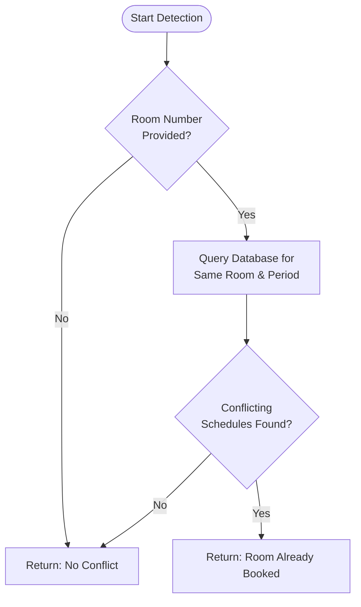
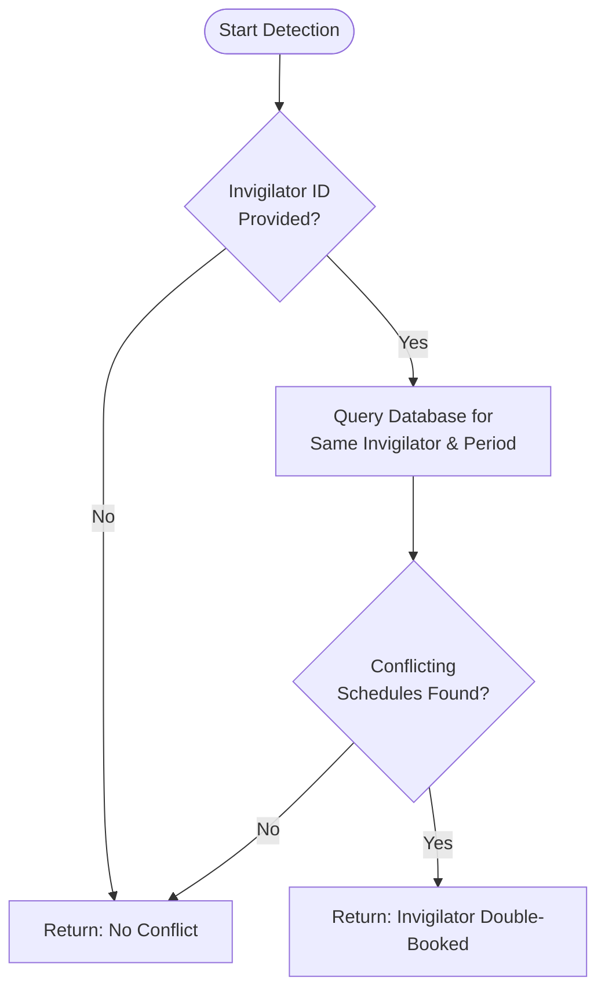
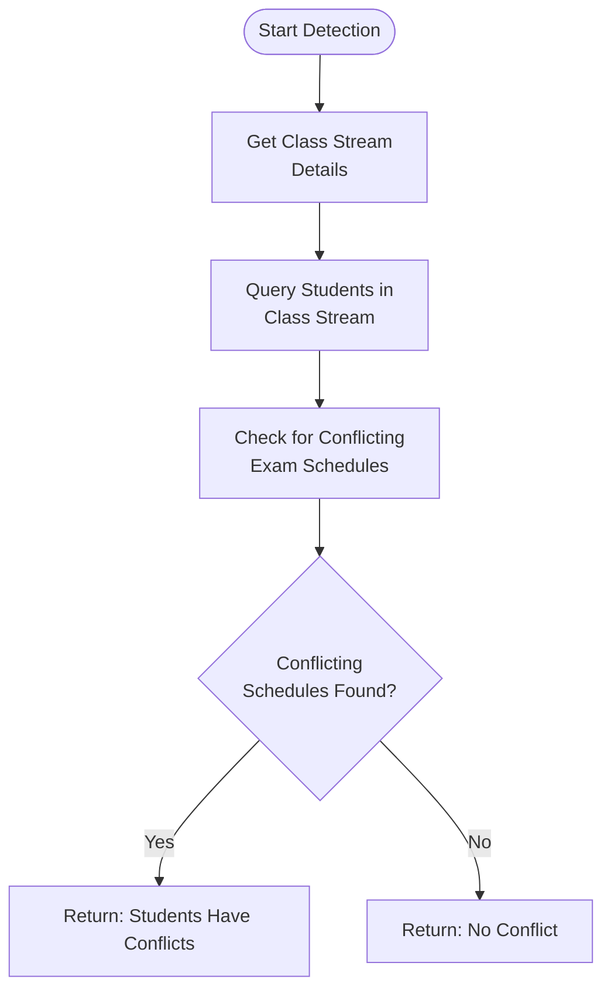
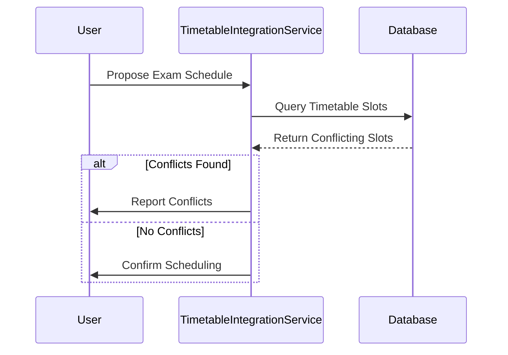
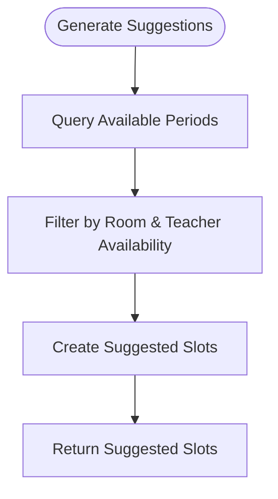
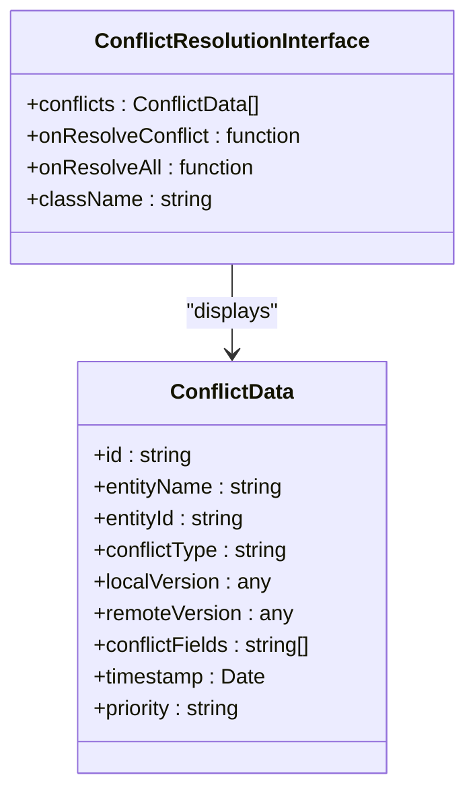
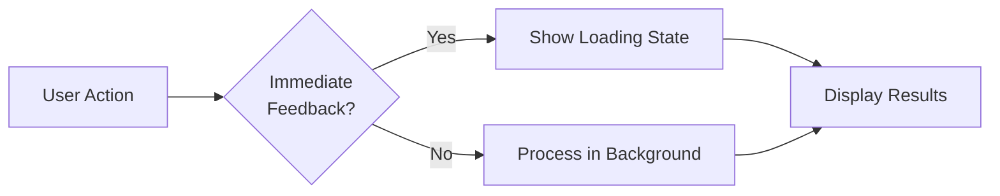

# Conflict Detection and Resolution

<cite>
**Referenced Files in This Document**   
- [ConflictDetectionEngine.ts](file://src/modules/academics/services/ConflictDetectionEngine.ts)
- [TimetableIntegrationService.ts](file://src/modules/academics/services/TimetableIntegrationService.ts)
- [types.ts](file://src/modules/academics/data/types.ts)
- [ConflictResolutionInterface.tsx](file://src/components/ConflictResolutionInterface.tsx)
</cite>

## Table of Contents
1. [Introduction](#introduction)
2. [Core Components](#core-components)
3. [Conflict Detection Algorithm](#conflict-detection-algorithm)
4. [Timetable Integration](#timetable-integration)
5. [User Interface Feedback](#user-interface-feedback)
6. [Configuration Options](#configuration-options)
7. [Troubleshooting Guide](#troubleshooting-guide)
8. [Performance Considerations](#performance-considerations)

## Introduction
The timetable conflict detection system is designed to identify and resolve scheduling conflicts within an educational institution's timetable. This system ensures that resources such as classrooms, teachers, and students are not double-booked during overlapping time slots. The core functionality revolves around the ConflictDetectionEngine and TimetableIntegrationService, which work together to detect conflicts, provide resolution suggestions, and integrate with the user interface for seamless conflict management.

## Core Components

The system's architecture is built around two primary components: the ConflictDetectionEngine and the TimetableIntegrationService. These components are responsible for detecting conflicts in scheduling and ensuring that timetable entries do not overlap in terms of resources like classrooms, teachers, and student availability.

The ConflictDetectionEngine focuses on identifying conflicts by analyzing exam schedules against existing bookings for rooms, invigilators (teachers), and students. It uses a set of configurable options to determine which types of conflicts to check and provides detailed feedback on detected issues.

The TimetableIntegrationService acts as a bridge between the exam scheduling system and the school's timetable. It checks for conflicts in the timetable, such as overlapping class periods or room bookings, and offers suggested alternative slots when conflicts are detected.

**Section sources**
- [ConflictDetectionEngine.ts](file://src/modules/academics/services/ConflictDetectionEngine.ts#L1-L250)
- [TimetableIntegrationService.ts](file://src/modules/academics/services/TimetableIntegrationService.ts#L1-L280)

## Conflict Detection Algorithm

The conflict detection algorithm implemented in the ConflictDetectionEngine is designed to identify three main types of conflicts: room conflicts, invigilator conflicts, and student conflicts. Each type of conflict is checked independently, allowing for flexible configuration based on institutional needs.

### Room Conflicts
Room conflicts occur when a classroom is scheduled for multiple activities at the same time. The algorithm checks for overlapping bookings by querying the database for existing schedules that share the same room number and period ID. If a conflict is found, it returns a descriptive message indicating the room is already booked.



**Diagram sources**
- [ConflictDetectionEngine.ts](file://src/modules/academics/services/ConflictDetectionEngine.ts#L47-L79)

### Invigilator Conflicts
Invigilator conflicts arise when a teacher is assigned to proctor multiple exams simultaneously. The algorithm checks for this by looking up existing exam schedules that involve the same invigilator during the same period. If a conflict is detected, it alerts the user with a message specifying the invigilator's double-booking.



**Diagram sources**
- [ConflictDetectionEngine.ts](file://src/modules/academics/services/ConflictDetectionEngine.ts#L81-L111)

### Student Conflicts
Student conflicts are identified by checking whether students in a particular class stream have overlapping exam schedules. This involves querying the database for other exams scheduled for the same class stream during the same period. If conflicts are found, the system reports which students are affected.



**Diagram sources**
- [ConflictDetectionEngine.ts](file://src/modules/academics/services/ConflictDetectionEngine.ts#L113-L146)

## Timetable Integration

The TimetableIntegrationService integrates the conflict detection system with the school's timetable, ensuring that exam schedules do not conflict with regular class periods. This service performs several checks to maintain timetable integrity.

### Timetable Conflict Checks
When a new exam schedule is proposed, the service checks for overlapping entries in the timetable. It queries the database for existing slots that share the same period ID and either the same room or class stream. If conflicts are found, they are reported to the user.



**Diagram sources**
- [TimetableIntegrationService.ts](file://src/modules/academics/services/TimetableIntegrationService.ts#L23-L42)

### Suggested Slots Generation
If conflicts are detected, the service generates suggested alternative slots where the exam could be scheduled without conflicts. These suggestions are based on available periods and resources, providing users with actionable alternatives.



**Diagram sources**
- [TimetableIntegrationService.ts](file://src/modules/academics/services/TimetableIntegrationService.ts#L122-L162)

## User Interface Feedback

The user interface provides clear feedback on detected conflicts through the ConflictResolutionInterface component. This interface displays conflicts in a prioritized list, allowing users to resolve them individually or in bulk.

### Visual Indicators
Conflicts are color-coded based on their severity:
- **Critical**: Red background for urgent conflicts (e.g., room double-booking)
- **High**: Orange background for significant conflicts (e.g., teacher double-booking)
- **Normal**: Blue background for moderate conflicts (e.g., student scheduling issues)
- **Low**: Gray background for minor warnings



**Diagram sources**
- [ConflictResolutionInterface.tsx](file://src/components/ConflictResolutionInterface.tsx#L10-L44)

### Resolution Suggestions
Users can choose from several resolution strategies:
- **Keep Local**: Use the offline changes
- **Keep Remote**: Use the server version
- **Auto Merge**: Combine both versions
- **Custom**: Manually edit the resolution

These options are presented in a modal dialog, allowing users to review the differences between conflicting versions before making a decision.

**Section sources**
- [ConflictResolutionInterface.tsx](file://src/components/ConflictResolutionInterface.tsx#L109-L146)

## Configuration Options

The conflict detection system can be customized through configuration options that control which types of conflicts are checked and how they are handled.

### Detection Options
The following options can be configured when running conflict detection:
- **excludeScheduleId**: Exclude a specific schedule from conflict checks (useful when editing existing schedules)
- **checkRoomConflicts**: Enable or disable room conflict detection
- **checkInvigilatorConflicts**: Enable or disable invigilator conflict detection
- **checkStudentConflicts**: Enable or disable student conflict detection
- **timeWindowMinutes**: Define the time window for conflict detection (default: 120 minutes)

```typescript
interface ConflictDetectionOptions {
  excludeScheduleId?: string;
  checkRoomConflicts?: boolean;
  checkInvigilatorConflicts?: boolean;
  checkStudentConflicts?: boolean;
  timeWindowMinutes?: number;
}
```

**Section sources**
- [ConflictDetectionEngine.ts](file://src/modules/academics/services/ConflictDetectionEngine.ts#L6-L14)

### Severity Levels
Conflicts are categorized by severity, which determines their visual presentation and handling priority:
- **Critical**: Prevents scheduling (e.g., room double-booking)
- **High**: Requires immediate attention (e.g., teacher double-booking)
- **Normal**: Should be addressed (e.g., student scheduling issues)
- **Low**: Informational warnings (e.g., missing room assignment)

## Troubleshooting Guide

### Persistent Conflicts
If conflicts persist after attempted resolution, consider the following steps:
1. **Verify Data Consistency**: Ensure that all related data (rooms, teachers, students) is up-to-date in the database.
2. **Check for Circular Dependencies**: Look for situations where resolving one conflict creates another.
3. **Review Exclusion Settings**: Confirm that the `excludeScheduleId` option is correctly set when editing existing schedules.

### Common Issues
- **Database Connection Errors**: Ensure the database service is running and accessible.
- **Missing Collections**: Verify that required database collections (e.g., `timetable_slots`, `exam_schedules`) exist.
- **Incorrect Period Mapping**: Check that period IDs are correctly mapped to days and times in the timetable.

**Section sources**
- [ConflictDetectionEngine.ts](file://src/modules/academics/services/ConflictDetectionEngine.ts#L251-L296)
- [TimetableIntegrationService.ts](file://src/modules/academics/services/TimetableIntegrationService.ts#L235-L280)

## Performance Considerations

### Large-Scale Detection
For institutions with large numbers of classes and teachers, performance can be optimized by:
- **Indexing Database Fields**: Ensure that frequently queried fields (e.g., `room_number`, `invigilator_id`, `period_id`) are indexed in the database.
- **Caching Results**: Cache the results of frequent queries to reduce database load.
- **Batch Processing**: Process conflict detection in batches rather than all at once to avoid memory issues.

### Optimization Strategies
- **Lazy Loading**: Load timetable data only when needed, rather than pre-loading everything.
- **Debounced Searches**: Implement debounced searches to prevent excessive database queries during user input.
- **Background Processing**: Run conflict detection in the background to avoid blocking the user interface.



**Section sources**
- [ConflictDetectionEngine.ts](file://src/modules/academics/services/ConflictDetectionEngine.ts#L292-L339)
- [TimetableIntegrationService.ts](file://src/modules/academics/services/TimetableIntegrationService.ts#L201-L254)