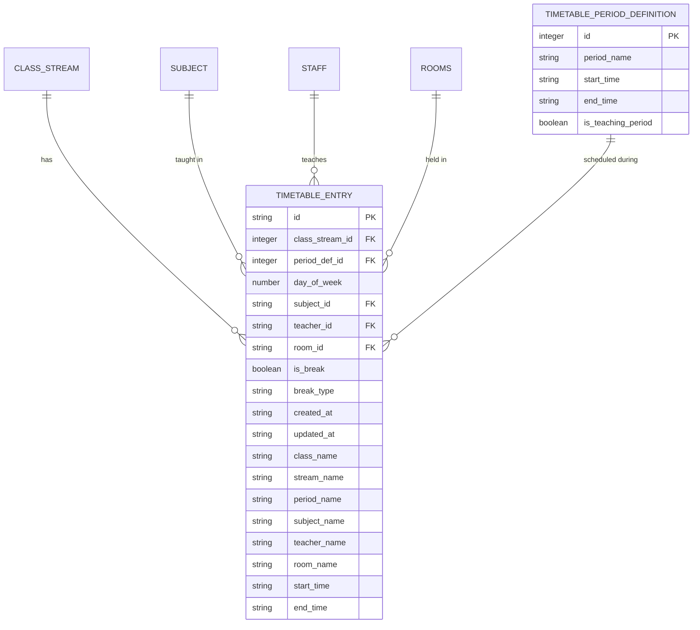
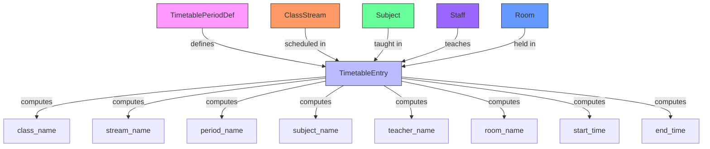
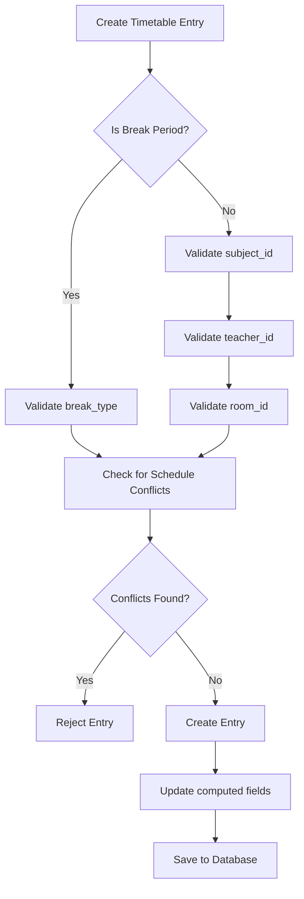
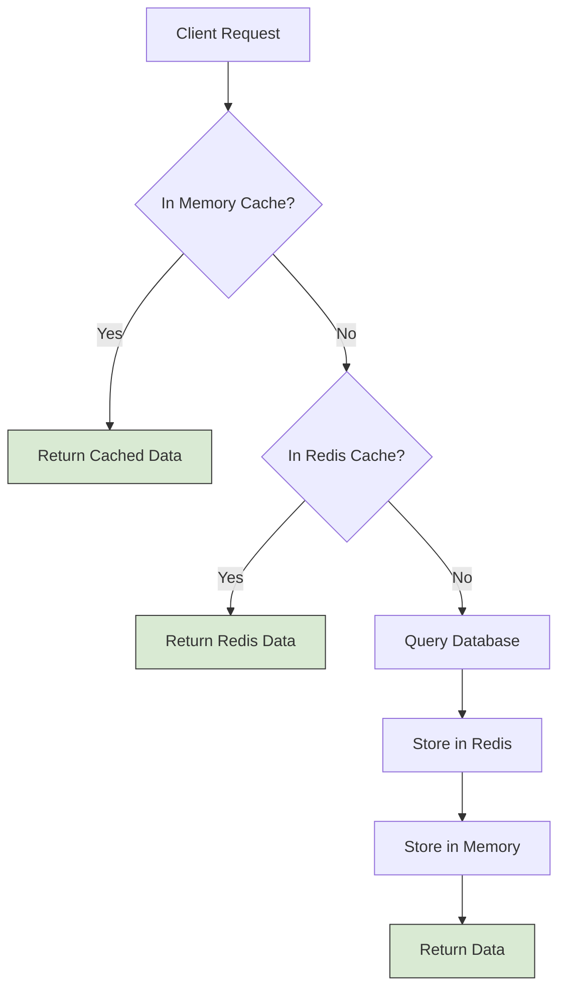

# Timetable Data Models

<cite>
**Referenced Files in This Document**   
- [useTimetableEntryData.ts](file://src/modules/academics/data/useTimetableEntryData.ts)
- [schema.ts](file://src/modules/academics/data/schema.ts)
- [types.ts](file://src/modules/academics/data/types.ts)
- [types.ts](file://src/core/types.ts)
- [useTimetablePeriodDefData.ts](file://src/modules/academics/data/useTimetablePeriodDefData.ts)
</cite>

## Table of Contents
1. [Introduction](#introduction)
2. [Entity Overview](#entity-overview)
3. [TimetableEntry Data Model](#timetableentry-data-model)
4. [TimetablePeriodDef Data Model](#timetableperioddef-data-model)
5. [Entity Relationships](#entity-relationships)
6. [Data Access Patterns](#data-access-patterns)
7. [Validation and Constraints](#validation-and-constraints)
8. [Sample Data Structures](#sample-data-structures)
9. [Performance Considerations](#performance-considerations)
10. [Conclusion](#conclusion)

## Introduction
This document provides comprehensive documentation for the TimetableEntry and TimetablePeriodDef data models within the SchoolPilot educational system. These models form the foundation of the academic scheduling system, enabling the organization of classes, teachers, subjects, and rooms across time periods. The documentation details field definitions, relationships with other entities, validation rules, and data access patterns through dedicated hooks.

**Section sources**
- [useTimetableEntryData.ts](file://src/modules/academics/data/useTimetableEntryData.ts)
- [schema.ts](file://src/modules/academics/data/schema.ts)

## Entity Overview
The timetable system consists of two primary entities: TimetableEntry and TimetablePeriodDef. TimetablePeriodDef defines the time slots that make up the school day (e.g., Period 1, Break, Period 2), while TimetableEntry represents specific scheduled classes that occur during these time slots for particular classes, subjects, teachers, and rooms.



**Diagram sources**
- [schema.ts](file://src/modules/academics/data/schema.ts#L250-L304)
- [types.ts](file://src/core/types.ts#L600-L800)

**Section sources**
- [schema.ts](file://src/modules/academics/data/schema.ts#L250-L304)
- [types.ts](file://src/core/types.ts#L600-L800)

## TimetableEntry Data Model
The TimetableEntry entity represents a specific scheduled class or break period in the school timetable. Each entry connects a class stream, academic period, day of the week, subject, teacher, and classroom.

### Field Definitions
- **id**: Unique identifier for the timetable entry (string, primary key)
- **class_stream_id**: Reference to the class stream (integer, foreign key to class_streams)
- **period_def_id**: Reference to the period definition (integer, foreign key to timetable_period_definitions)
- **day_of_week**: Day of the week (1-7, where 1=Monday, 7=Sunday)
- **subject_id**: Reference to the subject being taught (string, foreign key to subjects)
- **teacher_id**: Reference to the teaching staff member (string, foreign key to staff)
- **room_id**: Reference to the classroom (string, foreign key to rooms)
- **is_break**: Flag indicating if this is a break period (boolean, default: false)
- **break_type**: Type of break (string, enum: [BreakType] values)
- **created_at**: Timestamp when the entry was created (string, ISO date-time format)
- **updated_at**: Timestamp when the entry was last updated (string, ISO date-time format)
- **class_name**: Computed field with class name (string)
- **stream_name**: Computed field with stream name (string)
- **period_name**: Computed field with period name (string)
- **subject_name**: Computed field with subject name (string)
- **teacher_name**: Computed field with teacher name (string)
- **room_name**: Computed field with room name (string)
- **start_time**: Computed field with start time (string)
- **end_time**: Computed field with end time (string)

### Schema Definition
```typescript
export const timetableEntrySchema: DatabaseSchema = createDatabaseSchema({
    title: 'timetable_entry',
    primaryKey: 'id',
    properties: {
        id: SchemaHelpers.string({ description: 'Unique identifier', maxLength: 100 }),
        class_stream_id: SchemaHelpers.ref('class_streams', { description: 'Reference to class stream', maxLength: 100 }),
        period_def_id: SchemaHelpers.ref('timetable_period_definitions', { description: 'Reference to period definition', minimum: 1, maximum: 999999999 }),
        day_of_week: SchemaHelpers.number({ description: 'Day of week (1-7)', minimum: 1, maximum: 7 }),
        subject_id: SchemaHelpers.ref('subjects', { description: 'Reference to subject', maxLength: 100 }),
        teacher_id: SchemaHelpers.ref('staff', { description: 'Reference to teacher', maxLength: 100 }),
        room_id: SchemaHelpers.ref('rooms', { description: 'Reference to room', maxLength: 100 }),
        is_break: SchemaHelpers.boolean({ description: 'Is this a break period', default: false }),
        break_type: SchemaHelpers.string({ description: 'Type of break', enum: [...Object.values(BreakType), null], maxLength: 50 }),
        created_at: SchemaHelpers.timestamp({ description: 'Creation timestamp' }),
        updated_at: SchemaHelpers.timestamp({ description: 'Last update timestamp' }),
        class_name: SchemaHelpers.string({ description: 'Class name (computed)', maxLength: 100 }),
        stream_name: SchemaHelpers.string({ description: 'Stream name (computed)', maxLength: 100 }),
        period_name: SchemaHelpers.string({ description: 'Period name (computed)', maxLength: 100 }),
        subject_name: SchemaHelpers.string({ description: 'Subject name (computed)', maxLength: 100 }),
        teacher_name: SchemaHelpers.string({ description: 'Teacher name (computed)', maxLength: 200 }),
        room_name: SchemaHelpers.string({ description: 'Room name (computed)', maxLength: 100 }),
        start_time: SchemaHelpers.string({ description: 'Start time (computed)', maxLength: 20 }),
        end_time: SchemaHelpers.string({ description: 'End time (computed)', maxLength: 20 }),
    },
    required: ['id', 'class_stream_id', 'period_def_id', 'day_of_week', 'is_break', 'created_at', 'updated_at'],
    indexes: ['class_stream_id', 'period_def_id', 'day_of_week']
});
```

**Section sources**
- [schema.ts](file://src/modules/academics/data/schema.ts#L250-L304)
- [types.ts](file://src/core/types.ts#L600-L800)

## TimetablePeriodDef Data Model
The TimetablePeriodDef entity defines the time slots that make up the school day. These period definitions are reused across multiple timetable entries and days of the week.

### Field Definitions
- **id**: Unique identifier for the period definition (integer, primary key)
- **period_name**: Name of the period (string, e.g., "Period 1", "Break", "Lunch")
- **start_time**: Start time of the period in HH:MM format (string, pattern: ^([01]?[0-9]|2[0-3]):[0-5][0-9]$)
- **end_time**: End time of the period in HH:MM format (string, pattern: ^([01]?[0-9]|2[0-3]):[0-5][0-9]$)
- **is_teaching_period**: Flag indicating if this is a teaching period (boolean, default: true)

### Schema Definition
```typescript
export const timetablePeriodDefSchema: DatabaseSchema = createDatabaseSchema({
    title: 'timetable_period_definition',
    primaryKey: 'id',
    properties: {
        id: SchemaHelpers.integer({ description: 'Unique identifier', minimum: 1, maximum: 999999999 }),
        period_name: SchemaHelpers.string({ description: 'Period name', maxLength: 50 }),
        start_time: SchemaHelpers.string({ description: 'Start time', pattern: '^([01]?[0-9]|2[0-3]):[0-5][0-9]$', maxLength: 20 }),
        end_time: SchemaHelpers.string({ description: 'End time', pattern: '^([01]?[0-9]|2[0-3]):[0-5][0-9]$', maxLength: 20 }),
        is_teaching_period: SchemaHelpers.boolean({ description: 'Whether this is a teaching period', default: true }),
    },
    required: ['id', 'period_name', 'start_time', 'end_time'],
    indexes: ['period_name']
});
```

**Section sources**
- [schema.ts](file://src/modules/academics/data/schema.ts#L250-L304)

## Entity Relationships
The timetable data model establishes relationships between academic schedules and various educational entities including classrooms, teachers, subjects, and class streams.

### Relationship Diagram


**Diagram sources**
- [schema.ts](file://src/modules/academics/data/schema.ts#L250-L304)
- [types.ts](file://src/core/types.ts#L600-L800)

### Relationship Details
- **TimetableEntry → TimetablePeriodDef**: Each timetable entry references a period definition that specifies the time slot (start and end times)
- **TimetableEntry → ClassStream**: Each entry is associated with a specific class stream (e.g., Grade 10, Stream A)
- **TimetableEntry → Subject**: Each entry specifies which subject is being taught during that time slot
- **TimetableEntry → Staff**: Each entry identifies the teacher responsible for delivering the lesson
- **TimetableEntry → Room**: Each entry specifies the physical location where the class takes place
- **Computed Fields**: The timetable entry includes denormalized/computed fields (class_name, stream_name, etc.) for efficient display without requiring joins

**Section sources**
- [schema.ts](file://src/modules/academics/data/schema.ts#L250-L304)
- [types.ts](file://src/core/types.ts#L600-L800)

## Data Access Patterns
The system provides dedicated hooks for accessing and manipulating timetable data, with specific patterns for querying and filtering.

### useTimetableEntryData Hook
The `useTimetableEntryData` hook provides CRUD operations for timetable entries with in-memory state management.

```typescript
export const useTimetableEntryData = () => {
  const [data, setData] = useState<TimetableEntry[]>(initialMockTimetableEntries);

  const create = async (newItem: Partial<TimetableEntry>) => {
    const newDataItem: TimetableEntry = {
      ...newItem,
      id: Date.now(),
      created_at: new Date().toISOString(),
      updated_at: new Date().toISOString()
    } as TimetableEntry;
    setData((prev: TimetableEntry[]) => [...prev, newDataItem]);
    return newDataItem;
  };

  const update = async (id: number, updatedData: Partial<TimetableEntry>) => {
    setData((prev: TimetableEntry[]) => prev.map((item: TimetableEntry) => 
      item.id === id 
        ? { ...item, ...updatedData, updated_at: new Date().toISOString() }
        : item
    ));
  };

  const remove = async (id: number) => {
    setData((prev: TimetableEntry[]) => prev.filter((item: TimetableEntry) => item.id !== id));
  };

  return {
    data,
    create,
    update,
    remove
  };
};
```

### Filtering Capabilities
While the current implementation uses mock data, the schema supports efficient filtering through database indexes on:
- **class_stream_id**: For retrieving all timetable entries for a specific class
- **period_def_id**: For retrieving all entries for a specific period definition
- **day_of_week**: For retrieving entries by day of the week

Future implementations could extend the hook to support filtering by:
- Class/teacher/subject combinations
- Date ranges (for weekly timetables)
- Time-based queries (e.g., all periods between 9:00-11:00)

**Section sources**
- [useTimetableEntryData.ts](file://src/modules/academics/data/useTimetableEntryData.ts)
- [schema.ts](file://src/modules/academics/data/schema.ts#L250-L304)

## Validation and Constraints
The timetable data models include various validation rules and constraints to ensure data integrity and prevent invalid schedules.

### Primary Keys
- **TimetableEntry**: `id` (string) - Unique identifier for each timetable entry
- **TimetablePeriodDef**: `id` (integer) - Unique identifier for each period definition

### Foreign Key Constraints
- **class_stream_id**: References `class_streams` table
- **period_def_id**: References `timetable_period_definitions` table
- **subject_id**: References `subjects` table
- **teacher_id**: References `staff` table
- **room_id**: References `rooms` table

### Required Fields
**TimetableEntry** requires:
- id
- class_stream_id
- period_def_id
- day_of_week
- is_break
- created_at
- updated_at

**TimetablePeriodDef** requires:
- id
- period_name
- start_time
- end_time

### Validation Rules
- **day_of_week**: Must be between 1-7 (Monday-Sunday)
- **start_time/end_time**: Must match HH:MM format (24-hour)
- **is_break**: Boolean flag to distinguish between teaching periods and breaks
- **break_type**: Enumerated type from BreakType values when is_break is true
- **Time Validation**: The system should validate that end_time is after start_time
- **Schedule Conflicts**: Business logic should prevent:
  - Teachers scheduled for multiple classes simultaneously
  - Rooms assigned to multiple classes simultaneously
  - Students (class streams) scheduled for multiple subjects simultaneously



**Diagram sources**
- [schema.ts](file://src/modules/academics/data/schema.ts#L250-L304)
- [useTimetableEntryData.ts](file://src/modules/academics/data/useTimetableEntryData.ts)

**Section sources**
- [schema.ts](file://src/modules/academics/data/schema.ts#L250-L304)
- [useTimetableEntryData.ts](file://src/modules/academics/data/useTimetableEntryData.ts)

## Sample Data Structures
This section provides examples of typical data structures for weekly timetables and special scheduling events.

### Weekly Timetable Entry
```json
{
  "id": "te_001",
  "class_stream_id": 101,
  "period_def_id": 1,
  "day_of_week": 1,
  "subject_id": "MAT101",
  "teacher_id": "T005",
  "room_id": "R101",
  "is_break": false,
  "created_at": "2024-01-15T08:00:00Z",
  "updated_at": "2024-01-15T08:00:00Z",
  "class_name": "Grade 10",
  "stream_name": "A",
  "period_name": "Period 1",
  "subject_name": "Mathematics",
  "teacher_name": "Dr. Smith",
  "room_name": "Math Lab",
  "start_time": "08:00",
  "end_time": "08:45"
}
```

### Break Period Entry
```json
{
  "id": "te_002",
  "class_stream_id": 101,
  "period_def_id": 4,
  "day_of_week": 1,
  "subject_id": null,
  "teacher_id": null,
  "room_id": null,
  "is_break": true,
  "break_type": "SHORT_BREAK",
  "created_at": "2024-01-15T10:15:00Z",
  "updated_at": "2024-01-15T10:15:00Z",
  "class_name": "Grade 10",
  "stream_name": "A",
  "period_name": "Short Break",
  "subject_name": null,
  "teacher_name": null,
  "room_name": null,
  "start_time": "10:15",
  "end_time": "10:30"
}
```

### Period Definition
```json
{
  "id": 1,
  "period_name": "Period 1",
  "start_time": "08:00",
  "end_time": "08:45",
  "is_teaching_period": true
}
```

**Section sources**
- [schema.ts](file://src/modules/academics/data/schema.ts#L250-L304)
- [useTimetableEntryData.ts](file://src/modules/academics/data/useTimetableEntryData.ts)

## Performance Considerations
When working with large timetable datasets, several performance considerations and optimization strategies should be implemented.

### Query Optimization
The current schema includes indexes on key fields to optimize common queries:
- **class_stream_id**: For retrieving all timetable entries for a specific class
- **period_def_id**: For retrieving all entries for a specific period
- **day_of_week**: For retrieving entries by day of the week

Additional indexes that could improve performance:
- Composite index on (class_stream_id, day_of_week) for weekly class schedules
- Composite index on (teacher_id, day_of_week) for teacher schedules
- Composite index on (room_id, day_of_week) for room utilization

### Caching Strategies
For frequently accessed schedules, implement caching at multiple levels:



**Diagram sources**
- [useTimetableEntryData.ts](file://src/modules/academics/data/useTimetableEntryData.ts)

### Data Access Patterns
- **Batch Loading**: Load entire weekly timetables in a single query rather than individual periods
- **Lazy Loading**: Load detailed information (teacher names, room names) only when needed
- **Pagination**: For large datasets, implement pagination to limit result sets
- **Prefetching**: Anticipate and load commonly accessed schedules (e.g., current week's timetable)

### Performance Monitoring
Implement monitoring for:
- Query execution times
- Cache hit/miss ratios
- Memory usage patterns
- Database load during peak scheduling periods

**Section sources**
- [useTimetableEntryData.ts](file://src/modules/academics/data/useTimetableEntryData.ts)
- [schema.ts](file://src/modules/academics/data/schema.ts#L250-L304)

## Conclusion
The TimetableEntry and TimetablePeriodDef data models provide a robust foundation for managing academic schedules in the SchoolPilot system. These models effectively capture the relationships between classes, teachers, subjects, rooms, and time periods while maintaining data integrity through comprehensive validation rules and constraints.

The current implementation provides basic CRUD functionality through the useTimetableEntryData hook, with opportunities for enhancement in filtering capabilities, conflict detection, and performance optimization. By leveraging database indexes, implementing effective caching strategies, and optimizing data access patterns, the system can efficiently handle large timetable datasets while providing responsive user experiences.

Future improvements could include advanced scheduling algorithms, conflict detection and resolution, and integration with teacher availability and room capacity constraints to create a more intelligent and automated timetabling system.