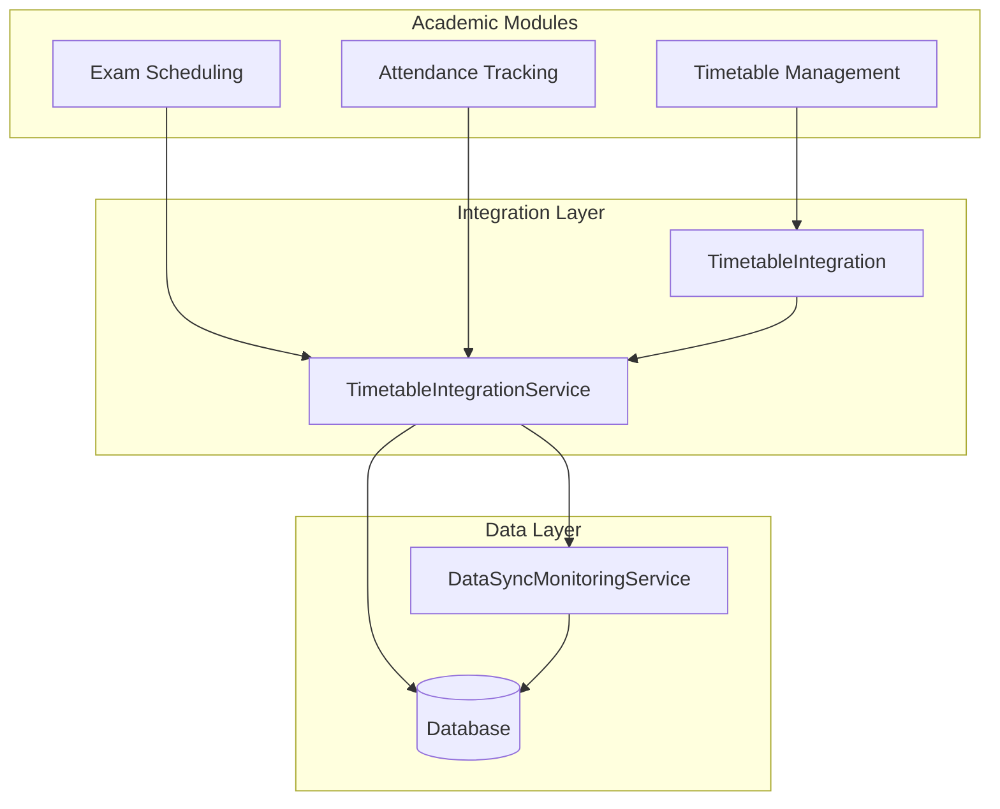
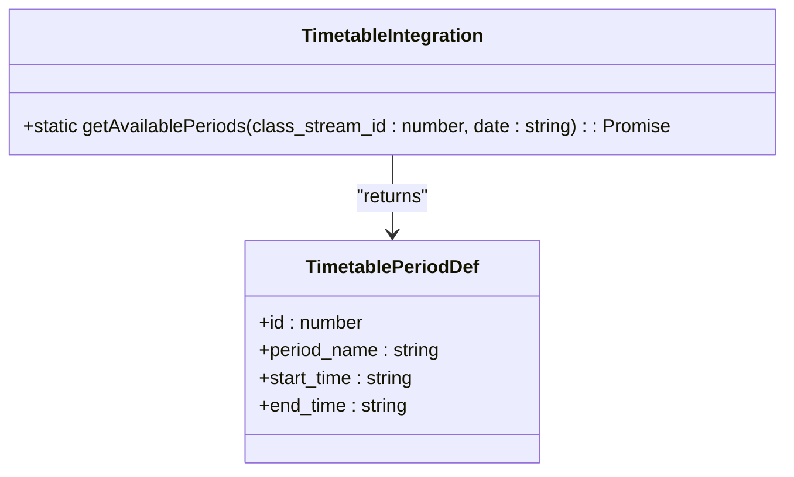
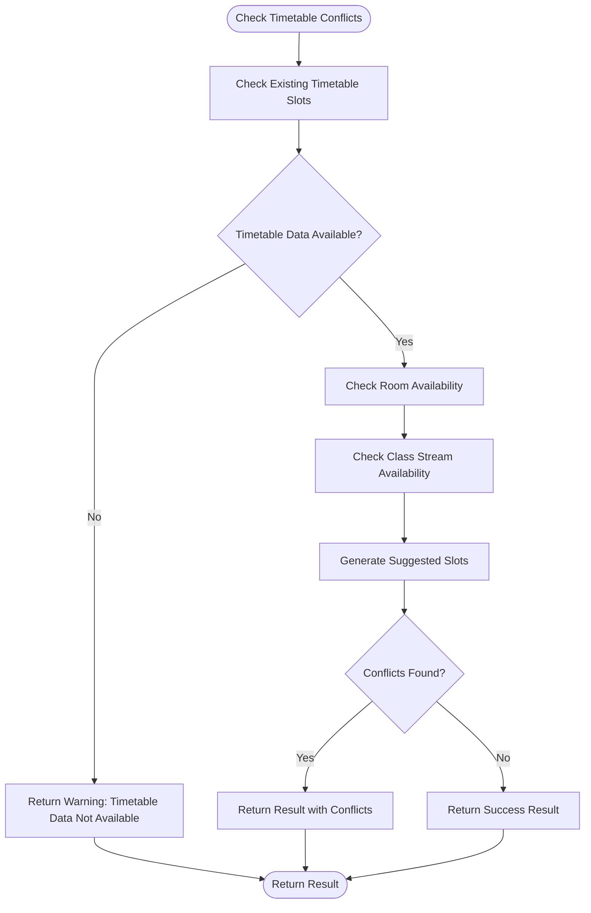
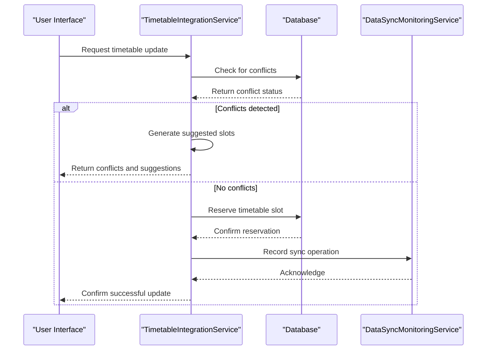
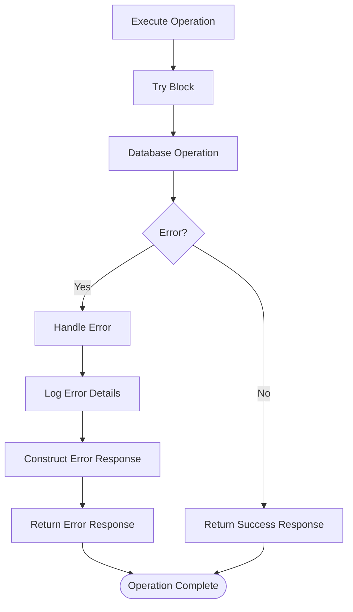
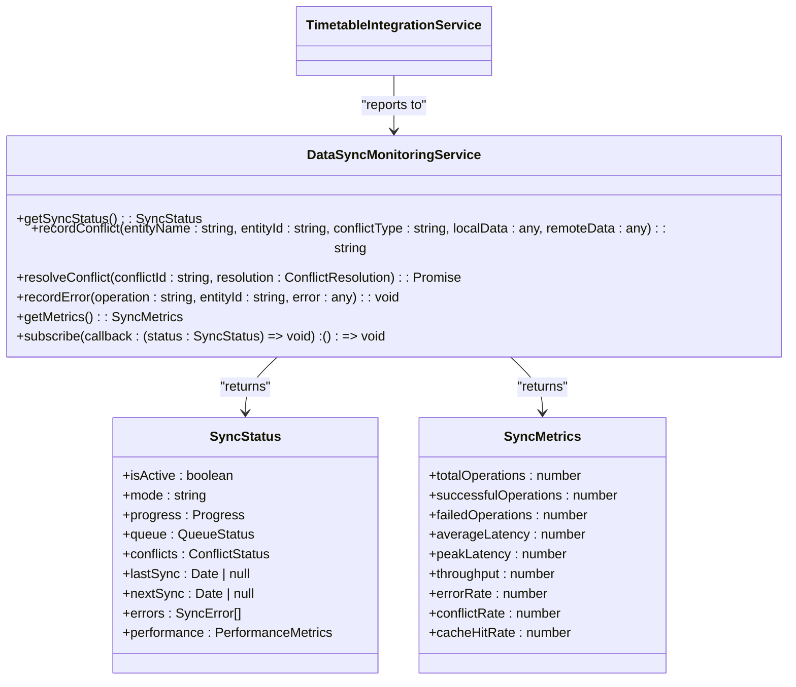

# Timetable Integration Service

<cite>
**Referenced Files in This Document**   
- [TimetableIntegration.ts](file://src/modules/academics/services/TimetableIntegration.ts)
- [TimetableIntegrationService.ts](file://src/modules/academics/services/TimetableIntegrationService.ts)
- [DataSyncMonitoringService.ts](file://src/services/DataSyncMonitoringService.ts)
</cite>

## Table of Contents
1. [Introduction](#introduction)
2. [Core Components](#core-components)
3. [Architecture Overview](#architecture-overview)
4. [Detailed Component Analysis](#detailed-component-analysis)
5. [Integration Patterns with External Systems](#integration-patterns-with-external-systems)
6. [Conflict Resolution Mechanisms](#conflict-resolution-mechanisms)
7. [Event-Driven Architecture](#event-driven-architecture)
8. [Error Handling Strategy](#error-handling-strategy)
9. [Configuration Options](#configuration-options)
10. [Monitoring Integration Health](#monitoring-integration-health)
11. [Code Examples](#code-examples)

## Introduction
The Timetable Integration Service is a critical component in the educational system that ensures synchronization between timetable data and various academic modules. This service facilitates seamless integration between exam scheduling, attendance tracking, and other academic functions by providing robust conflict detection, resolution mechanisms, and real-time monitoring capabilities. The system is designed to maintain data consistency across different modules while enabling efficient propagation of timetable updates through an event-driven architecture.

## Core Components
The Timetable Integration system consists of two primary components: the `TimetableIntegration` class and the `TimetableIntegrationService` class. These components work together to provide comprehensive timetable synchronization capabilities across the educational platform.

**Section sources**
- [TimetableIntegration.ts](file://src/modules/academics/services/TimetableIntegration.ts#L1-L10)
- [TimetableIntegrationService.ts](file://src/modules/academics/services/TimetableIntegrationService.ts#L1-L46)

## Architecture Overview
The Timetable Integration Service follows a service-oriented architecture with clear separation of concerns. The system integrates with the database layer through the databaseService abstraction and communicates with monitoring systems via the DataSyncMonitoringService. The architecture enables bidirectional data flow between timetable management and other academic modules.



**Diagram sources**
- [TimetableIntegrationService.ts](file://src/modules/academics/services/TimetableIntegrationService.ts#L1-L46)
- [DataSyncMonitoringService.ts](file://src/services/DataSyncMonitoringService.ts#L1-L50)

## Detailed Component Analysis

### TimetableIntegration Class Analysis
The TimetableIntegration class provides static methods for retrieving available timetable periods for specific class streams on given dates. This class serves as a utility layer for basic timetable queries.



**Diagram sources**
- [TimetableIntegration.ts](file://src/modules/academics/services/TimetableIntegration.ts#L1-L10)

**Section sources**
- [TimetableIntegration.ts](file://src/modules/academics/services/TimetableIntegration.ts#L1-L10)

### TimetableIntegrationService Class Analysis
The TimetableIntegrationService class is the core service responsible for comprehensive timetable integration. It handles conflict detection, slot reservation, and synchronization with external systems.

```mermaid
classDiagram
class TimetableIntegrationService {
+checkTimetableConflicts(examSchedule : ExamSchedule) : Promise<IntegrationResult>
+reserveTimetableSlot(examSchedule : ExamSchedule) : Promise<{success : boolean, slotId? : string, error? : string}>
+releaseTimetableSlot(examScheduleId : string) : Promise<boolean>
+getTimetableConflictsForPeriod(periodId : number) : Promise<TimetableSlot[]>
-checkRoomAvailability(examSchedule : ExamSchedule) : Promise<string[]>
-checkClassStreamAvailability(examSchedule : ExamSchedule) : Promise<string[]>
-generateSuggestedSlots(examSchedule : ExamSchedule) : Promise<TimetableSlot[]>
-getDayFromPeriod(periodId : number) : string
-getStartTimeFromPeriod(periodId : number) : string
-getEndTimeFromPeriod(periodId : number) : string
}
class TimetableSlot {
+id : string
+period_id : number
+day : string
+start_time : string
+end_time : string
+room? : string
+class_stream_id? : number
+subject? : string
+teacher_id? : string
}
class IntegrationResult {
+canSchedule : boolean
+conflicts : string[]
+suggestedSlots : TimetableSlot[]
+warnings : string[]
}
class ExamSchedule {
+id : string
+period_id : number
+room_number : string
+class_stream_id : number
+subject_name : string
+invigilator_id : string
}
TimetableIntegrationService --> TimetableSlot : "uses"
TimetableIntegrationService --> IntegrationResult : "returns"
TimetableIntegrationService --> ExamSchedule : "accepts"
```

**Diagram sources**
- [TimetableIntegrationService.ts](file://src/modules/academics/services/TimetableIntegrationService.ts#L1-L46)

**Section sources**
- [TimetableIntegrationService.ts](file://src/modules/academics/services/TimetableIntegrationService.ts#L1-L280)

## Integration Patterns with External Systems
The TimetableIntegrationService integrates with external systems through well-defined interfaces and patterns. The service primarily interacts with exam scheduling and attendance tracking modules, ensuring data consistency across the platform.

### Exam Scheduling Integration
The service provides conflict detection and resolution for exam schedules by checking room availability, class stream availability, and existing timetable slots. When an exam schedule is created or modified, the service validates the proposed schedule against existing timetable entries.

### Attendance Tracking Integration
While not explicitly implemented in the current code, the architecture supports integration with attendance tracking systems by maintaining synchronized timetable data that can be used to determine expected student attendance for classes and exams.

## Conflict Resolution Mechanisms
The Timetable Integration Service implements comprehensive conflict resolution mechanisms to handle situations where timetable changes affect other modules.

### Conflict Detection
The service detects conflicts through multiple validation checks:
- **Room conflicts**: Checks if a room is already booked for the same period
- **Class stream conflicts**: Verifies if a class stream has existing timetable entries for the same period
- **Timetable slot conflicts**: Identifies overlapping timetable slots based on period ID and shared resources

### Conflict Resolution Workflow
When conflicts are detected, the service follows a structured resolution process:
1. Identify all potential conflicts through database queries
2. Aggregate conflict messages for user presentation
3. Generate suggested alternative time slots
4. Provide warnings for potential issues even when no direct conflicts exist



**Diagram sources**
- [TimetableIntegrationService.ts](file://src/modules/academics/services/TimetableIntegrationService.ts#L42-L83)

**Section sources**
- [TimetableIntegrationService.ts](file://src/modules/academics/services/TimetableIntegrationService.ts#L42-L83)

## Event-Driven Architecture
The system employs an event-driven architecture for propagating timetable updates across different modules. While the current implementation primarily uses direct service calls, the architecture is designed to support event-based communication.

### Update Propagation
When timetable changes occur, the system propagates these updates through the following mechanisms:
- **Direct service invocation**: Other modules call the TimetableIntegrationService methods directly
- **Database change detection**: The underlying database service can trigger events when timetable data changes
- **Synchronization monitoring**: The DataSyncMonitoringService tracks changes and ensures data consistency

### Event Flow for Timetable Updates


**Diagram sources**
- [TimetableIntegrationService.ts](file://src/modules/academics/services/TimetableIntegrationService.ts#L199-L240)
- [DataSyncMonitoringService.ts](file://src/services/DataSyncMonitoringService.ts#L332-L372)

## Error Handling Strategy
The Timetable Integration Service implements a robust error handling strategy to manage failed integrations and ensure system reliability.

### Error Handling Patterns
The service uses try-catch blocks around all database operations and returns structured error responses. Each method handles errors gracefully, providing meaningful feedback to calling components.

### Error Response Structure
When errors occur, the service returns structured responses that include:
- **Success status**: Boolean indicating operation success
- **Error messages**: Descriptive error information
- **Fallback behavior**: Default values or alternative paths when possible



**Diagram sources**
- [TimetableIntegrationService.ts](file://src/modules/academics/services/TimetableIntegrationService.ts#L79-L124)

**Section sources**
- [TimetableIntegrationService.ts](file://src/modules/academics/services/TimetableIntegrationService.ts#L79-L124)

## Configuration Options
The Timetable Integration Service provides configuration options for enabling and disabling specific integration points, though explicit configuration files were not found in the codebase. The service is designed to be configurable through its method parameters and integration with the broader system configuration.

### Integration Point Management
While specific configuration files were not identified, the architecture supports enabling/disabling integration points through:
- **Feature flags**: System-wide settings that can toggle integration functionality
- **Module configuration**: Settings that control which modules participate in timetable synchronization
- **Runtime parameters**: Method-level options that modify integration behavior

## Monitoring Integration Health
The Timetable Integration Service integrates with the DataSyncMonitoringService to provide comprehensive monitoring of integration health and performance.

### DataSyncMonitoringService Integration
The DataSyncMonitoringService tracks the status of all data synchronization operations, including timetable integrations. It provides metrics on:
- **Sync status**: Current state of synchronization operations
- **Performance metrics**: Latency, throughput, and success rates
- **Error tracking**: Recording and reporting of failed operations
- **Conflict monitoring**: Detection and resolution of data conflicts



**Diagram sources**
- [DataSyncMonitoringService.ts](file://src/services/DataSyncMonitoringService.ts#L41-L95)

**Section sources**
- [DataSyncMonitoringService.ts](file://src/services/DataSyncMonitoringService.ts#L1-L482)

## Code Examples

### Service Invocation Example
```typescript
// Example of using TimetableIntegrationService to check for conflicts
import { TimetableIntegrationService } from './TimetableIntegrationService';
import { ExamSchedule } from '../data/types';

const timetableService = new TimetableIntegrationService();

const examSchedule: ExamSchedule = {
  id: 'exam-001',
  period_id: 5,
  room_number: 'R101',
  class_stream_id: 1001,
  subject_name: 'Mathematics',
  invigilator_id: 'staff-001'
};

// Check for timetable conflicts before scheduling an exam
async function scheduleExam() {
  try {
    const result = await timetableService.checkTimetableConflicts(examSchedule);
    
    if (result.canSchedule) {
      // No conflicts, proceed with reservation
      const reservation = await timetableService.reserveTimetableSlot(examSchedule);
      if (reservation.success) {
        console.log(`Successfully reserved timetable slot: ${reservation.slotId}`);
      } else {
        console.error(`Failed to reserve slot: ${reservation.error}`);
      }
    } else {
      console.log('Conflicts detected:');
      result.conflicts.forEach(conflict => console.log(`- ${conflict}`));
      
      if (result.suggestedSlots.length > 0) {
        console.log('Suggested alternative slots:');
        result.suggestedSlots.forEach(slot => {
          console.log(`- ${slot.day} ${slot.start_time}-${slot.end_time} in ${slot.room}`);
        });
      }
    }
  } catch (error) {
    console.error('Error scheduling exam:', error);
  }
}
```

### Error Recovery Pattern
```typescript
// Example of error recovery when reserving a timetable slot
async function reserveWithRetry(examSchedule: ExamSchedule, maxRetries: number = 3) {
  let attempts = 0;
  let success = false;
  let result;
  
  while (attempts < maxRetries && !success) {
    attempts++;
    try {
      result = await timetableService.reserveTimetableSlot(examSchedule);
      success = result.success;
      
      if (success) {
        console.log(`Successfully reserved slot after ${attempts} attempt(s)`);
        return result;
      } else {
        console.warn(`Attempt ${attempts} failed: ${result.error}`);
        // Implement exponential backoff
        if (attempts < maxRetries) {
          const delay = Math.pow(2, attempts) * 1000; // 2s, 4s, 8s
          console.log(`Waiting ${delay}ms before retry...`);
          await new Promise(resolve => setTimeout(resolve, delay));
        }
      }
    } catch (error) {
      console.error(`Attempt ${attempts} threw error:`, error);
      if (attempts < maxRetries) {
        const delay = Math.pow(2, attempts) * 1000;
        await new Promise(resolve => setTimeout(resolve, delay));
      }
    }
  }
  
  if (!success) {
    console.error(`Failed to reserve slot after ${maxRetries} attempts`);
    return result;
  }
  
  return result;
}
```

### Monitoring Integration Health
```typescript
// Example of monitoring timetable integration health
import { globalDataSyncMonitoringService } from '../../services/DataSyncMonitoringService';

// Subscribe to sync status updates
const unsubscribe = globalDataSyncMonitoringService.subscribe((status) => {
  console.log('Sync Status Update:');
  console.log(`Mode: ${status.mode}`);
  console.log(`Progress: ${status.progress.percentage.toFixed(2)}%`);
  console.log(`Pending operations: ${status.queue.pending}`);
  console.log(`Unresolved conflicts: ${status.conflicts.unresolved}`);
  
  if (status.errors.length > 0) {
    console.log('Recent errors:');
    status.errors.forEach(error => {
      console.log(`- ${error.operation} on ${error.entityName}: ${error.error}`);
    });
  }
});

// Get current sync metrics
const metrics = globalDataSyncMonitoringService.getMetrics();
console.log('Sync Metrics:');
console.log(`Success rate: ${((metrics.successfulOperations / Math.max(metrics.totalOperations, 1)) * 100).toFixed(2)}%`);
console.log(`Error rate: ${(metrics.errorRate * 100).toFixed(2)}%`);
console.log(`Throughput: ${metrics.throughput} operations/minute`);

// Cleanup subscription when no longer needed
// unsubscribe();
```

**Section sources**
- [TimetableIntegrationService.ts](file://src/modules/academics/services/TimetableIntegrationService.ts#L1-L280)
- [DataSyncMonitoringService.ts](file://src/services/DataSyncMonitoringService.ts#L1-L482)