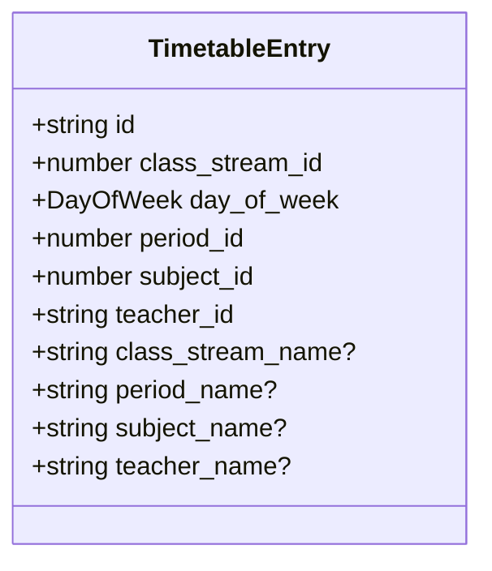
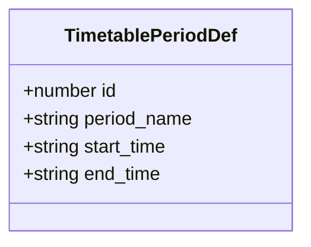
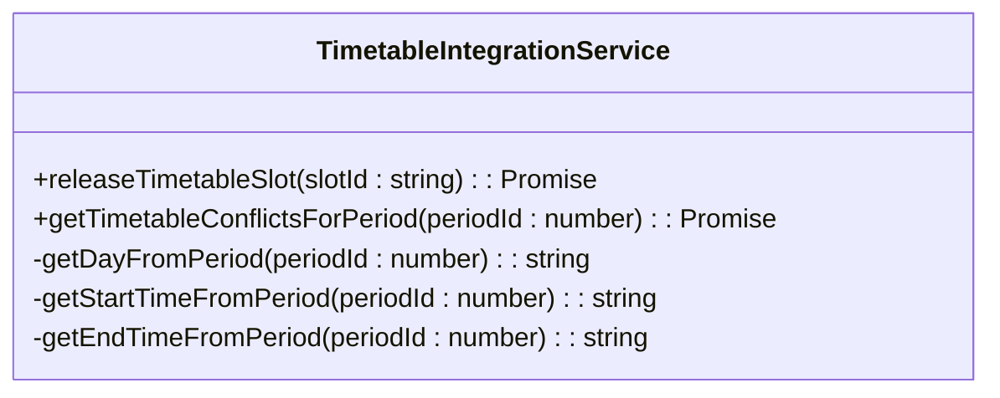
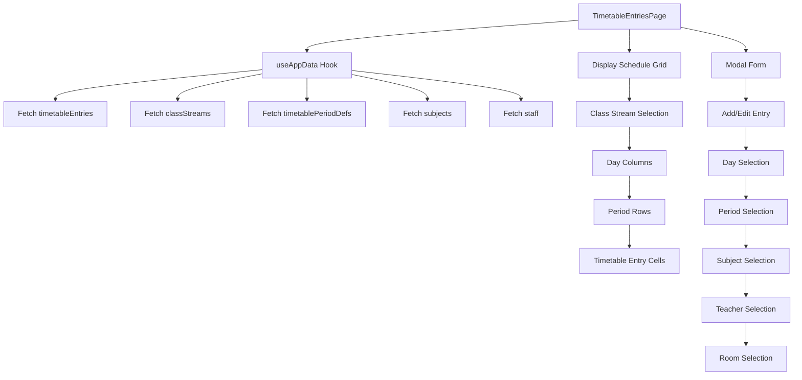
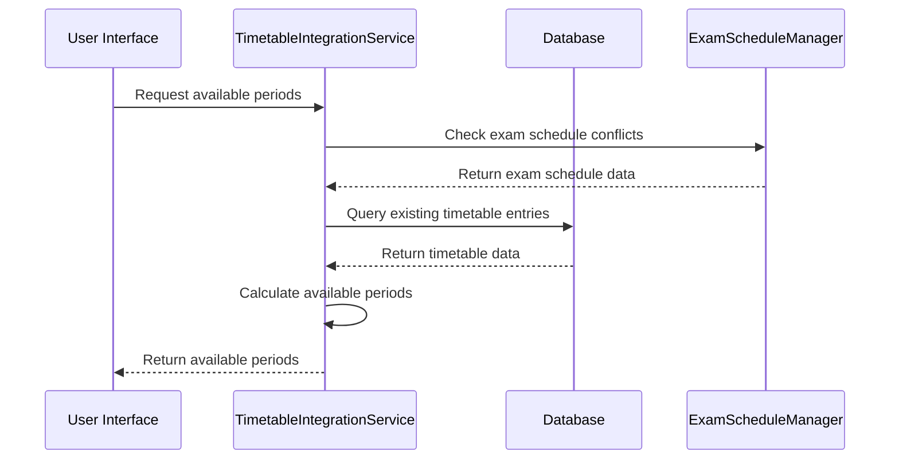
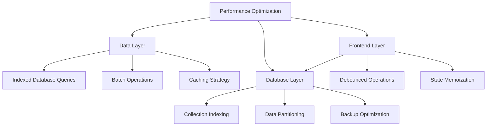

# Timetable Management

<cite>
**Referenced Files in This Document**   
- [TimetableIntegrationService.ts](file://src/modules/academics/services/TimetableIntegrationService.ts)
- [TimetableEntriesPage.tsx](file://src/modules/academics/pages/TimetableEntriesPage.tsx)
- [types.ts](file://src/core/types.ts)
- [schema.ts](file://src/modules/academics/data/schema.ts)
- [useTimetableEntryData.ts](file://src/modules/academics/data/useTimetableEntryData.ts)
- [mockData.ts](file://src/modules/academics/data/mockData.ts)
</cite>

## Table of Contents
1. [Introduction](#introduction)
2. [Data Models](#data-models)
3. [Timetable Integration Service](#timetable-integration-service)
4. [User Interface Components](#user-interface-components)
5. [Configuration Guidelines](#configuration-guidelines)
6. [Exam Scheduling Integration](#exam-scheduling-integration)
7. [Troubleshooting and Performance](#troubleshooting-and-performance)

## Introduction
The Timetable Management system provides a comprehensive solution for managing academic schedules within educational institutions. This document details the implementation of timetable functionality, including data models, integration services, user interface components, and configuration options. The system enables administrators to create and modify timetables while preventing scheduling conflicts and ensuring smooth integration with other academic systems.

## Data Models

### TimetableEntry Data Structure
The `TimetableEntry` interface defines the structure for individual timetable slots, representing scheduled classes with specific time, location, and personnel assignments.



**Diagram sources**
- [types.ts](file://src/core/types.ts#L880-L1079)

The TimetableEntry model contains the following properties:
- **id**: Unique identifier for the timetable entry
- **class_stream_id**: Reference to the class stream (e.g., Form 1A)
- **day_of_week**: Day of the week (Monday through Sunday)
- **period_id**: Reference to the period definition
- **subject_id**: Reference to the subject being taught
- **teacher_id**: Reference to the teaching staff member
- **Denormalized fields**: Optional display fields (class_stream_name, period_name, subject_name, teacher_name) for efficient rendering

### TimetablePeriodDef Data Structure
The `TimetablePeriodDef` interface defines the structure for period definitions, representing time slots within the school day.



**Diagram sources**
- [types.ts](file://src/core/types.ts#L880-L1079)

The TimetablePeriodDef model contains:
- **id**: Unique identifier for the period definition
- **period_name**: Descriptive name of the period (e.g., "Lesson 1", "Break")
- **start_time**: Start time in HH:MM format
- **end_time**: End time in HH:MM format

Sample period definitions from the system:
```json
[
  { "id": 1, "period_name": "Lesson 1", "start_time": "08:00", "end_time": "08:40" },
  { "id": 2, "period_name": "Lesson 2", "start_time": "08:40", "end_time": "09:20" },
  { "id": 4, "period_name": "Break", "start_time": "10:00", "end_time": "10:20" },
  { "id": 8, "period_name": "Lunch Break", "start_time": "12:20", "end_time": "13:20" }
]
```

**Section sources**
- [mockData.ts](file://src/modules/academics/data/mockData.ts#L317-L330)

## Timetable Integration Service

### TimetableIntegrationService Implementation
The `TimetableIntegrationService` class provides core functionality for managing timetable data and detecting conflicts.



**Diagram sources**
- [TimetableIntegrationService.ts](file://src/modules/academics/services/TimetableIntegrationService.ts)

Key methods include:
- **releaseTimetableSlot**: Removes a timetable slot and handles associated data cleanup
- **getTimetableConflictsForPeriod**: Retrieves all timetable slots for a specific period to detect conflicts
- Private helper methods for mapping period IDs to temporal values

The service integrates with the database layer to perform CRUD operations on timetable data, ensuring data consistency and integrity.

### Conflict Detection Mechanism
The system implements a robust conflict detection mechanism that prevents overlapping class assignments. When creating or modifying timetable entries, the system checks for conflicts based on:
- Teacher availability (same teacher assigned to multiple classes simultaneously)
- Room availability (same room assigned to multiple classes simultaneously)
- Class stream availability (same class stream scheduled for multiple subjects simultaneously)

The conflict detection engine queries the database for existing timetable entries that overlap in time, personnel, or resources, preventing the creation of conflicting schedules.

**Section sources**
- [TimetableIntegrationService.ts](file://src/modules/academics/services/TimetableIntegrationService.ts)

## User Interface Components

### TimetableEntriesPage Component
The `TimetableEntriesPage` component provides the primary user interface for managing timetables. It displays a grid-based view of the weekly schedule, allowing administrators to visualize and edit class assignments.



**Diagram sources**
- [TimetableEntriesPage.tsx](file://src/modules/academics/pages/TimetableEntriesPage.tsx)

Key features of the user interface:
- **Class stream selection**: Dropdown to select which class schedule to view/edit
- **Weekly grid layout**: Visual representation of the timetable with days as columns and periods as rows
- **Color-coded subjects**: Different background colors for different subjects to improve visual clarity
- **Modal editing**: Form-based interface for adding and editing timetable entries
- **Confirmation dialogs**: Prevent accidental deletion of timetable entries

### Form Validation and User Experience
The interface implements client-side validation to ensure data integrity:
- Required field validation for day, period, subject, teacher, and room
- Disabling of day and period fields when editing existing entries to prevent key conflicts
- Loading indicators during data operations
- Confirmation prompts for deletion operations

The UI also provides visual feedback through:
- Spinner indicators during loading states
- Disabled form elements during submission
- Success/error notifications for operations

**Section sources**
- [TimetableEntriesPage.tsx](file://src/modules/academics/pages/TimetableEntriesPage.tsx)

## Configuration Guidelines

### Defining School Periods
School periods are configured through the `timetablePeriodDefs` collection, which defines the temporal structure of the school day. Each period definition includes:
- **period_name**: Descriptive name for the period
- **start_time**: Start time in 24-hour format (HH:MM)
- **end_time**: End time in 24-hour format (HH:MM)

Best practices for period configuration:
- Ensure periods do not overlap
- Include breaks and special periods (lunch, assembly, etc.)
- Consider pedagogical needs when determining period length
- Maintain consistency across weekdays

Periods are sorted by start time to ensure proper display order in the timetable interface.

### Academic Calendar Configuration
While not directly implemented in the provided code, the timetable system integrates with academic calendar data through references to school periods and academic years. The system assumes that:
- Academic years are defined in the administration module
- School periods are mapped to specific academic calendars
- Timetable entries are associated with specific academic contexts

To configure the academic calendar:
1. Define academic years in the Administration module
2. Create school period structures that align with the academic calendar
3. Associate timetable entries with the appropriate academic context

**Section sources**
- [schema.ts](file://src/modules/academics/data/schema.ts#L269-L287)

## Exam Scheduling Integration

### Preventing Timetable Conflicts
The timetable system integrates with the Exam Scheduling system to prevent conflicts between regular classes and examinations. This integration is facilitated through:
- Shared data models and database collections
- Conflict detection mechanisms that consider both timetable entries and exam schedules
- Coordinated resource allocation (rooms, teachers)

The `TimetableIntegration` class provides a foundation for this integration, with methods designed to coordinate timetable and exam scheduling:



**Diagram sources**
- [TimetableIntegration.ts](file://src/modules/academics/services/TimetableIntegration.ts)

When scheduling exams, the system:
1. Identifies time slots that would conflict with existing timetable entries
2. Reserves appropriate rooms and resources
3. Temporarily suspends regular timetable entries during exam periods
4. Notifies affected teachers and students

This integration ensures that examination periods do not conflict with regular class schedules, maintaining academic integrity and logistical feasibility.

**Section sources**
- [TimetableIntegration.ts](file://src/modules/academics/services/TimetableIntegration.ts)

## Troubleshooting and Performance

### Common Scheduling Issues
The following are common issues encountered when managing timetables and their solutions:

**Issue: Overlapping Teacher Assignments**
- **Symptom**: Teacher appears in two places at once
- **Cause**: Manual entry error or inadequate conflict detection
- **Solution**: Implement real-time conflict checking and prevent saving conflicting entries

**Issue: Room Double-Booking**
- **Symptom**: Same room scheduled for multiple classes simultaneously
- **Cause**: Incomplete resource conflict detection
- **Solution**: Enhance conflict detection to include room availability checks

**Issue: Missing Denormalized Data**
- **Symptom**: Blank fields in timetable display (e.g., empty teacher names)
- **Cause**: Failure to populate denormalized fields during data operations
- **Solution**: Ensure all CRUD operations update denormalized fields

**Issue: Performance Degradation with Large Timetables**
- **Symptom**: Slow loading or unresponsive interface
- **Cause**: Inefficient data retrieval or rendering
- **Solution**: Implement pagination, caching, and optimized queries

### Performance Optimization
For large-scale timetable generation, consider the following optimizations:

**Data Retrieval Optimization**
- Implement indexed queries on frequently accessed fields (class_stream_id, day_of_week, period_id)
- Use batch operations when creating multiple timetable entries
- Implement caching for frequently accessed data

**Frontend Performance**
- Virtualize the timetable grid to render only visible cells
- Implement debounced search and filtering
- Use memoization for expensive calculations (e.g., conflict detection)

**Database Optimization**
- Ensure proper indexing on timetable_entry collection
- Consider partitioning data by academic term or school year
- Implement efficient backup and restore procedures

The current implementation uses a client-side state management approach with the `useTimetableEntryData` hook, which maintains timetable entries in memory. For production environments with large datasets, consider migrating to a database-backed approach with efficient querying.



**Diagram sources**
- [useTimetableEntryData.ts](file://src/modules/academics/data/useTimetableEntryData.ts)

The mock data implementation provides a foundation for testing and development, but production systems should implement robust data persistence and retrieval mechanisms to handle the scale and complexity of real-world timetable management.

**Section sources**
- [useTimetableEntryData.ts](file://src/modules/academics/data/useTimetableEntryData.ts)
- [mockData.ts](file://src/modules/academics/data/mockData.ts)