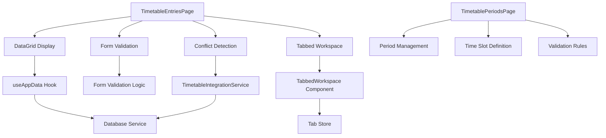
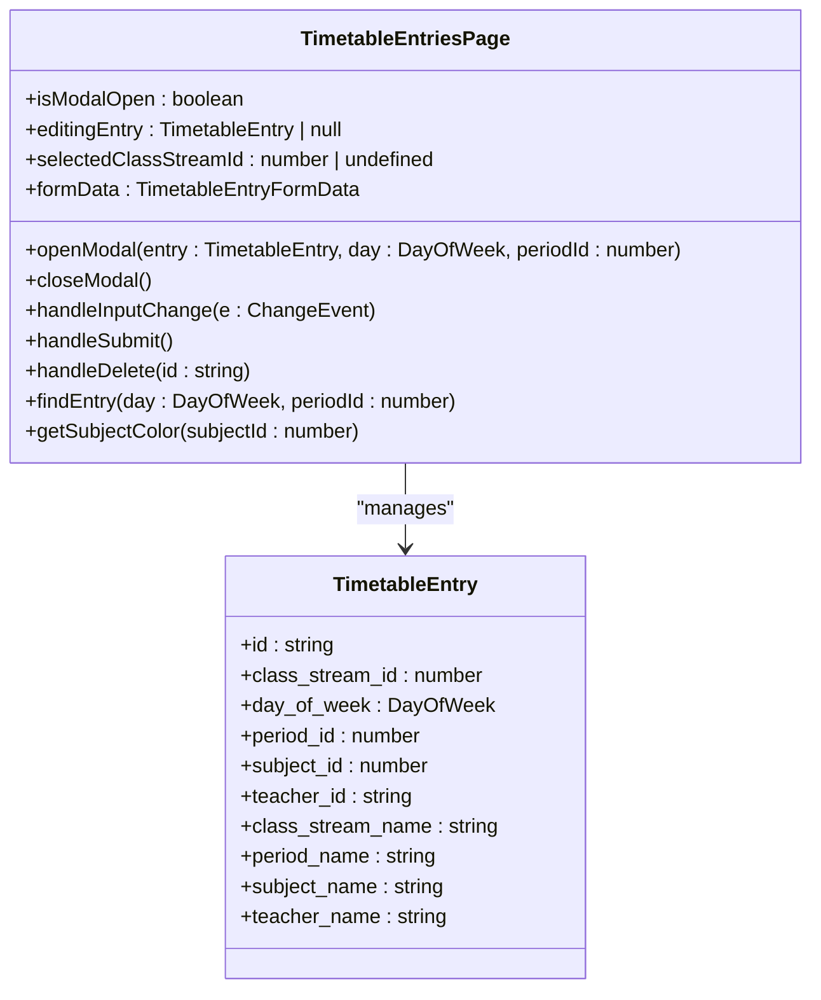
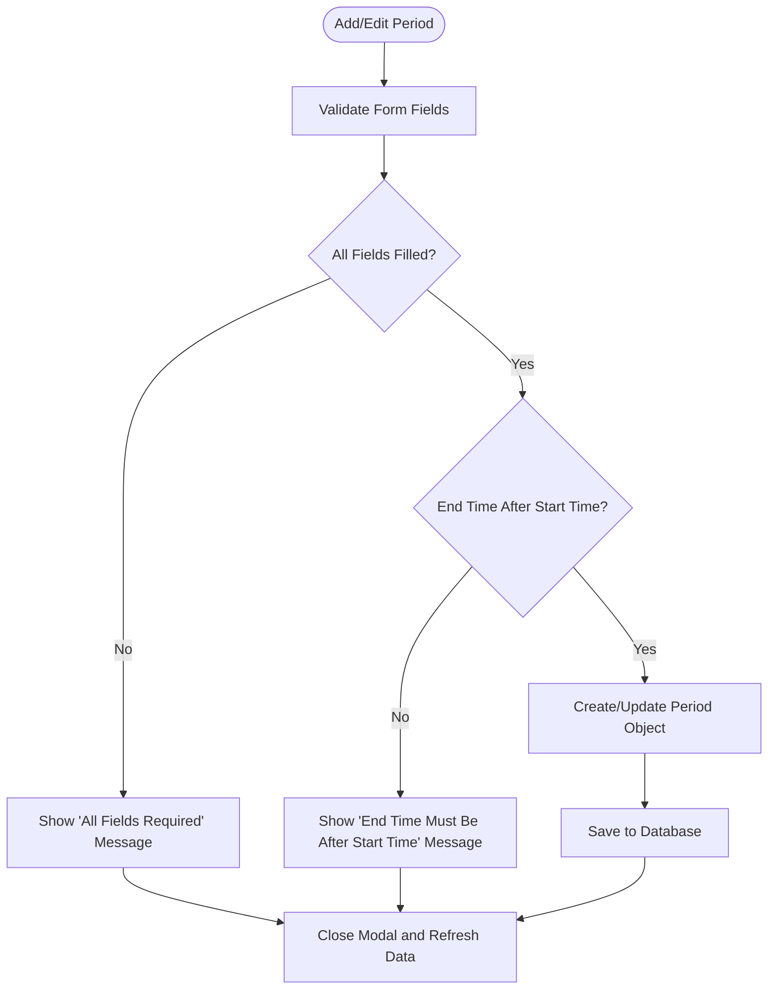
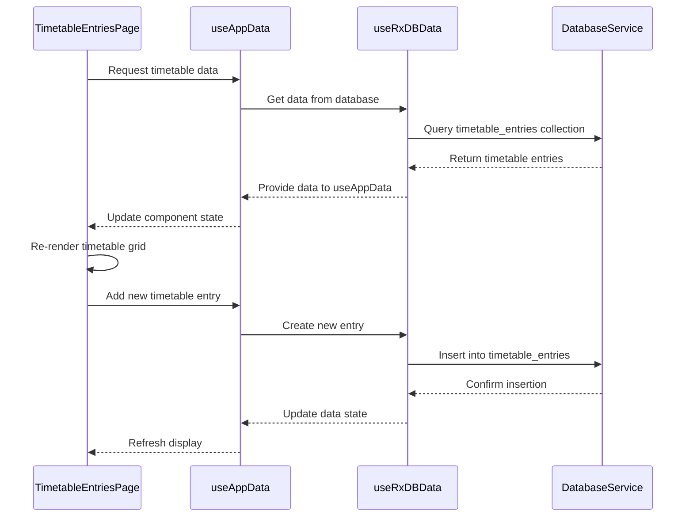
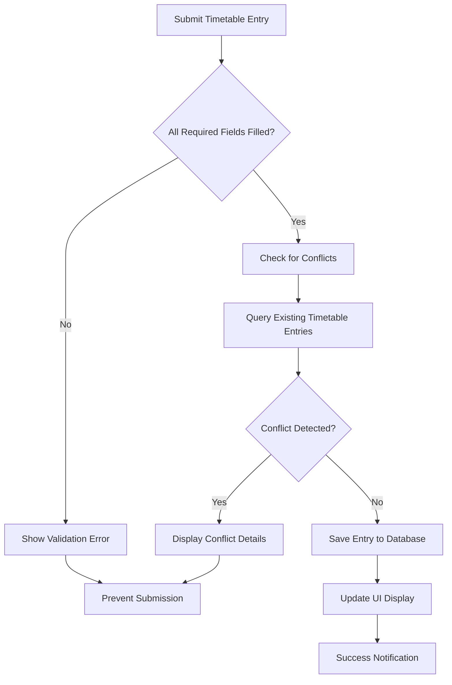
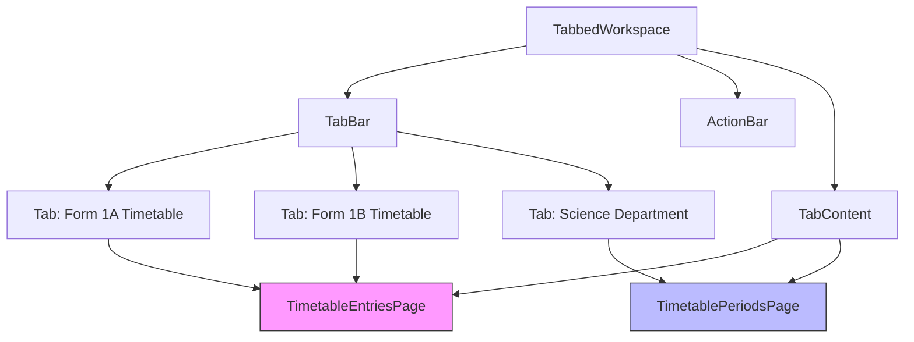
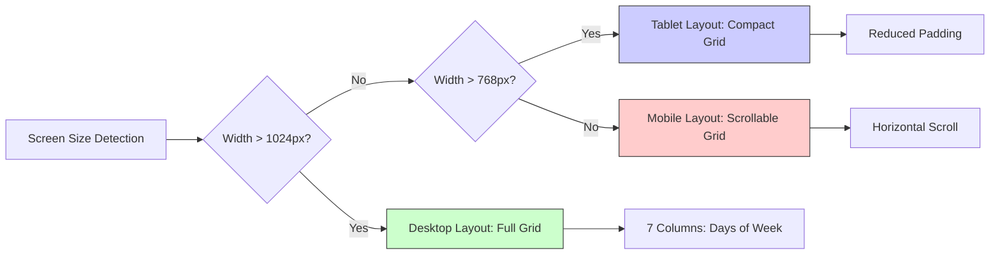

# Timetable UI Components

<cite>
**Referenced Files in This Document**   
- [TimetableEntriesPage.tsx](file://src/modules/academics/pages/TimetableEntriesPage.tsx)
- [TimetablePeriodsPage.tsx](file://src/modules/academics/pages/TimetablePeriodsPage.tsx)
- [useTimetableEntryData.ts](file://src/modules/academics/data/useTimetableEntryData.ts)
- [TimetableIntegrationService.ts](file://src/modules/academics/services/TimetableIntegrationService.ts)
- [TabbedWorkspace.tsx](file://src/components/tabbedWorkspace/TabbedWorkspace.tsx)
- [useAppData.ts](file://src/hooks/useAppData.ts)
- [useRxDBData.ts](file://src/hooks/useRxDBData.ts)
</cite>

## Table of Contents
1. [Introduction](#introduction)
2. [Core Components Overview](#core-components-overview)
3. [TimetableEntriesPage Implementation](#timetableentriespage-implementation)
4. [TimetablePeriodsPage Implementation](#timetableperiodspage-implementation)
5. [Data Management and Integration](#data-management-and-integration)
6. [Form Validation and Conflict Detection](#form-validation-and-conflict-detection)
7. [Tabbed Workspace Integration](#tabbed-workspace-integration)
8. [Responsive Design and Accessibility](#responsive-design-and-accessibility)
9. [Usage Examples and Customization](#usage-examples-and-customization)
10. [Conclusion](#conclusion)

## Introduction

The Timetable UI Components provide a comprehensive interface for managing school timetables, enabling administrators to create, edit, and visualize class schedules. This documentation details the implementation of two primary components: TimetableEntriesPage and TimetablePeriodsPage, which work together to provide a complete timetable management solution. The system supports both weekly and daily views, drag-and-drop scheduling capabilities, and real-time conflict detection to ensure schedule integrity.

The components are built using React with TypeScript, leveraging a modular architecture that separates concerns between data management, UI presentation, and business logic. The implementation integrates with a DataGrid component for displaying timetable data and utilizes a TabbedWorkspace system for managing multiple timetable views simultaneously. The interface is designed to be responsive and accessible, supporting various screen sizes and keyboard navigation.

**Section sources**
- [TimetableEntriesPage.tsx](file://src/modules/academics/pages/TimetableEntriesPage.tsx)
- [TimetablePeriodsPage.tsx](file://src/modules/academics/pages/TimetablePeriodsPage.tsx)

## Core Components Overview

The timetable system consists of two main components: TimetableEntriesPage for managing individual timetable entries (class assignments to specific time slots) and TimetablePeriodsPage for defining the time periods that make up the school day. These components work in conjunction with several supporting services and hooks to provide a complete timetable management solution.

The architecture follows a component-based design pattern with clear separation of concerns. The UI components are responsible for presentation and user interaction, while data management is handled by custom hooks and services. This separation allows for easier maintenance and testing of individual components.

**Diagram sources**
- [TimetableEntriesPage.tsx](file://src/modules/academics/pages/TimetableEntriesPage.tsx)
- [TimetablePeriodsPage.tsx](file://src/modules/academics/pages/TimetablePeriodsPage.tsx)
- [TabbedWorkspace.tsx](file://src/components/tabbedWorkspace/TabbedWorkspace.tsx)

**Section sources**
- [TimetableEntriesPage.tsx](file://src/modules/academics/pages/TimetableEntriesPage.tsx)
- [TimetablePeriodsPage.tsx](file://src/modules/academics/pages/TimetablePeriodsPage.tsx)

## TimetableEntriesPage Implementation

The TimetableEntriesPage component provides a visual interface for managing class timetable entries. It displays a grid-based timetable where rows represent time periods and columns represent days of the week. Users can add, edit, and delete timetable entries through a modal interface that appears when interacting with time slots.

The component uses a responsive table layout that adapts to different screen sizes. On larger screens, the full weekly timetable is displayed, while on smaller screens, users can scroll horizontally to view different days. The timetable cells are color-coded based on the subject being taught, making it easy to visually identify different classes.

**Diagram sources**
- [TimetableEntriesPage.tsx](file://src/modules/academics/pages/TimetableEntriesPage.tsx)

**Section sources**
- [TimetableEntriesPage.tsx](file://src/modules/academics/pages/TimetableEntriesPage.tsx)

## TimetablePeriodsPage Implementation

The TimetablePeriodsPage component allows administrators to define and manage the time periods that make up the school day. Each period has a name, start time, and end time, which are used to structure the timetable grid in TimetableEntriesPage.

The component provides a simple interface for creating, editing, and deleting periods. When adding or editing a period, form validation ensures that the end time is after the start time and that all required fields are filled. This prevents the creation of invalid time periods that could disrupt the timetable structure.

**Diagram sources**
- [TimetablePeriodsPage.tsx](file://src/modules/academics/pages/TimetablePeriodsPage.tsx)

**Section sources**
- [TimetablePeriodsPage.tsx](file://src/modules/academics/pages/TimetablePeriodsPage.tsx)

## Data Management and Integration

The timetable components integrate with the application's data layer through the useAppData hook, which provides access to timetable entries, class streams, periods, subjects, and staff data. This hook abstracts the underlying data storage mechanism, allowing the UI components to remain agnostic of whether data is stored locally or retrieved from a remote server.

The useAppData hook leverages the useRxDBData hook for database operations, providing a reactive data interface that automatically updates the UI when data changes. This ensures that the timetable display is always synchronized with the current state of the database.

**Diagram sources**
- [useAppData.ts](file://src/hooks/useAppData.ts)
- [useRxDBData.ts](file://src/hooks/useRxDBData.ts)

**Section sources**
- [useAppData.ts](file://src/hooks/useAppData.ts)
- [useRxDBData.ts](file://src/hooks/useRxDBData.ts)

## Form Validation and Conflict Detection

The timetable components implement comprehensive form validation to ensure data integrity. In TimetableEntriesPage, validation occurs when submitting the modal form, checking that all required fields are filled: class stream, day of week, period, subject, and teacher. In TimetablePeriodsPage, additional validation ensures that the end time is after the start time.

Beyond basic form validation, the system includes real-time conflict detection through the TimetableIntegrationService. This service checks for scheduling conflicts when creating or modifying timetable entries, preventing double-booking of rooms, teachers, or classes. The conflict detection logic examines existing timetable entries and exam schedules to identify potential overlaps.

**Diagram sources**
- [TimetableEntriesPage.tsx](file://src/modules/academics/pages/TimetableEntriesPage.tsx)
- [TimetableIntegrationService.ts](file://src/modules/academics/services/TimetableIntegrationService.ts)

**Section sources**
- [TimetableEntriesPage.tsx](file://src/modules/academics/pages/TimetableEntriesPage.tsx)
- [TimetableIntegrationService.ts](file://src/modules/academics/services/TimetableIntegrationService.ts)

## Tabbed Workspace Integration

The timetable components are integrated with the TabbedWorkspace system, allowing users to manage multiple timetable views simultaneously. This enables administrators to view and edit timetables for different class streams or departments in separate tabs, improving workflow efficiency.

The TabbedWorkspace component provides a tabbed interface with features like tab reordering, pinning, and closing. It maintains the state of each tab, including the active class stream and scroll position, allowing users to quickly switch between different timetable views without losing their place.

**Diagram sources**
- [TabbedWorkspace.tsx](file://src/components/tabbedWorkspace/TabbedWorkspace.tsx)
- [TimetableEntriesPage.tsx](file://src/modules/academics/pages/TimetableEntriesPage.tsx)

**Section sources**
- [TabbedWorkspace.tsx](file://src/components/tabbedWorkspace/TabbedWorkspace.tsx)
- [TimetableEntriesPage.tsx](file://src/modules/academics/pages/TimetableEntriesPage.tsx)

## Responsive Design and Accessibility

The timetable components are designed with responsiveness in mind, adapting to different screen sizes and device types. On desktop screens, the full weekly timetable is displayed in a grid format. On tablets, the interface remains similar but with adjusted spacing. On mobile devices, the layout switches to a more compact format with horizontal scrolling to view different days.

Accessibility features include proper semantic HTML structure, keyboard navigation support, and ARIA attributes for screen readers. The modal forms are accessible via keyboard, and all interactive elements have appropriate focus states. The color contrast meets WCAG guidelines, ensuring readability for users with visual impairments.

**Diagram sources**
- [TimetableEntriesPage.tsx](file://src/modules/academics/pages/TimetableEntriesPage.tsx)

**Section sources**
- [TimetableEntriesPage.tsx](file://src/modules/academics/pages/TimetableEntriesPage.tsx)

## Usage Examples and Customization

The timetable components support various usage scenarios and can be customized to meet institution-specific requirements. Common workflows include creating a new timetable for a semester, adjusting schedules during mid-term changes, and resolving scheduling conflicts.

For customization, institutions can modify the color scheme, adjust the number of periods per day, or extend the functionality to include features like room assignments or co-teaching support. The modular design allows for adding custom validation rules or integrating with external systems like student information systems.

Example workflow for creating a new timetable:
1. Navigate to TimetablePeriodsPage and define the daily periods
2. Go to TimetableEntriesPage and select the target class stream
3. Click on empty time slots to open the entry modal
4. Select the subject and teacher for each slot
5. Submit the entry and repeat for all required slots
6. Review the complete timetable for conflicts or gaps

**Section sources**
- [TimetableEntriesPage.tsx](file://src/modules/academics/pages/TimetableEntriesPage.tsx)
- [TimetablePeriodsPage.tsx](file://src/modules/academics/pages/TimetablePeriodsPage.tsx)

## Conclusion

The Timetable UI Components provide a robust and user-friendly interface for managing school timetables. Through the integration of TimetableEntriesPage and TimetablePeriodsPage, administrators can efficiently create and maintain class schedules while ensuring data integrity through comprehensive validation and conflict detection.

The components' integration with the TabbedWorkspace system enables efficient multitasking, allowing users to manage multiple timetables simultaneously. The responsive design ensures accessibility across different devices, while the accessible interface supports users with various needs.

Future enhancements could include drag-and-drop functionality for reassigning classes, automated timetable generation based on constraints, and enhanced reporting capabilities. The modular architecture makes it relatively straightforward to implement these features while maintaining the existing functionality.