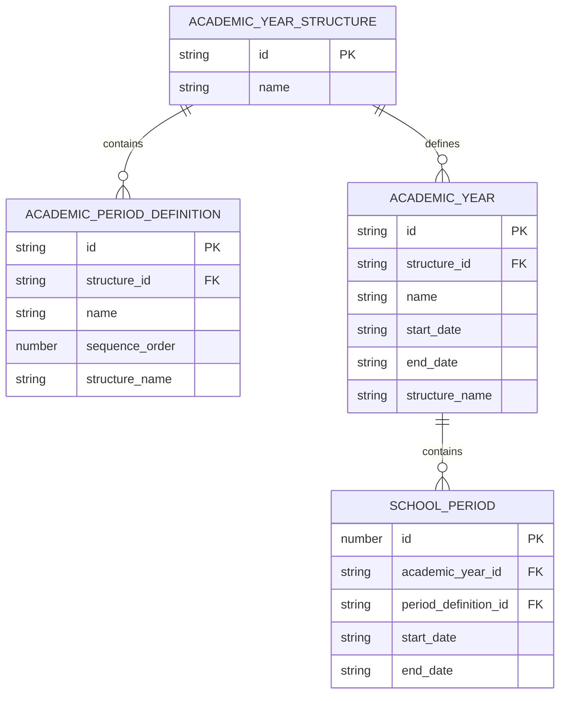
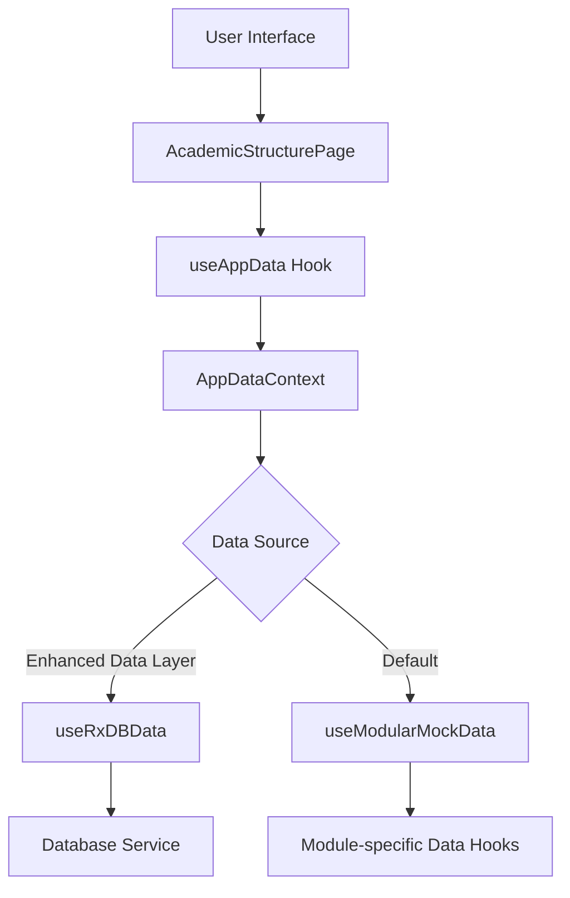
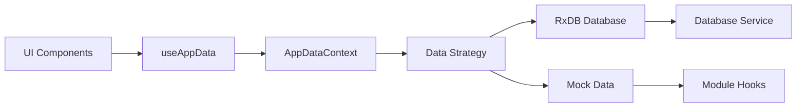
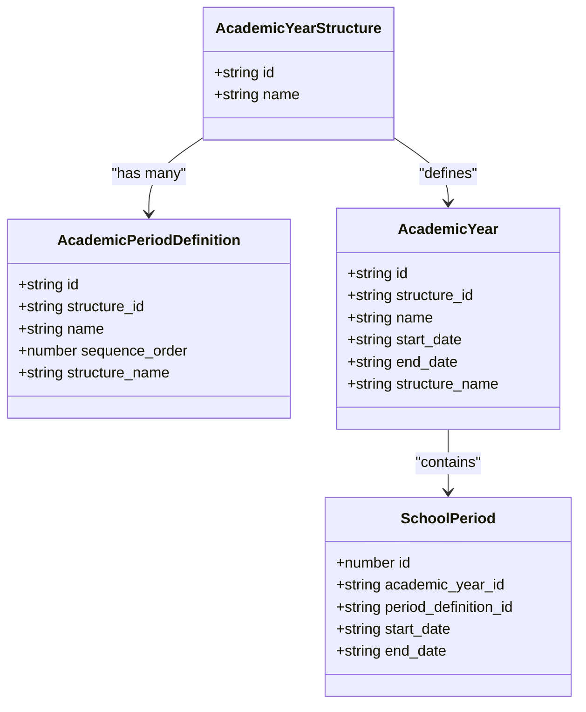
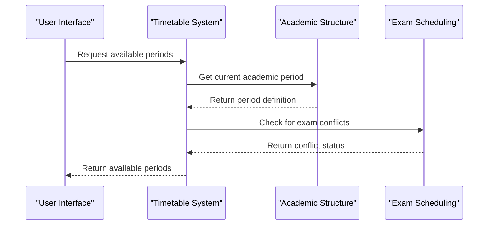
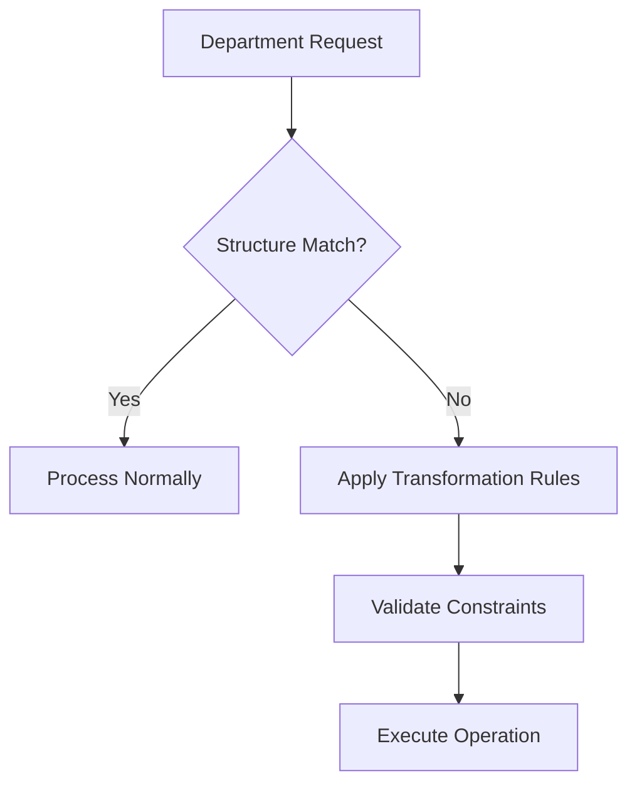

# Academic Structure Hierarchy

<cite>
**Referenced Files in This Document**   
- [AcademicStructurePage.tsx](file://src/modules/administration/pages/AcademicStructurePage.tsx)
- [useAcademicYearStructureData.ts](file://src/modules/administration/data/useAcademicYearStructureData.ts)
- [types.ts](file://src/core/types.ts)
- [schema.ts](file://src/modules/administration/data/schema.ts)
- [AppDataContext.tsx](file://src/contexts/AppDataContext.tsx)
- [useAppData.ts](file://src/hooks/useAppData.ts)
- [useModularMockData.ts](file://src/hooks/useModularMockData.ts)
- [useRxDBData.ts](file://src/hooks/useRxDBData.ts)
- [rxdbService.ts](file://src/services/rxdbService.ts)
- [TimetableIntegration.ts](file://src/modules/academics/services/TimetableIntegration.ts)
</cite>

## Table of Contents
1. [Introduction](#introduction)
2. [Data Model Structure](#data-model-structure)
3. [Academic Structure Hierarchy Implementation](#academic-structure-hierarchy-implementation)
4. [Hook and Data Management](#hook-and-data-management)
5. [Parent-Child Relationships](#parent-child-relationships)
6. [Configuration Examples](#configuration-examples)
7. [Integration with Timetable and Exam Systems](#integration-with-timetable-and-exam-systems)
8. [Common Issues and Solutions](#common-issues-and-solutions)

## Introduction
The Academic Structure Hierarchy feature provides a flexible framework for defining and managing academic calendars in educational institutions. This system enables administrators to configure various academic year structures such as term-based or semester-based systems, and establish hierarchical relationships between different academic periods. The implementation supports institutional variations in academic calendars while maintaining data integrity across related systems.

## Data Model Structure



**Diagram sources**
- [types.ts](file://src/core/types.ts#L359-L378)
- [schema.ts](file://src/modules/administration/data/schema.ts#L78-L199)
- [rxdbService.ts](file://src/services/rxdbService.ts#L78-L79)

**Section sources**
- [types.ts](file://src/core/types.ts#L359-L378)
- [schema.ts](file://src/modules/administration/data/schema.ts#L78-L199)

## Academic Structure Hierarchy Implementation

The academic structure hierarchy is implemented through a three-level organization:

1. **Academic Year Structure**: The top-level container that defines the overall pattern (e.g., "3-Term System" or "Semester System")
2. **Academic Period Definitions**: Mid-level components that define specific periods within a structure (e.g., "Term 1", "Term 2", "Semester 1")
3. **Academic Years**: Concrete instances that link a structure to specific calendar dates

The `AcademicStructurePage.tsx` component provides the user interface for managing academic year structures. It displays a data grid of existing structures and allows users to add, edit, or delete structures through a modal interface.



**Diagram sources**
- [AcademicStructurePage.tsx](file://src/modules/administration/pages/AcademicStructurePage.tsx#L0-L160)
- [AppDataContext.tsx](file://src/contexts/AppDataContext.tsx#L0-L169)
- [useAppData.ts](file://src/hooks/useAppData.ts#L0-L21)

**Section sources**
- [AcademicStructurePage.tsx](file://src/modules/administration/pages/AcademicStructurePage.tsx#L0-L160)

## Hook and Data Management

The system uses a layered approach to data management through custom React hooks:

### useAcademicYearStructureData Hook
This self-contained hook provides CRUD operations for academic year structures without depending on the global AppDataContext:

```typescript
export const useAcademicYearStructureData = () => {
  const [data, setData] = useState<AcademicYearStructure[]>(initialMockAcademicYearStructures);

  const create = async (newItem: Partial<AcademicYearStructure>) => {
    const newDataItem: AcademicYearStructure = {
      ...newItem,
      id: Date.now(),
      created_at: new Date().toISOString(),
      updated_at: new Date().toISOString()
    } as AcademicYearStructure;
    setData((prev: AcademicYearStructure[]) => [...prev, newDataItem]);
    return newDataItem;
  };

  const update = async (id: number, updatedData: Partial<AcademicYearStructure>) => {
    setData((prev: AcademicYearStructure[]) => prev.map((item: AcademicYearStructure) => 
      item.id === id 
        ? { ...item, ...updatedData, updated_at: new Date().toISOString() }
        : item
    ));
  };

  const remove = async (id: number) => {
    setData((prev: AcademicYearStructure[]) => prev.filter((item: AcademicYearStructure) => item.id !== id));
  };

  return {
    data,
    create,
    update,
    remove
  };
};
```

### Data Flow Architecture
The data flows through multiple layers of abstraction:



**Diagram sources**
- [useAcademicYearStructureData.ts](file://src/modules/administration/data/useAcademicYearStructureData.ts#L7-L39)
- [useModularMockData.ts](file://src/hooks/useModularMockData.ts#L0-L260)
- [useRxDBData.ts](file://src/hooks/useRxDBData.ts#L0-L306)

**Section sources**
- [useAcademicYearStructureData.ts](file://src/modules/administration/data/useAcademicYearStructureData.ts#L7-L39)
- [useModularMockData.ts](file://src/hooks/useModularMockData.ts#L0-L260)

## Parent-Child Relationships

The academic structure hierarchy establishes clear parent-child relationships between different levels of the academic calendar:

### Relationship Structure
- **Academic Year Structure** → **Academic Period Definitions**
- **Academic Year Structure** → **Academic Years**
- **Academic Year** → **School Periods**

### Implementation Details
The relationships are enforced through foreign key references in the data model:



**Diagram sources**
- [types.ts](file://src/core/types.ts#L359-L378)
- [schema.ts](file://src/modules/administration/data/schema.ts#L78-L199)
- [rxdbService.ts](file://src/services/rxdbService.ts#L78-L79)

**Section sources**
- [types.ts](file://src/core/types.ts#L359-L378)

## Configuration Examples

### Term-Based Academic Calendar
To configure a standard 3-term system:

1. Create an Academic Year Structure named "Standard 3-Term System"
2. Define three Academic Period Definitions:
   - Term 1 (sequence_order: 1)
   - Term 2 (sequence_order: 2)
   - Term 3 (sequence_order: 3)
3. Create Academic Years linking to this structure with specific start/end dates

### Semester-Based Academic Calendar
To configure a semester system:

1. Create an Academic Year Structure named "Semester System (2 Semesters)"
2. Define two Academic Period Definitions:
   - Semester 1 (sequence_order: 1)
   - Semester 2 (sequence_order: 2)
3. Create Academic Years with appropriate date ranges

### Example Data Structure
```json
{
  "academicYearStructures": [
    {
      "id": "1",
      "name": "Standard 3-Term System"
    },
    {
      "id": "2",
      "name": "Semester System (2 Semesters)"
    }
  ],
  "academicPeriodDefinitions": [
    {
      "id": "1",
      "structure_id": "1",
      "name": "Term 1",
      "sequence_order": 1
    },
    {
      "id": "2",
      "structure_id": "1",
      "name": "Term 2",
      "sequence_order": 2
    }
  ]
}
```

**Section sources**
- [mockData.ts](file://src/modules/administration/data/mockData.ts#L109-L130)
- [AcademicStructurePage.tsx](file://src/modules/administration/pages/AcademicStructurePage.tsx#L0-L160)

## Integration with Timetable and Exam Systems

The academic structure hierarchy integrates with timetable and exam scheduling systems through several mechanisms:

### Timetable Integration
The `TimetableIntegration` service uses academic period definitions to determine available periods for scheduling:

```typescript
export class TimetableIntegration {
  static async getAvailablePeriods(class_stream_id: number, date: string): Promise<TimetablePeriodDef[]> {
    // Logic to get available periods, considering existing timetable entries and exam schedules
    return []; // Placeholder
  }
}
```

### Data Flow for Scheduling


**Diagram sources**
- [TimetableIntegration.ts](file://src/modules/academics/services/TimetableIntegration.ts#L0-L10)
- [schema.ts](file://src/modules/academics/data/schema.ts#L251-L269)

**Section sources**
- [TimetableIntegration.ts](file://src/modules/academics/services/TimetableIntegration.ts#L0-L10)

## Common Issues and Solutions

### Structural Inheritance Conflicts
**Issue**: When departments use different academic structures, conflicts can arise in shared systems.

**Solution**: Implement department-specific academic year mappings with validation rules:



### Calendar Variations Across Departments
**Issue**: Different departments may require different academic calendars.

**Solutions**:
1. **Department-Specific Structures**: Allow departments to define their own academic year structures
2. **Mapping System**: Create mappings between different structures for cross-departmental coordination
3. **Validation Rules**: Implement rules to prevent scheduling conflicts between departments

### Data Integrity Challenges
**Issue**: Maintaining consistency when academic structures are modified.

**Prevention Strategies**:
- Implement cascading updates for dependent records
- Use soft deletes for academic structures with historical data
- Provide impact analysis before structural changes
- Maintain audit trails for all structural modifications

**Section sources**
- [rxdbService.ts](file://src/services/rxdbService.ts#L78-L79)
- [TimetableIntegration.ts](file://src/modules/academics/services/TimetableIntegration.ts#L0-L10)
- [useAppData.ts](file://src/hooks/useAppData.ts#L0-L21)