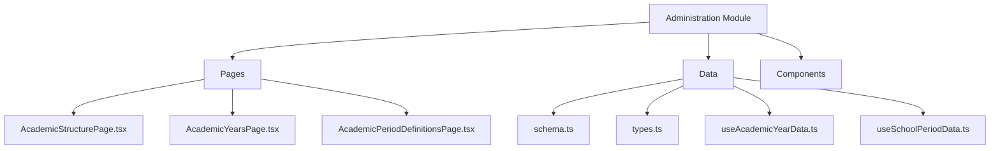
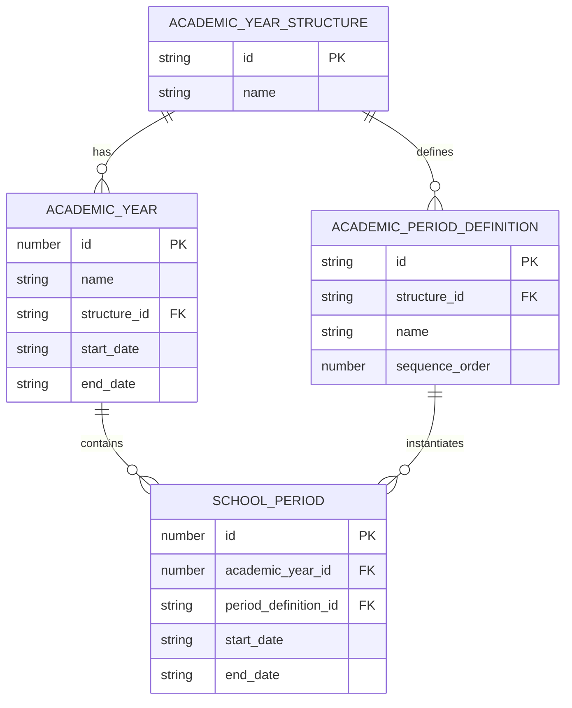
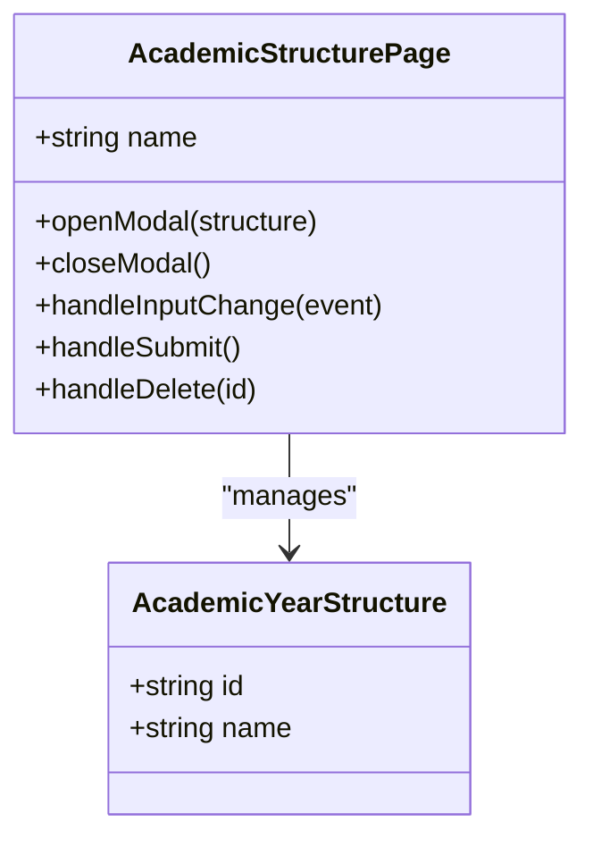
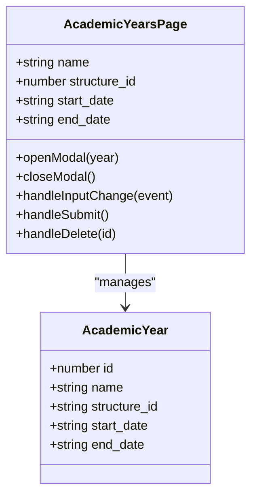
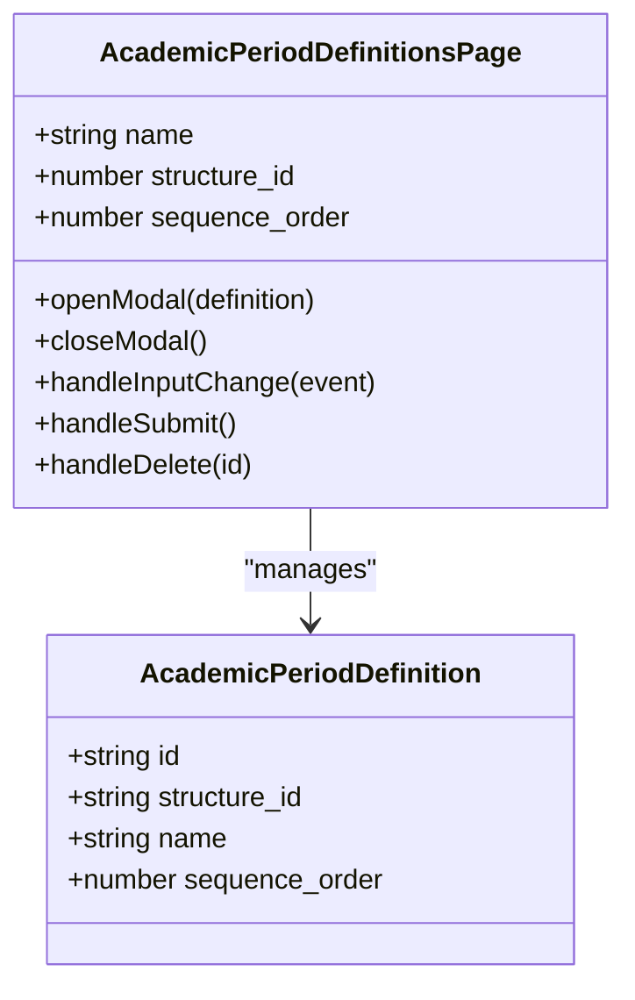
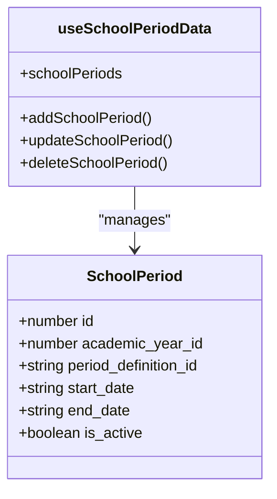
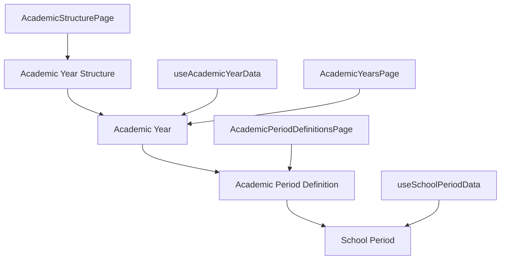

# Academic Structure Management

<cite>
**Referenced Files in This Document**   
- [AcademicStructurePage.tsx](file://src/modules/administration/pages/AcademicStructurePage.tsx)
- [AcademicYearsPage.tsx](file://src/modules/administration/pages/AcademicYearsPage.tsx)
- [AcademicPeriodDefinitionsPage.tsx](file://src/modules/administration/pages/AcademicPeriodDefinitionsPage.tsx)
- [useAcademicYearData.ts](file://src/modules/administration/data/useAcademicYearData.ts)
- [useSchoolPeriodData.ts](file://src/modules/administration/data/useSchoolPeriodData.ts)
- [schema.ts](file://src/modules/administration/data/schema.ts)
- [types.ts](file://src/modules/administration/data/types.ts)
- [types.ts](file://src/core/types.ts)
</cite>

## Table of Contents
1. [Introduction](#introduction)
2. [Project Structure](#project-structure)
3. [Core Components](#core-components)
4. [Architecture Overview](#architecture-overview)
5. [Detailed Component Analysis](#detailed-component-analysis)
6. [Dependency Analysis](#dependency-analysis)
7. [Performance Considerations](#performance-considerations)
8. [Troubleshooting Guide](#troubleshooting-guide)
9. [Conclusion](#conclusion)

## Introduction
The Academic Structure Management sub-feature within the Administration module provides a comprehensive system for configuring institutional timelines and academic calendars. This documentation details the implementation of academic calendar configuration, year-level definitions, and period scheduling. The system enables educational institutions to define flexible academic structures that can accommodate various educational systems and scheduling requirements. The hierarchical data model supports complex relationships between academic years, periods, and school schedules, ensuring data integrity and consistency across the platform.

## Project Structure
The Academic Structure Management functionality is organized within the administration module of the application. The core components are located in the `src/modules/administration` directory, with specific pages and data management utilities separated into dedicated subdirectories. The implementation follows a modular architecture with clear separation of concerns between UI components, data management hooks, and schema definitions.

**Diagram sources**
- [AcademicStructurePage.tsx](file://src/modules/administration/pages/AcademicStructurePage.tsx)
- [schema.ts](file://src/modules/administration/data/schema.ts)

**Section sources**
- [AcademicStructurePage.tsx](file://src/modules/administration/pages/AcademicStructurePage.tsx)
- [schema.ts](file://src/modules/administration/data/schema.ts)

## Core Components
The Academic Structure Management system consists of three primary components: Academic Structure, Academic Years, and Academic Period Definitions. These components work together to create a hierarchical framework for managing institutional timelines. The system also includes supporting hooks for data management and validation, ensuring consistent data handling across the application.

**Section sources**
- [AcademicStructurePage.tsx](file://src/modules/administration/pages/AcademicStructurePage.tsx)
- [AcademicYearsPage.tsx](file://src/modules/administration/pages/AcademicYearsPage.tsx)
- [AcademicPeriodDefinitionsPage.tsx](file://src/modules/administration/pages/AcademicPeriodDefinitionsPage.tsx)

## Architecture Overview
The Academic Structure Management system follows a hierarchical data model where academic structures serve as templates for academic years, which in turn contain specific period definitions. This architecture allows institutions to define multiple academic structures (such as semester or trimester systems) and apply them to different academic years as needed. The system is designed to support complex scheduling requirements while maintaining data integrity and providing a user-friendly interface for administrators.

**Diagram sources**
- [schema.ts](file://src/modules/administration/data/schema.ts)
- [types.ts](file://src/core/types.ts)

## Detailed Component Analysis

### Academic Structure Management
The Academic Structure component allows administrators to define the overall framework for academic years. These structures serve as templates that can be applied to multiple academic years, ensuring consistency in scheduling across different years.

**Diagram sources**
- [AcademicStructurePage.tsx](file://src/modules/administration/pages/AcademicStructurePage.tsx)
- [types.ts](file://src/core/types.ts)

**Section sources**
- [AcademicStructurePage.tsx](file://src/modules/administration/pages/AcademicStructurePage.tsx)
- [types.ts](file://src/core/types.ts)

### Academic Years Configuration
The Academic Years component enables the creation and management of specific academic years, linking them to predefined academic structures and setting their start and end dates. This component provides a comprehensive interface for configuring the temporal boundaries of academic activities.

**Diagram sources**
- [AcademicYearsPage.tsx](file://src/modules/administration/pages/AcademicYearsPage.tsx)
- [types.ts](file://src/core/types.ts)

**Section sources**
- [AcademicYearsPage.tsx](file://src/modules/administration/pages/AcademicYearsPage.tsx)
- [types.ts](file://src/core/types.ts)

### Period Definitions Management
The Academic Period Definitions component allows administrators to define the individual periods within an academic year structure, such as terms or semesters. These definitions include sequence ordering to ensure proper chronological arrangement of academic periods.

**Diagram sources**
- [AcademicPeriodDefinitionsPage.tsx](file://src/modules/administration/pages/AcademicPeriodDefinitionsPage.tsx)
- [types.ts](file://src/core/types.ts)

**Section sources**
- [AcademicPeriodDefinitionsPage.tsx](file://src/modules/administration/pages/AcademicPeriodDefinitionsPage.tsx)
- [types.ts](file://src/core/types.ts)

### School Period Scheduling
The School Period component represents the actual instantiation of academic periods within a specific academic year. These periods have defined start and end dates and are used to schedule academic activities such as exams and classes.

**Diagram sources**
- [useSchoolPeriodData.ts](file://src/modules/administration/data/useSchoolPeriodData.ts)
- [types.ts](file://src/core/types.ts)

**Section sources**
- [useSchoolPeriodData.ts](file://src/modules/administration/data/useSchoolPeriodData.ts)
- [types.ts](file://src/core/types.ts)

## Dependency Analysis
The Academic Structure Management system has well-defined dependencies between its components, ensuring data consistency and integrity. The hierarchical relationship between academic structures, academic years, and period definitions creates a robust framework for managing institutional timelines.

**Diagram sources**
- [schema.ts](file://src/modules/administration/data/schema.ts)
- [useAcademicYearData.ts](file://src/modules/administration/data/useAcademicYearData.ts)
- [useSchoolPeriodData.ts](file://src/modules/administration/data/useSchoolPeriodData.ts)

**Section sources**
- [schema.ts](file://src/modules/administration/data/schema.ts)
- [useAcademicYearData.ts](file://src/modules/administration/data/useAcademicYearData.ts)
- [useSchoolPeriodData.ts](file://src/modules/administration/data/useSchoolPeriodData.ts)

## Performance Considerations
The Academic Structure Management system is designed with performance in mind, utilizing efficient data fetching and state management patterns. The use of React hooks for data management ensures that components only re-render when necessary, minimizing unnecessary computations. The system also implements loading states and empty state handling to provide a smooth user experience during data retrieval operations.

## Troubleshooting Guide
Common issues in the Academic Structure Management system typically involve data validation and relationship integrity. When creating academic years, ensure that the start date is before the end date. When defining period sequences, verify that the sequence order is unique within each academic structure. For overlapping academic periods, implement validation checks to prevent date conflicts. When handling mid-year structural changes, consider creating a new academic year rather than modifying existing ones to maintain data integrity.

**Section sources**
- [AcademicYearsPage.tsx](file://src/modules/administration/pages/AcademicYearsPage.tsx)
- [AcademicPeriodDefinitionsPage.tsx](file://src/modules/administration/pages/AcademicPeriodDefinitionsPage.tsx)

## Conclusion
The Academic Structure Management system provides a comprehensive solution for configuring institutional timelines and academic calendars. By implementing a hierarchical data model with clear relationships between academic structures, years, and periods, the system offers flexibility while maintaining data integrity. The integration with other modules such as Academics and Finance ensures that academic scheduling aligns with exam planning and fee billing cycles. The user-friendly interface and robust data management hooks make it easy for administrators to configure and maintain complex academic schedules.