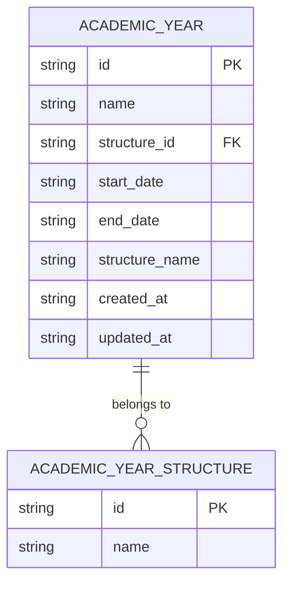
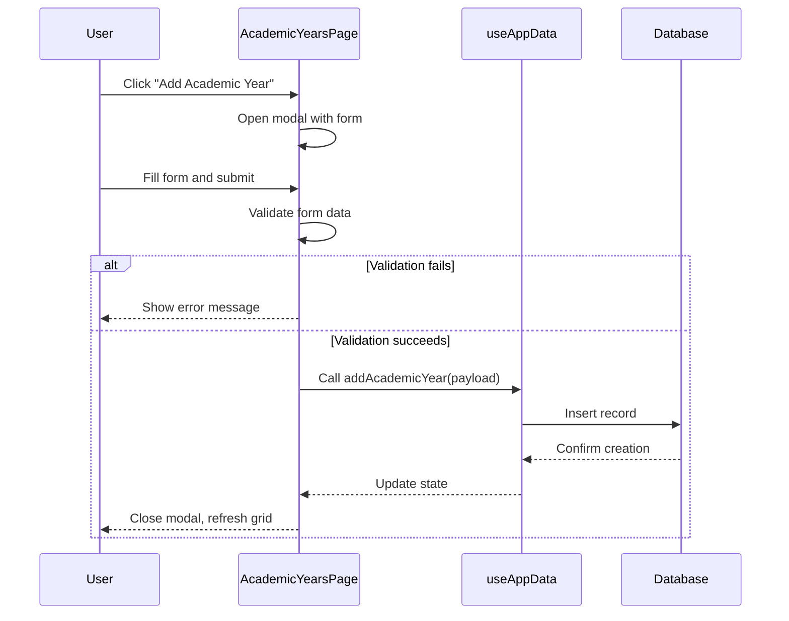
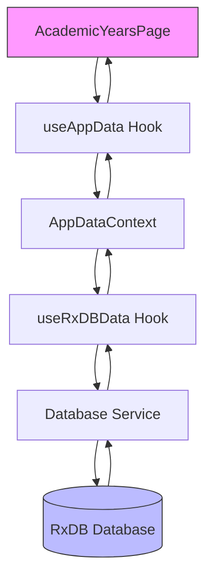
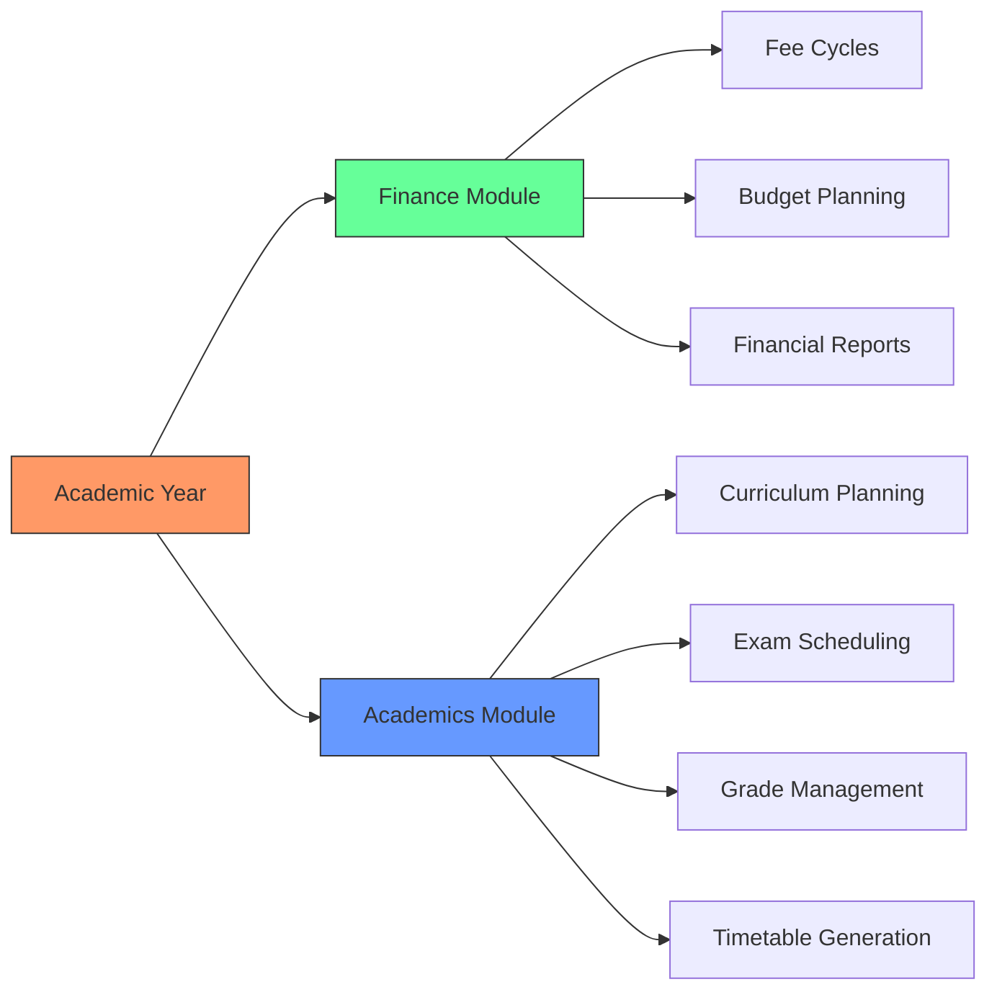

# Academic Year Configuration

<cite>
**Referenced Files in This Document**   
- [AcademicYearsPage.tsx](file://src/modules/administration/pages/AcademicYearsPage.tsx)
- [useAcademicYearData.ts](file://src/modules/administration/data/useAcademicYearData.ts)
- [types.ts](file://src/core/types.ts)
- [rxdbService.ts](file://src/services/rxdbService.ts)
- [useAppData.ts](file://src/hooks/useAppData.ts)
- [AppDataContext.tsx](file://src/contexts/AppDataContext.tsx)
- [useRxDBData.ts](file://src/hooks/useRxDBData.ts)
</cite>

## Table of Contents
1. [Introduction](#introduction)
2. [Data Model for Academic Years](#data-model-for-academic-years)
3. [Academic Year Workflows Implementation](#academic-year-workflows-implementation)
4. [State Management and Data Synchronization](#state-management-and-data-synchronization)
5. [Multi-Year Calendar Configuration](#multi-year-calendar-configuration)
6. [Validation and Error Handling](#validation-and-error-handling)
7. [Integration with Finance and Academics Modules](#integration-with-finance-and-academics-modules)
8. [Best Practices and Common Issues](#best-practices-and-common-issues)

## Introduction
The Academic Year Configuration sub-feature provides a comprehensive system for managing academic calendars within the educational institution. This document details the implementation of academic year creation, activation, and archival workflows, focusing on the data model, state management, and integration points. The system enables administrators to define academic periods, manage date ranges, and coordinate with financial and academic planning modules. The implementation follows a modular architecture with clear separation of concerns between UI components, data hooks, and backend services.

## Data Model for Academic Years

The academic year data model is designed to capture essential temporal and structural information for educational planning. The model includes core attributes for identification, temporal boundaries, and structural relationships.



**Diagram sources**
- [rxdbService.ts](file://src/services/rxdbService.ts#L80-L85)
- [types.ts](file://src/core/types.ts#L373-L383)

The AcademicYear interface defines the following properties:

**AcademicYear Properties**
- `id`: Unique identifier for the academic year
- `name`: Display name (e.g., "AY 2023/2024")
- `structure_id`: Foreign key reference to AcademicYearStructure
- `start_date`: Start date in ISO format (YYYY-MM-DD)
- `end_date`: End date in ISO format (YYYY-MM-DD)
- `created_at`: Timestamp of record creation
- `updated_at`: Timestamp of last modification
- `structure_name`: Denormalized field for display purposes

The data model enforces several constraints:
- All fields except `structure_name` are required
- Date fields must be valid ISO date strings
- The `id` field serves as the primary key
- The `structure_id` creates a relationship with AcademicYearStructure

**Section sources**
- [types.ts](file://src/core/types.ts#L373-L383)
- [rxdbService.ts](file://src/services/rxdbService.ts#L80-L85)

## Academic Year Workflows Implementation

The AcademicYearsPage.tsx component implements the user interface for managing academic years, providing CRUD operations through a modal-based workflow.

### Creation Workflow
The creation workflow follows these steps:
1. User clicks "Add Academic Year" button
2. Modal form appears with input fields for name, structure, start date, and end date
3. User fills in required information and submits the form
4. Client-side validation ensures all fields are complete and dates are logical
5. Data is sent to the backend via the addAcademicYear function



**Diagram sources**
- [AcademicYearsPage.tsx](file://src/modules/administration/pages/AcademicYearsPage.tsx#L40-L239)

### Edit and Delete Workflows
The edit workflow allows modification of existing academic years:
1. User clicks "Edit" button on a row
2. Modal form pre-populates with existing data
3. User makes changes and submits
4. System updates the record via updateAcademicYear

The delete workflow includes confirmation:
1. User clicks "Delete" button
2. System shows confirmation dialog
3. Upon confirmation, deleteAcademicYear is called
4. Record is removed from the database

**Section sources**
- [AcademicYearsPage.tsx](file://src/modules/administration/pages/AcademicYearsPage.tsx#L40-L239)

## State Management and Data Synchronization

The system employs a hierarchical state management approach, with data synchronization across components through the AppDataContext.

### Data Flow Architecture


**Diagram sources**
- [AppDataContext.tsx](file://src/contexts/AppDataContext.tsx#L0-L168)
- [useAppData.ts](file://src/hooks/useAppData.ts#L0-L20)
- [useRxDBData.ts](file://src/hooks/useRxDBData.ts#L0-L305)

### useAcademicYearData Hook Analysis
The useAcademicYearData hook provides a self-contained interface for academic year data management:

```typescript
export const useAcademicYearData = () => {
  const [data, setData] = useState<AcademicYear[]>(initialMockAcademicYears);

  const create = async (newItem: Partial<AcademicYear>) => {
    const newDataItem: AcademicYear = {
      ...newItem,
      id: Date.now(),
      created_at: new Date().toISOString(),
      updated_at: new Date().toISOString()
    } as AcademicYear;
    setData((prev: AcademicYear[]) => [...prev, newDataItem]);
    return newDataItem;
  };

  const update = async (id: number, updatedData: Partial<AcademicYear>) => {
    setData((prev: AcademicYear[]) => prev.map((item: AcademicYear) => 
      item.id === id 
        ? { ...item, ...updatedData, updated_at: new Date().toISOString() }
        : item
    ));
  };

  const remove = async (id: number) => {
    setData((prev: AcademicYear[]) => prev.filter((item: AcademicYear) => item.id !== id));
  };

  return {
    data,
    create,
    update,
    remove
  };
};
```

This hook manages local state for academic years and provides CRUD operations. However, in the current implementation, it appears to be overridden by the global AppDataContext which uses useRxDBData for actual data persistence.

### Global State Synchronization
The AppDataContext orchestrates data synchronization across the application:

1. It determines the data source based on configuration
2. It selects between RxDB and mock data implementations
3. It provides a unified interface to components
4. It manages loading states and error conditions

The context ensures that all components access consistent data and that updates are propagated throughout the application.

**Section sources**
- [useAcademicYearData.ts](file://src/modules/administration/data/useAcademicYearData.ts#L0-L43)
- [AppDataContext.tsx](file://src/contexts/AppDataContext.tsx#L0-L168)
- [useRxDBData.ts](file://src/hooks/useRxDBData.ts#L0-L305)

## Multi-Year Calendar Configuration

The system supports configuration of multi-year academic calendars through the AcademicYearStructure entity, which defines the template for academic periods.

### Year Rollover Process
The year rollover transition involves several steps:

1. **Preparation Phase**: Configure the new academic year structure
2. **Creation Phase**: Create the new academic year with appropriate date ranges
3. **Activation Phase**: Designate the new year as active
4. **Archival Phase**: Mark the previous year as inactive

The interface supports configuring overlapping date ranges for transitional periods, such as summer sessions that span two calendar years.

### Configuration Example
To configure a multi-year calendar:

1. Create AcademicYearStructure for "Semester System" or "Trimester System"
2. Define multiple AcademicYear records with consecutive date ranges
3. Ensure no gaps between academic years
4. Set appropriate start and end dates for each year

The system validates that date ranges do not conflict and that the entire calendar is continuous.

**Section sources**
- [AcademicYearsPage.tsx](file://src/modules/administration/pages/AcademicYearsPage.tsx#L40-L239)
- [types.ts](file://src/core/types.ts#L373-L383)

## Validation and Error Handling

The system implements comprehensive validation to ensure data integrity and prevent common configuration errors.

### Client-Side Validation Rules
The AcademicYearsPage enforces the following validation rules:

- **Required Fields**: Name, structure, start date, and end date must be provided
- **Date Logic**: End date must be after start date
- **Structural Integrity**: Academic year must be linked to a valid structure
- **Uniqueness**: Year names should be unique (enforced at database level)

```mermaid
flowchart TD
A[Form Submission] --> B{All Fields Filled?}
B --> |No| C[Show "All fields required" error]
B --> |Yes| D{End Date > Start Date?}
D --> |No| E[Show "End date must be after start date" error]
D --> |Yes| F[Submit to Server]
F --> G[Server Validation]
G --> H[Database Constraints]
H --> I[Success or Error Response]
```

**Diagram sources**
- [AcademicYearsPage.tsx](file://src/modules/administration/pages/AcademicYearsPage.tsx#L120-L130)

### Error Handling Strategy
The system employs a multi-layered error handling approach:

1. **Client-Side**: Immediate feedback for invalid inputs
2. **Server-Side**: Validation of business rules and data integrity
3. **Database-Level**: Enforcement of constraints and relationships
4. **User Interface**: Clear error messages and recovery options

The delete operation includes a confirmation dialog to prevent accidental data loss, warning users that deletion may affect related school periods and academic data.

**Section sources**
- [AcademicYearsPage.tsx](file://src/modules/administration/pages/AcademicYearsPage.tsx#L120-L130)

## Integration with Finance and Academics Modules

The academic year configuration serves as a foundational element for both financial and academic planning systems.

### Finance Module Integration
The academic year directly impacts the Finance module through:

- **Fee Cycle Alignment**: Tuition and fee schedules are tied to academic year boundaries
- **Financial Reporting**: Fiscal periods align with academic years
- **Budget Planning**: Annual budgets correspond to academic year cycles
- **Invoice Generation**: Student invoices are generated per academic year

The system ensures that fee templates and payment schedules respect academic year boundaries, preventing financial transactions from being assigned to non-existent or inactive years.

### Academics Module Integration
The academic year configuration is critical for academic planning:

- **Curriculum Planning**: Course offerings and syllabi are organized by academic year
- **Exam Scheduling**: Examination periods are defined within academic year boundaries
- **Grade Management**: Student grades are associated with specific academic years
- **Timetable Generation**: Class schedules are created for specific academic years

The integration ensures that academic activities are properly scoped to the correct time periods and that historical data is preserved for archival years.



**Diagram sources**
- [AcademicYearsPage.tsx](file://src/modules/administration/pages/AcademicYearsPage.tsx)
- [types.ts](file://src/core/types.ts#L373-L383)

## Best Practices and Common Issues

### Best Practices for Academic Year Configuration
1. **Plan Ahead**: Configure future academic years at least 6 months in advance
2. **Consistent Naming**: Use a standard naming convention (e.g., "AY 2023/2024")
3. **Validate Dates**: Ensure no gaps between consecutive academic years
4. **Backup Data**: Create backups before making structural changes
5. **Coordinate Changes**: Communicate year rollover plans to all stakeholders

### Common Issues and Solutions
**Overlapping Date Ranges**
- **Issue**: Accidentally creating academic years with overlapping dates
- **Solution**: The system validates that end dates are after start dates and should implement additional checks for overlaps with existing years

**Year Rollover Errors**
- **Issue**: Forgetting to activate the new academic year
- **Solution**: Implement a guided year rollover wizard with clear status indicators

**Data Archival Problems**
- **Issue**: Incomplete archival of previous year data
- **Solution**: Implement automated archival workflows that preserve historical data while optimizing current year performance

**Integration Failures**
- **Issue**: Finance or academics modules not recognizing the active year
- **Solution**: Ensure proper event broadcasting when changing the active academic year

The system should implement comprehensive logging and audit trails for all academic year modifications to support troubleshooting and compliance requirements.

**Section sources**
- [AcademicYearsPage.tsx](file://src/modules/administration/pages/AcademicYearsPage.tsx#L40-L239)
- [useAcademicYearData.ts](file://src/modules/administration/data/useAcademicYearData.ts#L0-L43)