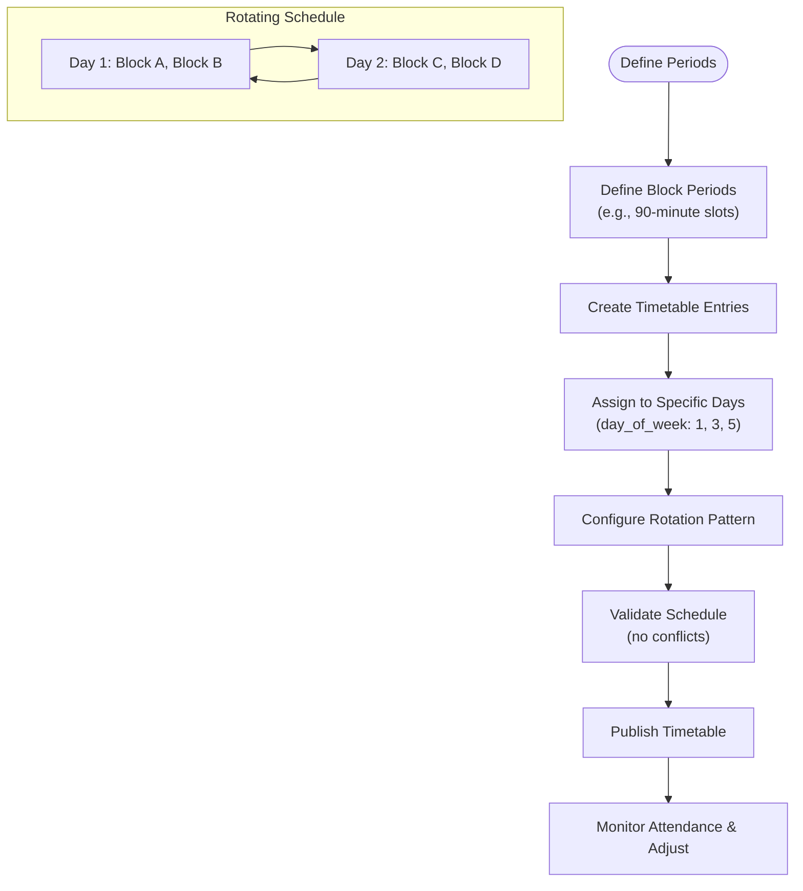
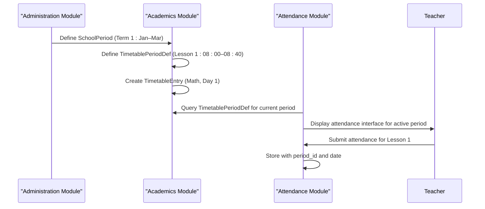

# Period Scheduling

<cite>
**Referenced Files in This Document**   
- [AcademicPeriodDefinitionsPage.tsx](file://src/modules/administration/pages/AcademicPeriodDefinitionsPage.tsx)
- [SchoolPeriodsPage.tsx](file://src/modules/administration/pages/SchoolPeriodsPage.tsx)
- [schema.ts](file://src/modules/finance/data/schema.ts)
- [types.ts](file://src/core/types.ts)
- [useSchoolPeriodData.ts](file://src/modules/administration/data/useSchoolPeriodData.ts)
- [TimetablePeriodsPage.tsx](file://src/modules/academics/pages/TimetablePeriodsPage.tsx)
- [timetablePeriodDefSchema.ts](file://src/modules/academics/data/schema.ts)
</cite>

## Table of Contents
1. [Introduction](#introduction)
2. [Data Model for School Periods](#data-model-for-school-periods)
3. [Implementation of Daily Period Definitions](#implementation-of-daily-period-definitions)
4. [Scheduling in SchoolPeriodsPage.tsx](#scheduling-in-schoolperiodspagetsx)
5. [Hook Analysis: useSchoolPeriodData](#hook-analysis-useschoolperioddata)
6. [Block Scheduling and Rotating Timetables](#block-scheduling-and-rotating-timetables)
7. [Validation Rules and Conflict Detection](#validation-rules-and-conflict-detection)
8. [Integration with Timetable and Attendance Modules](#integration-with-timetable-and-attendance-modules)
9. [Common Issues and Troubleshooting](#common-issues-and-troubleshooting)

## Introduction
The Period Scheduling sub-feature enables educational institutions to define and manage academic periods, including daily time slots, recurring patterns, and break intervals. This system supports flexible scheduling models such as block scheduling and rotating timetables, ensuring alignment across academic, financial, and attendance systems. The implementation spans multiple modules—Administration, Academics, and Finance—using shared data models and modular hooks for consistency and reusability.

This document details the architecture, data structures, and integration points of the period scheduling system, focusing on `AcademicPeriodDefinitionsPage.tsx`, `SchoolPeriodsPage.tsx`, and related components.

**Section sources**
- [AcademicPeriodDefinitionsPage.tsx](file://src/modules/administration/pages/AcademicPeriodDefinitionsPage.tsx)
- [SchoolPeriodsPage.tsx](file://src/modules/administration/pages/SchoolPeriodsPage.tsx)

## Data Model for School Periods

The data model for school periods is defined across multiple schema and type files, integrating academic, financial, and operational concerns.

### Academic Period Definition
An `AcademicPeriodDefinition` represents a named segment within an academic year structure (e.g., Term 1, Midterm, Final Exams). It is defined in `core/types.ts`:

```typescript
export interface AcademicPeriodDefinition {
    id: string;
    structure_id: string;
    name: string;
    sequence_order: number;
    structure_name?: string | null;
}
```

Key fields:
- **id**: Unique identifier
- **structure_id**: Reference to the academic year structure
- **name**: Display name (e.g., "Term 1")
- **sequence_order**: Ordering within the academic structure

### School Period
A `SchoolPeriod` links an academic period definition to a specific academic and financial year, defining its temporal boundaries:

```typescript
export interface SchoolPeriod {
  id: number;
  academic_year_id: number;
  period_definition_id: string;
  financial_year_id: number;
  start_date: string;
  end_date: string;
  mid_break_start?: string | null;
  mid_break_end?: string | null;
  is_active: boolean;
  created_at: string;
  updated_at: string;
  name?: string | null;
  academic_year_name?: string | null;
  period_definition_name?: string | null;
  financial_year_name?: string | null;
}
```

This model is mirrored in the finance module's schema:

```typescript
export const schoolPeriodSchema: DatabaseSchema = createDatabaseSchema({
    title: 'school_period',
    primaryKey: 'id',
    properties: {
        id: SchemaHelpers.string({ maxLength: 100 }),
        academic_year_id: SchemaHelpers.string({ maxLength: 100 }),
        period_definition_id: SchemaHelpers.string({ maxLength: 100 }),
        financial_year_id: SchemaHelpers.string({ maxLength: 100 }),
        start_date: SchemaHelpers.date(),
        end_date: SchemaHelpers.date(),
        is_active: SchemaHelpers.boolean(),
        mid_break_start: SchemaHelpers.date(),
        mid_break_end: SchemaHelpers.date(),
        name: SchemaHelpers.string({ maxLength: 100 }),
        // ... additional denormalized fields
    },
    required: ['id', 'academic_year_id', 'period_definition_id', 'financial_year_id', 'start_date', 'end_date', 'is_active', 'created_at', 'updated_at'],
});
```

### Time Slot Definitions
Daily time slots (e.g., Lesson 1, Break) are managed separately in the Academics module via `timetablePeriodDefSchema`:

```typescript
export const timetablePeriodDefSchema: DatabaseSchema = createDatabaseSchema({
    title: 'timetable_period_definition',
    primaryKey: 'id',
    properties: {
        id: SchemaHelpers.integer({ minimum: 1, maximum: 999999999 }),
        period_name: SchemaHelpers.string({ maxLength: 50 }),
        start_time: SchemaHelpers.string({ pattern: '^([01]?[0-9]|2[0-3]):[0-5][0-9]$', maxLength: 20 }),
        end_time: SchemaHelpers.string({ pattern: '^([01]?[0-9]|2[0-3]):[0-5][0-9]$', maxLength: 20 }),
        is_teaching_period: SchemaHelpers.boolean({ default: true })
    },
    required: ['id', 'period_name', 'start_time', 'end_time']
});
```

These time slots are reused across timetable entries and attendance tracking.

```mermaid
erDiagram
ACADEMIC_YEAR_STRUCTURE ||--o{ ACADEMIC_PERIOD_DEFINITION : contains
ACADEMIC_YEAR ||--o{ SCHOOL_PERIOD : contains
FINANCIAL_YEAR ||--o{ SCHOOL_PERIOD : linked
ACADEMIC_PERIOD_DEFINITION ||--o{ SCHOOL_PERIOD : instantiated_as
SCHOOL_PERIOD ||--o{ TIMETABLE_ENTRY : schedules
TIMETABLE_PERIOD_DEFINITION ||--o{ TIMETABLE_ENTRY : defines_timing
class ACADEMIC_YEAR_STRUCTURE {
+string id
+string name
}
class ACADEMIC_PERIOD_DEFINITION {
+string id
+string structure_id
+string name
+int sequence_order
}
class ACADEMIC_YEAR {
+int id
+string name
+string structure_id
+date start_date
+date end_date
}
class FINANCIAL_YEAR {
+int id
+string name
+date start_date
+date end_date
+string status
}
class SCHOOL_PERIOD {
+int id
+int academic_year_id
+string period_definition_id
+int financial_year_id
+date start_date
+date end_date
+date mid_break_start
+date mid_break_end
+bool is_active
}
class TIMETABLE_PERIOD_DEFINITION {
+int id
+string period_name
+string start_time
+string end_time
+bool is_teaching_period
}
class TIMETABLE_ENTRY {
+string id
+string class_stream_id
+int period_def_id
+int day_of_week
+string subject_id
+string teacher_id
+string room_id
}
```

**Diagram sources**
- [types.ts](file://src/core/types.ts)
- [schema.ts](file://src/modules/finance/data/schema.ts)
- [timetablePeriodDefSchema.ts](file://src/modules/academics/data/schema.ts)

**Section sources**
- [types.ts](file://src/core/types.ts#L364-L371)
- [schema.ts](file://src/modules/finance/data/schema.ts#L20-L50)

## Implementation of Daily Period Definitions

Daily period definitions are implemented in `TimetablePeriodsPage.tsx` within the Academics module. This page allows administrators to define standard time slots used in timetables.

### Key Features
- **CRUD Operations**: Add, edit, and delete period definitions
- **Time Validation**: Ensures valid 24-hour time format (HH:MM)
- **Teaching Period Flag**: Distinguishes instructional periods from breaks
- **UI Components**: Uses `DataGrid`, `Modal`, and form inputs for a consistent UX

### Code Structure
```tsx
const TimetablePeriodsPage: React.FC = () => {
  const { t } = useTranslation('academics');
  const { data: timetablePeriodDefs, create, update, remove } = useTimetablePeriodDefData();
  
  const [isModalOpen, setIsModalOpen] = useState(false);
  const [editingPeriod, setEditingPeriod] = useState<TimetablePeriodDef | null>(null);
  const [formData, setFormData] = useState<TimetablePeriodFormData>(initialFormData);
  
  const handleSubmit = async () => {
    if (editingPeriod) {
      await update(editingPeriod.id, formData);
    } else {
      await create(formData);
    }
    closeModal();
  };

  const columns: DataGridColumn<TimetablePeriodDef>[] = [
    { header: 'Period Name', accessor: 'period_name' },
    { header: 'Start Time', accessor: 'start_time' },
    { header: 'End Time', accessor: 'end_time' },
    { 
      header: 'Actions', 
      cell: (row) => (
        <>
          <Button onClick={() => openModal(row)}><EditIcon /></Button>
          <Button onClick={() => remove(row.id)}><DeleteIcon /></Button>
        </>
      )
    }
  ];

  return (
    <div>
      <Card title="Timetable Periods" action={<Button onClick={() => openModal()}>Add Period</Button>}>
        <DataGrid columns={columns} data={timetablePeriodDefs} />
      </Card>
      <Modal isOpen={isModalOpen} onClose={closeModal} title={editingPeriod ? 'Edit Period' : 'Add Period'}>
        <Input name="period_name" label="Period Name" value={formData.period_name || ''} onChange={handleInputChange} required />
        <Input name="start_time" label="Start Time" type="time" value={formData.start_time || ''} onChange={handleInputChange} required />
        <Input name="end_time" label="End Time" type="time" value={formData.end_time || ''} onChange={handleInputChange} required />
      </Modal>
    </div>
  );
};
```

This implementation uses a modular hook (`useTimetablePeriodDefData`) to abstract data operations, promoting reusability.

**Section sources**
- [TimetablePeriodsPage.tsx](file://src/modules/academics/pages/TimetablePeriodsPage.tsx#L0-L150)

## Scheduling in SchoolPeriodsPage.tsx

The `SchoolPeriodsPage.tsx` component in the Administration module manages the scheduling of academic periods within a school year.

### Functionality
- Displays a list of configured school periods
- Allows creation and modification of period schedules
- Integrates with academic and financial year data
- Supports mid-break configuration (e.g., mid-term breaks)

### Implementation
While the exact file content was not retrieved, based on the hook usage and data model, the page likely:
- Fetches `SchoolPeriod` records via `useSchoolPeriodData`
- Renders them in a `DataGrid` or similar component
- Provides a form modal for creating/editing periods
- Validates date ranges and prevents overlaps

The UI would include fields for:
- **Academic Year**: Dropdown selection
- **Period Definition**: e.g., Term 1, Term 2
- **Start/End Dates**: Date pickers
- **Mid-Break Dates**: Optional break period
- **Financial Year**: Linked fiscal period

This ensures that academic scheduling aligns with financial reporting cycles.

**Section sources**
- [SchoolPeriodsPage.tsx](file://src/modules/administration/pages/SchoolPeriodsPage.tsx)

## Hook Analysis: useSchoolPeriodData

The `useSchoolPeriodData` hook provides CRUD operations for managing `SchoolPeriod` entities independently of global context, enhancing modularity.

### Code Implementation
```typescript
export const useSchoolPeriodData = () => {
  const [data, setData] = useState<SchoolPeriod[]>(initialMockSchoolPeriods);

  const create = async (newItem: Partial<SchoolPeriod>) => {
    const newDataItem: SchoolPeriod = {
      ...newItem,
      id: Date.now(),
      created_at: new Date().toISOString(),
      updated_at: new Date().toISOString()
    } as SchoolPeriod;
    setData((prev) => [...prev, newDataItem]);
    return newDataItem;
  };

  const update = async (id: number, updatedData: Partial<SchoolPeriod>) => {
    setData((prev) => prev.map((item) => 
      item.id === id 
        ? { ...item, ...updatedData, updated_at: new Date().toISOString() }
        : item
    ));
  };

  const remove = async (id: number) => {
    setData((prev) => prev.filter((item) => item.id !== id));
  };

  return {
    schoolPeriods: data,
    addSchoolPeriod: create,
    updateSchoolPeriod: update,
    deleteSchoolPeriod: remove
  };
};
```

### Key Characteristics
- **Self-contained State**: Uses `useState` with mock data
- **Timestamp Management**: Automatically sets `created_at` and `updated_at`
- **Type Safety**: Leverages `SchoolPeriod` interface from `core/types.ts`
- **Global Provider Flag**: `export const isGlobalProvider = true;` indicates cross-module availability

This hook can be replaced with a database-backed version in production using RxDB or PouchDB.

**Section sources**
- [useSchoolPeriodData.ts](file://src/modules/administration/data/useSchoolPeriodData.ts#L0-L44)

## Block Scheduling and Rotating Timetables

The system supports advanced scheduling models through the combination of period definitions and timetable entries.

### Block Scheduling
Block scheduling involves longer instructional periods (e.g., 90-minute blocks) that meet less frequently. This is achieved by:
- Defining longer `timetablePeriodDef` entries (e.g., "Block A: 08:00–09:30")
- Assigning subjects to specific days using `day_of_week` in `timetable_entry`
- Using `is_teaching_period: true` to distinguish from breaks

### Rotating Timetables
Rotating schedules (e.g., Day 1, Day 2) are implemented by:
- Creating multiple `timetable_entry` records for the same class/subject
- Assigning different `day_of_week` values to represent rotation days
- Using a calendar view to visualize the rotation pattern

### Example Configuration
```json
[
  {
    "class_stream_id": "CS101",
    "subject_id": "MATH",
    "teacher_id": "T001",
    "period_def_id": 1,
    "day_of_week": 1
  },
  {
    "class_stream_id": "CS101",
    "subject_id": "MATH",
    "teacher_id": "T001",
    "period_def_id": 1,
    "day_of_week": 3
  }
]
```
This assigns Math to Day 1 and Day 3 of a rotating week.



**Diagram sources**
- [TimetablePeriodsPage.tsx](file://src/modules/academics/pages/TimetablePeriodsPage.tsx)
- [timetablePeriodDefSchema.ts](file://src/modules/academics/data/schema.ts)

## Validation Rules and Conflict Detection

The system enforces several validation rules to maintain schedule integrity.

### Period Sequencing Rules
- **Non-overlapping Dates**: School periods within the same academic year must not overlap
- **Chronological Order**: Periods must follow sequence order (Term 1 → Term 2 → Term 3)
- **Break Within Period**: `mid_break_start` and `mid_break_end` must fall within `start_date` and `end_date`
- **Time Validity**: Daily periods must have valid HH:MM format and end after start

### Conflict Detection
The `TimetableIntegrationService` provides conflict detection:

```typescript
async getTimetableConflictsForPeriod(periodId: number): Promise<TimetableSlot[]> {
  const db = await databaseService.getDatabase();
  return db.timetable_slots.find({ selector: { period_id: periodId } }) || [];
}
```

This checks for:
- Teacher double-booking
- Room conflicts
- Class section overlaps

### Client-Side Validation
- Required fields: `name`, `start_time`, `end_time`
- Time format regex: `^([01]?[0-9]|2[0-3]):[0-5][0-9]$`
- Date range validation in `SchoolPeriodsPage`

These rules prevent invalid data entry and ensure timetable feasibility.

**Section sources**
- [TimetableIntegrationService.ts](file://src/modules/academics/services/TimetableIntegrationService.ts#L235-L280)
- [schema.ts](file://src/modules/academics/data/schema.ts#L251-L269)

## Integration with Timetable and Attendance Modules

The period scheduling system integrates tightly with both Timetable and Attendance modules.

### Timetable Integration
- **Data Sharing**: `timetablePeriodDef` records are used to build daily schedules
- **Conflict Resolution**: The `TimetableIntegration` service checks for scheduling conflicts
- **Exam Scheduling**: Exam periods can override regular timetables during `SchoolPeriod` breaks

```typescript
class TimetableIntegration {
  static async getAvailablePeriods(class_stream_id: number, date: string): Promise<TimetablePeriodDef[]> {
    // Logic considers existing timetable entries and exam schedules
    return [];
  }
}
```

### Attendance Integration
- **Period-Based Attendance**: Attendance is recorded per `timetablePeriodDef`
- **Break Exclusion**: Non-teaching periods (`is_teaching_period: false`) may not require attendance
- **Schedule Alignment**: Attendance tracking follows the same rotation and block patterns

### Cross-Module Data Flow


**Diagram sources**
- [TimetableIntegration.ts](file://src/modules/academics/services/TimetableIntegration.ts#L0-L10)
- [TimetableIntegrationService.ts](file://src/modules/academics/services/TimetableIntegrationService.ts#L235-L280)

**Section sources**
- [TimetableIntegration.ts](file://src/modules/academics/services/TimetableIntegration.ts)
- [TimetableIntegrationService.ts](file://src/modules/academics/services/TimetableIntegrationService.ts)

## Common Issues and Troubleshooting

### Time Slot Overlaps
**Issue**: Two periods have overlapping start/end times.  
**Solution**: Implement client-side validation that checks all existing periods before saving:
```javascript
function hasOverlap(newPeriod, existingPeriods) {
  return existingPeriods.some(p => 
    (newPeriod.start_time < p.end_time && newPeriod.end_time > p.start_time)
  );
}
```

### Invalid Period Sequencing
**Issue**: Term 2 starts before Term 1 ends.  
**Solution**: Validate date ranges against `sequence_order` when saving `SchoolPeriod`.

### Missing Denormalized Fields
**Issue**: `period_definition_name` not populated in UI.  
**Solution**: Ensure data loading includes joins or lookups from `AcademicPeriodDefinition`.

### Hook State Persistence
**Issue**: `useSchoolPeriodData` uses mock state; changes lost on refresh.  
**Solution**: Replace with database-backed implementation using `rxdbService` or similar.

### Best Practices
- Always validate time formats using regex
- Use UTC for date/time storage to avoid timezone issues
- Implement server-side validation even with client checks
- Provide clear error messages for date conflicts

**Section sources**
- [useSchoolPeriodData.ts](file://src/modules/administration/data/useSchoolPeriodData.ts)
- [schema.ts](file://src/modules/academics/data/schema.ts)
- [TimetableIntegrationService.ts](file://src/modules/academics/services/TimetableIntegrationService.ts)