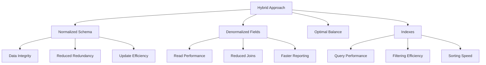
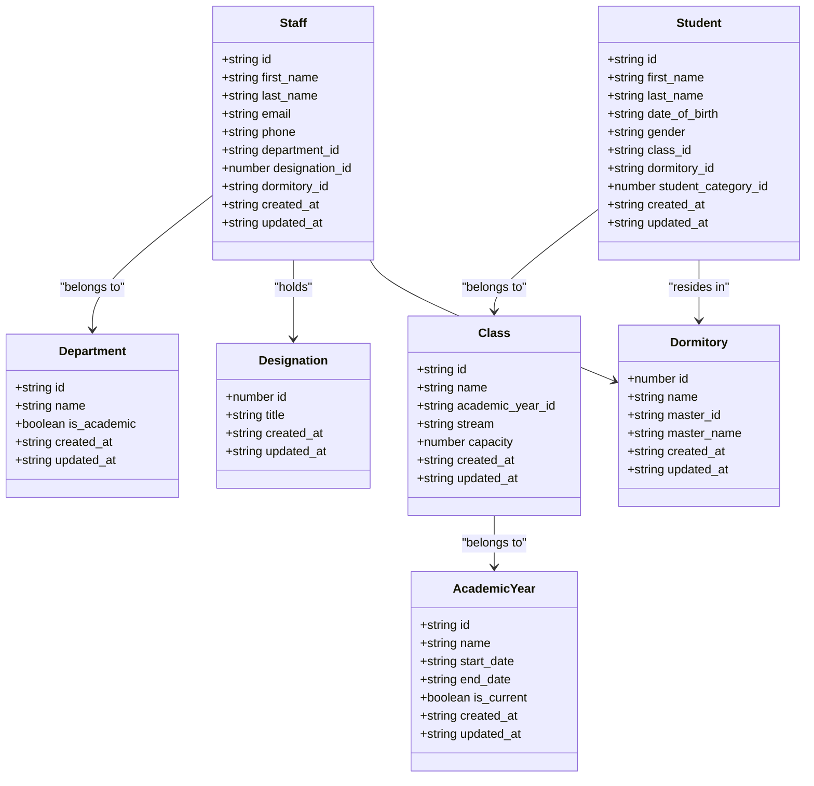
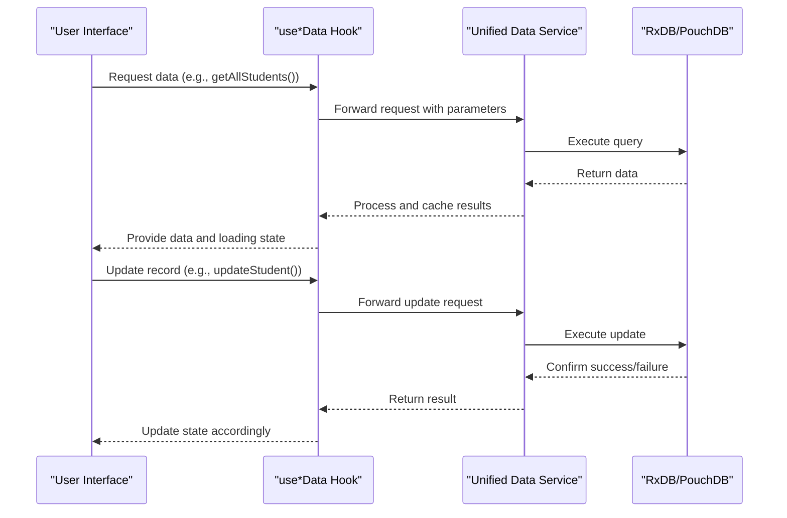

# Administration Data Models

<cite>
**Referenced Files in This Document**   
- [collections.ts](file://src/modules/administration/data/collections.ts)
- [schema.ts](file://src/modules/administration/data/schema.ts)
- [types.ts](file://src/modules/administration/data/types.ts)
</cite>

## Table of Contents
1. [Introduction](#introduction)
2. [Core Entity Relationships](#core-entity-relationships)
3. [Data Model Definitions](#data-model-definitions)
4. [Schema Design and Normalization](#schema-design-and-normalization)
5. [TypeScript Interfaces and Type Safety](#typescript-interfaces-and-type-safety)
6. [Data Access Patterns](#data-access-patterns)
7. [Sample Data Records](#sample-data-records)
8. [Business Rules and Constraints](#business-rules-and-constraints)

## Introduction
This document provides comprehensive documentation for the Administration module data models in schoolpilot3. The module manages core administrative entities including student information, staff details, departments, academic years, classes, dormitories, and designations. The data architecture is designed to support both operational efficiency and analytical capabilities through a normalized structure with strategic denormalization for performance optimization. The implementation uses a database-agnostic schema approach that supports multiple database backends through RxDB and PouchDB services.

**Section sources**
- [schema.ts](file://src/modules/administration/data/schema.ts#L1-L50)
- [types.ts](file://src/modules/administration/data/types.ts#L1-L50)

## Core Entity Relationships
The Administration module implements a relational data model with well-defined relationships between core entities. These relationships support the school's organizational structure and administrative workflows.

```mermaid
erDiagram
STUDENT {
string id PK
string first_name
string last_name
string date_of_birth
string gender
string class_id FK
string dormitory_id FK
string student_category_id FK
}
STAFF {
string id PK
string first_name
string last_name
string email
string phone
string department_id FK
string designation_id FK
string dormitory_id FK
}
DEPARTMENT {
string id PK
string name
boolean is_academic
}
DESIGNATION {
number id PK
string title
}
ACADEMIC_YEAR {
string id PK
string name
string start_date
string end_date
boolean is_current
}
CLASS {
string id PK
string name
string academic_year_id FK
string stream
number capacity
}
DORMITORY {
number id PK
string name
string master_id FK
}
STUDENT_HEALTH_RECORD {
string id PK
string student_id FK
string blood_type
string allergies
string medical_conditions
}
STUDENT_ATTENDANCE {
string id PK
string student_id FK
number period_id FK
string date
string status
}
APPLICATION {
string id PK
string application_number
string academic_year_id FK
string intended_class_id FK
string status
string first_name
string last_name
string date_of_birth
string gender
}
STUDENT ||--o{ STUDENT_HEALTH_RECORD : "has"
STUDENT ||--o{ STUDENT_ATTENDANCE : "has"
STUDENT ||--|| CLASS : "belongs to"
STUDENT ||--|| DORMITORY : "resides in"
STUDENT ||--|| STUDENT_CATEGORY : "categorized as"
STAFF ||--|| DEPARTMENT : "belongs to"
STAFF ||--|| DESIGNATION : "holds"
STAFF ||--|| DORMITORY : "masters"
CLASS ||--|| ACADEMIC_YEAR : "belongs to"
CLASS ||--o{ STUDENT : "contains"
APPLICATION ||--|| ACADEMIC_YEAR : "targets"
APPLICATION ||--|| CLASS : "intends"
APPLICATION ||--o{ APPLICATION_REVIEW : "has"
APPLICATION ||--o{ APPLICATION_DOCUMENT : "has"
APPLICATION ||--o{ APPLICATION_INTERVIEW : "has"
APPLICATION ||--o{ APPLICATION_APPROVAL : "has"
DORMITORY ||--|| STAFF : "mastered by"
DEPARTMENT }o--|| STAFF : "contains"
DESIGNATION }o--|| STAFF : "assigned to"
ACADEMIC_YEAR }o--|| CLASS : "contains"
ACADEMIC_YEAR }o--|| APPLICATION : "contains"
```

**Diagram sources**
- [schema.ts](file://src/modules/administration/data/schema.ts#L1-L484)
- [types.ts](file://src/modules/administration/data/types.ts#L1-L538)

**Section sources**
- [schema.ts](file://src/modules/administration/data/schema.ts#L1-L484)
- [types.ts](file://src/modules/administration/data/types.ts#L1-L538)

## Data Model Definitions
This section details the field definitions, data types, primary/foreign keys, and constraints for each collection in the Administration module.

### Student Entity
The Student entity represents enrolled students in the school system.

**Properties:**
- `id`: Unique identifier (string, primary key)
- `first_name`: Student's first name (string, required)
- `last_name`: Student's last name (string, required)
- `date_of_birth`: Date of birth in ISO format (string, required)
- `gender`: Gender of the student (string, enum: Male, Female, Other, required)
- `class_id`: Reference to the student's current class (string, foreign key)
- `dormitory_id`: Reference to the student's dormitory (string, foreign key)
- `student_category_id`: Reference to the student's category (number, foreign key)
- `created_at`: Record creation timestamp (string, required)
- `updated_at`: Record last update timestamp (string, required)

### Staff Entity
The Staff entity represents teaching and non-teaching personnel.

**Properties:**
- `id`: Unique identifier (string, primary key)
- `first_name`: Staff first name (string, required)
- `last_name`: Staff last name (string, required)
- `email`: Staff email address (string)
- `phone`: Staff phone number (string)
- `department_id`: Reference to the staff's department (string, foreign key)
- `designation_id`: Reference to the staff's designation (number, foreign key)
- `dormitory_id`: Reference to the dormitory the staff masters (string, foreign key)
- `created_at`: Record creation timestamp (string, required)
- `updated_at`: Record last update timestamp (string, required)

### Department Entity
The Department entity represents academic and administrative departments.

**Properties:**
- `id`: Unique identifier (string, primary key)
- `name`: Department name (string, required)
- `is_academic`: Flag indicating if the department is academic (boolean, required)
- `created_at`: Record creation timestamp (string, required)
- `updated_at`: Record last update timestamp (string, required)

### Designation Entity
The Designation entity represents staff positions and roles.

**Properties:**
- `id`: Unique identifier (number, primary key)
- `title`: Designation title (string, required)
- `created_at`: Record creation timestamp (string, required)
- `updated_at`: Record last update timestamp (string, required)

### AcademicYear Entity
The AcademicYear entity represents academic calendar years.

**Properties:**
- `id`: Unique identifier (string, primary key)
- `name`: Academic year name (string, required)
- `start_date`: Start date of the academic year (string, required)
- `end_date`: End date of the academic year (string, required)
- `is_current`: Flag indicating if this is the current academic year (boolean, required)
- `created_at`: Record creation timestamp (string, required)
- `updated_at`: Record last update timestamp (string, required)

### Class Entity
The Class entity represents class groups within an academic year.

**Properties:**
- `id`: Unique identifier (string, primary key)
- `name`: Class name (string, required)
- `academic_year_id`: Reference to the academic year (string, foreign key)
- `stream`: Class stream identifier (string)
- `capacity`: Maximum student capacity (number)
- `created_at`: Record creation timestamp (string, required)
- `updated_at`: Record last update timestamp (string, required)

### Dormitory Entity
The Dormitory entity represents student boarding houses.

**Properties:**
- `id`: Unique identifier (number, primary key)
- `name`: Dormitory name (string, required)
- `master_id`: Reference to the staff member who masters the dormitory (string, foreign key)
- `master_name`: Denormalized master name for performance (string)
- `created_at`: Record creation timestamp (string, required)
- `updated_at`: Record last update timestamp (string, required)

### StudentHealthRecord Entity
The StudentHealthRecord entity stores medical information for students.

**Properties:**
- `id`: Unique identifier (string, primary key)
- `student_id`: Reference to the student (string, foreign key, required)
- `blood_type`: Student's blood type (string)
- `allergies`: Known allergies (string)
- `medical_conditions`: Medical conditions (string)
- `emergency_contact_override`: Emergency contact override information (string)
- `created_at`: Record creation timestamp (string, required)
- `updated_at`: Record last update timestamp (string, required)
- `student_name`: Denormalized student name for performance (string)

### StudentAttendance Entity
The StudentAttendance entity tracks student attendance.

**Properties:**
- `id`: Unique identifier (string, primary key)
- `student_id`: Reference to the student (string, foreign key, required)
- `period_id`: Reference to the timetable period (number, foreign key, required)
- `date`: Attendance date (string, required)
- `status`: Attendance status (string, enum: Present, Absent, Late, Excused, required)
- `reason_for_absence`: Reason for absence (string)
- `created_at`: Record creation timestamp (string, required)
- `student_name`: Denormalized student name for performance (string)
- `period_name`: Denormalized period name for performance (string)

**Section sources**
- [schema.ts](file://src/modules/administration/data/schema.ts#L1-L484)
- [types.ts](file://src/modules/administration/data/types.ts#L1-L538)

## Schema Design and Normalization
The Administration module employs a balanced approach to database normalization, combining normalized structures with strategic denormalization for performance optimization.

### Normalization Strategy
The schema follows third normal form (3NF) principles to eliminate data redundancy and ensure data integrity. Entities are separated based on their functional dependencies, with foreign keys establishing relationships between related entities. This approach ensures that each piece of data is stored in exactly one place, reducing the risk of inconsistencies.

The core entities (Student, Staff, Department, Designation, AcademicYear, Class, Dormitory) are fully normalized, with each entity responsible for a specific domain of information. Relationships between entities are established through foreign key constraints, ensuring referential integrity across the data model.

### Indexing Patterns
The schema implements strategic indexing to optimize query performance for common access patterns:

- **Primary Keys**: All collections have a primary key index on the `id` field for efficient record retrieval
- **Foreign Keys**: Indexes on foreign key fields (e.g., `student_id`, `class_id`, `department_id`) to optimize join operations
- **Frequently Queried Fields**: Indexes on commonly searched fields such as `name`, `status`, and `date`
- **Composite Indexes**: Multi-field indexes for queries that filter on multiple criteria simultaneously

For example, the `student_attendance` collection has indexes on `student_id`, `date`, and `period_id` to support efficient queries for attendance records by student, date range, or specific period.

### Denormalization for Performance
While the schema is primarily normalized, strategic denormalization is employed to optimize read performance for frequently accessed data:

- **Denormalized Names**: Fields like `student_name`, `patron_name`, and `approver_name` are denormalized to avoid expensive join operations when displaying lists or reports
- **Calculated Fields**: Fields like `total_marks` and `mean_grade` in the `pre_nas_marks` collection are pre-calculated to avoid runtime computation
- **Status Flags**: Fields like `is_current` in the `academic_years` collection allow for quick filtering of active records

This hybrid approach balances data integrity with performance requirements, ensuring that the system remains responsive even with large datasets.



**Diagram sources**
- [schema.ts](file://src/modules/administration/data/schema.ts#L1-L484)

**Section sources**
- [schema.ts](file://src/modules/administration/data/schema.ts#L1-L484)

## TypeScript Interfaces and Type Safety
The Administration module leverages TypeScript interfaces to enforce type safety across the application layer.

### Interface Definitions
The `types.ts` file defines comprehensive TypeScript interfaces for all administration entities, ensuring consistent data structures throughout the codebase. These interfaces extend the database schema definitions with additional type information and constraints.

For example, the `Student` interface includes:
- Strict typing for all fields
- Optional field indicators for nullable properties
- Enum types for constrained fields (e.g., gender)
- Timestamp formatting requirements

### Type Enforcement
The interfaces serve multiple purposes:
- **Compile-time validation**: Catch type errors during development
- **Code completion**: Provide IDE support for field names and types
- **Documentation**: Serve as living documentation for data structures
- **Refactoring safety**: Enable safe refactoring across the codebase

The type system also defines enums for controlled vocabularies, such as `AttendanceStatus` and `ApplicationStatus`, preventing invalid values and ensuring consistency across the application.



**Diagram sources**
- [types.ts](file://src/modules/administration/data/types.ts#L1-L538)

**Section sources**
- [types.ts](file://src/modules/administration/data/types.ts#L1-L538)

## Data Access Patterns
The Administration module implements a consistent data access pattern through specialized hooks and a unified data service layer.

### Use Data Hooks
The module provides a series of `use*Data` hooks that abstract data access complexity:

- `useStudentData()`: Manages student records with CRUD operations
- `useStaffData()`: Handles staff information and relationships
- `useAcademicYearData()`: Manages academic year lifecycle
- `useClassData()`: Controls class creation and student assignment
- `useDormitoryData()`: Handles dormitory management and occupancy
- `useStudentAttendanceData()`: Tracks and reports attendance

These hooks encapsulate data fetching, caching, and state management, providing a consistent interface for components to interact with the data layer.

### Unified Data Service
The hooks integrate with a unified data service layer that provides:
- **Consistent API**: Standardized methods for create, read, update, and delete operations
- **Error Handling**: Centralized error handling and retry logic
- **Caching**: Intelligent caching to reduce database load
- **Synchronization**: Support for offline operation and data synchronization

The service layer abstracts the underlying database implementation (RxDB, PouchDB, etc.), allowing the application to switch between storage backends with minimal code changes.



**Diagram sources**
- [collections.ts](file://src/modules/administration/data/collections.ts#L1-L57)
- [schema.ts](file://src/modules/administration/data/schema.ts#L1-L484)

**Section sources**
- [collections.ts](file://src/modules/administration/data/collections.ts#L1-L57)

## Sample Data Records
This section provides example data records for key entities in the Administration module.

### Sample Student Record
```json
{
  "id": "std-001",
  "first_name": "John",
  "last_name": "Doe",
  "date_of_birth": "2008-05-15",
  "gender": "Male",
  "class_id": "cls-2023-01",
  "dormitory_id": 101,
  "student_category_id": 1,
  "created_at": "2023-01-15T08:30:00Z",
  "updated_at": "2023-01-15T08:30:00Z"
}
```

### Sample Staff Record
```json
{
  "id": "stf-001",
  "first_name": "Jane",
  "last_name": "Smith",
  "email": "jane.smith@school.edu",
  "phone": "+254712345678",
  "department_id": "dept-math",
  "designation_id": 5,
  "dormitory_id": 101,
  "created_at": "2022-09-01T08:00:00Z",
  "updated_at": "2022-09-01T08:00:00Z"
}
```

### Sample Academic Year Record
```json
{
  "id": "ay-2023",
  "name": "2023-2024",
  "start_date": "2023-01-15",
  "end_date": "2023-12-15",
  "is_current": true,
  "created_at": "2022-10-01T09:00:00Z",
  "updated_at": "2022-10-01T09:00:00Z"
}
```

### Sample Class Record
```json
{
  "id": "cls-2023-01",
  "name": "Form 1",
  "academic_year_id": "ay-2023",
  "stream": "A",
  "capacity": 40,
  "created_at": "2022-11-01T10:00:00Z",
  "updated_at": "2022-11-01T10:00:00Z"
}
```

### Sample Dormitory Record
```json
{
  "id": 101,
  "name": "Victoria Hall",
  "master_id": "stf-001",
  "master_name": "Jane Smith",
  "created_at": "2020-01-01T08:00:00Z",
  "updated_at": "2020-01-01T08:00:00Z"
}
```

**Section sources**
- [types.ts](file://src/modules/administration/data/types.ts#L1-L538)

## Business Rules and Constraints
The Administration module enforces several business rules to maintain data integrity and support school operations.

### Academic Year Validity
Academic years must have non-overlapping date ranges to prevent scheduling conflicts. The system validates that:
- The start date is before the end date
- No two academic years have overlapping date ranges
- Only one academic year can have `is_current` set to true

When creating a new academic year, the system automatically sets `is_current` to false for all other years.

### Class-Stream Hierarchies
Classes are organized within academic years and may have streams to support differentiated instruction. The system enforces:
- Each class must belong to exactly one academic year
- Stream names within a class must be unique
- Class capacity must be a positive integer
- Student enrollment cannot exceed class capacity

### Data Integrity Constraints
The system enforces referential integrity through foreign key constraints:
- Students must reference existing classes and dormitories
- Staff must reference existing departments and designations
- Attendance records must reference existing students and periods
- Health records must reference existing students

### Validation Rules
The system implements comprehensive validation rules:
- Required fields must be present
- String fields have maximum length constraints
- Numeric fields have appropriate ranges
- Date fields follow ISO format
- Email fields follow standard email format
- Phone numbers follow international format

These business rules are enforced at both the application and database levels to ensure data consistency and reliability across the system.

**Section sources**
- [schema.ts](file://src/modules/administration/data/schema.ts#L1-L484)
- [types.ts](file://src/modules/administration/data/types.ts#L1-L538)